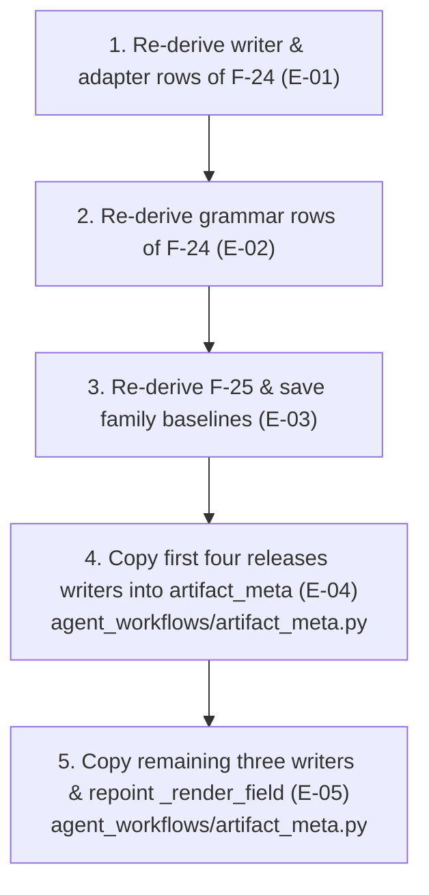

# IPD: Baseline the k6jd6l family and copy the releases value writers into artifact_meta

- Date: 2026-11-09
- Kind: child
- Concern: Spec `4sd62s` C5 allows exactly one metadata reader and writer (`artifact_meta`). Plan `k6jd6l` (Order 43) removes the four groups of metadata code that still live outside it after phase B (value writers, thin adapters, borrowed grammars, record text readers). Research `nj8zdp` guidance (at most 5 E-items, 8 work Scope-Paths, about 8 named units per item) split `k6jd6l` into Orders 280 to 299 plus `k6jd6l` itself as the finishing gate. This first part records the baseline every later part compares against, and copies the seven `releases` value writers into `artifact_meta` so the later parts can retarget callers before the originals are deleted.
- Scope: `k6jd6l` E-01 (baseline, re-derive F-24 and F-25) split into three items, plus the first half of `k6jd6l` E-08 (copy, not yet delete, `releases._in_metadata_region` and the seven `releases.set_*_line` writers into private `artifact_meta` functions and point `artifact_meta._render_field` at them). EXCLUDES: the `backlog` and `research_cmd` writers and the production caller retargets (Order 281), the test retargets (Orders 282 and 283), deleting the originals (Order 284).
- Scope-Paths: agent_workflows/artifact_meta.py, .aw/records/plans/pending/20261109-metastore-280-6bxlzb-baseline-the-k6jd6l-family-and-copy-the-releases-value-write.ipd.md
- Item-Dependencies: executed:1ajqaa, executed:59aiyh, executed:dcerjg, executed:ffceq0, executed:g5hpbb, executed:t4gl15
- Status: approved
- Readiness: go-pending-approval
- Review-Depth: complex
- From-Spec: 4sd62s
- Work-Kind: feature
- Priority: high
- Blocks-Release: next
- Set: metastore
- Order: 280
- Highest E allocated: 05
- Author: opencode its_direct/pt3-claude-opus-5.5-1m-us
- Id: 6bxlzb
- Approval: 2026-11-16, recorded via aw ipd set: status set to approved

> Write and proofread this plan per the technical writing standard, `.aw/system/workflows/technical-writing/technical-writing.md` (`.agents/workflows/technical-writing/technical-writing.md` in a legacy-layout install), including requirement 12 (diagrams).

## Workflow history
- 2026-11-16 approved (aw set): status set to approved

- 2026-11-14 reviewed (antigravity): plan-review verified E/V bijection, Scope-Paths, baseline rules, and execution gate; marked reviewed and go-pending-approval.
- 2026-11-09 to-review (opencode its_direct/pt3-claude-opus-5.5-1m-us): split from k6jd6l (round 3, research nj8zdp guidance).

## Goal

The family baseline is saved and F-24 and F-25 list every live caller with its owning plan, and `artifact_meta` holds private copies of the seven `releases` value writers that `artifact_meta._render_field` now calls, so the remaining parts can retarget callers one module at a time.

## Detailed Implementation Checklist (TODO)

Execution-state rule: mark an `E-*` item complete only after performing the action. That mark is not validation. Right-sizing rule: write for a modest executor that cannot hold much in its head. Each E-item is one step (one concern, about one file, executable in one focused pass) and its V-item names each unit it covers with its own check; a plan stays at about 5 E-items and 8 work Scope-Paths, else split it into more child plans (guidance, `IPD-Z603`). Accepted execution states: blocked, failed, pending, performed; terminal gate demands 'performed'.

`k6jd6l` E-01 is carried here split into three items (writers and adapters, grammars, readers, then the saved outputs); `k6jd6l` E-08's copy step is carried as E-04 and E-05. The owning plan named in F-24 and F-25 is one of the id6 values listed in this plan's Findings table F-30.

### Task group 1: baseline, then copy the releases writers

- [ ] E-01 Before any edit, re-derive the writer and adapter half of F-24: run `rg -n "def set_[a-z_]+_line|def _in_metadata_region|def _set_priority_line|set_[a-z_]+_line\(|_set_priority_line\(" agent_workflows tools` and `rg -n "_set_metadata\b|_update_frontmatter_metadata|_update_or_inject_set_metadata|render_metadata_comment|rederive_front_matter" agent_workflows tools tests`, and add one row per non-comment hit to this plan's F-24 table with its owning plan from F-30 (a hit a phase-B plan already moved is listed `moved`).
  - Depends on: none
  - Expected outcome: F-24 has one row per live writer or adapter hit, each with an owner.
  - Execution state: pending

- [ ] E-02 Re-derive the grammar half of F-24: run `rg -n "parse_metadata_block|parse_frontmatter\b|_parse_metadata_comment|history_block\b|last_history_at\b|newest_history_record\b|SPEC_STATUS_RE" agent_workflows tools tests` and add one row per non-comment hit to F-24 with its owner from F-30; a live hit in a module F-30 assigns to no plan is recorded as `delete (follow-on)` and reported (as `9o83cr` OQ-03 prescribed).
  - Depends on: E-01
  - Expected outcome: F-24 has one row per live grammar hit, each with an owner or `delete (follow-on)`.
  - Execution state: pending

- [ ] E-03 Re-derive F-25 the same way for each record text reader symbol of `k6jd6l` E-11 and E-18 (the subset-1 and subset-2 lists in F-30), with one `rg -n "\b<symbol>\b" agent_workflows tools tests` per symbol; then save the bare core gate summary line to `.aw/state/k6jd6l/core-before.txt`, and to `.aw/state/k6jd6l/before/` the stdout of `aw find plans --agent`, `aw attention --format json` and the rule-id multiset of `aw check all --all --agent` (`jq -r '.diagnostics[].rule' | sort | uniq -c`).
  - Depends on: E-02
  - Expected outcome: F-25 lists every live reader reference with an owner and the four baselines are saved.
  - Execution state: pending

- [ ] E-04 In `agent_workflows/artifact_meta.py`, add private copies, with unchanged behavior, of `releases._in_metadata_region`, `releases.set_blocks_release_line`, `releases.set_priority_line` and `releases.set_work_kind_line` (for example `_legacy_set_blocks_release_line`), keeping each docstring's behavior notes. Do not delete or change the originals yet.
  - Depends on: E-03
  - Expected outcome: the four private copies exist; the originals are untouched.
  - Execution state: pending

- [ ] E-05 In `agent_workflows/artifact_meta.py`, add private copies of `releases.set_from_backlog_line`, `releases.set_from_spec_line`, `releases.set_item_dependencies_line` and `releases.set_graduated_to_line`, then point the seven `releases` entries of the `writers` map in `artifact_meta._render_field` at the private copies; run `tests/test_artifact_meta_legacy.py` and `tests/test_releases_line_writers.py`.
  - Depends on: E-04
  - Expected outcome: `artifact_meta._render_field` calls no `releases` writer; both test modules pass.
  - Execution state: pending

## Project conventions discovered (Step 0)

- `artifact_meta.append_legacy` and `artifact_meta._render_field` call the pure value writers today (`releases.set_*_line`, `backlog.set_*_line`), which is why the fold target is the legacy writer.
- The baseline directory stays `.aw/state/k6jd6l/` for the whole family so every part and the finishing gate compare against one baseline.
- The `artifact_meta` interface (names from `tve77h`, `ffceq0`, `xexn45`): `read(id6) -> State`, `history(id6)`, `read_at(id6, rev)`, `read_text(text, *, record_type=None) -> State`, `append(id6, events, *, expect_seq)` with `dry_run`, the phase-B legacy writer (`append_legacy`, `render_legacy`), and the legacy loader (`load_legacy_artifact`).
- Cite code by SYMBOL (`module.function`) or by a quoted content string, with a line number only appended to one of those and never alone (advisory `IPD-C801`).

## Findings

Measured 2026-11-09 at `f83159217` with the `rg` commands of E-01 to E-03 before any phase-B plan in this family's dependencies had executed in the checkout, so the counts are an upper bound; E-01 to E-03 re-derive them.

| Id | Evidence | Finding |
|---|---|---|
| F-24 | Writers, adapters and grammars, re-derived by E-01 and E-02. | Written by E-01 and E-02. |
| F-25 | Record text readers, re-derived by E-03. | Written by E-03. |
| F-30 | Owners: value writers 280 (`6bxlzb`), 281 (`h1kfyp`), 282 (`tfvby1`), 283 (`6v4uao`), 284 (`zs7a45`); adapters 285 (`v0ucnz`), 286 (`8fxic1`); `parse_metadata_block` and `_parse_metadata_comment` 287 (`ad86ym`); `parse_frontmatter` 288 (`sq6v7i`), 289 (`5lgpix`), 290 (`bxupy8`); `history_block`, `last_history_at`, `newest_history_record` and `SPEC_STATUS_RE` 290, 291 (`ay6sxp`), 292 (`csobg7`); subset 1 (`selectors._ID_RE`, `_STATUS_RE`, `_SET_RE`, `read_front_matter_id`, `read_front_matter_status`, `read_front_matter_blocks_release`, `metadata_region`; `plans._STATUS_RE`, `_SET_RE`, `_ORDER_RE`, `plans.read_status`; `prompts._METADATA_STATUS_RE`, `read_metadata_id6`, `read_metadata_status`; `attention._frontmatter_block`) 293 (`71ewpn`), 294 (`8ysz6b`), 295 (`iup4lp`), 296 (`hrbbhy`); subset 2 (`specs._read_status`, `_read_gate`, `_read_blocks_release`, `_read_priority`, `_read_work_kind`, `_read_scope`, `_read_summary`; the metadata part of `backlog.parse_item`) 297 (`um2kvx`), 298 (`po3o1c`), 299 (`vw88h0`). | Each hit gets one owner. |
| F-31 | `rg -n "set_[a-z_]+_line" agent_workflows/artifact_meta.py`: `artifact_meta._render_field` maps nine fields to `releases` and `backlog` writers and calls `backlog.set_close_evidence_line`. | E-04 and E-05 copy the `releases` half; Order 281 the `backlog` half. |

## Proposed changes (ordered, validatable)

1. Re-derive the writer and adapter rows of F-24 (E-01).
2. Re-derive the grammar rows of F-24 (E-02).
3. Re-derive F-25 and save the baselines (E-03).
4. Copy four `releases` writers (E-04).
5. Copy the other three and repoint `_render_field` (E-05).

## Deferred / out of scope (with reason)

- The rest of `k6jd6l` E-08 (backlog and research writers, caller and test retargets, deleting the originals).
  - Carrier: h1kfyp
- The finishing gate (`k6jd6l` E-17).
  - Carrier: k6jd6l

## Scope check

- Over-scope: none.
- Under-scope: none known; E-01 to E-03 catch residue. Size: 5 E-items, 1 work Scope-Paths.

## Required tests / validation

`tests/test_artifact_meta_legacy.py` and `tests/test_releases_line_writers.py` (E-05); the bare core gate line is recorded as the family baseline (E-03).

## Spec / documentation sync

No spec change; implements part of `4sd62s` 4.3 and section 7 step 7. CONTRIBUTES to AC-1 (owned by `9o83cr`).

## Open questions

### OQ-01: Why copy before deleting?

- Blocking: no
- Status: resolved
- Owner: plan author
- Resolution or deferral rationale: So that each later part changes one module and leaves the suite green: callers and tests are retargeted (Orders 281 to 283) while the originals still exist, and Order 284 deletes them. Recommendation strength: strong.

## Validation and cross-check (verify before reporting done)

Validation-state rule: inspect evidence in a separate pass. Do not mark a `V-*` item complete from memory or from the matching execution checkmark. Accepted validation results: blocked, failed, pass, pending; terminal gate demands 'pass'. Runtime-demonstration reachability rule: for each `V-*` item demanding the software be observed acting (such as a run, a dispatch, or a transition), as distinct from items demanding a diff, a file's content, or a test result, which are reachable by construction, name the code path that produces the observation or the sibling `E-*` that creates it, else the demand is UNDER-SCOPE.

- [ ] V-01 validates E-01
  - Required evidence: paste both `rg` commands with their hit counts and the F-24 rows they produced, each row naming its owner id6.
  - Observed evidence:
  - Result: pending

- [ ] V-02 validates E-02
  - Required evidence: paste the `rg` command with its hit count and the grammar rows of F-24, each naming its owner id6 or `delete (follow-on)`.
  - Observed evidence:
  - Result: pending

- [ ] V-03 validates E-03
  - Required evidence: paste the per-symbol hit counts, the F-25 rows, the content of `.aw/state/k6jd6l/core-before.txt` and the listing `ls -l .aw/state/k6jd6l/before/` showing three non-empty files.
  - Observed evidence:
  - Result: pending

- [ ] V-04 validates E-04
  - Required evidence: paste `rg -n "def _legacy_(in_metadata_region|set_(blocks_release|priority|work_kind)_line)" agent_workflows/artifact_meta.py` with four hits, and `git diff --stat agent_workflows/releases.py` empty.
  - Observed evidence:
  - Result: pending

- [ ] V-05 validates E-05
  - Required evidence: paste `rg -n "_releases\.set_" agent_workflows/artifact_meta.py` printing nothing, `rg -n "def _legacy_set_(from_backlog|from_spec|item_dependencies|graduated_to)_line" agent_workflows/artifact_meta.py` with four hits, and the per-module pass counts of `python3 -m pytest -o addopts="" -rA tests/test_artifact_meta_legacy.py tests/test_releases_line_writers.py`.
  - Observed evidence:
  - Result: pending

## Approval and execution gate

- Size assessment: standard
- Cohesion rationale: not required

Execute only after human approval (`Status: approved`) and after every plan in `- Item-Dependencies:` is executed. Pin-first where an item deletes or retargets. Scope fence: the paths in `- Scope-Paths:` are a declaration; a needed file outside the fence is edited and then justified at finalize (`--scope-reason`), and a declared path left unmodified is acknowledged (`--scope-ack`). Honesty rule: paste the ACTUAL output; never claim a result you did not run. Commits: only through `aw commit 6bxlzb -- <paths>` with only Scope-Paths files; never `git add -A`, a bare `git add` or `git commit -a`; never push. Lifecycle: the plan moves to `.aw/records/plans/executed/` only through `aw ipd finalize`, never a hand `git mv`, after `aw ipd lint --phase pre-transition` conforms and every `V-*` reads `pass` with pasted evidence. When `aw oc run` or `aw agy run` executes the plan, the runner performs the finalize; a hand executor runs `aw ipd finalize 6bxlzb` itself.
