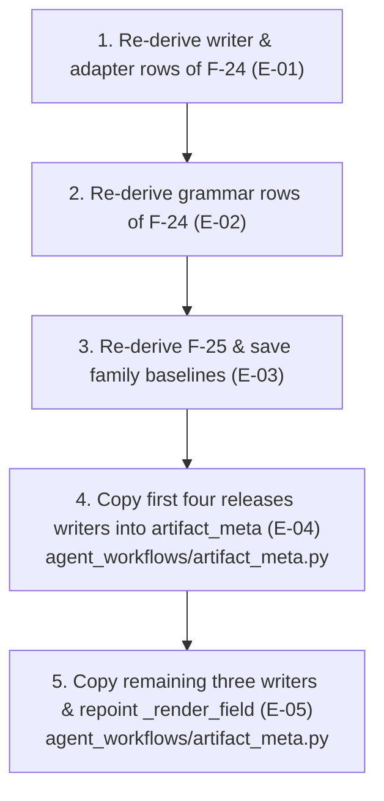

# IPD: Baseline the k6jd6l family and copy the releases value writers into artifact_meta

- Date: 2026-11-09
- Kind: child
- Concern: Spec `4sd62s` C5 allows exactly one metadata reader and writer (`artifact_meta`). Plan `k6jd6l` (Order 43) removes the four groups of metadata code that still live outside it after phase B (value writers, thin adapters, borrowed grammars, record text readers). Research `nj8zdp` guidance (at most 5 E-items, 8 work Scope-Paths, about 8 named units per item) split `k6jd6l` into Orders 280 to 299 plus `k6jd6l` itself as the finishing gate. This first part records the baseline every later part compares against, and copies the seven `releases` value writers into `artifact_meta` so the later parts can retarget callers before the originals are deleted.
- Scope: `k6jd6l` E-01 (baseline, re-derive F-24 and F-25) split into three items, plus the first half of `k6jd6l` E-08 (copy, not yet delete, `releases._in_metadata_region` and the seven `releases.set_*_line` writers into private `artifact_meta` functions and point `artifact_meta._render_field` at them). EXCLUDES: the `backlog` and `research_cmd` writers and the production caller retargets (Order 281), the test retargets (Orders 282 and 283), deleting the originals (Order 284).
- Scope-Paths: agent_workflows/artifact_meta.py, .aw/records/plans/pending/20261109-metastore-280-6bxlzb-baseline-the-k6jd6l-family-and-copy-the-releases-value-write.ipd.md
- Item-Dependencies: executed:1ajqaa, executed:59aiyh, executed:dcerjg, executed:ffceq0, executed:g5hpbb, executed:t4gl15
- Status: approved
- Readiness: go-pending-approval
- Review-Depth: complex
- From-Spec: 4sd62s
- Work-Kind: feature
- Priority: high
- Blocks-Release: next
- Set: metastore
- Order: 280
- Highest E allocated: 05
- Author: opencode its_direct/pt3-claude-opus-5.5-1m-us
- Id: 6bxlzb
- Approval: 2026-11-16, recorded via aw ipd set: status set to approved

> Write and proofread this plan per the technical writing standard, `.aw/system/workflows/technical-writing/technical-writing.md` (`.agents/workflows/technical-writing/technical-writing.md` in a legacy-layout install), including requirement 12 (diagrams).

## Workflow history
- 2026-11-16 approved (aw set): status set to approved

- 2026-11-14 reviewed (antigravity): plan-review verified E/V bijection, Scope-Paths, baseline rules, and execution gate; marked reviewed and go-pending-approval.
- 2026-11-09 to-review (opencode its_direct/pt3-claude-opus-5.5-1m-us): split from k6jd6l (round 3, research nj8zdp guidance).

## Goal

The family baseline is saved and F-24 and F-25 list every live caller with its owning plan, and `artifact_meta` holds private copies of the seven `releases` value writers that `artifact_meta._render_field` now calls, so the remaining parts can retarget callers one module at a time.

## Detailed Implementation Checklist (TODO)

Execution-state rule: mark an `E-*` item complete only after performing the action. That mark is not validation. Right-sizing rule: write for a modest executor that cannot hold much in its head. Each E-item is one step (one concern, about one file, executable in one focused pass) and its V-item names each unit it covers with its own check; a plan stays at about 5 E-items and 8 work Scope-Paths, else split it into more child plans (guidance, `IPD-Z603`). Accepted execution states: blocked, failed, pending, performed; terminal gate demands 'performed'.

`k6jd6l` E-01 is carried here split into three items (writers and adapters, grammars, readers, then the saved outputs); `k6jd6l` E-08's copy step is carried as E-04 and E-05. The owning plan named in F-24 and F-25 is one of the id6 values listed in this plan's Findings table F-30.

### Task group 1: baseline, then copy the releases writers

- [x] E-01 Before any edit, re-derive the writer and adapter half of F-24: run `rg -n "def set_[a-z_]+_line|def _in_metadata_region|def _set_priority_line|set_[a-z_]+_line\(|_set_priority_line\(" agent_workflows tools` and `rg -n "_set_metadata\b|_update_frontmatter_metadata|_update_or_inject_set_metadata|render_metadata_comment|rederive_front_matter" agent_workflows tools tests`, and add one row per non-comment hit to this plan's F-24 table with its owning plan from F-30 (a hit a phase-B plan already moved is listed `moved`).
  - Depends on: none
  - Expected outcome: F-24 has one row per live writer or adapter hit, each with an owner.
  - Execution state: performed

- [x] E-02 Re-derive the grammar half of F-24: run `rg -n "parse_metadata_block|parse_frontmatter\b|_parse_metadata_comment|history_block\b|last_history_at\b|newest_history_record\b|SPEC_STATUS_RE" agent_workflows tools tests` and add one row per non-comment hit to F-24 with its owner from F-30; a live hit in a module F-30 assigns to no plan is recorded as `delete (follow-on)` and reported (as `9o83cr` OQ-03 prescribed).
  - Depends on: E-01
  - Expected outcome: F-24 has one row per live grammar hit, each with an owner or `delete (follow-on)`.
  - Execution state: performed

- [x] E-03 Re-derive F-25 the same way for each record text reader symbol of `k6jd6l` E-11 and E-18 (the subset-1 and subset-2 lists in F-30), with one `rg -n "\b<symbol>\b" agent_workflows tools tests` per symbol; then save the bare core gate summary line to `.aw/state/k6jd6l/core-before.txt`, and to `.aw/state/k6jd6l/before/` the stdout of `aw find plans --agent`, `aw attention --format json` and the rule-id multiset of `aw check all --all --agent` (`jq -r '.diagnostics[].rule' | sort | uniq -c`).
  - Depends on: E-02
  - Expected outcome: F-25 lists every live reader reference with an owner and the four baselines are saved.
  - Execution state: performed

- [x] E-04 In `agent_workflows/artifact_meta.py`, add private copies, with unchanged behavior, of `releases._in_metadata_region`, `releases.set_blocks_release_line`, `releases.set_priority_line` and `releases.set_work_kind_line` (for example `_legacy_set_blocks_release_line`), keeping each docstring's behavior notes. Do not delete or change the originals yet.
  - Depends on: E-03
  - Expected outcome: the four private copies exist; the originals are untouched.
  - Execution state: performed

- [x] E-05 In `agent_workflows/artifact_meta.py`, add private copies of `releases.set_from_backlog_line`, `releases.set_from_spec_line`, `releases.set_item_dependencies_line` and `releases.set_graduated_to_line`, then point the seven `releases` entries of the `writers` map in `artifact_meta._render_field` at the private copies; run `tests/test_artifact_meta_legacy.py` and `tests/test_releases_line_writers.py`.
  - Depends on: E-04
  - Expected outcome: `artifact_meta._render_field` calls no `releases` writer; both test modules pass.
  - Execution state: performed

## Project conventions discovered (Step 0)

- `artifact_meta.append_legacy` and `artifact_meta._render_field` call the pure value writers today (`releases.set_*_line`, `backlog.set_*_line`), which is why the fold target is the legacy writer.
- The baseline directory stays `.aw/state/k6jd6l/` for the whole family so every part and the finishing gate compare against one baseline.
- The `artifact_meta` interface (names from `tve77h`, `ffceq0`, `xexn45`): `read(id6) -> State`, `history(id6)`, `read_at(id6, rev)`, `read_text(text, *, record_type=None) -> State`, `append(id6, events, *, expect_seq)` with `dry_run`, the phase-B legacy writer (`append_legacy`, `render_legacy`), and the legacy loader (`load_legacy_artifact`).
- Cite code by SYMBOL (`module.function`) or by a quoted content string, with a line number only appended to one of those and never alone (advisory `IPD-C801`).

## Findings

Measured 2026-11-09 at `f83159217` with the `rg` commands of E-01 to E-03 before any phase-B plan in this family's dependencies had executed in the checkout, so the counts are an upper bound; E-01 to E-03 re-derive them.

| Id | Evidence | Finding |
|---|---|---|
| F-24 | Writers, adapters and grammars, re-derived by E-01 and E-02 on 2026-11-23 at `470e81220`. | 40 writer and adapter rows and 113 grammar rows, listed below; 12 grammar hits in modules no F-30 plan names are `delete (follow-on)`. |
| F-25 | Record text readers, re-derived by E-03 on 2026-11-23 at `470e81220`. | 136 reader rows, listed below; 21 are in modules no F-30 plan names and are `delete (follow-on)`. |
| F-30 | Owners: value writers 280 (`6bxlzb`), 281 (`h1kfyp`), 282 (`tfvby1`), 283 (`6v4uao`), 284 (`zs7a45`); adapters 285 (`v0ucnz`), 286 (`8fxic1`); `parse_metadata_block` and `_parse_metadata_comment` 287 (`ad86ym`); `parse_frontmatter` 288 (`sq6v7i`), 289 (`5lgpix`), 290 (`bxupy8`); `history_block`, `last_history_at`, `newest_history_record` and `SPEC_STATUS_RE` 290, 291 (`ay6sxp`), 292 (`csobg7`); subset 1 (`selectors._ID_RE`, `_STATUS_RE`, `_SET_RE`, `read_front_matter_id`, `read_front_matter_status`, `read_front_matter_blocks_release`, `metadata_region`; `plans._STATUS_RE`, `_SET_RE`, `_ORDER_RE`, `plans.read_status`; `prompts._METADATA_STATUS_RE`, `read_metadata_id6`, `read_metadata_status`; `attention._frontmatter_block`) 293 (`71ewpn`), 294 (`8ysz6b`), 295 (`iup4lp`), 296 (`hrbbhy`); subset 2 (`specs._read_status`, `_read_gate`, `_read_blocks_release`, `_read_priority`, `_read_work_kind`, `_read_scope`, `_read_summary`; the metadata part of `backlog.parse_item`) 297 (`um2kvx`), 298 (`po3o1c`), 299 (`vw88h0`). | Each hit gets one owner. |
| F-31 | `rg -n "set_[a-z_]+_line" agent_workflows/artifact_meta.py`: `artifact_meta._render_field` maps nine fields to `releases` and `backlog` writers and calls `backlog.set_close_evidence_line`. | E-04 and E-05 copy the `releases` half; Order 281 the `backlog` half. |

### F-24 rows (E-01, writers and adapters)

Each row is one non-comment hit of the two E-01 searches at the E-01 baseline, with the plan from F-30 that removes or retargets it. `moved` means the hit is already the `artifact_meta` writer.

| Enclosing symbol | Hit (rg output) | Symbol | Owner |
|---|---|---|---|
| `backlog.set_release_exempt_kind_line` | agent_workflows/backlog.py line 939 | `set_release_exempt_kind_line` | h1kfyp (copy), zs7a45 (delete) |
| `backlog.set_release_exempt_ref_line` | agent_workflows/backlog.py line 955 | `set_release_exempt_ref_line` | h1kfyp (copy), zs7a45 (delete) |
| `backlog.set_close_evidence_line` | agent_workflows/backlog.py line 974 | `set_close_evidence_line` | h1kfyp (copy), zs7a45 (delete) |
| `releases._set_bullet_via_meta` | agent_workflows/releases.py line 197 | `set_legacy_bullet_line` | zs7a45 (dies with `releases._set_bullet_via_meta`, see the note below) |
| `releases.set_blocks_release_line` | agent_workflows/releases.py line 200 | `set_blocks_release_line` | 6bxlzb (copy E-04/E-05), zs7a45 (delete) |
| `releases.set_priority_line` | agent_workflows/releases.py line 539 | `set_priority_line` | 6bxlzb (copy E-04/E-05), zs7a45 (delete) |
| `releases.set_work_kind_line` | agent_workflows/releases.py line 549 | `set_work_kind_line` | 6bxlzb (copy E-04/E-05), zs7a45 (delete) |
| `releases.set_from_backlog_line` | agent_workflows/releases.py line 562 | `set_from_backlog_line` | 6bxlzb (copy E-04/E-05), zs7a45 (delete) |
| `releases.set_from_spec_line` | agent_workflows/releases.py line 572 | `set_from_spec_line` | 6bxlzb (copy E-04/E-05), zs7a45 (delete) |
| `releases.set_item_dependencies_line` | agent_workflows/releases.py line 582 | `set_item_dependencies_line` | 6bxlzb (copy E-04/E-05), zs7a45 (delete) |
| `releases.set_graduated_to_line` | agent_workflows/releases.py line 662 | `set_graduated_to_line` | 6bxlzb (copy E-04/E-05), zs7a45 (delete) |
| `research_cmd._set_priority_line` | agent_workflows/research_cmd.py line 995 | `_set_priority_line` | h1kfyp (copy), zs7a45 (delete) |
| `status_set.run_set_command` | agent_workflows/status_set.py line 3545 | `set_priority_line` | h1kfyp |
| `status_set.run_set_command` | agent_workflows/status_set.py line 3549 | `set_work_kind_line` | h1kfyp |
| `status_set.run_set_command` | agent_workflows/status_set.py line 3556 | `set_blocks_release_line` | h1kfyp |
| `status_set.run_set_command` | agent_workflows/status_set.py line 3583 | `set_blocks_release_line` | h1kfyp |
| `artifact_meta.set_legacy_bullet_line` | agent_workflows/artifact_meta.py line 6446 | `set_legacy_bullet_line` | moved (already the `artifact_meta` writer) |
| `artifact_meta._render_create_fields` | agent_workflows/artifact_meta.py line 7153 | `set_legacy_bullet_line` | moved (already the `artifact_meta` writer) |
| `artifact_meta._render_field` | agent_workflows/artifact_meta.py line 7180 | `set_close_evidence_line` | h1kfyp (F-31 backlog half) |
| `artifact_rename._update_frontmatter_metadata` | agent_workflows/artifact_rename.py line 293 | `_update_frontmatter_metadata` | v0ucnz |
| `artifact_rename._update_or_inject_set_metadata` | agent_workflows/artifact_rename.py line 619 | `_update_or_inject_set_metadata` | v0ucnz |
| `artifact_rename.run_rename_generic` | agent_workflows/artifact_rename.py line 1141 | `_update_frontmatter_metadata` | v0ucnz |
| `artifact_rename.run_group_generic` | agent_workflows/artifact_rename.py line 1508 | `_update_or_inject_set_metadata` | v0ucnz |
| `artifact_rename.run_group_generic` | agent_workflows/artifact_rename.py line 1601 | `_update_or_inject_set_metadata` | v0ucnz |
| `prompts.render_metadata_comment` | agent_workflows/prompts.py line 267 | `render_metadata_comment` | 8fxic1 |
| `plans_refs._set_metadata` | agent_workflows/plans_refs.py line 119 | `_set_metadata` | v0ucnz |
| `tests.test_spec_id6_filenames.TestToId6DatedLegacyNames.test_a_spec_still_gets_its_bullet` | tests/test_spec_id6_filenames.py line 471 | `_update_frontmatter_metadata` | v0ucnz |
| `tests.test_records_only_lane_rederive.test_rederivation_keeps_the_target_status_and_adds_both_keys` | tests/test_records_only_lane_rederive.py line 455 | `rederive_front_matter` | 8fxic1 |
| `tests.test_records_only_lane_rederive.test_the_anti_revert_control_holds_on_the_shipped_allow_list` | tests/test_records_only_lane_rederive.py line 617 | `rederive_front_matter` | 8fxic1 |
| `tests.test_records_only_lane_rederive.test_the_anti_revert_control_FAILS_when_rederivation_is_widened_to_status` | tests/test_records_only_lane_rederive.py line 669 | `rederive_front_matter` | 8fxic1 |
| `tests.test_records_only_lane_rederive.test_the_writer_refuses_every_gate_or_attestation_key_even_if_classified` | tests/test_records_only_lane_rederive.py line 690 | `rederive_front_matter` | 8fxic1 |
| `tests.test_records_only_lane_rederive.test_the_writer_refuses_a_path_it_did_not_positively_classify` | tests/test_records_only_lane_rederive.py line 701 | `rederive_front_matter` | 8fxic1 |
| `tests.test_writers_create_summary.test_prompts_render_metadata_comment_optional_short_description` | tests/test_writers_create_summary.py line 1472 | `render_metadata_comment` | 8fxic1 (outside its Scope-Paths; its V-06 search covers `tests`, so it needs `--scope-reason`) |
| `tests.test_writers_create_summary.test_prompts_render_metadata_comment_optional_short_description` | tests/test_writers_create_summary.py line 1484 | `render_metadata_comment` | 8fxic1 (outside its Scope-Paths; its V-06 search covers `tests`, so it needs `--scope-reason`) |
| `tests.test_plans_order_grammar (module level)` | tests/test_plans_order_grammar.py line 22 | `_set_metadata` | v0ucnz |
| `tests.test_plans_order_grammar.test_set_metadata_substitutes_negative_order_in_place` | tests/test_plans_order_grammar.py line 430 | `_set_metadata` | v0ucnz |
| `tests.test_plans_order_grammar.test_set_metadata_raises_on_unmatchable_order_line` | tests/test_plans_order_grammar.py line 447 | `_set_metadata` | v0ucnz |
| `runner_shared.rederive_front_matter` | agent_workflows/runner_shared.py line 6111 | `rederive_front_matter` | 8fxic1 |
| `runner_shared.apply_records_only_rederivation` | agent_workflows/runner_shared.py line 6376 | `rederive_front_matter` | 8fxic1 |
| `tests.test_prompts_set_surface.TestPromptsSetSurface.create_conforming_prompt` | tests/test_prompts_set_surface.py line 58 | `render_metadata_comment` | 8fxic1 |

Note on the `releases` rows (measured 2026-11-23 at `470e81220`): plan `3466h8` (commit `135a585b2`) already replaced `releases._in_metadata_region` with `releases._set_bullet_via_meta`, which delegates to `artifact_meta.set_legacy_bullet_line`, and it already changed `artifact_meta._render_field` to call `set_legacy_bullet_line` directly for the seven `releases` fields. So F-31's "maps nine fields to `releases` and `backlog` writers" is stale for the `releases` half: before E-05, `rg -n "_releases\.set_" agent_workflows/artifact_meta.py` already printed nothing. E-04 therefore copies `releases._set_bullet_via_meta` (the successor of `_in_metadata_region`) as `artifact_meta._legacy_in_metadata_region`, and E-05 routes `_render_field` through the seven named private copies, so Order 284 (`zs7a45`) can delete the originals with every behavior already owned by `artifact_meta`. The `releases._set_bullet_via_meta` row is listed for `zs7a45` because it has no caller once the seven writers are deleted.

### F-24 rows (E-02, borrowed grammars)

Each row is one non-comment hit of the E-02 search that references the grammar symbol itself (hits on a same-named dataclass field, keyword argument or local, such as `AttentionItem.last_history_at`, are not references and are omitted). `delete (follow-on)` marks a live hit in a module that no F-30 plan's Scope-Paths names.

| Enclosing symbol | Hit (rg output) | Symbol | Owner |
|---|---|---|---|
| `artifact_adopt.apply_adoption` | agent_workflows/artifact_adopt.py line 954 | `parse_frontmatter` | delete (follow-on) |
| `tests.test_selector_two_dialect_readers.YamlKeyLookupCaseSensitivityTests.test_case_sensitivity_is_lookup_not_parser_failure` | tests/test_selector_two_dialect_readers.py line 195 | `parse_frontmatter` | 5lgpix |
| `plan_readiness (module level)` | agent_workflows/plan_readiness.py line 84 | `history_block` | ay6sxp |
| `plan_readiness (module level)` | agent_workflows/plan_readiness.py line 85 | `newest_history_record` | ay6sxp |
| `plan_readiness.extract_newest_history_entry` | agent_workflows/plan_readiness.py line 290 | `history_block` | ay6sxp |
| `plan_readiness.history_has_review_record` | agent_workflows/plan_readiness.py line 582 | `history_block` | ay6sxp |
| `plan_readiness.newest_verdict` | agent_workflows/plan_readiness.py line 621 | `history_block` | ay6sxp |
| `review_sequence.count_verdict_bearing_entries` | agent_workflows/review_sequence.py line 569 | `history_block` | ay6sxp |
| `prompts_index._parse_metadata_comment` | agent_workflows/prompts_index.py line 49 | `_parse_metadata_comment` | ad86ym |
| `specs._find_status_index` | agent_workflows/specs.py line 77 | `SPEC_STATUS_RE` | csobg7 |
| `specs._read_status` | agent_workflows/specs.py line 86 | `SPEC_STATUS_RE` | csobg7 |
| `backlog.validate_item` | agent_workflows/backlog.py line 634 | `history_block` | ay6sxp |
| `backlog._strip_metadata_and_history` | agent_workflows/backlog.py line 1620 | `history_block` | ay6sxp |
| `backlog._prior_history_records` | agent_workflows/backlog.py line 1639 | `history_block` | ay6sxp |
| `backlog._reattach_history` | agent_workflows/backlog.py line 1660 | `history_block` | ay6sxp |
| `ipd_schema.parse_metadata_block` | agent_workflows/ipd_schema.py line 421 | `parse_metadata_block` | ad86ym |
| `status_set.same_status_message_is_duplicate` | agent_workflows/status_set.py line 1326 | `history_block` | ay6sxp |
| `releases._declared_blocks_release` | agent_workflows/releases.py line 522 | `parse_frontmatter` | sq6v7i |
| `research_cmd._write_planned_research_file` | agent_workflows/research_cmd.py line 579 | `parse_frontmatter` | delete (follow-on) |
| `attention._last_history_at_for_state` | agent_workflows/attention.py line 321 | `last_history_at` | csobg7 |
| `attention._last_history_at_for_state` | agent_workflows/attention.py line 324 | `last_history_at` | csobg7 |
| `attention_contract (module level)` | agent_workflows/attention_contract.py line 494 | `SPEC_STATUS_RE` | csobg7 |
| `attention_contract.history_block` | agent_workflows/attention_contract.py line 829 | `history_block` | csobg7 |
| `attention_contract.newest_history_record` | agent_workflows/attention_contract.py line 931 | `newest_history_record` | csobg7 |
| `attention_contract.last_history_at` | agent_workflows/attention_contract.py line 971 | `last_history_at` | csobg7 |
| `attention_contract.last_history_at` | agent_workflows/attention_contract.py line 994 | `newest_history_record` | csobg7 |
| `attention_contract.last_history_at` | agent_workflows/attention_contract.py line 1012 | `newest_history_record` | csobg7 |
| `artifact_meta._parse_bullet_metadata_with_loose` | agent_workflows/artifact_meta.py line 2646 | `history_block` | bxupy8 |
| `artifact_meta.load_legacy_artifact` | agent_workflows/artifact_meta.py line 3001 | `history_block` | bxupy8 |
| `artifact_meta.load_legacy_artifact` | agent_workflows/artifact_meta.py line 3236 | `newest_history_record` | bxupy8 |
| `artifact_meta.load_legacy_artifact` | agent_workflows/artifact_meta.py line 3238 | `last_history_at` | bxupy8 |
| `artifact_meta.load_legacy_artifact` | agent_workflows/artifact_meta.py line 3286 | `last_history_at` | bxupy8 |
| `artifact_meta.read_text` | agent_workflows/artifact_meta.py line 4708 | `history_block` | bxupy8 |
| `artifact_meta.read_text` | agent_workflows/artifact_meta.py line 4717 | `last_history_at` | bxupy8 |
| `artifact_meta.read_text` | agent_workflows/artifact_meta.py line 4816 | `last_history_at` | bxupy8 |
| `artifact_meta._validate_legacy_render` | agent_workflows/artifact_meta.py line 7761 | `history_block` | bxupy8 |
| `ipd_lint._parse_metadata_slice` | agent_workflows/ipd_lint.py line 511 | `parse_metadata_block` | ad86ym |
| `migrations.m0001_verify.build_field_census` | agent_workflows/migrations/m0001_verify.py line 319 | `parse_frontmatter` | delete (follow-on) |
| `migrations.m0001_verify._legacy_field_pairs_for_record` | agent_workflows/migrations/m0001_verify.py line 648 | `parse_frontmatter` | delete (follow-on) |
| `tests.test_from_backlog_cardinality.TestFromBacklogCardinality.test_writer_idempotency_and_metadata_parse` | tests/test_from_backlog_cardinality.py line 249 | `parse_metadata_block` | ad86ym |
| `migrations.m0001_discover.is_excluded_template` | agent_workflows/migrations/m0001_discover.py line 330 | `parse_frontmatter` | delete (follow-on) |
| `migrations.m0001_discover._has_sidecar_setter_history` | agent_workflows/migrations/m0001_discover.py line 358 | `history_block` | delete (follow-on) |
| `check_engine._item_close_date` | agent_workflows/check_engine.py line 7177 | `history_block` | csobg7 |
| `check_engine._item_close_date` | agent_workflows/check_engine.py line 7178 | `last_history_at` | csobg7 |
| `check_engine._item_graduated_date` | agent_workflows/check_engine.py line 7509 | `history_block` | csobg7 |
| `check_engine._spec_implementing_date` | agent_workflows/check_engine.py line 7571 | `history_block` | csobg7 |
| `research_contract.parse_frontmatter` | agent_workflows/research_contract.py line 645 | `parse_frontmatter` | bxupy8 |
| `migrations.m0001_convert.build_record_log` | agent_workflows/migrations/m0001_convert.py line 1077 | `parse_frontmatter` | bxupy8 |
| `migrations.m0001_convert.build_record_log` | agent_workflows/migrations/m0001_convert.py line 1219 | `history_block` | bxupy8 |
| `migrations.m0001_convert.build_record_log` | agent_workflows/migrations/m0001_convert.py line 1221 | `newest_history_record` | bxupy8 |
| `migrations.m0001_convert.build_record_log` | agent_workflows/migrations/m0001_convert.py line 1223 | `last_history_at` | bxupy8 |
| `migrations.m0001_convert.rewrite_record_file` | agent_workflows/migrations/m0001_convert.py line 1562 | `parse_frontmatter` | bxupy8 |
| `tests.test_history_block_bounding.HistoryBlockBoundingTests.test_a_well_formed_multi_record_block` | tests/test_history_block_bounding.py line 65 | `history_block` | csobg7 |
| `tests.test_history_block_bounding.HistoryBlockBoundingTests.test_a_well_formed_multi_record_block` | tests/test_history_block_bounding.py line 74 | `newest_history_record` | csobg7 |
| `tests.test_history_block_bounding.HistoryBlockBoundingTests.test_b_f01_indented_only_fixture` | tests/test_history_block_bounding.py line 88 | `history_block` | csobg7 |
| `tests.test_history_block_bounding.HistoryBlockBoundingTests.test_b_f01_indented_only_fixture` | tests/test_history_block_bounding.py line 95 | `newest_history_record` | csobg7 |
| `tests.test_history_block_bounding.HistoryBlockBoundingTests.test_c_tk1gqo_shape_prose_quoted_records` | tests/test_history_block_bounding.py line 107 | `history_block` | csobg7 |
| `tests.test_history_block_bounding.HistoryBlockBoundingTests.test_d_wrapped_record_with_continuation_lines` | tests/test_history_block_bounding.py line 127 | `history_block` | csobg7 |
| `tests.test_history_block_bounding.HistoryBlockBoundingTests.test_e_blank_separated_indented_quotation` | tests/test_history_block_bounding.py line 154 | `history_block` | csobg7 |
| `tests.test_history_block_bounding.HistoryBlockBoundingTests.test_e2_writer_round_trip_wrapped_and_quoted` | tests/test_history_block_bounding.py line 204 | `history_block` | csobg7 |
| `tests.test_history_block_bounding.HistoryBlockBoundingTests.test_e2_writer_round_trip_wrapped_and_quoted` | tests/test_history_block_bounding.py line 244 | `history_block` | csobg7 |
| `tests.test_history_block_bounding.HistoryBlockBoundingTests.test_f_end_to_end_backlog_set_both_spellings` | tests/test_history_block_bounding.py line 300 | `history_block` | csobg7 |
| `tests.test_history_block_bounding.HistoryBlockBoundingTests.test_f_end_to_end_backlog_set_both_spellings` | tests/test_history_block_bounding.py line 349 | `history_block` | csobg7 |
| `tests.test_history_block_bounding.HistoryBlockBoundingTests.test_h_specs_note_with_indented_history_fixture` | tests/test_history_block_bounding.py line 440 | `history_block` | csobg7 |
| `tests.test_research_unsafe_field.TestResearchUnsafeField.test_summary_unsafe_shapes` | tests/test_research_unsafe_field.py line 116 | `parse_frontmatter` | 5lgpix |
| `tests.test_research_unsafe_field.TestResearchUnsafeField.test_limit_one_newline_injection_and_last_wins` | tests/test_research_unsafe_field.py line 229 | `parse_frontmatter` | 5lgpix |
| `tests.test_ipd_schema.MetadataBlockParseTests.test_each_metadata_block_parses_to_its_exact_fields_and_errors` | tests/test_ipd_schema.py line 1013 | `parse_metadata_block` | ad86ym |
| `tests.test_m0001_conversion.test_clock_ac19_filename_date_created_day_and_last_history_day` | tests/test_m0001_conversion.py line 299 | `history_block` | delete (follow-on) |
| `tests.test_m0001_conversion.test_clock_ac19_filename_date_created_day_and_last_history_day` | tests/test_m0001_conversion.py line 300 | `newest_history_record` | delete (follow-on) |
| `tests.test_record_builder.RecordBuilderRoundTripTests.test_round_trip_research` | tests/test_record_builder.py line 196 | `parse_frontmatter` | delete (follow-on) |
| `tests.test_research_meta_writer_characterization.test_e03_5_order_keeps_two_digit_nn_form` | tests/test_research_meta_writer_characterization.py line 400 | `parse_frontmatter` | delete (follow-on) |
| `tests.test_research_meta_writer_characterization.test_e03_5_order_keeps_two_digit_nn_form` | tests/test_research_meta_writer_characterization.py line 421 | `parse_frontmatter` | delete (follow-on) |
| `tests.test_research_meta_writer_characterization.test_e03_5_order_keeps_two_digit_nn_form` | tests/test_research_meta_writer_characterization.py line 453 | `parse_frontmatter` | delete (follow-on) |
| `tests.test_artifact_adopt.ConformanceOfTheAdoptedArtifactTests.test_adopted_artifact_passes_name_and_frontmatter_validation` | tests/test_artifact_adopt.py line 624 | `parse_frontmatter` | 5lgpix |
| `tests.test_attention_contract.HistoryTests.test_newest_first_section_yields_its_newest_record` | tests/test_attention_contract.py line 217 | `last_history_at` | csobg7 |
| `tests.test_attention_contract.HistoryTests.test_newest_first_section_yields_its_newest_record` | tests/test_attention_contract.py line 219 | `newest_history_record` | csobg7 |
| `tests.test_attention_contract.HistoryTests.test_last_history_at` | tests/test_attention_contract.py line 231 | `last_history_at` | csobg7 |
| `tests.test_attention_contract.HistoryTests.test_last_history_at` | tests/test_attention_contract.py line 232 | `last_history_at` | csobg7 |
| `tests.test_attention_contract.HistoryTests.test_last_history_at` | tests/test_attention_contract.py line 233 | `newest_history_record` | csobg7 |
| `tests.test_attention_contract.HistoryTests.test_the_newest_record_rule_is_single_sourced` | tests/test_attention_contract.py line 260 | `newest_history_record` | csobg7 |
| `tests.test_attention_contract.FixtureParseTests._read_status` | tests/test_attention_contract.py line 291 | `SPEC_STATUS_RE` | csobg7 |
| `tests.test_research_rename_frontmatter.test_regroup_updates_set_and_order_frontmatter` | tests/test_research_rename_frontmatter.py line 104 | `parse_frontmatter` | 5lgpix |
| `tests.test_research_rename_frontmatter.test_mv_model_updates_model_frontmatter` | tests/test_research_rename_frontmatter.py line 146 | `parse_frontmatter` | 5lgpix |
| `tests.test_research_rename_frontmatter.test_mv_kind_updates_kind_frontmatter` | tests/test_research_rename_frontmatter.py line 187 | `parse_frontmatter` | 5lgpix |
| `tests.test_research_rename_frontmatter.test_alternate_spelling_research_set_assign` | tests/test_research_rename_frontmatter.py line 285 | `parse_frontmatter` | 5lgpix |
| `tests.test_research_rename_frontmatter.test_alternate_spelling_rename_research` | tests/test_research_rename_frontmatter.py line 327 | `parse_frontmatter` | 5lgpix |
| `tests.test_research_rename_frontmatter.test_rename_research_with_set` | tests/test_research_rename_frontmatter.py line 369 | `parse_frontmatter` | 5lgpix |
| `tests.test_research_rename_frontmatter.test_rename_research_with_set_and_slug` | tests/test_research_rename_frontmatter.py line 414 | `parse_frontmatter` | 5lgpix |
| `tests.test_research_rename_frontmatter.test_body_preservation_with_literal_frontmatter_keys` | tests/test_research_rename_frontmatter.py line 505 | `parse_frontmatter` | 5lgpix |
| `tests.test_research_rename_frontmatter.test_unrelated_frontmatter_keys_are_unmutated` | tests/test_research_rename_frontmatter.py line 613 | `parse_frontmatter` | 5lgpix |
| `tests.test_research_rename_frontmatter.test_model_provenance_preserved_on_facetless_name` | tests/test_research_rename_frontmatter.py line 718 | `parse_frontmatter` | 5lgpix |
| `tests.test_research_rename_frontmatter.test_model_and_kind_preserved_through_mv_slug` | tests/test_research_rename_frontmatter.py line 759 | `parse_frontmatter` | 5lgpix |
| `tests.test_research_rename_frontmatter.test_tier_independence_sibling_interaction` | tests/test_research_rename_frontmatter.py line 806 | `parse_frontmatter` | 5lgpix |
| `tests.test_artifact_meta_legacy.test_legacy_history_lines_order_and_last_history_day` | tests/test_artifact_meta_legacy.py line 465 | `last_history_at` | bxupy8 |
| `tests.test_research_descriptive_safety.TestPreFixDemonstration.test_pre_fix_summary_injection_smuggles_keys_and_checker_blind` | tests/test_research_descriptive_safety.py line 471 | `parse_frontmatter` | 5lgpix |
| `tests.test_research_descriptive_safety.TestPreFixDemonstration.test_pre_fix_crafted_topic_token_smuggles_keys_and_checker_blind` | tests/test_research_descriptive_safety.py line 491 | `parse_frontmatter` | 5lgpix |
| `tests.test_research_descriptive_safety.TestPreFixDemonstration.test_pre_fix_crafted_consumed_by_smuggles_status_and_checker_blind` | tests/test_research_descriptive_safety.py line 515 | `parse_frontmatter` | 5lgpix |
| `tests.test_research_descriptive_safety.TestBoundaryAndNonRegressions.test_slug_and_set_remain_unguarded_and_kebabed` | tests/test_research_descriptive_safety.py line 716 | `parse_frontmatter` | 5lgpix |
| `tests.test_research_descriptive_safety.TestBoundaryAndNonRegressions.test_slug_and_set_remain_unguarded_and_kebabed` | tests/test_research_descriptive_safety.py line 730 | `parse_frontmatter` | 5lgpix |
| `tests.test_research_archive.TransitionTests.test_promote_to_reference_moves_to_weekly_shard_keeps_id` | tests/test_research_archive.py line 95 | `parse_frontmatter` | 5lgpix |
| `tests.test_research_archive.TargetedArchiveTests.test_targeted_archive_moves_to_archive_shard` | tests/test_research_archive.py line 130 | `parse_frontmatter` | 5lgpix |
| `tests.test_research_archive.SweepTests.test_sweep_per_item_override_records_status` | tests/test_research_archive.py line 261 | `parse_frontmatter` | 5lgpix |
| `tests.test_research_archive.SuggestTriageTests.test_suggest_apply_promotes_as_previewed` | tests/test_research_archive.py line 453 | `parse_frontmatter` | 5lgpix |
| `tests.test_research_archive.IntakeToTodoMigrationTests.test_promote_intake_to_todo_flips_only_status_in_place` | tests/test_research_archive.py line 531 | `parse_frontmatter` | 5lgpix |
| `tests.test_research_archive.IntakeToTodoMigrationTests.test_legacy_intake_still_accepted_during_window` | tests/test_research_archive.py line 539 | `parse_frontmatter` | 5lgpix |
| `tests.test_research_archive.PromptArchiveTests.test_statusless_prompt_promote_to_reference_inserts_status` | tests/test_research_archive.py line 635 | `parse_frontmatter` | 5lgpix |
| `tests.test_research_cmd_create.SetOutcomeTests.test_updater_round_trips_only_named_fields` | tests/test_research_cmd_create.py line 408 | `parse_frontmatter` | 5lgpix |
| `tests.test_research_cmd_create.SetOutcomeTests.test_updater_round_trips_only_named_fields` | tests/test_research_cmd_create.py line 409 | `parse_frontmatter` | 5lgpix |
| `tests.test_research_cmd_create.SetOutcomeTests.test_set_append_replace_clear` | tests/test_research_cmd_create.py line 437 | `parse_frontmatter` | 5lgpix |
| `tests.test_research_cmd_create.SetOutcomeTests.test_set_append_replace_clear` | tests/test_research_cmd_create.py line 444 | `parse_frontmatter` | 5lgpix |
| `tests.test_research_cmd_create.SetOutcomeTests.test_set_append_replace_clear` | tests/test_research_cmd_create.py line 451 | `parse_frontmatter` | 5lgpix |
| `tests.test_research_cmd_create.SetOutcomeTests.test_run_set_outcome_apply_writes` | tests/test_research_cmd_create.py line 470 | `parse_frontmatter` | 5lgpix |
| `tests.test_research_cmd_create.SetOutcomeTests.test_run_set_outcome_tolerates_two_spellings_of_one_dir` | tests/test_research_cmd_create.py line 493 | `parse_frontmatter` | 5lgpix |

### F-25 rows (E-03, record text readers)

Each row is one code reference to a subset-1 or subset-2 reader, resolved through the module's imports so a same-named symbol of another module (for example `status_set._STATUS_RE`) is not counted. No hit references `selectors._ID_RE`, `_STATUS_RE`, `_SET_RE` or `plans._STATUS_RE`, `_SET_RE`, `_ORDER_RE` in code outside comments; those patterns no longer exist under those names in `selectors` or `plans`.

| Enclosing symbol | Hit (rg output) | Symbol | Owner |
|---|---|---|---|
| `agy_runipd (module level)` | agent_workflows/agy_runipd.py line 837 | `selectors.read_front_matter_id` | 8ysz6b |
| `oc_runipd (module level)` | agent_workflows/oc_runipd.py line 891 | `selectors.read_front_matter_id` | 8ysz6b |
| `artifact_meta.write_legacy` | agent_workflows/artifact_meta.py line 7955 | `selectors.read_front_matter_id` | 8ysz6b |
| `selectors.read_front_matter_id` | agent_workflows/selectors.py line 511 | `selectors.read_front_matter_id` | 8ysz6b (definition) |
| `tests.test_readers_selectors_find.test_loose_whitespace_and_quoted_example_fixtures` | tests/test_readers_selectors_find.py line 337 | `selectors.read_front_matter_id` | delete (follow-on) |
| `tests.test_readers_selectors_find.test_loose_whitespace_and_quoted_example_fixtures` | tests/test_readers_selectors_find.py line 343 | `selectors.read_front_matter_id` | delete (follow-on) |
| `tests.test_readers_selectors_find.test_loose_whitespace_and_quoted_example_fixtures` | tests/test_readers_selectors_find.py line 356 | `selectors.read_front_matter_id` | delete (follow-on) |
| `runner_shared.perform_coordinator_proposal_file` | agent_workflows/runner_shared.py line 55116 | `selectors.read_front_matter_id` | 8ysz6b (`--scope-reason`, per its Scope) |
| `tests.test_front_matter_loose_whitespace.FrontMatterLooseWhitespaceTests.test_public_readers_tolerate_loose_leading_whitespace` | tests/test_front_matter_loose_whitespace.py line 67 | `selectors.read_front_matter_id` | 8ysz6b |
| `tests.test_history_order._compare_plan_derivations` | tests/test_history_order.py line 79 | `selectors.read_front_matter_id` | 8ysz6b |
| `tests.test_artifact_meta_legacy_writer.test_tracked_corpus_five_type_byte_identity_round_trip` | tests/test_artifact_meta_legacy_writer.py line 797 | `selectors.read_front_matter_id` | delete (follow-on) |
| `review_basis.provisional_targets` | agent_workflows/review_basis.py line 97 | `selectors.read_front_matter_status` | delete (follow-on) |
| `review_basis.provisional_targets` | agent_workflows/review_basis.py line 117 | `selectors.read_front_matter_status` | delete (follow-on) |
| `review_basis.stale_bases` | agent_workflows/review_basis.py line 170 | `selectors.read_front_matter_status` | delete (follow-on) |
| `review_basis.stale_bases._read_target` | agent_workflows/review_basis.py line 191 | `selectors.read_front_matter_status` | delete (follow-on) |
| `review_basis.stale_bases._read_consumer` | agent_workflows/review_basis.py line 209 | `selectors.read_front_matter_status` | delete (follow-on) |
| `selectors.read_front_matter_status` | agent_workflows/selectors.py line 523 | `selectors.read_front_matter_status` | 8ysz6b (definition) |
| `tests.test_readers_selectors_find.test_loose_whitespace_and_quoted_example_fixtures` | tests/test_readers_selectors_find.py line 338 | `selectors.read_front_matter_status` | delete (follow-on) |
| `tests.test_readers_selectors_find.test_loose_whitespace_and_quoted_example_fixtures` | tests/test_readers_selectors_find.py line 344 | `selectors.read_front_matter_status` | delete (follow-on) |
| `tests.test_readers_selectors_find.test_loose_whitespace_and_quoted_example_fixtures` | tests/test_readers_selectors_find.py line 357 | `selectors.read_front_matter_status` | delete (follow-on) |
| `tests.test_front_matter_loose_whitespace.FrontMatterLooseWhitespaceTests.test_public_readers_tolerate_loose_leading_whitespace` | tests/test_front_matter_loose_whitespace.py line 68 | `selectors.read_front_matter_status` | 8ysz6b |
| `tests.test_front_matter_loose_whitespace.FrontMatterLooseWhitespaceTests.test_single_token_status_contract_survives` | tests/test_front_matter_loose_whitespace.py line 85 | `selectors.read_front_matter_status` | 8ysz6b |
| `tests.test_fixfirst_end_to_end._spec_5_5_owner_problems_scan` | tests/test_fixfirst_end_to_end.py line 247 | `selectors.read_front_matter_status` | 8ysz6b |
| `selectors.read_front_matter_blocks_release` | agent_workflows/selectors.py line 535 | `selectors.read_front_matter_blocks_release` | 8ysz6b (definition) |
| `releases._declared_blocks_release` | agent_workflows/releases.py line 531 | `selectors.read_front_matter_blocks_release` | 8ysz6b (`--scope-reason`, per its Scope) |
| `releases.count_blocks_release_sentinel` | agent_workflows/releases.py line 736 | `selectors.read_front_matter_blocks_release` | 8ysz6b (`--scope-reason`, per its Scope) |
| `releases.check_blocks_release` | agent_workflows/releases.py line 788 | `selectors.read_front_matter_blocks_release` | 8ysz6b (`--scope-reason`, per its Scope) |
| `tests.test_blocks_release_reader_bounding.TestBlocksReleaseReaderBounding.test_read_front_matter_blocks_release_cases` | tests/test_blocks_release_reader_bounding.py line 52 | `selectors.read_front_matter_blocks_release` | 8ysz6b |
| `tests.test_blocks_release_reader_bounding.TestBlocksReleaseReaderBounding.test_read_front_matter_blocks_release_cases` | tests/test_blocks_release_reader_bounding.py line 62 | `selectors.read_front_matter_blocks_release` | 8ysz6b |
| `tests.test_blocks_release_reader_bounding.TestBlocksReleaseReaderBounding.test_read_front_matter_blocks_release_cases` | tests/test_blocks_release_reader_bounding.py line 71 | `selectors.read_front_matter_blocks_release` | 8ysz6b |
| `tests.test_blocks_release_reader_bounding.TestBlocksReleaseReaderBounding.test_read_front_matter_blocks_release_cases` | tests/test_blocks_release_reader_bounding.py line 81 | `selectors.read_front_matter_blocks_release` | 8ysz6b |
| `tests.test_readers_selectors_find.test_loose_whitespace_and_quoted_example_fixtures` | tests/test_readers_selectors_find.py line 339 | `selectors.read_front_matter_blocks_release` | delete (follow-on) |
| `tests.test_readers_selectors_find.test_loose_whitespace_and_quoted_example_fixtures` | tests/test_readers_selectors_find.py line 345 | `selectors.read_front_matter_blocks_release` | delete (follow-on) |
| `tests.test_readers_selectors_find.test_loose_whitespace_and_quoted_example_fixtures` | tests/test_readers_selectors_find.py line 358 | `selectors.read_front_matter_blocks_release` | delete (follow-on) |
| `runner_shared.perform_coordinator_proposal_file` | agent_workflows/runner_shared.py line 54754 | `selectors.read_front_matter_blocks_release` | 8ysz6b (`--scope-reason`, per its Scope) |
| `releases.parse_graduated_to` | agent_workflows/releases.py line 656 | `selectors.metadata_region` | 71ewpn |
| `status_set._read_artifact_record_with_state` | agent_workflows/status_set.py line 421 | `selectors.metadata_region` | 71ewpn |
| `selectors._read_id` | agent_workflows/selectors.py line 437 | `selectors.metadata_region` | 8ysz6b (internal use; hrbbhy deletes) |
| `selectors._read_status` | agent_workflows/selectors.py line 454 | `selectors.metadata_region` | 8ysz6b (internal use; hrbbhy deletes) |
| `selectors.read_front_matter_id` | agent_workflows/selectors.py line 520 | `selectors.metadata_region` | 8ysz6b (internal use; hrbbhy deletes) |
| `selectors.read_front_matter_status` | agent_workflows/selectors.py line 532 | `selectors.metadata_region` | 8ysz6b (internal use; hrbbhy deletes) |
| `selectors.read_front_matter_blocks_release` | agent_workflows/selectors.py line 545 | `selectors.metadata_region` | 8ysz6b (internal use; hrbbhy deletes) |
| `selectors._read_setid` | agent_workflows/selectors.py line 551 | `selectors.metadata_region` | 8ysz6b (internal use; hrbbhy deletes) |
| `selectors.metadata_region` | agent_workflows/selectors.py line 614 | `selectors.metadata_region` | 8ysz6b (internal use; hrbbhy deletes) |
| `selectors.resolve._states` | agent_workflows/selectors.py line 1103 | `selectors.metadata_region` | 8ysz6b (internal use; hrbbhy deletes) |
| `selectors._declares_typed_subject` | agent_workflows/selectors.py line 1321 | `selectors.metadata_region` | 8ysz6b (internal use; hrbbhy deletes) |
| `check_engine._metadata_region` | agent_workflows/check_engine.py line 2060 | `selectors.metadata_region` | 71ewpn |
| `artifact_meta.load_legacy_artifact` | agent_workflows/artifact_meta.py line 3218 | `selectors.metadata_region` | 71ewpn |
| `artifact_meta.set_legacy_bullet_line` | agent_workflows/artifact_meta.py line 6466 | `selectors.metadata_region` | 71ewpn |
| `artifact_meta._legacy_in_metadata_region` | agent_workflows/artifact_meta.py line 6505 | `selectors.metadata_region` | 71ewpn |
| `artifact_meta._render_create_fields` | agent_workflows/artifact_meta.py line 6958 | `selectors.metadata_region` | 71ewpn |
| `artifact_meta._render_create_fields` | agent_workflows/artifact_meta.py line 6975 | `selectors.metadata_region` | 71ewpn |
| `artifact_meta._render_create_fields` | agent_workflows/artifact_meta.py line 6996 | `selectors.metadata_region` | 71ewpn |
| `artifact_meta._render_create_fields` | agent_workflows/artifact_meta.py line 7107 | `selectors.metadata_region` | 71ewpn |
| `artifact_meta._render_create_fields` | agent_workflows/artifact_meta.py line 7173 | `selectors.metadata_region` | 71ewpn |
| `artifact_meta._render_field` | agent_workflows/artifact_meta.py line 7223 | `selectors.metadata_region` | 71ewpn |
| `artifact_meta._render_history` | agent_workflows/artifact_meta.py line 7400 | `selectors.metadata_region` | 71ewpn |
| `artifact_meta._validate_legacy_render` | agent_workflows/artifact_meta.py line 7766 | `selectors.metadata_region` | 71ewpn |
| `tests.record_builder._insert_unknown_bullet` | tests/record_builder.py line 359 | `selectors.metadata_region` | delete (follow-on) |
| `tests.record_builder._apply_raw_fields` | tests/record_builder.py line 465 | `selectors.metadata_region` | delete (follow-on) |
| `runner_shared._split_metadata_region` | agent_workflows/runner_shared.py line 5741 | `selectors.metadata_region` | 71ewpn |
| `tests.test_releases_sibling_line_writers_bounding.TestReleasesSiblingLineWritersBounding.test_clear_dash_and_none_preserves_body` | tests/test_releases_sibling_line_writers_bounding.py line 117 | `selectors.metadata_region` | hrbbhy |
| `tests.test_releases_sibling_line_writers_bounding.TestReleasesSiblingLineWritersBounding.test_no_front_matter_line_adds_one_and_preserves_body` | tests/test_releases_sibling_line_writers_bounding.py line 133 | `selectors.metadata_region` | hrbbhy |
| `tests.test_releases_sibling_line_writers_bounding.TestReleasesSiblingLineWritersBounding.test_control_front_matter_line_is_replaced` | tests/test_releases_sibling_line_writers_bounding.py line 146 | `selectors.metadata_region` | hrbbhy |
| `tests.test_releases_sibling_line_writers_bounding.TestReleasesSiblingLineWritersBounding.test_anchor_in_body_does_not_divert_insertion` | tests/test_releases_sibling_line_writers_bounding.py line 179 | `selectors.metadata_region` | hrbbhy |
| `tests.test_releases_sibling_line_writers_bounding.TestReleasesSiblingLineWritersBounding.test_anchor_in_body_does_not_divert_insertion` | tests/test_releases_sibling_line_writers_bounding.py line 209 | `selectors.metadata_region` | hrbbhy |
| `tests.test_releases_sibling_line_writers_bounding.TestReleasesSiblingLineWritersBounding.test_graduated_to_multi_value_replacement_and_body_preservation` | tests/test_releases_sibling_line_writers_bounding.py line 263 | `selectors.metadata_region` | hrbbhy |
| `tests.test_releases_sibling_line_writers_bounding.TestReleasesSiblingLineWritersBounding.test_cli_backlog_set_work_kind_preserves_body` | tests/test_releases_sibling_line_writers_bounding.py line 356 | `selectors.metadata_region` | hrbbhy |
| `tests.test_artifact_meta_legacy_writer._pick_writable_field` | tests/test_artifact_meta_legacy_writer.py line 764 | `selectors.metadata_region` | delete (follow-on) |
| `plans.read_status` | agent_workflows/plans.py line 145 | `plans.read_status` | hrbbhy |
| `plans.scan` | agent_workflows/plans.py line 254 | `plans.read_status` | hrbbhy |
| `check_engine.check_ipd_lint_reach` | agent_workflows/check_engine.py line 12223 | `plans.read_status` | hrbbhy (`--scope-reason`, per its Scope) |
| `tests.test_plan_status.status_drift` | tests/test_plan_status.py line 44 | `plans.read_status` | hrbbhy |
| `tests.test_readers_selectors_find.test_multiword_executed_plan_disagreement_fixture` | tests/test_readers_selectors_find.py line 396 | `plans.read_status` | delete (follow-on) |
| `prompts (module level)` | agent_workflows/prompts.py line 88 | `prompts._METADATA_STATUS_RE` | iup4lp |
| `prompts.read_metadata_status` | agent_workflows/prompts.py line 397 | `prompts._METADATA_STATUS_RE` | iup4lp |
| `artifact_rename._read_existing_id6` | agent_workflows/artifact_rename.py line 445 | `prompts.read_metadata_id6` | iup4lp |
| `prompts.read_metadata_id6` | agent_workflows/prompts.py line 328 | `prompts.read_metadata_id6` | iup4lp |
| `cli._run_describe` | agent_workflows/cli.py line 14554 | `prompts.read_metadata_id6` | iup4lp |
| `tests.test_writers_create_summary._extract_prompt_id6` | tests/test_writers_create_summary.py line 1245 | `prompts.read_metadata_id6` | delete (follow-on) |
| `tests.test_prompts_new.TestApplyWritesConformingFile.test_apply_writes_exactly_one_file_at_derived_path` | tests/test_prompts_new.py line 149 | `prompts.read_metadata_id6` | iup4lp |
| `tests.test_artifact_meta_legacy_writer.test_prompt_create_and_cli_new_preserve_prompt_kind_and_created_day` | tests/test_artifact_meta_legacy_writer.py line 911 | `prompts.read_metadata_id6` | delete (follow-on) |
| `prompts.read_metadata_status` | agent_workflows/prompts.py line 389 | `prompts.read_metadata_status` | iup4lp |
| `prompts.update_metadata_status` | agent_workflows/prompts.py line 418 | `prompts.read_metadata_status` | iup4lp |
| `status_set._prepare_status_change` | agent_workflows/status_set.py line 1545 | `prompts.read_metadata_status` | iup4lp |
| `attention._frontmatter_block` | agent_workflows/attention.py line 441 | `attention._frontmatter_block` | iup4lp |
| `attention._extract_detail` | agent_workflows/attention.py line 457 | `attention._frontmatter_block` | iup4lp |
| `attention._research_record` | agent_workflows/attention.py line 1880 | `attention._frontmatter_block` | iup4lp |
| `specs._read_status` | agent_workflows/specs.py line 82 | `specs._read_status` | um2kvx |
| `specs.validate_spec` | agent_workflows/specs.py line 394 | `specs._read_status` | um2kvx |
| `tests.test_specs_releases_descriptive_safety.SpecsReleasesDescriptiveSafetyTests.test_pre_fix_title_injection_forges_approval_and_checker_blind` | tests/test_specs_releases_descriptive_safety.py line 406 | `specs._read_status` | um2kvx |
| `tests.test_specs_status_dirs.LiveSpecsTreeInvariantTests.test_every_spec_directory_agrees_with_its_status` | tests/test_specs_status_dirs.py line 384 | `specs._read_status` | um2kvx |
| `specs._read_gate` | agent_workflows/specs.py line 164 | `specs._read_gate` | um2kvx |
| `specs.validate_spec` | agent_workflows/specs.py line 411 | `specs._read_gate` | um2kvx |
| `specs._read_blocks_release` | agent_workflows/specs.py line 236 | `specs._read_blocks_release` | um2kvx |
| `specs._read_priority` | agent_workflows/specs.py line 246 | `specs._read_priority` | um2kvx |
| `specs.validate_spec` | agent_workflows/specs.py line 490 | `specs._read_priority` | um2kvx |
| `specs._read_work_kind` | agent_workflows/specs.py line 257 | `specs._read_work_kind` | um2kvx |
| `specs.validate_spec` | agent_workflows/specs.py line 508 | `specs._read_work_kind` | um2kvx |
| `specs._read_scope` | agent_workflows/specs.py line 268 | `specs._read_scope` | um2kvx |
| `specs.validate_spec` | agent_workflows/specs.py line 456 | `specs._read_scope` | um2kvx |
| `specs._read_summary` | agent_workflows/specs.py line 278 | `specs._read_summary` | um2kvx |
| `specs.validate_spec` | agent_workflows/specs.py line 466 | `specs._read_summary` | um2kvx |
| `tools.gate_drop_audit.census` | tools/gate_drop_audit.py line 191 | `backlog.parse_item` | po3o1c |
| `backlog.find_duplicate_candidates` | agent_workflows/backlog.py line 305 | `backlog.parse_item` | vw88h0 |
| `backlog.parse_item` | agent_workflows/backlog.py line 342 | `backlog.parse_item` | vw88h0 |
| `backlog.validate_item` | agent_workflows/backlog.py line 444 | `backlog.parse_item` | vw88h0 |
| `backlog.existing_backlog_ids` | agent_workflows/backlog.py line 682 | `backlog.parse_item` | vw88h0 |
| `backlog.blocks_release_of_item` | agent_workflows/backlog.py line 710 | `backlog.parse_item` | vw88h0 |
| `backlog.find_item` | agent_workflows/backlog.py line 730 | `backlog.parse_item` | vw88h0 |
| `backlog.run_new` | agent_workflows/backlog.py line 1069 | `backlog.parse_item` | vw88h0 |
| `backlog.run_note` | agent_workflows/backlog.py line 1575 | `backlog.parse_item` | vw88h0 |
| `backlog.run_check` | agent_workflows/backlog.py line 1736 | `backlog.parse_item` | vw88h0 |
| `set_records.promote_question_to_backlog` | agent_workflows/set_records.py line 374 | `backlog.parse_item` | po3o1c |
| `set_records.close_on_answer` | agent_workflows/set_records.py line 466 | `backlog.parse_item` | po3o1c |
| `tests.test_run_proposal_channel.test_injection_attempt_neutralized` | tests/test_run_proposal_channel.py line 656 | `backlog.parse_item` | vw88h0 |
| `tests.test_run_proposal_channel.test_injection_attempt_neutralized` | tests/test_run_proposal_channel.py line 658 | `backlog.parse_item` | vw88h0 |
| `tests.test_run_proposal_channel.test_coordinator_material_proposal_truncates_summary_and_slug_on_word_boundaries` | tests/test_run_proposal_channel.py line 2077 | `backlog.parse_item` | vw88h0 |
| `tests.test_backlog_duplicate_guard (module level)` | tests/test_backlog_duplicate_guard.py line 58 | `backlog.parse_item` | vw88h0 |
| `tests.test_backlog_duplicate_guard (module level)` | tests/test_backlog_duplicate_guard.py line 79 | `backlog.parse_item` | vw88h0 |
| `tests.test_backlog_duplicate_guard (module level)` | tests/test_backlog_duplicate_guard.py line 97 | `backlog.parse_item` | vw88h0 |
| `tests.test_backlog_duplicate_guard (module level)` | tests/test_backlog_duplicate_guard.py line 116 | `backlog.parse_item` | vw88h0 |
| `tests.test_backlog_duplicate_guard (module level)` | tests/test_backlog_duplicate_guard.py line 139 | `backlog.parse_item` | vw88h0 |
| `tests.test_backlog_duplicate_guard (module level)` | tests/test_backlog_duplicate_guard.py line 157 | `backlog.parse_item` | vw88h0 |
| `tests.test_backlog_duplicate_guard (module level)` | tests/test_backlog_duplicate_guard.py line 176 | `backlog.parse_item` | vw88h0 |
| `tests.test_backlog.BacklogVerbTests.test_new_blocks_release_valid_and_appears_in_release_blockers` | tests/test_backlog.py line 418 | `backlog.parse_item` | vw88h0 |
| `tests.test_backlog.BacklogVerbTests.test_new_blocks_release_dash_omits_field` | tests/test_backlog.py line 478 | `backlog.parse_item` | vw88h0 |
| `tests.test_backlog.BacklogVerbTests.test_one_call_vs_two_call_parity` | tests/test_backlog.py line 539 | `backlog.parse_item` | vw88h0 |
| `tests.test_backlog.BacklogVerbTests.test_one_call_vs_two_call_parity` | tests/test_backlog.py line 568 | `backlog.parse_item` | vw88h0 |
| `tests.test_backlog.BacklogPreservationTests.test_duplicate_work_kind_deduped` | tests/test_backlog.py line 1561 | `backlog.parse_item` | vw88h0 |
| `tests.test_backlog.BacklogPreservationTests.test_stale_gate_summary_dropped` | tests/test_backlog.py line 1622 | `backlog.parse_item` | vw88h0 |
| `tests.test_backlog.BacklogPreservationTests.test_render_item_preserves_release_exempt_with_source_text` | tests/test_backlog.py line 1836 | `backlog.parse_item` | vw88h0 |
| `tests.test_backlog.BacklogPreservationTests.test_render_item_drops_unknown_without_source_text_and_creation_emits_pair` | tests/test_backlog.py line 1859 | `backlog.parse_item` | vw88h0 |
| `runner_shared.perform_coordinator_proposal_file` | agent_workflows/runner_shared.py line 54735 | `backlog.parse_item` | po3o1c (`--scope-reason`, per its Scope) |
| `runner_shared.perform_coordinator_proposal_file` | agent_workflows/runner_shared.py line 55193 | `backlog.parse_item` | po3o1c (`--scope-reason`, per its Scope) |
| `tests.test_backlog_descriptive_safety.BacklogDescriptiveSafetyTests.test_pre_fix_injection_demonstration_checker_blindness` | tests/test_backlog_descriptive_safety.py line 350 | `backlog.parse_item` | vw88h0 |

## Proposed changes (ordered, validatable)



1. Re-derive the writer and adapter rows of F-24 (E-01).
2. Re-derive the grammar rows of F-24 (E-02).
3. Re-derive F-25 and save the baselines (E-03).
4. Copy four `releases` writers (E-04).
5. Copy the other three and repoint `_render_field` (E-05).

## Deferred / out of scope (with reason)

- The rest of `k6jd6l` E-08 (backlog and research writers, caller and test retargets, deleting the originals).
  - Carrier: h1kfyp
- The finishing gate (`k6jd6l` E-17).
  - Carrier: k6jd6l

## Scope check

- Over-scope: none.
- Under-scope: none known; E-01 to E-03 catch residue. Size: 5 E-items, 1 work Scope-Paths.

## Required tests / validation

`tests/test_artifact_meta_legacy.py` and `tests/test_releases_line_writers.py` (E-05); the bare core gate line is recorded as the family baseline (E-03).

## Spec / documentation sync

No spec change; implements part of `4sd62s` 4.3 and section 7 step 7. CONTRIBUTES to AC-1 (owned by `9o83cr`).

## Open questions

### OQ-01: Why copy before deleting?

- Blocking: no
- Status: resolved
- Owner: plan author
- Resolution or deferral rationale: So that each later part changes one module and leaves the suite green: callers and tests are retargeted (Orders 281 to 283) while the originals still exist, and Order 284 deletes them. Recommendation strength: strong.

## Validation and cross-check (verify before reporting done)

Validation-state rule: inspect evidence in a separate pass. Do not mark a `V-*` item complete from memory or from the matching execution checkmark. Accepted validation results: blocked, failed, pass, pending; terminal gate demands 'pass'. Runtime-demonstration reachability rule: for each `V-*` item demanding the software be observed acting (such as a run, a dispatch, or a transition), as distinct from items demanding a diff, a file's content, or a test result, which are reachable by construction, name the code path that produces the observation or the sibling `E-*` that creates it, else the demand is UNDER-SCOPE.

- [x] V-01 validates E-01
  - Required evidence: paste both `rg` commands with their hit counts and the F-24 rows they produced, each row naming its owner id6.
  - Observed evidence:
    Run 2026-11-23 at `470e81220`, before any edit.
    ```text
    $ rg -n "def set_[a-z_]+_line|def _in_metadata_region|def _set_priority_line|set_[a-z_]+_line\(|_set_priority_line\(" agent_workflows tools | wc -l
    19
    $ rg -n "_set_metadata\b|_update_frontmatter_metadata|_update_or_inject_set_metadata|render_metadata_comment|rederive_front_matter" agent_workflows tools tests | wc -l
    31
    ```
    The 50 hits give 40 non-comment rows (10 are comment or docstring hits). The rows are in Findings under "F-24 rows (E-01, writers and adapters)". Owners across the 40 rows: `v0ucnz` 10, `h1kfyp` 9, `8fxic1` 11 (2 of them in `tests/test_writers_create_summary.py`, outside its Scope-Paths, marked for `--scope-reason`), `6bxlzb` 7 (copy, with `zs7a45` deleting), `zs7a45` 1 (`releases._set_bullet_via_meta`), `moved` 2 (`artifact_meta.set_legacy_bullet_line`). Every row names an owner id6 or `moved`.
  - Result: pass

- [x] V-02 validates E-02
  - Required evidence: paste the `rg` command with its hit count and the grammar rows of F-24, each naming its owner id6 or `delete (follow-on)`.
  - Observed evidence:
    ```text
    $ rg -n "parse_metadata_block|parse_frontmatter\b|_parse_metadata_comment|history_block\b|last_history_at\b|newest_history_record\b|SPEC_STATUS_RE" agent_workflows tools tests | wc -l
    227
    ```
    113 of the 227 hits reference the grammar symbol itself (resolved through each module's imports); the other 114 are comments, strings, or same-named fields and locals. The rows are in Findings under "F-24 rows (E-02, borrowed grammars)". Owners: `5lgpix` 35, `csobg7` 33, `bxupy8` 16, `ay6sxp` 11, `ad86ym` 5, `sq6v7i` 1, `delete (follow-on)` 12 (in `artifact_adopt`, `research_cmd`, `migrations/m0001_verify`, `migrations/m0001_discover`, `tests/test_m0001_conversion.py`, `tests/test_record_builder.py`, `tests/test_research_meta_writer_characterization.py`; reported as a finding).
  - Result: pass

- [x] V-03 validates E-03
  - Required evidence: paste the per-symbol hit counts, the F-25 rows, the content of `.aw/state/k6jd6l/core-before.txt` and the listing `ls -l .aw/state/k6jd6l/before/` showing three non-empty files.
  - Observed evidence:
    Per-symbol `rg -n "\b<symbol>\b" agent_workflows tools tests | wc -l` counts:
    ```text
    _ID_RE 16
    _STATUS_RE 15
    _SET_RE 15
    read_front_matter_id 19
    read_front_matter_status 19
    read_front_matter_blocks_release 14
    metadata_region 60
    _ORDER_RE 13
    read_status 11
    _METADATA_STATUS_RE 2
    read_metadata_id6 6
    read_metadata_status 3
    _frontmatter_block 3
    _read_status 36
    _read_gate 2
    _read_blocks_release 10
    _read_priority 3
    _read_work_kind 2
    _read_scope 2
    _read_summary 2
    parse_item 37
    ```
    136 code references resolve to the subset-1 and subset-2 readers. The rows are in Findings under "F-25 rows (E-03, record text readers)". Owners: `8ysz6b` 29, `vw88h0` 28, `71ewpn` 15, `um2kvx` 15, `iup4lp` 12, `hrbbhy` 11, `po3o1c` 5, `delete (follow-on)` 21.
    ```text
    $ cat .aw/state/k6jd6l/core-before.txt
    2886 passed, 1 skipped, 11 warnings in 134.34s (0:02:14)
    $ ls -l .aw/state/k6jd6l/before/   (owner and group redacted for the leak check)
    total 3804
    -rw-r--r-- 1 <user> <group> 3383571 Nov 23 04:08 attention.json
    -rw-r--r-- 1 <user> <group>     620 Nov 23 04:09 check-rules.txt
    -rw-r--r-- 1 <user> <group>  502733 Nov 23 04:08 find-plans.json
    ```
  - Result: pass

- [x] V-04 validates E-04
  - Required evidence: paste `rg -n "def _legacy_(in_metadata_region|set_(blocks_release|priority|work_kind)_line)" agent_workflows/artifact_meta.py` with four hits, and `git diff --stat agent_workflows/releases.py` empty.
  - Observed evidence:
    ```text
    $ rg -n "def _legacy_(in_metadata_region|set_(blocks_release|priority|work_kind)_line)" agent_workflows/artifact_meta.py
    6500:def _legacy_in_metadata_region(
    6518:def _legacy_set_blocks_release_line(text: str, value: Optional[str]) -> str:
    6526:def _legacy_set_priority_line(text: str, value: Optional[str]) -> str:
    6535:def _legacy_set_work_kind_line(text: str, value: Optional[str]) -> str:
    $ git diff --stat agent_workflows/releases.py
    $
    ```
    Four hits; the `releases.py` diff is empty. `releases._in_metadata_region` was already deleted by `3466h8` (`135a585b2`), so `_legacy_in_metadata_region` copies its successor `releases._set_bullet_via_meta` (decision `194-6bxlzb-D1`). A parity script compared each of the seven copies with its `releases` original over 7 texts and 4 values: `parity cases: 196`, all equal.
  - Result: pass

- [x] V-05 validates E-05
  - Required evidence: paste `rg -n "_releases\.set_" agent_workflows/artifact_meta.py` printing nothing, `rg -n "def _legacy_set_(from_backlog|from_spec|item_dependencies|graduated_to)_line" agent_workflows/artifact_meta.py` with four hits, and the per-module pass counts of `python3 -m pytest -o addopts="" -rA tests/test_artifact_meta_legacy.py tests/test_releases_line_writers.py`.
  - Observed evidence:
    ```text
    $ rg -n "_releases\.set_" agent_workflows/artifact_meta.py; echo "rc=$?"
    rc=1
    $ rg -n "def _legacy_set_(from_backlog|from_spec|item_dependencies|graduated_to)_line" agent_workflows/artifact_meta.py
    6545:def _legacy_set_from_backlog_line(text: str, value: Optional[str]) -> str:
    6554:def _legacy_set_from_spec_line(text: str, value: Optional[str]) -> str:
    6563:def _legacy_set_item_dependencies_line(text: str, value: Optional[str]) -> str:
    6580:def _legacy_set_graduated_to_line(text: str, value: Optional[str]) -> str:
    $ python3 -m pytest -o addopts="" -rA tests/test_artifact_meta_legacy.py tests/test_releases_line_writers.py  (PASSED lines counted per module)
    19 PASSED tests/test_artifact_meta_legacy.py
    23 PASSED tests/test_releases_line_writers.py
    ============================== 42 passed in 5.66s ==============================
    ```
    The `bullet_writers` map in `_render_field` now dispatches the seven fields to the `_legacy_set_*_line` copies. Core gate after the change: `2886 passed, 1 skipped, 11 warnings in 79.65s (0:01:19)`.
  - Result: pass

## Approval and execution gate

- Size assessment: standard
- Cohesion rationale: not required

Execute only after human approval (`Status: approved`) and after every plan in `- Item-Dependencies:` is executed. Pin-first where an item deletes or retargets. Scope fence: the paths in `- Scope-Paths:` are a declaration; a needed file outside the fence is edited and then justified at finalize (`--scope-reason`), and a declared path left unmodified is acknowledged (`--scope-ack`). Honesty rule: paste the ACTUAL output; never claim a result you did not run. Commits: only through `aw commit 6bxlzb -- <paths>` with only Scope-Paths files; never `git add -A`, a bare `git add` or `git commit -a`; never push. Lifecycle: the plan moves to `.aw/records/plans/executed/` only through `aw ipd finalize`, never a hand `git mv`, after `aw ipd lint --phase pre-transition` conforms and every `V-*` reads `pass` with pasted evidence. When `aw oc run` or `aw agy run` executes the plan, the runner performs the finalize; a hand executor runs `aw ipd finalize 6bxlzb` itself.
