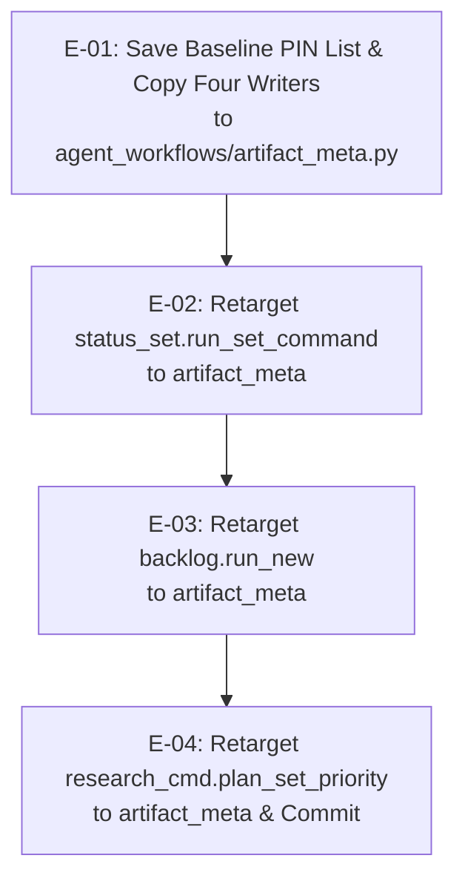

# IPD: Copy the backlog and research value writers and retarget their production callers

- Date: 2026-11-09
- Kind: child
- Concern: Spec `4sd62s` C5 allows exactly one metadata writer (`artifact_meta`). Part 2 of the round-3 split of `k6jd6l` (Order 43, research `nj8zdp` guidance). Order 280 copied the seven `releases` value writers into `artifact_meta`; this part copies the four remaining ones (`backlog.set_release_exempt_kind_line`, `set_release_exempt_ref_line`, `set_close_evidence_line`, `research_cmd._set_priority_line`) and moves every production caller of the eleven writers onto `artifact_meta`. Measured at `f83159217`: callers `status_set.run_set_command` (4 calls), `backlog.run_new` (5 calls), `research_cmd.plan_set_priority` (1 call), and `artifact_meta._render_field` (the `backlog` entries and the `set_close_evidence_line` call).
- Scope: Part of `k6jd6l` E-08: the copy of the `backlog` and `research_cmd` writers and the change of every production caller to `artifact_meta.append` (or the private copy, inside `artifact_meta`). EXCLUDES: test retargets (Orders 282, 283) and deleting the originals (Order 284).
- Scope-Paths: agent_workflows/artifact_meta.py, agent_workflows/status_set.py, agent_workflows/backlog.py, agent_workflows/research_cmd.py, .aw/records/plans/pending/20261109-metastore-281-h1kfyp-copy-the-backlog-and-research-value-writers-and-retarget-the.ipd.md
- Item-Dependencies: executed:1ajqaa, executed:59aiyh, executed:6bxlzb, executed:dcerjg, executed:ffceq0, executed:g5hpbb, executed:t4gl15
- Status: approved
- Readiness: go-pending-approval
- Review-Depth: standard
- From-Spec: 4sd62s
- Work-Kind: feature
- Priority: high
- Blocks-Release: next
- Set: metastore
- Order: 281
- Highest E allocated: 04
- Author: opencode its_direct/pt3-claude-opus-5.5-1m-us
- Id: h1kfyp
- Approval: 2026-11-16, recorded via aw ipd set: status set to approved

> Write and proofread this plan per the technical writing standard, `.aw/system/workflows/technical-writing/technical-writing.md` (`.agents/workflows/technical-writing/technical-writing.md` in a legacy-layout install), including requirement 12 (diagrams).

## Workflow history
- 2026-11-16 approved (aw set): status set to approved

- 2026-11-14 reviewed (antigravity/gemini-3.8-flash): /plan-review (antigravity/gemini-3.8-flash): APPROVE WITH REVISIONS APPLIED; PR-001, PR-002, PR-003, PR-004.
- 2026-11-09 to-review (opencode its_direct/pt3-claude-opus-5.5-1m-us): split from k6jd6l (round 3, research nj8zdp guidance).

## Goal

No production module outside `artifact_meta` calls a bullet-line value writer, while the originals still exist so the unchanged tests stay green.

## Detailed Implementation Checklist (TODO)

Execution-state rule: mark an `E-*` item complete only after performing the action. That mark is not validation. Right-sizing rule: write for a modest executor that cannot hold much in its head. Each E-item is one step (one concern, about one file, executable in one focused pass) and its V-item names each unit it covers with its own check; a plan stays at about 5 E-items and 8 work Scope-Paths, else split it into more child plans (guidance, `IPD-Z603`). Accepted execution states: blocked, failed, pending, performed; terminal gate demands 'performed'.

Carried from `k6jd6l` E-08: "change any remaining caller (`status_set`, `backlog`, `research_cmd`, ...) to `artifact_meta.append`" and "move ... `backlog.set_release_exempt_kind_line`, `set_release_exempt_ref_line`, `set_close_evidence_line` and `research_cmd._set_priority_line` into private `artifact_meta` functions with unchanged behavior". Save the before-list for E-02 to E-04 to `.aw/state/9o83cr/E-08-callers-before.txt` over `tests/test_status_set.py`, `tests/test_backlog.py` and `tests/test_research_priority.py` (ensure `.aw/state/9o83cr/` exists via `mkdir -p .aw/state/9o83cr/`).

PIN RULE (carried from `9o83cr`): before an edit that deletes or retargets, save the named test modules' per-test outcome list (`python3 -m pytest -o addopts="" -m "" -p no:randomly -n 0 -rA <modules> | grep -E "^(PASSED|FAILED|ERROR|SKIPPED|XFAIL|XPASS) " | sed -E 's/ - .*//' | sort > <before-file>`); after it, run the same command into the matching after-file. A retargeted test keeps every input case, so the after-list may rename a test but not drop a case; the evidence pastes both lists and maps each removed name to its successor.

### Task group 1: one module per item

- [x] E-01 Before the first edit, ensure `.aw/state/9o83cr/` exists (`mkdir -p .aw/state/9o83cr/`) and save the baseline callers PIN list to `.aw/state/9o83cr/E-08-callers-before.txt`. In `agent_workflows/artifact_meta.py`, add private copies (`_legacy_set_release_exempt_kind_line`, `_legacy_set_release_exempt_ref_line`, `_legacy_set_close_evidence_line`, `_legacy_research_set_priority_line`) with unchanged behavior of `backlog.set_release_exempt_kind_line`, `backlog.set_release_exempt_ref_line`, `backlog.set_close_evidence_line` and `research_cmd._set_priority_line`, and point the `backlog` entries and the `set_close_evidence_line` call in `artifact_meta._render_field` at them.
  - Depends on: none
  - Expected outcome: `artifact_meta` calls no `backlog` value writer.
  - Execution state: performed

- [x] E-02 In `status_set.run_set_command`, replace the four `_releases.set_priority_line`, `_releases.set_work_kind_line` and `_releases.set_blocks_release_line` calls with one `artifact_meta.append` (or `render_legacy`) event per field, keeping the rendered text byte-identical.
  - Depends on: E-01
  - Expected outcome: `rg -n "_releases\.set_" agent_workflows/status_set.py` prints nothing.
  - Execution state: performed

- [x] E-03 In `backlog.run_new`, replace the `_releases.set_blocks_release_line` call and the four `set_release_exempt_kind_line`/`set_release_exempt_ref_line` calls with `artifact_meta` events, keeping the rendered item byte-identical.
  - Depends on: E-02
  - Expected outcome: `backlog.run_new` calls no value writer.
  - Execution state: performed

- [x] E-04 In `research_cmd.plan_set_priority`, replace the `_set_priority_line` call with the `artifact_meta` private copy through `artifact_meta.append(..., dry_run=True)` or `render_legacy`, keeping the returned text byte-identical; run `tests/test_research_priority.py`; commit through `aw commit h1kfyp -- <paths>`.
  - Depends on: E-03
  - Expected outcome: `research_cmd.plan_set_priority` no longer calls `_set_priority_line`; the module passes.
  - Execution state: performed

## Project conventions discovered (Step 0)

- `backlog.set_close_evidence_line` takes a `repo_root` to normalize an absolute path; the copy keeps that parameter.
- The `artifact_meta` interface (names from `tve77h`, `ffceq0`, `xexn45`): `read(id6) -> State`, `history(id6)`, `read_at(id6, rev)`, `read_text(text, *, record_type=None) -> State`, `append(id6, events, *, expect_seq)` with `dry_run`, the phase-B legacy writer (`append_legacy`, `render_legacy`), and the legacy loader (`load_legacy_artifact`).
- Cite code by SYMBOL (`module.function`) or by a quoted content string, with a line number only appended to one of those and never alone (advisory `IPD-C801`).

## Findings

Measured 2026-11-09 at `f83159217`: `rg -n "set_[a-z_]+_line\(|_set_priority_line\(" agent_workflows` callers outside the definitions: `status_set.run_set_command` 4, `backlog.run_new` 5, `research_cmd.plan_set_priority` 1, `artifact_meta._render_field` 10 (map entries plus the close-evidence call). Order 280's F-24 is the authoritative re-derivation.

## Proposed changes (ordered, validatable)



1. Copy the four writers (E-01).
2. Retarget `status_set` (E-02).
3. Retarget `backlog` (E-03).
4. Retarget `research_cmd` and commit (E-04).

## Deferred / out of scope (with reason)

- Test retargets of `k6jd6l` E-08.
  - Carrier: tfvby1
- Deleting the originals.
  - Carrier: zs7a45

## Scope check

- Over-scope: none.
- Under-scope: none known; Order 280's F-24 lists every caller. Size: 4 E-items, 4 work Scope-Paths.

## Required tests / validation

`tests/test_status_set.py`, `tests/test_backlog.py`, `tests/test_research_priority.py` (PIN lists).

## Spec / documentation sync

No spec change; implements part of `4sd62s` 4.3 and section 7 step 7. CONTRIBUTES to AC-1 (owned by `9o83cr`).

## Open questions

### OQ-01: Is `artifact_meta.append` usable inside `backlog.run_new`, which renders a new file?

- Blocking: no
- Status: resolved
- Owner: plan author
- Resolution or deferral rationale: Use `artifact_meta.render_legacy` (pure, returns text) when the file does not exist yet, `append` otherwise; both write through the same private copies. Recommendation strength: medium.

## Validation and cross-check (verify before reporting done)

Validation-state rule: inspect evidence in a separate pass. Do not mark a `V-*` item complete from memory or from the matching execution checkmark. Accepted validation results: blocked, failed, pass, pending; terminal gate demands 'pass'. Runtime-demonstration reachability rule: for each `V-*` item demanding the software be observed acting (such as a run, a dispatch, or a transition), as distinct from items demanding a diff, a file's content, or a test result, which are reachable by construction, name the code path that produces the observation or the sibling `E-*` that creates it, else the demand is UNDER-SCOPE.

- [x] V-01 validates E-01
  - Required evidence: paste `rg -n "_backlog\.set_" agent_workflows/artifact_meta.py` printing nothing and `rg -n "def _legacy_(set_release_exempt_(kind|ref)_line|set_close_evidence_line|research_set_priority_line)" agent_workflows/artifact_meta.py` with four hits.
  - Observed evidence:
    Run 2026-11-23 in lane `aw/lane/h1kfyp` from `975b83620`. Baseline saved before the first edit: `.aw/state/9o83cr/E-08-callers-before.txt` (168 lines, all PASSED: 110 `test_status_set.py`, 47 `test_backlog.py`, 11 `test_research_priority.py`).
    ```text
    $ rg -n "_backlog\.set_" agent_workflows/artifact_meta.py
    (no output)
    $ rg -n "def _legacy_(set_release_exempt_(kind|ref)_line|set_close_evidence_line|research_set_priority_line)" agent_workflows/artifact_meta.py
    6610:def _legacy_set_release_exempt_kind_line(text: str, value: Optional[str]) -> str:
    6621:def _legacy_set_release_exempt_ref_line(text: str, value: Optional[str]) -> str:
    6632:def _legacy_set_close_evidence_line(
    6666:def _legacy_research_set_priority_line(text: str, value: Optional[str]) -> str:
    ```
    Unchanged behavior, differential check (each copy against its original, over every tracked backlog record with 5 exempt values and 4 evidence values incl. an absolute in-repo path, every research record with 4 priority values, plus 8 synthetic edge texts): `identical cases: 18244`.
  - Result: pass

- [x] V-02 validates E-02
  - Required evidence: paste `rg -n "_releases\.set_" agent_workflows/status_set.py` printing nothing and the before/after per-test lists of `tests/test_status_set.py` with no FAILED or ERROR line.
  - Observed evidence:
    ```text
    $ rg -n "_releases\.set_" agent_workflows/status_set.py
    (no output)
    $ diff .aw/state/9o83cr/E-08-callers-before.txt .aw/state/9o83cr/E-08-callers-after.txt && echo IDENTICAL
    IDENTICAL
    $ sha256sum .aw/state/9o83cr/E-08-callers-*.txt
    d6b72c776bbd245c905f8666f7b59b647bf7bbc01e86259d7c8fea43970456cd  .aw/state/9o83cr/E-08-callers-after.txt
    d6b72c776bbd245c905f8666f7b59b647bf7bbc01e86259d7c8fea43970456cd  .aw/state/9o83cr/E-08-callers-before.txt
    $ grep -c test_status_set .aw/state/9o83cr/E-08-callers-after.txt   # all PASSED, no FAILED/ERROR line
    110
    ```
    Byte identity: `artifact_meta.render_legacy` (the four calls now go through one `set` event per field) against the old `releases` writers over all 1252 tracked backlog records x 5 field combinations: `{'exact': 6260, 'rstrip-eq': 0, 'other': 0}`. Known difference outside the corpus: a legacy `- Kind:` line is canonicalized to `- Work-Kind:` (0 tracked records carry one); the parsed state is identical, and this text only feeds `check_engine.evaluate_blocking_close`, which parses it (decision 195-h1kfyp-D2).
  - Result: pass

- [x] V-03 validates E-03
  - Required evidence: paste `rg -n "set_[a-z_]+_line\(" agent_workflows/backlog.py` listing only the definitions (no call), and the before/after per-test lists of `tests/test_backlog.py` with no FAILED or ERROR line.
  - Observed evidence:
    `backlog.run_new` was already moved onto `artifact_meta.create` by `jlwedt` (commit `7d65160f7`, which removed the `_releases.set_blocks_release_line` call and the four `set_release_exempt_*_line` calls); this run confirms no call remains.
    ```text
    $ rg -n "set_[a-z_]+_line\(" agent_workflows/backlog.py
    939:def set_release_exempt_kind_line(text: str, value: Optional[str]) -> str:
    955:def set_release_exempt_ref_line(text: str, value: Optional[str]) -> str:
    974:def set_close_evidence_line(
    $ grep -c test_backlog.py .aw/state/9o83cr/E-08-callers-after.txt   # all PASSED, identical to before
    47
    ```
  - Result: pass

- [x] V-04 validates E-04
  - Required evidence: paste `rg -n "_set_priority_line\(" agent_workflows/research_cmd.py` listing only the definition, the before/after per-test lists of `tests/test_research_priority.py`, and `git show --stat` of the `aw commit h1kfyp` commit listing only Scope-Paths files.
  - Observed evidence:
    `research_cmd.plan_set_priority` was already moved onto `artifact_meta.append(..., dry_run=True)` by `s95hj6` (commit `baad4c0a3`); byte identity of that path against `_set_priority_line` over every `---`-fenced research record x 3 values: `501 0 10 []` (501 identical, 0 different, 10 non-fenced skipped).
    ```text
    $ rg -n "_set_priority_line\(" agent_workflows/research_cmd.py
    995:def _set_priority_line(text: str, value: Optional[str]) -> str:
    $ grep research_priority .aw/state/9o83cr/E-08-callers-after.txt | cut -d' ' -f1 | uniq -c
         11 PASSED
    $ aw suite
    2896 passed, 1 skipped, 11 warnings in 117.29s (0:01:57)
    ```
    `git show --stat` of the `aw commit h1kfyp` commit is recorded in the lane execution report (it cannot appear in the commit it describes).
  - Result: pass

## Approval and execution gate

- Size assessment: standard
- Cohesion rationale: not required

Execute only after human approval (`Status: approved`) and after every plan in `- Item-Dependencies:` is executed. Pin-first where an item deletes or retargets. Scope fence: the paths in `- Scope-Paths:` are a declaration; a needed file outside the fence is edited and then justified at finalize (`--scope-reason`), and a declared path left unmodified is acknowledged (`--scope-ack`). Safety stop: if prerequisite metastore symbols from `6bxlzb` or dependencies are absent upon starting, stop and report rather than creating conflicting implementations. Honesty rule: paste the ACTUAL output; never claim a result you did not run. Commits: only through `aw commit h1kfyp -- <paths>` with only Scope-Paths files; never `git add -A`, a bare `git add` or `git commit -a`; never push. Lifecycle: the plan moves to `.aw/records/plans/executed/` only through finalize; when `aw oc run` or `aw agy run` executes the plan, the runner performs the finalize; a hand executor runs `aw ipd finalize h1kfyp` itself; never a hand `git mv` to `executed/`.
