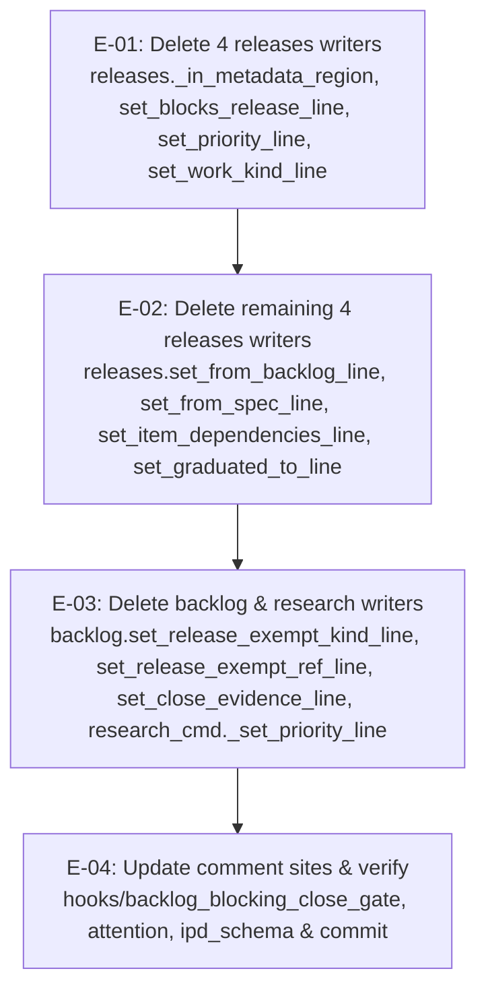

# IPD: Delete the original value writers and update their comment sites

- Date: 2026-11-09
- Kind: child
- Concern: Spec `4sd62s` C5 allows exactly one metadata writer (`artifact_meta`). Part 5 of the round-3 split of `k6jd6l` (Order 43, research `nj8zdp` guidance). After Orders 280 to 283, the twelve original value writers have no caller; this part deletes them and updates the three comments that cite them (in `hooks/backlog_blocking_close_gate`, `attention` and `ipd_schema`).
- Scope: The deletion half of `k6jd6l` E-08: delete `releases._in_metadata_region`, the seven `releases.set_*_line` writers, the three `backlog` writers and `research_cmd._set_priority_line`; update the three comment sites. EXCLUDES every other symbol.
- Scope-Paths: agent_workflows/releases.py, agent_workflows/backlog.py, agent_workflows/research_cmd.py, agent_workflows/hooks/backlog_blocking_close_gate.py, agent_workflows/attention.py, agent_workflows/ipd_schema.py, .aw/records/plans/pending/20261109-metastore-284-zs7a45-delete-the-original-value-writers-and-update-their-comment-s.ipd.md
- Item-Dependencies: executed:1ajqaa, executed:59aiyh, executed:6v4uao, executed:dcerjg, executed:ffceq0, executed:g5hpbb, executed:t4gl15
- Status: reviewed
- Readiness: go-pending-approval
- Review-Depth: standard
- From-Spec: 4sd62s
- Work-Kind: feature
- Priority: high
- Blocks-Release: next
- Set: metastore
- Order: 284
- Highest E allocated: 04
- Author: opencode its_direct/pt3-claude-opus-5.5-1m-us
- Id: zs7a45

> Write and proofread this plan per the technical writing standard, `.aw/system/workflows/technical-writing/technical-writing.md` (`.agents/workflows/technical-writing/technical-writing.md` in a legacy-layout install), including requirement 12 (diagrams).

## Workflow history

- 2026-11-14 reviewed (antigravity/gemini-3.8-flash): plan-review verified E/V bijection, Scope-Paths, deletion targets, execution gate, and state directory initialization; findings PR-001..PR-005 fixed; marked reviewed and go-pending-approval.
- 2026-11-09 to-review (opencode its_direct/pt3-claude-opus-5.5-1m-us): split from k6jd6l (round 3, research nj8zdp guidance).

## Goal

`rg -n "def set_[a-z_]+_line|def _in_metadata_region|def _set_priority_line" agent_workflows` lists only `artifact_meta.py`, which is `k6jd6l` E-08's expected outcome.

## Detailed Implementation Checklist (TODO)

Execution-state rule: mark an `E-*` item complete only after performing the action. That mark is not validation. Right-sizing rule: write for a modest executor that cannot hold much in its head. Each E-item is one step (one concern, about one file, executable in one focused pass) and its V-item names each unit it covers with its own check; a plan stays at about 5 E-items and 8 work Scope-Paths, else split it into more child plans (guidance, `IPD-Z603`). Accepted execution states: blocked, failed, pending, performed; terminal gate demands 'performed'.

Carried from `k6jd6l` E-08: "delete the originals" and "comments in `hooks/backlog_blocking_close_gate`, `attention`, `ipd_schema`". Save the before-list over the ten test modules of Orders 282 and 283 plus `tests/test_artifact_meta_legacy.py` to `.aw/state/9o83cr/E-08-before.txt` before E-01 (ensure `.aw/state/9o83cr/` exists via `mkdir -p .aw/state/9o83cr/`).

PIN RULE (carried from `9o83cr`): before an edit that deletes or retargets, save the named test modules' per-test outcome list (`python3 -m pytest -o addopts="" -m "" -p no:randomly -n 0 -rA <modules> | grep -E "^(PASSED|FAILED|ERROR|SKIPPED|XFAIL|XPASS) " | sed -E 's/ - .*//' | sort > <before-file>`); after it, run the same command into the matching after-file. A retargeted test keeps every input case, so the after-list may rename a test but not drop a case; the evidence pastes both lists and maps each removed name to its successor.

### Task group 1: one module per item

- [ ] E-01 Before the first edit, ensure `.aw/state/9o83cr/` exists (`mkdir -p .aw/state/9o83cr/`) and save the baseline test PIN list to `.aw/state/9o83cr/E-08-before.txt`. In `agent_workflows/releases.py`, delete `releases._in_metadata_region`, `releases.set_blocks_release_line`, `set_priority_line` and `set_work_kind_line`.
  - Depends on: none
  - Expected outcome: the four definitions are gone and nothing imports them.
  - Execution state: pending

- [ ] E-02 In `agent_workflows/releases.py`, delete `releases.set_from_backlog_line`, `set_from_spec_line`, `set_item_dependencies_line` and `set_graduated_to_line`.
  - Depends on: E-01
  - Expected outcome: the four definitions are gone and nothing imports them.
  - Execution state: pending

- [ ] E-03 Delete `backlog.set_release_exempt_kind_line`, `backlog.set_release_exempt_ref_line`, `backlog.set_close_evidence_line` and `research_cmd._set_priority_line`.
  - Depends on: E-02
  - Expected outcome: the four definitions are gone.
  - Execution state: pending

- [ ] E-04 Update the comments that cite a deleted writer in `agent_workflows/hooks/backlog_blocking_close_gate.py`, `agent_workflows/attention.py` and `agent_workflows/ipd_schema.py` to name the `artifact_meta` writer instead; then save the after-list and commit through `aw commit zs7a45 -- <paths>`.
  - Depends on: E-03
  - Expected outcome: `rg -n "def set_[a-z_]+_line|def _in_metadata_region|def _set_priority_line" agent_workflows` lists only `artifact_meta.py`; the eleven pinned modules pass with the same cases.
  - Execution state: pending

## Project conventions discovered (Step 0)

- `releases` keeps its readers and its `_ITEM_GRADUATED_TO_RE`-style patterns; Order 45 (`e8420v`) owns those.
- The `artifact_meta` interface (names from `tve77h`, `ffceq0`, `xexn45`): `read(id6) -> State`, `history(id6)`, `read_at(id6, rev)`, `read_text(text, *, record_type=None) -> State`, `append(id6, events, *, expect_seq)` with `dry_run`, the phase-B legacy writer (`append_legacy`, `render_legacy`), and the legacy loader (`load_legacy_artifact`).
- Cite code by SYMBOL (`module.function`) or by a quoted content string, with a line number only appended to one of those and never alone (advisory `IPD-C801`).

## Findings

Measured 2026-11-09 at `f83159217`: 12 definitions in 3 files (`releases` 8 including `_in_metadata_region`, `backlog` 3, `research_cmd` 1); 3 comment sites.

## Proposed changes (ordered, validatable)

1. Delete four `releases` writers (E-01).
2. Delete the other four `releases` writers (E-02).
3. Delete the `backlog` and `research_cmd` writers (E-03).
4. Update comments, verify and commit (E-04).

## Deferred / out of scope (with reason)

- Removing the folded copies again at the cutover.
  - Carrier: cxxmyv

## Scope check

- Over-scope: none.
- Under-scope: none known. Size: 4 E-items, 6 work Scope-Paths.

## Required tests / validation

The PIN lists over the ten test modules of Orders 282 and 283 and `tests/test_artifact_meta_legacy.py`.

## Spec / documentation sync

No spec change; implements part of `4sd62s` 4.3 and section 7 step 7. CONTRIBUTES to AC-1 (owned by `9o83cr`).

## Open questions

### OQ-01: What if a deleted writer still has a caller?

- Blocking: no
- Status: resolved
- Owner: plan author
- Resolution or deferral rationale: Stop: the caller belongs to Order 281 or a phase-B plan; record it in Order 280's F-24 as `delete (follow-on)` and report rather than editing an unowned module. Recommendation strength: strong.

## Validation and cross-check (verify before reporting done)

Validation-state rule: inspect evidence in a separate pass. Do not mark a `V-*` item complete from memory or from the matching execution checkmark. Accepted validation results: blocked, failed, pass, pending; terminal gate demands 'pass'. Runtime-demonstration reachability rule: for each `V-*` item demanding the software be observed acting (such as a run, a dispatch, or a transition), as distinct from items demanding a diff, a file's content, or a test result, which are reachable by construction, name the code path that produces the observation or the sibling `E-*` that creates it, else the demand is UNDER-SCOPE.

- [ ] V-01 validates E-01
  - Required evidence: paste `rg -n "_in_metadata_region|set_(blocks_release|priority|work_kind)_line" agent_workflows tools tests` listing only `artifact_meta.py` (and comment lines, each quoted).
  - Observed evidence:
  - Result: pending

- [ ] V-02 validates E-02
  - Required evidence: paste `rg -n "set_(from_backlog|from_spec|item_dependencies|graduated_to)_line" agent_workflows tools tests` listing only `artifact_meta.py` and comment lines.
  - Observed evidence:
  - Result: pending

- [ ] V-03 validates E-03
  - Required evidence: paste `rg -n "def (set_release_exempt_(kind|ref)_line|set_close_evidence_line|_set_priority_line)" agent_workflows/backlog.py agent_workflows/research_cmd.py` printing nothing.
  - Observed evidence:
  - Result: pending

- [ ] V-04 validates E-04
  - Required evidence: paste `rg -n "set_[a-z_]+_line|_set_priority_line" agent_workflows/hooks/backlog_blocking_close_gate.py agent_workflows/attention.py agent_workflows/ipd_schema.py` printing nothing, `rg -n "def set_[a-z_]+_line|def _in_metadata_region|def _set_priority_line" agent_workflows` listing only `agent_workflows/artifact_meta.py`, `diff .aw/state/9o83cr/E-08-before.txt .aw/state/9o83cr/E-08-after.txt` with no FAILED or ERROR line, and `git show --stat` of the `aw commit zs7a45` commit.
  - Observed evidence:
  - Result: pending

## Approval and execution gate

- Size assessment: standard
- Cohesion rationale: not required

Execute only after human approval (`Status: approved`) and after every plan in `- Item-Dependencies:` is executed. Pin-first where an item deletes or retargets. Scope fence: the paths in `- Scope-Paths:` are a declaration; a needed file outside the fence is edited and then justified at finalize (`--scope-reason`), and a declared path left unmodified is acknowledged (`--scope-ack`). Safety stop: if prerequisite metastore symbols from `6v4uao`, `59aiyh`, or `ffceq0` are absent upon starting, stop and report rather than creating conflicting implementations. Honesty rule: paste the ACTUAL output; never claim a result you did not run. Commits: only through `aw commit zs7a45 -- <paths>` with only Scope-Paths files; never `git add -A`, a bare `git add` or `git commit -a`; never push. Lifecycle: the plan moves to `.aw/records/plans/executed/` only through finalize; when `aw oc run` or `aw agy run` executes the plan, the runner performs the finalize; a hand executor runs `aw ipd finalize zs7a45` itself; never a hand `git mv` to `executed/`.
