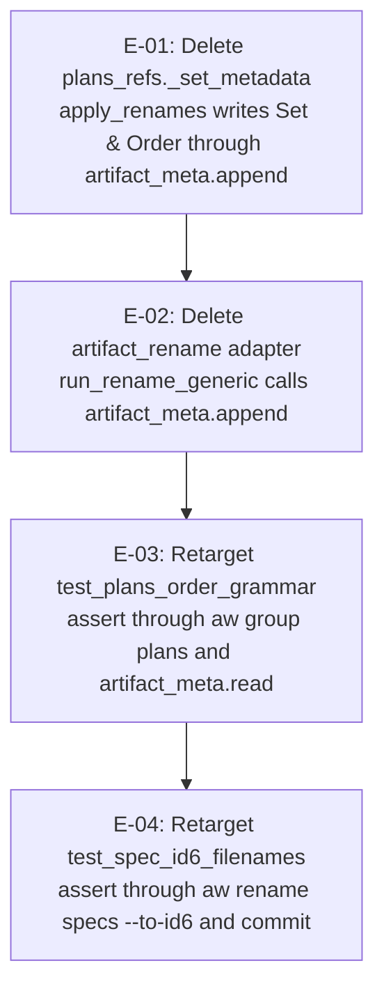

# IPD: Delete the plans_refs and artifact_rename metadata adapters

- Date: 2026-11-09
- Kind: child
- Concern: Spec `4sd62s` C5 allows exactly one metadata writer (`artifact_meta`), and `xexn45` F-08 kept four thin adapters between a caller and `artifact_meta`. Part 6 of the round-3 split of `k6jd6l` (Order 43, research `nj8zdp` guidance): this part deletes the two rename adapters, `plans_refs._set_metadata` (caller `plans_refs.apply_renames`) and `artifact_rename._update_frontmatter_metadata` (caller `artifact_rename.run_rename_generic`), plus `artifact_rename._update_or_inject_set_metadata` if Order 280's F-24 shows it is also an adapter. Measured at `f83159217`: `plans_refs` 2 references, `artifact_rename` 5, `tests/test_plans_order_grammar.py` 6, `tests/test_spec_id6_filenames.py` 1.
- Scope: The `plans_refs` and `artifact_rename` half of `k6jd6l` E-09 and its two test modules. EXCLUDES the `prompts` and `runner_shared` adapters (Order 286) and the module-level `^-` regex literals of these two modules, which Orders 244 (`tbvx4r`) and 245 (`qttoyc`) delete after `k6jd6l` (do NOT delete `plans_refs._SET_LINE_RE`, `_ORDER_LINE_RE`, `artifact_rename._SET_LINE_RE`, `_ORDER_LINE_RE`, `_ID_LINE_RE`, `_STATUS_LINE_RE` or `_DATE_LINE_RE` here, even if they lose a use).
- Scope-Paths: agent_workflows/plans_refs.py, agent_workflows/artifact_rename.py, tests/test_plans_order_grammar.py, tests/test_spec_id6_filenames.py, .aw/records/plans/pending/20261109-metastore-285-v0ucnz-delete-the-plans-refs-and-artifact-rename-metadata-adapters.ipd.md
- Item-Dependencies: executed:1ajqaa, executed:59aiyh, executed:dcerjg, executed:ffceq0, executed:g5hpbb, executed:t4gl15, executed:zs7a45
- Status: approved
- Readiness: go-pending-approval
- Review-Depth: standard
- From-Spec: 4sd62s
- Work-Kind: feature
- Priority: high
- Blocks-Release: next
- Set: metastore
- Order: 285
- Highest E allocated: 04
- Author: opencode its_direct/pt3-claude-opus-5.5-1m-us
- Id: v0ucnz
- Approval: 2026-11-16, recorded via aw ipd set: status set to approved

> Write and proofread this plan per the technical writing standard, `.aw/system/workflows/technical-writing/technical-writing.md` (`.agents/workflows/technical-writing/technical-writing.md` in a legacy-layout install), including requirement 12 (diagrams).

## Workflow history
- 2026-11-16 approved (aw set): status set to approved

- 2026-11-14 reviewed (antigravity/gemini-3.8-flash): plan-review verified E/V bijection, Scope-Paths, deletion targets, execution gate, and state directory initialization; findings PR-001..PR-005 fixed; marked reviewed and go-pending-approval.
- 2026-11-09 to-review (opencode its_direct/pt3-claude-opus-5.5-1m-us): split from k6jd6l (round 3, research nj8zdp guidance).

## Goal

`plans_refs.apply_renames` and `artifact_rename.run_rename_generic` call `artifact_meta` directly and the two adapters no longer exist.

## Detailed Implementation Checklist (TODO)

Execution-state rule: mark an `E-*` item complete only after performing the action. That mark is not validation. Right-sizing rule: write for a modest executor that cannot hold much in its head. Each E-item is one step (one concern, about one file, executable in one focused pass) and its V-item names each unit it covers with its own check; a plan stays at about 5 E-items and 8 work Scope-Paths, else split it into more child plans (guidance, `IPD-Z603`). Accepted execution states: blocked, failed, pending, performed; terminal gate demands 'performed'.

Carried from `k6jd6l` E-09: "Delete the thin adapters kept by `xexn45` F-08 ...; their one production caller each ... calls `artifact_meta` directly. Retarget ... to the behavior through `aw group plans`, `aw rename specs --to-id6` ..., asserting on the resulting `artifact_meta.read` state and file bytes." Save the before-list of `tests/test_plans_order_grammar.py` and `tests/test_spec_id6_filenames.py` to `.aw/state/9o83cr/E-09a-before.txt` before E-01 (ensure `.aw/state/9o83cr/` exists via `mkdir -p .aw/state/9o83cr/`).

PIN RULE (carried from `9o83cr`): before an edit that deletes or retargets, save the named test modules' per-test outcome list (`python3 -m pytest -o addopts="" -m "" -p no:randomly -n 0 -rA <modules> | grep -E "^(PASSED|FAILED|ERROR|SKIPPED|XFAIL|XPASS) " | sed -E 's/ - .*//' | sort > <before-file>`); after it, run the same command into the matching after-file. A retargeted test keeps every input case, so the after-list may rename a test but not drop a case; the evidence pastes both lists and maps each removed name to its successor.

### Task group 1: one adapter per item, then its tests

- [ ] E-01 Before the first edit, ensure `.aw/state/9o83cr/` exists (`mkdir -p .aw/state/9o83cr/`) and save the baseline test PIN list to `.aw/state/9o83cr/E-09a-before.txt`. Delete `plans_refs._set_metadata`; `plans_refs.apply_renames` writes the `Set` and `Order` change through `artifact_meta.append`, keeping the batch-refusal-before-write behavior (a plan whose `- Order:` line cannot be matched refuses the whole batch before any file is written).
  - Depends on: none
  - Expected outcome: `rg -n "_set_metadata\b" agent_workflows/plans_refs.py` prints nothing.
  - Execution state: pending

- [ ] E-02 Delete `artifact_rename._update_frontmatter_metadata` (and `artifact_rename._update_or_inject_set_metadata` if Order 280's F-24 classes it as an adapter); `artifact_rename.run_rename_generic` calls `artifact_meta.append` directly.
  - Depends on: E-01
  - Expected outcome: the adapter is gone; `run_rename_generic` calls `artifact_meta`.
  - Execution state: pending

- [ ] E-03 Retarget `tests/test_plans_order_grammar.py` to the behavior through `aw group plans`, asserting on the resulting `artifact_meta.read` state and file bytes, keeping every case including `set_metadata_raises_on_unmatchable_order_line` (or a renamed successor).
  - Depends on: E-02
  - Expected outcome: the module calls no deleted adapter and passes.
  - Execution state: pending

- [ ] E-04 Retarget `tests/test_spec_id6_filenames.py` to the behavior through `aw rename specs --to-id6`; save the after-list; commit through `aw commit v0ucnz -- <paths>`.
  - Depends on: E-03
  - Expected outcome: the module calls no deleted adapter and passes.
  - Execution state: pending

## Project conventions discovered (Step 0)

- Orders 244 and 245 depend on `executed:k6jd6l`, which depends on this plan, so they run after it and still find their regex literals.
- The `artifact_meta` interface (names from `tve77h`, `ffceq0`, `xexn45`): `read(id6) -> State`, `history(id6)`, `read_at(id6, rev)`, `read_text(text, *, record_type=None) -> State`, `append(id6, events, *, expect_seq)` with `dry_run`, the phase-B legacy writer (`append_legacy`, `render_legacy`), and the legacy loader (`load_legacy_artifact`).
- Cite code by SYMBOL (`module.function`) or by a quoted content string, with a line number only appended to one of those and never alone (advisory `IPD-C801`).

## Findings

Measured 2026-11-09 at `f83159217` with `rg -n "_set_metadata\b|_update_frontmatter_metadata|_update_or_inject_set_metadata" agent_workflows tests`: `plans_refs` 2, `artifact_rename` 5, `tests/test_plans_order_grammar.py` 6, `tests/test_spec_id6_filenames.py` 1.

## Proposed changes (ordered, validatable)

1. Delete `plans_refs._set_metadata` (E-01).
2. Delete the `artifact_rename` adapter (E-02).
3. Retarget `test_plans_order_grammar` (E-03).
4. Retarget `test_spec_id6_filenames` and commit (E-04).

## Deferred / out of scope (with reason)

- The `prompts` and `runner_shared` adapters.
  - Carrier: 8fxic1
- The `plans_refs` regex literals.
  - Carrier: tbvx4r
- The `artifact_rename` regex literals.
  - Carrier: qttoyc

## Scope check

- Over-scope: none.
- Under-scope: none known. Size: 4 E-items, 4 work Scope-Paths.

## Required tests / validation

`tests/test_plans_order_grammar.py`, `tests/test_spec_id6_filenames.py` (PIN lists).

## Spec / documentation sync

No spec change; implements part of `4sd62s` 4.3 and section 7 step 7. CONTRIBUTES to AC-1 (owned by `9o83cr`).

## Open questions

### OQ-01: The `order_lines` literal sits inside `plans_refs._set_metadata`; who deletes it?

- Blocking: no
- Status: resolved
- Owner: plan author
- Resolution or deferral rationale: It goes with `_set_metadata` here; Order 244 E-02 deletes it only "if `k6jd6l` left it", so no site is handled twice. Recommendation strength: strong.

## Validation and cross-check (verify before reporting done)

Validation-state rule: inspect evidence in a separate pass. Do not mark a `V-*` item complete from memory or from the matching execution checkmark. Accepted validation results: blocked, failed, pass, pending; terminal gate demands 'pass'. Runtime-demonstration reachability rule: for each `V-*` item demanding the software be observed acting (such as a run, a dispatch, or a transition), as distinct from items demanding a diff, a file's content, or a test result, which are reachable by construction, name the code path that produces the observation or the sibling `E-*` that creates it, else the demand is UNDER-SCOPE.

- [ ] V-01 validates E-01
  - Required evidence: paste `rg -n "_set_metadata\b" agent_workflows/plans_refs.py` printing nothing and `git diff --stat agent_workflows/plans_refs.py`.
  - Observed evidence:
  - Result: pending

- [ ] V-02 validates E-02
  - Required evidence: paste `rg -n "_update_frontmatter_metadata|_update_or_inject_set_metadata" agent_workflows/artifact_rename.py` (empty, or the one kept function with its F-24 classification quoted).
  - Observed evidence:
  - Result: pending

- [ ] V-03 validates E-03
  - Required evidence: paste `rg -n "_set_metadata\b" tests/test_plans_order_grammar.py` printing nothing and its before/after per-test lines with the batch-refusal case named.
  - Observed evidence:
  - Result: pending

- [ ] V-04 validates E-04
  - Required evidence: paste `rg -n "_update_frontmatter_metadata" tests/test_spec_id6_filenames.py` printing nothing, `diff .aw/state/9o83cr/E-09a-before.txt .aw/state/9o83cr/E-09a-after.txt` with each renamed test mapped, and `git show --stat` of the `aw commit v0ucnz` commit.
  - Observed evidence:
  - Result: pending

## Approval and execution gate

- Size assessment: standard
- Cohesion rationale: not required

Execute only after human approval (`Status: approved`) and after every plan in `- Item-Dependencies:` is executed. Pin-first where an item deletes or retargets. Scope fence: the paths in `- Scope-Paths:` are a declaration; a needed file outside the fence is edited and then justified at finalize (`--scope-reason`), and a declared path left unmodified is acknowledged (`--scope-ack`). Safety stop: if prerequisite metastore symbols from `1ajqaa`, `59aiyh`, `dcerjg`, `ffceq0`, `g5hpbb`, `t4gl15`, or `zs7a45` are absent upon starting, stop and report rather than creating conflicting implementations. Honesty rule: paste the ACTUAL output; never claim a result you did not run. Commits: only through `aw commit v0ucnz -- <paths>` with only Scope-Paths files; never `git add -A`, a bare `git add` or `git commit -a`; never push. Lifecycle: the plan moves to `.aw/records/plans/executed/` only through finalize; when `aw oc run` or `aw agy run` executes the plan, the runner performs the finalize; a hand executor runs `aw ipd finalize v0ucnz` itself; never a hand `git mv` to `executed/`.
