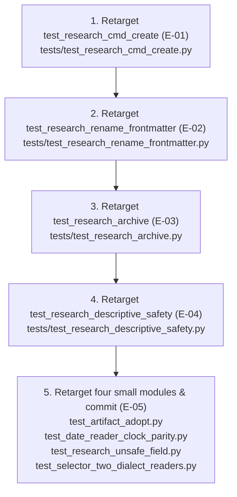

# IPD: Retarget the tests that still call parse_frontmatter

- Date: 2026-11-09
- Kind: child
- Concern: Spec `4sd62s` C5 allows exactly one metadata reader (`artifact_meta`). Part 10 of the round-3 split of `k6jd6l` (Order 43, research `nj8zdp` guidance). Before Order 290 deletes `research_contract.parse_frontmatter`, eight test modules that call it must read through `artifact_meta.read_text` instead. Measured references at `f83159217`: `tests/test_research_cmd_create.py` 15, `tests/test_research_rename_frontmatter.py` 12, `tests/test_research_archive.py` 7, `tests/test_research_descriptive_safety.py` 5, `tests/test_artifact_adopt.py` 1, `tests/test_date_reader_clock_parity.py` 2, `tests/test_research_unsafe_field.py` 3, `tests/test_selector_two_dialect_readers.py` 2.
- Scope: Test retargets for the `parse_frontmatter` move of `k6jd6l` E-10 (`k6jd6l` named only the loader test modules; these eight were found on 2026-11-09 by running the E-10 search over `tests`). Items E-01 to E-04 take one large module each; E-05 takes the four small ones.
- Scope-Paths: tests/test_research_cmd_create.py, tests/test_research_rename_frontmatter.py, tests/test_research_archive.py, tests/test_research_descriptive_safety.py, tests/test_artifact_adopt.py, tests/test_date_reader_clock_parity.py, tests/test_research_unsafe_field.py, tests/test_selector_two_dialect_readers.py, .aw/records/plans/pending/20261109-metastore-289-5lgpix-retarget-the-tests-that-still-call-parse-frontmatter.ipd.md
- Item-Dependencies: executed:1ajqaa, executed:59aiyh, executed:dcerjg, executed:ffceq0, executed:g5hpbb, executed:sq6v7i, executed:t4gl15
- Status: approved
- Readiness: go-pending-approval
- Review-Depth: complex
- From-Spec: 4sd62s
- Work-Kind: feature
- Priority: high
- Blocks-Release: next
- Set: metastore
- Order: 289
- Highest E allocated: 05
- Author: opencode its_direct/pt3-claude-opus-5.5-1m-us
- Id: 5lgpix
- Approval: 2026-11-16, recorded via aw ipd set: status set to approved

> Write and proofread this plan per the technical writing standard, `.aw/system/workflows/technical-writing/technical-writing.md` (`.agents/workflows/technical-writing/technical-writing.md` in a legacy-layout install), including requirement 12 (diagrams).

## Workflow history
- 2026-11-16 approved (aw set): status set to approved

- 2026-11-14 reviewed (antigravity): plan-review verified E/V bijection, Scope-Paths, test retargeting coverage, and execution gate; marked reviewed and go-pending-approval.
- 2026-11-09 to-review (opencode its_direct/pt3-claude-opus-5.5-1m-us): split from k6jd6l (round 3, research nj8zdp guidance).

## Goal

No test module calls `research_contract.parse_frontmatter`; each keeps every input case.

## Detailed Implementation Checklist (TODO)

Execution-state rule: mark an `E-*` item complete only after performing the action. That mark is not validation. Right-sizing rule: write for a modest executor that cannot hold much in its head. Each E-item is one step (one concern, about one file, executable in one focused pass) and its V-item names each unit it covers with its own check; a plan stays at about 5 E-items and 8 work Scope-Paths, else split it into more child plans (guidance, `IPD-Z603`). Accepted execution states: blocked, failed, pending, performed; terminal gate demands 'performed'.

Save the before-list of the eight modules to `.aw/state/9o83cr/E-10c-before.txt` before E-01. Each assertion that read a parsed dict now reads the matching `artifact_meta.State` field (or `State.fields`) from `artifact_meta.read_text(text, record_type="research")`.

PIN RULE (carried from `9o83cr`): before an edit that deletes or retargets, save the named test modules' per-test outcome list (`python3 -m pytest -o addopts="" -m "" -p no:randomly -n 0 -rA <modules> | grep -E "^(PASSED|FAILED|ERROR|SKIPPED|XFAIL|XPASS) " | sed -E 's/ - .*//' | sort > <before-file>`); after it, run the same command into the matching after-file. A retargeted test keeps every input case, so the after-list may rename a test but not drop a case; the evidence pastes both lists and maps each removed name to its successor.

### Task group 1: one test module per item, the four small ones together

- [x] E-01 Retarget `tests/test_research_cmd_create.py` (15 references) from `parse_frontmatter` to `artifact_meta.read_text`, keeping every case.
  - Depends on: none
  - Expected outcome: `tests/test_research_cmd_create.py` calls no `parse_frontmatter` and passes.
  - Execution note (2026-11-24): before-list saved to `.aw/state/9o83cr/E-10c-before.txt` (176 PASSED over the eight modules plus the two found by backlog `816pmu`). The local helper `_parse_frontmatter` (a hand-rolled duplicate parser) was replaced by `_mapping` (raw keys, via `artifact_meta.front_matter_mapping`) and `_fields` (via `artifact_meta.read_text(text, record_type="research").fields`); `R.parse_frontmatter` calls moved to whichever keeps the assertion unchanged (list-valued and verbatim-key assertions use the mapping, scalar assertions use `read_text`).
  - Execution state: performed

- [x] E-02 Retarget `tests/test_research_rename_frontmatter.py` (12 references) from `parse_frontmatter` to `artifact_meta.read_text`, keeping every case.
  - Depends on: E-01
  - Expected outcome: `tests/test_research_rename_frontmatter.py` calls no `parse_frontmatter` and passes.
  - Execution note (2026-11-24): eleven scalar reads now use `artifact_meta.read_text(..., record_type="research").fields` with `assert fm` replacing `assert fm is not None`; the full-field case (`topic`/`consumed-by` lists) uses `artifact_meta.front_matter_mapping`.
  - Execution state: performed

- [x] E-03 Retarget `tests/test_research_archive.py` (7 references) from `parse_frontmatter` to `artifact_meta.read_text`, keeping every case.
  - Depends on: E-02
  - Expected outcome: `tests/test_research_archive.py` calls no `parse_frontmatter` and passes.
  - Execution note (2026-11-24): four status/id reads use `read_text(...).fields`; the three reads fed to `R.validate_frontmatter` (which needs the raw hyphenated keys) use `artifact_meta.front_matter_mapping`.
  - Execution state: performed

- [x] E-04 Retarget `tests/test_research_descriptive_safety.py` (5 references) from `parse_frontmatter` to `artifact_meta.read_text`, keeping every case.
  - Depends on: E-03
  - Expected outcome: `tests/test_research_descriptive_safety.py` calls no `parse_frontmatter` and passes.
  - Execution note (2026-11-24): the three smuggling cases (last-wins, list values, `blocks-release` key) use `artifact_meta.front_matter_mapping`, so their observable stays identical (OQ-01); the two slug/set cases use `read_text(...).fields`.
  - Execution state: performed

- [x] E-05 Retarget the four small modules, `tests/test_artifact_adopt.py`, `tests/test_date_reader_clock_parity.py`, `tests/test_research_unsafe_field.py`, `tests/test_selector_two_dialect_readers.py`, the same way; save the after-list; commit through `aw commit 5lgpix -- <paths>`.
  - Depends on: E-04
  - Expected outcome: no test calls `parse_frontmatter`.
  - Execution note (2026-11-24): `test_artifact_adopt`, `test_research_unsafe_field` and `test_selector_two_dialect_readers` use `artifact_meta.front_matter_mapping` (validator input, last-wins and case-sensitive keys); `test_date_reader_clock_parity`'s child snippets use `read_text(...).fields`. Also retargeted, outside the fence with a `--scope-reason` each: `tests/test_record_builder.py` and `tests/test_research_meta_writer_characterization.py` (backlog `816pmu`), since the Goal says no test module calls it. After-list saved to `.aw/state/9o83cr/E-10c-after.txt`; committed as `93cfabb16` through `aw commit 5lgpix`.
  - Execution state: performed

## Project conventions discovered (Step 0)

- The `artifact_meta` interface (names from `tve77h`, `ffceq0`, `xexn45`): `read(id6) -> State`, `history(id6)`, `read_at(id6, rev)`, `read_text(text, *, record_type=None) -> State`, `append(id6, events, *, expect_seq)` with `dry_run`, the phase-B legacy writer (`append_legacy`, `render_legacy`), and the legacy loader (`load_legacy_artifact`).
- Cite code by SYMBOL (`module.function`) or by a quoted content string, with a line number only appended to one of those and never alone (advisory `IPD-C801`).

## Findings

Measured 2026-11-09 at `f83159217` with `rg -c "parse_frontmatter" tests`: see the Concern.

## Proposed changes (ordered, validatable)



1. Retarget `test_research_cmd_create` (E-01).
2. Retarget `test_research_rename_frontmatter` (E-02).
3. Retarget `test_research_archive` (E-03).
4. Retarget `test_research_descriptive_safety` (E-04).
5. Retarget the four small modules and commit (E-05).

## Deferred / out of scope (with reason)

- Deleting `parse_frontmatter`.
  - Carrier: bxupy8

## Scope check

- Over-scope: none.
- Under-scope: These eight modules were not named in `k6jd6l` E-10; they are added because deleting the original would break them. Size: 5 E-items, 8 work Scope-Paths.

## Required tests / validation

The eight modules (PIN lists).

## Spec / documentation sync

No spec change; implements part of `4sd62s` 4.3 and section 7 step 7. CONTRIBUTES to AC-1 (owned by `9o83cr`).

## Open questions

### OQ-01: Some tests assert on `parse_frontmatter` returning None for a malformed block; how is that kept?

- Blocking: no
- Status: resolved
- Owner: plan author
- Resolution or deferral rationale: Assert on the matching `artifact_meta.read_text` outcome (a defect or empty fields) and keep the case; if the observable differs, stop and report it in this plan rather than weakening the test. Recommendation strength: strong.

## Validation and cross-check (verify before reporting done)

Validation-state rule: inspect evidence in a separate pass. Do not mark a `V-*` item complete from memory or from the matching execution checkmark. Accepted validation results: blocked, failed, pass, pending; terminal gate demands 'pass'. Runtime-demonstration reachability rule: for each `V-*` item demanding the software be observed acting (such as a run, a dispatch, or a transition), as distinct from items demanding a diff, a file's content, or a test result, which are reachable by construction, name the code path that produces the observation or the sibling `E-*` that creates it, else the demand is UNDER-SCOPE.

- [x] V-01 validates E-01
  - Required evidence: paste `rg -n "parse_frontmatter" tests/test_research_cmd_create.py` printing nothing and its before/after per-test lines with each rename mapped.
  - Observed evidence:
    ```
    $ rg -n "parse_frontmatter" tests/test_research_cmd_create.py; echo "rg exit $?"
    rg exit 1
    ```
    before/after per-test lines for tests/test_research_cmd_create.py (20 before, 20 after; `diff` prints nothing, so no test was renamed or dropped and no rename mapping is needed):
    ```
    PASSED tests/test_research_cmd_create.py::ComparisonTests::test_comparison_invariants_under_non_empty_summary
    PASSED tests/test_research_cmd_create.py::ComparisonTests::test_comparison_no_summary_exact_strings
    PASSED tests/test_research_cmd_create.py::ComparisonTests::test_comparison_scaffold_prompt_has_no_status_and_reports_are_todo
    PASSED tests/test_research_cmd_create.py::ComparisonTests::test_comparison_summary_reaches_all_planned_documents
    PASSED tests/test_research_cmd_create.py::ComparisonTests::test_compose_comparison_summary_unit
    PASSED tests/test_research_cmd_create.py::ComparisonTests::test_scaffold_order_and_tags
    PASSED tests/test_research_cmd_create.py::ComparisonTests::test_unknown_model_accepted_and_malformed_rejected
    PASSED tests/test_research_cmd_create.py::IdCollisionTests::test_generate_avoids_existing
    PASSED tests/test_research_cmd_create.py::NewPlanTests::test_new_well_formed_and_full_frontmatter
    PASSED tests/test_research_cmd_create.py::NewPlanTests::test_nn_increments_on_second_same_set_call
    PASSED tests/test_research_cmd_create.py::NewPlanTests::test_singleton_derives_set_from_slug
    PASSED tests/test_research_cmd_create.py::NewPlanTests::test_unknown_kind_rejected_with_suggestion
    PASSED tests/test_research_cmd_create.py::SetOutcomeTests::test_invalid_outcome_rejected
    PASSED tests/test_research_cmd_create.py::SetOutcomeTests::test_run_set_outcome_apply_writes
    PASSED tests/test_research_cmd_create.py::SetOutcomeTests::test_run_set_outcome_tolerates_two_spellings_of_one_dir
    PASSED tests/test_research_cmd_create.py::SetOutcomeTests::test_set_append_replace_clear
    PASSED tests/test_research_cmd_create.py::SetOutcomeTests::test_updater_round_trips_only_named_fields
    PASSED tests/test_research_cmd_create.py::WriteSafetyTests::test_apply_writes_atomically
    PASSED tests/test_research_cmd_create.py::WriteSafetyTests::test_dry_run_writes_nothing
    PASSED tests/test_research_cmd_create.py::WriteSafetyTests::test_no_clobber_without_overwrite
    ```
  - Result: pass

- [x] V-02 validates E-02
  - Required evidence: paste `rg -n "parse_frontmatter" tests/test_research_rename_frontmatter.py` printing nothing and its before/after per-test lines with each rename mapped.
  - Observed evidence:
    ```
    $ rg -n "parse_frontmatter" tests/test_research_rename_frontmatter.py; echo "rg exit $?"
    rg exit 1
    ```
    before/after per-test lines for tests/test_research_rename_frontmatter.py (17 before, 17 after; `diff` prints nothing, so no test was renamed or dropped and no rename mapping is needed):
    ```
    PASSED tests/test_research_rename_frontmatter.py::test_alternate_spelling_rename_research
    PASSED tests/test_research_rename_frontmatter.py::test_alternate_spelling_research_set_assign
    PASSED tests/test_research_rename_frontmatter.py::test_body_preservation_with_literal_frontmatter_keys
    PASSED tests/test_research_rename_frontmatter.py::test_gate_agreement_on_all_four_fields
    PASSED tests/test_research_rename_frontmatter.py::test_model_and_kind_preserved_through_mv_slug
    PASSED tests/test_research_rename_frontmatter.py::test_model_provenance_preserved_on_facetless_name
    PASSED tests/test_research_rename_frontmatter.py::test_mv_kind_updates_kind_frontmatter
    PASSED tests/test_research_rename_frontmatter.py::test_mv_model_updates_model_frontmatter
    PASSED tests/test_research_rename_frontmatter.py::test_preview_announces_frontmatter_metadata_write
    PASSED tests/test_research_rename_frontmatter.py::test_regroup_find_resolves_regrouped_path
    PASSED tests/test_research_rename_frontmatter.py::test_regroup_frontmatter_write_idempotence
    PASSED tests/test_research_rename_frontmatter.py::test_regroup_updates_set_and_order_frontmatter
    PASSED tests/test_research_rename_frontmatter.py::test_rename_research_refuses_too_long_setid
    PASSED tests/test_research_rename_frontmatter.py::test_rename_research_with_set
    PASSED tests/test_research_rename_frontmatter.py::test_rename_research_with_set_and_slug
    PASSED tests/test_research_rename_frontmatter.py::test_tier_independence_sibling_interaction
    PASSED tests/test_research_rename_frontmatter.py::test_unrelated_frontmatter_keys_are_unmutated
    ```
  - Result: pass

- [x] V-03 validates E-03
  - Required evidence: paste `rg -n "parse_frontmatter" tests/test_research_archive.py` printing nothing and its before/after per-test lines with each rename mapped.
  - Observed evidence:
    ```
    $ rg -n "parse_frontmatter" tests/test_research_archive.py; echo "rg exit $?"
    rg exit 1
    ```
    before/after per-test lines for tests/test_research_archive.py (26 before, 26 after; `diff` prints nothing, so no test was renamed or dropped and no rename mapping is needed):
    ```
    PASSED tests/test_research_archive.py::BehavioralParityAndRefusalTests::test_apply_setid_moves_alpha_only
    PASSED tests/test_research_archive.py::BehavioralParityAndRefusalTests::test_no_match_empty_result
    PASSED tests/test_research_archive.py::BehavioralParityAndRefusalTests::test_parity_id6_and_setid
    PASSED tests/test_research_archive.py::BehavioralParityAndRefusalTests::test_path_parity_with_find
    PASSED tests/test_research_archive.py::BehavioralParityAndRefusalTests::test_rename_status_refusal
    PASSED tests/test_research_archive.py::BehavioralParityAndRefusalTests::test_set_outcome_status_refusal
    PASSED tests/test_research_archive.py::BehavioralParityAndRefusalTests::test_status_refusal_and_force
    PASSED tests/test_research_archive.py::GuardTests::test_confinement_guard
    PASSED tests/test_research_archive.py::GuardTests::test_legacy_layout_parity
    PASSED tests/test_research_archive.py::IndexRefreshTests::test_archived_leaves_index_md
    PASSED tests/test_research_archive.py::IntakeToTodoMigrationTests::test_legacy_intake_still_accepted_during_window
    PASSED tests/test_research_archive.py::IntakeToTodoMigrationTests::test_promote_intake_to_todo_flips_only_status_in_place
    PASSED tests/test_research_archive.py::MiscategorizedTests::test_archived_but_cited_flagged
    PASSED tests/test_research_archive.py::PromptArchiveTests::test_hot_status_refused_for_prompt
    PASSED tests/test_research_archive.py::PromptArchiveTests::test_statusless_prompt_promote_to_reference_inserts_status
    PASSED tests/test_research_archive.py::ShardDateTests::test_shard_for_date
    PASSED tests/test_research_archive.py::SuggestTriageTests::test_suggest_apply_promotes_as_previewed
    PASSED tests/test_research_archive.py::SuggestTriageTests::test_suggest_archives_uncited_run_set_deadend
    PASSED tests/test_research_archive.py::SuggestTriageTests::test_suggest_classifies_and_previews_without_mutation
    PASSED tests/test_research_archive.py::SweepTests::test_sweep_custom_age_duration
    PASSED tests/test_research_archive.py::SweepTests::test_sweep_per_item_override_records_status
    PASSED tests/test_research_archive.py::SweepTests::test_sweep_selects_aged_uncited_only
    PASSED tests/test_research_archive.py::SweepTests::test_sweep_set_cohesion_holds_young_set
    PASSED tests/test_research_archive.py::TargetedArchiveTests::test_targeted_archive_moves_to_archive_shard
    PASSED tests/test_research_archive.py::TransitionTests::test_invalid_status_rejected
    PASSED tests/test_research_archive.py::TransitionTests::test_promote_to_reference_moves_to_weekly_shard_keeps_id
    ```
  - Result: pass

- [x] V-04 validates E-04
  - Required evidence: paste `rg -n "parse_frontmatter" tests/test_research_descriptive_safety.py` printing nothing and its before/after per-test lines with each rename mapped.
  - Observed evidence:
    ```
    $ rg -n "parse_frontmatter" tests/test_research_descriptive_safety.py; echo "rg exit $?"
    rg exit 1
    ```
    before/after per-test lines for tests/test_research_descriptive_safety.py (24 before, 24 after; `diff` prints nothing, so no test was renamed or dropped and no rename mapping is needed):
    ```
    PASSED tests/test_research_descriptive_safety.py::TestAdoptInjection::test_adopt_heading_ansi_escape_refused_with_actionable_message
    PASSED tests/test_research_descriptive_safety.py::TestAdoptInjection::test_adopt_summary_flag_injection_refused
    PASSED tests/test_research_descriptive_safety.py::TestBoundaryAndNonRegressions::test_conforming_creation_and_modifications_succeed
    PASSED tests/test_research_descriptive_safety.py::TestBoundaryAndNonRegressions::test_deliberate_under_scope_text_writers_unchanged
    PASSED tests/test_research_descriptive_safety.py::TestBoundaryAndNonRegressions::test_existing_planner_refusals_preserved
    PASSED tests/test_research_descriptive_safety.py::TestBoundaryAndNonRegressions::test_quiet_versus_loud_distinction_both_refused
    PASSED tests/test_research_descriptive_safety.py::TestBoundaryAndNonRegressions::test_refusal_writes_nothing_listing_unchanged
    PASSED tests/test_research_descriptive_safety.py::TestBoundaryAndNonRegressions::test_slug_and_set_remain_unguarded_and_kebabed
    PASSED tests/test_research_descriptive_safety.py::TestBoundaryAndNonRegressions::test_summary_length_boundary_300_accepted_301_refused
    PASSED tests/test_research_descriptive_safety.py::TestHelperContract::test_helper_refuse_unsafe_descriptive_contract
    PASSED tests/test_research_descriptive_safety.py::TestPreFixDemonstration::test_pre_fix_crafted_consumed_by_smuggles_status_and_checker_blind
    PASSED tests/test_research_descriptive_safety.py::TestPreFixDemonstration::test_pre_fix_crafted_topic_token_smuggles_keys_and_checker_blind
    PASSED tests/test_research_descriptive_safety.py::TestPreFixDemonstration::test_pre_fix_summary_injection_smuggles_keys_and_checker_blind
    PASSED tests/test_research_descriptive_safety.py::TestResearchNewComparisonInjection::test_cli_research_new_comparison_summary_injection_refused
    PASSED tests/test_research_descriptive_safety.py::TestResearchNewComparisonInjection::test_cli_research_new_comparison_topic_injection_refused
    PASSED tests/test_research_descriptive_safety.py::TestResearchNewComparisonInjection::test_plan_new_comparison_summary_injection_refused
    PASSED tests/test_research_descriptive_safety.py::TestResearchNewComparisonInjection::test_plan_new_comparison_topic_token_injection_refused
    PASSED tests/test_research_descriptive_safety.py::TestResearchNewInjection::test_cli_research_new_preview_refused_on_summary_injection
    PASSED tests/test_research_descriptive_safety.py::TestResearchNewInjection::test_cli_research_new_summary_injection_refused
    PASSED tests/test_research_descriptive_safety.py::TestResearchNewInjection::test_cli_research_new_topic_injection_refused
    PASSED tests/test_research_descriptive_safety.py::TestResearchNewInjection::test_plan_new_summary_injection_refused
    PASSED tests/test_research_descriptive_safety.py::TestResearchNewInjection::test_plan_new_topic_token_injection_refused
    PASSED tests/test_research_descriptive_safety.py::TestResearchSetOutcomeInjection::test_cli_research_set_outcome_consumed_by_injection_refused
    PASSED tests/test_research_descriptive_safety.py::TestResearchSetOutcomeInjection::test_plan_set_outcome_consumed_by_injection_refused
    ```
  - Result: pass

- [x] V-05 validates E-05
  - Required evidence: paste `rg -n "parse_frontmatter" tests` printing nothing, the before/after per-test lines of each of the four modules, and `git show --stat` of the `aw commit 5lgpix` commit.
  - Observed evidence:
    ```
    $ rg -n "parse_frontmatter" tests; echo "rg exit $?"
    rg exit 1
    ```
    before/after per-test lines for tests/test_artifact_adopt.py (40 before, 40 after; `diff` prints nothing, so no test was renamed or dropped and no rename mapping is needed):
    ```
    PASSED tests/test_artifact_adopt.py::AlreadyAdoptedWarningTests::test_a_distinct_drop_is_not_flagged
    PASSED tests/test_artifact_adopt.py::AlreadyAdoptedWarningTests::test_identical_body_is_flagged_in_the_preview_as_already_adopted
    PASSED tests/test_artifact_adopt.py::AlreadyAdoptedWarningTests::test_the_warning_does_not_block_apply
    PASSED tests/test_artifact_adopt.py::BodyDeclaredId6IsNeverAdoptedTests::test_a_horizontal_rule_is_not_mistaken_for_front_matter
    PASSED tests/test_artifact_adopt.py::BodyDeclaredId6IsNeverAdoptedTests::test_a_quoted_bullet_id_owning_nothing_is_reported_and_allowed
    PASSED tests/test_artifact_adopt.py::BodyDeclaredId6IsNeverAdoptedTests::test_a_quoted_bullet_id_that_collides_with_a_live_owner_is_refused
    PASSED tests/test_artifact_adopt.py::BodyDeclaredId6IsNeverAdoptedTests::test_bullet_dialect_id6_is_reported_but_not_adopted
    PASSED tests/test_artifact_adopt.py::BodyDeclaredId6IsNeverAdoptedTests::test_no_collision_drift_after_adopting_a_body_that_quotes_an_id
    PASSED tests/test_artifact_adopt.py::BodyDeclaredId6IsNeverAdoptedTests::test_yaml_dialect_id6_is_reported_but_not_adopted
    PASSED tests/test_artifact_adopt.py::BulkRefusalTests::test_two_paths_are_refused_and_nothing_is_written
    PASSED tests/test_artifact_adopt.py::BulkRefusalTests::test_zero_paths_is_a_usage_error
    PASSED tests/test_artifact_adopt.py::ConformanceOfTheAdoptedArtifactTests::test_adopted_artifact_passes_name_and_frontmatter_validation
    PASSED tests/test_artifact_adopt.py::ConformanceOfTheAdoptedArtifactTests::test_aw_check_proves_nothing_about_a_research_id6_so_the_mint_must
    PASSED tests/test_artifact_adopt.py::ConformanceOfTheAdoptedArtifactTests::test_id6_uniqueness_holds_under_the_existing_collision_check
    PASSED tests/test_artifact_adopt.py::ConformanceOfTheAdoptedArtifactTests::test_the_provenance_marker_is_present_and_names_the_original
    PASSED tests/test_artifact_adopt.py::FailureOrderingTests::test_destination_write_failure_leaves_the_original
    PASSED tests/test_artifact_adopt.py::FailureOrderingTests::test_existing_destination_is_not_clobbered
    PASSED tests/test_artifact_adopt.py::FailureOrderingTests::test_index_refresh_failure_rolls_back_and_leaves_the_original
    PASSED tests/test_artifact_adopt.py::FailureOrderingTests::test_successful_adoption_removes_the_original_and_writes_the_artifact
    PASSED tests/test_artifact_adopt.py::FailureOrderingTests::test_successful_adoption_reports_no_index_refresh_in_json
    PASSED tests/test_artifact_adopt.py::LeakGateTests::test_allow_leaks_refuses_without_a_tty_and_without_an_attestation
    PASSED tests/test_artifact_adopt.py::LeakGateTests::test_fail_severity_leak_refuses_before_any_write
    PASSED tests/test_artifact_adopt.py::LeakGateTests::test_interactivity_predicate_requires_both_streams_and_honors_ci
    PASSED tests/test_artifact_adopt.py::LeakGateTests::test_override_proceeds_and_records_rules_but_never_the_leaked_string
    PASSED tests/test_artifact_adopt.py::LeakGateTests::test_the_gate_calls_scan_text_not_scan_working_tree
    PASSED tests/test_artifact_adopt.py::LeakGateTests::test_warn_only_drop_proceeds
    PASSED tests/test_artifact_adopt.py::ModuleContractTests::test_a_rule_name_that_embeds_the_matched_token_is_redacted
    PASSED tests/test_artifact_adopt.py::ModuleContractTests::test_only_research_is_supported_on_day_one
    PASSED tests/test_artifact_adopt.py::ModuleContractTests::test_the_leak_note_never_contains_matched_text
    PASSED tests/test_artifact_adopt.py::RepositoryWideCollisionSetTests::test_set_includes_bullet_declared_ids_from_another_tree
    PASSED tests/test_artifact_adopt.py::RepositoryWideCollisionSetTests::test_set_includes_yaml_declared_research_ids
    PASSED tests/test_artifact_adopt.py::ScopeAndPreviewTests::test_agent_mode_emits_the_structured_envelope
    PASSED tests/test_artifact_adopt.py::ScopeAndPreviewTests::test_an_unsupported_destination_type_is_refused_with_the_reason
    PASSED tests/test_artifact_adopt.py::ScopeAndPreviewTests::test_a_path_outside_the_inbox_is_refused
    PASSED tests/test_artifact_adopt.py::ScopeAndPreviewTests::test_bare_invocation_writes_nothing_and_shows_the_proposal
    PASSED tests/test_artifact_adopt.py::ScopeAndPreviewTests::test_the_same_set_groups_successive_adoptions
    PASSED tests/test_artifact_adopt.py::SuggestionTests::test_an_explicit_flag_is_not_marked_suggested
    PASSED tests/test_artifact_adopt.py::SuggestionTests::test_an_implementation_prompt_is_suggested_as_a_prompt_kind
    PASSED tests/test_artifact_adopt.py::SuggestionTests::test_model_facet_and_kind_are_suggested_from_the_filename
    PASSED tests/test_artifact_adopt.py::VerbatimBodyTests::test_body_is_byte_identical_after_adoption
    ```
    before/after per-test lines for tests/test_date_reader_clock_parity.py (8 before, 8 after; `diff` prints nothing, so no test was renamed or dropped and no rename mapping is needed):
    ```
    PASSED tests/test_date_reader_clock_parity.py::TestDateReaderClockParity::test_local_plan_operand_east
    PASSED tests/test_date_reader_clock_parity.py::TestDateReaderClockParity::test_local_plan_operand_west
    PASSED tests/test_date_reader_clock_parity.py::TestDateReaderClockParity::test_local_research_operand_east
    PASSED tests/test_date_reader_clock_parity.py::TestDateReaderClockParity::test_local_research_operand_west
    PASSED tests/test_date_reader_clock_parity.py::TestDateReaderClockParity::test_negative_control_east
    PASSED tests/test_date_reader_clock_parity.py::TestDateReaderClockParity::test_negative_control_west
    PASSED tests/test_date_reader_clock_parity.py::TestDateReaderClockParity::test_utc_operand_east
    PASSED tests/test_date_reader_clock_parity.py::TestDateReaderClockParity::test_utc_operand_west
    ```
    before/after per-test lines for tests/test_research_unsafe_field.py (11 before, 11 after; `diff` prints nothing, so no test was renamed or dropped and no rename mapping is needed):
    ```
    PASSED tests/test_research_unsafe_field.py::TestResearchUnsafeField::test_consumed_by_token_unsafe_shape
    PASSED tests/test_research_unsafe_field.py::TestResearchUnsafeField::test_limit_one_newline_injection_and_last_wins
    PASSED tests/test_research_unsafe_field.py::TestResearchUnsafeField::test_limit_two_no_sanitization_bytes_unchanged
    PASSED tests/test_research_unsafe_field.py::TestResearchUnsafeField::test_non_regression_empty_lists_no_fault
    PASSED tests/test_research_unsafe_field.py::TestResearchUnsafeField::test_non_regression_existing_four_drift_rules
    PASSED tests/test_research_unsafe_field.py::TestResearchUnsafeField::test_non_regression_live_research_tree_clean
    PASSED tests/test_research_unsafe_field.py::TestResearchUnsafeField::test_non_regression_validate_frontmatter_unchanged
    PASSED tests/test_research_unsafe_field.py::TestResearchUnsafeField::test_rule_registry_entry
    PASSED tests/test_research_unsafe_field.py::TestResearchUnsafeField::test_summary_boundary_300_and_301
    PASSED tests/test_research_unsafe_field.py::TestResearchUnsafeField::test_summary_unsafe_shapes
    PASSED tests/test_research_unsafe_field.py::TestResearchUnsafeField::test_topic_token_unsafe_shape
    ```
    before/after per-test lines for tests/test_selector_two_dialect_readers.py (11 before, 11 after; `diff` prints nothing, so no test was renamed or dropped and no rename mapping is needed):
    ```
    PASSED tests/test_selector_two_dialect_readers.py::BoundedReaderMetadataRegionTests::test_metadata_region_bounds_all_three_readers_against_quoted_prose
    PASSED tests/test_selector_two_dialect_readers.py::BoundedReaderMetadataRegionTests::test_metadata_region_prevents_id6_collision_from_quoted_block
    PASSED tests/test_selector_two_dialect_readers.py::HarnessProvenanceTests::test_harness_measures_workspace_package
    PASSED tests/test_selector_two_dialect_readers.py::YamlIdFallbackObservableResolutionTests::test_same_filename_trap_demonstration
    PASSED tests/test_selector_two_dialect_readers.py::YamlIdFallbackObservableResolutionTests::test_yaml_id_fallback_resolves_unique_id6_and_succeeds_for_mutation
    PASSED tests/test_selector_two_dialect_readers.py::YamlKeyLookupCaseSensitivityTests::test_capitalized_yaml_keys_not_matched_by_readers_or_find
    PASSED tests/test_selector_two_dialect_readers.py::YamlKeyLookupCaseSensitivityTests::test_case_sensitivity_is_lookup_not_parser_failure
    PASSED tests/test_selector_two_dialect_readers.py::YamlScalarNormalizationAndBulletAsymmetryTests::test_bullet_setid_preserves_backticks_verbatim_without_normalization
    PASSED tests/test_selector_two_dialect_readers.py::YamlScalarNormalizationAndBulletAsymmetryTests::test_yaml_scalars_strip_backticks_and_quotes_for_bare_resolution
    PASSED tests/test_selector_two_dialect_readers.py::YamlStatusAndSetFallbacksDirectTests::test_yaml_setid_fallback_resolves_setid_directly
    PASSED tests/test_selector_two_dialect_readers.py::YamlStatusAndSetFallbacksDirectTests::test_yaml_status_fallback_resolves_status_directly
    ```
    The two modules the f83159217 census missed (backlog `816pmu`), retargeted in the same commit so the Goal holds:
    before/after per-test lines for tests/test_record_builder.py (14 before, 14 after; `diff` prints nothing, so no test was renamed or dropped and no rename mapping is needed):
    ```
    PASSED tests/test_record_builder.py::RecordBuilderGoldenTests::test_golden_ready_plan_text
    PASSED tests/test_record_builder.py::RecordBuilderLintAndRefusalTests::test_lint_ready_plan_conforms
    PASSED tests/test_record_builder.py::RecordBuilderLintAndRefusalTests::test_refuses_illegal_status
    PASSED tests/test_record_builder.py::RecordBuilderLintAndRefusalTests::test_refuses_long_short_description
    PASSED tests/test_record_builder.py::RecordBuilderLintAndRefusalTests::test_refuses_unknown_field
    PASSED tests/test_record_builder.py::RecordBuilderRoundTripTests::test_round_trip_backlog
    PASSED tests/test_record_builder.py::RecordBuilderRoundTripTests::test_round_trip_ipd
    PASSED tests/test_record_builder.py::RecordBuilderRoundTripTests::test_round_trip_prompt
    PASSED tests/test_record_builder.py::RecordBuilderRoundTripTests::test_round_trip_release
    PASSED tests/test_record_builder.py::RecordBuilderRoundTripTests::test_round_trip_research
    PASSED tests/test_record_builder.py::RecordBuilderRoundTripTests::test_round_trip_review
    PASSED tests/test_record_builder.py::RecordBuilderRoundTripTests::test_round_trip_spec
    PASSED tests/test_record_builder.py::RecordBuilderRoundTripTests::test_round_trip_walkthrough
    PASSED tests/test_record_builder.py::RecordBuilderSwitchPointTests::test_switch_point_unknown_record_format_raises_for_every_method
    ```
    before/after per-test lines for tests/test_research_meta_writer_characterization.py (5 before, 5 after; `diff` prints nothing, so no test was renamed or dropped and no rename mapping is needed):
    ```
    PASSED tests/test_research_meta_writer_characterization.py::test_e03_1_archive_and_promote_without_status_insert_directly_after_kind
    PASSED tests/test_research_meta_writer_characterization.py::test_e03_2_archive_and_promote_rewrite_existing_and_empty_status_in_place
    PASSED tests/test_research_meta_writer_characterization.py::test_e03_3_mv_and_set_assign_leave_absent_keys_absent
    PASSED tests/test_research_meta_writer_characterization.py::test_e03_4_only_edited_frontmatter_lines_differ_and_no_workflow_history
    PASSED tests/test_research_meta_writer_characterization.py::test_e03_5_order_keeps_two_digit_nn_form
    ```
    Whole PIN set: `wc -l` 176 before and 176 after, all PASSED; `diff .aw/state/9o83cr/E-10c-before.txt .aw/state/9o83cr/E-10c-after.txt` printed nothing.
    ```
    $ git show --stat 93cfabb1695c1d632884e7d9e683bcb643e1e63e
    commit 93cfabb1695c1d632884e7d9e683bcb643e1e63e
        5lgpix: retarget tests off research_contract.parse_frontmatter onto artifact_meta.read_text / front_matter_mapping
        AW-Run: run-20261124T050731Z-1001505
        AW-Item: 5lgpix
        AW-Runner: aw oc run
     tests/test_artifact_adopt.py                       |  3 +-
     tests/test_date_reader_clock_parity.py             | 10 ++--
     tests/test_record_builder.py                       |  4 +-
     tests/test_research_archive.py                     | 23 ++++++---
     tests/test_research_cmd_create.py                  | 57 ++++++++++------------
     tests/test_research_descriptive_safety.py          | 13 +++--
     .../test_research_meta_writer_characterization.py  | 20 +++++---
     tests/test_research_rename_frontmatter.py          | 48 +++++++++---------
     tests/test_research_unsafe_field.py                |  7 +--
     tests/test_selector_two_dialect_readers.py         |  6 +--
     10 files changed, 102 insertions(+), 89 deletions(-)
    ```
    Core suite after the change (`aw suite`): `2882 passed, 1 skipped, 11 warnings in 128.12s (0:02:08)`.
  - Result: pass

## Approval and execution gate

- Size assessment: standard
- Cohesion rationale: not required

Execute only after human approval (`Status: approved`) and after every plan in `- Item-Dependencies:` is executed. Pin-first where an item deletes or retargets. Scope fence: the paths in `- Scope-Paths:` are a declaration; a needed file outside the fence is edited and then justified at finalize (`--scope-reason`), and a declared path left unmodified is acknowledged (`--scope-ack`). Honesty rule: paste the ACTUAL output; never claim a result you did not run. Commits: only through `aw commit 5lgpix -- <paths>` with only Scope-Paths files; never `git add -A`, a bare `git add` or `git commit -a`; never push. Lifecycle: the plan moves to `.aw/records/plans/executed/` only through `aw ipd finalize`, never a hand `git mv`, after `aw ipd lint --phase pre-transition` conforms and every `V-*` reads `pass` with pasted evidence. When `aw oc run` or `aw agy run` executes the plan, the runner performs the finalize; a hand executor runs `aw ipd finalize 5lgpix` itself.
