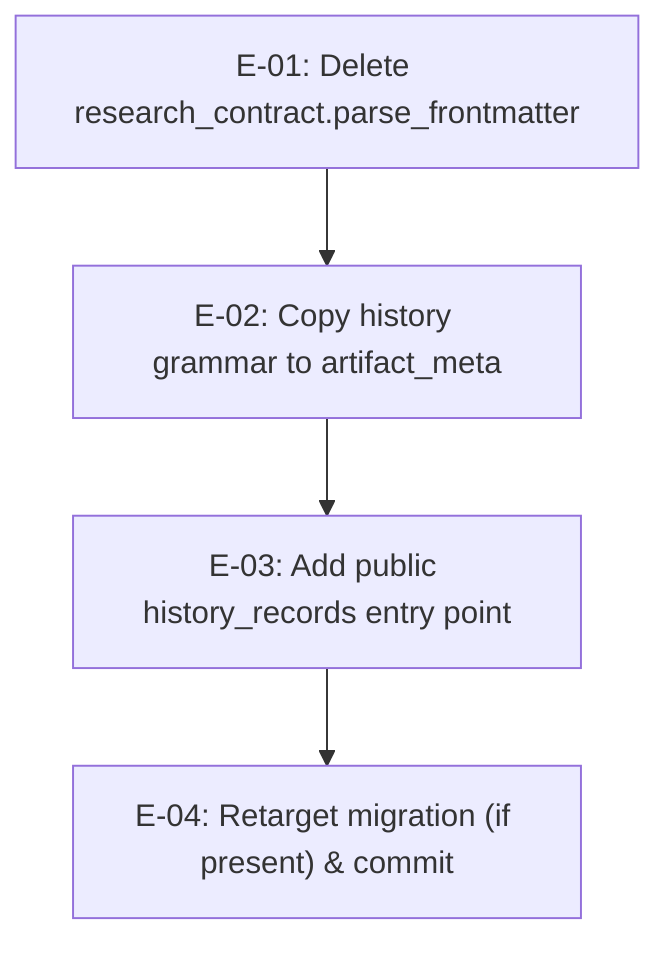

# IPD: Delete parse_frontmatter and move the history grammar into artifact_meta

- Date: 2026-11-09
- Kind: child
- Concern: Spec `4sd62s` C5 allows exactly one metadata reader (`artifact_meta`). Part 11 of the round-3 split of `k6jd6l` (Order 43, research `nj8zdp` guidance). After Orders 288 and 289, `research_contract.parse_frontmatter` has no caller and is deleted here. This part also copies the three workflow-history grammars `artifact_meta`'s legacy loader borrows from `attention_contract` (`history_block` with its `HistoryBlock` result, `newest_history_record`, `last_history_at`) into `artifact_meta`, and gives text-only readers one public `artifact_meta` entry point, so Orders 291 and 292 can move the readers. Measured at `f83159217`: `artifact_meta.load_legacy_artifact` calls `_att.newest_history_record` once and `_att.last_history_at` twice.
- Scope: Part of `k6jd6l` E-10: delete `research_contract.parse_frontmatter`; copy the history grammar into `artifact_meta` with a public text entry point; retarget the loader and the migration. EXCLUDES the readers (Orders 291, 292), deleting the `attention_contract` originals (Order 292), and `attention_contract.HISTORY_RECORD_RE`, which Order 248 (`tdhav3`) deletes after `k6jd6l` (`artifact_meta` gets its own private copy of the record pattern).
- Scope-Paths: agent_workflows/research_contract.py, agent_workflows/artifact_meta.py, agent_workflows/migrations/m0001_convert.py, tests/test_artifact_meta_legacy.py, .aw/records/plans/pending/20261109-metastore-290-bxupy8-delete-parse-frontmatter-and-move-the-history-grammar-into-a.ipd.md
- Item-Dependencies: executed:1ajqaa, executed:59aiyh, executed:5lgpix, executed:dcerjg, executed:ffceq0, executed:g5hpbb, executed:t4gl15
- Status: approved
- Readiness: go-pending-approval
- Review-Depth: standard
- From-Spec: 4sd62s
- Work-Kind: feature
- Priority: high
- Blocks-Release: next
- Set: metastore
- Order: 290
- Highest E allocated: 04
- Author: opencode its_direct/pt3-claude-opus-5.5-1m-us
- Id: bxupy8
- Approval: 2026-11-16, recorded via aw ipd set: status set to approved

> Written to .aw/system/workflows/technical-writing/technical-writing.md. Every obligation, exact identifier, quotation, evidence record, and lifecycle status is preserved.

## Workflow history
- 2026-11-16 approved (aw set): status set to approved

- 2026-11-14 reviewed (antigravity/gemini-3.8-flash): /plan-review (antigravity/gemini-3.8-flash): APPROVE WITH REVISIONS APPLIED; PR-001..PR-006; review record .aw/records/reviews/20261109-metastore-290-bxupy8-delete-parse-frontmatter-and-move-the-history-grammar-into-a.review.md
- 2026-11-09 to-review (opencode its_direct/pt3-claude-opus-5.5-1m-us): split from k6jd6l (round 3, research nj8zdp guidance).

## Goal

`research_contract` defines no `parse_frontmatter`, and `artifact_meta` owns a private history grammar that its loader uses and that a text-only caller reaches through one public function.

## Detailed Implementation Checklist (TODO)

Execution-state rule: mark an `E-*` item complete only after performing the action. That mark is not validation. Right-sizing rule: write for a modest executor that cannot hold much in its head. Each E-item is one step (one concern, about one file, executable in one focused pass) and its V-item names each unit it covers with its own check; a plan stays at about 5 E-items and 8 work Scope-Paths, else split it into more child plans (guidance, `IPD-Z603`). Accepted execution states: blocked, failed, pending, performed; terminal gate demands 'performed'.

Carried from `k6jd6l` E-10: "`attention_contract.history_block`, `last_history_at`, `newest_history_record` ... The migration (`dcerjg` E-09, `m0001_convert`) computes `last_history_day` with `newest_history_record`: it must call the moved private function inside `artifact_meta` (or a public `artifact_meta` wrapper), and `tests/test_m0001_conversion.py` and `tests/test_m0001_roundtrip.py` must pass unchanged." Ensure `.aw/state/9o83cr/` exists (`mkdir -p .aw/state/9o83cr/`). Save the before-list of `tests/test_artifact_meta_legacy.py` (and `tests/test_m0001_conversion.py` and `tests/test_m0001_roundtrip.py` if present) to `.aw/state/9o83cr/E-10d-before.txt`.

PIN RULE (carried from `9o83cr`): before an edit that deletes or retargets, save the named test modules' per-test outcome list (`python3 -m pytest -o addopts="" -m "" -p no:randomly -n 0 -rA <modules> | grep -E "^(PASSED|FAILED|ERROR|SKIPPED|XFAIL|XPASS) " | sed -E 's/ - .*//' | sort > <before-file>`); after it, run the same command into the matching after-file. A retargeted test keeps every input case, so the after-list may rename a test but not drop a case; the evidence pastes both lists and maps each removed name to its successor.

### Task group 1: one step per item

- [x] E-01 Before the first edit, ensure `.aw/state/9o83cr/` exists (`mkdir -p .aw/state/9o83cr/`) and save the baseline test PIN list to `.aw/state/9o83cr/E-10d-before.txt`. Delete `research_contract.parse_frontmatter`.
  - Depends on: none
  - Expected outcome: no module defines or calls it.
  - Execution state: performed

- [x] E-02 In `agent_workflows/artifact_meta.py`, add private copies, unchanged in behavior, of `attention_contract.history_block` (with its `HistoryBlock` result type and a private copy of the record pattern), `attention_contract.newest_history_record` and `attention_contract.last_history_at`, and change `artifact_meta.load_legacy_artifact` to call them.
  - Depends on: E-01
  - Expected outcome: `artifact_meta` calls no `_att` history function.
  - Execution state: performed

- [x] E-03 Add one public `artifact_meta` function for a caller that holds only TEXT and needs the history records (for example `artifact_meta.history_records(text) -> HistoryBlock`), documented as the single history grammar; a caller with an id6 uses `artifact_meta.history` or `read` instead.
  - Depends on: E-02
  - Expected outcome: the public function exists and returns the same block as the original for the same text.
  - Execution state: performed

- [x] E-04 If `agent_workflows/migrations/m0001_convert.py` exists, change its `newest_history_record` call to the `artifact_meta` function; save the after-list; commit through `aw commit bxupy8 -- <paths>`.
  - Depends on: E-03
  - Expected outcome: the migration calls `artifact_meta`; the migration tests pass unchanged.
  - Execution state: performed

## Project conventions discovered (Step 0)

- `attention_contract.HISTORY_RECORD_RE` is imported by `plan_readiness`, `record_history`, `ipd_lifecycle` and `review_sequence`; Order 248 (`tdhav3`) E-02 deletes it, so this family leaves it in place.
- The `artifact_meta` interface (names from `tve77h`, `ffceq0`, `xexn45`): `read(id6) -> State`, `history(id6)`, `read_at(id6, rev)`, `read_text(text, *, record_type=None) -> State`, `append(id6, events, *, expect_seq)` with `dry_run`, the phase-B legacy writer (`append_legacy`, `render_legacy`), and the legacy loader (`load_legacy_artifact`).
- Cite code by SYMBOL (`module.function`) or by a quoted content string, with a line number only appended to one of those and never alone (advisory `IPD-C801`).

## Findings

Measured 2026-11-09 at `f83159217` with `rg -n "_att\." agent_workflows/artifact_meta.py`: the loader calls `newest_history_record` (1) and `last_history_at` (2). `agent_workflows/migrations/` did not exist at that commit; Order 18 (`ghhzb6`) creates `m0001_convert.py`.

## Proposed changes (ordered, validatable)



1. Delete `parse_frontmatter` (E-01).
2. Copy the history grammar (E-02).
3. Add the public text entry point (E-03).
4. Retarget the migration and commit (E-04).

## Deferred / out of scope (with reason)

- The history readers.
  - Carrier: ay6sxp
- `attention_contract.HISTORY_RECORD_RE`.
  - Carrier: tdhav3

## Scope check

- Over-scope: none.
- Under-scope: none known. Size: 4 E-items, 4 work Scope-Paths.

## Required tests / validation

`tests/test_artifact_meta_legacy.py`, `tests/test_m0001_conversion.py`, `tests/test_m0001_roundtrip.py` (PIN lists).

## Spec / documentation sync

No spec change; implements part of `4sd62s` 4.3 and section 7 step 7. CONTRIBUTES to AC-1 (owned by `9o83cr`).

## Open questions

### OQ-01: Does a public `history_records(text)` break the 'read through `read`, `history`, `read_text` or `read_at`' rule of `k6jd6l` E-10?

- Blocking: no
- Status: resolved
- Owner: maintainer
- Resolution or deferral rationale: No: E-10 already allows a public `artifact_meta` wrapper for the migration, and several readers (`plan_readiness.newest_verdict`, `status_set.same_status_message_is_duplicate`) hold staged text with no id6, so they need a text entry point; it keeps the one grammar inside `artifact_meta`. Recommendation strength: medium. RESOLVED 2026-11-11 by the user via /askme: public now, private later (the function is public in artifact_meta so every caller uses the one copy; the cutover may make it private once no outside caller remains). No reason was given.

## Validation and cross-check (verify before reporting done)

Validation-state rule: inspect evidence in a separate pass. Do not mark a `V-*` item complete from memory or from the matching execution checkmark. Accepted validation results: blocked, failed, pass, pending; terminal gate demands 'pass'. Runtime-demonstration reachability rule: for each `V-*` item demanding the software be observed acting (such as a run, a dispatch, or a transition), as distinct from items demanding a diff, a file's content, or a test result, which are reachable by construction, name the code path that produces the observation or the sibling `E-*` that creates it, else the demand is UNDER-SCOPE.

- [x] V-01 validates E-01
  - Required evidence: paste `rg -n "parse_frontmatter\b" agent_workflows tools tests` listing only the private `artifact_meta` copy from Order 288 (and comments, each quoted).
  - Observed evidence:
    ```
    $ rg -n "parse_frontmatter\b" agent_workflows tools tests
    agent_workflows/research_index.py:906:    # Reads raw text because parse_frontmatter destroys key duplicates by last-wins assignment.
    agent_workflows/artifact_meta.py:2974:def _parse_frontmatter(text: str) -> Optional[Dict[str, object]]:
    agent_workflows/artifact_meta.py:2977:    Copy of ``research_contract.parse_frontmatter`` with unchanged behavior (IPD `sq6v7i`), so the
    agent_workflows/artifact_meta.py:3010:    `State` that `read_text` returns. See `_parse_frontmatter` for the exact framing.
    agent_workflows/artifact_meta.py:3013:    return _parse_frontmatter(text)
    ```
    Only the private `artifact_meta._parse_frontmatter` copy (Order 288), its public wrapper `front_matter_mapping` calling it, and two comments/docstrings: `research_index.py:906` quoted "# Reads raw text because parse_frontmatter destroys key duplicates by last-wins assignment." and `artifact_meta.py:2977` quoted "Copy of ``research_contract.parse_frontmatter`` with unchanged behavior". No module defines or calls `research_contract.parse_frontmatter` (the 36-line definition is removed in commit `c9fb84eec`).
  - Result: pass

- [x] V-02 validates E-02
  - Required evidence: paste `rg -n "_att\.(history_block|newest_history_record|last_history_at)" agent_workflows/artifact_meta.py` printing nothing and `rg -n "def _(history_block|newest_history_record|last_history_at)\b" agent_workflows/artifact_meta.py` with three hits.
  - Observed evidence:
    ```
    $ rg -n "_att\.(history_block|newest_history_record|last_history_at)" agent_workflows/artifact_meta.py; echo "exit=$?"
    exit=1
    $ rg -n "def _(history_block|newest_history_record|last_history_at)\b" agent_workflows/artifact_meta.py
    2701:def _history_block(text: str) -> HistoryBlock:
    2803:def _newest_history_record(history_lines: List[str]) -> Optional[str]:
    2843:def _last_history_at(
    ```
    First command prints nothing (exit 1); second has three hits. `artifact_meta` also owns `class HistoryBlock(NamedTuple)` and the private `_HISTORY_RECORD_RE`, `_HISTORY_HEADING_RE`, `_HISTORY_DATE_RE` patterns.
  - Result: pass

- [x] V-03 validates E-03
  - Required evidence: paste the new test in `tests/test_artifact_meta_legacy.py` that compares `artifact_meta.history_records(text)` with `attention_contract.history_block(text)` on the fixture texts, and its PASSED line.
  - Observed evidence:
    New tests in `tests/test_artifact_meta_legacy.py`: `test_history_records_matches_attention_contract_history_block` (parametrized over six fixture texts) and `test_last_history_at_copy_matches_original_for_event_dicts`. Core of the comparison test:
    ```
    @pytest.mark.parametrize(
        "text",
        _HISTORY_FIXTURE_TEXTS,
        ids=["no-history", "two-records", "wrapped-and-quoted", "column-zero-prose", "crlf", "empty-block"],
    )
    def test_history_records_matches_attention_contract_history_block(text: str):
        got = meta.history_records(text)
        want = att.history_block(text)
        assert got.records == want.records
        assert got.record_lines == want.record_lines
        assert got.body == want.body
        assert tuple(got) == tuple(want)
        assert meta._newest_history_record(got.records) == att.newest_history_record(
            want.records
        )
        assert meta._last_history_at(got.records) == att.last_history_at(want.records)
    ```
    PASSED lines (from the after-list run):
    ```
    PASSED tests/test_artifact_meta_legacy.py::test_history_records_matches_attention_contract_history_block[column-zero-prose]
    PASSED tests/test_artifact_meta_legacy.py::test_history_records_matches_attention_contract_history_block[crlf]
    PASSED tests/test_artifact_meta_legacy.py::test_history_records_matches_attention_contract_history_block[empty-block]
    PASSED tests/test_artifact_meta_legacy.py::test_history_records_matches_attention_contract_history_block[no-history]
    PASSED tests/test_artifact_meta_legacy.py::test_history_records_matches_attention_contract_history_block[two-records]
    PASSED tests/test_artifact_meta_legacy.py::test_history_records_matches_attention_contract_history_block[wrapped-and-quoted]
    PASSED tests/test_artifact_meta_legacy.py::test_last_history_at_copy_matches_original_for_event_dicts
    ```
  - Result: pass

- [x] V-04 validates E-04
  - Required evidence: paste `rg -n "newest_history_record|attention_contract" agent_workflows/migrations/m0001_convert.py` (no `attention_contract` hit, or 'file absent' with `ls agent_workflows/migrations/`), `diff .aw/state/9o83cr/E-10d-before.txt .aw/state/9o83cr/E-10d-after.txt` with no FAILED or ERROR line, and `git show --stat` of the `aw commit bxupy8` commit.
  - Observed evidence:
    ```
    $ rg -n "newest_history_record|attention_contract" agent_workflows/migrations/m0001_convert.py
    1217:        newest = artifact_meta._newest_history_record(hb.records)
    $ diff .aw/state/9o83cr/E-10d-before.txt .aw/state/9o83cr/E-10d-after.txt
    0a1,7
    > PASSED tests/test_artifact_meta_legacy.py::test_history_records_matches_attention_contract_history_block[column-zero-prose]
    > PASSED tests/test_artifact_meta_legacy.py::test_history_records_matches_attention_contract_history_block[crlf]
    > PASSED tests/test_artifact_meta_legacy.py::test_history_records_matches_attention_contract_history_block[empty-block]
    > PASSED tests/test_artifact_meta_legacy.py::test_history_records_matches_attention_contract_history_block[no-history]
    > PASSED tests/test_artifact_meta_legacy.py::test_history_records_matches_attention_contract_history_block[two-records]
    > PASSED tests/test_artifact_meta_legacy.py::test_history_records_matches_attention_contract_history_block[wrapped-and-quoted]
    > PASSED tests/test_artifact_meta_legacy.py::test_last_history_at_copy_matches_original_for_event_dicts
    $ git show --stat c9fb84eec
    commit c9fb84eec5758eb75e36270f719f2deeb8f535c9
        bxupy8: delete research_contract.parse_frontmatter; move the workflow-history grammar into artifact_meta with public history_records(text); retarget the loader and m0001_convert
        AW-Run: run-20261124T050731Z-1001505
        AW-Item: bxupy8
        AW-Runner: aw oc run
     agent_workflows/artifact_meta.py            | 237 +++++++++++++++++++++++++++-
     agent_workflows/migrations/m0001_convert.py |  15 +-
     agent_workflows/research_contract.py        |  36 -----
     tests/test_artifact_meta_legacy.py          |  69 ++++++++
     4 files changed, 304 insertions(+), 53 deletions(-)
    ```
    No `attention_contract` hit in `m0001_convert.py` (import removed; the heading pattern, record pattern, `history_block`, `newest_history_record` and `last_history_at` uses all moved to `artifact_meta`). The diff only adds the 7 new test cases; all 37 baseline cases (`tests/test_artifact_meta_legacy.py`, `tests/test_m0001_conversion.py`, `tests/test_m0001_roundtrip.py`) remain PASSED, no FAILED or ERROR line, no case removed. Full core tier (`aw suite`): "2889 passed, 1 skipped, 11 warnings in 197.78s". Every non-livecorpus test module citing `research_contract`, `m0001_convert`, `artifact_meta`, `history_block` or `last_history_at`: "1972 passed in 141.30s".
  - Result: pass

## Approval and execution gate

- Size assessment: standard
- Cohesion rationale: not required

Execute only after human approval (`Status: approved`) and after every plan in `- Item-Dependencies:` is executed. Pin-first where an item deletes or retargets. Stop safely if prerequisite metastore symbols from `59aiyh`, `5lgpix`, `ffceq0`, or `t4gl15` are absent.

Safety rule: uncommitted changes and untracked files you did not create are not yours; never revert, stage, commit, discard, reformat, or "clean up" another party's work.

Scope fence: the paths in `- Scope-Paths:` are a declaration; a needed file outside the fence is edited and then justified at finalize (`--scope-reason`), and a declared path left unmodified is acknowledged (`--scope-ack`).

Honesty rule: paste the ACTUAL output; never claim a result you did not run.

Commits: only through `aw commit bxupy8 -- <paths>` with only Scope-Paths files; never `git add -A`, a bare `git add` or `git commit -a`; never push.

Lifecycle transition: the plan moves to `.aw/records/plans/executed/` only through `aw ipd finalize bxupy8` (never a hand git mv), after `aw ipd lint --phase pre-transition` conforms and every `V-*` reads `pass` with pasted evidence. When aw oc run or aw agy run executes the plan, the runner performs the finalize; a hand executor runs aw ipd finalize bxupy8 itself.
