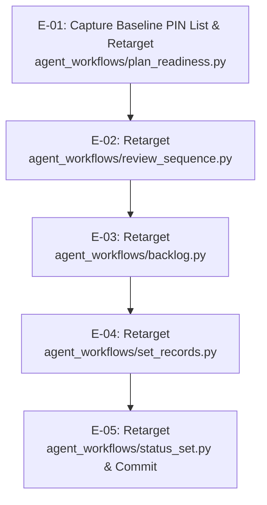

# IPD: Move the plan readiness backlog and setter history readers onto artifact_meta

- Date: 2026-11-09
- Kind: child
- Concern: Spec `4sd62s` C5 allows exactly one metadata reader (`artifact_meta`). Part 12 of the round-3 split of `k6jd6l` (Order 43, research `nj8zdp` guidance). Order 290 put the history grammar in `artifact_meta`; this part moves five reader modules off `attention_contract.history_block`/`newest_history_record`. Measured at `f83159217`: `plan_readiness` (`extract_newest_history_entry`, `history_has_review_record`, `newest_verdict`; 4 references), `review_sequence` (`count_verdict_bearing_entries`, `restore_pre_s7_plan`, through `plan_readiness.history_block`; 2), `backlog` (`validate_item`, `_strip_metadata_and_history`, `_prior_history_records`; 3), `set_records._extract_body` (1), `status_set.same_status_message_is_duplicate` (1).
- Scope: The `plan_readiness`, `review_sequence`, `backlog`, `set_records` and `status_set` readers of `k6jd6l` E-10's history grammar. EXCLUDES `attention`, `check_engine`, `specs`, `research_index` and deleting the originals (Order 292); `HISTORY_RECORD_RE` uses stay (Order 248, `tdhav3`).
- Scope-Paths: agent_workflows/plan_readiness.py, agent_workflows/review_sequence.py, agent_workflows/backlog.py, agent_workflows/set_records.py, agent_workflows/status_set.py, .aw/records/plans/pending/20261109-metastore-291-ay6sxp-move-the-plan-readiness-backlog-and-setter-history-readers-o.ipd.md
- Item-Dependencies: executed:1ajqaa, executed:59aiyh, executed:bxupy8, executed:dcerjg, executed:ffceq0, executed:g5hpbb, executed:t4gl15
- Status: approved
- Readiness: go-pending-approval
- Review-Depth: standard
- From-Spec: 4sd62s
- Work-Kind: feature
- Priority: high
- Blocks-Release: next
- Set: metastore
- Order: 291
- Highest E allocated: 05
- Author: opencode its_direct/pt3-claude-opus-5.5-1m-us
- Id: ay6sxp
- Approval: 2026-11-16, recorded via aw ipd set: status set to approved

> Write and proofread this plan per the technical writing standard, `.aw/system/workflows/technical-writing/technical-writing.md` (`.agents/workflows/technical-writing/technical-writing.md` in a legacy-layout install), including requirement 12 (diagrams).

## Workflow history
- 2026-11-16 approved (aw set): status set to approved

- 2026-11-14 reviewed (antigravity/gemini-3.8-flash): /plan-review (antigravity/gemini-3.8-flash): APPROVE WITH REVISIONS APPLIED; PR-001, PR-002, PR-003, PR-004.
- 2026-11-09 to-review (opencode its_direct/pt3-claude-opus-5.5-1m-us): split from k6jd6l (round 3, research nj8zdp guidance).

## Goal

None of these five modules imports `history_block` or `newest_history_record` from `attention_contract`.

## Detailed Implementation Checklist (TODO)

Execution-state rule: mark an `E-*` item complete only after performing the action. That mark is not validation. Right-sizing rule: write for a modest executor that cannot hold much in its head. Each E-item is one step (one concern, about one file, executable in one focused pass) and its V-item names each unit it covers with its own check; a plan stays at about 5 E-items and 8 work Scope-Paths, else split it into more child plans (guidance, `IPD-Z603`). Accepted execution states: blocked, failed, pending, performed; terminal gate demands 'performed'.

Carried from `k6jd6l` E-10: "Non-loader callers (... `backlog`, and the measured `attention_contract` importers `plan_readiness`, `set_records`, `record_history`, `ipd_lifecycle` and `status_set`, whichever F-20 still lists) read through `artifact_meta.read`, `history`, `read_text` or `read_at`." (`record_history` and `ipd_lifecycle` import only `HISTORY_RECORD_RE`, which Order 248 owns.) Each caller here holds text, so it uses Order 290's public text entry point. Save the before-list of `tests/test_history_block_bounding.py`, `tests/test_history_consumers_shared_reader.py`, `tests/test_review_sequence.py`, `tests/test_backlog.py` and `tests/test_status_set.py` to `.aw/state/9o83cr/E-10e-before.txt` before E-01 (ensure `.aw/state/9o83cr/` exists via `mkdir -p .aw/state/9o83cr/`).

PIN RULE (carried from `9o83cr`): before an edit that deletes or retargets, save the named test modules' per-test outcome list (`python3 -m pytest -o addopts="" -m "" -p no:randomly -n 0 -rA <modules> | grep -E "^(PASSED|FAILED|ERROR|SKIPPED|XFAIL|XPASS) " | sed -E 's/ - .*//' | sort > <before-file>`); after it, run the same command into the matching after-file. A retargeted test keeps every input case, so the after-list may rename a test but not drop a case; the evidence pastes both lists and maps each removed name to its successor.

### Task group 1: one module per item

- [ ] E-01 Before the first edit, ensure `.aw/state/9o83cr/` exists (`mkdir -p .aw/state/9o83cr/`) and save the baseline test PIN list to `.aw/state/9o83cr/E-10e-before.txt`. In `agent_workflows/plan_readiness.py`, replace the `history_block` and `newest_history_record` imports and their uses in `plan_readiness.extract_newest_history_entry`, `history_has_review_record` and `newest_verdict` with the `artifact_meta` history functions; keep the `HISTORY_RECORD_RE` import.
  - Depends on: none
  - Expected outcome: `plan_readiness` imports no history function from `attention_contract`.
  - Execution state: pending

- [ ] E-02 In `review_sequence.count_verdict_bearing_entries` and `review_sequence.restore_pre_s7_plan`, replace `plan_readiness.history_block` with the `artifact_meta` text entry point.
  - Depends on: E-01
  - Expected outcome: `review_sequence` reaches the history grammar only through `artifact_meta`.
  - Execution state: pending

- [ ] E-03 In `backlog.validate_item`, `backlog._strip_metadata_and_history` and `backlog._prior_history_records`, replace `A.history_block` with the `artifact_meta` text entry point.
  - Depends on: E-02
  - Expected outcome: `backlog` calls no `A.history_block`.
  - Execution state: pending

- [ ] E-04 In `set_records._extract_body`, replace `_ac.history_block` with the `artifact_meta` text entry point.
  - Depends on: E-03
  - Expected outcome: `set_records` calls no `_ac.history_block`.
  - Execution state: pending

- [ ] E-05 In `status_set.same_status_message_is_duplicate`, replace `_ac.newest_history_record(_ac.history_block(text).records)` with the `artifact_meta` functions; save the after-list; commit through `aw commit ay6sxp -- <paths>`.
  - Depends on: E-04
  - Expected outcome: the five modules import no history function from `attention_contract`.
  - Execution state: pending

## Project conventions discovered (Step 0)

- Order 247 (`akhrp5`) deletes `plan_readiness._READINESS_FIELD_PRESENT_RE`, `_READINESS_LINE_SUB_RE`, `_STATUS_RE` and the `id6_match` literals after `k6jd6l`; Order 248 (`tdhav3`) replaces the `^-` literals in `review_sequence.restore_pre_s7_plan` with an `artifact_meta.append` event. This plan changes only the history-grammar calls in those functions.
- The `artifact_meta` interface (names from `tve77h`, `ffceq0`, `xexn45`): `read(id6) -> State`, `history(id6)`, `read_at(id6, rev)`, `read_text(text, *, record_type=None) -> State`, `append(id6, events, *, expect_seq)` with `dry_run`, the phase-B legacy writer (`append_legacy`, `render_legacy`), and the legacy loader (`load_legacy_artifact`).
- Cite code by SYMBOL (`module.function`) or by a quoted content string, with a line number only appended to one of those and never alone (advisory `IPD-C801`).

## Findings

Measured 2026-11-09 at `f83159217` with `rg -n "history_block|newest_history_record" agent_workflows`: see the Concern.

## Proposed changes (ordered, validatable)

1. Retarget `plan_readiness` (E-01).
2. Retarget `review_sequence` (E-02).
3. Retarget `backlog` (E-03).
4. Retarget `set_records` (E-04).
5. Retarget `status_set` and commit (E-05).

## Deferred / out of scope (with reason)

- The `attention`, `check_engine`, `specs` and `research_index` readers and the deletion.
  - Carrier: csobg7

## Scope check

- Over-scope: none.
- Under-scope: none known. Size: 5 E-items, 5 work Scope-Paths.

## Required tests / validation

The five PIN modules above.

## Spec / documentation sync

No spec change; implements part of `4sd62s` 4.3 and section 7 step 7. CONTRIBUTES to AC-1 (owned by `9o83cr`).

## Open questions

### OQ-01: Two plans edit `review_sequence.restore_pre_s7_plan`; is that a module handled twice?

- Blocking: no
- Status: resolved
- Owner: plan author
- Resolution or deferral rationale: No: this plan changes its history-grammar read, Order 248 its two bullet-writer literals; they are different units, and Order 248 runs after `k6jd6l`, so they never edit the file at the same time. Recommendation strength: strong.

## Validation and cross-check (verify before reporting done)

Validation-state rule: inspect evidence in a separate pass. Do not mark a `V-*` item complete from memory or from the matching execution checkmark. Accepted validation results: blocked, failed, pass, pending; terminal gate demands 'pass'. Runtime-demonstration reachability rule: for each `V-*` item demanding the software be observed acting (such as a run, a dispatch, or a transition), as distinct from items demanding a diff, a file's content, or a test result, which are reachable by construction, name the code path that produces the observation or the sibling `E-*` that creates it, else the demand is UNDER-SCOPE.

- [ ] V-01 validates E-01
  - Required evidence: paste `rg -n "history_block|newest_history_record" agent_workflows/plan_readiness.py` showing only `artifact_meta` uses, and the before/after per-test lines of `tests/test_history_consumers_shared_reader.py`.
  - Observed evidence:
  - Result: pending

- [ ] V-02 validates E-02
  - Required evidence: paste `rg -n "history_block" agent_workflows/review_sequence.py` showing only `artifact_meta` uses and the before/after per-test lines of `tests/test_review_sequence.py`.
  - Observed evidence:
  - Result: pending

- [ ] V-03 validates E-03
  - Required evidence: paste `rg -n "A\.history_block" agent_workflows/backlog.py` printing nothing and the before/after per-test lines of `tests/test_backlog.py`.
  - Observed evidence:
  - Result: pending

- [ ] V-04 validates E-04
  - Required evidence: paste `rg -n "_ac\.history_block" agent_workflows/set_records.py` printing nothing and the before/after per-test lines of `tests/test_history_block_bounding.py`.
  - Observed evidence:
  - Result: pending

- [ ] V-05 validates E-05
  - Required evidence: paste `rg -n "(_ac|A|attention_contract)\.(history_block|newest_history_record)|import .*history_block" agent_workflows/plan_readiness.py agent_workflows/review_sequence.py agent_workflows/backlog.py agent_workflows/set_records.py agent_workflows/status_set.py` printing nothing, `diff .aw/state/9o83cr/E-10e-before.txt .aw/state/9o83cr/E-10e-after.txt` with no FAILED or ERROR line, and `git show --stat` of the `aw commit ay6sxp` commit.
  - Observed evidence:
  - Result: pending

## Approval and execution gate

- Size assessment: standard
- Cohesion rationale: not required

Execute only after human approval (`Status: approved`) and after every plan in `- Item-Dependencies:` is executed. Pin-first where an item deletes or retargets. Scope fence: the paths in `- Scope-Paths:` are a declaration; a needed file outside the fence is edited and then justified at finalize (`--scope-reason`), and a declared path left unmodified is acknowledged (`--scope-ack`). Safety stop: if prerequisite metastore history grammar functions from `bxupy8` or `t4gl15` are absent upon starting, stop and report rather than creating conflicting implementations. Honesty rule: paste the ACTUAL output; never claim a result you did not run. Commits: only through `aw commit ay6sxp -- <paths>` with only Scope-Paths files; never `git add -A`, a bare `git add` or `git commit -a`; never push. Lifecycle: the plan moves to `.aw/records/plans/executed/` only through finalize; when `aw oc run` or `aw agy run` executes the plan, the runner performs the finalize; a hand executor runs `aw ipd finalize ay6sxp` itself; never a hand `git mv` to `executed/`.
