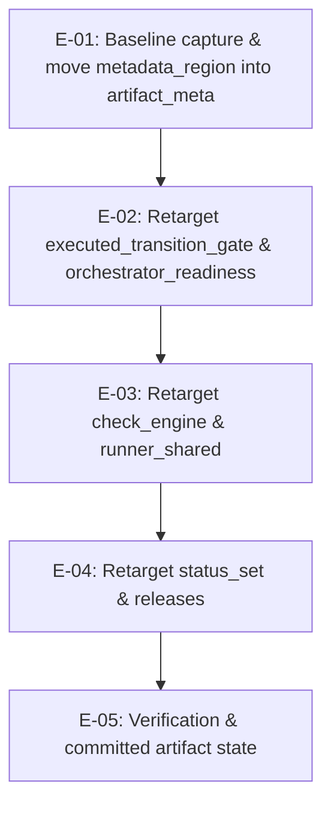

# IPD: Move metadata_region into artifact_meta and retarget the gate and readiness callers

- Date: 2026-11-09
- Kind: child
- Concern: Spec `4sd62s` C5 allows exactly one metadata reader (`artifact_meta`), and `k6jd6l` E-11 deletes `selectors.metadata_region`, the function that bounds a record's metadata region (everything before the first `##` heading). Part 14 of the round-3 split of `k6jd6l` (Order 43, research `nj8zdp` guidance): this part gives `artifact_meta` the region function and moves the production callers outside `selectors` onto it. Measured at `f83159217`: `hooks/executed_transition_gate._has_executed_status` and `_plan_id_of` (2), `orchestrator_readiness.resolve_all_set_memberships` (1), `artifact_meta._set_bullet` (1), `check_engine._metadata_region` (1), `runner_shared._split_metadata_region` (1), `status_set.read_artifact_record` (1), `releases.parse_graduated_to` (1).
- Scope: The non-`selectors` callers of `selectors.metadata_region` from `k6jd6l` E-11. Each call changes from `selectors.metadata_region(text)` to `artifact_meta.metadata_region(text)` ONLY; the `^-` regex literals applied to the region stay, because Orders 247 (`akhrp5`, `orchestrator_readiness._BATCH_META_RE`), 249 (`n2cvf0`, the literal in `executed_transition_gate._plan_id_of`) and 45 (`e8420v`, `check_engine`, `runner_shared`, `status_set`, `releases`) delete them after `k6jd6l`. EXCLUDES the `selectors` internal uses and the deletion (Order 294).
- Scope-Paths: agent_workflows/artifact_meta.py, agent_workflows/hooks/executed_transition_gate.py, agent_workflows/orchestrator_readiness.py, agent_workflows/check_engine.py, agent_workflows/runner_shared.py, agent_workflows/status_set.py, agent_workflows/releases.py, .aw/records/plans/pending/20261109-metastore-293-71ewpn-move-metadata-region-into-artifact-meta-and-retarget-the-gat.ipd.md
- Item-Dependencies: executed:1ajqaa, executed:59aiyh, executed:csobg7, executed:dcerjg, executed:ffceq0, executed:g5hpbb, executed:t4gl15
- Status: reviewed
- Readiness: go-pending-approval
- Review-Depth: standard
- From-Spec: 4sd62s
- Work-Kind: feature
- Priority: high
- Blocks-Release: next
- Set: metastore
- Order: 293
- Highest E allocated: 05
- Author: opencode its_direct/pt3-claude-opus-5.5-1m-us
- Id: 71ewpn

This plan conforms to the technical writing standard, `.aw/system/workflows/technical-writing/technical-writing.md`.

## Workflow history
- 2026-11-14 reviewed (aw set): APPROVE WITH REVISIONS APPLIED; PR-001..PR-006 FIXED

- 2026-11-14 /plan-review (antigravity/gemini-3.8-flash): APPROVE WITH REVISIONS APPLIED; PR-001..PR-006 fixed; review record .aw/records/reviews/20261109-metastore-293-71ewpn-move-metadata-region-into-artifact-meta-and-retarget-the-gat.review.md
- 2026-11-09 to-review (opencode its_direct/pt3-claude-opus-5.5-1m-us): split from k6jd6l (round 3, research nj8zdp guidance).

## Goal

Only `selectors` itself still calls `selectors.metadata_region`.

## Detailed Implementation Checklist (TODO)

Execution-state rule: mark an `E-*` item complete only after performing the action. That mark is not validation. Right-sizing rule: write for a modest executor that cannot hold much in its head. Each E-item is one step (one concern, about one file, executable in one focused pass) and its V-item names each unit it covers with its own check; a plan stays at about 5 E-items and 8 work Scope-Paths, else split it into more child plans (guidance, `IPD-Z603`). Accepted execution states: blocked, failed, pending, performed; terminal gate demands 'performed'.

Carried from `k6jd6l` E-11: "Delete the text readers of the record and selector modules: ... `metadata_region` (their remaining callers, including `hooks/executed_transition_gate`, use `artifact_meta.read`, `read_text` or `read_at`)". A caller that only needs the region text keeps applying its own (later-deleted) literal to `artifact_meta.metadata_region`, so no unit here is also edited by Orders 247 or 249. Ensure the baseline directory exists (`mkdir -p .aw/state/9o83cr`) and save the before-list of `tests/test_executed_transition_gate.py`, `tests/test_orchestrator_readiness.py`, `tests/test_check_engine_status_meta.py`, `tests/test_graduation_forward_links.py` and `tests/test_artifact_meta_legacy.py` to `.aw/state/9o83cr/E-11a-before.txt`.

PIN RULE (carried from `9o83cr`): before an edit that deletes or retargets, save the named test modules' per-test outcome list (`python3 -m pytest -o addopts="" -m "" -p no:randomly -n 0 -rA <modules> | grep -E "^(PASSED|FAILED|ERROR|SKIPPED|XFAIL|XPASS) " | sed -E 's/ - .*//' | sort > <before-file>`); after it, run the same command into the matching after-file. A retargeted test keeps every input case, so the after-list may rename a test but not drop a case; the evidence pastes both lists and maps each removed name to its successor.

### Task group 1: one or two callers per item

- [ ] E-01 Ensure directory `.aw/state/9o83cr` exists (`mkdir -p .aw/state/9o83cr`) and record baseline outcomes to `.aw/state/9o83cr/E-11a-before.txt`. Move `selectors.metadata_region` (and `selectors._metadata_region_complete` if only it uses it) into `artifact_meta` as a public `artifact_meta.metadata_region` with unchanged behavior; for now `selectors.metadata_region` is a one-line call to it; change `artifact_meta._set_bullet` to call the local function.
  - Depends on: none
  - Expected outcome: `artifact_meta.metadata_region` exists; `artifact_meta` does not call `_sel.metadata_region`.
  - Execution state: pending

- [ ] E-02 In `agent_workflows/hooks/executed_transition_gate.py` (`_has_executed_status`, `_plan_id_of`) and `orchestrator_readiness.resolve_all_set_memberships`, call `artifact_meta.metadata_region`.
  - Depends on: E-01
  - Expected outcome: neither module calls `selectors.metadata_region`.
  - Execution state: pending

- [ ] E-03 In `check_engine._metadata_region` and `runner_shared._split_metadata_region`, call `artifact_meta.metadata_region`.
  - Depends on: E-02
  - Expected outcome: neither module calls `selectors.metadata_region`.
  - Execution state: pending

- [ ] E-04 In `status_set.read_artifact_record` and `releases.parse_graduated_to`, call `artifact_meta.metadata_region`.
  - Depends on: E-03
  - Expected outcome: neither module calls `selectors.metadata_region`.
  - Execution state: pending

- [ ] E-05 Save the after-list; run `rg -n "selectors\.metadata_region|_sel\.metadata_region" agent_workflows tools`; commit through `aw commit 71ewpn -- <paths>`.
  - Depends on: E-04
  - Expected outcome: only `selectors` calls `selectors.metadata_region`; no pinned case is dropped.
  - Execution state: pending

## Project conventions discovered (Step 0)

- `agent_workflows/releases.py::_in_metadata_region` also called `agent_workflows/selectors.py::metadata_region`; Order 284 (`zs7a45`) deleted it.
- The `agent_workflows/artifact_meta.py` interface (names from `tve77h`, `ffceq0`, `xexn45`): `read(id6) -> State`, `history(id6)`, `read_at(id6, rev)`, `read_text(text, *, record_type=None) -> State`, `append(id6, events, *, expect_seq)` with `dry_run`, the phase-B legacy writer (`append_legacy`, `render_legacy`), and the legacy loader (`load_legacy_artifact`).
- Cite code by SYMBOL (`path::Symbol`) or by a quoted content string, with a line number only appended to one of those and never alone (advisory `IPD-C801`).

## Findings

Measured 2026-11-09 at `f83159217` with `rg -n "metadata_region\(" agent_workflows | grep -v selectors.py`: see the Concern. Order 280's F-25 re-derives the list after phase B.
Context baseline measured at HEAD `56c6460f0`: 65 passed in 4.44s across the five PIN test modules (`tests/test_executed_transition_gate.py`: 12, `tests/test_orchestrator_readiness.py`: 24, `tests/test_check_engine_status_meta.py`: 5, `tests/test_graduation_forward_links.py`: 9, `tests/test_artifact_meta_legacy.py`: 15).

## Proposed changes (ordered, validatable)

1. Move the function into `artifact_meta` (E-01).
2. Retarget the gate and readiness callers (E-02).
3. Retarget `check_engine` and `runner_shared` (E-03).
4. Retarget `status_set` and `releases` (E-04).
5. Verify and commit (E-05).

## Deferred / out of scope (with reason)

- `selectors` internal uses and deleting `selectors.metadata_region`.
  - Carrier: 8ysz6b
- The literals applied to the region in these modules.
  - Carrier: e8420v

## Scope check

- Over-scope: none.
- Under-scope: none known. Size: 5 E-items, 7 work Scope-Paths.

## Required tests / validation

The five PIN modules above: `tests/test_executed_transition_gate.py` (12 tests), `tests/test_orchestrator_readiness.py` (24 tests), `tests/test_check_engine_status_meta.py` (5 tests), `tests/test_graduation_forward_links.py` (9 tests), and `tests/test_artifact_meta_legacy.py` (15 tests). Baseline context measured at HEAD `56c6460f0`: 65 passed in 4.44s.

## Spec / documentation sync

No spec change; implements part of `4sd62s` 4.3 and section 7 step 7. CONTRIBUTES to `4sd62s` AC-1 (owned by `9o83cr`).

## Open questions

### OQ-01: Is a public `artifact_meta.metadata_region` allowed by C5?

- Blocking: no
- Status: resolved
- Owner: plan author
- Resolution or deferral rationale: Yes: it keeps the region bound inside `artifact_meta`, and the callers that use it are exactly the regex-literal sites that later plans delete; once those run, its only callers are inside `artifact_meta` and the cutover (`cxxmyv`) may make it private. Recommendation strength: medium. RESOLVED 2026-11-11 by the user via /askme: public now, private later (the function is public in artifact_meta so every caller uses the one copy; the cutover may make it private once no outside caller remains). No reason was given.

## Validation and cross-check (verify before reporting done)

Validation-state rule: inspect evidence in a separate pass. Do not mark a `V-*` item complete from memory or from the matching execution checkmark. Accepted validation results: blocked, failed, pass, pending; terminal gate demands 'pass'. Runtime-demonstration reachability rule: for each `V-*` item demanding the software be observed acting (such as a run, a dispatch, or a transition), as distinct from items demanding a diff, a file's content, or a test result, which are reachable by construction, name the code path that produces the observation or the sibling `E-*` that creates it, else the demand is UNDER-SCOPE.

- [ ] V-01 validates E-01
  - Required evidence: paste `rg -n "def metadata_region|_sel\.metadata_region" agent_workflows/artifact_meta.py` showing only the definition.
  - Observed evidence:
  - Result: pending

- [ ] V-02 validates E-02
  - Required evidence: paste `rg -n "metadata_region" agent_workflows/hooks/executed_transition_gate.py agent_workflows/orchestrator_readiness.py` showing only `artifact_meta` calls, and the before/after per-test lines of `tests/test_executed_transition_gate.py` and `tests/test_orchestrator_readiness.py`.
  - Observed evidence:
  - Result: pending

- [ ] V-03 validates E-03
  - Required evidence: paste `rg -n "_sel\.metadata_region" agent_workflows/check_engine.py agent_workflows/runner_shared.py` printing nothing and the before/after per-test lines of `tests/test_check_engine_status_meta.py`.
  - Observed evidence:
  - Result: pending

- [ ] V-04 validates E-04
  - Required evidence: paste `rg -n "_sel\.metadata_region" agent_workflows/status_set.py agent_workflows/releases.py` printing nothing and the before/after per-test lines of `tests/test_graduation_forward_links.py`.
  - Observed evidence:
  - Result: pending

- [ ] V-05 validates E-05
  - Required evidence: paste the `rg` output listing no file but `agent_workflows/selectors.py`, `diff .aw/state/9o83cr/E-11a-before.txt .aw/state/9o83cr/E-11a-after.txt` with no FAILED or ERROR line, and `git show --stat` of the `aw commit 71ewpn` commit.
  - Observed evidence:
  - Result: pending

## Approval and execution gate

- Size assessment: standard
- Cohesion rationale: not required

Execute only after human approval (`Status: approved`) and after every plan in `- Item-Dependencies:` is executed. Safety stop: if prerequisite metastore symbols from `1ajqaa`, `59aiyh`, `csobg7`, `dcerjg`, `ffceq0`, `g5hpbb`, or `t4gl15` are absent, or if an unresolvable concurrent-edit conflict arises on any Scope-Paths file, STOP and report. Pin-first where an item deletes or retargets. Scope fence: the paths in `- Scope-Paths:` are a declaration; a needed file outside the fence is edited and then justified at finalize (`--scope-reason`), and a declared path left unmodified is acknowledged (`--scope-ack`). Honesty rule: paste the ACTUAL runner output; never claim a result you did not run. Commits: only through `aw commit 71ewpn -- <paths>` with only Scope-Paths files; never `git add -A`, a bare `git add` or `git commit -a`; never push. Lifecycle: the plan moves to `.aw/records/plans/executed/` only through `aw ipd finalize`, never a hand `git mv`. When `aw oc run` or `aw agy run` executes the plan, the runner performs the finalize; a hand executor runs `aw ipd finalize 71ewpn` itself after `aw ipd lint --phase pre-transition` conforms and every `V-*` reads `pass` with pasted evidence.
