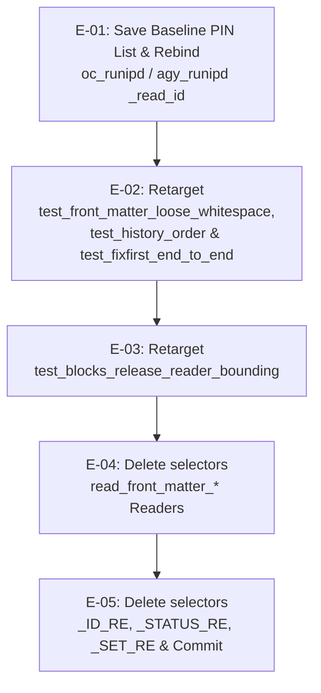

# IPD: Delete the selectors record text readers and rebind the runner re-exports

- Date: 2026-11-09
- Kind: child
- Concern: Spec `4sd62s` C5 allows exactly one metadata reader (`artifact_meta`). Part 15 of the round-3 split of `k6jd6l` (Order 43, research `nj8zdp` guidance): delete the `selectors` public text readers `read_front_matter_id`, `read_front_matter_status` and `read_front_matter_blocks_release` and the module patterns `selectors._ID_RE`, `_STATUS_RE` and `_SET_RE`. The `oc_runipd`/`agy_runipd` `_read_id` re-exports, pinned by `tests/test_runner_shared.py::CrossHostReadIdReExportTests` (loose `-  `/`-\t` spelling), are rebound first. Measured at `f83159217`: test callers `tests/test_front_matter_loose_whitespace.py` (3), `tests/test_history_order.py` (1), `tests/test_fixfirst_end_to_end.py` (1), `tests/test_blocks_release_reader_bounding.py` (5); `artifact_meta.append_legacy` calls `_sel.read_front_matter_id` (1).
- Scope: The `selectors` reader part of `k6jd6l` E-11 subset 1. Production callers in `runner_shared`, `releases`, `status_set`, `ipd_lint` and `attention` are moved by `ffceq0` and `t4gl15` (dependencies); any that Order 280's F-25 still lists live is handled here with `--scope-reason`. EXCLUDES `selectors.metadata_region` (Orders 293 and 296), the `plans` and `prompts` readers (Orders 295, 296).
- Scope-Paths: agent_workflows/selectors.py, agent_workflows/oc_runipd.py, agent_workflows/agy_runipd.py, agent_workflows/artifact_meta.py, tests/test_front_matter_loose_whitespace.py, tests/test_history_order.py, tests/test_fixfirst_end_to_end.py, tests/test_blocks_release_reader_bounding.py, .aw/records/plans/pending/20261109-metastore-294-8ysz6b-delete-the-selectors-record-text-readers-and-rebind-the-runn.ipd.md
- Item-Dependencies: executed:1ajqaa, executed:59aiyh, executed:71ewpn, executed:dcerjg, executed:ffceq0, executed:g5hpbb, executed:t4gl15
- Status: approved
- Readiness: go-pending-approval
- Review-Depth: standard
- From-Spec: 4sd62s
- Work-Kind: feature
- Priority: high
- Blocks-Release: next
- Set: metastore
- Order: 294
- Highest E allocated: 05
- Author: opencode its_direct/pt3-claude-opus-5.5-1m-us
- Id: 8ysz6b
- Approval: 2026-11-16, recorded via aw ipd set: status set to approved

> Write and proofread this plan per the technical writing standard, `.aw/system/workflows/technical-writing/technical-writing.md` (`.agents/workflows/technical-writing/technical-writing.md` in a legacy-layout install), including requirement 12 (diagrams).

## Workflow history
- 2026-11-16 approved (aw set): status set to approved

- 2026-11-14 reviewed (antigravity/gemini-3.8-flash): /plan-review (antigravity/gemini-3.8-flash): APPROVE WITH REVISIONS APPLIED; PR-001, PR-002, PR-003, PR-004.
- 2026-11-09 to-review (opencode its_direct/pt3-claude-opus-5.5-1m-us): split from k6jd6l (round 3, research nj8zdp guidance).

## Goal

`selectors` defines no `read_front_matter_*` reader and no `_ID_RE`, `_STATUS_RE` or `_SET_RE`, and `CrossHostReadIdReExportTests` passes unchanged.

## Detailed Implementation Checklist (TODO)

Execution-state rule: mark an `E-*` item complete only after performing the action. That mark is not validation. Right-sizing rule: write for a modest executor that cannot hold much in its head. Each E-item is one step (one concern, about one file, executable in one focused pass) and its V-item names each unit it covers with its own check; a plan stays at about 5 E-items and 8 work Scope-Paths, else split it into more child plans (guidance, `IPD-Z603`). Accepted execution states: blocked, failed, pending, performed; terminal gate demands 'performed'.

Carried from `k6jd6l` E-11: "The public `selectors.read_front_matter_*` callers that remain after `ffceq0` and `t4gl15` include the `oc_runipd`/`agy_runipd` `_read_id` re-exports ...; rebind the re-export to `artifact_meta.read_text`'s loose `id` value (`ffceq0` D-2, `t4gl15` D-4) so that test passes unchanged." Save the before-list of `tests/test_runner_shared.py`, `tests/test_front_matter_loose_whitespace.py`, `tests/test_history_order.py`, `tests/test_fixfirst_end_to_end.py` and `tests/test_blocks_release_reader_bounding.py` to `.aw/state/9o83cr/E-11b-before.txt` before E-01 (ensure `.aw/state/9o83cr/` exists via `mkdir -p .aw/state/9o83cr/`).

PIN RULE (carried from `9o83cr`): before an edit that deletes or retargets, save the named test modules' per-test outcome list (`python3 -m pytest -o addopts="" -m "" -p no:randomly -n 0 -rA <modules> | grep -E "^(PASSED|FAILED|ERROR|SKIPPED|XFAIL|XPASS) " | sed -E 's/ - .*//' | sort > <before-file>`); after it, run the same command into the matching after-file. A retargeted test keeps every input case, so the after-list may rename a test but not drop a case; the evidence pastes both lists and maps each removed name to its successor.

### Task group 1: rebind, retarget tests, delete

- [ ] E-01 Before the first edit, ensure `.aw/state/9o83cr/` exists (`mkdir -p .aw/state/9o83cr/`) and save the baseline test PIN list to `.aw/state/9o83cr/E-11b-before.txt`. Rebind `oc_runipd._read_id` and `agy_runipd._read_id` to a function returning `artifact_meta.read_text(text).fields`' loose `id` value (`ffceq0` D-2, `t4gl15` D-4), and change `artifact_meta.append_legacy`'s `_sel.read_front_matter_id` call to the same local reader.
  - Depends on: none
  - Expected outcome: no module imports `read_front_matter_id` for the re-export; `CrossHostReadIdReExportTests` passes unchanged.
  - Execution state: pending

- [ ] E-02 Retarget `tests/test_front_matter_loose_whitespace.py`, `tests/test_history_order.py` and `tests/test_fixfirst_end_to_end.py` from `selectors.read_front_matter_id`/`read_front_matter_status` to `artifact_meta.read_text`, keeping every case.
  - Depends on: E-01
  - Expected outcome: none of the three calls a `read_front_matter_*` reader.
  - Execution state: pending

- [ ] E-03 Retarget `tests/test_blocks_release_reader_bounding.py` from `selectors.read_front_matter_blocks_release` to `artifact_meta.read_text(...).fields`, keeping every case.
  - Depends on: E-02
  - Expected outcome: the module calls no `read_front_matter_*` reader.
  - Execution state: pending

- [ ] E-04 Delete `selectors.read_front_matter_id`, `read_front_matter_status` and `read_front_matter_blocks_release` with their private patterns.
  - Depends on: E-03
  - Expected outcome: `rg -n "read_front_matter_(id|status|blocks_release)" agent_workflows tools tests` prints only comment lines.
  - Execution state: pending

- [ ] E-05 Delete `selectors._ID_RE`, `_STATUS_RE` and `_SET_RE` (their readers `selectors._read_id`, `_read_status`, `_read_setid` read through `artifact_meta` since Order 142, `cdglt1`); save the after-list; commit through `aw commit 8ysz6b -- <paths>`.
  - Depends on: E-04
  - Expected outcome: the three patterns are gone; no pinned case is dropped.
  - Execution state: pending

## Project conventions discovered (Step 0)

- `selectors.read_front_matter_id` and `read_front_matter_status` are the loose-spelling readers (`^-\s*Id:`); `CrossHostReadIdReExportTests` pins that behavior.
- The `artifact_meta` interface (names from `tve77h`, `ffceq0`, `xexn45`): `read(id6) -> State`, `history(id6)`, `read_at(id6, rev)`, `read_text(text, *, record_type=None) -> State`, `append(id6, events, *, expect_seq)` with `dry_run`, the phase-B legacy writer (`append_legacy`, `render_legacy`), and the legacy loader (`load_legacy_artifact`).
- Cite code by SYMBOL (`module.function`) or by a quoted content string, with a line number only appended to one of those and never alone (advisory `IPD-C801`).

## Findings

Measured 2026-11-09 at `f83159217` with `rg -n "read_front_matter_(id|status|blocks_release)" agent_workflows tests`: see the Concern; production callers in `runner_shared` (11), `releases` (3), `status_set` (3), `ipd_lint` (1), `attention` (1) are in the Scope-Paths of `ffceq0` or `t4gl15` and expected moved.

## Proposed changes (ordered, validatable)

1. Rebind the re-exports (E-01).
2. Retarget three tests (E-02).
3. Retarget the blocks-release test (E-03).
4. Delete the readers (E-04).
5. Delete the patterns and commit (E-05).

## Deferred / out of scope (with reason)

- `selectors.metadata_region` and the `plans` readers.
  - Carrier: hrbbhy
- The `prompts` readers.
  - Carrier: iup4lp

## Scope check

- Over-scope: none.
- Under-scope: If Order 280's F-25 lists a live production caller of a deleted reader, retarget it here and justify the path at finalize (`--scope-reason`). Size: 5 E-items, 8 work Scope-Paths.

## Required tests / validation

The five PIN modules above.

## Spec / documentation sync

No spec change; implements part of `4sd62s` 4.3 and section 7 step 7. CONTRIBUTES to AC-1 (owned by `9o83cr`).

## Open questions

### OQ-01: What if `selectors._read_id` still uses `_ID_RE`?

- Blocking: no
- Status: resolved
- Owner: plan author
- Resolution or deferral rationale: Then Order 142 did not finish; stop and report rather than deleting the pattern. Recommendation strength: strong.

## Validation and cross-check (verify before reporting done)

Validation-state rule: inspect evidence in a separate pass. Do not mark a `V-*` item complete from memory or from the matching execution checkmark. Accepted validation results: blocked, failed, pass, pending; terminal gate demands 'pass'. Runtime-demonstration reachability rule: for each `V-*` item demanding the software be observed acting (such as a run, a dispatch, or a transition), as distinct from items demanding a diff, a file's content, or a test result, which are reachable by construction, name the code path that produces the observation or the sibling `E-*` that creates it, else the demand is UNDER-SCOPE.

- [ ] V-01 validates E-01
  - Required evidence: paste `rg -n "read_front_matter_id" agent_workflows/oc_runipd.py agent_workflows/agy_runipd.py agent_workflows/artifact_meta.py` printing nothing and `python3 -m pytest -o addopts="" -v tests/test_runner_shared.py -k CrossHostReadIdReExport` with every test PASSED and `git diff --stat tests/test_runner_shared.py` empty.
  - Observed evidence:
  - Result: pending

- [ ] V-02 validates E-02
  - Required evidence: paste `rg -n "read_front_matter_" tests/test_front_matter_loose_whitespace.py tests/test_history_order.py tests/test_fixfirst_end_to_end.py` printing nothing and each module's before/after per-test lines.
  - Observed evidence:
  - Result: pending

- [ ] V-03 validates E-03
  - Required evidence: paste `rg -n "read_front_matter_" tests/test_blocks_release_reader_bounding.py` printing nothing and its before/after per-test lines.
  - Observed evidence:
  - Result: pending

- [ ] V-04 validates E-04
  - Required evidence: paste that `rg` output (empty, or each line a quoted comment).
  - Observed evidence:
  - Result: pending

- [ ] V-05 validates E-05
  - Required evidence: paste `rg -n "^_(ID|STATUS|SET)_RE =" agent_workflows/selectors.py` printing nothing, `diff .aw/state/9o83cr/E-11b-before.txt .aw/state/9o83cr/E-11b-after.txt` with no FAILED or ERROR line, and `git show --stat` of the `aw commit 8ysz6b` commit.
  - Observed evidence:
  - Result: pending

## Approval and execution gate

- Size assessment: standard
- Cohesion rationale: not required

Execute only after human approval (`Status: approved`) and after every plan in `- Item-Dependencies:` is executed. Pin-first where an item deletes or retargets. Scope fence: the paths in `- Scope-Paths:` are a declaration; a needed file outside the fence is edited and then justified at finalize (`--scope-reason`), and a declared path left unmodified is acknowledged (`--scope-ack`). Safety stop: if prerequisite metastore symbols from `59aiyh`, `71ewpn`, `ffceq0`, or `t4gl15` are absent upon starting, stop and report rather than creating conflicting implementations. Honesty rule: paste the ACTUAL output; never claim a result you did not run. Commits: only through `aw commit 8ysz6b -- <paths>` with only Scope-Paths files; never `git add -A`, a bare `git add` or `git commit -a`; never push. Lifecycle: the plan moves to `.aw/records/plans/executed/` only through finalize; when `aw oc run` or `aw agy run` executes the plan, the runner performs the finalize; a hand executor runs `aw ipd finalize 8ysz6b` itself; never a hand `git mv` to `executed/`.
