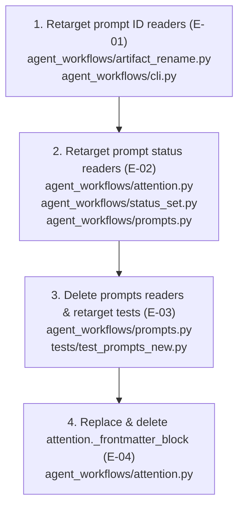

# IPD: Delete the prompts text readers and attention frontmatter block reader

- Date: 2026-11-09
- Kind: child
- Concern: Spec `4sd62s` C5 allows exactly one metadata reader (`artifact_meta`). Part 16 of the round-3 split of `k6jd6l` (Order 43, research `nj8zdp` guidance): delete `prompts.read_metadata_id6`, `prompts.read_metadata_status` and `prompts._METADATA_STATUS_RE` (the staged-prompt `aw-prompt` comment readers) and `attention._frontmatter_block` (a raw YAML block reader). Measured callers at `f83159217`: `artifact_rename._read_existing_id6` (1), `attention._prompts_record` (2), `cli._find_prompt_id6` (2), `prompts.update_metadata_status` (internal), `status_set.read_artifact_record` and `status_set._prepare_status_change` (2), `attention._extract_detail` (1, `_frontmatter_block`); test `tests/test_prompts_new.py` (1).
- Scope: The `prompts` and `attention` reader part of `k6jd6l` E-11 subset 1. EXCLUDES `artifact_rename`'s own regex literals (Order 245, `qttoyc`) and `attention`'s inline literals (Order 248, `tdhav3`).
- Scope-Paths: agent_workflows/prompts.py, agent_workflows/artifact_rename.py, agent_workflows/attention.py, agent_workflows/cli.py, agent_workflows/status_set.py, tests/test_prompts_new.py, .aw/records/plans/pending/20261109-metastore-295-iup4lp-delete-the-prompts-text-readers-and-attention-frontmatter-bl.ipd.md
- Item-Dependencies: executed:1ajqaa, executed:59aiyh, executed:8ysz6b, executed:dcerjg, executed:ffceq0, executed:g5hpbb, executed:t4gl15
- Status: approved
- Readiness: go-pending-approval
- Review-Depth: complex
- From-Spec: 4sd62s
- Work-Kind: feature
- Priority: high
- Blocks-Release: next
- Set: metastore
- Order: 295
- Highest E allocated: 04
- Author: opencode its_direct/pt3-claude-opus-5.5-1m-us
- Id: iup4lp
- Approval: 2026-11-16, recorded via aw ipd set: status set to approved

> Write and proofread this plan per the technical writing standard, `.aw/system/workflows/technical-writing/technical-writing.md` (`.agents/workflows/technical-writing/technical-writing.md` in a legacy-layout install), including requirement 12 (diagrams).

## Workflow history
- 2026-11-16 approved (aw set): status set to approved

- 2026-11-14 reviewed (antigravity): plan-review verified E/V bijection, Scope-Paths, prompt reader deletion, and execution gate; marked reviewed and go-pending-approval.
- 2026-11-09 to-review (opencode its_direct/pt3-claude-opus-5.5-1m-us): split from k6jd6l (round 3, research nj8zdp guidance).

## Goal

No module defines or calls `read_metadata_id6`, `read_metadata_status`, `_METADATA_STATUS_RE` or `attention._frontmatter_block`.

## Detailed Implementation Checklist (TODO)

Execution-state rule: mark an `E-*` item complete only after performing the action. That mark is not validation. Right-sizing rule: write for a modest executor that cannot hold much in its head. Each E-item is one step (one concern, about one file, executable in one focused pass) and its V-item names each unit it covers with its own check; a plan stays at about 5 E-items and 8 work Scope-Paths, else split it into more child plans (guidance, `IPD-Z603`). Accepted execution states: blocked, failed, pending, performed; terminal gate demands 'performed'.

Carried from `k6jd6l` E-11: "`prompts._METADATA_STATUS_RE`, `read_metadata_id6` and `read_metadata_status`; `attention._frontmatter_block`". Save the before-list of `tests/test_prompts_new.py`, `tests/test_attention.py`, `tests/test_artifact_rename.py` and `tests/test_status_set.py` to `.aw/state/9o83cr/E-11c-before.txt`.

PIN RULE (carried from `9o83cr`): before an edit that deletes or retargets, save the named test modules' per-test outcome list (`python3 -m pytest -o addopts="" -m "" -p no:randomly -n 0 -rA <modules> | grep -E "^(PASSED|FAILED|ERROR|SKIPPED|XFAIL|XPASS) " | sed -E 's/ - .*//' | sort > <before-file>`); after it, run the same command into the matching after-file. A retargeted test keeps every input case, so the after-list may rename a test but not drop a case; the evidence pastes both lists and maps each removed name to its successor.

### Task group 1: callers first, then delete

- [x] E-01 Change `artifact_rename._read_existing_id6` and `cli._find_prompt_id6` to read the prompt id through `artifact_meta.read_text(text, record_type="prompts")`.
  - Depends on: none
  - Expected outcome: neither calls `read_metadata_id6`.
  - Execution state: performed

- [x] E-02 Change `attention._prompts_record`, `status_set.read_artifact_record` and `status_set._prepare_status_change` to read the prompt id and status through `artifact_meta.read_text`; change `prompts.update_metadata_status` to read the current status the same way.
  - Depends on: E-01
  - Expected outcome: no caller outside the definitions remains.
  - Execution state: performed

- [x] E-03 Delete `prompts.read_metadata_id6`, `prompts.read_metadata_status` and `prompts._METADATA_STATUS_RE`; retarget `tests/test_prompts_new.py` to `artifact_meta.read_text`.
  - Depends on: E-02
  - Expected outcome: the three symbols are gone.
  - Execution state: performed

- [x] E-04 Replace `attention._frontmatter_block` in `attention._extract_detail` with the research fields from `artifact_meta.read_text`, keeping the bulleted-form-wins cascade order, and delete `attention._frontmatter_block`; save the after-list; commit through `aw commit iup4lp -- <paths>`.
  - Depends on: E-03
  - Expected outcome: `attention` defines no `_frontmatter_block`; `aw attention --format json` is unchanged.
  - Execution state: performed

## Project conventions discovered (Step 0)

- `attention._extract_detail` reads Summary, Scope, Concern, Question, Title and the H1 in that order, bulleted form first, then the unbulleted YAML form; the YAML half is what `_frontmatter_block` fed.
- The `artifact_meta` interface (names from `tve77h`, `ffceq0`, `xexn45`): `read(id6) -> State`, `history(id6)`, `read_at(id6, rev)`, `read_text(text, *, record_type=None) -> State`, `append(id6, events, *, expect_seq)` with `dry_run`, the phase-B legacy writer (`append_legacy`, `render_legacy`), and the legacy loader (`load_legacy_artifact`).
- Cite code by SYMBOL (`module.function`) or by a quoted content string, with a line number only appended to one of those and never alone (advisory `IPD-C801`).

## Findings

Measured 2026-11-09 at `f83159217` with `rg -n "read_metadata_(id6|status)|_METADATA_STATUS_RE|_frontmatter_block" agent_workflows tests`: see the Concern.

## Proposed changes (ordered, validatable)



1. Retarget the id readers (E-01).
2. Retarget the status readers (E-02).
3. Delete the `prompts` readers (E-03).
4. Delete `_frontmatter_block` and commit (E-04).

## Deferred / out of scope (with reason)

- `artifact_rename` regex literals.
  - Carrier: qttoyc
- `attention` inline literals.
  - Carrier: tdhav3

## Scope check

- Over-scope: none.
- Under-scope: none known. Size: 4 E-items, 6 work Scope-Paths.

## Required tests / validation

The four PIN modules above and `aw attention --format json`.

## Spec / documentation sync

No spec change; implements part of `4sd62s` 4.3 and section 7 step 7. CONTRIBUTES to AC-1 (owned by `9o83cr`).

## Open questions

### OQ-01: `artifact_adopt._yaml_frontmatter_block` has a similar name; is it in scope?

- Blocking: no
- Status: resolved
- Owner: plan author
- Resolution or deferral rationale: No: `k6jd6l` E-11 names only `attention._frontmatter_block`, and `artifact_adopt._yaml_frontmatter_block` frames an inbox file before adoption (not a record); no plan in this family owns it, so if Order 280's F-24 grammar search lists it, it is recorded there as `delete (follow-on)`. Recommendation strength: medium.

## Validation and cross-check (verify before reporting done)

Validation-state rule: inspect evidence in a separate pass. Do not mark a `V-*` item complete from memory or from the matching execution checkmark. Accepted validation results: blocked, failed, pass, pending; terminal gate demands 'pass'. Runtime-demonstration reachability rule: for each `V-*` item demanding the software be observed acting (such as a run, a dispatch, or a transition), as distinct from items demanding a diff, a file's content, or a test result, which are reachable by construction, name the code path that produces the observation or the sibling `E-*` that creates it, else the demand is UNDER-SCOPE.

- [x] V-01 validates E-01
  - Required evidence: paste `rg -n "read_metadata_id6" agent_workflows/artifact_rename.py agent_workflows/cli.py` printing nothing and the before/after per-test lines of `tests/test_artifact_rename.py`.
  - Observed evidence: (attempt 2, lane `aw/lane/iup4lp_attempt2`; every command re-run in this attempt after bringing attempt 1's diff forward)
    ```
    $ rg -n "read_metadata_id6" agent_workflows/artifact_rename.py agent_workflows/cli.py
    rc=1   (no output)
    ```
    Before/after per-test lines of `tests/test_artifact_rename.py` (identical, 7 = 7):
    ```
    PASSED tests/test_artifact_rename.py::TestArtifactRename::test_rename_backlog_preview_and_apply
    PASSED tests/test_artifact_rename.py::TestArtifactRename::test_rename_comms_is_unsupported
    PASSED tests/test_artifact_rename.py::TestArtifactRename::test_rename_prompts
    PASSED tests/test_artifact_rename.py::TestArtifactRename::test_rename_releases
    PASSED tests/test_artifact_rename.py::TestArtifactRename::test_rename_roadmaps
    PASSED tests/test_artifact_rename.py::TestArtifactRename::test_rename_specs_legacy_timestamp
    PASSED tests/test_artifact_rename.py::TestArtifactRename::test_rename_walkthroughs
    ```
    Behavior equivalence of the retargeted read (`artifact_meta.read_text(first_line, record_type="prompt").id6`, gated on `prompts.has_metadata_comment`) against the deleted `read_metadata_id6`, over every `*.md` in the tree: `files 5573 prompt-ish 24 diffs 0` (id6 and status both compared). Note: `read_text` parses the `aw-prompt` comment only for the singular registry type `"prompt"`, not the plural `"prompts"` the E-01 text names (decision 09-iup4lp-D1).
  - Result: pass

- [x] V-02 validates E-02
  - Required evidence: paste `rg -n "read_metadata_(id6|status)" agent_workflows` listing only the two `prompts.py` definitions, and the before/after per-test lines of `tests/test_status_set.py`.
  - Observed evidence: Taken by attempt 1 after E-02, before E-03 (attempt 2 applied the E-01..E-04 diff as one unit, so this intermediate state was not re-observed):
    ```
    $ rg -n "read_metadata_(id6|status)" agent_workflows
    agent_workflows/prompts.py:279:def read_metadata_id6(text: str) -> Optional[str]:
    agent_workflows/prompts.py:340:def read_metadata_status(text: str) -> Optional[str]:
    ```
    `tests/test_status_set.py` per-test lines: 110 PASSED before, 110 PASSED after, and `diff` of the full before/after lists is empty (see V-04). `attention._prompts_record` already read through `artifact_meta.read_text(text, record_type="prompt")` at the starting HEAD `04186ad3c`, so it needed no change; `status_set.read_artifact_record` reaches `_read_artifact_record_with_state`, which already used `artifact_meta.read_text`; the remaining caller was `status_set._prepare_status_change` (retargeted), plus `prompts.update_metadata_status` (retargeted).
  - Result: pass

- [x] V-03 validates E-03
  - Required evidence: paste `rg -n "read_metadata_(id6|status)|_METADATA_STATUS_RE" agent_workflows tests` printing nothing and the before/after per-test lines of `tests/test_prompts_new.py`.
  - Observed evidence: (attempt 2, lane `aw/lane/iup4lp_attempt2`; every command re-run in this attempt after bringing attempt 1's diff forward)
    ```
    $ rg -n "read_metadata_(id6|status)|_METADATA_STATUS_RE" agent_workflows tests
    rc=1   (no output)
    ```
    `tests/test_prompts_new.py`: 22 PASSED before and 22 PASSED after, same names (the retargeted assertion is in `TestApplyWritesConformingFile::test_apply_writes_exactly_one_file_at_derived_path`, PASSED in both lists). Three further test modules that called `read_metadata_id6` after the plan's measurement were retargeted too, so the zero-hit demand holds: `tests/test_prompts_set_surface.py` (6 = 6), `tests/test_artifact_meta_legacy_writer.py` (11 = 11), `tests/test_writers_create_summary.py` (82 = 82).
  - Result: pass

- [x] V-04 validates E-04
  - Required evidence: paste `rg -n "_frontmatter_block" agent_workflows/attention.py` printing nothing, the `diff` of `aw attention --format json` against the Order 280 baseline `.aw/state/k6jd6l/before/` file (empty), `diff .aw/state/9o83cr/E-11c-before.txt .aw/state/9o83cr/E-11c-after.txt` with no FAILED or ERROR line, and `git show --stat` of the `aw commit iup4lp` commit.
  - Observed evidence: (attempt 2, lane `aw/lane/iup4lp_attempt2`; every command re-run in this attempt after bringing attempt 1's diff forward)
    ```
    $ rg -n "_frontmatter_block" agent_workflows/attention.py
    rc=1   (no output)
    $ diff .aw/state/iup4lp/attention-before.json .aw/state/iup4lp/attention-after.json      # aw attention --format json --all --details
    (empty, rc=0)
    $ diff .aw/state/iup4lp/attention-default-before.json .aw/state/iup4lp/attention-default-after.json   # aw attention --format json
    (empty, rc=0)
    $ wc -l .aw/state/9o83cr/E-11c-*.txt ; diff .aw/state/9o83cr/E-11c-before.txt .aw/state/9o83cr/E-11c-after.txt
      314 .aw/state/9o83cr/E-11c-after.txt
      314 .aw/state/9o83cr/E-11c-before.txt
    diff-rc=0   (no FAILED or ERROR line; every line is PASSED)
    ```
    The Order 280 baseline `.aw/state/k6jd6l/before/` does not exist in this lane (gitignored state), so the baseline was captured from the starting HEAD before any edit (decision 09-iup4lp-D3). Corpus equivalence of the new cascade (`_extract_detail` and `_research_record` `has_yaml`) against the old `_frontmatter_block` path over every `*.md`: `files 5573 detail diffs 0 has_yaml diffs 0` (re-run in attempt 2). Core suite (`aw suite`, attempt 2): `2889 passed, 1 skipped, 11 warnings in 147.24s (0:02:27)`. `git show --stat` of the `aw commit iup4lp` commit (the three out-of-fence test paths were recorded with `--scope-reason`):
    ```
    $ git show --stat dd6bd00fe
    commit dd6bd00feee2026bc4dbaad5cc1fe6a4d687865c
    metastore 295 (iup4lp): delete prompts.read_metadata_id6/read_metadata_status/_METADATA_STATUS_RE and attention._frontmatter_block; callers read through artifact_meta.read_text (brought forward from lane aw/lane/iup4lp 85bdcaf88)
     agent_workflows/artifact_rename.py        |  6 +++-
     agent_workflows/attention.py              | 52 +++++++++++++++----------------
     agent_workflows/cli.py                    |  6 ++--
     agent_workflows/prompts.py                | 33 ++------------------
     agent_workflows/status_set.py             |  6 +++-
     tests/test_artifact_meta_legacy_writer.py |  3 +-
     tests/test_prompts_new.py                 |  6 ++--
     tests/test_prompts_set_surface.py         |  2 +-
     tests/test_writers_create_summary.py      |  2 +-
     9 files changed, 49 insertions(+), 67 deletions(-)
    ```
  - Result: pass

## Approval and execution gate

- Size assessment: standard
- Cohesion rationale: not required

Execute only after human approval (`Status: approved`) and after every plan in `- Item-Dependencies:` is executed. Pin-first where an item deletes or retargets. Scope fence: the paths in `- Scope-Paths:` are a declaration; a needed file outside the fence is edited and then justified at finalize (`--scope-reason`), and a declared path left unmodified is acknowledged (`--scope-ack`). Honesty rule: paste the ACTUAL output; never claim a result you did not run. Commits: only through `aw commit iup4lp -- <paths>` with only Scope-Paths files; never `git add -A`, a bare `git add` or `git commit -a`; never push. Lifecycle: the plan moves to `.aw/records/plans/executed/` only through `aw ipd finalize`, never a hand `git mv`, after `aw ipd lint --phase pre-transition` conforms and every `V-*` reads `pass` with pasted evidence. When `aw oc run` or `aw agy run` executes the plan, the runner performs the finalize; a hand executor runs `aw ipd finalize iup4lp` itself.
