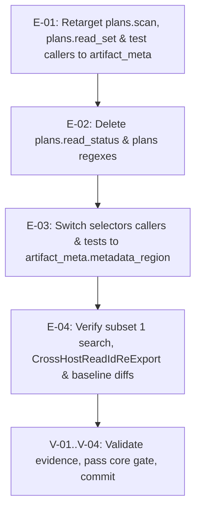

# IPD: Delete the plans record text readers and verify the subset-1 deletions

- Date: 2026-11-09
- Kind: child
- Concern: Spec `4sd62s` C5 allows exactly one metadata reader (`artifact_meta`). Part 17 of the round-3 split of `k6jd6l` (Order 43, research `nj8zdp` guidance): delete `plans.read_status` and the `plans` patterns `_STATUS_RE`, `_SET_RE` and `_ORDER_RE`, then delete `selectors.metadata_region` (whose last callers are inside `selectors`), and verify the whole of `k6jd6l` E-11 subset 1. Measured at `f83159217`: `plans.read_status` callers `plans.scan` (1), `attention._plans_record` (1), `ipd_lint.lint_text` (1), `check_engine.check_ipd_lint_reach` (1), tests `tests/test_plan_status.py` (2) and `tests/test_drift_detail_escaping.py` (1); `plans.read_set` uses `_SET_RE`/`_ORDER_RE`.
- Scope: The `plans` reader part of `k6jd6l` E-11 subset 1, the `selectors.metadata_region` deletion, and subset 1's expected-outcome check. The `attention`, `ipd_lint` and `check_engine` callers are in `ffceq0`'s Scope-Paths and expected moved; a live one in Order 280's F-25 is retargeted here with `--scope-reason`.
- Scope-Paths: agent_workflows/plans.py, agent_workflows/selectors.py, tests/test_plan_status.py, tests/test_drift_detail_escaping.py, tests/test_releases_sibling_line_writers_bounding.py, .aw/records/plans/pending/20261109-metastore-296-hrbbhy-delete-the-plans-record-text-readers-and-verify-the-subset-1.ipd.md
- Item-Dependencies: executed:1ajqaa, executed:59aiyh, executed:dcerjg, executed:ffceq0, executed:g5hpbb, executed:iup4lp, executed:t4gl15
- Status: approved
- Review-Depth: standard
- Readiness: go-pending-approval
- From-Spec: 4sd62s
- Work-Kind: feature
- Priority: high
- Blocks-Release: next
- Set: metastore
- Order: 296
- Highest E allocated: 04
- Author: opencode its_direct/pt3-claude-opus-5.5-1m-us
- Id: hrbbhy
- Approval: 2026-11-16, recorded via aw ipd set: status set to approved

> Reviewed and proofread per the technical writing standard, `.aw/system/workflows/technical-writing/technical-writing.md`, including requirement 12 (diagrams).

## Workflow history
- 2026-11-16 approved (aw set): status set to approved

- 2026-11-14 reviewed (antigravity/gemini-3.8-flash): /plan-review (antigravity/gemini-3.8-flash): APPROVE WITH REVISIONS APPLIED; PR-001, PR-002, PR-003, PR-004.
- 2026-11-09 to-review (opencode its_direct/pt3-claude-opus-5.5-1m-us): split from k6jd6l (round 3, research nj8zdp guidance).

## Goal

None of the subset-1 symbols of `k6jd6l` E-11 is defined or referenced in `agent_workflows`, and `aw find` and `aw attention --format json` match the Order 280 baseline.

## Detailed Implementation Checklist (TODO)

Execution-state rule: mark an `E-*` item complete only after performing the action. That mark is not validation. Right-sizing rule: write for a modest executor that cannot hold much in its head. Each E-item is one step (one concern, about one file, executable in one focused pass) and its V-item names each unit it covers with its own check; a plan stays at about 5 E-items and 8 work Scope-Paths, else split it into more child plans (guidance, `IPD-Z603`). Accepted execution states: blocked, failed, pending, performed; terminal gate demands 'performed'.

Carried from `k6jd6l` E-11 ("`plans._STATUS_RE`, `_SET_RE`, `_ORDER_RE` and `plans.read_status`", and `selectors.metadata_region`) and its V-11 evidence. Save the before-list of `tests/test_plan_status.py`, `tests/test_drift_detail_escaping.py` `tests/test_selector_two_dialect_readers.py` and `tests/test_releases_sibling_line_writers_bounding.py` to `.aw/state/9o83cr/E-11d-before.txt`.

PIN RULE (carried from `9o83cr`): before an edit that deletes or retargets, save the named test modules' per-test outcome list (`mkdir -p .aw/state/9o83cr && python3 -m pytest -o addopts="" -m "" -p no:randomly -n 0 -rA <modules> | grep -E "^(PASSED|FAILED|ERROR|SKIPPED|XFAIL|XPASS) " | sed -E 's/ - .*//' | sort > <before-file>`); after it, run the same command into the matching after-file. A retargeted test keeps every input case, so the after-list may rename a test but not drop a case; the evidence pastes both lists and maps each removed name to its successor.

### Task group 1: delete, then verify

- [ ] E-01 Change `plans.scan` and `plans.read_set` to read status, Set and Order through `artifact_meta.read_text` (or `read`), and retarget `tests/test_plan_status.py` and `tests/test_drift_detail_escaping.py` off `plans.read_status`, keeping every case (PIN RULE, `mkdir -p .aw/state/9o83cr && ` capture to before-list).
  - Depends on: none
  - Expected outcome: no caller of `plans.read_status` remains.
  - Execution state: pending

- [ ] E-02 Delete `plans.read_status`, `plans._STATUS_RE`, `plans._SET_RE` and `plans._ORDER_RE`.
  - Depends on: E-01
  - Expected outcome: the four symbols are gone.
  - Execution state: pending

- [ ] E-03 Change the internal uses of `selectors.metadata_region` (`selectors.record_dirs` and the `_read_id`, `_read_status`, `_read_setid`, `_declares_typed_subject` readers) to `artifact_meta.metadata_region`, and delete `selectors.metadata_region` and `selectors._metadata_region_complete` if unused; change the `selectors.metadata_region` assertions in `tests/test_releases_sibling_line_writers_bounding.py` to `artifact_meta.metadata_region`.
  - Depends on: E-02
  - Expected outcome: `selectors` defines no `metadata_region`.
  - Execution state: pending

- [ ] E-04 Verify subset 1: run the `k6jd6l` V-11 search over `agent_workflows`, `python3 -m pytest -o addopts="" -v tests/test_runner_shared.py -k CrossHostReadIdReExport`, and `diff` `aw find plans --agent` and `aw attention --format json` against `.aw/state/k6jd6l/before/`; save the after-list; commit through `aw commit hrbbhy -- <paths>`.
  - Depends on: E-03
  - Expected outcome: the subset-1 search prints nothing; the re-export tests pass unchanged; both diffs are empty.
  - Execution state: pending

## Project conventions discovered (Step 0)

- `plans.read_status` and `plans.scan` keep their public signatures for `aw ipd board`; Order 142 (`cdglt1`) moved the board path onto `artifact_meta.query`.
- The `artifact_meta` interface (names from `tve77h`, `ffceq0`, `xexn45`): `read(id6) -> State`, `history(id6)`, `read_at(id6, rev)`, `read_text(text, *, record_type=None) -> State`, `append(id6, events, *, expect_seq)` with `dry_run`, the phase-B legacy writer (`append_legacy`, `render_legacy`), and the legacy loader (`load_legacy_artifact`).
- Cite code by SYMBOL (`module.function`) or by a quoted content string, with a line number only appended to one of those and never alone (advisory `IPD-C801`).

## Findings

Measured 2026-11-09 at `f83159217` with `rg -n "read_status\(" agent_workflows tests` and `rg -n "_(STATUS|SET|ORDER)_RE" agent_workflows/plans.py`: see the Concern.

## Proposed changes (ordered, validatable)

1. Retarget the `plans` readers (E-01).
2. Delete them (E-02).
3. Delete `selectors.metadata_region` (E-03).
4. Verify subset 1 and commit (E-04).

## Deferred / out of scope (with reason)

- Subset 2 (spec and backlog readers).
  - Carrier: um2kvx

## Scope check

- Over-scope: none.
- Under-scope: none known. Size: 4 E-items, 5 work Scope-Paths.

## Required tests / validation

The three PIN modules, `tests/test_runner_shared.py -k CrossHostReadIdReExport`, `aw find plans --agent`, `aw attention --format json`.

## Spec / documentation sync

No spec change; implements part of `4sd62s` 4.3 and section 7 step 7. CONTRIBUTES to AC-1 (owned by `9o83cr`).

## Open questions

### OQ-01: `tests/test_releases_sibling_line_writers_bounding.py` calls `selectors.metadata_region` 8 times; who retargets it?

- Blocking: no
- Status: resolved
- Owner: plan author (carried from k6jd6l)
- Resolution or deferral rationale: Order 282 changes only its writer calls; E-03 here changes its region assertions. They are different units and run serially. Recommendation strength: strong.

## Validation and cross-check (verify before reporting done)

Validation-state rule: inspect evidence in a separate pass. Do not mark a `V-*` item complete from memory or from the matching execution checkmark. Accepted validation results: blocked, failed, pass, pending; terminal gate demands 'pass'. Runtime-demonstration reachability rule: for each `V-*` item demanding the software be observed acting (such as a run, a dispatch, or a transition), as distinct from items demanding a diff, a file's content, or a test result, which are reachable by construction, name the code path that produces the observation or the sibling `E-*` that creates it, else the demand is UNDER-SCOPE.

- [ ] V-01 validates E-01
  - Required evidence: paste `rg -n "read_status\(" agent_workflows/plans.py tests/test_plan_status.py tests/test_drift_detail_escaping.py` showing only the definition, and both test modules' before/after per-test lines.
  - Observed evidence:
  - Result: pending

- [ ] V-02 validates E-02
  - Required evidence: paste `rg -n "plans\.read_status|_plans\.read_status|plans_mod\.read_status|^_(STATUS|SET|ORDER)_RE =" agent_workflows tools` (with `agent_workflows/plans.py` for the patterns) printing nothing.
  - Observed evidence:
  - Result: pending

- [ ] V-03 validates E-03
  - Required evidence: paste `rg -n "def metadata_region|selectors\.metadata_region|_sel\.metadata_region" agent_workflows tools tests` showing only the `artifact_meta.py` definition, and the before/after per-test lines of `tests/test_selector_two_dialect_readers.py`.
  - Observed evidence:
  - Result: pending

- [ ] V-04 validates E-04
  - Required evidence: paste the empty output of `rg -n "read_front_matter_(id|status|blocks_release)|selectors\.metadata_region|plans\.read_status|read_metadata_(id6|status)|_METADATA_STATUS_RE|_frontmatter_block" agent_workflows` and of `rg -n "^_(ID|STATUS|SET|ORDER)_RE =" agent_workflows/selectors.py agent_workflows/plans.py`, the CrossHostReadIdReExport tests PASSED, both `diff` outputs empty, `diff .aw/state/9o83cr/E-11d-before.txt .aw/state/9o83cr/E-11d-after.txt`, and `git show --stat` of the `aw commit hrbbhy` commit.
  - Observed evidence:
  - Result: pending

## Approval and execution gate

- Size assessment: standard
- Cohesion rationale: not required

Execute only after human approval (`Status: approved`) and after every plan in `- Item-Dependencies:` is executed. Pin-first where an item deletes or retargets. A narrow safety stop applies if prerequisite metastore symbols from `1ajqaa`, `59aiyh`, `dcerjg`, `ffceq0`, `g5hpbb`, `iup4lp`, or `t4gl15` are absent. Scope fence: the paths in `- Scope-Paths:` are a declaration; a needed file outside the fence is edited and then justified at finalize (`--scope-reason`), and a declared path left unmodified is acknowledged (`--scope-ack`). Honesty rule: paste the ACTUAL output; never claim a result you did not run. Commits: only through `aw commit hrbbhy -- <paths>` with only Scope-Paths files; never `git add -A`, a bare `git add` or `git commit -a`; never push. Lifecycle transition: the plan moves to `.aw/records/plans/executed/` only through `aw ipd finalize` (never a hand `git mv`), and only after `aw ipd lint --phase pre-transition` conforms and every `V-*` reads `pass` with pasted evidence. When `aw oc run` or `aw agy run` executes the plan, the runner performs the finalize; a hand executor runs `aw ipd finalize hrbbhy` itself.
