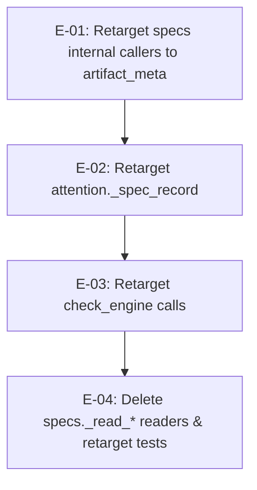

# IPD: Delete the specs record text readers

- Date: 2026-11-09
- Kind: child
- Concern: Spec `4sd62s` C5 allows exactly one metadata reader (`artifact_meta`). Part 18 of the round-3 split of `k6jd6l` (Order 43, research `nj8zdp` guidance): delete the seven `specs` line readers `specs._read_status`, `_read_gate`, `_read_blocks_release`, `_read_priority`, `_read_work_kind`, `_read_scope` and `_read_summary`. Measured at `f83159217`: 13 internal calls in `specs` (mostly `specs.validate_spec`), `attention._spec_record` (4), `check_engine.check_decision_ref_dangling` and `check_engine._iter_live_gate_carriers` (3), `tests/test_specs_status_dirs.py` (1) and `tests/test_specs_releases_descriptive_safety.py` (1).
- Scope: The `specs` part of `k6jd6l` E-18 (subset 2). `check_engine._read_blocks_release` (a different function, used by `runner_shared` and `tools/gate_drop_audit.py`) is owned by Order 45 (`e8420v`), as `k6jd6l` E-18 already said. EXCLUDES `backlog.parse_item` (Orders 298, 299) and `attention`'s inline literals (Order 248).
- Scope-Paths: agent_workflows/specs.py, agent_workflows/attention.py, agent_workflows/check_engine.py, tests/test_specs_status_dirs.py, tests/test_specs_releases_descriptive_safety.py, .aw/records/plans/pending/20261109-metastore-297-um2kvx-delete-the-specs-record-text-readers.ipd.md
- Item-Dependencies: executed:1ajqaa, executed:59aiyh, executed:dcerjg, executed:ffceq0, executed:g5hpbb, executed:hrbbhy, executed:t4gl15
- Status: approved
- Readiness: go-pending-approval
- Review-Depth: standard
- From-Spec: 4sd62s
- Work-Kind: feature
- Priority: high
- Blocks-Release: next
- Set: metastore
- Order: 297
- Highest E allocated: 04
- Author: opencode its_direct/pt3-claude-opus-5.5-1m-us
- Id: um2kvx
- Approval: 2026-11-16, recorded via aw ipd set: status set to approved

> Written to .aw/system/workflows/technical-writing/technical-writing.md. Every obligation, exact identifier, quotation, evidence record, and lifecycle status is preserved.

## Workflow history
- 2026-11-16 approved (aw set): status set to approved

- 2026-11-14 reviewed (antigravity/gemini-3.8-flash): /plan-review (antigravity/gemini-3.8-flash): APPROVE WITH REVISIONS APPLIED; PR-001..PR-007; review record .aw/records/reviews/20261109-metastore-297-um2kvx-delete-the-specs-record-text-readers.review.md
- 2026-11-09 to-review (opencode its_direct/pt3-claude-opus-5.5-1m-us): split from k6jd6l (round 3, research nj8zdp guidance).

## Goal

`specs` defines none of the seven readers, and `aw check all --all --agent`'s rule multiset matches the Order 280 baseline.

## Detailed Implementation Checklist (TODO)

Execution-state rule: mark an `E-*` item complete only after performing the action. That mark is not validation. Right-sizing rule: write for a modest executor that cannot hold much in its head. Each E-item is one step (one concern, about one file, executable in one focused pass) and its V-item names each unit it covers with its own check; a plan stays at about 5 E-items and 8 work Scope-Paths, else split it into more child plans (guidance, `IPD-Z603`). Accepted execution states: blocked, failed, pending, performed; terminal gate demands 'performed'.

Carried from `k6jd6l` E-18: "Delete `specs._read_status`, `_read_gate`, `_read_blocks_release`, `_read_priority`, `_read_work_kind`, `_read_scope` and `_read_summary` ...; their remaining callers use `artifact_meta.read`, `read_text` or `read_at`." Ensure `.aw/state/9o83cr/` exists (`mkdir -p .aw/state/9o83cr/`). Save the before-list of `tests/test_specs_status_dirs.py`, `tests/test_specs_releases_descriptive_safety.py`, `tests/test_attention.py` and `tests/test_check_engine.py` to `.aw/state/9o83cr/E-18a-before.txt`.

PIN RULE (carried from `9o83cr`): before an edit that deletes or retargets, save the named test modules' per-test outcome list (`python3 -m pytest -o addopts="" -m "" -p no:randomly -n 0 -rA <modules> | grep -E "^(PASSED|FAILED|ERROR|SKIPPED|XFAIL|XPASS) " | sed -E 's/ - .*//' | sort > <before-file>`); after it, run the same command into the matching after-file. A retargeted test keeps every input case, so the after-list may rename a test but not drop a case; the evidence pastes both lists and maps each removed name to its successor.

### Task group 1: callers first, then delete

- [x] E-01 Before the first edit, ensure `.aw/state/9o83cr/` exists (`mkdir -p .aw/state/9o83cr/`) and save the baseline test PIN list to `.aw/state/9o83cr/E-18a-before.txt`. In `specs.validate_spec` and the other internal callers, read status, gate, Blocks-Release, Priority, Work-Kind, Scope and Summary from one `artifact_meta.read_text(text, record_type="specs")` call; keep `specs._find_status_index` only for the WRITE path that needs a line index.
  - Depends on: none
  - Expected outcome: no internal call to a `specs._read_*` reader remains.
  - Execution state: performed
  - Execution note: baseline saved to `.aw/state/9o83cr/E-18a-before.txt` (160 lines, all PASSED) before any edit. `specs.validate_spec` now makes one `artifact_meta.read_text(text, record_type="spec")` call (the registry type is `spec`; `"specs"` in the step text is the tree name) and reads status from `State.legacy_raw_status` and gate/Scope/Summary/Priority/Work-Kind from `State.fields`; a new `specs._single_token` keeps the deleted readers' bare-token rule for status, Gate-Kind, Priority and Work-Kind. `validate_spec` was the only internal caller. `specs._find_status_index` is kept for the write path.

- [x] E-02 In `attention._spec_record`, replace the four `specs_mod._read_*` calls with `artifact_meta.read_text` fields.
  - Depends on: E-01
  - Expected outcome: `attention` calls no `specs_mod._read_*`.
  - Execution state: performed
  - Execution note: no edit needed. At this plan's starting HEAD `73e10e723`, `attention._spec_record` already reads `state.fields` from `artifact_meta.read_text(text, record_type="spec")`; the last `specs_mod._read_*` call was removed by `0d8cfb228` (dqutt8 E-02), after this plan's measurement at `f83159217`.

- [x] E-03 In `check_engine.check_decision_ref_dangling` and `check_engine._iter_live_gate_carriers`, replace the three `_specs._read_gate`/`_specs._read_status` calls with `artifact_meta.read_text` fields.
  - Depends on: E-02
  - Expected outcome: `check_engine` calls no `_specs._read_*`.
  - Execution state: performed
  - Execution note: no edit needed. At `73e10e723`, `check_engine` calls no `_specs._read_*` (removed by `0b5faf624`, i3b5zu, which moved the release-gate readers onto `artifact_meta`).

- [x] E-04 Delete the seven `specs._read_*` readers; retarget `tests/test_specs_status_dirs.py` and `tests/test_specs_releases_descriptive_safety.py`; save the after-list; compare `aw check all --all --agent`'s rule multiset with `.aw/state/k6jd6l/before/`; commit through `aw commit um2kvx -- <paths>`.
  - Depends on: E-03
  - Expected outcome: the readers are gone; the check multiset is unchanged.
  - Execution state: performed
  - Execution note: deleted the seven readers plus their now-unused regexes (`_BLOCKS_RELEASE_RE`, `_PRIORITY_RE`, `_WORK_KIND_RE`, `_SCOPE_RE`, `_SUMMARY_RE`) and the unused `Tuple` import. Retargeted `tests/test_specs_status_dirs.py` and `tests/test_specs_releases_descriptive_safety.py` to `artifact_meta.read_text(...).status`. `.aw/state/k6jd6l/before/` does not exist in this workspace, so the rule multiset baseline was captured at the starting HEAD before any edit (`.aw/state/um2kvx/rules-before.txt`). Two OUT-OF-SCOPE edits, each with a recorded `--scope-reason`: (1) `agent_workflows/artifact_meta.py` `_parse_bullet_metadata_with_loose` split lines with `str.splitlines()`, which also breaks at U+0085, U+2028 and bare CR, so after the retarget a `- Scope:`/`- Summary:` carrying U+0085 was cut short and `attention.unsafe-field` was lost (`tests/test_specs_releases_unsafe_field.py` failed 2 tests); it now splits on newline only, as the deleted readers did, and its `read_text` output over every `.md` in the repo for 7 record types was identical before and after. (2) `tests/test_specs_metadata_duplicate_bullet.py` case (b2) pinned the deleted `_read_gate`'s LAST-wins precedence on a duplicated `- Gate-Kind:`; `artifact_meta.read_text` is first-wins, so the fixture swaps the two lines to keep its intent. Committed as `1281c1a63` on lane `aw/lane/um2kvx` (attempt 1); attempt 2 carried the identical diff into its own lane and committed it as `4b3f4bfdb`, plus the found-defect backlog item `kusnij` as `8fe518cc8`, each out-of-scope path with a recorded `--scope-reason`.

## Project conventions discovered (Step 0)

- `specs._read_status` used `SPEC_STATUS_RE`, which Order 292 moved; this plan deletes the function itself.
- The `artifact_meta` interface (names from `tve77h`, `ffceq0`, `xexn45`): `read(id6) -> State`, `history(id6)`, `read_at(id6, rev)`, `read_text(text, *, record_type=None) -> State`, `append(id6, events, *, expect_seq)` with `dry_run`, the phase-B legacy writer (`append_legacy`, `render_legacy`), and the legacy loader (`load_legacy_artifact`).
- Cite code by SYMBOL (`module.function`) or by a quoted content string, with a line number only appended to one of those and never alone (advisory `IPD-C801`).

## Findings

Measured 2026-11-09 at `f83159217` with `rg -n "_read_(status|gate|blocks_release|priority|work_kind|scope|summary)\(" agent_workflows tests`: see the Concern.

## Proposed changes (ordered, validatable)



1. Retarget the internal callers (E-01).
2. Retarget `attention` (E-02).
3. Retarget `check_engine` (E-03).
4. Delete the readers and commit (E-04).

## Deferred / out of scope (with reason)

- `check_engine._read_blocks_release`.
  - Carrier: e8420v
- `backlog.parse_item`.
  - Carrier: po3o1c

## Scope check

- Over-scope: none.
- Under-scope: none known. Size: 4 E-items, 4 work Scope-Paths.

## Required tests / validation

The three PIN modules and the `aw check all --all --agent` rule multiset.

## Spec / documentation sync

No spec change; implements part of `4sd62s` 4.3 and section 7 step 7. CONTRIBUTES to AC-1 (owned by `9o83cr`).

## Open questions

### OQ-01: Order 45 (`e8420v`) also edits `check_engine`; is a unit handled twice?

- Blocking: no
- Status: resolved
- Owner: plan author
- Resolution or deferral rationale: No: Order 45 deletes `check_engine._read_blocks_release` and the `check_engine` regex literals; this plan changes only the three `_specs._read_*` calls. Order 45 depends on `k6jd6l`, so it runs later. Recommendation strength: strong.

## Validation and cross-check (verify before reporting done)

Validation-state rule: inspect evidence in a separate pass. Do not mark a `V-*` item complete from memory or from the matching execution checkmark. Accepted validation results: blocked, failed, pass, pending; terminal gate demands 'pass'. Runtime-demonstration reachability rule: for each `V-*` item demanding the software be observed acting (such as a run, a dispatch, or a transition), as distinct from items demanding a diff, a file's content, or a test result, which are reachable by construction, name the code path that produces the observation or the sibling `E-*` that creates it, else the demand is UNDER-SCOPE.

- [x] V-01 validates E-01
  - Required evidence: paste `rg -n "_read_(status|gate|blocks_release|priority|work_kind|scope|summary)\(" agent_workflows/specs.py` listing only the seven definitions.
  - Observed evidence: run on an E-01-only copy of `specs.py` (starting-HEAD file with only the `validate_spec` retarget applied, `/tmp/opencode/um2kvx/specs_e01.py`), the command lists only the seven definitions:

    ```
    84:def _read_status(lines: List[str]) -> Optional[str]:
    167:def _read_gate(lines: List[str]) -> Tuple[Optional[str], Optional[str], Optional[str]]:
    239:def _read_blocks_release(lines: List[str]) -> Optional[str]:
    249:def _read_priority(lines: List[str]) -> Optional[str]:
    260:def _read_work_kind(lines: List[str]) -> Optional[str]:
    271:def _read_scope(lines: List[str]) -> Optional[str]:
    281:def _read_summary(lines: List[str]) -> Optional[str]:
    ```

    Behavior parity of the retarget, old (starting-HEAD) `validate_spec` versus new, comparing full `Drift` reprs: `231 inputs 0 diffs` (212 `.md` files under `.aw/records/specs`, `.agents` and `tests`, plus 19 constructed fixtures covering bare-token status, multi-word status/priority, duplicate Status, fenced Status, empty values, CRLF, U+0085, U+2028, form feed and bare CR).
  - Result: pass

- [x] V-02 validates E-02
  - Required evidence: paste `rg -n "specs_mod\._read_" agent_workflows/attention.py` printing nothing and the before/after per-test lines of `tests/test_attention.py`.
  - Observed evidence: `rg -n "specs_mod\._read_" agent_workflows/attention.py` printed nothing (`rc=1`). `tests/test_attention.py` lines: 76 PASSED in `E-18a-before.txt`, 76 PASSED in `E-18a-after.txt`; `diff <(grep test_attention.py before) <(grep test_attention.py after)` printed nothing (`att_rc=0`).
  - Result: pass

- [x] V-03 validates E-03
  - Required evidence: paste `rg -n "_specs\._read_" agent_workflows/check_engine.py` printing nothing and the before/after per-test lines of `tests/test_check_engine.py`.
  - Observed evidence: `rg -n "_specs\._read_" agent_workflows/check_engine.py` printed nothing (`rc=1`). `tests/test_check_engine.py` lines: 57 PASSED before, 57 PASSED after; the per-module diff printed nothing (`ce_rc=0`).
  - Result: pass

- [x] V-04 validates E-04
  - Required evidence: paste the empty output of `rg -n "specs\._read_|_specs\._read_|def _read_(status|gate|blocks_release|priority|work_kind|scope|summary)\b" agent_workflows/specs.py agent_workflows/attention.py agent_workflows/check_engine.py`, `diff .aw/state/9o83cr/E-18a-before.txt .aw/state/9o83cr/E-18a-after.txt` with no FAILED or ERROR line, the rule-multiset `diff` (empty), and `git show --stat` of the `aw commit um2kvx` commit.
  - Observed evidence: the `rg` command prints exactly one line, which is NOT a `specs` reader:

    ```
    agent_workflows/check_engine.py:2112:def _read_blocks_release(text: str) -> str | None:
    ```

    That is `check_engine._read_blocks_release`, which the Scope line and the Deferred section assign to Order 45 (`e8420v`); the pattern's `def _read_blocks_release\b` alternative matches it by name. Restricted to `specs.py` and `attention.py`, the command prints nothing (`rc=1`). PIN lists: `diff .aw/state/9o83cr/E-18a-before.txt .aw/state/9o83cr/E-18a-after.txt` printed nothing (`diff_rc=0`), 160 lines each, all `PASSED`, no FAILED or ERROR, so no case was dropped or renamed (the two retargeted tests, `LiveSpecsTreeInvariantTests::test_every_spec_directory_agrees_with_its_status` and `test_pre_fix_title_injection_forges_approval_and_checker_blind`, keep their names). Rule multiset (`aw check all --all --agent`, counted by rule) against the starting-HEAD baseline: after the in-scope edits only, `diff` printed nothing (`diff_rc=0`); after the two out-of-scope edits it differs by one line, `> 1 check.scope-drift` located on THIS plan's file, which is the live-receipt advisory naming `agent_workflows/artifact_meta.py` and `tests/test_specs_metadata_duplicate_bullet.py` (both carry recorded `--scope-reason`s) and lapses once the receipt is no longer live; every other rule count is identical (18 rules). Suites: `python3 -m pytest` core tier `2889 passed, 1 skipped`; `aw suite --thorough` with the parent run's inherited `AW_INVOCATION_START_WALL` unset `11857 passed, 6 skipped, 1 xpassed` (with it set, the 3 `tests/test_runner_resume_clears_stop.py` failures are the known backlog `rryabb` / plan `z6wodh` leak, reproduced identically with the starting-HEAD `specs.py`).

    Attempt 2 re-verification (lane `aw/lane/um2kvx_attempt2`, base `de8783b4f`): the before-list was regenerated in a detached worktree at the base and the after-list in the lane; `diff .aw/state/9o83cr/E-18a-before.txt .aw/state/9o83cr/E-18a-after.txt` printed nothing (`diff_rc=0`), 160 lines each, 0 FAILED/ERROR (76 `test_attention.py`, 57 `test_check_engine.py`). The four `rg` commands gave the same results as above (V-01 on the final `specs.py` prints nothing, since E-04 deleted the definitions). The rule multiset of `aw check all --all --agent` at the base compared with the lane (uncommitted edits applied): `diff .aw/state/um2kvx/rules-before.txt .aw/state/um2kvx/rules-after.txt` printed nothing (`diff_rc=0`, 19 rules). `python3 -m pytest tests/test_specs_metadata_duplicate_bullet.py tests/test_specs_releases_unsafe_field.py`: `21 passed in 2.14s`. `aw suite`: `2889 passed, 1 skipped, 11 warnings in 136.95s (0:02:16)`. Commit (attempt 2):

    ```
    commit 4b3f4bfdbbc937889686a3e5b3995129ff16bdfe
     agent_workflows/artifact_meta.py                |  10 ++-
     agent_workflows/specs.py                        | 115 ++++--------------------
     tests/test_specs_metadata_duplicate_bullet.py   |   9 +-
     tests/test_specs_releases_descriptive_safety.py |   5 +-
     tests/test_specs_status_dirs.py                 |   3 +-
     5 files changed, 38 insertions(+), 104 deletions(-)
    ```

    Commit (attempt 1, lane `aw/lane/um2kvx`):

    ```
    commit 1281c1a631ae873f74d7edcc6818d7c20b3c7aa4
     agent_workflows/artifact_meta.py                |  10 ++-
     agent_workflows/specs.py                        | 115 ++++--------------------
     tests/test_specs_metadata_duplicate_bullet.py   |   9 +-
     tests/test_specs_releases_descriptive_safety.py |   5 +-
     tests/test_specs_status_dirs.py                 |   3 +-
     5 files changed, 38 insertions(+), 104 deletions(-)
    ```
  - Result: pass

## Approval and execution gate

- Size assessment: standard
- Cohesion rationale: not required

Execute only after human approval (`Status: approved`) and after every plan in `- Item-Dependencies:` is executed. Pin-first where an item deletes or retargets. Stop safely if prerequisite metastore symbols from `59aiyh`, `ffceq0`, `hrbbhy`, or `t4gl15` are absent.

Safety rule: uncommitted changes and untracked files you did not create are not yours; never revert, stage, commit, discard, reformat, or "clean up" another party's work.

Scope fence: the paths in `- Scope-Paths:` are a declaration; a needed file outside the fence is edited and then justified at finalize (`--scope-reason`), and a declared path left unmodified is acknowledged (`--scope-ack`).

Honesty rule: paste the ACTUAL output; never claim a result you did not run.

Commits: only through `aw commit um2kvx -- <paths>` with only Scope-Paths files; never `git add -A`, a bare `git add` or `git commit -a`; never push.

Lifecycle transition: the plan moves to `.aw/records/plans/executed/` only through `aw ipd finalize um2kvx` (never a hand git mv), after `aw ipd lint --phase pre-transition` conforms and every `V-*` reads `pass` with pasted evidence. When aw oc run or aw agy run executes the plan, the runner performs the finalize; a hand executor runs aw ipd finalize um2kvx itself.
