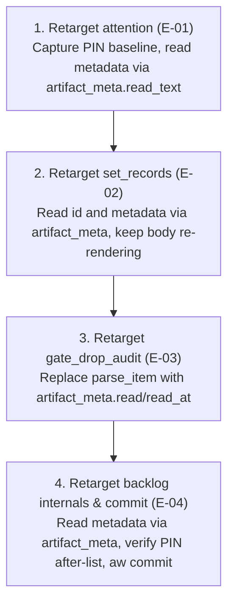

# IPD: Move the backlog parse_item metadata callers onto artifact_meta

- Date: 2026-11-09
- Kind: child
- Concern: Spec `4sd62s` C5 allows exactly one metadata reader (`artifact_meta`). Part 19 of the round-3 split of `k6jd6l` (Order 43, research `nj8zdp` guidance). `backlog.parse_item` returns a `BacklogItem` with metadata fields and body sections; `k6jd6l` E-18 removes its metadata part. This part moves the callers that read METADATA from it onto `artifact_meta`. Measured at `f83159217` (`k6jd6l` F-25 live list): `attention._backlog_record` (1), `set_records.promote_question_to_backlog` and `set_records.close_on_answer` (2), `tools/gate_drop_audit.census` (1), and the `backlog` internal callers `find_duplicate_candidates`, `validate_item`, `existing_backlog_ids`, `blocks_release_of_item`, `find_item`, `run_new`, `run_note` and `run_check` (8).
- Scope: The caller half of `k6jd6l` E-18's `backlog.parse_item` work. Callers in `check_engine`, `runner_shared`, `status_set` and `production_checks` are in phase-B Scope-Paths (`ffceq0`, `t4gl15`) and expected moved; a live one in Order 280's F-25 is retargeted here with `--scope-reason`. EXCLUDES changing `parse_item` itself (Order 299).
- Scope-Paths: agent_workflows/attention.py, agent_workflows/set_records.py, tools/gate_drop_audit.py, agent_workflows/backlog.py, tests/test_gate_drop_audit.py, .aw/records/plans/pending/20261109-metastore-298-po3o1c-move-the-backlog-parse-item-metadata-callers-onto-artifact-m.ipd.md
- Item-Dependencies: executed:1ajqaa, executed:59aiyh, executed:dcerjg, executed:ffceq0, executed:g5hpbb, executed:t4gl15, executed:um2kvx
- Status: approved
- Readiness: go-pending-approval
- Review-Depth: standard
- From-Spec: 4sd62s
- Work-Kind: feature
- Priority: high
- Blocks-Release: next
- Set: metastore
- Order: 298
- Highest E allocated: 04
- Author: opencode its_direct/pt3-claude-opus-5.5-1m-us
- Id: po3o1c
- Approval: 2026-11-16, recorded via aw ipd set: status set to approved

> Written to .aw/system/workflows/technical-writing/technical-writing.md. Every obligation, exact identifier, quotation, evidence record, and lifecycle status is preserved.

## Workflow history
- 2026-11-16 approved (aw set): status set to approved

- 2026-11-14 reviewed (antigravity/gemini-3.8-flash): /plan-review APPROVE WITH REVISIONS APPLIED; PR-001..PR-005 FIXED; review record .aw/records/reviews/20261109-metastore-298-po3o1c-move-the-backlog-parse-item-metadata-callers-onto-artifact-m.review.md
- 2026-11-09 to-review (opencode its_direct/pt3-claude-opus-5.5-1m-us): split from k6jd6l (round 3, research nj8zdp guidance).

## Goal

Every caller that reads a metadata field of a backlog item reads it from `artifact_meta`; only body-section uses of `backlog.parse_item` remain.

## Detailed Implementation Checklist (TODO)

Execution-state rule: mark an `E-*` item complete only after performing the action. That mark is not validation. Right-sizing rule: write for a modest executor that cannot hold much in its head. Each E-item is one step (one concern, about one file, executable in one focused pass) and its V-item names each unit it covers with its own check; a plan stays at about 5 E-items and 8 work Scope-Paths, else split it into more child plans (guidance, `IPD-Z603`). Accepted execution states: blocked, failed, pending, performed; terminal gate demands 'performed'.

Carried from `k6jd6l` E-18: "the metadata part of `backlog.parse_item`; their remaining callers use `artifact_meta.read`, `read_text` or `read_at` ... Retarget `tools/gate_drop_audit.py`'s `backlog.parse_item` call to `artifact_meta.read`/`read_at`, keeping `tests/test_gate_drop_audit.py` green." Ensure directory `.aw/state/9o83cr/` exists (`mkdir -p .aw/state/9o83cr/`), and save the before-list of `tests/test_attention.py`, `tests/test_gate_drop_audit.py`, `tests/test_backlog.py` and `tests/test_backlog_duplicate_guard.py` to `.aw/state/9o83cr/E-18b-before.txt`.

PIN RULE (carried from `9o83cr`): before an edit that deletes or retargets, save the named test modules' per-test outcome list (`python3 -m pytest -o addopts="" -m "" -p no:randomly -n 0 -rA <modules> | grep -E "^(PASSED|FAILED|ERROR|SKIPPED|XFAIL|XPASS) " | sed -E 's/ - .*//' | sort > <before-file>`); after it, run the same command into the matching after-file. A retargeted test keeps every input case, so the after-list may rename a test but not drop a case; the evidence pastes both lists and maps each removed name to its successor.

### Task group 1: one module per item

- [ ] E-01 Capture the baseline PIN list (`mkdir -p .aw/state/9o83cr/` and save `.aw/state/9o83cr/E-18b-before.txt`); then in `attention._backlog_record`, read the item's metadata through `artifact_meta.read_text(text, record_type="backlog")` instead of `backlog_mod.parse_item`.
  - Depends on: none
  - Expected outcome: `attention` calls no `parse_item`.
  - Execution state: pending

- [ ] E-02 In `set_records.promote_question_to_backlog` and `set_records.close_on_answer`, read the item id and metadata through `artifact_meta`; keep `parse_item` only where the body sections are re-rendered.
  - Depends on: E-01
  - Expected outcome: `set_records` reads no metadata field from `parse_item`.
  - Execution state: pending

- [ ] E-03 In `tools/gate_drop_audit.census`, replace `backlog.parse_item` with `artifact_meta.read`/`read_at`.
  - Depends on: E-02
  - Expected outcome: `tools/gate_drop_audit.py` calls no `parse_item`; its test passes.
  - Execution state: pending

- [ ] E-04 In the eight `backlog` internal callers (`backlog.find_duplicate_candidates`, `validate_item`, `existing_backlog_ids`, `blocks_release_of_item`, `find_item`, `run_new`, `run_note`, `run_check`), read metadata fields through `artifact_meta.read_text`; keep `parse_item` only for body sections; save the after-list; commit through `aw commit po3o1c -- <paths>`.
  - Depends on: E-03
  - Expected outcome: no `backlog` caller reads a metadata field from `parse_item`.
  - Execution state: pending

## Project conventions discovered (Step 0)

- `backlog.parse_item` body parsing (N3) may stay; its metadata fields come from `artifact_meta`.
- `backlog.validate_item` also uses the `attention_contract` gate regexes (`A.GATE_KIND_RE` and siblings); Order 248 (`tdhav3`) owns those.
- The `artifact_meta` interface (names from `tve77h`, `ffceq0`, `xexn45`): `read(id6) -> State`, `history(id6)`, `read_at(id6, rev)`, `read_text(text, *, record_type=None) -> State`, `append(id6, events, *, expect_seq)` with `dry_run`, the phase-B legacy writer (`append_legacy`, `render_legacy`), and the legacy loader (`load_legacy_artifact`).
- Cite code by SYMBOL (`module.function`) or by a quoted content string, with a line number only appended to one of those and never alone (advisory `IPD-C801`).

## Findings

Measured 2026-11-09 at `f83159217` with `rg -n "parse_item\(" agent_workflows tools tests`: see the Concern. Other production callers at that commit: `check_engine` 3, `runner_shared` 9, `status_set` 5, `production_checks` 2 (phase B).

## Proposed changes (ordered, validatable)

1. Retarget `attention` (E-01): Capture baseline PIN test outcomes to `.aw/state/9o83cr/E-18b-before.txt`, then update `attention._backlog_record` to read backlog metadata through `artifact_meta.read_text(text, record_type="backlog")`.
2. Retarget `set_records` (E-02): Update `set_records.promote_question_to_backlog` and `set_records.close_on_answer` to read item IDs and metadata through `artifact_meta`, preserving `parse_item` only where body sections are re-rendered.
3. Retarget `gate_drop_audit` (E-03): In `tools/gate_drop_audit.census`, replace `backlog.parse_item` with `artifact_meta.read`/`read_at` while keeping `tests/test_gate_drop_audit.py` passing.
4. Retarget the `backlog` internals and commit (E-04): Update internal callers in `backlog.py` (`find_duplicate_candidates`, `validate_item`, `existing_backlog_ids`, `blocks_release_of_item`, `find_item`, `run_new`, `run_note`, `run_check`) to read metadata via `artifact_meta.read_text`, verify after-list PIN outcomes match before-list, and commit via `aw commit po3o1c`.

## Deferred / out of scope (with reason)

- Removing the metadata part of `parse_item`.
  - Carrier: vw88h0

## Scope check

- Over-scope: none.
- Under-scope: If Order 280's F-25 lists a live caller outside these files, retarget it here with `--scope-reason`. Size: 4 E-items, 5 work Scope-Paths.

## Required tests / validation

The four PIN modules above.

## Spec / documentation sync

No spec change; implements part of `4sd62s` 4.3 and section 7 step 7. CONTRIBUTES to AC-1 (owned by `9o83cr`).

## Open questions

### OQ-01: Does `backlog.parse_item` disappear entirely?

- Blocking: no
- Status: resolved
- Owner: plan author
- Resolution or deferral rationale: Carried from `k6jd6l` OQ-02: no; `9o83cr` E-11 deletes only "the metadata part of `backlog.parse_item`". Body sections are Markdown prose that N3 keeps, so a body-only parser may survive; Order 299 decides by whether any caller still needs body sections. Recommendation strength: medium.

## Validation and cross-check (verify before reporting done)

Validation-state rule: inspect evidence in a separate pass. Do not mark a `V-*` item complete from memory or from the matching execution checkmark. Accepted validation results: blocked, failed, pass, pending; terminal gate demands 'pass'. Runtime-demonstration reachability rule: for each `V-*` item demanding the software be observed acting (such as a run, a dispatch, or a transition), as distinct from items demanding a diff, a file's content, or a test result, which are reachable by construction, name the code path that produces the observation or the sibling `E-*` that creates it, else the demand is UNDER-SCOPE.

- [ ] V-01 validates E-01
  - Required evidence: paste `rg -n "parse_item\(" agent_workflows/attention.py` printing nothing and the before/after per-test lines of `tests/test_attention.py`.
  - Observed evidence:
  - Result: pending

- [ ] V-02 validates E-02
  - Required evidence: paste `rg -n "parse_item\(" agent_workflows/set_records.py` with each remaining hit labelled body-only.
  - Observed evidence:
  - Result: pending

- [ ] V-03 validates E-03
  - Required evidence: paste `rg -n "parse_item" tools/gate_drop_audit.py` printing nothing and the before/after per-test lines of `tests/test_gate_drop_audit.py`.
  - Observed evidence:
  - Result: pending

- [ ] V-04 validates E-04
  - Required evidence: paste `rg -n "parse_item\(" agent_workflows/backlog.py` with each hit labelled body-only (or the definition), `diff .aw/state/9o83cr/E-18b-before.txt .aw/state/9o83cr/E-18b-after.txt` with no FAILED or ERROR line, and `git show --stat` of the `aw commit po3o1c` commit.
  - Observed evidence:
  - Result: pending

## Approval and execution gate

- Size assessment: standard
- Cohesion rationale: not required

Execute only after human approval (`Status: approved`) and after every plan in `- Item-Dependencies:` is executed. Safety stop: if prerequisite metastore reader symbols from `t4gl15`, `ffceq0`, or `1ajqaa` are absent, stop and report rather than proceeding. Shared-checkout safety: this plan edits only its Scope-Paths; do not stage, edit, or commit any other file.

Pin-first where an item deletes or retargets. Scope fence: the paths in `- Scope-Paths:` are a declaration; a needed file outside the fence is edited and then justified at finalize (`--scope-reason`), and a declared path left unmodified is acknowledged (`--scope-ack`). Honesty rule: paste the ACTUAL output; never claim a result you did not run. Commits: only through `aw commit po3o1c -- <paths>` with only Scope-Paths files; never `git add -A`, a bare `git add` or `git commit -a`; never push.

Lifecycle transition: the plan moves to `.aw/records/plans/executed/` only through `aw ipd finalize`, never a hand `git mv`, and only after `aw ipd lint --phase pre-transition` conforms and every `V-*` reads `pass` with pasted evidence. When `aw oc run` or `aw agy run` executes the plan, the runner performs the finalize; a hand executor runs `aw ipd finalize po3o1c` itself.
