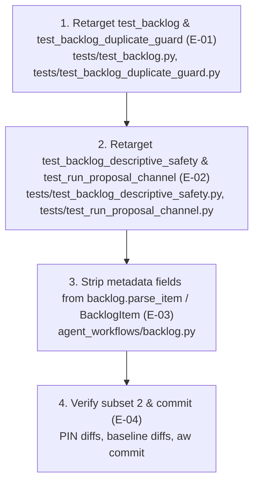

# IPD: Remove the metadata part of backlog parse_item and verify the subset-2 deletions

- Date: 2026-11-09
- Kind: child
- Concern: Spec `4sd62s` C5 allows exactly one metadata reader (`artifact_meta`). Part 20 of the round-3 split of `k6jd6l` (Order 43, research `nj8zdp` guidance): after Order 298 moved the metadata callers, remove the metadata fields from `backlog.parse_item` (it survives only as a body parser, or is deleted if no caller needs body sections) and verify `k6jd6l` E-18's expected outcome. Measured test callers at `f83159217`: `tests/test_backlog.py` (8), `tests/test_backlog_duplicate_guard.py` (7), `tests/test_backlog_descriptive_safety.py` (1), `tests/test_run_proposal_channel.py` (1).
- Scope: The last part of `k6jd6l` E-18 and its V-18 evidence.
- Scope-Paths: agent_workflows/backlog.py, tests/test_backlog.py, tests/test_backlog_duplicate_guard.py, tests/test_backlog_descriptive_safety.py, tests/test_run_proposal_channel.py, .aw/records/plans/pending/20261109-metastore-299-vw88h0-remove-the-metadata-part-of-backlog-parse-item-and-verify-th.ipd.md
- Item-Dependencies: executed:1ajqaa, executed:59aiyh, executed:dcerjg, executed:ffceq0, executed:g5hpbb, executed:po3o1c, executed:t4gl15
- Status: reviewed
- Readiness: go-pending-approval
- Review-Depth: standard
- From-Spec: 4sd62s
- Work-Kind: feature
- Priority: high
- Blocks-Release: next
- Set: metastore
- Order: 299
- Highest E allocated: 04
- Author: opencode its_direct/pt3-claude-opus-5.5-1m-us
- Id: vw88h0

> Write and proofread this plan per the technical writing standard, `.aw/system/workflows/technical-writing/technical-writing.md` (`.agents/workflows/technical-writing/technical-writing.md` in a legacy-layout install), including requirement 12 (diagrams).

## Workflow history

- 2026-11-14 reviewed (antigravity/gemini-3.8-flash): plan-review verified E/V bijection, Scope-Paths, baseline diff commands, execution gate, and PIN rule; findings PR-001..PR-004 fixed; marked reviewed and go-pending-approval.
- 2026-11-09 to-review (opencode its_direct/pt3-claude-opus-5.5-1m-us): split from k6jd6l (round 3, research nj8zdp guidance).

## Goal

`backlog.parse_item` reads no metadata field, and `aw find`, `aw attention --format json` and `aw check all --all --agent` match the Order 280 baseline.

## Detailed Implementation Checklist (TODO)

Execution-state rule: mark an `E-*` item complete only after performing the action. That mark is not validation. Right-sizing rule: write for a modest executor that cannot hold much in its head. Each E-item is one step (one concern, about one file, executable in one focused pass) and its V-item names each unit it covers with its own check; a plan stays at about 5 E-items and 8 work Scope-Paths, else split it into more child plans (guidance, `IPD-Z603`). Accepted execution states: blocked, failed, pending, performed; terminal gate demands 'performed'.

Carried from `k6jd6l` E-18 and OQ-02 (see Order 298). Before any test retargeting edit, create directory `mkdir -p .aw/state/9o83cr/` and save the before-list of the four test modules and `tests/test_specs_status_dirs.py` and `tests/test_gate_drop_audit.py` to `.aw/state/9o83cr/E-18c-before.txt`.

PIN RULE (carried from `9o83cr`): before an edit that deletes or retargets, save the named test modules' per-test outcome list (`python3 -m pytest -o addopts="" -m "" -p no:randomly -n 0 -rA <modules> | grep -E "^(PASSED|FAILED|ERROR|SKIPPED|XFAIL|XPASS) " | sed -E 's/ - .*//' | sort > <before-file>`); after it, run the same command into the matching after-file. A retargeted test keeps every input case, so the after-list may rename a test but not drop a case; the evidence pastes both lists and maps each removed name to its successor.

### Task group 1: tests, then the parser, then verify

- [ ] E-01 Ensure `.aw/state/9o83cr/` exists (`mkdir -p .aw/state/9o83cr/`) and save the six PIN modules baseline to `.aw/state/9o83cr/E-18c-before.txt`; then retarget the metadata assertions of `tests/test_backlog.py` and `tests/test_backlog_duplicate_guard.py` from `parse_item(...).<field>` to `artifact_meta.read_text(...)`, keeping every case.
  - Depends on: none
  - Expected outcome: neither module reads a metadata field from `parse_item`.
  - Execution state: pending

- [ ] E-02 Retarget `tests/test_backlog_descriptive_safety.py` and `tests/test_run_proposal_channel.py` the same way.
  - Depends on: E-01
  - Expected outcome: neither module reads a metadata field from `parse_item`.
  - Execution state: pending

- [ ] E-03 Remove the metadata fields from `backlog.parse_item` and its `BacklogItem` result (or delete `parse_item` if Order 298 left no body-section caller), recording the choice in this plan's Findings.
  - Depends on: E-02
  - Expected outcome: `backlog.parse_item` parses no `- Field:` bullet.
  - Execution state: pending

- [ ] E-04 Verify subset 2: save the after-list; `diff` `aw find plans --agent`, `aw attention --format json` and the `aw check all --all --agent` rule multiset against `.aw/state/k6jd6l/before/`; commit through `aw commit vw88h0 -- <paths>`.
  - Depends on: E-03
  - Expected outcome: no pinned case is dropped; the three diffs are empty.
  - Execution state: pending

## Project conventions discovered (Step 0)

- The `artifact_meta` interface (names from `tve77h`, `ffceq0`, `xexn45`): `read(id6) -> State`, `history(id6)`, `read_at(id6, rev)`, `read_text(text, *, record_type=None) -> State`, `append(id6, events, *, expect_seq)` with `dry_run`, the phase-B legacy writer (`append_legacy`, `render_legacy`), and the legacy loader (`load_legacy_artifact`).
- Cite code by SYMBOL (`module.function`) or by a quoted content string, with a line number only appended to one of those and never alone (advisory `IPD-C801`).

## Findings

Measured 2026-11-09 at `f83159217` with `rg -c "parse_item\(" tests`: see the Concern. The body-parser choice is recorded here by E-03.

## Proposed changes (ordered, validatable)

1. Retarget two backlog test modules (E-01).
2. Retarget two more (E-02).
3. Strip the parser (E-03).
4. Verify subset 2 and commit (E-04).

## Deferred / out of scope (with reason)

- The family finishing gate.
  - Carrier: k6jd6l

## Scope check

- Over-scope: none.
- Under-scope: none known. Size: 4 E-items, 5 work Scope-Paths.

## Required tests / validation

The six PIN modules and the three baseline diffs.

## Spec / documentation sync

No spec change; implements part of `4sd62s` 4.3 and section 7 step 7. CONTRIBUTES to AC-1 (owned by `9o83cr`).

## Open questions

### OQ-01: What if a body-only caller needs the item id to locate the file?

- Blocking: no
- Status: resolved
- Owner: plan author
- Resolution or deferral rationale: It reads the id from `artifact_meta` and the body from `parse_item`; the id is metadata. Recommendation strength: strong.

## Validation and cross-check (verify before reporting done)

Validation-state rule: inspect evidence in a separate pass. Do not mark a `V-*` item complete from memory or from the matching execution checkmark. Accepted validation results: blocked, failed, pass, pending; terminal gate demands 'pass'. Runtime-demonstration reachability rule: for each `V-*` item demanding the software be observed acting (such as a run, a dispatch, or a transition), as distinct from items demanding a diff, a file's content, or a test result, which are reachable by construction, name the code path that produces the observation or the sibling `E-*` that creates it, else the demand is UNDER-SCOPE.

- [ ] V-01 validates E-01
  - Required evidence: paste `rg -n "parse_item\(" tests/test_backlog.py tests/test_backlog_duplicate_guard.py` with each remaining hit labelled body-only, and both modules' before/after per-test lines.
  - Observed evidence:
  - Result: pending

- [ ] V-02 validates E-02
  - Required evidence: paste `rg -n "parse_item\(" tests/test_backlog_descriptive_safety.py tests/test_run_proposal_channel.py` with each hit labelled body-only (or none), and both modules' before/after per-test lines.
  - Observed evidence:
  - Result: pending

- [ ] V-03 validates E-03
  - Required evidence: paste `rg -n "parse_item\(" agent_workflows tools` showing only body-parser uses (or nothing) and the recorded choice.
  - Observed evidence:
  - Result: pending

- [ ] V-04 validates E-04
  - Required evidence: paste `diff .aw/state/9o83cr/E-18c-before.txt .aw/state/9o83cr/E-18c-after.txt` with each removed name mapped and no FAILED or ERROR line, the three `diff` outputs (empty), and `git show --stat` of the `aw commit vw88h0` commit.
  - Observed evidence:
  - Result: pending

## Approval and execution gate

- Size assessment: standard
- Cohesion rationale: not required

Execute only after human approval (`Status: approved`) and after every plan in `- Item-Dependencies:` is executed. Pin-first where an item deletes or retargets. Scope fence: the paths in `- Scope-Paths:` are a declaration; a needed file outside the fence is edited and then justified at finalize (`--scope-reason`), and a declared path left unmodified is acknowledged (`--scope-ack`). Honesty rule: paste the ACTUAL output; never claim a result you did not run. Commits: only through `aw commit vw88h0 -- <paths>` with only Scope-Paths files; never `git add -A`, a bare `git add` or `git commit -a`; never push. Safety stop: if a prerequisite plan in `- Item-Dependencies:` is not executed or required metastore symbols from `t4gl15`, `ffceq0`, or `po3o1c` are absent, stop and report rather than proceeding. Lifecycle: the plan moves to `.aw/records/plans/executed/` only through `aw ipd finalize`, never a hand `git mv`, after `aw ipd lint --phase pre-transition` conforms and every `V-*` reads `pass` with pasted evidence. When `aw oc run` or `aw agy run` executes the plan, the runner performs the finalize; a hand executor runs `aw ipd finalize vw88h0` itself.
