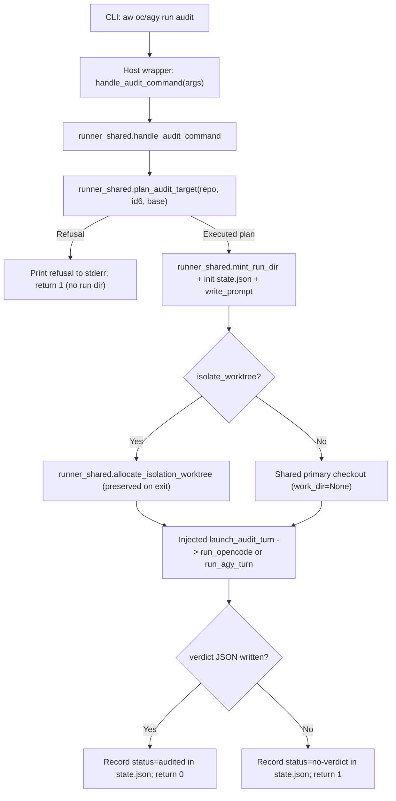

# IPD: Implement aw agy run audit via shared audit runner helper

- Date: 2026-11-16
- Kind: child
- Concern: `aw agy run audit` currently shares the subcommand parser (`runner_shared.add_audit_parser`) and implicit-start shim entry (`"audit"`) with `aw oc run audit`, but `agy_runipd.handle_audit_command` refuses every invocation with exit code `2` and redirects operators to `aw oc run audit <id6>`. Plan `mp289j` omitted the Antigravity binding to avoid duplicating ~150 lines of audit launch code while the two drivers were still being unified. That leaves Antigravity unable to run post-hoc independent audits (including cross-host second opinions on plans executed by `aw oc run` with validation off).
- Scope: Lift the host-neutral audit orchestration from `oc_runipd.handle_audit_command` into `runner_shared.handle_audit_command`; keep `oc_runipd.handle_audit_command` as a thin wrapper; implement `agy_runipd.handle_audit_command` and `agy_runipd._audit_launch_options` delegating to the same shared helper and launching `agy_runipd.run_agy_turn`; update `tests/test_runner_bare_verb_shim.py` and add end-to-end Antigravity audit behavioral coverage in `tests/test_agy_runipd_audit.py`; update `i4gpto` (`R-10`, AC-9) to record dual-host support. EXCLUDES: changing per-host in-run verification defaults (`RUNNER_REGISTRY` rows owned by `tm2cz8`/`ybkmzp`), adding `--model`/`--profile` CLI flags to `add_audit_parser` (audit reuses the host verifier/default launch configuration per `i4gpto` Section 9), or changing `aw runs verify-ledger`.
- Scope-Paths: agent_workflows/runner_shared.py, agent_workflows/oc_runipd.py, agent_workflows/agy_runipd.py, tests/test_runner_bare_verb_shim.py, tests/test_agy_runipd_audit.py, .aw/records/specs/**/20260920-i4gpto-01-i4gpto-standalone-executed-plan-audit.spec.md
- Item-Dependencies: executed:mp289j
- Status: to-review
- From-Spec: i4gpto
- Work-Kind: feature
- Priority: medium
- Set: reverify
- Order: 02
- Highest E allocated: 04
- Author: Antigravity
- Id: mgp655

> Write and proofread this plan per the technical writing standard, `.aw/system/workflows/technical-writing/technical-writing.md` (`.agents/workflows/technical-writing/technical-writing.md` in a legacy-layout install), including requirement 12 (diagrams).

## Workflow history

- 2026-11-16 to-review (Antigravity): authored review-ready child plan `reverify-02` (`mgp655`) to lift `handle_audit_command` into `runner_shared` and wire `aw agy run audit`.
- 2026-11-16 draft (Antigravity): created.

## Goal

Enable `aw agy run audit <id6>` (and `aw antigravity run audit <id6>` / `aw agy runipd audit <id6>`) with full behavioral parity with `aw oc run audit <id6>` by lifting the audit workflow into one shared helper in `agent_workflows/runner_shared.py` that both host drivers invoke with their own session launcher and launch options.

## Detailed Implementation Checklist (TODO)

Execution-state rule: mark an `E-*` item complete only after performing the action. That mark is not validation. Right-sizing rule: write for a modest executor that cannot hold much in its head. Each E-item is one step (one concern, about one file, executable in one focused pass) and its V-item names each unit it covers with its own check; a plan stays at about 5 E-items and 8 work Scope-Paths, else split it into more child plans (guidance, `IPD-Z603`). Accepted execution states: blocked, failed, pending, performed; terminal gate demands 'performed'.

### Task group 1: Shared audit helper and OpenCode wrapper

- [ ] E-01 Lift the audit transaction from `oc_runipd.handle_audit_command` into `runner_shared.handle_audit_command` in `agent_workflows/runner_shared.py` and delegate `agent_workflows/oc_runipd.py`'s `handle_audit_command` to it.
  - Depends on: none
  - Expected outcome: `runner_shared.handle_audit_command` owns target resolution (`plan_audit_target`), run-directory minting (`mint_run_dir` or injected `mint_run_dir`), directory creation (`outcomes`, `prompts`, `sessions`), minimal `state.json` initialization (`kind: "audit"`, `action: "audit"`), verifier prompt rendering (`build_verifier_prompt(..., audit=True, labels=labels)`), isolated worktree allocation and preservation (`allocate_isolation_worktree`), verdict loading from `outcomes/01-<id6>-verification.json`, status recording (`audited` or `no-verdict`), stdout/stderr reporting, and exit codes (`0` verdict written, `1` refused or no verdict). `oc_runipd.handle_audit_command` passes `OC_HOST_LABELS`, `_audit_launch_options(args)`, `opencode` binary option, `_fresh_audit_run_dir`, and a launcher callback invoking `oc_runipd.run_opencode`, preserving `aw oc run audit` behavior and existing monkeypatch seams.
  - Execution state: pending

### Task group 2: Antigravity audit binding

- [ ] E-02 Implement `agy_runipd._audit_launch_options` and replace `agy_runipd.handle_audit_command`'s exit-2 refusal in `agent_workflows/agy_runipd.py` with delegation to `runner_shared.handle_audit_command`.
  - Depends on: E-01
  - Expected outcome: `agy_runipd._audit_launch_options` resolves the `"agy"` launch (and optional `verify_with` verifier profile) from `runner_profiles.load()` when present, falling back to `agy_models.resolve_agy_default_model()` when no profile model is configured, sets `"model"` (when non-None) and `"effort"` (from profile `variant` when non-None) without injecting `"explicit_model": None`, and preserves `"agy_executable"` when set. `agy_runipd.handle_audit_command` invokes `runner_shared.handle_audit_command` with `runner_shared.AGY_HOST_LABELS`, a `launch_audit_turn` adapter calling `run_agy_turn(state, run_dir, item, prompt_path, 1, session_id=None, use_continue=False, log_suffix="audit", label_suffix="audit", work_dir=work_dir, telemetry_phase=runner_shared.TELEMETRY_PHASE_VALIDATE)`, and `mint_run_dir=runner_shared.mint_run_dir`. Removing the `handle_audit_command` exit-2 refusal makes `aw agy run audit <id6>` execute identically to `aw oc run audit <id6>`.
  - Execution state: pending

### Task group 3: Behavioral test coverage

- [ ] E-03 Update `tests/test_runner_bare_verb_shim.py` and add `tests/test_agy_runipd_audit.py` to test `aw agy run audit` end-to-end behavior.
  - Depends on: E-02
  - Expected outcome: In `tests/test_runner_bare_verb_shim.py`, `BareAuditNotRewrittenTests` asserts that `agy_runipd.main(["audit", "audt01", ...])` and `agy_runipd.main(["audit", "nosuch", ...])` exit `1` with `"audit refused (audit-plan-not-executed)"` and `"audit refused (audit-plan-not-found)"` on stderr, emit nothing on stdout, dispatch no `run_queue`, and create no run directory. `tests/test_agy_runipd_audit.py` asserts: (1) valid executed plan audit writes `state.json` (`kind: "audit"`, `action: "audit"`, `status: "audited"`) and `outcomes/01-<id6>-verification.json`, exits `0`, and keeps the audited plan document byte-identical; (2) isolated worktree allocation is default and preserved (not torn down) while `--no-isolate-worktree` runs with `work_dir=None`; (3) `--base <rev>` and surviving begin-receipt `base_head` set `diff_basis` cleanly, while absent receipt sets `diff_basis: "none"`; (4) missing verdict exits `1` and sets `item["status"] = "no-verdict"`; (5) Antigravity audit prompt uses `AGY_HOST_LABELS` (`"fresh Antigravity session"` and `"run_command"`), forbids editing the executed plan, and passes `telemetry_phase=TELEMETRY_PHASE_VALIDATE`; (6) two consecutive `aw agy run audit` calls within one second create distinct run directories; (7) `_audit_launch_options` resolves `verify_with` profile overrides and `agy_models.resolve_agy_default_model()` fallback cleanly; and (8) `aw agy run audit <id6>` / `aw agy runipd audit <id6>` dispatch through `agent_workflows.cli.main`.
  - Execution state: pending

### Task group 4: Spec sync

- [ ] E-04 Update spec `.aw/records/specs/**/20260920-i4gpto-01-i4gpto-standalone-executed-plan-audit.spec.md` (`R-10`, Section 10 AC-9, and `## Workflow history`) to reflect dual-host support.
  - Depends on: E-03
  - Expected outcome: Spec `i4gpto` records that `audit` is implemented on both `aw oc run audit` and `aw agy run audit` via `runner_shared.handle_audit_command`, appends a dated history note (without changing `Status: draft` unless separately reviewed), and `aw specs check` + `aw attention --check --agent` pass without regressions.
  - Execution state: pending

## Project conventions discovered (Step 0)

- Cite code by SYMBOL (`module.function`) or by a quoted content string, with a line number only appended to one of those and never alone: an offset expires before this plan executes (advisory `IPD-C801`).
- `runner_shared.py` must never import `oc_runipd` or `agy_runipd` (`tests/test_runner_delegation_and_host_independence.py` enforces host independence). Shared verb handlers (`runner_shared.handle_stop_command`, `runner_shared.handle_integrate_command`) live in `runner_shared.py` and accept host callables injected by each driver.
- `runner_shared.add_audit_parser` registers `audit` on both drivers' parsers, and `"audit"` is already registered in both drivers' implicit-start shim subcommand sets (`oc_runipd.py` and `agy_runipd.py`).
- `agy_runipd.run_agy_turn` reads `options.get("explicit_model")` first, and reads `options.get("model")` ONLY when `"explicit_model" not in options` (or when `explicit_model` is non-None). Audit launch options must omit `"explicit_model"` when no CLI `--model` is supplied so profile or settings-based `"model"` values take effect.
- `tests/test_structural_pins.py` / `5zyuc8` prohibits reading production code via `inspect` or `ast` in tests. All new tests must assert on observable execution, arguments passed to mocked subprocess/turn launchers, files on disk, exit codes, and output streams.
- Run pytest bare (`python3 -m pytest` or `python3 -m pytest <file>`); never pass `-n0`, extra `-q`, or `-p no:randomly`.

## Findings

| Id | Severity | Area | Finding | Evidence |
|---|---|---|---|---|
| F-1 | MEDIUM | Shared runner architecture | `runner_shared.py` already owns `add_audit_parser`, `plan_audit_target`, `mint_run_dir`, `allocate_isolation_worktree`, `write_prompt`, and `build_verifier_prompt(..., audit=True, labels=...)`. Only `handle_audit_command` itself (~160 lines) remains duplicated inside `oc_runipd.py` while `agy_runipd.handle_audit_command` exits `2`. | `agent_workflows/runner_shared.py` (`add_audit_parser`, `plan_audit_target`), `agent_workflows/oc_runipd.py` (`handle_audit_command`), `agent_workflows/agy_runipd.py` (`handle_audit_command`) |
| F-2 | HIGH | Launcher signature mismatch | `oc_runipd.run_opencode` accepts `(state, run_dir, item, plan_path, prompt_path, attempt_no, ...)` whereas `agy_runipd.run_agy_turn` accepts `(state, run_dir, item, prompt_path, attempt_no, session_id, use_continue, ...)` without `plan_path`. `runner_shared.handle_audit_command` must invoke an injected normalized callback `launch_audit_turn(state, run_dir, item, plan_path, prompt_path, work_dir)` rather than assuming identical positional signatures. | `agent_workflows/oc_runipd.py` (`def run_opencode`), `agent_workflows/agy_runipd.py` (`def run_agy_turn`) |
| F-3 | HIGH | AGY model lookup subtlety | `agy_runipd.run_agy_turn` skips `options.get("model")` if `"explicit_model"` exists as a key with value `None` (`if model_flag is None and "explicit_model" not in options:`). `_audit_launch_options` on AGY must only include `"model"` (and `"effort"` if configured), omitting `"explicit_model": None`. | `agent_workflows/agy_runipd.py` (`def run_agy_turn`, `"explicit_model" not in options`) |
| F-4 | MEDIUM | Existing test pin on AGY refusal | `tests/test_runner_bare_verb_shim.py` (`BareAuditNotRewrittenTests`) asserts exit `2` and `"audit is not implemented on the Antigravity host"` for `agy_runipd.main(["audit", ...])`. Updating those two assertions to check exit `1` and `audit-plan-not-executed` / `audit-plan-not-found` keeps the bare-shim coverage intact. | `tests/test_runner_bare_verb_shim.py` (`BareAuditNotRewrittenTests`) |
| F-5 | LOW | Spec drift | Draft spec `.aw/records/specs/draft/20260920-i4gpto-01-i4gpto-standalone-executed-plan-audit.spec.md` (`R-10`, AC-9) still specifies `audit` as implemented on OpenCode only and returning exit `2` on Antigravity. | `.aw/records/specs/draft/20260920-i4gpto-01-i4gpto-standalone-executed-plan-audit.spec.md` (`R-10`, Section 10) |

## Proposed changes (ordered, validatable)

1. **Extract `runner_shared.handle_audit_command` in `agent_workflows/runner_shared.py`**:
   - Accept:
     - `args: argparse.Namespace`
     - `labels: HostLabels`
     - `options: dict[str, Any]` (host-resolved launch options merged into `state["options"]`)
     - `launch_audit_turn: Callable[[dict[str, Any], Path, dict[str, Any], Path, Path, str | None], tuple[int, str | None, Path, list[str]]]`
     - Optional injection seams for testability/compatibility (`mint_run_dir: Callable[[Path], tuple[str, Path]] = mint_run_dir`, `build_prompt_fn: Callable[..., str] = build_verifier_prompt`, `allocate_worktree_fn: Callable[[Path, str], Any] = allocate_isolation_worktree`).
   - Resolve target via `plan_audit_target(repo, id6, base=getattr(args, "base", None))`; on refusal print `audit refused ({target.refusal}): {target.reason}` to stderr and return `1`.
   - Mint `run_dir` via `mint_run_dir(repo)`, create `outcomes`, `prompts`, `sessions`, write initial `state.json` (`kind: "audit"`, `action: "audit"`), build verifier prompt via `build_prompt_fn(item, state, run_dir, target.plan_path, audit=True, diff_basis=target.basis_detail, labels=labels)`.
   - Allocate isolated worktree when `getattr(args, "isolate_worktree", True)` (printing worktree failure refusal and returning `1` without running in primary checkout); report `lane preserved` in `finally` without calling `teardown_isolation_worktree`.
   - Call `launch_audit_turn(state, run_dir, item, target.plan_path, prompt_path, work_dir)`.
   - Read verdict from `run_dir / "outcomes" / f"01-{target.id6}-verification.json"` (or worktree-relative fallback), update `item["attempts"]`, `item["status"]` (`"audited"` or `"no-verdict"`), `state["audit"]["verdict"]`, `state["audit"]["lane"]`, atomically rewrite `state.json`, print summary or no-verdict stderr message, and return `0` or `1`.

2. **Delegate `agent_workflows/oc_runipd.py` `handle_audit_command`**:
   - Keep `oc_runipd._fresh_audit_run_dir` and `oc_runipd._audit_launch_options` unchanged.
   - Replace the inline body of `oc_runipd.handle_audit_command` with a thin wrapper passing `labels=runner_shared.OC_HOST_LABELS`, `options={"opencode": getattr(args, "opencode", "opencode") or "opencode", "auto": True, **_audit_launch_options(args)}`, `mint_run_dir=_fresh_audit_run_dir`, `build_prompt_fn=build_verifier_prompt`, `allocate_worktree_fn=runner_shared.allocate_isolation_worktree`, and an adapter calling `run_opencode(...)` (preserving existing monkeypatches on `oc_runipd.run_opencode`, `oc_runipd.build_verifier_prompt`, and `oc_runipd._fresh_audit_run_dir`).

3. **Implement `agent_workflows/agy_runipd.py` `handle_audit_command` and `_audit_launch_options`**:
   - Add `_audit_launch_options(args: argparse.Namespace) -> dict[str, Any]`:
     - Best-effort load `runner_profiles.load()` and `runner_profiles.resolve(cfg, runner="agy", profile=None)`; if `executor.verify_with` is configured, resolve `verifier = runner_profiles.resolve(cfg, runner="agy", profile=executor.verify_with)` and prefer verifier `model`/`variant`, else use executor `model`/`variant`.
     - If resolved `model` is `None`, fall back to `agy_models.resolve_agy_default_model()[0]`.
     - Build `options` with `"auto": True`, optional `"agy_executable"`, optional `"model"` (only if resolved non-None; never set `"explicit_model": None`), and optional `"effort"` + `"variant"` (if profile `variant` is set).
   - Update `agy_runipd.handle_audit_command(args)` to delegate to `runner_shared.handle_audit_command` with `labels=runner_shared.AGY_HOST_LABELS`, `options=_audit_launch_options(args)`, `build_prompt_fn=runner_shared.build_verifier_prompt`, `allocate_worktree_fn=runner_shared.allocate_isolation_worktree`, and a `launch_audit_turn` adapter calling `run_agy_turn(state, run_dir, item, prompt_path, 1, session_id=None, use_continue=False, log_suffix="audit", label_suffix="audit", work_dir=work_dir, telemetry_phase=runner_shared.TELEMETRY_PHASE_VALIDATE)`.

4. **Tests (`tests/test_runner_bare_verb_shim.py` and `tests/test_agy_runipd_audit.py`)**:
   - Update `BareAuditNotRewrittenTests` in `tests/test_runner_bare_verb_shim.py`.
   - Create `tests/test_agy_runipd_audit.py` testing real CLI/main invocation, verdict persistence, plan byte-identity, isolated vs non-isolated worktree handling, diff basis precedence (`--base`, receipt, `none`), missing-verdict handling, `AGY_HOST_LABELS` prompt rendering, same-second run directory collision handling, and `_audit_launch_options`.

5. **Spec sync (`i4gpto`)**:
   - Update `.aw/records/specs/draft/20260920-i4gpto-01-i4gpto-standalone-executed-plan-audit.spec.md` (`R-10`, Section 10 AC-9, and `## Workflow history`) so it documents both `aw oc run audit` and `aw agy run audit`.

## Deferred / out of scope (with reason)

- Adding host-specific CLI overrides (`--model`, `--effort`, `--profile`, `--verify-with`) to `runner_shared.add_audit_parser`.
  - Carrier-Declined: `i4gpto` Section 9 specifies that `audit` inherits its launch configuration from the configured verifier/host defaults rather than introducing per-role CLI flags; keeping `add_audit_parser` identical across both hosts preserves CLI parity.
- Automatically tearing down or integrating the audit lane branch when `aw agy run audit` produces code fixes.
  - Carrier-Declined: permanent safety design per `i4gpto` Section 8 (`R-16`, `R-17`); fixes behind a finished plan must be reviewed by the operator and integrated explicitly via `aw agy run integrate <id6>` or manually.

## Scope check

- Over-scope: none. Every file in `Scope-Paths` directly implements the shared audit extraction, Antigravity wiring, test coverage, and spec sync.
- Under-scope: none. CLI forwarding in `agent_workflows/cli.py` already forwards all `aw agy run` / `aw agy runipd` / `aw antigravity run` subcommands verbatim via `argparse.REMAINDER` and pre-parse dispatch, and `agy_runipd.py` already registers `audit` in `add_audit_parser` and its implicit-start shim set.

## Required tests / validation

- Bare `python3 -m pytest tests/test_runner_bare_verb_shim.py tests/test_agy_runipd_audit.py tests/test_agy_runipd_cli.py tests/test_oc_runipd.py`
- `python3 -m pytest` (full suite)
- `python3 -m agent_workflows specs check` and `python3 -m agent_workflows attention --check --agent`
- `python3 -m agent_workflows check`

## Spec / documentation sync

- Update `.aw/records/specs/draft/20260920-i4gpto-01-i4gpto-standalone-executed-plan-audit.spec.md` (`R-10`, AC-9, and `## Workflow history`) per `E-04`.
- No user-facing doc (`README.md`, `docs/`) currently documents `audit` as OpenCode-only or Antigravity-refused (verified via `rg`), so no user-facing doc edit is required.

## Open questions

### OQ-01: Should `aw agy run audit` inherit `runner_profiles` `verify_with` / default `agy` profile before falling back to `agy_models.resolve_agy_default_model()`?

- Blocking: no
- Status: resolved
- Owner: Antigravity
- Resolution or deferral rationale: Yes (resolved from `agy_runipd.resolve_verification_decision` and `i4gpto` Section 9): `runner_profiles` already supports `runner="agy"` with per-runner default profiles and `verify_with`. Resolving `runner="agy"` (and its `verify_with` target when set) in `runner_profiles` first and falling back to `agy_models.resolve_agy_default_model()` honors any configured `agy` verifier profile while staying zero-config when none exists.

## Validation and cross-check (verify before reporting done)

Validation-state rule: inspect evidence in a separate pass. Do not mark a `V-*` item complete from memory or from the matching execution checkmark. Accepted validation results: blocked, failed, pass, pending; terminal gate demands 'pass'. Runtime-demonstration reachability rule: for each `V-*` item demanding the software be observed acting (such as a run, a dispatch, or a transition)—as distinct from items demanding a diff, a file's content, or a test result, which are reachable by construction—name the code path that produces the observation or the sibling `E-*` that creates it, else the demand is UNDER-SCOPE.

- [ ] V-01 validates E-01
  - Required evidence: paste the symbol/signature diff or read output confirming `runner_shared.handle_audit_command` exists in `agent_workflows/runner_shared.py`, `oc_runipd.handle_audit_command` delegates to it without importing `oc_runipd` from `runner_shared.py`, and `python3 -m pytest tests/test_oc_runipd.py tests/test_runner_delegation_and_host_independence.py` passes with 0 failures.
  - Observed evidence:
  - Result: pending
- [ ] V-02 validates E-02
  - Required evidence: paste `python3 -m agent_workflows agy run audit --help` output confirming the command line matches `oc run audit --help`, plus `git diff -- agent_workflows/agy_runipd.py` showing the exit-2 refusal removed and replaced by delegation to `runner_shared.handle_audit_command` and `_audit_launch_options`.
  - Observed evidence:
  - Result: pending
- [ ] V-03 validates E-03
  - Required evidence: paste the verbatim output of `python3 -m pytest tests/test_runner_bare_verb_shim.py tests/test_agy_runipd_audit.py tests/test_agy_runipd_cli.py` showing every test passing (0 failed, 0 skipped), plus the full bare `python3 -m pytest` summary line after final edits.
  - Observed evidence:
  - Result: pending
- [ ] V-04 validates E-04
  - Required evidence: paste the `git diff` on `.aw/records/specs/**/20260920-i4gpto-01-i4gpto-standalone-executed-plan-audit.spec.md` alongside passing outputs of `python3 -m agent_workflows specs check` and `python3 -m agent_workflows attention --check --agent`.
  - Observed evidence:
  - Result: pending

## Approval and execution gate

- Size assessment: standard
- Cohesion rationale: not required

Execute only after human approval (`Status: approved`) and after `mp289j` is verified in `.aw/records/plans/executed/` (satisfied: `executed:mp289j`).

Scope fence: `Scope-Paths` declares the expected file set; do not expand scope casually. If the work genuinely requires editing a file outside `Scope-Paths`, make the edit and justify it in the two-way scope reconciliation at finalize (`--scope-reason`), and acknowledge any declared path left unmodified (`--scope-ack`). Only stop for genuinely unsafe conditions (for example an unresolvable conflict with a co-worker's concurrent edits or missing prerequisite symbols).

Honesty rule: paste the ACTUAL output of each command; never claim test or check results you did not run after your final edit.

Commits and lifecycle: commit only the paths you changed for this plan using `aw commit mgp655 -- <paths>`; never `git add -A`, bare `git add`, or `git commit -a`, and never push. On completion, finalize with `aw ipd finalize mgp655 --actor <agent/model> --message "
" --apply` to move the plan to `executed/` and refresh the plans index cleanly.
