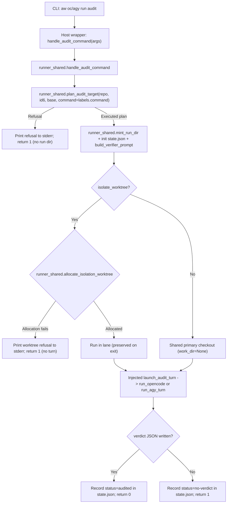

# IPD: Implement aw agy run audit via shared audit runner helper

- Date: 2026-11-16
- Kind: child
- Concern: `aw agy run audit` currently shares the subcommand parser (`runner_shared.add_audit_parser`) and implicit-start shim entry (`"audit"`) with `aw oc run audit`, but `agy_runipd.handle_audit_command` refuses every invocation with exit code `2` and redirects operators to `aw oc run audit <id6>`. Plan `mp289j` omitted the Antigravity binding to avoid duplicating ~150 lines of audit launch code while the two drivers were still being unified. That leaves Antigravity unable to run post-hoc independent audits (including cross-host second opinions on plans executed by `aw oc run` with validation off).
- Scope: Lift the host-neutral audit orchestration from `agent_workflows/oc_runipd.py::handle_audit_command` into `agent_workflows/runner_shared.py::handle_audit_command` and parameterize `agent_workflows/runner_shared.py::plan_audit_target` with the host command label; keep `agent_workflows/oc_runipd.py::handle_audit_command` as a thin wrapper; update `agent_workflows/agy_runipd.py::build_verifier_prompt` to forward `audit` and `diff_basis`; implement `agent_workflows/agy_runipd.py::handle_audit_command` and `agent_workflows/agy_runipd.py::_audit_launch_options` delegating to the same shared helper and launching `agent_workflows/agy_runipd.py::run_agy_turn`; update `tests/test_runner_bare_verb_shim.py` and add end-to-end Antigravity audit and OpenCode delegation parity behavioral coverage in `tests/test_agy_runipd_audit.py`; update `i4gpto` (`R-10`, Section 10 AC-9, `Implemented-by:`, and `## Workflow history`) to record dual-host support. EXCLUDES: changing per-host in-run verification defaults (`RUNNER_REGISTRY` rows owned by `tm2cz8`/`ybkmzp`), adding `--model`/`--profile` CLI flags to `add_audit_parser` (audit reuses the host verifier/default launch configuration per `i4gpto` Section 9), or changing `aw runs verify-ledger`.
- Scope-Paths: agent_workflows/runner_shared.py, agent_workflows/oc_runipd.py, agent_workflows/agy_runipd.py, tests/test_runner_bare_verb_shim.py, tests/test_agy_runipd_audit.py, .aw/records/specs/**/20260920-i4gpto-01-i4gpto-standalone-executed-plan-audit.spec.md
- Item-Dependencies: executed:mp289j
- Status: reviewed
- Readiness: go-pending-approval
- Review-Depth: standard
- From-Spec: i4gpto
- Work-Kind: feature
- Priority: medium
- Set: reverify
- Order: 02
- Highest E allocated: 04
- Author: Antigravity
- Id: mgp655

> Write and proofread this plan per the technical writing standard, `.aw/system/workflows/technical-writing/technical-writing.md` (`.agents/workflows/technical-writing/technical-writing.md` in a legacy-layout install), including requirement 12 (diagrams).

## Workflow history

- 2026-11-21 reviewed (aw set): APPROVE WITH REVISIONS APPLIED; PR-001..PR-007 (review record: .aw/records/reviews/20261121-reverify-02-mgp655-implement-aw-agy-run-audit-via-shared-audit-runner-helper.review.md)
- 2026-11-21 /plan-review (antigravity/gemini-4-neon-high): APPROVE WITH REVISIONS APPLIED; PR-001..PR-007 (review record: .aw/records/reviews/20261121-reverify-02-mgp655-implement-aw-agy-run-audit-via-shared-audit-runner-helper.review.md)
- 2026-11-16 to-review (Antigravity): authored review-ready child plan `reverify-02` (`mgp655`) to lift `handle_audit_command` into `runner_shared` and wire `aw agy run audit`.
- 2026-11-16 draft (Antigravity): created.

## Goal

Enable `aw agy run audit <id6>` (and `aw antigravity run audit <id6>` / `aw agy runipd audit <id6>`) with full behavioral parity with `aw oc run audit <id6>` by lifting the audit workflow into one shared helper in `agent_workflows/runner_shared.py` that both host drivers invoke with their own session launcher and launch options.

## Detailed Implementation Checklist (TODO)

Execution-state rule: mark an `E-*` item complete only after performing the action. That mark is not validation. Right-sizing rule: write for a modest executor that cannot hold much in its head. Each E-item is one step (one concern, about one file, executable in one focused pass) and its V-item names each unit it covers with its own check; a plan stays at about 5 E-items and 8 work Scope-Paths, else split it into more child plans (guidance, `IPD-Z603`). Accepted execution states: blocked, failed, pending, performed; terminal gate demands 'performed'.

### Task group 1: Shared audit helper and OpenCode wrapper

- [ ] E-01 Lift the audit transaction from `agent_workflows/oc_runipd.py::handle_audit_command` into `agent_workflows/runner_shared.py::handle_audit_command`, parameterize `agent_workflows/runner_shared.py::plan_audit_target` with the host command label, and delegate `agent_workflows/oc_runipd.py::handle_audit_command` to the shared helper.
  - Depends on: none
  - Expected outcome: `agent_workflows/runner_shared.py::plan_audit_target` accepts an optional `command: str = OC_HOST_LABELS.command` keyword parameter so its `audit-plan-not-executed` refusal recommends the invoking host's command (defaulting to `aw oc run`). `agent_workflows/runner_shared.py::handle_audit_command` owns target resolution (`plan_audit_target(repo, id6, base=..., command=labels.command)`), run-directory minting (`mint_run_dir` or injected `mint_run_dir`), directory creation (`outcomes`, `prompts`, `sessions`), minimal `state.json` initialization (`kind: "audit"`, `action: "audit"`), verifier prompt rendering (calling `build_verifier_prompt(..., labels=labels, audit=True, diff_basis=target.basis_detail)` when `build_prompt_fn` is `None`, or calling a host-supplied label-bound `build_prompt_fn(item, state, run_dir, target.plan_path, audit=True, diff_basis=target.basis_detail)` without `labels=`), isolated worktree allocation (refusing with exit `1` on allocation failure without running in the primary checkout) and preservation (`allocate_isolation_worktree`, never calling `teardown_isolation_worktree`), verdict loading from `outcomes/01-<id6>-verification.json` (with worktree-relative fallback), status recording (`audited` or `no-verdict`), stdout/stderr reporting, and exit codes (`0` verdict written, `1` refused or no verdict). `agent_workflows/runner_shared.py::add_audit_parser` docstring is updated to record dual-host implementation. `agent_workflows/oc_runipd.py::handle_audit_command` delegates to `runner_shared.handle_audit_command`, passing `OC_HOST_LABELS`, `options={"opencode": getattr(args, "opencode", "opencode") or "opencode", "auto": True, **_audit_launch_options(args)}`, `mint_run_dir=_fresh_audit_run_dir`, `build_prompt_fn=build_verifier_prompt`, `allocate_worktree_fn=runner_shared.allocate_isolation_worktree`, and a launcher callback invoking `oc_runipd.run_opencode(..., fresh_session=True, log_suffix="audit", label_suffix="audit", work_dir=work_dir, use_verifier_launch=True, telemetry_phase=runner_shared.TELEMETRY_PHASE_VALIDATE)`, preserving `aw oc run audit` behavior and existing monkeypatch seams.
  - Execution state: pending

### Task group 2: Antigravity audit binding

- [ ] E-02 Update `agent_workflows/agy_runipd.py::build_verifier_prompt` to forward `audit` and `diff_basis`, implement `agent_workflows/agy_runipd.py::_audit_launch_options`, and replace `agent_workflows/agy_runipd.py::handle_audit_command`'s exit-2 refusal with delegation to `agent_workflows/runner_shared.py::handle_audit_command`.
  - Depends on: E-01
  - Expected outcome: `agent_workflows/agy_runipd.py::build_verifier_prompt` accepts keyword-only `audit: bool = False` and `diff_basis: str = ""` (matching `agent_workflows/oc_runipd.py::build_verifier_prompt`) and forwards them to `runner_shared.build_verifier_prompt(..., labels=runner_shared.AGY_HOST_LABELS, audit=audit, diff_basis=diff_basis)` so in-run calls stay byte-identical. `agent_workflows/agy_runipd.py::_audit_launch_options` performs a best-effort `runner_profiles.load()` and `executor = runner_profiles.resolve(cfg, runner="agy", profile=None)`; when `executor.verify_with` is set, it resolves `verifier = runner_profiles.resolve(cfg, runner="agy", profile=executor.verify_with)` inside its own `try/except runner_profiles.RunnerProfileError:` block so a cross-runner `defaults.verify_with` or `roles["verify"]` (for example an `"oc"` profile) falls back to `executor` instead of crashing or discarding the `"agy"` default profile; it selects the first non-`None` model from `verifier.model`, `executor.model`, or `agy_models.resolve_agy_default_model()[0]`, sets `"model"` only when non-`None` without injecting `"explicit_model": None`, sets `"effort"` (and `"variant"` when profile-supplied) only when a non-`None` `variant` or `getattr(args, "effort", None)` is present (noting `RUNNER_REGISTRY["agy"].supports_variant` is `False` for stored `"agy"` profiles today), sets `"auto": True`, and preserves `"agy_executable"` when supplied on `args`. `agent_workflows/agy_runipd.py::handle_audit_command` invokes `runner_shared.handle_audit_command` with `runner_shared.AGY_HOST_LABELS`, `options=_audit_launch_options(args)`, `build_prompt_fn=build_verifier_prompt`, `allocate_worktree_fn=runner_shared.allocate_isolation_worktree`, `mint_run_dir=runner_shared.mint_run_dir`, and a `launch_audit_turn` adapter calling `run_agy_turn(state, run_dir, item, prompt_path, 1, session_id=None, use_continue=False, log_suffix="audit", label_suffix="audit", work_dir=work_dir, telemetry_phase=runner_shared.TELEMETRY_PHASE_VALIDATE)`. The stale OpenCode-only comment at `agent_workflows/agy_runipd.py::main` (`args.command == "audit"`) is updated accordingly.
  - Execution state: pending

### Task group 3: Behavioral test coverage

- [ ] E-03 Update `tests/test_runner_bare_verb_shim.py` and add `tests/test_agy_runipd_audit.py` to test `aw agy run audit` end-to-end behavior and `aw oc run audit` delegation parity.
  - Depends on: E-02
  - Expected outcome: In `tests/test_runner_bare_verb_shim.py`, `BareAuditNotRewrittenTests` asserts that `agy_runipd.main(["audit", "audt01", ...])` exits `1` with `"audit refused (audit-plan-not-executed)"` and `"aw agy run audt01"` on stderr and `agy_runipd.main(["audit", "nosuch", ...])` exits `1` with `"audit refused (audit-plan-not-found)"` on stderr, with empty stdout, no `run_queue` dispatch, and no run directory created. `tests/test_agy_runipd_audit.py` asserts: (1) valid executed plan audit writes `state.json` (`kind: "audit"`, `action: "audit"`, `status: "audited"`) and `outcomes/01-<id6>-verification.json`, exits `0`, and keeps the audited plan document byte-identical; (2) isolated worktree allocation is default and preserved (not torn down), `--no-isolate-worktree` runs with `work_dir=None`, and a worktree allocation failure exits `1` with a refusal on stderr without launching the audit turn in the primary checkout; (3) `--base <rev>` and surviving begin-receipt `base_head` set `diff_basis` cleanly (`operator` > `receipt`), while absent receipt sets `diff_basis: "none"`; (4) missing verdict exits `1` and sets `item["status"] = "no-verdict"`; (5) Antigravity audit prompt uses `AGY_HOST_LABELS` (`"fresh Antigravity session"` and `"run_command"`), forbids editing the executed plan, requires backlog-carrier filing, keeps in-run `agy_runipd.build_verifier_prompt(..., audit=False)` byte-identical, and passes `telemetry_phase=TELEMETRY_PHASE_VALIDATE`; (6) two consecutive `aw agy run audit` calls within one second create distinct run directories; (7) `_audit_launch_options` resolves an `"agy"` `verify_with` profile override, falls back to the `"agy"` default profile when `defaults.verify_with` or `roles["verify"]` targets an `"oc"` profile, falls back to `agy_models.resolve_agy_default_model()` when no `"agy"` profile model exists, and omits `"explicit_model"` so `run_agy_turn` passes `--model`; (8) `aw agy run audit <id6>`, `aw antigravity run audit <id6>`, and `aw agy runipd audit <id6>` dispatch through `agent_workflows.cli.main`; and (9) OpenCode characterization parity: `oc_runipd.handle_audit_command` delegates to `runner_shared.handle_audit_command` with `OC_HOST_LABELS`, `use_verifier_launch=True`, `telemetry_phase=TELEMETRY_PHASE_VALIDATE`, and preserves monkeypatch seams on `oc_runipd.run_opencode`, `oc_runipd.build_verifier_prompt`, and `oc_runipd._fresh_audit_run_dir`.
  - Execution state: pending

### Task group 4: Spec sync

- [ ] E-04 Update spec `.aw/records/specs/draft/20260920-i4gpto-01-i4gpto-standalone-executed-plan-audit.spec.md` (or its current lifecycle directory under `.aw/records/specs/`) (`R-10`, Section 10 AC-9, `Implemented-by:`, and `## Workflow history`) to reflect dual-host support.
  - Depends on: E-03
  - Expected outcome: Spec `i4gpto` records that `audit` is implemented on both `aw oc run audit` and `aw agy run audit` via `agent_workflows/runner_shared.py::handle_audit_command`, updates `Implemented-by:` to cite both `mp289j` (in `executed/`) and `mgp655`, appends a dated history note (without changing `- Status: draft` unless separately reviewed), and `python3 -m agent_workflows specs check` plus `python3 -m agent_workflows attention --check --agent` pass without regressions.
  - Execution state: pending

## Project conventions discovered (Step 0)

- Cite code by SYMBOL (`path::Symbol` or `module.function`) or by a quoted content string, with a line number only appended to one of those and never alone: an offset expires before this plan executes (advisory `IPD-C801`).
- `agent_workflows/runner_shared.py` must never import `oc_runipd` or `agy_runipd` (`tests/test_runner_delegation_and_host_independence.py` enforces host independence). Shared verb handlers (`agent_workflows/runner_shared.py::handle_stop_command`, `agent_workflows/runner_shared.py::handle_integrate_command`) live in `agent_workflows/runner_shared.py` and accept host callables injected by each driver.
- `agent_workflows/runner_shared.py::add_audit_parser` registers `audit` on both drivers' parsers (declaring `id6`, `--repo`, `--base`, and `--isolate-worktree`/`--no-isolate-worktree`, with no `--opencode` or `--agy-executable` CLI flags), and `"audit"` is already registered in both drivers' implicit-start shim subcommand sets (`agent_workflows/oc_runipd.py::main` and `agent_workflows/agy_runipd.py::main`).
- `agent_workflows/agy_runipd.py::run_agy_turn` reads `options.get("explicit_model")` first, and reads `options.get("model")` ONLY when `"explicit_model" not in options` (or when `explicit_model` is non-`None`). Audit launch options must omit `"explicit_model"` when no CLI `--model` is supplied so profile or settings-based `"model"` values take effect.
- `agent_workflows/runner_profiles.py::RUNNER_REGISTRY` sets `supports_variant=False` and `supports_agent=False` for `"agy"`, and `agent_workflows/runner_profiles.py::resolve` inherits `defaults.verify_with` / `roles["verify"]` across runners before checking runner match on a second `resolve(cfg, runner="agy", profile=...)` call. Cross-runner verifier references must therefore be handled independently so an `"oc"` verifier profile does not break `"agy"` audit option resolution.
- `tests/test_structural_pins.py` / `5zyuc8` and `GUIDING_PRINCIPLES.md#16. Test outcomes and behavior, never code structure or text` prohibit reading production code via `inspect`, `ast`, regex, or `read_text()` in tests. All new tests must assert on observable execution, arguments passed to mocked subprocess/turn launchers, files on disk, exit codes, and output streams.
- Run pytest bare (`python3 -m pytest` or `python3 -m pytest <file>`); never pass `-n0`, extra `-q`, or `-p no:randomly`.

## Findings

| Id | Severity | Area | Finding | Evidence |
|---|---|---|---|---|
| F-1 | MEDIUM | Shared runner architecture | `agent_workflows/runner_shared.py` already owns `add_audit_parser`, `plan_audit_target`, `mint_run_dir`, `allocate_isolation_worktree`, `write_prompt`, and `build_verifier_prompt(..., audit=True, labels=...)`. Only `handle_audit_command` itself (~160 lines) remains inside `agent_workflows/oc_runipd.py` while `agent_workflows/agy_runipd.py::handle_audit_command` exits `2`, and `plan_audit_target` hardcodes `` `aw oc run {0}` `` in its `audit-plan-not-executed` refusal text. | `agent_workflows/runner_shared.py::add_audit_parser`, `agent_workflows/runner_shared.py::plan_audit_target`, `agent_workflows/oc_runipd.py::handle_audit_command`, `agent_workflows/agy_runipd.py::handle_audit_command` |
| F-2 | HIGH | Launcher and prompt wrapper signature mismatch | `agent_workflows/oc_runipd.py::run_opencode` accepts `(state, run_dir, item, plan_path, prompt_path, attempt_no, ...)` whereas `agent_workflows/agy_runipd.py::run_agy_turn` accepts `(state, run_dir, item, prompt_path, attempt_no, session_id, use_continue, ...)` without `plan_path`. Likewise, `agent_workflows/oc_runipd.py::build_verifier_prompt` binds `OC_HOST_LABELS` internally and does not accept `labels=`, while `agent_workflows/agy_runipd.py::build_verifier_prompt` does not yet accept `audit` or `diff_basis`. `runner_shared.handle_audit_command` must invoke an injected normalized `launch_audit_turn` callback and call a host-supplied `build_prompt_fn` without `labels=`, while `agy_runipd.build_verifier_prompt` must forward `audit` and `diff_basis`. | `agent_workflows/oc_runipd.py::run_opencode`, `agent_workflows/oc_runipd.py::build_verifier_prompt`, `agent_workflows/agy_runipd.py::run_agy_turn`, `agent_workflows/agy_runipd.py::build_verifier_prompt` |
| F-3 | HIGH | AGY model lookup and cross-runner `verify_with` subtlety | `agent_workflows/agy_runipd.py::run_agy_turn` skips `options.get("model")` if `"explicit_model"` exists as a key with value `None` (`if model_flag is None and "explicit_model" not in options:`). Additionally, `runner_profiles.resolve(cfg, runner="agy", profile=executor.verify_with)` raises `ProfileResolutionError` when `defaults.verify_with` or `roles["verify"]` names an `"oc"` profile. `_audit_launch_options` on AGY must omit `"explicit_model": None` and catch `ProfileResolutionError` around verifier profile resolution so cross-runner `verify_with` falls back to the `"agy"` default profile cleanly. | `agent_workflows/agy_runipd.py::run_agy_turn` `"explicit_model" not in options`, `agent_workflows/runner_profiles.py::resolve`, `agent_workflows/runner_profiles.py::RUNNER_REGISTRY` |
| F-4 | MEDIUM | Existing test pin on AGY refusal and missing OC audit characterization | `tests/test_runner_bare_verb_shim.py::BareAuditNotRewrittenTests` asserts exit `2` and `"audit is not implemented on the Antigravity host"` for `agy_runipd.main(["audit", ...])`, and no existing test exercises `oc_runipd.handle_audit_command` end-to-end. Updating `BareAuditNotRewrittenTests` to check exit `1` and `audit-plan-not-executed` (citing `aw agy run audt01`) / `audit-plan-not-found`, and adding both AGY end-to-end and OC delegation characterization coverage in `tests/test_agy_runipd_audit.py`, keeps both hosts covered. | `tests/test_runner_bare_verb_shim.py::BareAuditNotRewrittenTests`, `tests/test_oc_runipd.py` |
| F-5 | LOW | Spec drift | Draft spec `.aw/records/specs/draft/20260920-i4gpto-01-i4gpto-standalone-executed-plan-audit.spec.md` (`R-10`, Section 10 AC-9, `Implemented-by:`) still specifies `audit` as implemented on OpenCode only and returning exit `2` on Antigravity. | `.aw/records/specs/draft/20260920-i4gpto-01-i4gpto-standalone-executed-plan-audit.spec.md#6. Surface: which noun, and which host`, `#10. Acceptance criteria` |

## Proposed changes (ordered, validatable)

1. **Extract `runner_shared.handle_audit_command` and parameterize `plan_audit_target` in `agent_workflows/runner_shared.py`**:
   - Add an optional keyword parameter `command: str = OC_HOST_LABELS.command` to `plan_audit_target(repo, id6, *, base=None, command=OC_HOST_LABELS.command)` so the `audit-plan-not-executed` refusal message cites `` `{command} {id6}` `` instead of hardcoding `aw oc run`.
   - Add `handle_audit_command` accepting:
     - `args: argparse.Namespace`
     - `labels: HostLabels`
     - `options: dict[str, Any]` (host-resolved launch options merged into `state["options"]`)
     - `launch_audit_turn: Callable[[dict[str, Any], Path, dict[str, Any], Path, Path, str | None], tuple[int, str | None, Path, list[str]]]`
     - Optional injection seams for testability/compatibility (`mint_run_dir: Callable[[Path], tuple[str, Path]] = mint_run_dir`, `build_prompt_fn: Callable[..., str] | None = None`, `allocate_worktree_fn: Callable[[Path, str], Any] = allocate_isolation_worktree`).
   - Resolve target via `plan_audit_target(repo, id6, base=getattr(args, "base", None), command=labels.command)`; on refusal print `audit refused ({target.refusal}): {target.reason}` to stderr and return `1`.
   - Mint `run_dir` via `mint_run_dir(repo)`, create `outcomes`, `prompts`, `sessions`, write initial `state.json` (`kind: "audit"`, `action: "audit"`), and build the verifier prompt: when `build_prompt_fn is None`, call `build_verifier_prompt(item, state, run_dir, target.plan_path, labels=labels, audit=True, diff_basis=target.basis_detail)`; when a host-bound `build_prompt_fn` is provided, call `build_prompt_fn(item, state, run_dir, target.plan_path, audit=True, diff_basis=target.basis_detail)` (without `labels=`, since host wrappers already bind their own `HostLabels`).
   - Allocate isolated worktree via `allocate_worktree_fn(repo, f"audit-{target.id6}")` when `getattr(args, "isolate_worktree", True)` (printing worktree failure refusal to stderr and returning `1` without launching the turn in the primary checkout); write prompt via `write_prompt`, report `lane preserved` in `finally` without calling `teardown_isolation_worktree`.
   - Call `launch_audit_turn(state, run_dir, item, target.plan_path, prompt_path, work_dir)`.
   - Read verdict from `run_dir / "outcomes" / f"01-{target.id6}-verification.json"` (or worktree-relative fallback), update `item["attempts"]`, `item["status"]` (`"audited"` or `"no-verdict"`), `state["audit"]["verdict"]`, `state["audit"]["lane"]`, atomically rewrite `state.json`, print summary (using `Palette(should_color(sys.stdout))`) or no-verdict stderr message, and return `0` or `1`.
   - Update `add_audit_parser` docstring so it documents dual-host support rather than OpenCode-only implementation.

2. **Delegate `agent_workflows/oc_runipd.py::handle_audit_command`**:
   - Keep `oc_runipd._fresh_audit_run_dir` and `oc_runipd._audit_launch_options` unchanged.
   - Replace the inline body of `oc_runipd.handle_audit_command` with a thin wrapper passing `labels=runner_shared.OC_HOST_LABELS`, `options={"opencode": getattr(args, "opencode", "opencode") or "opencode", "auto": True, **_audit_launch_options(args)}`, `mint_run_dir=_fresh_audit_run_dir`, `build_prompt_fn=build_verifier_prompt`, `allocate_worktree_fn=runner_shared.allocate_isolation_worktree`, and a `launch_audit_turn` adapter calling `run_opencode(state, run_dir, item, plan_path, prompt_path, 1, fresh_session=True, log_suffix="audit", label_suffix="audit", work_dir=work_dir, use_verifier_launch=True, telemetry_phase=runner_shared.TELEMETRY_PHASE_VALIDATE)` (preserving existing monkeypatches on `oc_runipd.run_opencode`, `oc_runipd.build_verifier_prompt`, and `oc_runipd._fresh_audit_run_dir`).

3. **Implement `agent_workflows/agy_runipd.py::handle_audit_command`, `_audit_launch_options`, and `build_verifier_prompt` audit forwarding**:
   - Update `agy_runipd.build_verifier_prompt(item, state, run_dir, plan_path, *, audit=False, diff_basis="")` to forward `audit` and `diff_basis` to `runner_shared.build_verifier_prompt(..., labels=runner_shared.AGY_HOST_LABELS, audit=audit, diff_basis=diff_basis)` (keeping in-run calls byte-identical).
   - Add `_audit_launch_options(args: argparse.Namespace) -> dict[str, Any]`:
     - Best-effort load `runner_profiles.load()` and `executor = runner_profiles.resolve(cfg, runner="agy", profile=None)`.
     - When `executor.verify_with` is configured, resolve `verifier = runner_profiles.resolve(cfg, runner="agy", profile=executor.verify_with)` inside its own `try/except runner_profiles.RunnerProfileError:` block so a cross-runner `defaults.verify_with` or `roles["verify"]` (such as an `"oc"` profile) falls back cleanly to `executor` rather than failing or dropping the `"agy"` default profile.
     - Prefer `verifier.model` when available, else `executor.model`, else `agy_models.resolve_agy_default_model()[0]`.
     - Build `options` with `"auto": True`, optional `"agy_executable"` (from `getattr(args, "agy_executable", None) or getattr(args, "agy", None)` when set on `args`), optional `"model"` (only if resolved non-`None`; never set `"explicit_model": None`), and optional `"effort"` (from profile `variant` when non-`None` or `getattr(args, "effort", None)`, plus `"variant"` if profile `variant` is non-`None`; `RUNNER_REGISTRY["agy"].supports_variant` is `False` for stored `"agy"` profiles today).
   - Replace `agy_runipd.handle_audit_command(args)`'s exit-2 refusal with delegation to `runner_shared.handle_audit_command` passing `labels=runner_shared.AGY_HOST_LABELS`, `options=_audit_launch_options(args)`, `build_prompt_fn=build_verifier_prompt`, `allocate_worktree_fn=runner_shared.allocate_isolation_worktree`, `mint_run_dir=runner_shared.mint_run_dir`, and a `launch_audit_turn` adapter calling `run_agy_turn(state, run_dir, item, prompt_path, 1, session_id=None, use_continue=False, log_suffix="audit", label_suffix="audit", work_dir=work_dir, telemetry_phase=runner_shared.TELEMETRY_PHASE_VALIDATE)`.
   - Update the stale comment at `args.command == "audit"` in `agy_runipd.main`.

4. **Tests (`tests/test_runner_bare_verb_shim.py` and `tests/test_agy_runipd_audit.py`)**:
   - Update `BareAuditNotRewrittenTests` in `tests/test_runner_bare_verb_shim.py` to assert exit `1`, `"audit refused (audit-plan-not-executed)"` with `"aw agy run audt01"`, and `"audit refused (audit-plan-not-found)"` for Antigravity.
   - Create `tests/test_agy_runipd_audit.py` testing real CLI/main invocation (`aw agy run`, `aw antigravity run`, `aw agy runipd`), verdict persistence, plan byte-identity, isolated vs non-isolated worktree handling and worktree-allocation-failure refusal, diff basis precedence (`--base`, receipt, `none`), missing-verdict handling, `AGY_HOST_LABELS` prompt rendering and in-run byte-identity, same-second run directory collision handling, `_audit_launch_options` (including cross-runner `verify_with` fallback), and `oc_runipd.handle_audit_command` delegation/monkeypatch characterization parity.

5. **Spec sync (`i4gpto`)**:
   - Update `.aw/records/specs/draft/20260920-i4gpto-01-i4gpto-standalone-executed-plan-audit.spec.md` (`R-10`, Section 10 AC-9, `Implemented-by:`, and `## Workflow history`) so it documents both `aw oc run audit` and `aw agy run audit`.

## Deferred / out of scope (with reason)

- Adding host-specific CLI overrides (`--model`, `--effort`, `--profile`, `--verify-with`) to `runner_shared.add_audit_parser`.
  - Carrier-Declined: `i4gpto` Section 9 specifies that `audit` inherits its launch configuration from the configured verifier/host defaults rather than introducing per-role CLI flags; keeping `add_audit_parser` identical across both hosts preserves CLI parity.
- Automatically tearing down or integrating the audit lane branch when `aw agy run audit` produces code fixes.
  - Carrier-Declined: permanent safety design per `i4gpto` Section 8 (`R-16`, `R-17`); fixes behind a finished plan must be reviewed by the operator and integrated explicitly via `aw agy run integrate <id6>` or manually.

## Scope check

- Over-scope: none. Every file in `Scope-Paths` directly implements the shared audit extraction, Antigravity wiring, test coverage (including OpenCode delegation parity), and spec sync.
- Under-scope: none. CLI forwarding in `agent_workflows/cli.py` already forwards all `aw agy run` / `aw agy runipd` / `aw antigravity run` subcommands verbatim via `argparse.REMAINDER` and pre-parse dispatch, and `agent_workflows/agy_runipd.py` already registers `audit` in `add_audit_parser` and its implicit-start shim set.

## Required tests / validation

- Bare `python3 -m pytest tests/test_runner_bare_verb_shim.py tests/test_agy_runipd_audit.py tests/test_agy_runipd_cli.py tests/test_oc_runipd.py tests/test_runner_delegation_and_host_independence.py`
- `python3 -m pytest` (full suite)
- `python3 -m agent_workflows specs check` and `python3 -m agent_workflows attention --check --agent`
- `python3 -m agent_workflows check`

## Spec / documentation sync

- Update `.aw/records/specs/draft/20260920-i4gpto-01-i4gpto-standalone-executed-plan-audit.spec.md` (`R-10`, Section 10 AC-9, `Implemented-by:`, and `## Workflow history`) per `E-04`.
- No user-facing doc (`README.md`, `docs/`) currently documents `audit` as OpenCode-only or Antigravity-refused (verified across `README.md` and `docs/**/*.md`), so no user-facing doc edit is required.

## Open questions

### OQ-01: Should `aw agy run audit` inherit `runner_profiles` `verify_with` / default `agy` profile before falling back to `agy_models.resolve_agy_default_model()`?

- Blocking: no
- Status: resolved
- Owner: plan author
- Resolution or deferral rationale: Yes (resolved from `agent_workflows/agy_runipd.py::resolve_verification_decision`, `agent_workflows/runner_profiles.py::resolve`, and `i4gpto` Section 9): `runner_profiles` already supports `runner="agy"` with per-runner default profiles and `verify_with`. Resolving `runner="agy"` (and its `verify_with` target when that target also runs on `"agy"`, falling back to the `"agy"` default profile if a global `defaults.verify_with` or `roles["verify"]` targets another runner) first and falling back to `agy_models.resolve_agy_default_model()` honors any configured `agy` verifier profile while staying zero-config when none exists.

## Validation and cross-check (verify before reporting done)

Validation-state rule: inspect evidence in a separate pass. Do not mark a `V-*` item complete from memory or from the matching execution checkmark. Accepted validation results: blocked, failed, pass, pending; terminal gate demands 'pass'. Runtime-demonstration reachability rule: for each `V-*` item demanding the software be observed acting (such as a run, a dispatch, or a transition)—as distinct from items demanding a diff, a file's content, or a test result, which are reachable by construction—name the code path that produces the observation or the sibling `E-*` that creates it, else the demand is UNDER-SCOPE.

- [ ] V-01 validates E-01
  - Required evidence: paste the diff or symbol summary confirming `agent_workflows/runner_shared.py::handle_audit_command` and parameterized `plan_audit_target(..., command=...)` exist in `agent_workflows/runner_shared.py`, `agent_workflows/oc_runipd.py::handle_audit_command` delegates to `runner_shared.handle_audit_command` without passing `labels=` to `oc_runipd.build_verifier_prompt` and without importing `oc_runipd` from `runner_shared.py`, and `python3 -m pytest tests/test_oc_runipd.py tests/test_runner_delegation_and_host_independence.py tests/test_agy_runipd_audit.py` passes with 0 failures (including the OpenCode delegation characterization test in `tests/test_agy_runipd_audit.py`).
  - Observed evidence:
  - Result: pending
- [ ] V-02 validates E-02
  - Required evidence: paste (1) `python3 -m agent_workflows agy run audit --help` output confirming flags/arguments match `oc run audit --help` with `aw agy run audit` examples; (2) runtime output and exit code of `python3 -m agent_workflows agy run audit nosuch` showing exit `1` and `audit refused (audit-plan-not-found)` on stderr (via `agy_runipd.main -> handle_audit_command -> runner_shared.handle_audit_command`, proving the exit-2 refusal is replaced); and (3) `git diff -- agent_workflows/agy_runipd.py` showing `build_verifier_prompt` forwarding `audit`/`diff_basis`, `_audit_launch_options` (with cross-runner `verify_with` fallback and no `"explicit_model": None`), and `handle_audit_command` delegating to `runner_shared.handle_audit_command`.
  - Observed evidence:
  - Result: pending
- [ ] V-03 validates E-03
  - Required evidence: paste the verbatim output of `python3 -m pytest tests/test_runner_bare_verb_shim.py tests/test_agy_runipd_audit.py tests/test_agy_runipd_cli.py` showing every test passing (0 failed, 0 skipped), plus the full bare `python3 -m pytest` summary line after final edits.
  - Observed evidence:
  - Result: pending
- [ ] V-04 validates E-04
  - Required evidence: paste `git diff -- '.aw/records/specs/**/20260920-i4gpto-01-i4gpto-standalone-executed-plan-audit.spec.md'` showing `R-10`, Section 10 AC-9, `Implemented-by:`, and `## Workflow history` updated for dual-host support without altering `- Status:`, alongside passing outputs of `python3 -m agent_workflows specs check` and `python3 -m agent_workflows attention --check --agent`.
  - Observed evidence:
  - Result: pending

## Approval and execution gate

- Size assessment: standard
- Cohesion rationale: not required

Preconditions: execute only after human approval (`Status: approved`), with all blocking open questions resolved (`OQ-01` is resolved and non-blocking; zero open blocking questions remain), and with `mp289j` verified in `.aw/records/plans/executed/` (satisfied: `executed:mp289j`).

Scope fence: `Scope-Paths` declares the expected file set; do not expand scope casually. If the work genuinely requires editing a file outside `Scope-Paths`, make the edit and justify it in the two-way scope reconciliation at finalize (`--scope-reason`), and acknowledge any declared path left unmodified (`--scope-ack`). Only stop for genuinely unsafe conditions (for example an unresolvable conflict with a co-worker's concurrent edits or missing prerequisite symbols).

Honesty rule: paste the ACTUAL output of each command; never claim test or check results you did not run after your final edit.

Commits and lifecycle: commit only the paths you changed for this plan using `aw commit mgp655 -- <paths>`; never `git add -A`, bare `git add`, or `git commit -a`, and never push. Never hand-roll a `git mv` of this plan into `.aw/records/plans/executed/`. Lifecycle transition is mandatory on completion with conditional ownership: when running inside a managed runner lane (`AW_EXECUTION_ROLE=worker`), leave `aw ipd finalize` to the runner after verification and integration; when executing standalone outside a managed lane, finalize with `aw ipd finalize mgp655 --actor <agent/model> --message "
" --apply` so the tool moves the plan to `executed/` and refreshes the plans index cleanly.
