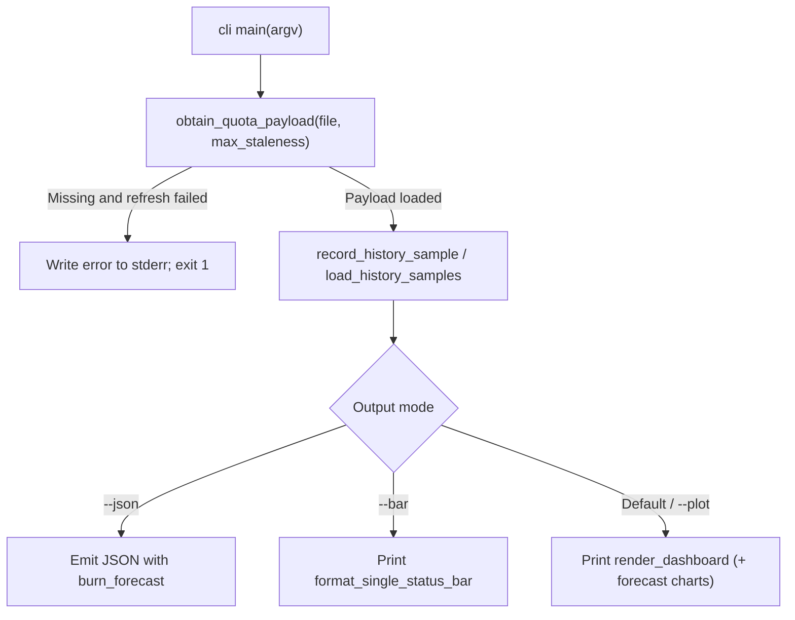

# IPD: Add gemini-quota CLI module and behavioral tests to agent_workflows

- Date: 2026-11-17
- Kind: child
- Concern: Bring the Antigravity `gemini-quota` CLI script into the `agent_workflows` Python package so `aw install more` can expose it without requiring external binaries or third-party dependencies.
- Scope: Add `agent_workflows/gemini_quota.py` (stdlib-only module implementing the `gemini-quota` status bar, dashboard, burn-rate forecast, JSON export, watch loop, and cache/API quota refresh) and `tests/test_gemini_quota.py` covering its CLI flags and rendering/forecast behavior. EXCLUDES modifying `[project.scripts]` in `pyproject.toml`, installing user PATH launchers (`58isyp`), and changing `agent_workflows/agy_runipd.py` statuslines.
- Scope-Paths: agent_workflows/gemini_quota.py, tests/test_gemini_quota.py, .aw/records/plans/pending/20261117-installmore-01-z403j4-add-gemini-quota-cli-module-and-behavioral-tests-to-agent-wo.ipd.md
- Item-Dependencies: none
- Status: to-review
- Short-Description: Package the Antigravity gemini-quota status/forecast CLI under agent_workflows/gemini_quota.py with unit and CLI tests
- Work-Kind: feature
- Priority: medium
- Set: installmore
- Order: 1
- Highest E allocated: 04
- Author: antigravity
- Id: z403j4

> Write and proofread this plan per the technical writing standard, `.aw/system/workflows/technical-writing/technical-writing.md` (`.agents/workflows/technical-writing/technical-writing.md` in a legacy-layout install), including requirement 12 (diagrams).

## Workflow history

- 2026-11-18 to-review (aw set): status set to to-review
- 2026-11-18 draft (antigravity): created and authored as self-contained Order 01 of Set `installmore`.

## Goal

Package `gemini-quota` inside `agent_workflows/gemini_quota.py` using Python stdlib modules only, so `agent-workflows` ships the tool in its wheel/sdist and `58isyp` can install a launcher for it via `aw install more`.

## Detailed Implementation Checklist (TODO)

Execution-state rule: mark an `E-*` item complete only after performing the action. That mark is not validation. Right-sizing rule: write for a modest executor that cannot hold much in its head. Each E-item is one step (one concern, about one file, executable in one focused pass) and its V-item names each unit it covers with its own check; a plan stays at about 5 E-items and 8 work Scope-Paths, else split it into more child plans (guidance, `IPD-Z603`). Accepted execution states: blocked, failed, pending, performed; terminal gate demands 'performed'.

### Task group 1: Module implementation and behavioral verification

- [ ] E-01 Create `agent_workflows/gemini_quota.py` implementing the quota payload reader/refresher (`DEFAULT_CACHE_PATHS = (Path("/tmp/antigravity_quota.json"), Path.home() / ".gemini" / "antigravity-cli" / "last_quota.json")`, `HISTORY_PATH = Path.home() / ".gemini" / "antigravity-cli" / "quota_history.json"`, `load_quota_payload`, `obtain_quota_payload`, `refresh_quota`, `load_history_samples`, `record_history_sample`), the ANSI/256-color renderers (`supports_color`, `format_bar`, `format_duration`, `compute_reset_in_seconds`, `format_single_status_bar`, `render_dashboard`), and the 5-hour OLS burn-rate analyzer (`analyze_bucket`, `render_watch_forecast_panel`, `build_json_forecast`), using Python stdlib only and keeping all paths free of user-specific or machine-local strings.
  - Depends on: none
  - Expected outcome: `agent_workflows/gemini_quota.py` imports cleanly with zero third-party dependencies and passes `ruff`, `mypy`, and `aw check-local-leaks`.
  - Execution state: pending

- [ ] E-02 Implement `build_parser()` and `main(argv: list[str] | None = None) -> int` in `agent_workflows/gemini_quota.py` supporting `--bar`/`-b`/`--status-bar`/`--compact`, `--gemini`/`-g`/`--gemini-only`, `--3p`/`-3`/`--third-party`, `--json`/`-j`, `--watch`/`-w` (optional float seconds, default `2.0`), `--max-staleness`/`-m` (float seconds, default `60.0`), `--no-color`/`--plain`, `--color`, `--plot`/`-p`/`--charts`, `--context`, and `--file`/`-f`, plus runnable `if __name__ == "__main__": sys.exit(main())`.
  - Depends on: E-01
  - Expected outcome: `python3 -m agent_workflows.gemini_quota --help` renders all flags, missing/unreadable payload files print an actionable error on stderr and return non-zero, and `--file`, `--bar`, `--json`, and dashboard modes render from fixture JSON.
  - Execution state: pending

- [ ] E-03 Add behavioral tests in `tests/test_gemini_quota.py` driving `gemini_quota.main` and helper APIs against synthetic quota fixture files (`--file`): single-line `--bar` output, `--json` output with `burn_forecast`, `--gemini` vs `--3p` bucket filtering, `--no-color` plain output, `--plot` Braille forecast panel, non-zero exit when quota data is missing (`obtain_quota_payload` returning `None` without network access), and history sample recording/pruning under a temporary home path.
  - Depends on: E-02
  - Expected outcome: All tests in `tests/test_gemini_quota.py` pass deterministically without requiring network access or live Antigravity credentials, and contain no source-code inspection assertions.
  - Execution state: pending

- [ ] E-04 Run `aw check-local-leaks` and `python3 -m pytest -v tests/test_gemini_quota.py` (plus bare `python3 -m pytest`) confirming zero leaks, zero mypy regressions, and passing tests.
  - Depends on: E-03
  - Expected outcome: `tests/test_gemini_quota.py` passes cleanly, leak check passes, and core pytest suite remains green.
  - Execution state: pending

## Project conventions discovered (Step 0)

- Runtime dependencies in `pyproject.toml` are strictly minimized (`filelock>=3` only); `agent_workflows/gemini_quota.py` uses stdlib modules only (`argparse`, `datetime`, `json`, `os`, `re`, `shutil`, `subprocess`, `sys`, `time`, `urllib.*`, `pathlib`) so `dependencies` in `pyproject.toml` stays unchanged.
- `pyproject.toml` packages `agent_workflows` into wheels and sdists automatically (`packages = ["agent_workflows"]`).
- All tracked files must pass `aw check-local-leaks` (no local usernames or machine-local home paths; use `Path.home()` or `~/.gemini/...`).
- Tests must exercise observable behavior (`main`, CLI subprocess invocation, temp JSON fixtures) with no `inspect`/`ast` source-pinning checks.

## Findings

| Finding | Evidence | Impact on this plan |
| --- | --- | --- |
| `gemini-quota` uses stdlib only | Existing CLI uses stdlib modules (`argparse`, `datetime`, `json`, `urllib.*`, `pathlib`) and needs no new runtime dependency | Keeps `pyproject.toml` `dependencies = ["filelock>=3"]` unchanged |
| Wheel packaging covers all `agent_workflows/*.py` modules | `pyproject.toml` declares `[tool.hatch.build.targets.wheel] packages = ["agent_workflows"]` | Putting `gemini_quota.py` under `agent_workflows/` ships it automatically in builds and editable installs |
| Executable entrypoint stays separate from default `[project.scripts]` | Maintainer requested opt-in installation via `aw install more` after asking | Do NOT add `gemini-quota` to `[project.scripts]`; expose `python3 -m agent_workflows.gemini_quota` for `58isyp` to wrap on opt-in |

## Proposed changes (ordered, validatable)

1. Add `agent_workflows/gemini_quota.py` implementing the quota dashboard, cache/history handling, live refresh helpers, burn-rate forecast, and CLI entrypoint `main(argv=None)`.
2. Add `tests/test_gemini_quota.py` exercising all CLI flags and forecast/rendering paths with local temp fixtures (zero network calls).
3. Verify with `pytest`, `mypy`, `ruff`, and `aw check-local-leaks`.

## Deferred / out of scope (with reason)

- Registering `gemini-quota` in `aw install more` and adding the `aw install` discovery tip: owned by sibling Order 02 (`58isyp`).
- Installing launchers into user bin directories by default in `pyproject.toml`: omitted intentionally because installation must be opt-in after asking (`aw install more`).

## Scope check

- Over-scope: none.
- Under-scope: none. Packaging inside `agent_workflows/` gives `58isyp` a clean `python3 -m agent_workflows.gemini_quota` target.

## Required tests / validation

- `python3 -m pytest -v tests/test_gemini_quota.py`
- `aw check-local-leaks`
- `python3 -m pytest` (core suite)

## Spec / documentation sync

- N/A for `z403j4`: companion CLI behavior and user installation docs live in `58isyp` (`README.md` / CLI help).

## Open questions

### OQ-01: Should `agent_workflows/gemini_quota.py` be copied verbatim from the maintainer's local script before execution or authored directly from the behavioral contract above?

- Blocking: no
- Status: resolved
- Owner: maintainer
- Resolution or deferral rationale: Self-contained default for autonomous lanes: implement `agent_workflows/gemini_quota.py` from this plan's contract with no out-of-lane reads. If the maintainer wants byte-identical preservation of their local `~/.gemini/antigravity-cli/bin/gemini-quota` script, they can copy it to `agent_workflows/gemini_quota.py` on `main` before running `z403j4` (after adjusting `main()` to accept `argv: list[str] | None = None`).

## Validation and cross-check (verify before reporting done)

Validation-state rule: inspect evidence in a separate pass. Do not mark a `V-*` item complete from memory or from the matching execution checkmark. Accepted validation results: blocked, failed, pass, pending; terminal gate demands 'pass'. Runtime-demonstration reachability rule: for each `V-*` item demanding the software be observed acting (such as a run, a dispatch, or a transition)—as distinct from items demanding a diff, a file's content, or a test result, which are reachable by construction—name the code path that produces the observation or the sibling `E-*` that creates it, else the demand is UNDER-SCOPE.

- [ ] V-01 validates E-01
  - Required evidence: paste `git status --short agent_workflows/gemini_quota.py` showing the new module, `aw check-local-leaks` clean output, and `python3 -c "from agent_workflows import gemini_quota; print(callable(gemini_quota.format_single_status_bar), callable(gemini_quota.render_dashboard), callable(gemini_quota.analyze_bucket))"` printing `True True True`.
  - Observed evidence:
  - Result: pending

- [ ] V-02 validates E-02
  - Required evidence: paste `python3 -m agent_workflows.gemini_quota --help` output showing `-b`/`--bar`, `-g`/`--gemini`, `-3`/`--3p`, `-j`/`--json`, `-w`/`--watch`, `-m`/`--max-staleness`, `--no-color`, `--color`, `-p`/`--plot`, `--context`, and `-f`/`--file`, plus `python3 -m agent_workflows.gemini_quota --file /nonexistent/quota.json --max-staleness -1` exiting non-zero with an error message.
  - Observed evidence:
  - Result: pending

- [ ] V-03 validates E-03
  - Required evidence: paste `python3 -m pytest -v tests/test_gemini_quota.py` showing every test node PASSED and 0 failed, plus `rg -n "^(import|from) (inspect|ast)\b" tests/test_gemini_quota.py` returning exit 1.
  - Observed evidence:
  - Result: pending

- [ ] V-04 validates E-04
  - Required evidence: paste `pre-commit run --files agent_workflows/gemini_quota.py tests/test_gemini_quota.py` showing all hooks passed and the summary line of bare `python3 -m pytest` passing within budget.
  - Observed evidence:
  - Result: pending

## Approval and execution gate

- Size assessment: standard
- Cohesion rationale: not required

Once reviewed and approved, execute inside an isolated worktree, verify all `V-*` checks, and finalize with `aw ipd finalize`.
