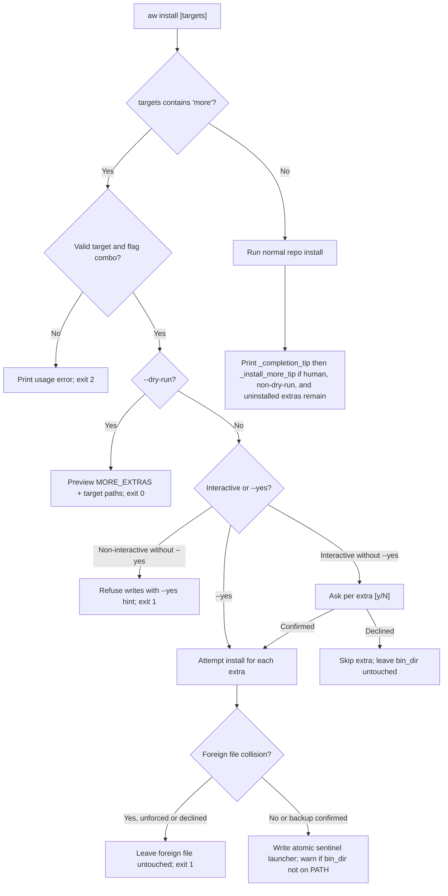

# IPD: Add aw install more opt-in companion installer and discovery tip in aw install

- Date: 2026-11-17
- Kind: child
- Concern: Let users opt in (after explicit confirmation) to installing optional companion CLI tools packaged with `agent_workflows` via `aw install more`, and advertise `aw install more` at the end of `aw install`.
- Scope: Add `agent_workflows/install_more.py` defining an extensible catalog of optional companion tools (starting with `gemini-quota` and `agy-quota` from `z403j4`), user bin directory resolution (`$XDG_BIN_HOME` else `~/.local/bin`, overridable with `--bin-dir`), sentinel-guarded executable launcher generation (POSIX and Windows), and install/status/uninstall helpers; wire `aw install more` (with ask-first confirmation, `--dry-run`, `--yes`, `--bin-dir`, `--agent`/`--json`) and the once-per-invocation discovery tip (`_install_more_tip`) into `agent_workflows/cli.py` and `agent_workflows/command_surface.py`; document `aw install more` in `README.md`; add behavioral tests in `tests/test_install_more.py` (including `command_surface` declaration coverage for `--bin-dir`). EXCLUDES `gemini_quota.py` implementation (`z403j4`) and shell dotfile editing.
- Scope-Paths: agent_workflows/install_more.py, agent_workflows/cli.py, agent_workflows/command_surface.py, tests/test_install_more.py, README.md, .aw/records/plans/pending/20261117-installmore-02-58isyp-add-aw-install-more-opt-in-companion-installer-and-discovery.ipd.md
- Item-Dependencies: executed:z403j4
- Status: approved
- Readiness: go-pending-approval
- Review-Depth: standard
- Short-Description: Implement install_more catalog and launcher installer, wire aw install more confirmation flow and command surface, and print discovery tip after aw install
- Work-Kind: feature
- Priority: medium
- Set: installmore
- Order: 2
- Highest E allocated: 05
- Author: antigravity
- Id: 58isyp
- Approval: 2026-11-27, recorded via aw ipd set: status set to approved

> Write and proofread this plan per the technical writing standard, `.aw/system/workflows/technical-writing/technical-writing.md` (`.agents/workflows/technical-writing/technical-writing.md` in a legacy-layout install), including requirement 12 (diagrams).

## Workflow history

- 2026-11-27 updated (antigravity): added `agy-quota` launcher alongside `gemini-quota` in `MORE_EXTRAS` (both wrapping `agent_workflows.gemini_quota:main`) per maintainer request.
- 2026-11-27 approved (aw set): status set to approved
- 2026-11-18 reviewed (aw set): APPROVE WITH REVISIONS APPLIED; PR-001..PR-005
- 2026-11-18 /plan-review (antigravity/gemini-4-hydrogen-high): APPROVE WITH REVISIONS APPLIED; PR-001, PR-002, PR-003, PR-004, PR-005; review record .aw/records/reviews/20261117-installmore-02-58isyp-add-aw-install-more-opt-in-companion-installer-and-discovery.review.md
- 2026-11-18 to-review (aw set): status set to to-review
- 2026-11-18 draft (antigravity): created and authored as Order 02 of Set `installmore`, depending on `executed:z403j4`.

## Goal

Provide an extensible, consent-gated `aw install more` command that installs optional companion tools (starting with `gemini-quota` and `agy-quota`) into the user's bin directory after asking, and have `aw install` / `aw install all` inform users when optional extras are available via `aw install more`.

## Detailed Implementation Checklist (TODO)

Execution-state rule: mark an `E-*` item complete only after performing the action. That mark is not validation. Right-sizing rule: write for a modest executor that cannot hold much in its head. Each E-item is one step (one concern, about one file, executable in one focused pass) and its V-item names each unit it covers with its own check; a plan stays at about 5 E-items and 8 work Scope-Paths, else split it into more child plans (guidance, `IPD-Z603`). Accepted execution states: blocked, failed, pending, performed; terminal gate demands 'performed'.

### Task group 1: Companion catalog, CLI integration, discovery tip, docs, and tests

- [ ] E-01 Create `agent_workflows/install_more.py` (with `from __future__ import annotations` and Python 3.9+ stdlib only, using `typing.Optional` / `typing.Tuple` or postponed annotations and no runtime `X | Y` unions) implementing:
  - Catalog & models: `INSTALL_SENTINEL = "# managed-by: agent-workflows (aw install more)"`, frozen `ExtraTool` dataclass (`name`, `module`, `entrypoint`, `description`), `ExtraInstallResult` dataclass (`name`, `path`, `status`, `backup_path`, `message`), and declarative `MORE_EXTRAS: tuple[ExtraTool, ...]` starting with `ExtraTool(name="gemini-quota", module="agent_workflows.gemini_quota", entrypoint="main", description="Gemini and third-party quota/credit status and burn-rate forecast CLI for Antigravity (AGY)")` and `ExtraTool(name="agy-quota", module="agent_workflows.gemini_quota", entrypoint="main", description="Alias for gemini-quota (Antigravity quota/credit status and burn-rate forecast CLI)")`. Validate `extra.name` as a safe single filename component (no `/`, `\`, or `..`).
  - Path & status helpers: `resolve_bin_dir(custom_dir: Path | None = None) -> Path` (honoring `custom_dir` if supplied, else non-empty `$XDG_BIN_HOME`, else `Path.home() / ".local" / "bin"`, expanded and resolved; raise `InstallMoreError` if an existing target path is a non-directory file), `is_extra_installed(extra, bin_dir=None) -> bool` (True only when the launcher at `bin_dir` exists as a regular file and carries `INSTALL_SENTINEL`), `is_foreign_extra(extra, bin_dir=None) -> bool` (True when a non-managed file or symlink exists at the target path), `has_uninstalled_extras(bin_dir=None) -> bool` (True when any entry in `MORE_EXTRAS` has neither our managed launcher nor an existing executable at its target path, failing soft to `False` on `OSError`), and `is_bin_dir_on_path(bin_dir: Path) -> bool` (comparing normalized resolved `PATH` entries).
  - Launcher installer & uninstaller: `install_extra(extra, bin_dir=None, *, dry_run=False, force=False) -> ExtraInstallResult` and `uninstall_extra(name, bin_dir=None, *, dry_run=False) -> ExtraInstallResult`. On POSIX, write a `0o755` launcher containing `INSTALL_SENTINEL` and using `#!<sys.executable>` calling `agent_workflows.gemini_quota:main` (falling back to `#!/bin/sh` `exec <shlex.quote(sys.executable)> -m agent_workflows.gemini_quota "$@"` when `sys.executable` contains whitespace); on Windows (`sys.platform == "win32"`), write a `.cmd` wrapper (`@echo off` + `rem <INSTALL_SENTINEL>` + `"<sys.executable>" -m agent_workflows.gemini_quota %*`). Write atomically via `tempfile.mkstemp` in `bin_dir` + `chmod` + `os.replace`, and never write through a symlink. If a foreign (non-sentinel) file or symlink occupies the target path, return/refuse collision without modifying it when `force=False`; when `force=True`, back up the existing foreign entry to `<name>.bak` (or `<name>.bak.<n>`) before replacing. `uninstall_extra` removes only launchers carrying `INSTALL_SENTINEL` and leaves foreign files untouched.
  - Depends on: none
  - Expected outcome: `install_more` imports cleanly on Python 3.9+, exposes a multi-extra catalog so future tools can be appended via `MORE_EXTRAS`, and performs atomic, sentinel-guarded installs and uninstalls across POSIX and Windows.
  - Execution state: pending

- [ ] E-02 Wire `"more"` into `aw install` in `agent_workflows/cli.py` and `agent_workflows/command_surface.py`:
  - Parser & declarations: add `--bin-dir` (`default=None`, `type=Path`) on `p_install` (`agent_workflows/cli.py`) and declare `"--bin-dir"` in `CommandDeclaration(command="install").legacy_flags` (`agent_workflows/command_surface.py`). Update `_run_install` dispatch signature in `agent_workflows/cli.py` (`_dispatch`) to receive `context: OutputContext | None = None` (falling back to `select_output(args)` when None) so `--agent` (`OutputMode.AGENT`) and `--json` (`OutputMode.JSON`) are honored cleanly.
  - Target validation & routing: in `_run_install`, detect `"more" in targets` before path resolution and route to `_install_more(args, term, context=ctx)`. Refuse invalid combinations with exit `2`: `"more"` mixed with `"all"` or repo paths, or repo-only flags (`--relocate`, `--relocate-resume`, `--relocate-rollback`, `--preset`, `--delivery-mode`, `--records-backend`, `--companion-dir`, `--to-aw`, `--keep-legacy`, `--leftovers`), and refuse `--bin-dir` passed without `"more"` with exit `2`. Emit an `aw.agent/v1` `kind="error"` (`outcome="cannot-run"`, `exit=2`) record when `ctx.is_agent` is True.
  - Consent, collision, PATH, & output modes in `_install_more`:
    - Under `--dry-run`: preview each extra in `MORE_EXTRAS` and its target path without creating directories or files, returning exit `0` (`outcome="preview"`, `verified=True`, `complete=False`, `applied=False` under `--agent`).
    - Under non-interactive mode (`not term.is_interactive()`, including `--no-interactive`, `--agent`, or `--json` without `--yes`): refuse all writes and exit `1` with an actionable `--yes` instruction.
    - Interactively without `--yes`: display the `MORE_EXTRAS` catalog and prompt `[y/N]` for each extra before writing (default No). Under `--yes` (interactive or non-interactive): install each non-colliding extra. If a foreign (non-sentinel) file exists at a target path, interactively prompt `[y/N]` to back up and replace (`force=True`); non-interactively (or if declined), leave the foreign file untouched, report the collision path, and return exit `1`.
    - `PATH` guidance: if `not is_bin_dir_on_path(bin_dir)`, warn clearly and print manual `export PATH="<shlex.quote(str(bin_dir))>:$PATH"` guidance (or Windows `%PATH%` note) without editing shell dotfiles.
    - Machine output: under `--agent`, emit a single `aw.agent/v1` `kind="result"` JSONL record via `agent_schema.render_guarded_jsonl_record` (respecting `ctx.fields`), passing all embedded user/home paths (`bin_dir`, launcher paths, backup paths) through `agent_schema.redact_home_paths` so `agent_schema.validate_agent_record` passes with zero unsanitized home paths; under `--json`, emit formatted JSON summarizing `bin_dir`, `on_path`, `dry_run`, and per-extra `results`.
  - Depends on: E-01
  - Expected outcome: `aw install more` asks before installing, handles foreign collisions safely, supports `--dry-run`, `--yes`, `--bin-dir`, `--agent`, and `--json`, and conforms with `command_surface` and `exit_contract` gates.
  - Execution state: pending

- [ ] E-03 Add `_install_more_tip(term: Term, *, args: argparse.Namespace | None = None, context: OutputContext | None = None) -> None` in `agent_workflows/cli.py` and invoke it once per invocation immediately after `_completion_tip(term)` at the end of `_run_install` (when `returncode == 0`) and `_install_all` (when `failed == 0`). Skip emitting the tip when `OutputMode.HUMAN` is not active (`context` is `AGENT` or `JSON`, or `getattr(args, "agent", False)` / `getattr(args, "json", False)`), when `--dry-run` is set, or when `install_more.has_uninstalled_extras()` is False. Update `p_install` help, `targets` help, and `_DESCRIPTIONS["install"]` in `agent_workflows/cli.py` to document `'more'` and `--bin-dir`, and add a concise section in `README.md` (with zero em or en dashes per `AGENTS.md` prose rules) documenting `aw install more`, `gemini-quota`, and `agy-quota`.
  - Depends on: E-02
  - Expected outcome: Human non-dry-run `aw install` and `aw install all` runs inform the user once per invocation that `'aw install more'` is available to install optional companion tools (such as `gemini-quota` and `agy-quota`) whenever uninstalled extras remain, while `--dry-run`, `--agent`, and `--json` stay clean.
  - Execution state: pending

- [ ] E-04 Add behavioral tests in `tests/test_install_more.py` (marked with `pytestmark = pytest.mark.core` at module scope, using fast in-process `cli.main` / `install_more` calls and temp directories well under the 2s slow threshold, with zero `inspect`/`ast` source-pinning checks) exercising: (a) `resolve_bin_dir` (`--bin-dir`, `$XDG_BIN_HOME`, `~/.local/bin` fallback, non-directory refusal) and `is_bin_dir_on_path`, (b) ask-first confirmation (`[y/N]` accept installs executable `gemini-quota` and `agy-quota` launchers carrying `INSTALL_SENTINEL` whose execution with `--help` exits `0` cleanly; decline leaves the directory untouched), (c) non-interactive refusal without `--yes` (exit `1`, no writes), `--yes` install success, `--dry-run` no-write guarantee, and invalid mixed targets / `--bin-dir` without `more` returning exit `2`, (d) foreign-file collision safety (refusal without `force`, backup+replace with `force` or interactive confirm, `uninstall_extra` leaving foreign files untouched and removing only sentinel-marked launchers), (e) `--agent` (`aw.agent/v1` schema-valid record via `agent_schema.validate_agent_record` with zero raw `/home/` paths) and `--json` output envelopes, (f) `_install_more_tip` printed once after `aw install` / `aw install all` when extras are uninstalled and omitted on `--dry-run`, `--agent`, `--json`, or once installed, and (g) `CommandDeclaration(command="install").legacy_flags` including `"--bin-dir"`.
  - Depends on: E-03
  - Expected outcome: Every test in `tests/test_install_more.py` runs in the `core` tier, passes deterministically without modifying user home or dotfiles, and proves all ask-first, launcher, collision, machine-output, and discovery behaviors.
  - Execution state: pending

- [ ] E-05 Run `aw check-local-leaks`, `ruff check agent_workflows/install_more.py agent_workflows/cli.py agent_workflows/command_surface.py tests/test_install_more.py`, `ruff format --check agent_workflows/install_more.py agent_workflows/cli.py agent_workflows/command_surface.py tests/test_install_more.py`, `python3 -m mypy agent_workflows`, `pre-commit run --files ...` (after staging modified files), `python3 -m pytest -v tests/test_install_more.py tests/test_gemini_quota.py tests/test_command_surface_declarations.py tests/test_exit_contract_conformance.py tests/test_agent_surface_conformance.py tests/test_completion.py tests/test_installer.py`, and bare `python3 -m pytest`, verifying zero leaks, zero mypy/ruff regressions, and zero test failures across the suite.
  - Depends on: E-04
  - Expected outcome: Static checks, pre-commit hooks, targeted behavioral/conformance tests, and the bare core pytest suite all pass with pasted runner output.
  - Execution state: pending

## Project conventions discovered (Step 0)

- `_run_install` in `agent_workflows/cli.py` already dispatches positional `"all"` (`if "all" in targets: return _install_all(args, term)`) and ends both `_run_install` and `_install_all` with per-invocation host hooks (`_configure_completion`, `_completion_tip`) outside the per-repo loop.
- `agent_workflows/command_surface.py` declares `CommandDeclaration(command="install", ...)` with `legacy_flags=(...)` and `exit_contract=(0, 1, 2)`, enforced by `tests/test_command_surface_declarations.py` and `tests/test_exit_contract_conformance.py` (there is no `--quiet` flag on `common` or `p_install`).
- `agent_workflows/completion.py` provides the shipped pattern for optional host/user-dir installation (`resolve_completion_dir` with `$XDG_*` override, `INSTALL_SENTINEL` non-clobbering ownership checks, atomic writes, symlink refusal, no shell dotfile edits, and actionable `PATH`/rc snippet printed instead).
- `pyproject.toml` requires Python `>=3.9` across Linux, macOS, and Windows; `conftest.py::pytest_collection_modifyitems` selects only `@pytest.mark.core` tests on bare `python3 -m pytest`, and `agent_workflows/agent_schema.py::validate_agent_record` rejects any `aw.agent/v1` record containing unsanitized `/home/<user>` / `/Users/<user>` / `C:\Users\<user>` paths.
- User-facing prose in `README.md` must contain zero em dashes or en dashes (checked during execution and review).

## Findings

| Finding | Evidence | Impact on this plan |
| --- | --- | --- |
| `aw install` handles named target keywords alongside repo paths | `_run_install` checks `if "all" in targets:` before converting `targets` into `Path`s | Add `if "more" in targets:` right alongside `"all"` (refusing combined repo paths/`"all"` or `--bin-dir` without `"more"` with exit 2) |
| Once-per-invocation tip slot already exists | Both `_run_install` and `_install_all` call `_completion_tip(term)` once at the end | Call `_install_more_tip(term, args=args, context=ctx)` immediately after `_completion_tip(term)` when `OutputMode.HUMAN` is active and `--dry-run` is False |
| User-level optional writes require consent, sentinels, and path redaction | `completion.py` uses `INSTALL_SENTINEL` and never edits dotfiles silently; `agent_schema.py::validate_agent_record` rejects raw home paths in `--agent` records | Use `INSTALL_SENTINEL` + atomic writes + foreign collision refusal/backup, require interactive `[y/N]` or `--yes`, and redact home paths via `agent_schema.redact_home_paths` in `--agent` records |

## Proposed changes (ordered, validatable)

1. Add `agent_workflows/install_more.py` (`INSTALL_SENTINEL`, `MORE_EXTRAS`, `resolve_bin_dir`, `is_extra_installed`, `is_foreign_extra`, `has_uninstalled_extras`, `is_bin_dir_on_path`, `install_extra`, `uninstall_extra`) with Python 3.9+ compatibility and POSIX/Windows launchers.
2. Update `agent_workflows/cli.py` and `agent_workflows/command_surface.py` to support `aw install more`, `--bin-dir`, ask-first prompts, foreign-file collision handling, `--agent`/`--json` output with `agent_schema.redact_home_paths`, updated help text, and `_install_more_tip`.
3. Update `README.md` (dash-free user prose) and add `tests/test_install_more.py` (`pytestmark = pytest.mark.core`).
4. Validate with `mypy`, `ruff`, `pre-commit`, `aw check-local-leaks`, targeted conformance suites, and bare `python3 -m pytest`.

## Deferred / out of scope (with reason)

- Separate `aw more uninstall` subcommand: `install_more.uninstall_extra` helper provides programmatic uninstall support for tests and future CLI exposure; exposing a dedicated subcommand can follow if needed once more extras accumulate.
  - Carrier-Declined: intentional exclusion for initial release (`install_more.uninstall_extra` provides programmatic uninstall; a CLI uninstall verb can be filed once additional companion extras are added)
- Editing `~/.bashrc` or `~/.zshrc` to add `~/.local/bin` to `PATH`: excluded by design (`completion.py` policy never edits user shell rc files automatically).
  - Carrier-Declined: intentional exclusion by design (matches `agent_workflows/completion.py` no-silent-rc-edit policy; prints manual `export PATH` guidance instead)

## Scope check

- Over-scope: none.
- Under-scope: none. Connects `z403j4`'s packaged `gemini_quota` module directly to `aw install more` and `aw install` discovery.

## Required tests / validation

- `python3 -m pytest -v tests/test_install_more.py tests/test_gemini_quota.py tests/test_command_surface_declarations.py tests/test_exit_contract_conformance.py tests/test_agent_surface_conformance.py tests/test_completion.py tests/test_installer.py`
- `python3 -m mypy agent_workflows`
- `ruff check agent_workflows/install_more.py agent_workflows/cli.py agent_workflows/command_surface.py tests/test_install_more.py` and `ruff format --check agent_workflows/install_more.py agent_workflows/cli.py agent_workflows/command_surface.py tests/test_install_more.py`
- `aw check-local-leaks`
- `python3 -m pytest` (core suite)

## Spec / documentation sync

- Updates `README.md` with `aw install more` usage and companion-tool notes (zero em/en dashes).

## Open questions

None blocking.

## Validation and cross-check (verify before reporting done)

Validation-state rule: inspect evidence in a separate pass. Do not mark a `V-*` item complete from memory or from the matching execution checkmark. Accepted validation results: blocked, failed, pass, pending; terminal gate demands 'pass'. Runtime-demonstration reachability rule: for each `V-*` item demanding the software be observed acting (such as a run, a dispatch, or a transition)—as distinct from items demanding a diff, a file's content, or a test result, which are reachable by construction—name the code path that produces the observation or the sibling `E-*` that creates it, else the demand is UNDER-SCOPE.

- [ ] V-01 validates E-01
  - Required evidence: paste `python3 -c` output exercising `install_more.resolve_bin_dir`, `install_more.MORE_EXTRAS`, `install_more.install_extra` (including `INSTALL_SENTINEL` and foreign-file collision safety), `install_more.uninstall_extra`, and running the generated `gemini-quota --help` and `agy-quota --help` launchers into a temp dir (exit 0).
  - Observed evidence:
  - Result: pending

- [ ] V-02 validates E-02
  - Required evidence: paste `aw install --help` showing `--bin-dir` and `'more'`, plus pasted pytest output from `tests/test_install_more.py`, `tests/test_command_surface_declarations.py`, and `tests/test_exit_contract_conformance.py` demonstrating `--dry-run`, interactive accept/decline prompts, non-interactive without `--yes` refusal, `--yes` install, foreign-file collision handling, exit-2 invalid target/flag combinations, and schema-valid `--agent` / `--json` output.
  - Observed evidence:
  - Result: pending

- [ ] V-03 validates E-03
  - Required evidence: paste test/CLI output from a non-dry-run temp-repo `aw install <tmp_repo> --yes` run showing the `'aw install more'` discovery tip printed once per invocation (and omitted on `--dry-run`, `--agent`, `--json`, and after installation), plus `git diff README.md` and confirmation of zero em/en dashes (`U+2013`/`U+2014`) in added `README.md` lines.
  - Observed evidence:
  - Result: pending

- [ ] V-04 validates E-04
  - Required evidence: paste `python3 -m pytest -v tests/test_install_more.py` showing all new test cases PASSED (0 failed, 0 skipped), plus `rg -n "^(import|from) (inspect|ast)\b" tests/test_install_more.py` returning exit 1.
  - Observed evidence:
  - Result: pending

- [ ] V-05 validates E-05
  - Required evidence: paste `python3 -m mypy agent_workflows`, `ruff check ...`, `ruff format --check ...`, `pre-commit run --files ...` (after staging) showing all hooks passed, `aw check-local-leaks` clean output, and the summary line of bare `python3 -m pytest` passing within budget with `tests/test_install_more.py` collected in the core tier.
  - Observed evidence:
  - Result: pending

## Approval and execution gate

- Size assessment: standard
- Cohesion rationale: not required

Execution contract:
- **Open questions**: None (`58isyp` has zero unresolved blocking open questions; execution remains gated on `- Item-Dependencies: executed:z403j4` and human approval).
- **Scope fence**: Declared work paths are listed in `- Scope-Paths:`. An out-of-scope edit must be justified at finalize with `--scope-reason`, and any declared path left unmodified must be acknowledged with `--scope-ack`.
- **Safety stop**: Stop and report only on a genuinely unsafe condition (such as an unresolvable concurrent-edit conflict or missing `agent_workflows/gemini_quota.py` symbols after `z403j4`).
- **Evidence honesty**: MUST paste the actual runner output for every check and test run; never claim passing results without running them after the final edit.
- **Commit and push**: Commit only files you changed for this plan, limited to named paths, via `aw commit 58isyp -- <paths>`. Never use `git add -A`, `git commit -a`, or `--no-verify`, and never push without an explicit human directive.
- **Lifecycle transition**: When `aw oc run` or `aw agy run` executes this plan, the runner performs the terminal finalize (`aw ipd finalize 58isyp`); a hand executor runs `aw ipd finalize 58isyp` itself (never a hand `git mv` to `executed/`).
