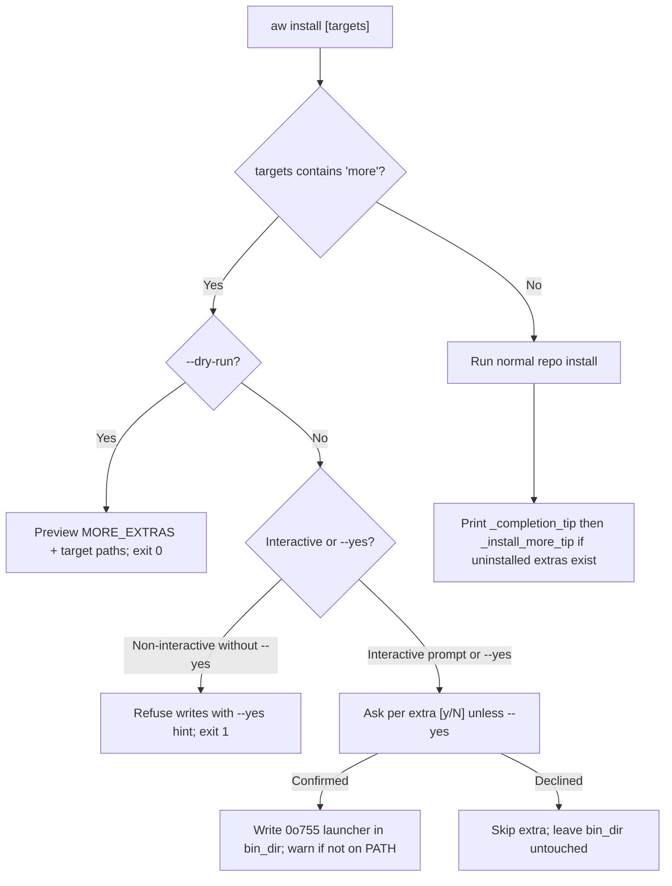

# IPD: Add aw install more opt-in companion installer and discovery tip in aw install

- Date: 2026-11-17
- Kind: child
- Concern: Let users opt in (after explicit confirmation) to installing optional companion CLI tools packaged with `agent_workflows` via `aw install more`, and advertise `aw install more` at the end of `aw install`.
- Scope: Add `agent_workflows/install_more.py` defining an extensible catalog of optional companion tools (starting with `gemini-quota` from `z403j4`), user bin directory resolution (`$XDG_BIN_HOME` else `~/.local/bin`, overridable with `--bin-dir`), executable wrapper generation, and install/status/uninstall helpers; wire `aw install more` (with ask-first confirmation, `--dry-run`, `--yes`, `--bin-dir`, `--agent`/`--json`) and the once-per-invocation discovery tip (`_install_more_tip`) into `agent_workflows/cli.py` and `agent_workflows/command_surface.py`; document `aw install more` in `README.md`; add behavioral tests in `tests/test_install_more.py` and update command-surface checks if needed in `tests/test_command_surface_declarations.py`. EXCLUDES `gemini_quota.py` implementation (`z403j4`) and shell dotfile editing.
- Scope-Paths: agent_workflows/install_more.py, agent_workflows/cli.py, agent_workflows/command_surface.py, tests/test_install_more.py, tests/test_command_surface_declarations.py, README.md, .aw/records/plans/pending/20261117-installmore-02-58isyp-add-aw-install-more-opt-in-companion-installer-and-discovery.ipd.md
- Item-Dependencies: executed:z403j4
- Status: to-review
- Short-Description: Implement install_more catalog and launcher installer, wire aw install more confirmation flow and command surface, and print discovery tip after aw install
- Work-Kind: feature
- Priority: medium
- Set: installmore
- Order: 2
- Highest E allocated: 05
- Author: antigravity
- Id: 58isyp

> Write and proofread this plan per the technical writing standard, `.aw/system/workflows/technical-writing/technical-writing.md` (`.agents/workflows/technical-writing/technical-writing.md` in a legacy-layout install), including requirement 12 (diagrams).

## Workflow history

- 2026-11-18 to-review (aw set): status set to to-review
- 2026-11-18 draft (antigravity): created and authored as Order 02 of Set `installmore`, depending on `executed:z403j4`.

## Goal

Provide an extensible, consent-gated `aw install more` command that installs optional companion tools (starting with `gemini-quota`) into the user's bin directory after asking, and have `aw install` / `aw install all` inform users when optional extras are available via `aw install more`.

## Detailed Implementation Checklist (TODO)

Execution-state rule: mark an `E-*` item complete only after performing the action. That mark is not validation. Right-sizing rule: write for a modest executor that cannot hold much in its head. Each E-item is one step (one concern, about one file, executable in one focused pass) and its V-item names each unit it covers with its own check; a plan stays at about 5 E-items and 8 work Scope-Paths, else split it into more child plans (guidance, `IPD-Z603`). Accepted execution states: blocked, failed, pending, performed; terminal gate demands 'performed'.

### Task group 1: Companion catalog, CLI integration, discovery tip, docs, and tests

- [ ] E-01 Create `agent_workflows/install_more.py` defining a declarative tuple `MORE_EXTRAS` of `ExtraTool` specs (starting with `name="gemini-quota"`, `module="agent_workflows.gemini_quota"`, `description="Gemini and third-party quota/credit status and burn-rate forecast CLI for Antigravity (AGY)"`), `resolve_bin_dir(custom_dir: Path | None = None) -> Path` (honoring `custom_dir`, then `$XDG_BIN_HOME`, else `Path.home() / ".local" / "bin"`), `is_extra_installed(extra, bin_dir=None) -> bool`, `has_uninstalled_extras(bin_dir=None) -> bool`, `is_bin_dir_on_path(bin_dir: Path) -> bool`, `install_extra(extra, bin_dir=None, *, dry_run=False, force=False) -> ExtraInstallResult` (writing an executable launcher script with shebang `#!<sys.executable>` calling `agent_workflows.gemini_quota:main`, `0o755` permissions, backing up or leaving foreign non-AW files untouched unless confirmed/forced), and `uninstall_extra(name, bin_dir=None)`.
  - Depends on: none
  - Expected outcome: `install_more` exposes a reusable, multi-extra catalog so future tools can be appended by adding one entry to `MORE_EXTRAS`, and cleanly handles existing/foreign files and `PATH` checks.
  - Execution state: pending

- [ ] E-02 Wire `"more"` into `aw install` in `agent_workflows/cli.py` and `agent_workflows/command_surface.py`: add `--bin-dir` optional argument on `p_install` (`default=None`, `type=Path`) and declare `"--bin-dir"` in `CommandDeclaration(command="install")` (`agent_workflows/command_surface.py`). In `_run_install`, dispatch `"more" in targets` to `_install_more(args, term)` (refusing mixed `"more"` + repo paths with exit 2). In `_install_more`: under `--dry-run`, preview each extra and target path without writing; interactively (`term_mod.is_interactive()` without `--yes`), display the catalog of extras and prompt `[y/N]` for each before writing; non-interactively without `--yes`, refuse writes and exit 1 with a clear `--yes` instruction (and emit structured `aw.agent/v1` JSON under `--agent`/`--json`). Warn clearly if `bin_dir` is not on `PATH` and print `export PATH=...` guidance without modifying shell dotfiles.
  - Depends on: E-01
  - Expected outcome: `aw install more` asks before installing, supports `--dry-run`, `--yes`, `--bin-dir`, `--agent`, and `--json`, and conforms with `command_surface` exit-contract tests.
  - Execution state: pending

- [ ] E-03 Add `_install_more_tip(term: Term, *, args: argparse.Namespace | None = None) -> None` in `agent_workflows/cli.py` and invoke it once per invocation right after `_completion_tip(term)` at the end of both `_run_install` and `_install_all` (skipping when `--quiet`/`--agent`/`--json`/`--dry-run` or when `has_uninstalled_extras()` is False). Update `p_install` help/epilog in `agent_workflows/cli.py` and add a concise section in `README.md` (with zero em or en dashes per AGENTS.md prose rules) documenting `aw install more` and `gemini-quota`.
  - Depends on: E-02
  - Expected outcome: Interactive/human `aw install` and `aw install all` runs tell the user `'aw install more'` is available to install more tools (such as `gemini-quota`) whenever uninstalled extras exist.
  - Execution state: pending

- [ ] E-04 Add behavioral tests in `tests/test_install_more.py` (and update `tests/test_command_surface_declarations.py` if any allowlist expects exact `install` flags) exercising: (a) `resolve_bin_dir` (`--bin-dir`, `$XDG_BIN_HOME`, `~/.local/bin` fallback), (b) ask-first confirmation (`[y/N]` accept installs an executable `gemini-quota` launcher that runs `--help` cleanly; decline leaves directory untouched), (c) non-interactive refusal without `--yes` vs success with `--yes` and `--dry-run` no-write guarantee, (d) foreign-file collision safety and idempotent update of our own wrapper, (e) `--agent`/`--json` result envelope, and (f) `_install_more_tip` printed once after `aw install` / `aw install all` when extras are uninstalled and omitted once installed.
  - Depends on: E-03
  - Expected outcome: Every test in `tests/test_install_more.py` passes and proves all ask-first, launcher, and discovery behaviors with real temp dirs and CLI runs (zero code-pinning checks).
  - Execution state: pending

- [ ] E-05 Run `aw check-local-leaks`, `python3 -m pytest tests/test_install_more.py tests/test_gemini_quota.py tests/test_command_surface_declarations.py tests/test_exit_contract_conformance.py tests/test_completion.py tests/test_installer.py`, and bare `python3 -m pytest`, verifying zero failures across the suite.
  - Depends on: E-04
  - Expected outcome: Pre-commit hooks pass on all modified/created files and the full core suite exits 0 with pasted counts.
  - Execution state: pending

## Project conventions discovered (Step 0)

- `_run_install` in `agent_workflows/cli.py` already dispatches positional `"all"` (`if "all" in targets: return _install_all(args, term)`) and ends both `_run_install` and `_install_all` with per-invocation host hooks (`_configure_completion`, `_completion_tip`) outside the per-repo loop.
- `agent_workflows/command_surface.py` declares `CommandDeclaration(command="install", ...)` with `legacy_flags=(...)` and `exit_contract=(0, 1, 2)`, enforced by `tests/test_command_surface_declarations.py` and `tests/test_exit_contract_conformance.py`.
- `agent_workflows/completion.py` provides the shipped pattern for optional host/user-dir installation (`resolve_completion_dir` with `$XDG_*` override, explicit consent, no shell dotfile edits, actionable `PATH`/rc snippet printed instead).
- User-facing prose in `README.md` must contain zero em dashes or en dashes (checked during execution and review).

## Findings

| Finding | Evidence | Impact on this plan |
| --- | --- | --- |
| `aw install` handles named target keywords alongside repo paths | `_run_install` checks `if "all" in targets:` before converting `targets` into `Path`s | Add `if "more" in targets:` right alongside `"all"` (refusing combined repo paths cleanly with exit 2) |
| Once-per-invocation tip slot already exists | Both `_run_install` and `_install_all` call `_completion_tip(term)` once at the end | Call `_install_more_tip(term)` immediately after `_completion_tip(term)` |
| User-level optional writes must require consent and never edit dotfiles | `--completion` (`jolfpj`) prompts interactively, skips/refuses silently under non-TTY without consent, and prints manual `PATH` advice rather than editing shell rc files | Apply the same fail-safe pattern to `aw install more`: interactive `[y/N]` confirm (default No), require `--yes` non-interactively, never edit dotfiles |

## Proposed changes (ordered, validatable)

1. Add `agent_workflows/install_more.py` (`MORE_EXTRAS`, `resolve_bin_dir`, `is_extra_installed`, `has_uninstalled_extras`, `install_extra`, `uninstall_extra`).
2. Update `agent_workflows/cli.py` and `agent_workflows/command_surface.py` to support `aw install more`, `--bin-dir`, ask-first prompts, `--agent`/`--json` support, and `_install_more_tip`.
3. Update `README.md` (dash-free user prose) and add `tests/test_install_more.py` (plus any `test_command_surface_declarations.py` flag updates if needed).
4. Validate with `pre-commit` / `aw check-local-leaks` and pytest.

## Deferred / out of scope (with reason)

- Separate `aw more uninstall` subcommand: `install_more.uninstall_extra` helper provides programmatic uninstall support for tests and future CLI exposure; exposing a dedicated subcommand can follow if needed once more extras accumulate.
- Editing `~/.bashrc` or `~/.zshrc` to add `~/.local/bin` to `PATH`: excluded by design (`completion.py` policy never edits user shell rc files automatically).

## Scope check

- Over-scope: none.
- Under-scope: none. Connects `z403j4`'s packaged `gemini_quota` module directly to `aw install more` and `aw install` discovery.

## Required tests / validation

- `python3 -m pytest -v tests/test_install_more.py tests/test_gemini_quota.py tests/test_command_surface_declarations.py tests/test_exit_contract_conformance.py tests/test_completion.py tests/test_installer.py`
- `aw check-local-leaks`
- `python3 -m pytest` (core suite)

## Spec / documentation sync

- Updates `README.md` with `aw install more` usage and companion-tool notes (zero em/en dashes).

## Open questions

None blocking.

## Validation and cross-check (verify before reporting done)

Validation-state rule: inspect evidence in a separate pass. Do not mark a `V-*` item complete from memory or from the matching execution checkmark. Accepted validation results: blocked, failed, pass, pending; terminal gate demands 'pass'. Runtime-demonstration reachability rule: for each `V-*` item demanding the software be observed acting (such as a run, a dispatch, or a transition)—as distinct from items demanding a diff, a file's content, or a test result, which are reachable by construction—name the code path that produces the observation or the sibling `E-*` that creates it, else the demand is UNDER-SCOPE.

- [ ] V-01 validates E-01
  - Required evidence: paste `python3 -c` output exercising `install_more.resolve_bin_dir`, `install_more.MORE_EXTRAS`, and `install_more.install_extra` into a temp dir and running the generated `gemini-quota --help` launcher (exit 0).
  - Observed evidence:
  - Result: pending

- [ ] V-02 validates E-02
  - Required evidence: paste `aw install --help` showing `--bin-dir` and `'more'`, plus pasted pytest output from `tests/test_install_more.py` demonstrating `--dry-run`, interactive accept/decline prompts, non-interactive without `--yes` refusal, `--yes` install, and `tests/test_command_surface_declarations.py` passing.
  - Observed evidence:
  - Result: pending

- [ ] V-03 validates E-03
  - Required evidence: paste `aw install --dry-run` / test output showing the `'aw install more'` discovery tip printed once per invocation, plus `git diff README.md` and confirmation of zero em/en dashes (`U+2013`/`U+2014`) in added `README.md` lines.
  - Observed evidence:
  - Result: pending

- [ ] V-04 validates E-04
  - Required evidence: paste `python3 -m pytest -v tests/test_install_more.py` showing all new test cases PASSED (0 failed, 0 skipped), plus `rg -n "^(import|from) (inspect|ast)\b" tests/test_install_more.py` returning exit 1.
  - Observed evidence:
  - Result: pending

- [ ] V-05 validates E-05
  - Required evidence: paste `pre-commit run --files ...` showing all hooks passed, `aw check-local-leaks` clean output, and the summary line of bare `python3 -m pytest` passing within budget.
  - Observed evidence:
  - Result: pending

## Approval and execution gate

- Size assessment: standard
- Cohesion rationale: not required

Once `z403j4` reaches `executed` and this plan is reviewed and approved, execute inside an isolated worktree, verify all `V-*` checks, and finalize with `aw ipd finalize`.
