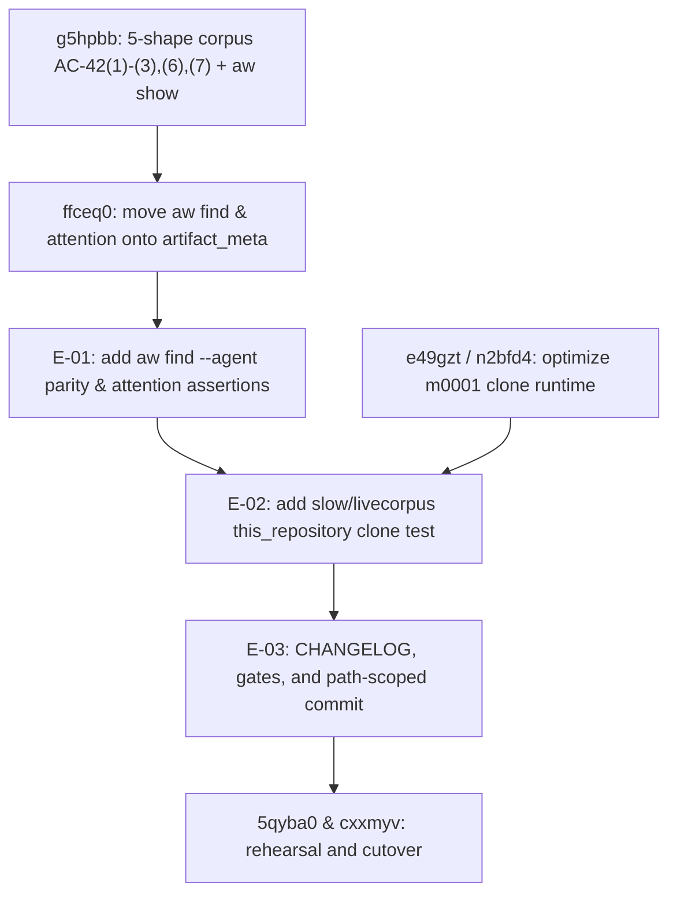

# IPD: Verify AC-42 aw find, aw attention parity, and clone migration after Order 08

- Date: 2026-11-17
- Kind: child
- Concern: Spec `4sd62s` AC-42 items (4) and (5) require `aw find`, `aw attention --format json`, and before/after `aw find` parity (legacy readers before migration matching log readers after migration by mapped path and status) across all five C12 corpus shapes (`legacy_agents_layout`, `mixed_layout`, `idless_prose`, `no_sidecar`, `companion_backend`) and on a fresh `git clone --no-hardlinks` of this repository. Executed plan `g5hpbb` excluded moving readers onto `artifact_meta` ("EXCLUDES: moving any reader or writer onto the cache (Orders 07 to 11)"), while `cdglt1` (Order 142, executed), `r81uvz` (Order 27, executed), `dqutt8` (Order 28, pending), and `ffceq0` (Order 08, pending) depended on `executed:g5hpbb`, and running `agent_workflows/migrations/m0001_metadata_v2.py::run` on a clone of this repository took ~51.5 minutes (`435.34s` dry run + `2656.37s` apply, `dcerjg` V-15, graduated backlog `e49gzt` with child plan `n2bfd4`). Per maintainer direction on `g5hpbb` question `g5hpbb-ac42-order08-circular-dependency` (2026-11-17), those deferred AC-42 assertions and the `this_repository` clone test move here, gated on `executed:ffceq0`, `executed:g5hpbb`, and `state:backlog:done:e49gzt`, to run before `5qyba0` and `cxxmyv`.
- Scope: Extend `tests/test_m0001_any_repo.py` after Order 08 (`ffceq0`) and `e49gzt` (`n2bfd4`) land to: (1) assert spec `4sd62s` AC-42 item (4) (`aw find` and `aw attention --format json` / `--all --format json` on migrated records) and item (5) (before/after `aw find --agent` parity by mapped path and normalized status) across all five `tests/migration_corpus.py` shapes; (2) add the `this_repository` (`git clone --no-hardlinks`) test marked `@pytest.mark.slow`, `@pytest.mark.livecorpus`, and `@pytest.mark.timeout(...)` (excluded from `@pytest.mark.core`) and allowlisted in `tests/slow_allowlist.txt`; and (3) record one `CHANGELOG.md` entry and run all validation gates. EXCLUDES: AC-42 items (1)-(3), (6), (7), `aw show --history`/`--format json`, and `agent_workflows/status_set.py::inventory_all_artifacts`-vs-`agent_workflows/artifact_meta.py::query` parity on the five corpus shapes (already delivered by `g5hpbb`); modifying production readers (`ffceq0` and its split parts); and optimizing `m0001` runtime (`e49gzt` / `n2bfd4`).
- Scope-Paths: tests/test_m0001_any_repo.py, tests/slow_allowlist.txt, CHANGELOG.md, .aw/records/plans/pending/20261117-mzw0kk-01-60mazt-verify-ac-42-aw-find-aw-attention-parity-and-clone-migration.ipd.md
- Item-Dependencies: executed:ffceq0, executed:g5hpbb, state:backlog:done:e49gzt
- Status: reviewed
- Readiness: go-pending-approval
- Review-Depth: standard
- Short-Description: Verify AC-42 items (4), (5), and the this-repository clone migration in tests/test_m0001_any_repo.py after ffceq0 and e49gzt.
- Work-Kind: followup
- Priority: high
- From-Backlog: mzw0kk
- From-Spec: 4sd62s
- Blocks-Release: next
- Set: mzw0kk
- Order: 1
- Highest E allocated: 03
- Author: antigravity/gemini
- Id: 60mazt

> Write and proofread this plan per the technical writing standard, `.aw/system/workflows/technical-writing/technical-writing.md` (`.agents/workflows/technical-writing/technical-writing.md` in a legacy-layout install), including requirement 12 (diagrams).

## Workflow history

- 2026-11-20 reviewed (aw set): APPROVE WITH REVISIONS APPLIED; PR-001..PR-007 FIXED
- 2026-11-20 /plan-review (antigravity/gemini-4-neon-high): APPROVE WITH REVISIONS APPLIED; PR-001..PR-007 FIXED; review record .aw/records/reviews/20261117-mzw0kk-01-60mazt-verify-ac-42-aw-find-aw-attention-parity-and-clone-migration.review.md
- 2026-11-18 to-review (aw set): Authored review-ready follow-up plan graduated from backlog mzw0kk
- 2026-11-18 draft (antigravity/gemini): created.

## Goal

Prove spec `4sd62s` AC-42 items (4) and (5) (`aw find` before/after parity and `aw attention --format json` validity on migrated records) across all five prior-format corpus shapes and on a fresh `git clone --no-hardlinks` of this repository after `ffceq0` moves the readers onto `artifact_meta` and `e49gzt` (`n2bfd4`) resolves the clone runtime bottleneck, before the `5qyba0` rehearsal and `cxxmyv` cutover run.

## Detailed Implementation Checklist (TODO)

Execution-state rule: mark an `E-*` item complete only after performing the action. That mark is not validation. Right-sizing rule: write for a modest executor that cannot hold much in its head. Each E-item is one step (one concern, about one file, executable in one focused pass) and its V-item names each unit it covers with its own check; a plan stays at about 5 E-items and 8 work Scope-Paths, else split it into more child plans (guidance, `IPD-Z603`). Accepted execution states: blocked, failed, pending, performed; terminal gate demands 'performed'.

### Task group 1: extend tests/test_m0001_any_repo.py and record gates

- [ ] E-01 Before editing `tests/test_m0001_any_repo.py`, create `.aw/state/60mazt` (`mkdir -p .aw/state/60mazt`) and save `aw check all --agent > .aw/state/60mazt/check-before.jsonl`. Extend `tests/test_m0001_any_repo.py::test_ac42_corpus_shapes_end_to_end_migration` across all five `tests/migration_corpus.py` shapes (`legacy_agents_layout`, `mixed_layout`, `idless_prose`, `no_sidecar`, `companion_backend`):
  1. **Pre-migration capture**: run `aw find --agent` before migration via `_run_cli_inproc` (no `--limit`, asserting exit `0` and `summary["complete"] is True`) and collect each `kind == "item"` record's `(path, type, id6, status)`.
  2. **Spec `4sd62s` AC-42 item (4) after `--apply`**: run `aw find <probe_id6> --agent` (asserting exit `0` and `probe_id6` returned from migrated logs), plus `aw attention --format json` and `aw attention --all --format json`. Assert zero violations referencing `meta/` or any migrated record (`attention.uninventoried-tree`, `attention.missing-status`, `attention.unknown-status`) and assert migrated record IDs appear in the `--all --format json` `items` list; for `mixed_layout`, `no_sidecar`, `companion_backend`, and `legacy_agents_layout` (unless a pre-migration fixture violation already existed before `--apply`), assert `exit_code == 0` and `valid is True`; for `idless_prose`, assert that the sole `attention.uninventoried-tree` violation is `.aw/records/notes` (the intentionally unclassifiable `notes/scratch.md` directory).
  3. **Spec `4sd62s` AC-42 item (5) after `--apply`**: run `aw find --agent` after migration (asserting exit `0` and `summary["complete"] is True`). Map each pre-migration item's path through stage-1 layout relocation (`.agents/` -> `.aw/records/`, deduplicating the byte-identical `qa1z03` copy in `mixed_layout`) and `journal.json["rename_map"]`, then assert that every pre-migration item appears post-migration at its mapped path with the same normalized status (accounting explicitly for documented `ffceq0` Decisions D-1 to D-6 and `m0001` status normalization), zero pre-migration records are dropped, and any post-migration-only items are strictly records whose `id6` was minted in `journal.json["minted_ids"]` (such as legacy id-less research `20260708-survey-notes.md` in `legacy_agents_layout`, which `agent_workflows/cli.py::_find_type_records` skips pre-migration when `parse_name` is `None` or `id_derived` is `True`).
  4. Keep all existing AC-42 (1)-(3), (6), (7), `aw show`, and `artifact_meta.query` checks intact. Use zero source-code inspection (`inspect`, `ast`, regex, or `read_text` on `agent_workflows/*.py`).
  - Depends on: none
  - Expected outcome: `tests/test_m0001_any_repo.py::test_ac42_corpus_shapes_end_to_end_migration` passes all five corpus cases with real `aw find --agent` parity and `aw attention --format json` / `--all --format json` assertions.
  - Execution state: pending

- [ ] E-02 Move `pytest.mark.core` from module-level `pytestmark` in `tests/test_m0001_any_repo.py` onto `test_ac42_corpus_shapes_end_to_end_migration` only, and add a dedicated `test_ac42_this_repository_clone_migration` function marked `@pytest.mark.slow`, `@pytest.mark.livecorpus`, and `@pytest.mark.timeout(...)` (sized above the measured CPU time with at least 2x headroom per `conftest.py::_test_timeout_budgets`, not marked `core`). Add its exact pytest node id with a tab-separated reason to `tests/slow_allowlist.txt` (plus any corpus case exceeding 2s, if any). Inside `test_ac42_this_repository_clone_migration`:
  1. Record the source repository's `git rev-parse HEAD` and `git status --porcelain` before running. Create a disposable clone via `git clone --no-hardlinks <repo_root> <tmp_path/this_repository>` using `_clean_git_env()` so no ambient `GIT_*` variable leaks and the clone is an independent non-worktree git repository.
  2. Capture pre-migration `aw find --agent` items and pre-migration `aw attention --all --format json` violations in the clone via `_run_cli_inproc` with an isolated `aw_home`.
  3. Drive spec `4sd62s` AC-42 items (1) to (5) through real CLI commands in the clone: (1) `aw migrate metadata --json` dry run (asserting clean census with zero unknown-field/unparseable refusals, `round_trip_passed is True`, and unchanged clone tree); (2) seed descriptions in `journal.json["descriptions"]` via `_seed_journal_descriptions(clone)` so `agent_workflows/migrations/m0001_describe.py::describe_all` requires zero real host spawns under `PYTEST_CURRENT_TEST`, then run `aw migrate metadata --apply --force` (passing `--force` because the gitignored `.aw/records/history.jsonl` sidecar is absent in the fresh clone while `sidecar_expected` is `True`), verify `metadata_schema == 2` and a new clean commit, then run a second `aw migrate metadata --apply --force` and verify it changes nothing (`metadata_schema is 2; nothing to do`, unchanged `HEAD` and tree); (3) verify post-apply `meta/<id6>.jsonl` checkpoint and `artifact_meta.replay` round-trip validity across converted logs; (4) run `aw find <probe_id6> --agent`, `aw show <probe_id6> --history`, `aw show <probe_id6> --format json`, and `aw attention --format json` / `--all --format json` (asserting zero violations on `.aw/records/meta` and zero new violations relative to the pre-migration `aw attention --all --format json` baseline); and (5) assert before/after `aw find --agent` parity by mapped path (`journal.json["rename_map"]`) and normalized status, accounting for `ffceq0` Decisions D-1 to D-6 and `journal.json["minted_ids"]`.
  4. Verify the source repository's `git rev-parse HEAD` and `git status --porcelain` are identical before and after.
  - Depends on: E-01
  - Expected outcome: `tests/test_m0001_any_repo.py` passes all five corpus cases and `test_ac42_this_repository_clone_migration` with `0 unlisted slow tests`, bare `python3 -m pytest` / `aw suite` runs the five core corpus cases while deselecting `test_ac42_this_repository_clone_migration`, and the source checkout is untouched.
  - Execution state: pending

- [ ] E-03 Add one bullet under `## 2.0.0 (pending)` in `CHANGELOG.md` (with zero em or en dashes): `- Added: `aw migrate metadata` AC-42 verification now covers `aw find` and `aw attention` parity across all five prior-format corpus shapes and a fresh clone of this repository.` Run `python3 -m pytest -o addopts="" -v --durations=0 tests/test_m0001_any_repo.py`, `aw suite` (core tier), `make typecheck`, `aw check all --agent` (diffed by `(location, rule)` against `.aw/state/60mazt/check-before.jsonl` with zero added error or warning pairs), `aw ipd lint --phase pre-transition` on this plan, and `aw sanitize --agent`; commit only changed `Scope-Paths` files through `aw commit 60mazt -- <each changed path>`. Never push.
  - Depends on: E-02
  - Expected outcome: all named tests and gates pass with `0 unlisted slow tests`, zero new `aw check all --agent` errors/warnings, clean `aw sanitize --agent`, zero em/en dashes in the added `CHANGELOG.md` line, and one path-scoped commit on `- Scope-Paths:`.
  - Execution state: pending

Add further leaves as `- [ ] E-NEW <action>` and run `aw ipd sync` to assign ids.

## Project conventions discovered (Step 0)

- `tests/test_m0001_any_repo.py` (`g5hpbb`, executed) already verifies spec `4sd62s` AC-42 items (1)-(3), `aw show <id6> --history` and `--format json` of (4), `agent_workflows/status_set.py::inventory_all_artifacts`-vs-`agent_workflows/artifact_meta.py::query` parity of (5), (6), and (7) across the five `tests/migration_corpus.py` shapes (`legacy_agents_layout`, `mixed_layout`, `idless_prose`, `no_sidecar`, `companion_backend`).
- `agent_workflows/cli.py::_run_find` emits rendered human strings and bare paths under `--json`, whereas `--agent` (with `agent_workflows/result_types.py::select_output` defaulting `limit=None`) emits structured JSONL `item` records (`path`, `type`, `id6`, `status`) followed by a `summary` record (`complete: true`). `agent_workflows/cli.py::_find_type_records` skips id-less research files whose filename fails `research_contract.parse_name` or whose `st.id_derived` is `True` before migration, so minted research files appear post-migration via `journal.json["minted_ids"]`.
- `agent_workflows/cli.py::_find_type_records` and `agent_workflows/selectors.py` already moved onto `artifact_meta` under executed plans `cdglt1` (Order 142) and `r81uvz` (Order 27); `agent_workflows/attention.py` moves onto `artifact_meta` under `dqutt8` (Order 28) and `ffceq0` (Order 08), with `ffceq0` Decisions D-1 to D-6 documenting any intentional status, Set, or skip-list differences between legacy readers and `artifact_meta`.
- `ya4ee4` (Order 05, executed) wired `agent_workflows/migrations/m0001_describe.py::describe_all` into `agent_workflows/migrations/m0001_metadata_v2.py::run`; under `PYTEST_CURRENT_TEST`, uncached records return `could-not-ask` (`pytest-spawn-refused`) and `--no-describe` clears `merged_descs`, so `--apply` in tests uses `_seed_journal_descriptions` after dry run (preserving `tx_data["descriptions"]` when `eff_describer.enabled` is `True`).
- `dcerjg` V-15 proved `agent_workflows/migrations/m0001_metadata_v2.py::run` on a `git clone --no-hardlinks` of this repository (an independent non-worktree repo where gitignored `.aw/records/history.jsonl` is absent while `sidecar_expected` is `True`, requiring `--force`), and graduated backlog `e49gzt` (child plan `n2bfd4`) tracks the runtime optimization required before running that clone migration inside `pytest`.
- Slow tests exceeding 2s are allowlisted in `tests/slow_allowlist.txt` (`node_id<TAB>reason`, checked by `conftest.py::pytest_terminal_summary` and `tests/test_slow_report.py`). `pyproject.toml` `[tool.pytest.ini_options]` sets `addopts = "-q -n auto --dist=worksteal -m 'not slow and not livecorpus'"`, and `conftest.py::_test_timeout_budgets` enforces a 60s CPU / 240s wall hang guard unless raised with `@pytest.mark.timeout(...)`. Tests asserting over this repository's live `.aw/records/` tree carry `@pytest.mark.livecorpus` (`GUIDING_PRINCIPLES.md` P16).
- `AGENTS.md` and `GUIDING_PRINCIPLES.md` P16 forbid tests that read production source (`inspect`, `ast`, regex, or substring checks).

## Findings

| Id | Finding | Evidence |
|---|---|---|
| F-01 | Before `dqutt8` and `ffceq0` land, `aw attention --format json` fails on migrated corpus shapes. | Observed during `g5hpbb` Attempt 1 on migrated `legacy_agents_layout`, `mixed_layout`, `idless_prose`, `no_sidecar`, `companion_backend`: `aw attention --format json` returned exit `1`, `valid: false`, `attention.missing-status`, and `attention.uninventoried-tree` on `.aw/records/meta`. |
| F-02 | Before `cdglt1`/`r81uvz`/`ffceq0` landed, `aw find` read legacy `.md` metadata instead of `meta/<id6>.jsonl`, and `aw find --json` emits display strings without structured `status` fields. | Observed during `g5hpbb` Attempt 1 on migrated `legacy_agents_layout` (`aw find` printed `??????` for migrated plans and dropped migrated research docs); `agent_workflows/cli.py::_run_find` emits structured `path`/`status`/`id6` items under `--agent` rather than `--json`. |
| F-03 | Full `m0001` migration on a clone of this repository currently takes ~51.5 minutes until `e49gzt` (`n2bfd4`) completes. | Measured in `dcerjg` V-15 (`435.34s` dry run + `2656.37s` apply = `3091.71s`) and tracked in `.aw/records/backlog/graduated/20261117-metastore-01-e49gzt-optimize-m0001-renames-citation-performance.backlog.md` (pending child plan `n2bfd4`). |

## Proposed changes (ordered, validatable)

1. Save `.aw/state/60mazt/check-before.jsonl`; extend `tests/test_m0001_any_repo.py::test_ac42_corpus_shapes_end_to_end_migration` with `aw find --agent` mapped path/status parity and `aw attention --format json` / `--all --format json` assertions across all five corpus shapes (`E-01`).
2. Scope `@pytest.mark.core` to the five corpus cases, add `@pytest.mark.slow` + `@pytest.mark.livecorpus` + `@pytest.mark.timeout(...)` `test_ac42_this_repository_clone_migration` (`git clone --no-hardlinks`) to `tests/test_m0001_any_repo.py`, and allowlist its node id in `tests/slow_allowlist.txt` (`E-02`).
3. Add one `CHANGELOG.md` bullet under `## 2.0.0 (pending)` and verify all tests, `aw suite`, `make typecheck`, `aw check all --agent`, `aw ipd lint --phase pre-transition`, and `aw sanitize --agent` before committing (`E-03`).

## Deferred / out of scope (with reason)

- Corpus builder (`tests/migration_corpus.py`), multi-shape cache scan, discovery, id-less conversion, layout stage chaining, and AC-42(1)-(3), (6), (7) + `aw show` five-shape corpus tests: already delivered by `9vf2iv`, `6oi2nu`, `3g20ms`, `bv4kkj`, and `g5hpbb`.
  - Carrier: g5hpbb
  - Carrier-Evidence: .aw/records/plans/executed/20261107-metastore-14-g5hpbb-make-aw-migrate-metadata-migrate-any-repository-from-any-pri.ipd.md
- Moving `aw find`, `selectors`, `status_set`, and `attention` onto `artifact_meta`: prerequisite owned by `ffceq0` (`cdglt1`, `r81uvz`, `dqutt8`).
  - Carrier: ffceq0
- Optimizing `agent_workflows/migrations/m0001_renames.py::build_rename_map`, `agent_workflows/artifact_refs.py::plan_reference_rewrites_with_warnings`, and `agent_workflows/migrations/m0001_metadata_v2.py::_execute_planned_operations`: prerequisite tracked in graduated backlog `e49gzt` (child plan `n2bfd4`).
  - Carrier: e49gzt

## Scope check

- Over-scope: none. Only `tests/test_m0001_any_repo.py`, `tests/slow_allowlist.txt`, `CHANGELOG.md`, and this plan are modified.
- Under-scope: none. Assumes `ffceq0` and `e49gzt` (`n2bfd4`) are already `executed`/`done` via `- Item-Dependencies:`.

## Required tests / validation

- `python3 -m pytest -o addopts="" -v --durations=0 tests/test_m0001_any_repo.py` (all five corpus cases plus `test_ac42_this_repository_clone_migration` PASSED, and `0 unlisted slow tests`)
- `aw suite` (core tier green; runs the five corpus cases and deselects `test_ac42_this_repository_clone_migration`)
- `make typecheck` (0 mypy errors)
- `aw check all --agent` (no new error or warning `(location, rule)` pairs relative to `.aw/state/60mazt/check-before.jsonl`)
- `aw ipd lint --phase pre-transition` on this plan (`outcome: "clean"`)
- `aw sanitize --agent` (`outcome: "clean"`)

## Spec / documentation sync

Completes spec `4sd62s` AC-42 items (4), (5), and the `this_repository` clone test in `tests/test_m0001_any_repo.py`. User-facing note: one `CHANGELOG.md` bullet under `## 2.0.0 (pending)` (`E-03`).

## Open questions

None. Circular dependency with Order 08 and runtime bottleneck `e49gzt` were resolved by maintainer decision `g5hpbb-ac42-order08-circular-dependency` (2026-11-17).

## Validation and cross-check (verify before reporting done)

Validation-state rule: inspect evidence in a separate pass. Do not mark a `V-*` item complete from memory or from the matching execution checkmark. Accepted validation results: blocked, failed, pass, pending; terminal gate demands 'pass'. Runtime-demonstration reachability rule: for each `V-*` item demanding the software be observed acting (such as a run, a dispatch, or a transition), as distinct from items demanding a diff, a file's content, or a test result (which are reachable by construction), name the code path that produces the observation or the sibling `E-*` that creates it, else the demand is UNDER-SCOPE.

- [ ] V-01 validates E-01
  - Required evidence: paste `python3 -m pytest -o addopts="" -v --durations=0 tests/test_m0001_any_repo.py` showing all five corpus cases PASSED (`legacy_agents_layout`, `mixed_layout`, `idless_prose`, `no_sidecar`, `companion_backend`), quoting the spec `4sd62s` AC-42(4) `aw find` / `aw attention --format json` / `--all --format json` and AC-42(5) `aw find --agent` mapped path/status parity assertions executed for each shape, plus confirmation that `.aw/state/60mazt/check-before.jsonl` was captured before editing.
  - Observed evidence:
  - Result: pending

- [ ] V-02 validates E-02
  - Required evidence: paste `python3 -m pytest -o addopts="" -v --durations=0 tests/test_m0001_any_repo.py` showing `test_ac42_this_repository_clone_migration` PASSED with its wall time and `0 unlisted slow tests`, the `tests/slow_allowlist.txt` diff hunk, `python3 -m pytest --collect-only -q tests/test_m0001_any_repo.py` (with default `addopts`) confirming the five corpus cases are collected while `test_ac42_this_repository_clone_migration` is deselected, and identical `git rev-parse HEAD` and `git status --porcelain` on the source checkout before and after.
  - Observed evidence:
  - Result: pending

- [ ] V-03 validates E-03
  - Required evidence: paste the `CHANGELOG.md` diff hunk (verifying zero em or en dashes in the added line), the `aw suite` and `make typecheck` summaries, the `(location, rule)` diff of `aw check all --agent` against `.aw/state/60mazt/check-before.jsonl` (zero new error/warning pairs), `aw ipd lint --phase pre-transition` output on this plan, `aw sanitize --agent` output, and the `aw commit 60mazt` output listing only `- Scope-Paths:` files.
  - Observed evidence:
  - Result: pending

## Approval and execution gate

- Size assessment: standard
- Cohesion rationale: not required

Execute only after human approval (`- Status: approved`) and after `- Item-Dependencies:` (`executed:ffceq0`, `executed:g5hpbb`, `state:backlog:done:e49gzt`) are satisfied. Open questions: none open (`g5hpbb-ac42-order08-circular-dependency` resolved 2026-11-17).

Scope fence: the paths in `- Scope-Paths:` are a declaration. If execution must edit a file outside the fence, make the needed edit and justify it at finalize (`--scope-reason`), and acknowledge any declared path left unmodified (`--scope-ack`).

Safety rule: uncommitted changes and untracked files you did not create are not yours; never revert, stage, commit, discard, reformat, or clean up another party's work. Stop and report if a file you must edit has an unresolvable concurrent-edit conflict, or if prerequisite `ffceq0` reader moves or `e49gzt` optimizations are absent on HEAD. Never run `aw migrate metadata --apply` on the source checkout; run `test_ac42_this_repository_clone_migration` only inside a disposable `git clone --no-hardlinks` under `tmp_path` with clean `GIT_*` environment variables.

Honesty rule: run all required tests and checks and paste the ACTUAL runner output and summary lines; never claim a result you did not run.

Commits: commit only files modified for this plan through `aw commit 60mazt -- <paths>`; never `git add -A`, a bare `git add`, `git commit -a`, or `--no-verify`; never push without explicit human instruction.

Lifecycle transition: this plan moves to `.aw/records/plans/executed/` only through `aw ipd finalize`, never a hand `git mv`, and only after `aw ipd lint --phase pre-transition` conforms and every `V-*` reads `pass` with pasted evidence. When `aw oc run` or `aw agy run` executes this plan, the runner owns retirement to `executed/` and runs finalize automatically upon task completion; when executed standalone by hand or direct agent turn, the executor runs `aw ipd finalize 60mazt`.
