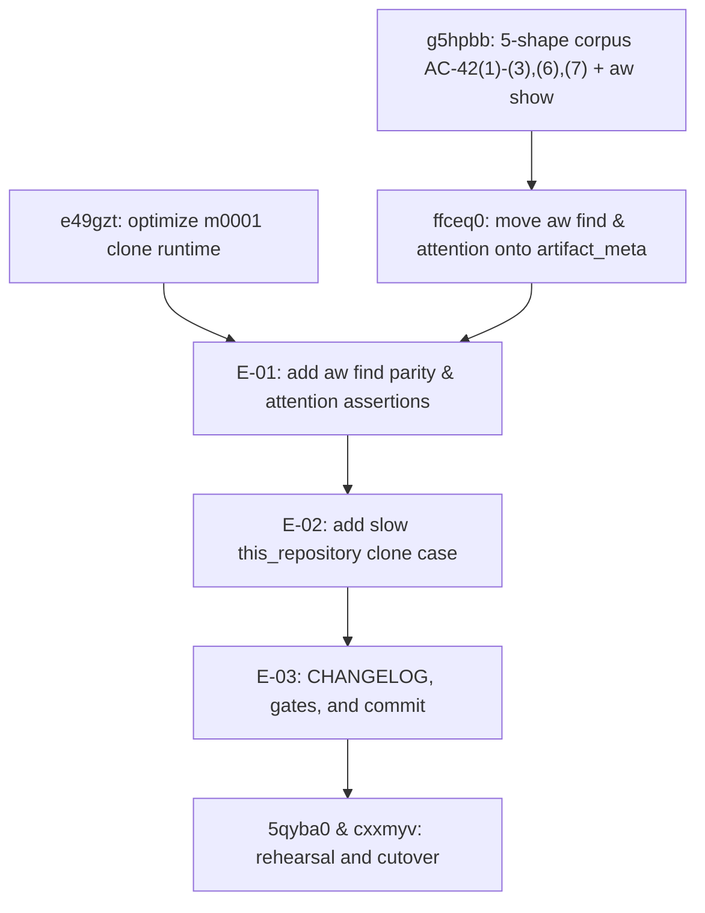

# IPD: Verify AC-42 aw find, aw attention parity, and clone migration after Order 08

- Date: 2026-11-17
- Kind: child
- Concern: Spec `4sd62s` AC-42 items (4) and (5) require `aw find`, `aw attention --format json`, and before/after `aw find` parity (legacy readers before migration matching log readers after migration by path and status) across all five C12 corpus shapes (`legacy_agents_layout`, `mixed_layout`, `idless_prose`, `no_sidecar`, `companion_backend`) and on a fresh `git clone --no-hardlinks` of this repository. Plan `g5hpbb` excluded moving readers onto `artifact_meta` ("EXCLUDES: moving any reader or writer onto the cache (Orders 07 to 11)"), while `cdglt1` (Order 142), `r81uvz` (Order 27), `dqutt8` (Order 28), and `ffceq0` (Order 08) depended on `executed:g5hpbb`, and running `m0001_metadata_v2.run` on a clone of this repository took ~51.5 minutes (`435.34s` dry run + `2656.37s` apply, `dcerjg` V-15, open backlog `e49gzt`). Per maintainer direction on `g5hpbb` question `g5hpbb-ac42-order08-circular-dependency`, those deferred AC-42 assertions and the `this_repository` clone test move here, gated on `executed:ffceq0`, `executed:g5hpbb`, and `state:backlog:done:e49gzt`, to run before `5qyba0` and `cxxmyv`.
- Scope: Extend `tests/test_m0001_any_repo.py` after Order 08 (`ffceq0`) and `e49gzt` land to: (1) assert AC-42 item (4) (`aw find` and `aw attention --format json` on migrated records) and item (5) (before/after `aw find` parity by path and status) across all five `tests/migration_corpus.py` shapes; (2) add the parameterized `this_repository` (`git clone --no-hardlinks`) case marked `slow` and allowlisted in `tests/slow_allowlist.txt`; and (3) record the `CHANGELOG.md` entry and run the validation gates. EXCLUDES: AC-42 items (1)-(3), (6), (7), `aw show --history`/`--format json`, and `status_set.inventory_all_artifacts`-vs-`artifact_meta.query` parity on the five corpus shapes (already delivered by `g5hpbb`); modifying production readers (`ffceq0`); and optimizing `m0001` runtime (`e49gzt`).
- Scope-Paths: tests/test_m0001_any_repo.py, tests/slow_allowlist.txt, CHANGELOG.md, .aw/records/plans/pending/20261117-mzw0kk-01-60mazt-verify-ac-42-aw-find-aw-attention-parity-and-clone-migration.ipd.md
- Item-Dependencies: executed:ffceq0, executed:g5hpbb, state:backlog:done:e49gzt
- Status: to-review
- Short-Description: Verify AC-42 items (4), (5), and the this-repository clone migration in tests/test_m0001_any_repo.py after ffceq0 and e49gzt.
- Work-Kind: followup
- Priority: high
- From-Backlog: mzw0kk
- From-Spec: 4sd62s
- Blocks-Release: next
- Set: mzw0kk
- Order: 1
- Highest E allocated: 03
- Author: antigravity/gemini
- Id: 60mazt

> Write and proofread this plan per the technical writing standard, `.aw/system/workflows/technical-writing/technical-writing.md` (`.agents/workflows/technical-writing/technical-writing.md` in a legacy-layout install), including requirement 12 (diagrams).

## Workflow history

- 2026-11-18 to-review (aw set): Authored review-ready follow-up plan graduated from backlog mzw0kk
- 2026-11-18 draft (antigravity/gemini): created.

## Goal

Prove spec `4sd62s` AC-42 items (4) and (5) (`aw find` before/after parity and passing `aw attention --format json`) across all five prior-format corpus shapes and on a fresh `git clone --no-hardlinks` of this repository after `ffceq0` moves the readers onto `artifact_meta` and `e49gzt` resolves the clone runtime bottleneck, before the `5qyba0` rehearsal and `cxxmyv` cutover run.

## Detailed Implementation Checklist (TODO)

Execution-state rule: mark an `E-*` item complete only after performing the action. That mark is not validation. Right-sizing rule: write for a modest executor that cannot hold much in its head. Each E-item is one step (one concern, about one file, executable in one focused pass) and its V-item names each unit it covers with its own check; a plan stays at about 5 E-items and 8 work Scope-Paths, else split it into more child plans (guidance, `IPD-Z603`). Accepted execution states: blocked, failed, pending, performed; terminal gate demands 'performed'.

### Task group 1: extend tests/test_m0001_any_repo.py and record gates

- [ ] E-01 Before editing `tests/test_m0001_any_repo.py`, save `aw check --agent > .aw/state/60mazt/check-before.jsonl` (`mkdir -p .aw/state/60mazt`). Extend `tests/test_m0001_any_repo.py` over the five `tests/migration_corpus.py` shapes (`legacy_agents_layout`, `mixed_layout`, `idless_prose`, `no_sidecar`, `companion_backend`) to capture `aw find --json` before migration (legacy readers) and assert after `--apply`: (a) AC-42 item (4) `aw find` and `aw attention --format json` (`exit_code == 0` when no unrelated fixture violation exists, or zero `attention.missing-status`/`attention.uninventoried-tree` diagnostics on migrated logs/records) on migrated records; and (b) AC-42 item (5) before/after `aw find` parity by path and status (accounting explicitly for documented `ffceq0` decisions D-1 to D-6 and excluded unclassifiable files such as `idless_prose` `notes/scratch.md`). Keep existing AC-42 (1)-(3), (6), (7), `aw show`, and `artifact_meta.query` checks intact. Zero source-code inspection.
  - Depends on: none
  - Expected outcome: `tests/test_m0001_any_repo.py` passes all five corpus cases with real `aw find` and `aw attention --format json` assertions.
  - Execution state: pending

- [ ] E-02 Add a `this_repository` (`git clone --no-hardlinks` of the repository inside `tmp_path`) test case marked `@pytest.mark.slow` in `tests/test_m0001_any_repo.py` and add its node id with a reason to `tests/slow_allowlist.txt`. Drive AC-42 items (1) to (5) through real CLI commands and real `m0001_metadata_v2` functions inside the clone (using `--force` when the gitignored `history.jsonl` sidecar is absent in the clone, or seeding `journal.json["descriptions"]` if `ya4ee4` has not yet executed), and verify the source repository's `git status --porcelain` is unchanged before and after.
  - Depends on: E-01
  - Expected outcome: `tests/test_m0001_any_repo.py` passes all six parameter cases (the five corpus shapes plus `this_repository`), and `tests/slow_allowlist.txt` documents the slow clone node id.
  - Execution state: pending

- [ ] E-03 Add one `CHANGELOG.md` bullet under `2.0.0 (pending)` (no em or en dashes): `aw migrate metadata` AC-42 verification now covers `aw find` and `aw attention` parity across all five prior-format corpus shapes and a fresh clone of this repository. Run `python3 -m pytest -o addopts="" -v --durations=0 tests/test_m0001_any_repo.py`, `aw suite`, `make typecheck`, `aw check --agent` (diffed by `(location, rule)` against `.aw/state/60mazt/check-before.jsonl` with zero added errors or warnings), `aw ipd lint` on this plan, and `aw sanitize --agent`; commit through `aw commit 60mazt -- <each changed path>`. Never push.
  - Depends on: E-02
  - Expected outcome: all named tests and gates pass with zero new `aw check` errors/warnings, clean `aw sanitize --agent`, and one path-scoped commit on `Scope-Paths`.
  - Execution state: pending

Add further leaves as `- [ ] E-NEW <action>` and run `aw ipd sync` to assign ids.

## Project conventions discovered (Step 0)

- `tests/test_m0001_any_repo.py` (`g5hpbb`) already verifies AC-42 items (1)-(3), `aw show <id6> --history` and `--format json` of (4), `status_set.inventory_all_artifacts` vs `artifact_meta.query` parity of (5), (6), and (7) across the five `tests/migration_corpus.py` shapes (`legacy_agents_layout`, `mixed_layout`, `idless_prose`, `no_sidecar`, `companion_backend`).
- `agent_workflows/attention.py` (`dqutt8`) and `agent_workflows/cli.py` `_find_type_records` (`cdglt1`/`r81uvz`) move onto `artifact_meta` under `ffceq0` (Order 08), with `ffceq0` Decisions D-1 to D-6 documenting any intentional status/set differences between legacy readers and `artifact_meta`.
- `dcerjg` V-15 proved `m0001_metadata_v2.run` on a `git clone --no-hardlinks` of this repository, and open backlog `e49gzt` tracks the runtime optimization required before running that clone migration inside `pytest`.
- Slow tests exceeding 2s carry `@pytest.mark.slow` (when excluded from the 30s core tier) and are listed in `tests/slow_allowlist.txt` with a tab-separated reason (`tests/test_slow_report.py`).
- `AGENTS.md` forbids tests that read production source (`inspect`, `ast`, regex, or substring checks).

## Findings

| Id | Finding | Evidence |
|---|---|---|
| F-01 | Before `ffceq0` lands, `aw attention --format json` fails on migrated corpus shapes. | Observed during `g5hpbb` Attempt 1 on migrated `legacy_agents_layout`, `mixed_layout`, `idless_prose`, `no_sidecar`, `companion_backend`: `aw attention --format json` returned exit `1`, `valid: false`, `attention.missing-status`, and `attention.uninventoried-tree` on `.aw/records/meta`. |
| F-02 | Before `cdglt1`/`r81uvz`/`ffceq0` land, `aw find` reads legacy `.md` metadata instead of `meta/<id6>.jsonl`. | Observed during `g5hpbb` Attempt 1 on migrated `legacy_agents_layout`: `aw find` called `plans_index.scan_plans` (printing `??????` for migrated plan `id6`) and `research_index._scan_docs` (dropping migrated research docs). |
| F-03 | Full `m0001` migration on a clone of this repository currently takes ~51.5 minutes. | Measured in `dcerjg` V-15 (`435.34s` dry run + `2656.37s` apply = `3091.71s`) and tracked in `.aw/records/backlog/open/20261117-metastore-01-e49gzt-optimize-m0001-renames-citation-performance.backlog.md`. |

## Proposed changes (ordered, validatable)

1. Save `aw check --agent` baseline; extend `tests/test_m0001_any_repo.py` with `aw find` parity and `aw attention --format json` assertions across all five corpus shapes (`E-01`).
2. Add the `@pytest.mark.slow` `this_repository` (`git clone --no-hardlinks`) test case to `tests/test_m0001_any_repo.py` and document it in `tests/slow_allowlist.txt` (`E-02`).
3. Add one `CHANGELOG.md` bullet and verify all tests, `aw suite`, `make typecheck`, `aw check --agent`, `aw ipd lint`, and `aw sanitize --agent` before committing (`E-03`).

## Deferred / out of scope (with reason)

- Corpus builder (`tests/migration_corpus.py`), multi-shape cache scan, discovery, id-less conversion, layout stage chaining, and AC-42(1)-(3), (6), (7) + `aw show` five-shape corpus tests: already delivered by `9vf2iv`, `6oi2nu`, `3g20ms`, `bv4kkj`, and `g5hpbb`.
  - Carrier: g5hpbb
  - Carrier-Evidence: .aw/records/plans/pending/20261107-metastore-14-g5hpbb-make-aw-migrate-metadata-migrate-any-repository-from-any-pri.ipd.md
- Moving `aw find`, `selectors`, `status_set`, and `attention` onto `artifact_meta`: prerequisite owned by `ffceq0` (`cdglt1`, `r81uvz`, `dqutt8`).
  - Carrier: ffceq0
- Optimizing `m0001_renames.build_rename_map`, `artifact_refs.plan_reference_rewrites_with_warnings`, and `m0001_metadata_v2._execute_operations`: prerequisite tracked in open backlog `e49gzt`.
  - Carrier: e49gzt

## Scope check

- Over-scope: none. Only `tests/test_m0001_any_repo.py`, `tests/slow_allowlist.txt`, `CHANGELOG.md`, and this plan are modified.
- Under-scope: none. Assumes `ffceq0` and `e49gzt` are already `executed`/`done` via `- Item-Dependencies:`.

## Required tests / validation

- `python3 -m pytest -o addopts="" -v --durations=0 tests/test_m0001_any_repo.py` (all six parameter cases PASSED)
- `aw suite` (core tier green)
- `make typecheck` (0 mypy errors)
- `aw check --agent` (no new error or warning `(location, rule)` pairs relative to `.aw/state/60mazt/check-before.jsonl`)
- `aw sanitize --agent` (`outcome: "clean"`)

## Spec / documentation sync

Completes spec `4sd62s` AC-42 items (4), (5), and the `this_repository` clone test in `tests/test_m0001_any_repo.py`. User-facing note: one `CHANGELOG.md` line (`E-03`).

## Open questions

None. Circular dependency with Order 08 and runtime bottleneck `e49gzt` resolved by maintainer decision `g5hpbb-ac42-order08-circular-dependency` (2026-11-17).

## Validation and cross-check (verify before reporting done)

Validation-state rule: inspect evidence in a separate pass. Do not mark a `V-*` item complete from memory or from the matching execution checkmark. Accepted validation results: blocked, failed, pass, pending; terminal gate demands 'pass'. Runtime-demonstration reachability rule: for each `V-*` item demanding the software be observed acting (such as a run, a dispatch, or a transition)—as distinct from items demanding a diff, a file's content, or a test result, which are reachable by construction—name the code path that produces the observation or the sibling `E-*` that creates it, else the demand is UNDER-SCOPE.

- [ ] V-01 validates E-01
  - Required evidence: paste `python3 -m pytest -o addopts="" -v --durations=0 tests/test_m0001_any_repo.py` showing all five corpus cases PASSED (`legacy_agents_layout`, `mixed_layout`, `idless_prose`, `no_sidecar`, `companion_backend`), quoting the `aw find` parity and `aw attention --format json` assertions executed by each case.
  - Observed evidence:
  - Result: pending

- [ ] V-02 validates E-02
  - Required evidence: paste `python3 -m pytest -o addopts="" -v --durations=0 tests/test_m0001_any_repo.py` showing the `this_repository` parameter case PASSED (and its wall time), the `tests/slow_allowlist.txt` diff hunk, and identical `git status --porcelain` on the source checkout before and after.
  - Observed evidence:
  - Result: pending

- [ ] V-03 validates E-03
  - Required evidence: paste the `CHANGELOG.md` diff hunk, the `aw suite` and `make typecheck` summaries, the `(location, rule)` diff of `aw check --agent` against `.aw/state/60mazt/check-before.jsonl` (zero new error/warning pairs), `aw ipd lint` output on this plan, `aw sanitize --agent` output, and the `aw commit 60mazt` output.
  - Observed evidence:
  - Result: pending

## Approval and execution gate

- Size assessment: standard
- Cohesion rationale: not required

Execute only after human approval (`Status: approved`) and after `executed:ffceq0`, `executed:g5hpbb`, and `state:backlog:done:e49gzt` are satisfied. Never run `aw migrate metadata --apply` on the source checkout; run the `this_repository` case only on a disposable `git clone --no-hardlinks` inside `tmp_path`. Commit only through `aw commit 60mazt -- <paths>`; never push. Finalize through `aw ipd finalize`.
