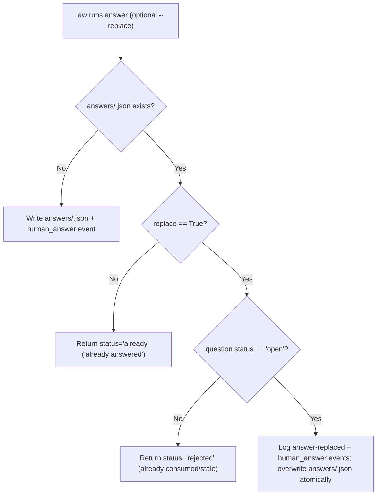

# IPD: Support replacing or updating unconsumed answers in aw runs answer and question_inbox

- Date: 2026-11-17
- Kind: child
- Concern: Add explicit `--replace` support to `question_inbox.write_answer`, `question_inbox.write_group_answer`, and `aw runs answer`, and surface existing unconsumed answers in interactive prompts before accepting input.
- Scope: Amend spec `6kwd2e` (R9.2, R9.5, A42) to permit explicit replacement of an unconsumed answer (`status == "open"`) while keeping first-answer-wins as the default for concurrent unflagged callers; add `replace: bool = False` to `question_inbox.write_answer` and `question_inbox.write_group_answer` with an `answer-replaced` event in `events.jsonl`; expose `--replace` on `aw runs answer` and show any pending unconsumed answer before prompting interactively; add behavioral tests in `tests/test_runs_answer.py` and `tests/test_question_resume.py`. EXCLUDES replacing answers already consumed by a resumed turn (`status != "open"`), modifying `open_questions` pre-flight sweep answers committed to git, and remote notification adapters (Telegram).
- Scope-Paths: .aw/records/specs/implemented/20260912-6kwd2e-01-6kwd2e-midrun-question-surfacing.spec.md, agent_workflows/question_inbox.py, agent_workflows/cli.py, agent_workflows/run_cli.py, tests/test_runs_answer.py, tests/test_question_resume.py, .aw/records/plans/pending/20261117-reanswer-01-04ygpo-support-replacing-or-updating-unconsumed-answers-in-aw-runs.ipd.md
- Item-Dependencies: none
- Status: to-review
- Short-Description: Add explicit replace support for unconsumed question_inbox answers and surface existing answers before re-prompting in aw runs answer
- Work-Kind: feature
- Priority: high
- From-Backlog: 9t7u5r
- From-Spec: 6kwd2e
- Blocks-Release: next
- Set: reanswer
- Order: 1
- Highest E allocated: 05
- Author: antigravity
- Id: 04ygpo

> Write and proofread this plan per the technical writing standard, `.aw/system/workflows/technical-writing/technical-writing.md` (`.agents/workflows/technical-writing/technical-writing.md` in a legacy-layout install), including requirement 12 (diagrams).

## Workflow history

- 2026-11-18 to-review (aw set): status set to to-review
- 2026-11-18 draft (antigravity): created and authored for backlog `9t7u5r`.

## Goal

Let operators update or replace an unconsumed answer recorded in `answers/<qid>.json` (for example after an accidental terminal paste or wrong selection) without losing concurrency safety across concurrent adapters. Also display any existing unconsumed answer upfront during interactive `aw runs answer` so operators are not prompted to write a full reply only to hit `"already answered"`.

## Detailed Implementation Checklist (TODO)

Execution-state rule: mark an `E-*` item complete only after performing the action. That mark is not validation. Right-sizing rule: write for a modest executor that cannot hold much in its head. Each E-item is one step (one concern, about one file, executable in one focused pass) and its V-item names each unit it covers with its own check; a plan stays at about 5 E-items and 8 work Scope-Paths, else split it into more child plans (guidance, `IPD-Z603`). Accepted execution states: blocked, failed, pending, performed; terminal gate demands 'performed'.

### Task group 1: Spec amendment, inbox writer, CLI wiring, and tests

- [ ] E-01 Amend spec `6kwd2e` (`.aw/records/specs/implemented/20260912-6kwd2e-01-6kwd2e-midrun-question-surfacing.spec.md`) in Sections R9.2, R9.5, and A42 to state that concurrent unflagged writers preserve first-answer-wins (`"already answered"`), whereas explicit `--replace` (`replace=True`) atomically overwrites an unconsumed answer while `questions/<qid>.json` still has `status == "open"`, records an `answer-replaced` audit event naming the prior answer and replacement timestamp, and refuses once the answer has been consumed (`status != "open"`). Append a dated `## Workflow history` note in `6kwd2e`.
  - Depends on: none
  - Expected outcome: `6kwd2e` documents both default first-answer-wins and explicit unconsumed replacement rules, and `aw specs check` reports no new violations in `6kwd2e`.
  - Execution state: pending

- [ ] E-02 Add `replace: bool = False` to `question_inbox.write_answer` and `question_inbox.write_group_answer` in `agent_workflows/question_inbox.py`. Keep default `replace=False` returning `status="already"` (`"already answered"`) when `ans_file.exists()`. When `replace=True` and `q_data_locked.get("status") != QUESTION_STATUS_OPEN`, return `status="rejected"` naming the non-open status (`"question status is not open: ..."`). When `replace=True`, `ans_file.exists()`, and `q_data_locked.get("status") == QUESTION_STATUS_OPEN`, read the existing answer record under the question lock, atomically write the replacement `answers/<qid>.json`, append an `answer-replaced` event (with `question_id`, `previous_answer`, `previous_choice`, `previous_answered_at`, `answer`, `choice`, `actor`, `channel`, `sender`) plus `human_answer` and `question_disposition` events to `events.jsonl`, refresh projection, and return `status="recorded"`.
  - Depends on: E-01
  - Expected outcome: Concurrent calls with `replace=False` remain one-winner (`already answered`); `replace=True` atomically updates unconsumed `open` answers with audit history and refuses already-consumed questions.
  - Execution state: pending

- [ ] E-03 Add `--replace` flag on `_p_runs_answer` in `agent_workflows/cli.py` and wire `replace=getattr(args, "replace", False)` into single-question (`write_answer`), group (`write_group_answer`), and interactive calls in `agent_workflows/run_cli.py`. In the interactive loop in `agent_workflows/run_cli.py`, inspect existing answer files for the group's members before prompting: if any member already has an unconsumed answer file and `--replace` is not set, show the existing answer summary and ask whether to skip (`Enter`) or confirm replacement (`r` to replace) before collecting replacement text or choice; if `--replace` is set, display the prior answer banner and write the new input with `replace=True`.
  - Depends on: E-02
  - Expected outcome: `aw runs answer <run-id> <qid> --answer ... --replace`, `--group ... --replace`, and interactive replacement all succeed cleanly on unconsumed answers and never silently discard user-typed text into `"already answered"`.
  - Execution state: pending

- [ ] E-04 Add behavioral tests in `tests/test_runs_answer.py` and `tests/test_question_resume.py` driving: (a) default `replace=False` first-answer-wins preservation, (b) `write_answer(..., replace=True)` and `write_group_answer(..., replace=True)` overwriting an unconsumed answer and recording `answer-replaced`, (c) `replace=True` refusal when question status is `"answered"` or `"stale"`, and (d) CLI `aw runs answer --replace` (including `--agent` JSON output) plus interactive skip/replace behavior when an answer already exists.
  - Depends on: E-03
  - Expected outcome: Every new behavioral test exercises real `question_inbox` / `run_cli` paths and passes without code-pinning checks.
  - Execution state: pending

- [ ] E-05 Run `aw specs check`, `python3 -m pytest tests/test_runs_answer.py tests/test_question_resume.py tests/test_question_parking.py tests/test_question_drain.py tests/test_question_visibility.py`, and `aw suite` (or bare `python3 -m pytest`), confirming zero failures across all tests.
  - Depends on: E-04
  - Expected outcome: `aw specs check` clean for `6kwd2e` and all executed test suites exit 0 with pasted counts.
  - Execution state: pending

## Project conventions discovered (Step 0)

- `question_inbox.write_answer` acquires `answers/<qid>.lock` via `FileLock`, re-reads `questions/<qid>.json` inside the lock, writes `answers/<qid>.json` atomically (`tmp` + `flush` + `os.fsync` + `os.replace`), appends `human_answer` and `question_disposition` to `events.jsonl`, and calls `write_projection(run_dir)`.
- `question_inbox.write_group_answer` acquires `answers/.group.lock`, calls `group_open_questions`, and iterates `write_answer` per member with `applied_to`.
- Spec `6kwd2e` R9.2 mandates "first answer wins" for unflagged adapters to prevent concurrent CLI/Telegram races (verified in A42); `--replace` preserves this invariant by defaulting to `False`.
- Interactive `aw runs answer` in `agent_workflows/run_cli.py` uses `group_open_questions`, which reads `questions/*.json` where `status == "open"` - because `set_question_status(..., "answered")` only fires when the driver consumes the answer on resume, an unconsumed answer leaves the question visible in `group_open_questions` even after `answers/<qid>.json` exists.

## Findings

| Finding | Evidence | Impact on this plan |
| --- | --- | --- |
| `write_answer` rejects any existing `answers/<qid>.json` | `question_inbox.write_answer` checks `if ans_file.exists():` before reading the answer or checking flags | Add `replace: bool = False` inside `FileLock` when `q_data_locked.get("status") == QUESTION_STATUS_OPEN` |
| Interactive loop prompts before checking `answers/<qid>.json` | `run_cli` calls `group_open_questions(r_dir, st)` (filters on `questions/*.json` `status == "open"`) and reads `input("Answer (Enter to skip): ")` before calling `write_answer` | Check existing `answers/<qid>.json` files before prompting and display prior answer + explicit replace confirmation |
| CLI parser has no `--replace` option | `_p_runs_answer` in `agent_workflows/cli.py` defines `--group`, `--answer`, `--choice`, `--dir` only | Add `--replace` flag on `_p_runs_answer` and plumb through `run_cli` |

## Proposed changes (ordered, validatable)

1. **Spec `6kwd2e` amendment (E-01)**: Update R9.2, R9.5, and A42 in `.aw/records/specs/implemented/20260912-6kwd2e-01-6kwd2e-midrun-question-surfacing.spec.md` and record a workflow history entry.
2. **Inbox writer replacement path (E-02)**: Extend `question_inbox.write_answer` and `question_inbox.write_group_answer` with `replace: bool = False`, preserving default concurrency refusal (`"already answered"`), refusing non-`open` consumed questions, and recording `answer-replaced` in `events.jsonl` on atomic overwrite.
3. **CLI flag & interactive UX (E-03)**: Add `--replace` to `_p_runs_answer` (`agent_workflows/cli.py`) and handle unconsumed existing answers clearly before prompting in `agent_workflows/run_cli.py`.
4. **Tests & validation (E-04, E-05)**: Exercise both CLI and library APIs in `tests/test_runs_answer.py` and `tests/test_question_resume.py`, then validate with `aw specs check` and pytest.

## Deferred / out of scope (with reason)

- Replacing answers **after** the driver has consumed them (`status == "answered"` on `questions/<qid>.json` and item already re-queued/dispatched): requires halting or cancelling an in-flight resumed attempt and is deferred to a separate lane-control design if needed.
- Amending committed pre-flight OQ answers (`### OQ-*` already committed via `offer_commit` to git): those live in tracked plan history, not run inbox `answers/`.
- Telegram inline reply editing: chat-channel adapters continue invoking `write_answer(..., replace=False)` so first-answer-wins across adapters stays intact.

## Scope check

- Over-scope: none.
- Under-scope: none. All four layers (spec `6kwd2e`, `question_inbox`, `cli`/`run_cli`, tests) are covered within this single child plan.

## Required tests / validation

- Targeted suites: `python3 -m pytest tests/test_runs_answer.py tests/test_question_resume.py tests/test_question_parking.py tests/test_question_drain.py tests/test_question_visibility.py`
- Spec validation: `aw specs check`
- Full core suite: `aw suite` (or bare `python3 -m pytest`)

## Spec / documentation sync

- Updates `.aw/records/specs/implemented/20260912-6kwd2e-01-6kwd2e-midrun-question-surfacing.spec.md` (R9.2, R9.5, A42, and `## Workflow history`) per E-01.

## Open questions

None blocking.

### OQ-01: Should interactive `aw runs answer` require confirmation (`r` / `--replace`) before replacing an unconsumed answer, rather than replacing implicitly when typed?

- Blocking: no
- Status: resolved
- Owner: maintainer
- Resolution or deferral rationale: Explicit confirmation (showing the existing pending answer and requiring `r` or `--replace`) avoids accidental overwrites while fixing the surprise prompt-then-reject trap.

## Validation and cross-check (verify before reporting done)

Validation-state rule: inspect evidence in a separate pass. Do not mark a `V-*` item complete from memory or from the matching execution checkmark. Accepted validation results: blocked, failed, pass, pending; terminal gate demands 'pass'. Runtime-demonstration reachability rule: for each `V-*` item demanding the software be observed acting (such as a run, a dispatch, or a transition)—as distinct from items demanding a diff, a file's content, or a test result, which are reachable by construction—name the code path that produces the observation or the sibling `E-*` that creates it, else the demand is UNDER-SCOPE.

- [ ] V-01 validates E-01
  - Required evidence: paste the unified `git diff` of `.aw/records/specs/implemented/20260912-6kwd2e-01-6kwd2e-midrun-question-surfacing.spec.md` showing R9.2, R9.5, A42, and `## Workflow history`, plus the `aw specs check` output showing zero errors on `6kwd2e`.
  - Observed evidence:
  - Result: pending

- [ ] V-02 validates E-02
  - Required evidence: paste `python3 -m pytest -v tests/test_runs_answer.py tests/test_question_resume.py` output showing PASSED test node ids for default `replace=False` (`"already answered"`), `write_answer(..., replace=True)` and `write_group_answer(..., replace=True)` atomic overwrite, `answer-replaced` event emission in `events.jsonl`, and non-`open` question refusal.
  - Observed evidence:
  - Result: pending

- [ ] V-03 validates E-03
  - Required evidence: paste `aw runs answer --help` output showing `--replace` and pasted CLI test node outputs from `tests/test_runs_answer.py` demonstrating `--replace` on `--answer`, `--choice`, `--group`, `--agent` output, and interactive display of existing unconsumed answers before input.
  - Observed evidence:
  - Result: pending

- [ ] V-04 validates E-04
  - Required evidence: paste `python3 -m pytest -v tests/test_runs_answer.py tests/test_question_resume.py` full run summary showing all new and existing tests passing with 0 failures and 0 skipped new cases, plus `rg -n "^(import|from) (inspect|ast)\b" tests/test_runs_answer.py` returning exit 1 (no code-pinning tests).
  - Observed evidence:
  - Result: pending

- [ ] V-05 validates E-05
  - Required evidence: paste the final output of `aw specs check`, `python3 -m pytest tests/test_runs_answer.py tests/test_question_resume.py tests/test_question_parking.py tests/test_question_drain.py tests/test_question_visibility.py`, and `aw suite` (or bare `python3 -m pytest`) showing exit 0 and 0 failures.
  - Observed evidence:
  - Result: pending

## Approval and execution gate

- Size assessment: standard
- Cohesion rationale: not required

This plan delivers the `--replace` capability across spec `6kwd2e`, `question_inbox`, `aw runs answer`, and tests in a single bounded child IPD (`- Blocks-Release: next`, `- From-Backlog: 9t7u5r`). Once reviewed and approved, execute inside an isolated worktree, verify all `V-*` checks, finalize with `aw ipd finalize`, and close backlog `9t7u5r` via carrier evidence / `aw backlog set done`.
