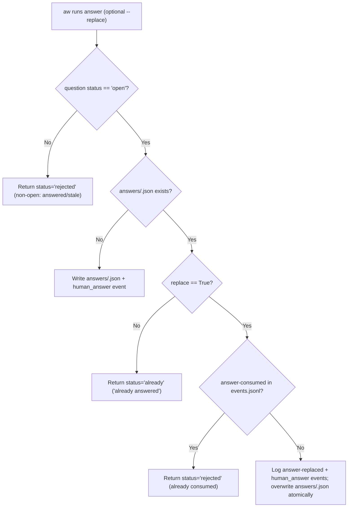

# IPD: Support replacing or updating unconsumed answers in aw runs answer and question_inbox

- Date: 2026-11-17
- Kind: child
- Concern: Add explicit `--replace` support to `question_inbox.write_answer`, `question_inbox.write_group_answer`, and `aw runs answer`, and surface existing unconsumed answers in interactive prompts before accepting input.
- Scope: Amend spec `6kwd2e` (R9.2, R9.5, A42) to permit explicit replacement of an unconsumed answer (`status == "open"` and not yet consumed) while keeping first-answer-wins as the default for concurrent unflagged callers; add `replace: bool = False` to `agent_workflows/question_inbox.py::write_answer` and `agent_workflows/question_inbox.py::write_group_answer` with an `answer-replaced` event in `events.jsonl` and mark `preflight_parked` questions `"answered"` on consumption in `agent_workflows/runner_shared.py::consume_answers`; expose `--replace` on `aw runs answer` (`agent_workflows/cli.py`, `agent_workflows/run_cli.py`) and show any pending unconsumed answer before prompting interactively; add behavioral tests in `tests/test_runs_answer.py` and `tests/test_question_resume.py`. EXCLUDES replacing answers already consumed by a resumed turn or preflight commit (`status != "open"` or `answer-consumed` logged), modifying `open_questions` pre-flight sweep answers committed to git, and remote notification adapters (Telegram).
- Scope-Paths: .aw/records/specs/implemented/20260912-6kwd2e-01-6kwd2e-midrun-question-surfacing.spec.md, agent_workflows/question_inbox.py, agent_workflows/runner_shared.py, agent_workflows/cli.py, agent_workflows/run_cli.py, tests/test_runs_answer.py, tests/test_question_resume.py, .aw/records/plans/pending/20261117-reanswer-01-04ygpo-support-replacing-or-updating-unconsumed-answers-in-aw-runs.ipd.md
- Item-Dependencies: none
- Status: approved
- Readiness: go-pending-approval
- Review-Depth: standard
- Short-Description: Add explicit replace support for unconsumed question_inbox answers and surface existing answers before re-prompting in aw runs answer
- Work-Kind: feature
- Priority: high
- From-Backlog: 9t7u5r
- From-Spec: 6kwd2e
- Blocks-Release: next
- Set: reanswer
- Order: 1
- Highest E allocated: 05
- Author: antigravity
- Id: 04ygpo
- Approval: 2026-11-27, recorded via aw ipd set: status set to approved

> Write and proofread this plan per the technical writing standard, `.aw/system/workflows/technical-writing/technical-writing.md` (`.agents/workflows/technical-writing/technical-writing.md` in a legacy-layout install), including requirement 12 (diagrams).

## Workflow history

- 2026-11-27 approved (aw set): status set to approved
- 2026-11-18 reviewed (aw set): APPROVE WITH REVISIONS APPLIED; PR-001..PR-007
- 2026-11-18 /plan-review (antigravity/gemini-4-hydrogen-high): APPROVE WITH REVISIONS APPLIED; PR-001, PR-002, PR-003, PR-004, PR-005, PR-006, PR-007; review record .aw/records/reviews/20261117-reanswer-01-04ygpo-support-replacing-or-updating-unconsumed-answers-in-aw-runs.review.md
- 2026-11-18 to-review (aw set): status set to to-review
- 2026-11-18 draft (antigravity): created and authored for backlog `9t7u5r`.

## Goal

Let operators update or replace an unconsumed answer recorded in `answers/<qid>.json` (for example after an accidental terminal paste or wrong selection) without losing concurrency safety across concurrent adapters. Also display any existing unconsumed answer upfront during interactive `aw runs answer` so operators are not prompted to write a full reply only to hit `"already answered"`.

## Detailed Implementation Checklist (TODO)

Execution-state rule: mark an `E-*` item complete only after performing the action. That mark is not validation. Right-sizing rule: write for a modest executor that cannot hold much in its head. Each E-item is one step (one concern, about one file, executable in one focused pass) and its V-item names each unit it covers with its own check; a plan stays at about 5 E-items and 8 work Scope-Paths, else split it into more child plans (guidance, `IPD-Z603`). Accepted execution states: blocked, failed, pending, performed; terminal gate demands 'performed'.

### Task group 1: Spec amendment, inbox writer, CLI wiring, and tests

- [ ] E-01 Amend spec `6kwd2e` (`.aw/records/specs/implemented/20260912-6kwd2e-01-6kwd2e-midrun-question-surfacing.spec.md`) in Sections `6kwd2e R9.2`, `6kwd2e R9.5`, and `6kwd2e A42` to state that concurrent unflagged writers preserve first-answer-wins (`"already answered"`), whereas explicit `--replace` (`replace=True`) atomically overwrites an unconsumed answer while `questions/<qid>.json` still has `status == "open"` and no `answer-consumed` event has been recorded, records an `answer-replaced` audit event naming the prior answer and replacement timestamp, and refuses once the answer has been consumed (`status != "open"` or already consumed). Record a dated `## Workflow history` note (newest-first) in `6kwd2e` using `aw specs note`.
  - Depends on: none
  - Expected outcome: `6kwd2e` documents both default first-answer-wins and explicit unconsumed replacement rules, and `aw specs check` reports no new violations in `6kwd2e`.
  - Execution state: pending

- [ ] E-02 Add `replace: bool = False` to `agent_workflows/question_inbox.py::write_answer` and `agent_workflows/question_inbox.py::write_group_answer`, and close the preflight/checkpoint consumption gap in `agent_workflows/runner_shared.py::consume_answers`. Inside `write_answer`'s `FileLock`: (1) check `q_data_locked.get("status") != QUESTION_STATUS_OPEN` before `ans_file.exists()` and return `status="rejected"` naming the non-open status (`"question status is not open: ..."`); (2) when `replace=True` and `ans_file.exists()`, also check `events.jsonl` for any `answer-consumed` event with `question_id == qid` and return `status="rejected"` (`"answer already consumed for question_id: ..."`) if found; (3) keep default `replace=False` returning `status="already"` (`"already answered"`) when `ans_file.exists()`; (4) when `replace=True`, `ans_file.exists()`, `q_data_locked.get("status") == QUESTION_STATUS_OPEN`, and unconsumed, read the existing answer record under the lock, atomically write the replacement `answers/<qid>.json`, append an `answer-replaced` event (`{"at": answered_at, "event": "answer-replaced", "question_id": qid, "previous_answer": ..., "previous_choice": ..., "previous_answered_at": ..., "answer": str_answer, "choice": choice, "actor": actor, "channel": str_channel, "sender": str_sender}`, without a ledger `"kind"` key) plus `human_answer` and `question_disposition` events to `events.jsonl`, refresh projection, and return `status="recorded"`; (5) when `replace=True` and `not ans_file.exists()`, record a normal first answer with no `answer-replaced` event. In `runner_shared.py::consume_answers`, call `question_inbox.set_question_status(run_dir, qid, question_inbox.QUESTION_STATUS_ANSWERED, reason="preflight answer consumed and committed")` after `offer_commit` succeeds on `preflight_parked` items.
  - Depends on: E-01
  - Expected outcome: Concurrent calls with `replace=False` remain one-winner (`"already answered"`); `replace=True` atomically updates unconsumed `open` answers with `answer-replaced` audit history; and both preflight-committed and checkpoint-consumed questions reject replacement.
  - Execution state: pending

- [ ] E-03 Add `--replace` flag (`action="store_true"`, `default=False`) and update help `description`/`epilog` on `_p_runs_answer` inside `agent_workflows/cli.py::_build_parser`, and wire replacement into `agent_workflows/run_cli.py::_run_answer`. Pass `replace=bool(getattr(args, "replace", False))` into non-interactive single-question (`write_answer`) and group (`write_group_answer`) calls. In the interactive loop in `agent_workflows/run_cli.py::_run_answer`, inspect existing answer files (`question_inbox.read_answer`) for the group's members before prompting: if any member already has an unconsumed answer file, display the existing answer summary sanitized via `agent_workflows/run_cli.py::_clean_worker_text` and include the lowercase `"already answered"` indicator (preserving compatibility with interactive repeat-answer callers). When `--replace` is not set, ask whether to skip (`Enter`) or confirm replacement (`r` to replace) before collecting replacement text or choice, and pass `replace=bool(getattr(args, "replace", False)) or confirmed_replace` into `write_group_answer`; when `--replace` is set, display the sanitized prior answer banner and write the new input with `replace=True`.
  - Depends on: E-02
  - Expected outcome: `aw runs answer <run-id> <qid> --answer ... --replace`, `--group ... --replace`, and interactive replacement (both via `--replace` and via `'r'` confirmation) succeed cleanly on unconsumed answers, sanitize displayed prior answers, and never silently discard user-typed text into `"already answered"`.
  - Execution state: pending

- [ ] E-04 Add behavioral tests in `tests/test_runs_answer.py` and `tests/test_question_resume.py` driving: (a) default `replace=False` first-answer-wins preservation, (b) `write_answer(..., replace=True)` and `write_group_answer(..., replace=True)` overwriting an unconsumed answer and recording `answer-replaced` (and recording normally without `answer-replaced` when no prior answer exists), (c) `replace=True` refusal when question status is `"answered"` or `"stale"`, when `consume_answers` has emitted `answer-consumed` (both preflight-committed and mid-run queued `resume_with_answers`), and (d) CLI `aw runs answer --replace` (including `--agent` JSON output) plus interactive skip (`Enter`), `'r'` confirmation, and `--replace` behavior when an answer already exists.
  - Depends on: E-03
  - Expected outcome: Every new behavioral test exercises real `question_inbox`, `runner_shared`, and `run_cli` paths and passes without code-pinning checks.
  - Execution state: pending

- [ ] E-05 Run `aw specs check`, `python3 -m pytest tests/test_runs_answer.py tests/test_question_resume.py tests/test_question_inbox.py tests/test_question_preflight.py tests/test_question_parking.py tests/test_question_drain.py tests/test_question_visibility.py`, and `aw suite` (or bare `python3 -m pytest`), confirming zero failures across all tests.
  - Depends on: E-04
  - Expected outcome: `aw specs check` clean for `6kwd2e` and all executed test suites exit 0 with pasted counts.
  - Execution state: pending

## Project conventions discovered (Step 0)

- `agent_workflows/question_inbox.py::write_answer` acquires `answers/<qid>.lock` via `FileLock`, re-reads `questions/<qid>.json` inside the lock, writes `answers/<qid>.json` atomically (`tmp` + `flush` + `os.fsync` + `os.replace`), appends `human_answer` and `question_disposition` to `events.jsonl`, and calls `agent_workflows/question_inbox.py::write_projection`.
- `agent_workflows/question_inbox.py::write_group_answer` acquires `answers/.group.lock`, calls `agent_workflows/question_inbox.py::group_open_questions`, and iterates `write_answer` per member with `applied_to`.
- Spec `6kwd2e R9.2` mandates "first answer wins" for unflagged adapters to prevent concurrent CLI/Telegram races (verified in `6kwd2e A42`); `--replace` preserves this invariant by defaulting to `False`.
- Interactive `aw runs answer` in `agent_workflows/run_cli.py::_run_answer` uses `group_open_questions`, which reads `questions/*.json` where `status == "open"` - because `set_question_status(..., "answered")` only fires when `agent_workflows/runner_shared.py::execute_item_core` dispatches a resumed turn, an unconsumed answer leaves the question visible in `group_open_questions` even after `answers/<qid>.json` exists.
- In `agent_workflows/runner_shared.py::consume_answers`, `preflight_parked` items commit the OQ answer to git and emit `answer-consumed` without calling `set_question_status(..., "answered")`, and normal parked items snapshot `answers_pending` into `state.json` and emit `answer-consumed` before `execute_item_core` transitions the question status. Marking `preflight_parked` questions `"answered"` after commit and checking `answer-consumed` in `write_answer` closes both consumption gaps.

## Findings

| Finding | Evidence | Impact on this plan |
| --- | --- | --- |
| `write_answer` rejects any existing `answers/<qid>.json` before re-checking status | `agent_workflows/question_inbox.py::write_answer` checks `if ans_file.exists():` inside `FileLock` before re-reading `q_data_locked` | Re-read `q_data_locked` first inside `FileLock`, add `replace: bool = False`, check `answer-consumed` in `events.jsonl`, and allow atomic overwrite only when `status == "open"` and unconsumed |
| `consume_answers` leaves `preflight_parked` `questions/<qid>.json` `"open"` after git commit and snapshots `answers_pending` before `run_item` | `agent_workflows/runner_shared.py::consume_answers` emits `answer-consumed` without calling `set_question_status` on `preflight_parked` | Mark `preflight_parked` questions `"answered"` after `offer_commit` in `consume_answers`, and reject `replace=True` when `answer-consumed` is already logged for `qid` |
| Interactive loop prompts before checking `answers/<qid>.json` | `agent_workflows/run_cli.py::_run_answer` calls `group_open_questions(r_dir, st)` and reads `input("Answer (Enter to skip): ")` before calling `write_group_answer` | Check `read_answer` before prompting, display sanitized prior answer with `"already answered"`, and require `'r'` or `--replace` before overwriting |
| CLI parser has no `--replace` option | `agent_workflows/cli.py::_build_parser` (`_p_runs_answer`) defines `--group`, `--answer`, `--choice`, `--dir` only | Add `--replace` flag and update help `description`/`epilog` on `_p_runs_answer`, and plumb through `agent_workflows/run_cli.py::_run_answer` |

## Proposed changes (ordered, validatable)

1. **Spec `6kwd2e` amendment (E-01)**: Update `6kwd2e R9.2`, `6kwd2e R9.5`, and `6kwd2e A42` in `.aw/records/specs/implemented/20260912-6kwd2e-01-6kwd2e-midrun-question-surfacing.spec.md` and record a newest-first workflow history note via `aw specs note`.
2. **Inbox writer replacement path & consumption boundary (E-02)**: Extend `agent_workflows/question_inbox.py::write_answer` and `agent_workflows/question_inbox.py::write_group_answer` with `replace: bool = False`, preserving default concurrency refusal (`"already answered"`), checking `q_data_locked` status and `answer-consumed` before overwriting, recording `answer-replaced` in `events.jsonl` on atomic overwrite, and marking `preflight_parked` questions `"answered"` in `agent_workflows/runner_shared.py::consume_answers` after `offer_commit`.
3. **CLI flag & interactive UX (E-03)**: Add `--replace` and help text to `_p_runs_answer` (`agent_workflows/cli.py::_build_parser`), handle unconsumed existing answers clearly with sanitized display and `"already answered"` compatibility before prompting in `agent_workflows/run_cli.py::_run_answer`, and pass `replace=True` when `--replace` or `'r'` confirmation is given.
4. **Tests & validation (E-04, E-05)**: Exercise both CLI and library APIs (including preflight and checkpoint consumption refusal) in `tests/test_runs_answer.py` and `tests/test_question_resume.py`, then validate with `aw specs check` and pytest.

## Deferred / out of scope (with reason)

- Replacing answers **after** the driver has consumed them (`status != "open"` on `questions/<qid>.json` or `answer-consumed` already logged in `events.jsonl` after preflight commit / checkpoint re-queue): requires halting or cancelling an in-flight resumed attempt and is deferred to a separate lane-control design if needed.
  - Carrier-Declined: Requires lane-control cancellation semantics for in-flight resumed attempts; intentionally excluded from unconsumed inbox replacement.
- Amending committed pre-flight OQ answers (`### OQ-*` already committed via `offer_commit` to git): those live in tracked plan history, not run inbox `answers/`.
  - Carrier-Declined: Committed pre-flight OQ answers reside in immutable tracked git plan history rather than run inbox `answers/`.
- Telegram inline reply editing: chat-channel adapters continue invoking `write_answer(..., replace=False)` so first-answer-wins across adapters stays intact.
  - Carrier-Declined: Chat-channel adapters intentionally keep `replace=False` to preserve first-answer-wins across concurrent adapters per spec `6kwd2e R9.2`.

## Scope check

- Over-scope: none.
- Under-scope: none. All layers (spec `6kwd2e`, `question_inbox`, `runner_shared.consume_answers`, `cli`/`run_cli`, tests) are covered within this single child plan.

## Required tests / validation

- Targeted suites: `python3 -m pytest tests/test_runs_answer.py tests/test_question_resume.py tests/test_question_inbox.py tests/test_question_preflight.py tests/test_question_parking.py tests/test_question_drain.py tests/test_question_visibility.py`
- Spec validation: `aw specs check`
- Full core suite: `aw suite` (or bare `python3 -m pytest`)

## Spec / documentation sync

- Updates `.aw/records/specs/implemented/20260912-6kwd2e-01-6kwd2e-midrun-question-surfacing.spec.md` (R9.2, R9.5, A42, and `## Workflow history`) per E-01.

## Open questions

None blocking.

### OQ-01: Should interactive `aw runs answer` require confirmation (`r` / `--replace`) before replacing an unconsumed answer, rather than replacing implicitly when typed?

- Blocking: no
- Status: resolved
- Owner: maintainer
- Resolution or deferral rationale: Explicit confirmation (showing the existing pending answer and requiring `r` or `--replace`) avoids accidental overwrites while fixing the surprise prompt-then-reject trap.

## Validation and cross-check (verify before reporting done)

Validation-state rule: inspect evidence in a separate pass. Do not mark a `V-*` item complete from memory or from the matching execution checkmark. Accepted validation results: blocked, failed, pass, pending; terminal gate demands 'pass'. Runtime-demonstration reachability rule: for each `V-*` item demanding the software be observed acting (such as a run, a dispatch, or a transition)—as distinct from items demanding a diff, a file's content, or a test result, which are reachable by construction—name the code path that produces the observation or the sibling `E-*` that creates it, else the demand is UNDER-SCOPE.

- [ ] V-01 validates E-01
  - Required evidence: paste the unified `git diff` of `.aw/records/specs/implemented/20260912-6kwd2e-01-6kwd2e-midrun-question-surfacing.spec.md` showing `6kwd2e R9.2`, `6kwd2e R9.5`, `6kwd2e A42`, and the newest-first `## Workflow history` note, plus the `aw specs check` output showing zero errors on `6kwd2e`.
  - Observed evidence:
  - Result: pending

- [ ] V-02 validates E-02
  - Required evidence: paste `python3 -m pytest -v tests/test_runs_answer.py tests/test_question_resume.py` output showing PASSED test node ids for default `replace=False` (`"already answered"`), `write_answer(..., replace=True)` and `write_group_answer(..., replace=True)` atomic overwrite (and first-answer recording without `answer-replaced` when no prior answer exists), `answer-replaced` event emission in `events.jsonl`, non-`open` question refusal, and `answer-consumed` refusal for both preflight-committed and checkpoint-consumed items.
  - Observed evidence:
  - Result: pending

- [ ] V-03 validates E-03
  - Required evidence: paste `aw runs answer --help` output showing `--replace` and updated help text, and pasted CLI test node outputs from `tests/test_runs_answer.py` demonstrating `--replace` on `--answer`, `--choice`, `--group`, `--agent` output, interactive display of sanitized existing unconsumed answers (`"already answered"`) with skip/`r` confirmation and `--replace`, and preservation of existing interactive repeat behavior.
  - Observed evidence:
  - Result: pending

- [ ] V-04 validates E-04
  - Required evidence: paste `python3 -m pytest -v tests/test_runs_answer.py tests/test_question_resume.py` full run summary showing all new and existing tests passing with 0 failures and 0 skipped new cases, plus `rg -n "^(import|from) (inspect|ast)\b" tests/test_runs_answer.py tests/test_question_resume.py` returning exit 1 (no code-pinning tests).
  - Observed evidence:
  - Result: pending

- [ ] V-05 validates E-05
  - Required evidence: paste the final output of `aw specs check`, `python3 -m pytest tests/test_runs_answer.py tests/test_question_resume.py tests/test_question_inbox.py tests/test_question_preflight.py tests/test_question_parking.py tests/test_question_drain.py tests/test_question_visibility.py`, and `aw suite` (or bare `python3 -m pytest`) showing exit 0 and 0 failures.
  - Observed evidence:
  - Result: pending

## Approval and execution gate

- Size assessment: standard
- Cohesion rationale: not required

Execution contract:
- **Open questions**: `OQ-01` is resolved (`- Blocking: no`); zero unresolved blocking questions remain.
- **Scope fence**: Declared work paths are listed in `- Scope-Paths:`. An out-of-scope edit must be justified at finalize with `--scope-reason`, and any declared path left unmodified must be acknowledged with `--scope-ack`.
- **Safety stop**: Stop and report only on a genuinely unsafe condition (an unresolvable concurrent-edit conflict or absent prerequisite symbols `question_inbox.write_answer`, `question_inbox.write_group_answer`, `runner_shared.consume_answers`, or `run_cli._run_answer`).
- **Evidence honesty**: MUST paste the actual runner output for every check and test run; never claim passing results without running them after the final edit.
- **Commit and push**: Commit only files you changed for this plan, limited to named paths, via `aw commit 04ygpo -- <paths>`. Never use `git add -A`, `git commit -a`, or `--no-verify`, and never push without an explicit human directive.
- **Lifecycle transition**: When `aw oc run` or `aw agy run` executes this plan, the runner performs the terminal finalize (`aw ipd finalize 04ygpo`); a hand executor runs `aw ipd finalize 04ygpo` itself (never a hand `git mv` to `executed/`). After finalization, close backlog `9t7u5r` via `aw backlog set done 9t7u5r --carrier-evidence ...` or carrier validation.
