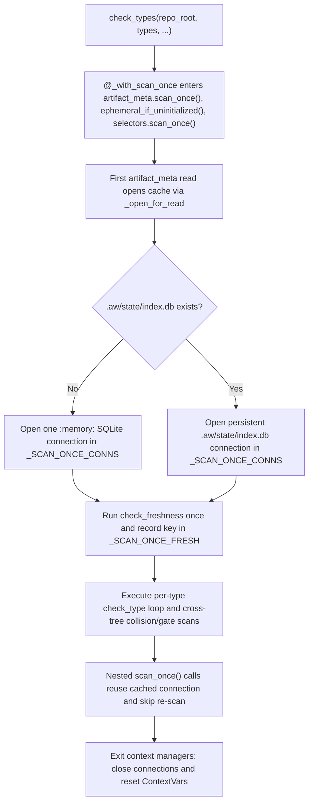

# IPD: Wrap check_engine.check_types in artifact_meta.scan_once and ephemeral_if_uninitialized

- Date: 2026-11-19
- Kind: child
- Concern: Verify the outer `artifact_meta.scan_once()`, `artifact_meta.ephemeral_if_uninitialized()`, and `selectors.scan_once()` wrapper (`agent_workflows/check_engine.py::_with_scan_once`, landed in commit `5ca9a65a2` on `check_type` and `check_types`) and add dedicated behavioral regression coverage pinning single-connection, single-freshness-scan reuse so `check_engine.check_types` cannot regress into rebuilding `.aw/state/index.db` on every inner helper call.
- Scope: Verify `agent_workflows/check_engine.py::_with_scan_once` already decorates `agent_workflows/check_engine.py::check_types` and `agent_workflows/check_engine.py::check_type` (landed in `5ca9a65a2`, requiring no redundant inner `with` block in `check_engine.py`), and add behavioral outcome tests in `tests/test_check_engine_scan_once.py` covering uninitialized cache single-build reuse (`in_memory=True`), initialized cache reuse (`in_memory=False`), consecutive-call freshness, nested `scan_once` compatibility, single-type `check_type` reuse, `Drift` output parity, mutation sensitivity (`check_types.__wrapped__`), and `cli.main` execution. EXCLUDES changing `artifact_meta.scan_once`, `artifact_meta.ephemeral_if_uninitialized`, `selectors.scan_once`, modifying `agent_workflows/check_engine.py` unless `E-02` exposes an actual cache-reuse regression, or wrapping standalone `check_engine.check_release_gates` callers (`aw check release-gates`).
- Scope-Paths: tests/test_check_engine_scan_once.py
- Item-Dependencies: none
- Status: approved
- Readiness: go-pending-approval
- Review-Depth: standard
- Short-Description: Pin check_engine.check_types artifact_meta.scan_once and ephemeral_if_uninitialized reuse with behavioral regression tests
- Work-Kind: bug
- Priority: high
- From-Backlog: 2i04so
- Blocks-Release: next
- Set: 2i04so
- Order: 1
- Highest E allocated: 03
- Author: antigravity/gemini
- Id: 28k5h5
- Approval: 2026-11-27, recorded via aw ipd set: status set to approved

> Write and proofread this plan per the technical writing standard, `.aw/system/workflows/technical-writing/technical-writing.md` (`.agents/workflows/technical-writing/technical-writing.md` in a legacy-layout install), including requirement 12 (diagrams).

## Workflow history

- 2026-11-27 approved (aw set): status set to approved
- 2026-11-21 reviewed (aw set): APPROVE WITH REVISIONS APPLIED; PR-001..PR-004 (review record: .aw/records/reviews/20261121-2i04so-01-28k5h5-wrap-check-engine-check-types-in-artifact-meta-scan-once-and.review.md)
- 2026-11-21 /plan-review (antigravity/gemini-4-neon-high): APPROVE WITH REVISIONS APPLIED; PR-001..PR-004 (review record: .aw/records/reviews/20261121-2i04so-01-28k5h5-wrap-check-engine-check-types-in-artifact-meta-scan-once-and.review.md)
- 2026-11-19 to-review (aw set): ready for review: authored for backlog 2i04so
- 2026-11-19 draft (antigravity/gemini): created.

## Goal

Prevent regressions to repeated full-corpus SQLite metadata cache rebuilds and redundant freshness scans during `agent_workflows/check_engine.py::check_types` (and `check_type`) runs. Commit `5ca9a65a2` landed `agent_workflows/check_engine.py::_with_scan_once` wrapping `check_type` and `check_types` in `artifact_meta.scan_once()`, `artifact_meta.ephemeral_if_uninitialized()`, and `selectors.scan_once()`, but shipped no dedicated behavioral regression tests. This plan verifies that landed wrapper remains intact and pins its observable cache-reuse contract in `tests/test_check_engine_scan_once.py`, enabling clean closure of release-blocking backlog item `2i04so`.

## Detailed Implementation Checklist (TODO)

Execution-state rule: mark an `E-*` item complete only after performing the action. That mark is not validation. Right-sizing rule: write for a modest executor that cannot hold much in its head. Each E-item is one step (one concern, about one file, executable in one focused pass) and its V-item names each unit it covers with its own check; a plan stays at about 5 E-items and 8 work Scope-Paths, else split it into more child plans (guidance, `IPD-Z603`). Accepted execution states: blocked, failed, pending, performed; terminal gate demands 'performed'.

### Task group 1: Verify landed scan-once wrapper and add behavioral tests

- [ ] E-01 Verify `agent_workflows/check_engine.py::_with_scan_once` (landed in commit `5ca9a65a2`) decorates both `agent_workflows/check_engine.py::check_type` and `agent_workflows/check_engine.py::check_types` with `artifact_meta.scan_once()`, `artifact_meta.ephemeral_if_uninitialized()`, and `selectors.scan_once()`, preserving `check_types` signature, `types == ["all"]` normalization, `check.collisions-not-checked` `info` emission, per-scan `try`/`except Exception: pass` isolation blocks, and returned `List[_core.Drift]`. Do NOT add a redundant inner `with _meta.scan_once(), _meta.ephemeral_if_uninitialized():` block inside `check_types` and do NOT remove `_sel.scan_once()` or `@_with_scan_once`. (Only edit `agent_workflows/check_engine.py` if `E-02` exposes an actual cache-reuse leak, justifying the extra path via `--scope-reason` at finalize.)
  - Depends on: none
  - Expected outcome: Confirmed from repository source and commit `5ca9a65a2` that `check_engine.check_types` and `check_engine.check_type` already share one `artifact_meta` connection and one `artifact_meta.check_freshness` scan per `(records_root, state_root)` key without creating `.aw/state/index.db` when absent, with zero redundant changes to `agent_workflows/check_engine.py`.
  - Execution state: pending

- [ ] E-02 Add behavioral outcome tests in `tests/test_check_engine_scan_once.py` (with `pytestmark = pytest.mark.core`, exercising real functions and `cli.main` on `tmp_path` repositories without source-inspecting assertions). Configure each `tmp_path` fixture with repository-backed `.aw/config/project.json` (`"records_backend": "repository"`, `"placements": {"records": "target-tracked", "state_runtime": "target-ignored"}`) and populated multi-type records (at least `plans` and `backlog`) so `artifact_meta` resolves `records_root` inside `tmp_path/.aw/records` even when `AW_HOME` is exported. Cover: (1) uninitialized repository (`.aw/state/index.db` absent): `check_types(repo, ["all"])` leaves `.aw/state/index.db` absent on disk, invokes `artifact_meta.open_cache` exactly once (`call_count == 1`, with `in_memory=True`) and `artifact_meta.check_freshness` exactly once (`call_count == 1`, measured via `unittest.mock.patch(..., wraps=...)`), and matches the `Drift` set returned for an initialized repository; (2) initialized repository (`.aw/state/index.db` present): `check_types(repo, ["all"])` invokes `artifact_meta.open_cache` exactly once (`call_count == 1`, with `in_memory=False`) and `artifact_meta.check_freshness` exactly once (`call_count == 1`); (3) consecutive calls after scope exit: adding a new defect record (for example a duplicate `id6`) between two `check_types(repo, ["all"])` calls on an uninitialized repository surfaces the new finding on the second call while keeping `.aw/state/index.db` absent; (4) nested scope safety: calling `check_types(repo, ["plans"])` inside an outer `with artifact_meta.scan_once(), artifact_meta.ephemeral_if_uninitialized():` block leaves the outer connection open and usable (`SELECT 1` and a follow-up `artifact_meta.query` succeed); (5) single-type `check_type(repo, "plans")` reuse on an uninitialized repository leaves `.aw/state/index.db` absent and invokes `open_cache` once (`in_memory=True`); (6) mutation-sensitivity check: calling `check_types.__wrapped__(repo, ["all"])` (bypassing `@_with_scan_once`) on the same uninitialized repository triggers multiple `open_cache` calls (`> 1`), proving the test fails if the wrapper is removed; and (7) real command-line interface (CLI) invocation via `cli.main(["check", "all", "--agent", "--dir", str(repo)])` on an uninitialized repository emits valid `aw.agent/v1` JSON output without creating `.aw/state/index.db`.
  - Depends on: E-01
  - Expected outcome: All tests in `tests/test_check_engine_scan_once.py` pass against the landed `@_with_scan_once` wrapper, exercise real `tmp_path/.aw/records` under `AW_HOME`, and demonstrate sensitivity to removing the outer wrapper via `check_types.__wrapped__`.
  - Execution state: pending

- [ ] E-03 Run the targeted test modules (`python3 -m pytest -v tests/test_check_engine_scan_once.py tests/test_check_engine.py tests/test_readers_check_engine.py`), the routine core suite (`python3 -m pytest`), static type check (`python3 -m mypy agent_workflows`), repository check (`aw check all --agent`), and leak scan (`aw sanitize --agent`).
  - Depends on: E-02
  - Expected outcome: All targeted tests, core suite tests, `mypy`, and `aw sanitize --agent` pass with zero failures, and `aw check all --agent` reports no regressions caused by this change.
  - Execution state: pending

## Project conventions discovered (Step 0)

- `agent_workflows/check_engine.py` imports `artifact_meta` lazily inside functions (`from agent_workflows import artifact_meta as _meta`) rather than at module import time; `agent_workflows/check_engine.py::_with_scan_once` follows that convention and wraps both `check_type` and `check_types` in `_meta.scan_once()`, `_meta.ephemeral_if_uninitialized()`, and `_sel.scan_once()`.
- `agent_workflows/artifact_meta.py::scan_once` stores a `set` of scanned `(resolved_records_root, resolved_state_root)` keys in `_SCAN_ONCE_FRESH` and a `dict` of open connections in `_SCAN_ONCE_CONNS` via `ContextVar`s; nested `scan_once()` calls detect an existing non-`None` `_SCAN_ONCE_FRESH` and yield without resetting or closing the outer scope.
- `agent_workflows/artifact_meta.py::ephemeral_if_uninitialized` sets `_EPHEMERAL_IF_ABSENT` via a `ContextVar` token and resets that token on exit; `_open_for_read` opens an in-memory SQLite database (`open_cache(..., in_memory=True)`) only when `(state_root / "index.db").exists()` is `False`, so initialized repositories continue using their persistent `.aw/state/index.db`.
- When `AW_HOME` is set in the environment (as inside managed runner lanes), `agent_workflows/project_context.py::resolve_project_context` routes a `tmp_path` directory without `.aw/config/project.json` to `$AW_HOME/projects/<name>-<hash>/records`. Test fixtures must write a repository-backed `.aw/config/project.json` (`records_backend: "repository"`, `placements.records: "target-tracked"`) so `artifact_meta` actually scans `tmp_path/.aw/records`.
- Core test modules set `pytestmark = pytest.mark.core`, test observable outcomes only (no source inspection via `inspect`, `ast`, regex, or line counting per `GUIDING_PRINCIPLES.md#16. Test outcomes and behavior, never code structure or text`), and run under the bare `python3 -m pytest` gate.

## Findings

| Finding | Evidence | Impact on this plan |
| --- | --- | --- |
| `check_types` and `check_type` are already wrapped by `@_with_scan_once` (landed 2026-11-20, after this plan was drafted on 2026-11-19) | Commit `5ca9a65a2`; `agent_workflows/check_engine.py::_with_scan_once`, `check_type`, `check_types` | Do not add a duplicate inner `with` block in `check_engine.py`; verify `@_with_scan_once` stays intact and keep `28k5h5` focused on the missing regression tests and backlog `2i04so` closure |
| Commit `5ca9a65a2` shipped zero dedicated behavioral regression tests for `check_types` cache reuse | Search across `tests/**/*.py` finds zero tests asserting `open_cache`/`check_freshness` call counts or `.aw/state/index.db` non-creation for `check_types` | Add `tests/test_check_engine_scan_once.py` (`E-02`) to pin single-connection, single-scan, non-persistent-on-absent, freshness, nested-scope, parity, mutation-sensitivity, and CLI invariants |
| History helpers read `artifact_meta.history` without an inner `ephemeral_if_uninitialized()` guard | `agent_workflows/check_engine.py::_item_close_date`, `_item_graduated_date`, and `_spec_implementing_date` call `_meta.history(..., project_context=ctx)` directly | Inheriting the outer `@_with_scan_once` context from `check_types` keeps those history queries on the shared in-memory connection when `.aw/state/index.db` is absent |
| Bare `tmp_path` fixtures without `.aw/config/project.json` redirect `records_root` to `$AW_HOME` in managed lanes | Live probe of `agent_workflows/check_engine.py::check_types` in a runner lane with `AW_HOME` set | `E-02` fixtures must configure repository-backed `.aw/config/project.json` and assert exact `call_count == 1` so tests cannot pass vacuously |

## Proposed changes (ordered, validatable)

1. **Verify landed `@_with_scan_once` wrapper (E-01)**: Confirm `agent_workflows/check_engine.py::_with_scan_once` decorates both `check_type` and `check_types` with `_meta.scan_once()`, `_meta.ephemeral_if_uninitialized()`, and `_sel.scan_once()` (commit `5ca9a65a2`), without adding duplicate wrapping or modifying `agent_workflows/check_engine.py`.
2. **Add behavioral outcome tests (E-02)**: Create `tests/test_check_engine_scan_once.py` with repository-backed `tmp_path` fixtures testing uninitialized cache single-build (`open_cache` and `check_freshness` `call_count == 1`, `in_memory=True`, `index.db` absent), persistent cache single-scan reuse (`in_memory=False`), consecutive-call freshness after scope exit, nested `scan_once()` safety, single-type `check_type` reuse, `Drift` parity, mutation sensitivity (`check_types.__wrapped__`), and `cli.main` CLI behavior.
3. **Validate suite, type check, and hygiene (E-03)**: Run targeted pytest modules, bare `python3 -m pytest`, `python3 -m mypy agent_workflows`, `aw check all --agent`, and `aw sanitize --agent`.

## Deferred / out of scope (with reason)

- Wrapping standalone `agent_workflows/check_engine.py::check_release_gates` when invoked directly via `aw check release-gates` (`agent_workflows/cli.py`): `check_release_gates` already inherits the outer scope when called inside `check_types(repo, ["all"])` (and carries inner `scan_once()` blocks), and wrapping its standalone CLI entry point is outside `2i04so`.
  - Carrier-Declined: Separate entry point outside `check_types`; `check_release_gates` already inherits the outer scope during `check_types(..., ["all"])`.
- Wrapping standalone `agent_workflows/check_engine.py::check_type` callers (`agent_workflows/doctor.py`, `agent_workflows/work_cmd.py`) and `selectors.scan_once()` around `check_types`: already landed in commit `5ca9a65a2` via `agent_workflows/check_engine.py::_with_scan_once`, which decorates both `check_type` and `check_types` and enters `_sel.scan_once()`.
  - Carrier-Declined: Already implemented in commit `5ca9a65a2af7441da5148c7f51b3fd9c77dba2fc` (`agent_workflows/check_engine.py::_with_scan_once`, `check_type`, `check_types`); no follow-up work required.

## Scope check

- Over-scope: none. Only `tests/test_check_engine_scan_once.py` is created; `agent_workflows/check_engine.py` already carries `@_with_scan_once` from commit `5ca9a65a2` and is not edited unless `E-02` exposes an unexpected regression.
- Under-scope: none. Testing `check_types` (and `check_type`) covers all per-type and cross-tree checks reached via `check_engine.check_types` (including `aw check all` and `aw check <type>`).

## Required tests / validation

- Targeted tests: `python3 -m pytest -v tests/test_check_engine_scan_once.py tests/test_check_engine.py tests/test_readers_check_engine.py`
- Routine core suite: `python3 -m pytest`
- Static type check: `python3 -m mypy agent_workflows`
- Self-check and leak scan: `aw check all --agent` and `aw sanitize --agent`

## Spec / documentation sync

N/A: this plan verifies an already-landed internal cache-reuse decorator (`agent_workflows/check_engine.py::_with_scan_once`) and adds behavioral regression tests without changing any CLI flags, output schemas, or specification contracts.

## Open questions

### OQ-01: Should `check_types` wrap only `artifact_meta.scan_once()` and `artifact_meta.ephemeral_if_uninitialized()`, or also wrap `selectors.scan_once()`?

- Blocking: no
- Status: resolved
- Owner: plan author
- Resolution or deferral rationale: Commit `5ca9a65a2` (2026-11-20) already landed `agent_workflows/check_engine.py::_with_scan_once`, which wraps both `check_type` and `check_types` in `artifact_meta.scan_once()`, `artifact_meta.ephemeral_if_uninitialized()`, and `selectors.scan_once()`. Preserve `_with_scan_once` unchanged and pin the `artifact_meta` cache-reuse contract with behavioral regression tests per backlog item `2i04so`.

## Validation and cross-check (verify before reporting done)

Validation-state rule: inspect evidence in a separate pass. Do not mark a `V-*` item complete from memory or from the matching execution checkmark. Accepted validation results: blocked, failed, pass, pending; terminal gate demands 'pass'. Runtime-demonstration reachability rule: for each `V-*` item demanding the software be observed acting (such as a run, a dispatch, or a transition)—as distinct from items demanding a diff, a file's content, or a test result, which are reachable by construction—name the code path that produces the observation or the sibling `E-*` that creates it, else the demand is UNDER-SCOPE.

- [ ] V-01 validates E-01
  - Required evidence: paste the output of `git show 5ca9a65a2 -- agent_workflows/check_engine.py` (or the current `agent_workflows/check_engine.py` excerpt for `_with_scan_once`, `check_type`, and `check_types`) plus `git diff -- agent_workflows/check_engine.py` (empty unless a real leak was fixed) confirming `@_with_scan_once` wraps `check_type` and `check_types` with `_meta.scan_once()`, `_meta.ephemeral_if_uninitialized()`, and `_sel.scan_once()` with no duplicate inner wrapper.
  - Observed evidence:
  - Result: pending

- [ ] V-02 validates E-02
  - Required evidence: paste the `python3 -m pytest -v tests/test_check_engine_scan_once.py` output showing all PASSED test node IDs covering repository-backed `tmp_path` uninitialized cache single-build (`call_count == 1`, `in_memory=True`, `.aw/state/index.db` absent), initialized cache reuse (`call_count == 1`, `in_memory=False`), consecutive-call freshness, nested `scan_once()` safety, single-type `check_type` reuse, `Drift` output parity, mutation sensitivity (`check_types.__wrapped__`), and `cli.main` execution leaving `.aw/state/index.db` absent.
  - Observed evidence:
  - Result: pending

- [ ] V-03 validates E-03
  - Required evidence: paste the pass summaries and exit codes from `python3 -m pytest -v tests/test_check_engine_scan_once.py tests/test_check_engine.py tests/test_readers_check_engine.py`, `python3 -m pytest`, `python3 -m mypy agent_workflows`, `aw check all --agent`, and `aw sanitize --agent`.
  - Observed evidence:
  - Result: pending

## Approval and execution gate

- Size assessment: standard
- Cohesion rationale: not required

Preconditions: execute only after human approval (`Status: approved`) and with all blocking open questions resolved (`OQ-01` is resolved and non-blocking; zero open blocking questions remain).

Scope fence: `Scope-Paths` declares the expected file set (`tests/test_check_engine_scan_once.py`); do not expand scope casually. If `E-02` exposes a real cache-reuse leak requiring an edit to `agent_workflows/check_engine.py` (or another file outside `Scope-Paths`), make the edit and justify it in two-way scope reconciliation at finalize (`--scope-reason`), and acknowledge any declared path left unmodified (`--scope-ack`). Only stop for genuinely unsafe conditions (for example an unresolvable conflict with a co-worker's concurrent edits).

Honesty rule: paste the ACTUAL output of each command; never claim test or check results you did not run after your final edit.

Commits and lifecycle: commit only the paths you changed for this plan using `aw commit 28k5h5 -- <paths>`; never `git add -A`, bare `git add`, or `git commit -a`, and never push without explicit human instruction. Never hand-roll a `git mv` of this plan into `.aw/records/plans/executed/`. Lifecycle transition is mandatory on completion with conditional ownership: when running inside a managed runner lane (`AW_EXECUTION_ROLE=worker`), leave `aw ipd finalize` to the runner after verification and integration; when executing standalone outside a managed lane, after `V-01` through `V-03` reach `pass`, finalize with `aw ipd finalize 28k5h5 --actor <agent/model> --message "
" --apply` so the tool moves the plan to `executed/` and refreshes the plans index cleanly.
