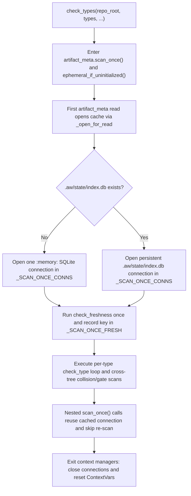

# IPD: Wrap check_engine.check_types in artifact_meta.scan_once and ephemeral_if_uninitialized

- Date: 2026-11-19
- Kind: child
- Concern: Wrap `agent_workflows/check_engine.py::check_types` in an outer `artifact_meta.scan_once()` and `artifact_meta.ephemeral_if_uninitialized()` context so sequential per-type and cross-tree checks share one metadata cache connection and one freshness scan.
- Scope: Wrap the execution body of `agent_workflows/check_engine.py::check_types` in `with _meta.scan_once(), _meta.ephemeral_if_uninitialized():` using a lazy `from agent_workflows import artifact_meta as _meta` import, and add behavioral outcome tests in `tests/test_check_engine_scan_once.py` covering uninitialized cache reuse, initialized cache reuse, consecutive-call freshness, nested `scan_once` compatibility, Drift output parity, and `cli.main` execution. EXCLUDES changing `artifact_meta.scan_once`, `artifact_meta.ephemeral_if_uninitialized`, `check_engine.check_type` direct callers (`doctor.py`, `work_cmd.py`), and `check_engine.check_release_gates` direct callers (`aw check release-gates`).
- Scope-Paths: agent_workflows/check_engine.py, tests/test_check_engine_scan_once.py, .aw/records/plans/pending/20261119-2i04so-01-28k5h5-wrap-check-engine-check-types-in-artifact-meta-scan-once-and.ipd.md
- Item-Dependencies: none
- Status: to-review
- Short-Description: Wrap check_engine.check_types in artifact_meta.scan_once and ephemeral_if_uninitialized so per-type and cross-tree checks share one cache scan
- Work-Kind: bug
- Priority: high
- From-Backlog: 2i04so
- Blocks-Release: next
- Set: 2i04so
- Order: 1
- Highest E allocated: 03
- Author: antigravity/gemini
- Id: 28k5h5

> Write and proofread this plan per the technical writing standard, `.aw/system/workflows/technical-writing/technical-writing.md` (`.agents/workflows/technical-writing/technical-writing.md` in a legacy-layout install), including requirement 12 (diagrams).

## Workflow history

- 2026-11-19 to-review (aw set): ready for review: authored for backlog 2i04so
- 2026-11-19 draft (antigravity/gemini): created.

## Goal

Eliminate repeated full-corpus SQLite metadata cache rebuilds and redundant freshness scans during `agent_workflows/check_engine.py::check_types` runs. When `.aw/state/index.db` is absent, such as in a fresh worktree or after deleting the cache, wrapping `check_types` in `artifact_meta.scan_once()` and `artifact_meta.ephemeral_if_uninitialized()` builds and scans the in-memory SQLite database at most once per `(records_root, state_root)` pair instead of rebuilding it on every inner helper call.

## Detailed Implementation Checklist (TODO)

Execution-state rule: mark an `E-*` item complete only after performing the action. That mark is not validation. Right-sizing rule: write for a modest executor that cannot hold much in its head. Each E-item is one step (one concern, about one file, executable in one focused pass) and its V-item names each unit it covers with its own check; a plan stays at about 5 E-items and 8 work Scope-Paths, else split it into more child plans (guidance, `IPD-Z603`). Accepted execution states: blocked, failed, pending, performed; terminal gate demands 'performed'.

### Task group 1: Outer scan scope in check_types and behavioral tests

- [ ] E-01 Update `agent_workflows/check_engine.py::check_types` to import `artifact_meta` lazily as `_meta` and wrap the per-type `check_type` loop and all cross-tree checks (both the `if not collisions:` branch and the `if collisions:` branch) in `with _meta.scan_once(), _meta.ephemeral_if_uninitialized():`. Preserve the function signature, target normalization (`types == ["all"]`), `check.collisions-not-checked` `info` emission, per-scan `try`/`except Exception: pass` isolation blocks, and returned `List[_core.Drift]`.
  - Depends on: none
  - Expected outcome: Any call to `check_engine.check_types` shares one `artifact_meta` connection and at most one `artifact_meta.check_freshness` scan per `(records_root, state_root)` key, and never creates `.aw/state/index.db` on disk when the database is absent.
  - Execution state: pending

- [ ] E-02 Add behavioral outcome tests in `tests/test_check_engine_scan_once.py` (with `pytestmark = pytest.mark.core`, exercising real functions and `cli.main` on `tmp_path` repositories without source-inspecting assertions) covering: (1) uninitialized repository (`.aw/state/index.db` absent): `check_types(repo, ["all"])` leaves `.aw/state/index.db` absent on disk, invokes `artifact_meta.open_cache` at most once (with `in_memory=True`) and `artifact_meta.check_freshness` at most once (measured via `unittest.mock.patch(..., wraps=...)`), and matches the `Drift` set returned for an initialized repository; (2) initialized repository (`.aw/state/index.db` present): `check_types(repo, ["all"])` invokes `artifact_meta.open_cache` at most once (with `in_memory=False`) and `artifact_meta.check_freshness` at most once; (3) consecutive calls after scope exit: adding a new defect record between two `check_types(repo, ["all"])` calls on an uninitialized repository surfaces the new finding on the second call; (4) nested scope safety: calling `check_types(repo, ["plans"])` inside an outer `with artifact_meta.scan_once(), artifact_meta.ephemeral_if_uninitialized():` block completes without prematurely closing the outer connection; and (5) real command-line interface (CLI) invocation via `cli.main(["check", "all", "--agent", "--dir", str(repo)])` on an uninitialized repository emits valid `aw.agent/v1` output without creating `.aw/state/index.db`.
  - Depends on: E-01
  - Expected outcome: All tests in `tests/test_check_engine_scan_once.py` pass and fail if the outer `scan_once()` or `ephemeral_if_uninitialized()` context in `check_types` is removed.
  - Execution state: pending

- [ ] E-03 Run the targeted test modules (`python3 -m pytest -v tests/test_check_engine_scan_once.py tests/test_check_engine.py tests/test_readers_check_engine.py`), the routine core suite (`python3 -m pytest`), static type check (`python3 -m mypy agent_workflows`), repository check (`aw check all --agent`), and leak scan (`aw sanitize --agent`).
  - Depends on: E-02
  - Expected outcome: All targeted tests, core suite tests, `mypy`, and `aw sanitize --agent` pass with zero failures, and `aw check all --agent` reports no regressions caused by this change.
  - Execution state: pending

Add further leaves as `- [ ] E-NEW <action>` and run `aw ipd sync` to assign ids.

## Project conventions discovered (Step 0)

- `agent_workflows/check_engine.py` imports `artifact_meta` lazily inside functions (`from agent_workflows import artifact_meta as _meta`) rather than at module import time; `check_types` must follow that convention to avoid introducing import cycles.
- `agent_workflows/artifact_meta.py::scan_once` stores a `set` of scanned `(resolved_records_root, resolved_state_root)` keys in `_SCAN_ONCE_FRESH` and a `dict` of open connections in `_SCAN_ONCE_CONNS` via `ContextVar`s; nested `scan_once()` calls detect an existing non-`None` `_SCAN_ONCE_FRESH` and yield without resetting or closing the outer scope.
- `agent_workflows/artifact_meta.py::ephemeral_if_uninitialized` sets `_EPHEMERAL_IF_ABSENT` via a `ContextVar` token and resets that token on exit; `_open_for_read` opens an in-memory SQLite database (`open_cache(..., in_memory=True)`) only when `(state_root / "index.db").exists()` is `False`, so initialized repositories continue using their persistent `.aw/state/index.db`.
- Existing callers in `agent_workflows/cli.py::_run_find` (`with _meta.scan_once(), _meta.ephemeral_if_uninitialized(), sel_mod.scan_once():`), `agent_workflows/status_set.py`, and inner `check_engine.py` helpers (`_meta_records_with_fields`, `_meta_state_for_path`, `_meta_state_map`) already combine `scan_once()` and `ephemeral_if_uninitialized()`.
- Core test modules set `pytestmark = pytest.mark.core`, test observable outcomes only (no source inspection via `inspect`, `ast`, regex, or line counting), and run under the bare `python3 -m pytest` gate.

## Findings

| Finding | Evidence | Impact on this plan |
| --- | --- | --- |
| `check_types` lacks an outer `artifact_meta.scan_once()` and `ephemeral_if_uninitialized()` block | `agent_workflows/check_engine.py::check_types` enters `check_type` and cross-tree checks directly while inner helpers (`_meta_records_with_fields`, `_meta_state_map`, `_meta_state_for_path`, `build_dependency_index`, `check_graduation_incomplete`, `check_release_gate_consistency`, `check_live_bug_gate`, `check_review_dangling`, `check_decision_ref_dangling`, `check_gate_ref_dangling`, `check_gate_ref_discharged`) each open and close their own `scan_once()` scope | Wrap the body of `check_types` in `with _meta.scan_once(), _meta.ephemeral_if_uninitialized():` so every inner `scan_once()` becomes a nested no-op sharing one connection and one freshness scan |
| History helpers read `artifact_meta.history` without an inner `ephemeral_if_uninitialized()` guard | `agent_workflows/check_engine.py::_item_close_date`, `_item_graduated_date`, and `_spec_implementing_date` call `_meta.history(..., project_context=ctx)` directly | Inheriting the outer `ephemeral_if_uninitialized()` and `scan_once()` context from `check_types` keeps those history queries on the shared in-memory connection when `.aw/state/index.db` is absent |
| `check_types` performs read-only analysis | `check_engine.py::check_types` and its composed `check_*` helpers only read records and emit `List[_core.Drift]` | Holding one `scan_once()` snapshot for the duration of a single `check_types` call cannot observe stale mid-call mutations from `check_types` itself, and closing on exit ensures subsequent calls re-scan |

## Proposed changes (ordered, validatable)

1. **Wrap `check_types` (E-01)**: In `agent_workflows/check_engine.py::check_types`, import `artifact_meta as _meta` lazily and wrap the target resolution, `check_type` fan-out loop, `if not collisions:` branch, and `if collisions:` cross-tree scan block in `with _meta.scan_once(), _meta.ephemeral_if_uninitialized():`.
2. **Add behavioral outcome tests (E-02)**: Create `tests/test_check_engine_scan_once.py` testing uninitialized cache single-build behavior, persistent cache single-scan reuse, consecutive-call freshness after scope exit, nested `scan_once()` safety, `Drift` parity, and `cli.main` CLI behavior.
3. **Validate suite, type check, and hygiene (E-03)**: Run targeted pytest modules, bare `python3 -m pytest`, `python3 -m mypy agent_workflows`, `aw check all --agent`, and `aw sanitize --agent`.

## Deferred / out of scope (with reason)

- Wrapping standalone `agent_workflows/check_engine.py::check_type` callers outside `check_types` (`agent_workflows/doctor.py`, `agent_workflows/work_cmd.py`): callers invoking `check_type` directly are outside the `check_types` entry point scoped by backlog item `2i04so`.
  - Carrier-Declined: Separate callers outside the `check_types` entry point named in backlog item `2i04so`.
- Wrapping standalone `agent_workflows/check_engine.py::check_release_gates` when invoked directly via `aw check release-gates` (`agent_workflows/cli.py`): `check_release_gates` already inherits the outer scope when called inside `check_types(repo, ["all"])`, and wrapping its standalone CLI entry point is outside `2i04so`.
  - Carrier-Declined: Separate entry point outside `check_types`; `check_release_gates` already inherits the outer scope during `check_types(..., ["all"])`.
- Adding `selectors.scan_once()` around `check_types`: backlog item `2i04so` targets the SQLite metadata cache rebuild in `artifact_meta.scan_once()` and `artifact_meta.ephemeral_if_uninitialized()`.
  - Carrier-Declined: Separate optimization surface (`selectors.resolve` file reads) not requested by `2i04so`.

## Scope check

- Over-scope: none. Only `agent_workflows/check_engine.py`, the new behavioral test file `tests/test_check_engine_scan_once.py`, and this implementation plan document (IPD) are modified.
- Under-scope: none. Wrapping `check_types` covers all per-type and cross-tree checks reached via `check_engine.check_types` (including `aw check all` and `aw check <type>`).

## Required tests / validation

- Targeted tests: `python3 -m pytest -v tests/test_check_engine_scan_once.py tests/test_check_engine.py tests/test_readers_check_engine.py`
- Routine core suite: `python3 -m pytest`
- Static type check: `python3 -m mypy agent_workflows`
- Self-check and leak scan: `aw check all --agent` and `aw sanitize --agent`

## Spec / documentation sync

N/A: this bugfix adds an internal performance and cache-reuse context manager inside `agent_workflows/check_engine.py::check_types` without changing any CLI flags, output schemas, or specification contracts.

## Open questions

### OQ-01: Should `check_types` wrap only `artifact_meta.scan_once()` and `artifact_meta.ephemeral_if_uninitialized()`, or also wrap `selectors.scan_once()`?

- Blocking: no
- Status: resolved
- Owner: none
- Resolution or deferral rationale: Keep the change strictly scoped to `artifact_meta.scan_once()` and `artifact_meta.ephemeral_if_uninitialized()` as specified by backlog item `2i04so`, so `selectors` caching semantics remain unchanged.

## Validation and cross-check (verify before reporting done)

Validation-state rule: inspect evidence in a separate pass. Do not mark a `V-*` item complete from memory or from the matching execution checkmark. Accepted validation results: blocked, failed, pass, pending; terminal gate demands 'pass'. Runtime-demonstration reachability rule: for each `V-*` item demanding the software be observed acting (such as a run, a dispatch, or a transition)—as distinct from items demanding a diff, a file's content, or a test result, which are reachable by construction—name the code path that produces the observation or the sibling `E-*` that creates it, else the demand is UNDER-SCOPE.

- [ ] V-01 validates E-01
  - Required evidence: paste the unified `git diff agent_workflows/check_engine.py` showing `check_types` wrapped in `with _meta.scan_once(), _meta.ephemeral_if_uninitialized():` and preserving existing branches and error isolation.
  - Observed evidence:
  - Result: pending

- [ ] V-02 validates E-02
  - Required evidence: paste the `python3 -m pytest -v tests/test_check_engine_scan_once.py` output showing all PASSED test node IDs covering uninitialized cache single-build (`in_memory=True`), initialized cache reuse (`in_memory=False`), consecutive-call freshness, nested `scan_once()` safety, `Drift` output parity, and `cli.main` execution leaving `.aw/state/index.db` absent.
  - Observed evidence:
  - Result: pending

- [ ] V-03 validates E-03
  - Required evidence: paste the pass summaries and exit codes from `python3 -m pytest -v tests/test_check_engine_scan_once.py tests/test_check_engine.py tests/test_readers_check_engine.py`, `python3 -m pytest`, `python3 -m mypy agent_workflows`, `aw check all --agent`, and `aw sanitize --agent`.
  - Observed evidence:
  - Result: pending

## Approval and execution gate

- Size assessment: standard
- Cohesion rationale: not required

Execution proceeds only after `aw ipd set approved 28k5h5 --by-human` (or runner dispatch on an approved plan). Commit only the files named in `- Scope-Paths:` using `aw commit 28k5h5 -- <paths>`, never `git add -A`, bare `git add`, or `git commit -a`, and never push without explicit human instruction. After `V-01` through `V-03` reach `pass`, finalize the plan lifecycle to `executed/` through `aw ipd finalize 28k5h5` (or `aw ipd set executed 28k5h5 --actor ...`).
