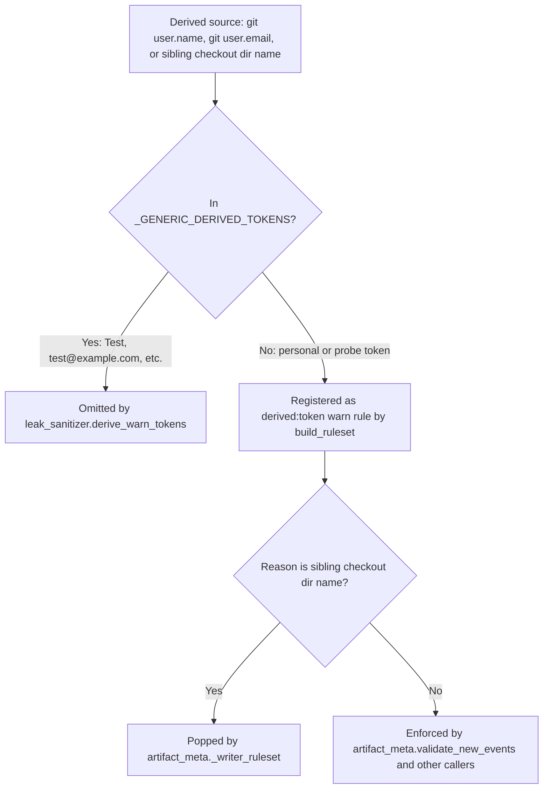

# IPD: Hoist generic test git identity tokens into leak_sanitizer

- Date: 2026-11-19
- Kind: child
- Concern: `agent_workflows/leak_sanitizer.py::derive_warn_tokens` currently derives synthetic test git identities such as `Test` (`tests/support.py::init_repo`), `Test User`, `Tester`, `Test Runner`, `Test Agent`, `Test Committer`, and `test@example.com` as personal `derived:` warn tokens because `agent_workflows/leak_sanitizer.py::_GENERIC_DERIVED_TOKENS` omits them. IPD `b3l7y6` added a local workaround (`_GENERIC_FIXTURE_GIT_TOKENS`) inside `agent_workflows/artifact_meta.py::_writer_ruleset` to unblock `artifact_meta.validate_new_events` in tests such as `tests/test_generators_writing_standard_pointer.py::test_specs_new_writing_standard_pointer`. However, `derive_warn_tokens` and other `build_ruleset(..., include_warn=True)` callers (`artifact_adopt.scan_drop_for_leaks`, `install_history._redact_details`, `migrations/m0001_verify`) remain exposed to the same collision.
- Scope: Move the generic test-fixture git identity tokens into `agent_workflows/leak_sanitizer.py::_GENERIC_DERIVED_TOKENS`, remove `_GENERIC_FIXTURE_GIT_TOKENS` and its git-identity filter branch from `agent_workflows/artifact_meta.py::_writer_ruleset`, and add behavioral regression and non-vacuous control tests in `tests/test_local_leaks.py` and `tests/test_artifact_meta_write.py`. EXCLUDES modifying `tests/support.py::init_repo` or inline `git config user.name` / `user.email` fixtures across existing test files, and excludes altering the unconditional `reason == "sibling checkout dir name"` filter in `agent_workflows/artifact_meta.py::_writer_ruleset`.
- Scope-Paths: agent_workflows/leak_sanitizer.py, agent_workflows/artifact_meta.py, tests/test_local_leaks.py, tests/test_artifact_meta_write.py
- Item-Dependencies: none
- Status: reviewed
- Readiness: go-pending-approval
- Review-Depth: standard
- Short-Description: Hoist synthetic test git identity tokens from artifact_meta._writer_ruleset into leak_sanitizer._GENERIC_DERIVED_TOKENS
- Work-Kind: bug
- Priority: medium
- From-Backlog: 5uqo2g
- Blocks-Release: next
- Set: 5uqo2g
- Order: 1
- Highest E allocated: 04
- Author: Gemini 4 Hydrogen
- Id: rowsi5

> Write and proofread this plan per the technical writing standard, `.aw/system/workflows/technical-writing/technical-writing.md` (`.agents/workflows/technical-writing/technical-writing.md` in a legacy-layout install), including requirement 12 (diagrams).

## Workflow history

- 2026-11-21 reviewed (aw set): APPROVE WITH REVISIONS APPLIED; PR-001..PR-004 (review record: .aw/records/reviews/20261121-5uqo2g-01-rowsi5-hoist-generic-test-git-identity-tokens-into-leak-sanitizer.review.md)
- 2026-11-21 /plan-review (antigravity/gemini-4-neon-high): APPROVE WITH REVISIONS APPLIED; PR-001..PR-004 (review record: .aw/records/reviews/20261121-5uqo2g-01-rowsi5-hoist-generic-test-git-identity-tokens-into-leak-sanitizer.review.md)
- 2026-11-19 to-review (aw set): authored plan for backlog 5uqo2g
- 2026-11-19 draft (Gemini 4 Hydrogen): created from backlog `5uqo2g`.

## Goal

Eliminate false-positive `derived:` leak findings on generic test git identities at the single source of truth in `agent_workflows/leak_sanitizer.py::derive_warn_tokens` (`_GENERIC_DERIVED_TOKENS`), and remove the duplicated `_GENERIC_FIXTURE_GIT_TOKENS` workaround from `agent_workflows/artifact_meta.py::_writer_ruleset`.

## Detailed Implementation Checklist (TODO)

Execution-state rule: mark an `E-*` item complete only after performing the action. That mark is not validation. Right-sizing rule: write for a modest executor that cannot hold much in its head. Each E-item is one step (one concern, about one file, executable in one focused pass) and its V-item names each unit it covers with its own check; a plan stays at about 5 E-items and 8 work Scope-Paths, else split it into more child plans (guidance, `IPD-Z603`). Accepted execution states: blocked, failed, pending, performed; terminal gate demands 'performed'.

### Task group 1: Hoist generic test tokens and remove writer workaround

- [ ] E-01 Update `agent_workflows/leak_sanitizer.py::_GENERIC_DERIVED_TOKENS` to include lowercase synthetic test-fixture git identity tokens (`"test"`, `"tester"`, `"test user"`, `"test runner"`, `"test agent"`, `"test committer"`, `"test author"`, `"test@example.com"`, `"test@example.invalid"`, `"tester@example.com"`, `"tester@example.invalid"`, `"test@test.com"`, `"test@test.local"`, `"tests@example.com"`, `"test-agent@example.com"`, `"committer@example.com"`, `"runner@example.com"`, `"runner@example.invalid"`), and update the comment above `_GENERIC_DERIVED_TOKENS` to explain that it covers both generic machine/CI identifiers and generic test-fixture identities.
  - Depends on: none
  - Expected outcome: `agent_workflows/leak_sanitizer.py::derive_warn_tokens` omits all listed generic test identity tokens regardless of case while continuing to derive non-generic `user.name` and `user.email` values, and `tests/test_leak_sanitizer.py::SelfCleanTests::test_engine_source_is_self_clean` passes without self-leak findings.
  - Execution state: pending

- [ ] E-02 In `agent_workflows/artifact_meta.py`, delete `_GENERIC_FIXTURE_GIT_TOKENS`, remove the `elif reason in ("git user.name", "git user.email") and tok.lower() in _GENERIC_FIXTURE_GIT_TOKENS:` branch inside `_writer_ruleset`, keep the unconditional `if reason == "sibling checkout dir name":` filter unchanged (do NOT re-introduce an `in_lane` guard), and update the `_writer_ruleset` docstring to remove the synthetic test-fixture git identity clause while retaining the sibling checkout directory rationale (covering both `.aw/worktrees/` lanes and normal workspaces).
  - Depends on: E-01
  - Expected outcome: `agent_workflows/artifact_meta.py` contains no `_GENERIC_FIXTURE_GIT_TOKENS` symbol and no git-identity exemption inside `_writer_ruleset`, while `_writer_ruleset` continues removing `sibling checkout dir name` tokens unconditionally and relies on `leak_sanitizer.build_ruleset` (`derive_warn_tokens`) to skip generic test git identities.
  - Execution state: pending

### Task group 2: Behavioral regression and control tests

- [ ] E-03 In `tests/test_local_leaks.py::AutoDeriveTests`, add a behavioral test method that configures throwaway git repositories with generic test git identities (`user.name="Test"` with `user.email="test@example.com"`, `user.name="Tester"`, `user.name="Test User"`, and `user.email="TEST@EXAMPLE.INVALID"` to exercise case-insensitive folding), commits files containing that case's own configured `user.name` and `user.email` tokens in each repository, and asserts that `derive_warn_tokens` omits those tokens and `ll.run(repo, include_warn=True)` produces no `derived:` warn or fail findings for them. Pair those cases in the same test with a control repository configured with a non-generic synthetic git identity (such as `user.name="ci-derive-git-probe"`), committing a file containing that token and asserting that `derive_warn_tokens` returns it and `ll.run(repo, include_warn=True)` emits a `warn` finding (`fail` findings empty).
  - Depends on: E-01
  - Expected outcome: `tests/test_local_leaks.py::AutoDeriveTests` verifies both case-insensitive suppression of generic test git identities across committed content and continued warn-only derivation of non-generic git identities (preventing vacuous pass).
  - Execution state: pending

- [ ] E-04 In `tests/test_artifact_meta_write.py`, add a behavioral test that initializes a throwaway git repository via `tests.support.init_repo` (`user.name="Test"`, `user.email="test@example.com"`) with `records_root = repo / ".aw" / "records"` (anchoring `_writer_ruleset` to that fixture repository's local `git config`) and verifies `artifact_meta.validate_new_events` and `artifact_meta.create` succeed when `fields["title"]` and event `message` contain `"Test"` and `"test@example.com"`, paired in the same test with a control repository configured with a non-generic synthetic `git config user.name` (such as `"ci-writer-probe-user"`) asserting `artifact_meta.validate_new_events` raises `ValueError` matching `"leak sanitizer refusal"` when that derived token appears in `fields["title"]` or `message`.
  - Depends on: E-01, E-02
  - Expected outcome: `tests/test_artifact_meta_write.py` proves `artifact_meta` writer validation allows `init_repo` test identities through the hoisted `leak_sanitizer` filter while still refusing non-generic derived git identities.
  - Execution state: pending

## Project conventions discovered (Step 0)

- Core-tier test modules set `pytestmark = pytest.mark.core` (`tests/test_local_leaks.py`, `tests/test_artifact_meta_write.py`, `tests/test_generators_writing_standard_pointer.py`); `tests/test_leak_sanitizer.py` carries `pytestmark = pytest.mark.slow`.
- Test suite execution rules (`GEMINI.md`): run bare `python3 -m pytest` (or `python3 -m pytest <paths>` for targeted runs); do not pass `-n0`, extra `-q`, or `-p no:randomly`.
- Behavioral test rule (`AGENTS.md`): tests must drive real functions and CLI entry points in temporary repositories and assert on observable outputs, return values, and exceptions, never reading production source with `ast`, `inspect`, regex, or substring matching.
- Leak-detector control rule (`tests/test_local_leaks.py`, `tests/test_leak_sanitizer.py`): every assertion that a generic token is NOT flagged must be paired in the same test with a control case whose non-generic token IS derived and reported, so a disabled detector cannot pass vacuously.
- Cite code by symbol (`module.function` or `path::Symbol`) or quoted string rather than bare line numbers (`IPD-C801`).

## Findings

| Id | Source inspected | Finding |
|---|---|---|
| F-01 | `tests/support.py::init_repo` | Sets `git config --local user.email "test@example.com"` and `git config --local user.name "Test"` for deterministic fixture commits. |
| F-02 | `tests/` scan of `git config user.name` and `user.email` | More than 30 test modules also configure synthetic git identities inline, including `"Test"`, `"Tester"`, `"Test User"`, `"Test Runner"`, `"Test Agent"`, `"Test Committer"`, `"Test Author"`, `"test@example.com"`, `"test@example.invalid"`, `"tester@example.com"`, `"tester@example.invalid"`, `"test@test.com"`, `"test@test.local"`, `"tests@example.com"`, `"test-agent@example.com"`, `"committer@example.com"`, `"runner@example.com"`, and `"runner@example.invalid"`. |
| F-03 | `agent_workflows/leak_sanitizer.py::_GENERIC_DERIVED_TOKENS`, `derive_warn_tokens` | `derive_warn_tokens` skips values `< 3` characters or matching `_GENERIC_DERIVED_TOKENS` (case-folded via `val.lower()`). `_GENERIC_DERIVED_TOKENS` currently contains only machine/CI tokens (`agent-workflows`, `runner`, `runneradmin`, `root`, `ubuntu`, `circleci`, `builder`, `user`). |
| F-04 | `agent_workflows/artifact_meta.py::_GENERIC_FIXTURE_GIT_TOKENS`, `_writer_ruleset` | `_writer_ruleset` unconditionally pops `reason == "sibling checkout dir name"` (for both `.aw/worktrees/` lanes and normal workspaces) and manually pops `derived:<tok>` for `_GENERIC_FIXTURE_GIT_TOKENS` when `reason in ("git user.name", "git user.email")`. Other `build_ruleset(..., include_warn=True)` callers (`artifact_adopt.scan_drop_for_leaks`, `install_history._redact_details`, `migrations/m0001_verify.py`, `leak_sanitizer.run(..., include_warn=True)`) do not use `_writer_ruleset` and still receive `derived:Test`. |
| F-05 | `agent_workflows/leak_sanitizer.py::_FAIL_PATTERNS`, `tests/test_leak_sanitizer.py::SelfCleanTests` | None of the hoisted generic test tokens match `_FAIL_PATTERNS` (`_ACCT` uses underscores as `"test_" + "user_1"`), so adding the lowercase literals to `_GENERIC_DERIVED_TOKENS` keeps `SelfCleanTests::test_engine_source_is_self_clean` clean. |

## Behavior decisions

- **Hoist into `leak_sanitizer._GENERIC_DERIVED_TOKENS` rather than editing `tests/support.py::init_repo`.** Adjusting `init_repo` alone would leave 30+ test files that set `Test`, `Tester`, `Test User`, `Test Runner`, `Test Agent`, `Test Committer`, or `test@example.com` inline still colliding, and could alter git log fixtures expected by existing tests. Filtering generic test tokens inside `leak_sanitizer._GENERIC_DERIVED_TOKENS` fixes `derive_warn_tokens` once for `artifact_meta._writer_ruleset`, `artifact_adopt`, `install_history`, `m0001_verify`, and `aw sanitize --warn`.
- **Keep the unconditional `sibling checkout dir name` filter in `artifact_meta._writer_ruleset`.** Per spec 4.2 and `_writer_ruleset`'s docstring, sibling directory names are not among the writer-refused leak classes (whether inside `.aw/worktrees/` lanes or in a normal workspace where a sibling repo such as `../uri` would refuse `uri/its_direct/...`, `during`, or `security`), while remaining advisory-only in `leak_sanitizer.derive_warn_tokens` for `aw check-local-leaks`.

## Proposed changes (ordered, validatable)

1. Add generic test-fixture git identity tokens to `agent_workflows/leak_sanitizer.py::_GENERIC_DERIVED_TOKENS` and update its leading comment (E-01).
2. Remove `_GENERIC_FIXTURE_GIT_TOKENS` and the git-identity pop branch from `agent_workflows/artifact_meta.py::_writer_ruleset`, keeping the unconditional `if reason == "sibling checkout dir name":` filter and its docstring rationale unchanged (E-02).
3. Add paired generic-exemption and non-generic-control tests for `derive_warn_tokens` and `local_leaks.run` in `tests/test_local_leaks.py::AutoDeriveTests` (E-03).
4. Add paired `init_repo` pass and non-generic-identity refusal tests for `artifact_meta.validate_new_events` and `artifact_meta.create` in `tests/test_artifact_meta_write.py` (E-04).

## Deferred / out of scope (with reason)

- Changing `tests/support.py::init_repo` or inline `git config user.name` / `user.email` fixtures across existing tests.
  - Carrier-Declined: Filtering generic test identity tokens in `leak_sanitizer._GENERIC_DERIVED_TOKENS` resolves the collision across all test fixtures and `build_ruleset(..., include_warn=True)` callers without altering deterministic git author history in existing test suites.

## Scope check

- Over-scope: none.
- Under-scope: none. Every modified production and test file (`agent_workflows/leak_sanitizer.py`, `agent_workflows/artifact_meta.py`, `tests/test_local_leaks.py`, `tests/test_artifact_meta_write.py`) is listed in `- Scope-Paths:`.

## Required tests / validation

- Core targeted run covering modified and directly exercised modules:
  `python3 -m pytest tests/test_local_leaks.py tests/test_artifact_meta_write.py tests/test_generators_writing_standard_pointer.py tests/test_core_module_coverage.py`
- Slow leak-sanitizer self-clean and tier checks:
  `python3 -m pytest tests/test_leak_sanitizer.py -k "SelfCleanTests or RuleTierTests"`
- Full core test suite (`python3 -m pytest`) before finalizing.

## Spec / documentation sync

N/A with reason: Internal bug fix aligning `leak_sanitizer._GENERIC_DERIVED_TOKENS` and `artifact_meta._writer_ruleset` without changing user-facing CLI flags, record schemas, or documented behavior.

## Open questions

None open. Repository evidence (`tests/support.py::init_repo`, `agent_workflows/leak_sanitizer.py`, `agent_workflows/artifact_meta.py`, and existing test git-identity fixtures) resolves the design choice between `leak_sanitizer._GENERIC_DERIVED_TOKENS` and `tests/support.py::init_repo`.

## Validation and cross-check (verify before reporting done)

Validation-state rule: inspect evidence in a separate pass. Do not mark a `V-*` item complete from memory or from the matching execution checkmark. Accepted validation results: blocked, failed, pass, pending; terminal gate demands 'pass'. Runtime-demonstration reachability rule: for each `V-*` item demanding the software be observed acting (such as a run, a dispatch, or a transition)—as distinct from items demanding a diff, a file's content, or a test result, which are reachable by construction—name the code path that produces the observation or the sibling `E-*` that creates it, else the demand is UNDER-SCOPE.

- [ ] V-01 validates E-01
  - Required evidence: paste `git diff agent_workflows/leak_sanitizer.py` showing the added tokens and comment in `_GENERIC_DERIVED_TOKENS`, and paste the `python3 -m pytest tests/test_leak_sanitizer.py -k "SelfCleanTests"` output showing `test_engine_source_is_self_clean` and `test_this_repo_tree_clean` passed.
  - Observed evidence:
  - Result: pending
- [ ] V-02 validates E-02
  - Required evidence: paste `git diff agent_workflows/artifact_meta.py` showing `_GENERIC_FIXTURE_GIT_TOKENS` and its git-identity filter branch removed while the unconditional `if reason == "sibling checkout dir name":` filter remains unchanged, paste `rg -n "_GENERIC_FIXTURE_GIT_TOKENS" agent_workflows/ tests/` returning zero matches (exit 1), and paste `python3 -m pytest tests/test_generators_writing_standard_pointer.py` output showing `test_specs_new_writing_standard_pointer` passed.
  - Observed evidence:
  - Result: pending
- [ ] V-03 validates E-03
  - Required evidence: paste `python3 -m pytest tests/test_local_leaks.py` output showing all tests including the new `AutoDeriveTests` generic-git-identity and non-generic control test passed with zero skips.
  - Observed evidence:
  - Result: pending
- [ ] V-04 validates E-04
  - Required evidence: paste `python3 -m pytest tests/test_artifact_meta_write.py` output showing all tests including the new `init_repo` pass and non-generic control refusal test passed, plus the full `python3 -m pytest` summary after the final edit.
  - Observed evidence:
  - Result: pending

## Approval and execution gate

- Size assessment: standard
- Cohesion rationale: not required

Preconditions: execute only after human approval (`Status: approved`) and with all blocking open questions resolved (zero open questions remain).

Scope fence: `Scope-Paths` declares the expected file set (`agent_workflows/leak_sanitizer.py`, `agent_workflows/artifact_meta.py`, `tests/test_local_leaks.py`, `tests/test_artifact_meta_write.py`); do not expand scope casually. If execution genuinely requires editing a file outside `Scope-Paths`, make the edit and justify it in two-way scope reconciliation at finalize (`--scope-reason`), and acknowledge any declared path left unmodified (`--scope-ack`). Only stop for genuinely unsafe conditions (for example an unresolvable conflict with a co-worker's concurrent edits).

Honesty rule: paste the ACTUAL output of each command; never claim test or check results you did not run after your final edit.

Commits and lifecycle: commit only the paths you changed for this plan using `aw commit rowsi5 -- <paths>`; never `git add -A`, bare `git add`, or `git commit -a`, and never push without explicit human instruction. Never hand-roll a `git mv` of this plan into `.aw/records/plans/executed/`. Lifecycle transition is mandatory on completion with conditional ownership: when running inside a managed runner lane (`AW_EXECUTION_ROLE=worker`), leave `aw ipd finalize` to the runner after verification and integration; when executing standalone outside a managed lane, after `V-01` through `V-04` reach `pass`, finalize with `aw ipd finalize rowsi5 --actor <agent/model> --message "
" --apply` so the tool moves the plan to `executed/` and refreshes the plans index cleanly.
