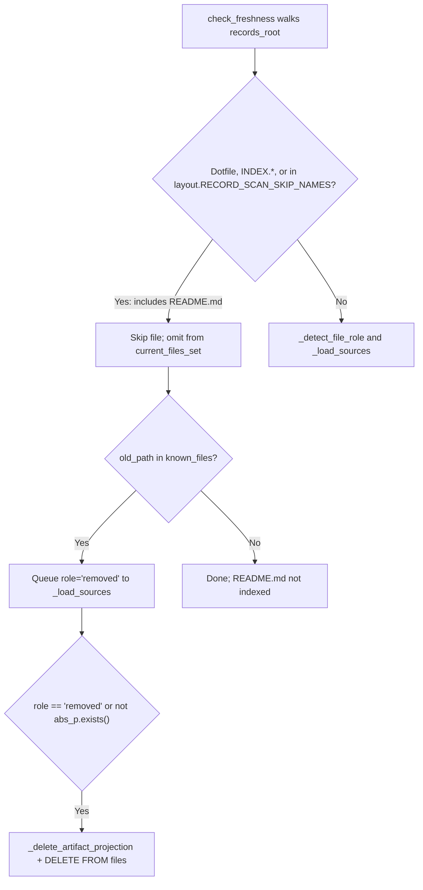

# IPD: Skip README.md in artifact_meta.check_freshness records_root walk

- Date: 2026-11-19
- Kind: child
- Concern: Align the `records_root` walk in `agent_workflows/artifact_meta.py::check_freshness` with the `extra_root_dirs` walk and `agent_workflows/layout.py::RECORD_SCAN_SKIP_NAMES` so `README.md` files under `.aw/records/` are skipped instead of being indexed as id-less artifacts with derived `id6` values and `status=None`.
- Scope: Import `agent_workflows/layout.py` in `agent_workflows/artifact_meta.py`; update `artifact_meta.check_freshness` so its `records_root` `os.walk` filter skips `layout.RECORD_SCAN_SKIP_NAMES` (`README.md`, `INDEX.md`, `STATUS.md`) alongside dotfiles and `INDEX.*`; update `artifact_meta._load_sources` so the removal branch handles `role == "removed"` even when the skipped file remains on disk (`abs_p.exists()` is `True`), ensuring pre-existing cached `README.md` rows in `files` and `artifacts` are evicted cleanly; add behavioral tests in `tests/test_artifact_meta_cache.py` and `tests/test_m0001_any_repo.py`; and record one `CHANGELOG.md` entry. EXCLUDES: modifying `artifact_core.iter_scan_files` citation scans (which intentionally scan `README.md`), modifying `m0001` migration conversion or layout movement rules, and changing non-`README.md` exclusions such as `notes/scratch.md` in the `idless_prose` fixture or research companion files.
- Scope-Paths: agent_workflows/artifact_meta.py, tests/test_artifact_meta_cache.py, tests/test_m0001_any_repo.py, CHANGELOG.md, .aw/records/plans/pending/20261119-63v9ph-01-4q1rri-skip-readme-md-in-artifact-meta-check-freshness-records-root.ipd.md
- Item-Dependencies: none
- Status: to-review
- Short-Description: Skip README.md in artifact_meta.check_freshness records_root walk so README files are not indexed as id-less artifacts
- Work-Kind: bug
- Priority: medium
- From-Backlog: 63v9ph
- Blocks-Release: next
- Set: 63v9ph
- Order: 1
- Highest E allocated: 04
- Author: antigravity/gemini
- Id: 4q1rri

> Write and proofread this plan per the technical writing standard, `.aw/system/workflows/technical-writing/technical-writing.md` (`.agents/workflows/technical-writing/technical-writing.md` in a legacy-layout install), including requirement 12 (diagrams).

## Workflow history

- 2026-11-19 to-review (aw set): Authored review-ready plan graduated from backlog 63v9ph
- 2026-11-19 draft (antigravity/gemini): created.

## Goal

Prevent `artifact_meta.check_freshness` from indexing `README.md` files inside `records_root` (including `.aw/records/plans/README.md` migrated from `.agents/plans/README.md` by `m0001`) as id-less artifacts with derived `id6` values and `status=None`, and evict any previously cached `README.md` rows from `.aw/state/index.db`.

## Detailed Implementation Checklist (TODO)

Execution-state rule: mark an `E-*` item complete only after performing the action. That mark is not validation. Right-sizing rule: write for a modest executor that cannot hold much in its head. Each E-item is one step (one concern, about one file, executable in one focused pass) and its V-item names each unit it covers with its own check; a plan stays at about 5 E-items and 8 work Scope-Paths, else split it into more child plans (guidance, `IPD-Z603`). Accepted execution states: blocked, failed, pending, performed; terminal gate demands 'performed'.

### Task group 1: Update check_freshness skip filter, cache eviction, tests, and gates

- [ ] E-01 Before editing any tracked file, save `aw check --agent > .aw/state/4q1rri/check-before.jsonl` (`mkdir -p .aw/state/4q1rri`). In `agent_workflows/artifact_meta.py`, import `layout as _layout` from `agent_workflows`, update the `records_root` `os.walk` file filter in `artifact_meta.check_freshness` from `fname == "STATUS.md"` to `fname in _layout.RECORD_SCAN_SKIP_NAMES` (while keeping `fname.startswith(".")` and `fname.startswith("INDEX.")`), and update the removal condition in `artifact_meta._load_sources` from `if not abs_p.exists():` to `if role == "removed" or not abs_p.exists():` so newly skipped files that still exist on disk are deleted from the SQLite `files` table as well as `artifacts`.
  - Depends on: none
  - Expected outcome: `artifact_meta.check_freshness` skips `README.md` in `records_root` alongside `INDEX.*`, `STATUS.md`, and dotfiles, and `artifact_meta._load_sources` deletes any pre-existing `files` and `artifacts` rows when `check_freshness` emits `role="removed"` for an existing `README.md`.
  - Execution state: pending

- [ ] E-02 Add behavioral tests in `tests/test_artifact_meta_cache.py` driving `artifact_meta.query` and `artifact_meta.check_freshness` directly (without source-code inspection) to verify: (a) `README.md` files inside `records_root` (at root and under record subdirectories) are omitted from both `artifacts` and `files` while real records in those directories still index; and (b) pre-existing cached `files` and `artifacts` rows for an on-disk `plans/README.md` are deleted on the next freshness check with zero stale rows left on subsequent queries.
  - Depends on: E-01
  - Expected outcome: Both new tests and all existing tests in `tests/test_artifact_meta_cache.py` pass when run through `pytest`.
  - Execution state: pending

- [ ] E-03 Update `tests/test_m0001_any_repo.py::test_ac42_corpus_shapes_end_to_end_migration` so post-migration `artifact_meta.query(project_context=ctx)` assertions verify that zero rows in `q.rows` have `Path(r.path).name == "README.md"` across all five corpus shapes, and for `legacy_agents_layout` specifically (where `.agents/plans/README.md` moves to `.aw/records/plans/README.md`) verify `[r for r in q.rows if r.id_derived] == []` and `len(q.rows) == EXPECTED_RECORD_COUNTS["legacy_agents_layout"]`.
  - Depends on: E-01
  - Expected outcome: `tests/test_m0001_any_repo.py` passes all five corpus shapes and directly fails if migrated `plans/README.md` is indexed as an id-less artifact.
  - Execution state: pending

- [ ] E-04 Add one `- Fixed:` bullet under `## 2.0.0 (pending)` in `CHANGELOG.md` (using no em or en dashes): `artifact_meta.check_freshness` now skips `README.md` (via `layout.RECORD_SCAN_SKIP_NAMES`) in the `records_root` walk so repository and migrated `README.md` files are not indexed as id-less artifacts. Run `python3 -m pytest tests/test_artifact_meta_cache.py tests/test_artifact_meta_shapes.py tests/test_m0001_any_repo.py`, `aw suite`, `make typecheck`, `aw check --agent` (diffed by `(location, rule)` against `.aw/state/4q1rri/check-before.jsonl` with zero added error or warning pairs), `aw ipd lint` on this plan, and `aw sanitize --agent`; commit only the modified `Scope-Paths` via `aw commit 4q1rri -- <paths>`. Never push.
  - Depends on: E-02, E-03
  - Expected outcome: All targeted and full-core tests, `make typecheck`, `aw check --agent`, `aw ipd lint`, and `aw sanitize --agent` pass with zero regressions, and one path-scoped commit is recorded.
  - Execution state: pending

Add further leaves as `- [ ] E-NEW <action>` and run `aw ipd sync` to assign ids.

## Project conventions discovered (Step 0)

- `agent_workflows/layout.py::RECORD_SCAN_SKIP_NAMES` defines the canonical skip tuple `("README.md", "INDEX.md", "STATUS.md")` for record walkers (`selectors._SKIP_NAMES` aliases this constant, and `specs.py`, `releases.py`, `ipd_lint.py`, `check_engine.py`, and `artifact_refs.py` consume it). `agent_workflows/layout.py` imports only stdlib modules and `agent_workflows/lifecycle_dirs.py`, so importing `layout` into `agent_workflows/artifact_meta.py` introduces no circular dependency.
- `agent_workflows/artifact_meta.py::check_freshness` walks `records_root` first and then `extra_root_dirs`. The `extra_root_dirs` walk checks `fname in _sel._SKIP_NAMES` (`layout.RECORD_SCAN_SKIP_NAMES`), whereas the `records_root` walk checks only `fname.startswith(".")`, `fname.startswith("INDEX.")`, and `fname == "STATUS.md"`.
- In the `records_root` walk, `meta/<id6>.jsonl` logs must continue to be visited (`_detect_file_role` returns `"log"` when `is_meta=rel_f.startswith("meta/")`), so filtering by `fname in _layout.RECORD_SCAN_SKIP_NAMES` rather than `not fname.endswith(".md")` keeps event-log indexing intact while skipping `README.md`, `INDEX.md`, and `STATUS.md`.
- `agent_workflows/artifact_meta.py::check_freshness` detects paths present in `known_files` (from SQLite `files`) that are absent from `current_files_set` and queues `{"path": old_path, "role": "removed", "id6": None}` for `artifact_meta._load_sources`. In `_load_sources`, `_delete_artifact_projection` removes the `artifacts` row whenever `owns_projection` is `True`, whereas `DELETE FROM files WHERE path = ?` currently runs only inside `if not abs_p.exists():`.
- `tests/migration_corpus.py::legacy_agents_layout` creates `.agents/plans/INDEX.md` and `.agents/plans/README.md`. Before `m0001` migration, `.agents/plans/README.md` is visited in `extra_root_dirs` and skipped; after `m0001` migration moves it to `.aw/records/plans/README.md`, `records_root` visits it.
- `tests/test_m0001_any_repo.py::test_ac42_corpus_shapes_end_to_end_migration` previously filtered `log_rows = [r for r in q.rows if not r.id_derived]`, which masked the extra `id_derived=True` row for `plans/README.md` on `legacy_agents_layout`. (Note: `idless_prose` intentionally keeps `.aw/records/notes/scratch.md`, which remains `id_derived=True`.)
- `AGENTS.md` forbids code-pinning tests (`inspect`, `ast`, regex, or source substring assertions) and forbids em or en dashes in user-facing prose (`CHANGELOG.md`).

## Findings

| Id | Finding | Evidence |
| --- | --- | --- |
| F-01 | `check_freshness` `records_root` walk skips dotfiles, `INDEX.*`, and `STATUS.md`, but does not skip `README.md`. | `agent_workflows/artifact_meta.py::check_freshness` checks `fname.startswith(".") or fname.startswith("INDEX.") or fname == "STATUS.md"` in `records_root`, whereas `extra_root_dirs` checks `fname in _sel._SKIP_NAMES` (`layout.RECORD_SCAN_SKIP_NAMES`, which includes `"README.md"`). |
| F-02 | Unskipped `README.md` files inside `records_root` are indexed as id-less `ipd` or record artifacts with derived `id6` values and `status=None`. | `agent_workflows/artifact_meta.py::_detect_file_role` returns `("artifact", None, None)` for any `.md` file that reaches it, causing `_load_sources` to call `load_legacy_artifact` and derive an `id6`. |
| F-03 | `_load_sources` leaves a stale `files` row behind when a file still on disk (`abs_p.exists()`) is emitted with `role="removed"`. | `agent_workflows/artifact_meta.py::_load_sources` gates `DELETE FROM files WHERE path = ?` on `if not abs_p.exists():`, so pre-existing cached `README.md` rows in `files` would persist and re-emit `"removed"` on every `check_freshness` call unless `role == "removed"` also enters that cleanup branch. |

## Proposed changes (ordered, validatable)

1. **Skip `README.md` and evict stale `files` rows (`E-01`)**: Import `agent_workflows/layout.py` as `_layout` in `agent_workflows/artifact_meta.py`, use `fname in _layout.RECORD_SCAN_SKIP_NAMES` in `check_freshness`'s `records_root` walk, and gate `_load_sources`'s `files` deletion branch on `if role == "removed" or not abs_p.exists():`.
2. **Verify cache skip and upgrade eviction (`E-02`)**: Add behavioral unit tests in `tests/test_artifact_meta_cache.py` covering `README.md` exclusion across `records_root` and clean cache eviction when a pre-fix `index.db` already contains `plans/README.md`.
3. **Verify migrated `legacy_agents_layout` parity (`E-03`)**: Strengthen `tests/test_m0001_any_repo.py::test_ac42_corpus_shapes_end_to_end_migration` to assert zero `README.md` rows across all five corpus shapes and zero `id_derived` rows on migrated `legacy_agents_layout`.
4. **Update `CHANGELOG.md` and run gates (`E-04`)**: Add one user-facing `- Fixed:` line in `CHANGELOG.md` (no em or en dashes), run targeted pytest suites, `aw suite`, `make typecheck`, `aw check --agent`, `aw ipd lint`, and `aw sanitize --agent`, and commit via `aw commit 4q1rri`.

## Deferred / out of scope (with reason)

- Citation scanning in `agent_workflows/artifact_core.py::iter_scan_files`: deliberately scans `README.md` for outbound record citations per `agent_workflows/layout.py` (`RECORD_SCAN_SKIP_NAMES` comment) and `agent_workflows/artifact_refs.py`.
  - Carrier-Declined: Intentionally out of scope; `iter_scan_files` must keep scanning `README.md` for outbound citations rather than skipping it.
- Non-`README.md` unclassifiable notes (such as `.aw/records/notes/scratch.md` in `tests/migration_corpus.py::idless_prose`) and research companion files in `records_root`: outside the `README.md` defect scope requested by backlog `63v9ph`.
  - Carrier-Declined: Intentionally out of scope; unclassifiable notes are deliberately kept as id-derived records per `tests/migration_corpus.py::idless_prose` and backlog `63v9ph` is scoped to `README.md` only.

## Scope check

- Over-scope: none. Only `agent_workflows/artifact_meta.py`, `tests/test_artifact_meta_cache.py`, `tests/test_m0001_any_repo.py`, `CHANGELOG.md`, and this plan are modified.
- Under-scope: none. Updating `_load_sources` (`role == "removed"`) alongside `check_freshness` ensures both clean caches and pre-existing live `.aw/state/index.db` caches converge with zero stale `files` rows.

## Required tests / validation

- Targeted suite: `python3 -m pytest tests/test_artifact_meta_cache.py tests/test_artifact_meta_shapes.py tests/test_m0001_any_repo.py`
- Full core suite: `aw suite`
- Static type check: `make typecheck`
- Repo integrity check: `aw check --agent` compared by `(location, rule)` against `.aw/state/4q1rri/check-before.jsonl`
- Plan lint and leak check: `aw ipd lint` on this plan and `aw sanitize --agent`

## Spec / documentation sync

- Aligns `agent_workflows/artifact_meta.py::check_freshness` with spec `4sd62s` 4.4 / D-3 (`agent_workflows/layout.py::RECORD_SCAN_SKIP_NAMES`). User-facing note: one `- Fixed:` bullet in `CHANGELOG.md` (`E-04`).

## Open questions

None. Backlog item `63v9ph` specifies the exact behavior change (`README.md` skipped in `records_root` walk of `check_freshness`) and `agent_workflows/layout.py::RECORD_SCAN_SKIP_NAMES` already defines the canonical filename set.

## Validation and cross-check (verify before reporting done)

Validation-state rule: inspect evidence in a separate pass. Do not mark a `V-*` item complete from memory or from the matching execution checkmark. Accepted validation results: blocked, failed, pass, pending; terminal gate demands 'pass'. Runtime-demonstration reachability rule: for each `V-*` item demanding the software be observed acting (such as a run, a dispatch, or a transition)—as distinct from items demanding a diff, a file's content, or a test result, which are reachable by construction—name the code path that produces the observation or the sibling `E-*` that creates it, else the demand is UNDER-SCOPE.

- [ ] V-01 validates E-01
  - Required evidence: paste `git diff agent_workflows/artifact_meta.py` showing the `layout as _layout` import, `fname in _layout.RECORD_SCAN_SKIP_NAMES` in `check_freshness`'s `records_root` walk, and `if role == "removed" or not abs_p.exists():` in `_load_sources`.
  - Observed evidence:
  - Result: pending

- [ ] V-02 validates E-02
  - Required evidence: paste `python3 -m pytest -v tests/test_artifact_meta_cache.py` output showing the new `README.md` exclusion test node id(s) and pre-existing cache eviction test node id(s) PASSED with zero failures, plus `rg -n "^(import|from) (inspect|ast)\b" tests/test_artifact_meta_cache.py` exiting 1 (no code-pinning imports).
  - Observed evidence:
  - Result: pending

- [ ] V-03 validates E-03
  - Required evidence: paste `python3 -m pytest -v tests/test_m0001_any_repo.py` output showing all five `test_ac42_corpus_shapes_end_to_end_migration` cases PASSED (including `legacy_agents_layout`) and the `git diff tests/test_m0001_any_repo.py` hunk asserting zero `README.md` rows and zero `id_derived` rows on `legacy_agents_layout`.
  - Observed evidence:
  - Result: pending

- [ ] V-04 validates E-04
  - Required evidence: paste the `CHANGELOG.md` diff hunk (confirming no em or en dashes), `aw suite` core tier summary, `make typecheck` output (0 new errors), the `(location, rule)` diff of `aw check --agent` against `.aw/state/4q1rri/check-before.jsonl` (zero added errors or warnings), `aw ipd lint` output on this plan, `aw sanitize --agent` output (`outcome: "clean"`), and `aw commit 4q1rri` output.
  - Observed evidence:
  - Result: pending

## Approval and execution gate

- Size assessment: standard
- Cohesion rationale: not required

Execute only after human approval (`- Status: approved`). Commit only files modified for this plan, limited to `- Scope-Paths:`, through `aw commit 4q1rri -- <paths>` (never `git add -A`, `git commit -a`, or `--no-verify`, and never push without explicit human direction). Finalize through `aw ipd finalize 4q1rri` (performed by the runner when dispatched via `aw oc run` or `aw agy run`), and close backlog item `63v9ph` via `aw backlog set done 63v9ph --carrier-evidence ...` once verified.
