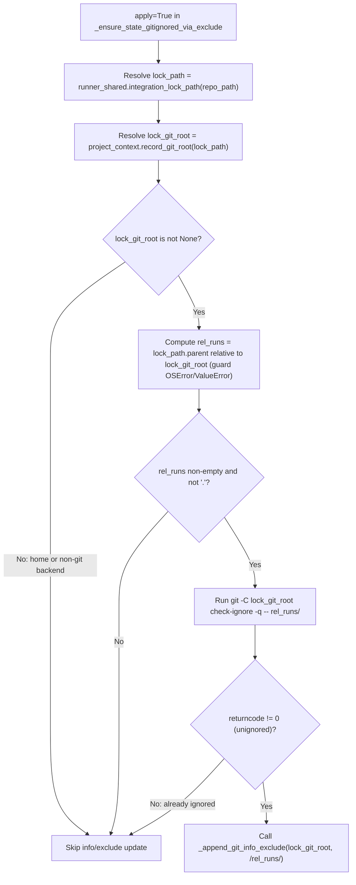

# IPD: Ignore companion records/runs via git info/exclude in m0001_metadata_v2._ensure_state_gitignored_via_exclude

- Date: 2026-11-19
- Kind: child
- Concern: Resolve the git repository root of `agent_workflows/runner_shared.py::integration_lock_path(repo_path)` via `agent_workflows/project_context.py::record_git_root` inside `agent_workflows/migrations/m0001_metadata_v2.py::_ensure_state_gitignored_via_exclude` so `aw migrate metadata --apply` excludes `records/runs/` in `companion_backend` companion repositories via `info/exclude` when unignored.
- Scope: Update `agent_workflows/migrations/m0001_metadata_v2.py::_ensure_state_gitignored_via_exclude` (and its docstring) so `apply=True` resolves the git root of `lock_path` via `agent_workflows/project_context.py::record_git_root(lock_path)` and excludes the relative `lock_path.parent` directory via `<git_common_dir>/info/exclude` when `git check-ignore` reports it unignored; add behavioral tests in `tests/test_m0001_layout_stage.py`; tighten the `companion_backend` `git status` assertion in `tests/test_m0001_any_repo.py::test_ac42_corpus_shapes_end_to_end_migration` by removing `--untracked-files=no`; and add one `- Fixed:` entry in `CHANGELOG.md`. EXCLUDES: modifying `agent_workflows/runner_shared.py::integration_lock_path`, `agent_workflows/project_context.py::record_git_root`, `agent_workflows/migrations/m0001_preflight.py::acquire_apply_integration_lock`, `aw install`, or `.gitignore` templates in tracked repositories.
- Scope-Paths: agent_workflows/migrations/m0001_metadata_v2.py, tests/test_m0001_layout_stage.py, tests/test_m0001_any_repo.py, CHANGELOG.md, .aw/records/plans/pending/20261119-9bg1uk-01-dvxh1p-ignore-companion-records-runs-via-git-info-exclude-in-m0001.ipd.md
- Item-Dependencies: none
- Status: approved
- Readiness: go-pending-approval
- Review-Depth: standard
- Short-Description: Resolve the integration lock git root via project_context.record_git_root and exclude its relative runs directory via info/exclude when unignored
- Work-Kind: bug
- Priority: low
- From-Backlog: 9bg1uk
- Blocks-Release: next
- Set: 9bg1uk
- Order: 1
- Highest E allocated: 04
- Author: antigravity/gemini
- Id: dvxh1p
- Approval: 2026-11-27, recorded via aw ipd set: status set to approved

> Write and proofread this plan per the technical writing standard, `.aw/system/workflows/technical-writing/technical-writing.md` (`.agents/workflows/technical-writing/technical-writing.md` in a legacy-layout install), including requirement 12 (diagrams).

## Workflow history

- 2026-11-27 approved (aw set): status set to approved
- 2026-11-21 reviewed (aw set): APPROVE WITH REVISIONS APPLIED; PR-001..PR-004 FIXED
- 2026-11-21 /plan-review (antigravity/gemini-4-neon-high): APPROVE WITH REVISIONS APPLIED; PR-001, PR-002, PR-003, PR-004
- 2026-11-19 to-review (aw set): Authored review-ready plan graduated from backlog 9bg1uk
- 2026-11-19 draft (antigravity/gemini): created.

## Goal

Prevent `aw migrate metadata --apply` (`agent_workflows/migrations/m0001_metadata_v2.py::run(..., apply=True)`) from leaving an untracked `records/runs/` directory in a `companion_backend` companion repository whose `.gitignore` lacks `records/runs/`. Resolve the git root of `lock_path` with `agent_workflows/project_context.py::record_git_root` and exclude its relative runs directory via `<git_common_dir>/info/exclude` when unignored.

## Detailed Implementation Checklist (TODO)

Execution-state rule: mark an `E-*` item complete only after performing the action. That mark is not validation. Right-sizing rule: write for a modest executor that cannot hold much in its head. Each E-item is one step (one concern, about one file, executable in one focused pass) and its V-item names each unit it covers with its own check; a plan stays at about 5 E-items and 8 work Scope-Paths, else split it into more child plans (guidance, `IPD-Z603`). Accepted execution states: blocked, failed, pending, performed; terminal gate demands 'performed'.

### Task group 1: Exclude integration lock runs directory in owning git root and verify behavior

- [ ] E-01 Before editing any tracked file, save `aw check --agent > .aw/state/dvxh1p/check-before.jsonl` (`mkdir -p .aw/state/dvxh1p`). In `agent_workflows/migrations/m0001_metadata_v2.py::_ensure_state_gitignored_via_exclude`, replace the `<repo_path>/.aw/records/runs` containment check under `if apply:` with resolving `lock_git_root = project_context.record_git_root(lock_path)` (`agent_workflows/project_context.py::record_git_root`), computing `rel_runs = lock_path.parent.resolve().relative_to(lock_git_root.resolve()).as_posix()` (guarding `OSError`, `ValueError`, empty string, and `"."`), running `git -C <lock_git_root> check-ignore -q -- <rel_runs>/`, and calling `agent_workflows/migrations/m0001_metadata_v2.py::_append_git_info_exclude(lock_git_root, f"/{rel_runs}/")` when `returncode != 0`. Update the `_ensure_state_gitignored_via_exclude` docstring to describe resolving the integration lock git root rather than only `<repo>/.aw/records/runs`.
  - Depends on: none
  - Expected outcome: `agent_workflows/migrations/m0001_metadata_v2.py::_ensure_state_gitignored_via_exclude(..., apply=True)` excludes `/.aw/records/runs/` on repository-backed checkouts, excludes `/records/runs/` on unignored `companion_backend` companion repositories, preserves `.gitignore` overrides, and is a clean no-op when `lock_git_root` is `None` (`home` backend).
  - Execution state: pending

- [ ] E-02 Add behavioral fixture tests in `tests/test_m0001_layout_stage.py` using isolated `tmp_path` git repositories (with zero source-code inspection via `inspect`, `ast`, or regex) to verify: (a) on `companion_backend` with no `.gitignore` entry for `records/runs/`, dry-run (`m0001_metadata_v2.run(..., apply=False)`) does not modify `<companion_common_dir>/info/exclude`, whereas `m0001_metadata_v2.run(..., apply=True)` writes `/records/runs/` to `<companion_common_dir>/info/exclude`, `git -C companion check-ignore -q -- records/runs/` exits `0`, `git -C companion status --porcelain` is empty, and repeated `_ensure_state_gitignored_via_exclude(..., apply=True)` calls do not duplicate `/records/runs/`; (b) when a committed `companion/.gitignore` already ignores `records/runs/`, `<companion_common_dir>/info/exclude` is not modified (byte-identical or still absent) and `git -C companion status --porcelain` is empty; (c) on a `repository`-backed checkout lacking `.aw/.gitignore` (`no_sidecar`), `/.aw/records/runs/` is still written to `<repo_common_dir>/info/exclude`; and (d) on a `home` backend (`agent_workflows/project_context.py::record_git_root(lock_path) is None`), `m0001_metadata_v2.run(..., apply=True)` succeeds without writing any `runs/` lock-directory entry to `<repo_common_dir>/info/exclude` (noting that `/.aw/state/` may still be written for `journal_dir` when the target repository lacks `.aw/.gitignore`).
  - Depends on: E-01
  - Expected outcome: All new and existing behavioral tests in `tests/test_m0001_layout_stage.py` pass under `python3 -m pytest`.
  - Execution state: pending

- [ ] E-03 Update `tests/test_m0001_any_repo.py::test_ac42_corpus_shapes_end_to_end_migration` so the `shape == "companion_backend"` check asserts `_git(companion_dir, "status", "--porcelain").stdout.strip() == ""` without `--untracked-files=no`, confirming that `aw migrate metadata --apply` leaves zero untracked `records/runs/` files in the companion repository.
  - Depends on: E-01
  - Expected outcome: All parameterized `CORPUS_SHAPES` cases in `tests/test_m0001_any_repo.py::test_ac42_corpus_shapes_end_to_end_migration` (including `companion_backend`) pass with clean untracked `git status` on `companion_dir`.
  - Execution state: pending

- [ ] E-04 Add one `- Fixed:` bullet under `CHANGELOG.md#2.0.0 (pending) - AW project layout, storage backends, install wizard, and operational state` (with no em or en dashes): `aw migrate metadata --apply` now detects the git repository that holds the integration lock and excludes its relative `runs/` directory via `info/exclude` when unignored, so companion record repositories without a `.gitignore` entry do not retain an untracked `records/runs/` directory. Run `python3 -m pytest tests/test_m0001_layout_stage.py tests/test_m0001_any_repo.py tests/test_m0001_preflight.py`, `aw suite`, `make typecheck`, `aw check --agent` (diffed by `(location, rule)` against `.aw/state/dvxh1p/check-before.jsonl` with zero added error or warning pairs), `aw ipd lint --phase pre-transition --agent` on this plan, and `aw sanitize --agent`; commit only the modified `Scope-Paths` via `aw commit dvxh1p -- <paths>`. Never push.
  - Depends on: E-02, E-03
  - Expected outcome: All targeted and full-core tests, `make typecheck`, `aw check --agent`, `aw ipd lint --phase pre-transition --agent`, and `aw sanitize --agent` pass with zero regressions, and one path-scoped commit is recorded.
  - Execution state: pending

Add further leaves as `- [ ] E-NEW <action>` and run `aw ipd sync` to assign ids.

## Project conventions discovered (Step 0)

- `agent_workflows/migrations/m0001_metadata_v2.py::run` calls `_ensure_state_gitignored_via_exclude(repo_path, journal_dir, apply=apply)` after step-1 preflight and step-2 sidecar checks clear, immediately before `_make_rebound_manager` and `m0001_preflight.acquire_apply_integration_lock(repo_path, apply=apply, ...)`.
- `agent_workflows/migrations/m0001_metadata_v2.py::_ensure_state_gitignored_via_exclude` currently handles `journal_dir` under `<repo_path>/.aw/state` unconditionally and, when `apply=True`, resolves `lock_path = runner_shared.integration_lock_path(repo_path)` but checks only whether `lock_path` lies under `repo_path / ".aw" / "records" / "runs"`.
- `agent_workflows/runner_shared.py::integration_lock_path` returns `state_root(runs_repo_root(Path(repo))) / INTEGRATION_LOCK_FILENAME`, where `runner_shared.state_root` resolves `<records_root>/runs`. On a `companion_backend` repository, `lock_path` is `<companion>/records/runs/integration.lock`, which lies outside `repo_path / ".aw" / "records" / "runs"`.
- `agent_workflows/project_context.py::record_git_root` resolves `Path(path).resolve()` (which works even when `lock_path` and `lock_path.parent` do not yet exist on disk) and returns the nearest ancestor directory containing `.git`, or `None` when the path is outside any git repository (such as the `home` backend under `AW_HOME`).
- `agent_workflows/migrations/m0001_metadata_v2.py::_append_git_info_exclude` resolves `<git_common_dir>` via `ipd_lifecycle.checkout_git_common_dir(repo_path)`, creates `info/exclude` if missing, and idempotently appends the pattern if none of the normalized stripped/bare forms already appear in `info/exclude`.
- `tests/migration_corpus.py::companion_backend` creates `target` and `companion` git repositories without a `.gitignore` entry for `records/runs/` in `companion`. Because `_ensure_state_gitignored_via_exclude` skipped `companion/records/runs`, `tests/test_m0001_any_repo.py::test_ac42_corpus_shapes_end_to_end_migration` previously passed `--untracked-files=no` to `_git(companion_dir, "status", ...)` on `companion_backend`.
- `AGENTS.md` forbids code-pinning tests (`inspect`, `ast`, regex, or source substring assertions) and forbids em or en dashes in user-facing prose (`CHANGELOG.md`).

## Findings

| Id | Finding | Evidence |
| --- | --- | --- |
| F-01 | `_ensure_state_gitignored_via_exclude` checks only `<repo_path>/.aw/records/runs` when `apply=True`. | `agent_workflows/migrations/m0001_metadata_v2.py::_ensure_state_gitignored_via_exclude` tests `within_repo_runs` against `repo_path / ".aw" / "records" / "runs"`, so external companion `lock_path` values (`<companion>/records/runs/integration.lock`) always skip `git check-ignore` and `_append_git_info_exclude`. |
| F-02 | Acquiring the apply-time integration lock creates `companion/records/runs/` as an untracked directory when `companion/.gitignore` lacks `records/runs/`. | `agent_workflows/migrations/m0001_preflight.py::acquire_apply_integration_lock` acquires `agent_workflows/runner_shared.py::integration_lock_path(repo_path)`, creating `<companion>/records/runs/integration.lock`, and `tests/test_m0001_any_repo.py::test_ac42_corpus_shapes_end_to_end_migration` previously suppressed untracked files via `--untracked-files=no` when checking `companion_dir`. |
| F-03 | `agent_workflows/project_context.py::record_git_root(lock_path)` handles repository, companion, linked worktree, and home backends uniformly. | `agent_workflows/project_context.py::record_git_root` returns `<repo>` for `repository` backend, `<companion>` for `companion` backend, and `None` for `home` backend (`AW_HOME`), and `agent_workflows/ipd_lifecycle.py::checkout_git_common_dir(lock_git_root)` resolves the owning common git directory for `info/exclude`. |

## Proposed changes (ordered, validatable)

1. **Exclude lock runs directory in its owning git root (`E-01`)**: Update `agent_workflows/migrations/m0001_metadata_v2.py::_ensure_state_gitignored_via_exclude` (and its docstring) so `apply=True` resolves `lock_git_root = project_context.record_git_root(lock_path)` (`agent_workflows/project_context.py::record_git_root`), computes `rel_runs` from `lock_path.parent.resolve()` relative to `lock_git_root.resolve()`, runs `git -C <lock_git_root> check-ignore -q -- <rel_runs>/`, and calls `agent_workflows/migrations/m0001_metadata_v2.py::_append_git_info_exclude(lock_git_root, f"/{rel_runs}/")` when unignored.
2. **Add behavioral backend, dry-run, and idempotency tests (`E-02`)**: Add tests in `tests/test_m0001_layout_stage.py` covering `companion_backend` dry-run (`apply=False` leaves `info/exclude` untouched) and `apply=True` without `.gitignore` (including idempotency), `companion_backend` with committed `.gitignore` already ignoring `records/runs/`, `repository` backend non-regression (`/.aw/records/runs/`), and `home` backend (`record_git_root(lock_path) is None`, verifying no `runs/` exclude entry is written).
3. **Verify clean untracked status in AC-42 companion corpus (`E-03`)**: Remove `--untracked-files=no` from the `companion_dir` `git status` assertion in `tests/test_m0001_any_repo.py::test_ac42_corpus_shapes_end_to_end_migration`.
4. **Update `CHANGELOG.md` and run gates (`E-04`)**: Add one user-facing `- Fixed:` line in `CHANGELOG.md` (no em or en dashes), run targeted pytest suites, `aw suite`, `make typecheck`, `aw check --agent`, `aw ipd lint --phase pre-transition --agent`, and `aw sanitize --agent`, and commit via `aw commit dvxh1p`.

## Deferred / out of scope (with reason)

- Modifying `aw install` or `tests/migration_corpus.py::companion_backend` to write `.gitignore` entries in companion repositories: backlog `9bg1uk` specifically requires handling unignored companion `records/runs/` via `info/exclude` inside `agent_workflows/migrations/m0001_metadata_v2.py::_ensure_state_gitignored_via_exclude`, without creating or modifying tracked `.gitignore` files during migration.
  - Carrier-Declined: Intentionally out of scope; modifying tracked `.gitignore` files violates `m0001`'s `info/exclude` contract for unignored state/runs directories.
- Changing `agent_workflows/runner_shared.py::integration_lock_path` or `agent_workflows/project_context.py::record_git_root`: both primitives already return the expected paths and require no behavior change.
  - Carrier-Declined: Intentionally out of scope; existing path and git-root resolution primitives already provide the contract needed by `_ensure_state_gitignored_via_exclude`.

## Scope check

- Over-scope: none. Only `agent_workflows/migrations/m0001_metadata_v2.py`, `tests/test_m0001_layout_stage.py`, `tests/test_m0001_any_repo.py`, `CHANGELOG.md`, and this plan are modified.
- Under-scope: none. Resolving `lock_git_root` via `agent_workflows/project_context.py::record_git_root(lock_path)` covers `companion_backend` companion repositories, custom companion subpaths, `repository` backends (main checkouts and linked worktrees), and `home` backends without changing caller signatures.

## Required tests / validation

- Targeted suite: `python3 -m pytest tests/test_m0001_layout_stage.py tests/test_m0001_any_repo.py tests/test_m0001_preflight.py`
- Full core suite: `aw suite`
- Static type check: `make typecheck`
- Repo integrity check: `aw check --agent` compared by `(location, rule)` against `.aw/state/dvxh1p/check-before.jsonl`
- Plan lint and leak check: `aw ipd lint --phase pre-transition --agent` on this plan and `aw sanitize --agent`

## Spec / documentation sync

- Aligns `agent_workflows/migrations/m0001_metadata_v2.py::_ensure_state_gitignored_via_exclude` with artifact metadata store spec `4sd62s` (`.aw/records/specs/approved/20260925-metastore-01-4sd62s-artifact-metadata-store.spec.md`) Section `5.2a` (generic any-repository migration), `AC-18` (companion and home external records roots), and `AC-42` (end-to-end migration across all corpus shapes, exercised by `E-03`). User-facing note: one `- Fixed:` bullet in `CHANGELOG.md` (`E-04`).

## Open questions

None. Backlog item `9bg1uk` specifies the exact behavior change (`agent_workflows/project_context.py::record_git_root(lock_path)` and excluding its relative path via `info/exclude` when unignored inside `agent_workflows/migrations/m0001_metadata_v2.py::_ensure_state_gitignored_via_exclude`).

## Validation and cross-check (verify before reporting done)

Validation-state rule: inspect evidence in a separate pass. Do not mark a `V-*` item complete from memory or from the matching execution checkmark. Accepted validation results: blocked, failed, pass, pending; terminal gate demands 'pass'. Runtime-demonstration reachability rule: for each `V-*` item demanding the software be observed acting (such as a run, a dispatch, or a transition)—as distinct from items demanding a diff, a file's content, or a test result, which are reachable by construction—name the code path that produces the observation or the sibling `E-*` that creates it, else the demand is UNDER-SCOPE.

- [ ] V-01 validates E-01
  - Required evidence: paste `git diff agent_workflows/migrations/m0001_metadata_v2.py` showing the updated `_ensure_state_gitignored_via_exclude` implementation (using `project_context.record_git_root(lock_path)`, computing `rel_runs`, running `git -C <lock_git_root> check-ignore -q -- <rel_runs>/`, and calling `_append_git_info_exclude(lock_git_root, f"/{rel_runs}/")`) and updated docstring.
  - Observed evidence:
  - Result: pending

- [ ] V-02 validates E-02
  - Required evidence: paste `python3 -m pytest -v tests/test_m0001_layout_stage.py` output showing the new `companion_backend` (dry-run non-mutation, unignored apply, already-ignored `.gitignore` preservation, idempotency), `repository`-backend non-regression, and `home`-backend (no `runs/` exclude entry) test node ids PASSED with zero failures, plus `rg -n "^(import|from) (inspect|ast)\b" tests/test_m0001_layout_stage.py` exiting `1` (no code-pinning imports).
  - Observed evidence:
  - Result: pending

- [ ] V-03 validates E-03
  - Required evidence: paste `python3 -m pytest -v tests/test_m0001_any_repo.py` output showing all parameterized `CORPUS_SHAPES` cases of `test_ac42_corpus_shapes_end_to_end_migration` PASSED (including `companion_backend`) and the `git diff tests/test_m0001_any_repo.py` hunk removing `--untracked-files=no` from the `companion_dir` `git status` assertion.
  - Observed evidence:
  - Result: pending

- [ ] V-04 validates E-04
  - Required evidence: paste the `CHANGELOG.md` diff hunk (confirming no em or en dashes), `python3 -m pytest tests/test_m0001_layout_stage.py tests/test_m0001_any_repo.py tests/test_m0001_preflight.py` output, `aw suite` core tier summary, `make typecheck` output (zero added errors), the `(location, rule)` diff of `aw check --agent` against `.aw/state/dvxh1p/check-before.jsonl` (zero added errors or warnings), `aw ipd lint --phase pre-transition --agent` output on this plan, `aw sanitize --agent` output (`outcome: "clean"`), and `aw commit dvxh1p` output.
  - Observed evidence:
  - Result: pending

## Approval and execution gate

- Size assessment: standard
- Cohesion rationale: not required

- **Preconditions**: Execute only after human approval (`- Status: approved`) and with all blocking open questions resolved (none currently open).
- **Scope fence**: Intended edits are declared in `- Scope-Paths:`. Do not stop over a scope variance; if execution requires editing an undeclared path or leaving a declared path unmodified, complete the work and supply `--scope-reason` per out-of-scope path or `--scope-ack` per unmodified path at finalization.
- **Honesty rule**: You MUST paste the actual runner output for every test, lint, typecheck, and verification claim in `Observed evidence:`. Never claim a check passed without running it.
- **Shared-checkout safety and commit**: Never revert, stage, commit, discard, reformat, or clean up another party's uncommitted changes or untracked files. Verify staged paths and commit only files modified for this plan through `aw commit dvxh1p -- <paths>` (never `git add -A`, `git commit -a`, or `--no-verify`, and never push without explicit human direction).
- **Lifecycle transition**: When dispatched by `aw oc run` or `aw agy run`, leave terminal finalization to the runner; when executed directly by hand, run `aw ipd finalize dvxh1p` after all `E-*` items are `performed` and all `V-*` items are `pass` (never hand-roll `git mv` to `executed/`). After finalization and verification, close backlog item `9bg1uk` via `aw backlog set done 9bg1uk --carrier-evidence ...` as a separate post-finalization step (outside this plan's `- Scope-Paths:`).
