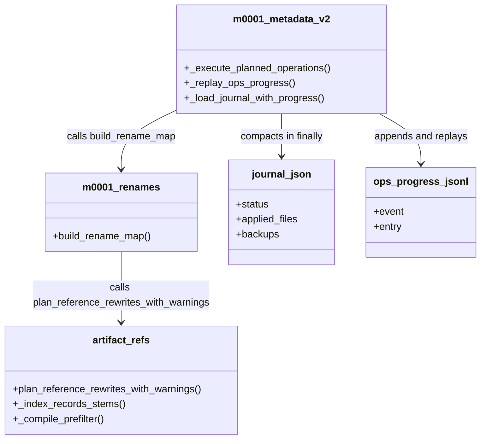
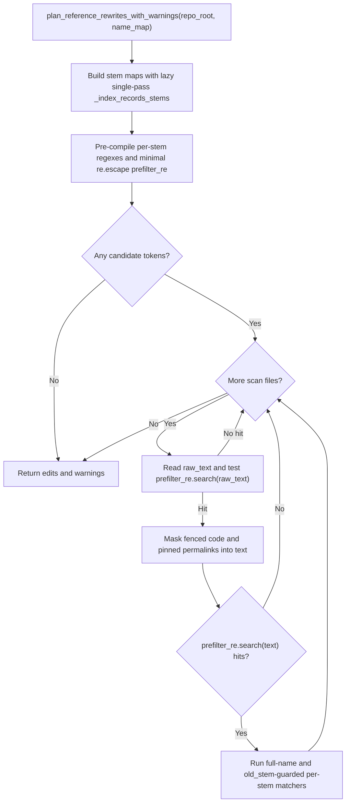
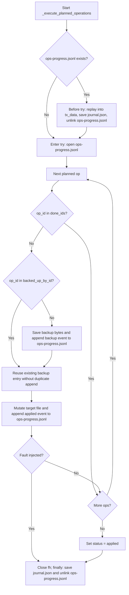

# IPD: Optimize m0001 rename ID minting, citation scan prefiltering, and apply journal progress

- Date: 2026-11-19
- Kind: child
- Concern: Eliminate three runtime bottlenecks measured during `m0001` metadata-v2 migration dry-run and `--apply` runs on this repository. The first bottleneck is repeated full-repository `agent_workflows/artifact_core.py::global_id6s` scans in `agent_workflows/migrations/m0001_renames.py::build_rename_map`. The second is unprefiltered per-stem negative-lookaround regular expression (regex) scans and repeated legacy-prefix directory walks in `agent_workflows/artifact_refs.py::plan_reference_rewrites_with_warnings`. The third is full `journal.json` atomic rewrites on every operation in `agent_workflows/migrations/m0001_metadata_v2.py::_execute_planned_operations`.
- Scope: Update three production modules and add behavioral outcome tests in three test modules. (1) Lazily seed the six-character base36 identifier (`id6`) collision pool once from `agent_workflows/artifact_core.py::global_id6s(repo_path)` in `agent_workflows/migrations/m0001_renames.py::build_rename_map` and mint each new `id6` in memory via `agent_workflows/artifact_core.py::generate_id6`, with behavioral tests in `tests/test_m0001_renames.py`. (2) Add a single-pass record stem indexer, pre-compiled per-stem regexes, a minimal `re.escape`-escaped combined literal alternation prefilter regex checked before and after masking, and per-stem substring guards in `agent_workflows/artifact_refs.py::plan_reference_rewrites_with_warnings`, with `@pytest.mark.core` behavioral parity and prefilter tests in `tests/test_artifact_refs_rewrite.py`. (3) Stream per-operation backup and applied events to an append-only JSON Lines (JSONL) write-ahead log (`ops-progress.jsonl`) inside `agent_workflows/migrations/m0001_metadata_v2.py::_execute_planned_operations`, closing the file handle before compacting into `journal.json` and unlinking `ops-progress.jsonl` on completion or exception, replaying `ops-progress.jsonl` on journal load, resume, and rollback, and clearing stale progress logs on fresh non-applying runs, with behavioral crash-recovery and compaction tests in `tests/test_m0001_preflight.py`. EXCLUDES: changing `agent_workflows/artifact_core.py::global_id6s`, `agent_workflows/artifact_core.py::generate_id6`, `agent_workflows/artifact_core.py::mint_id6`, `agent_workflows/artifact_refs.py::count_legacy_prefix_records`, `agent_workflows/migrations/m0001_renames.py::apply_step3`, `agent_workflows/layout_migration.py::MigrationManager`, or adding the `this_repository` clone migration test (`60mazt`).
- Scope-Paths: agent_workflows/migrations/m0001_renames.py, agent_workflows/artifact_refs.py, agent_workflows/migrations/m0001_metadata_v2.py, tests/test_m0001_renames.py, tests/test_artifact_refs_rewrite.py, tests/test_m0001_preflight.py, .aw/records/plans/pending/20261119-e49gzt-01-n2bfd4-optimize-m0001-rename-id-minting-citation-scan-prefiltering.ipd.md
- Item-Dependencies: none
- Status: approved
- Readiness: go-pending-approval
- Review-Depth: standard
- Short-Description: Seed m0001_renames.build_rename_map id6 pool once, prefilter artifact_refs.plan_reference_rewrites_with_warnings, and stream m0001_metadata_v2._execute_planned_operations progress via ops-progress.jsonl
- Work-Kind: chore
- Priority: medium
- From-Backlog: e49gzt
- Set: e49gzt
- Order: 1
- Highest E allocated: 05
- Author: antigravity/gemini
- Id: n2bfd4
- Approval: 2026-11-20, recorded via aw ipd set: status set to approved

> Write and proofread this plan per the technical writing standard, `.aw/system/workflows/technical-writing/technical-writing.md` (`.agents/workflows/technical-writing/technical-writing.md` in a legacy-layout install), including requirement 12 (diagrams).

## Workflow history

- 2026-11-20 approved (aw set): status set to approved
- 2026-11-20 reviewed (aw set): APPROVE WITH REVISIONS APPLIED; PR-001..PR-005 FIXED
- 2026-11-20 /plan-review (antigravity/gemini-4-neon-high): APPROVE WITH REVISIONS APPLIED; PR-001..PR-005 FIXED; review record .aw/records/reviews/20261119-e49gzt-01-n2bfd4-optimize-m0001-rename-id-minting-citation-scan-prefiltering.review.md
- 2026-11-20 to-review (aw set): Authored review-ready plan graduated from backlog e49gzt
- 2026-11-20 draft (antigravity/gemini): created.

## Goal

Reduce `m0001` metadata-v2 dry-run and `--apply` runtime without weakening `id6` collision safety, citation rewrite parity, or crash-safe resume and rollback. Remove repeated `artifact_core.global_id6s` scans during rename mapping. Skip per-stem negative-lookaround regex scans and masking on non-matching files during citation planning. Replace per-operation multi-megabyte `journal.json` rewrites during `--apply` with an append-only JSONL progress log compacted into `journal.json`.

## Detailed Implementation Checklist (TODO)

Execution-state rule: mark an `E-*` item complete only after performing the action. That mark is not validation. Right-sizing rule: write for a modest executor that cannot hold much in its head. Each E-item is one step (one concern, about one file, executable in one focused pass) and its V-item names each unit it covers with its own check; a plan stays at about 5 E-items and 8 work Scope-Paths, else split it into more child plans (guidance, `IPD-Z603`). Accepted execution states: blocked, failed, pending, performed; terminal gate demands 'performed'.

### Task group 1: Optimize rename ID minting and citation rewrite scanning

- [ ] E-01 Capture the baseline integrity check and optimize `id6` minting in `agent_workflows/migrations/m0001_renames.py::build_rename_map`:
  1. Before editing any tracked file, create `.aw/state/n2bfd4` (`mkdir -p .aw/state/n2bfd4`) and save `aw check all --agent > .aw/state/n2bfd4/check-before.jsonl`.
  2. In `agent_workflows/migrations/m0001_renames.py::build_rename_map`, initialize `global_pool: Optional[Set[str]] = None` before the `rename_targets` loop. On the first record that needs a newly minted `id6` (neither `existing_id` nor a reused journal entry is present), seed `global_pool = artifact_core.global_id6s(repo_path) | all_known_ids | minted_in_pass` once. Generate each uncached `id6` via `artifact_core.generate_id6(global_pool)`, then add the minted `id6` to `global_pool`, `minted_in_pass`, `all_known_ids`, and `new_journal_entries`. Update the `build_rename_map` docstring to describe seeding once from `artifact_core.global_id6s` and generating via `artifact_core.generate_id6`.
  3. Add behavioral tests in `tests/test_m0001_renames.py` using `unittest.mock.patch.object` with `wraps=...` on `artifact_core.global_id6s` and `artifact_core.generate_id6` against a `tmp_path` repository containing four id-less legacy records and a document quoting `- Id: qut111`. Verify that: (a) `build_rename_map` calls `artifact_core.global_id6s` exactly once when minting four id-less records; (b) the `existing` set passed to `artifact_core.generate_id6` includes `qut111` and every previously minted `id6` in the pass, and all four minted `id6` values are distinct; and (c) a second `build_rename_map` call reusing `journal["minted_ids"]` calls `artifact_core.global_id6s` zero times and returns the identical `RenameMap`.
  - Depends on: none
  - Expected outcome: `build_rename_map` scans repository-wide `id6` values at most once per call (zero times when all IDs are preserved or reused from the journal), preserves all refusal checks (`(a)`, `(b)`, `(c)`, and unknown facets), and all new and existing tests in `tests/test_m0001_renames.py` pass.
  - Execution state: pending

- [ ] E-02 Update `agent_workflows/artifact_refs.py::plan_reference_rewrites_with_warnings` and add module-private helpers `_index_records_stems` and `_compile_prefilter` in `agent_workflows/artifact_refs.py`:
  1. Add `_index_records_stems(repo_root: Path) -> Tuple[Dict[str, int], Dict[str, List[str]]]` using the exact directory, skip-name, excluded-directory, and gitignore filters of `count_legacy_prefix_records` and `_index_records_facetless_stems`. One walk computes both legacy-prefix counts and the facetless-stem index. Call `_index_records_stems` lazily at most once during `plan_reference_rewrites_with_warnings` setup (zero calls when no changed `name_map` entry has a legacy prefix or a qualifying facetless stem), while keeping `count_legacy_prefix_records` and `_index_records_facetless_stems` intact for direct callers.
  2. Collect `active_name_pairs = [(o, n) for o, n in name_map.items() if o and o != n]` and pre-compile per-stem regexes once before the file scan loop (`compiled_bare` over `whole_stem_map` then `legacy_stem_map`, `compiled_facetless` over `facetless_stem_map`, and `compiled_shared_facetless` over `shared_facetless_stems`). Return `([], warnings)` immediately when no active filenames, bare stems, facetless stems, or shared facetless stems remain to scan.
  3. Add `_compile_prefilter(tokens: Iterable[str]) -> Optional[re.Pattern[str]]` that deduplicates non-empty tokens, sorts by `(len(token), token)`, keeps a minimal substring-free subset (skipping any token that contains an already-kept shorter token), escapes every kept token with `re.escape(token)`, and compiles one literal alternation regex (`"|".join(re.escape(t) for t in kept)`) over all active filenames, whole stems, legacy prefix stems, facetless stems, and shared facetless stems (returning `None` if `kept` is empty).
  4. For each scanned file in `plan_reference_rewrites_with_warnings`, test `prefilter_re.search(raw_text)` before calling `_mask_fenced_code` and `_mask_permalinks` (skipping non-matching files immediately). Re-test `prefilter_re.search(text)` after masking (skipping files whose only hits were masked). Guard each per-stem `.findall(text)` and `.search(text)` call with `if old_stem in text:` while preserving the exact `RefEdit` order and warning text.
  5. Add a `@pytest.mark.core`-marked behavioral test class in `tests/test_artifact_refs_rewrite.py` (leaving existing slower CLI-spawning test classes unmarked) verifying: (a) output parity (exact `RefEdit` sequence and warning list) across full-name, whole-stem, legacy-prefix, facetless-stem, shared-legacy-prefix, shared-facetless-stem, fenced-code, and pinned-permalink cases; (b) `_boundaried` and `_facetless_boundaried` are called once per distinct stem rather than once per scanned file (verified via `unittest.mock.patch.object(..., wraps=...)`); and (c) non-matching files (including a large synthetic file without citations) bypass `_mask_fenced_code` via the prefilter.
  - Depends on: none
  - Expected outcome: `plan_reference_rewrites_with_warnings` emits byte-identical `RefEdit` and warning results while scanning non-matching files with one escaped literal prefilter and compiling each stem regex once, and all new (`@pytest.mark.core`) and existing tests in `tests/test_artifact_refs_rewrite.py` and `tests/test_reference_matcher_parity.py` pass.
  - Execution state: pending

### Task group 2: Stream apply journal progress via append-only JSONL log and validate

- [ ] E-03 Update `agent_workflows/migrations/m0001_metadata_v2.py` to replace per-operation `mgr._save_transaction(tx_data)` calls in `_execute_planned_operations` with a transient append-only write-ahead progress log `ops-progress.jsonl` (`_OPS_PROGRESS_FILENAME = "ops-progress.jsonl"`) inside `journal_dir`:
  1. Add `_replay_ops_progress(tx_data: Dict[str, Any], journal_dir: Path) -> Dict[str, Any]` to merge uncompacted `{"event": "backup", "entry": ...}` and `{"event": "applied", "entry": ...}` lines from `journal_dir / _OPS_PROGRESS_FILENAME` into `tx_data["backups"]` and `tx_data["applied_files"]`, deduplicating by `op_id`. Ignore a truncated, unparseable final non-empty line (representing a torn write during abrupt process termination such as `SIGKILL`). Raise `layout_migration.MigrationError` if any earlier non-empty line is malformed JSON, is not a JSON object, or carries an unsupported `event` or non-dict `entry`.
  2. Add `_load_journal_with_progress(mgr: layout_migration.MigrationManager, journal_dir: Path) -> Optional[Dict[str, Any]]`. Replay `ops-progress.jsonl` in `_peek_journal` (catching only `(OSError, json.JSONDecodeError)` on `journal.json` so `layout_migration.MigrationError` from `_replay_ops_progress` propagates rather than returning `None`), `_resume_applying_journal` (initial pre-lock check, locked load, and exception-rollback reload), `rollback`, `_rollback_all_locked` (at entry and at its internal post-marker and post-stage-one reloads), `run` (exception-rollback reloads), and `_execute_planned_operations`. In `run()`, unlink any stale `ops-progress.jsonl` (`missing_ok=True`) ONLY when `prior_tx.get("status") != "applying"` (so a dry run or failed non-applying invocation never destroys an interrupted `applying` transaction's progress log) and only after acquiring the lock and writing the replacement transaction (or immediately before starting a fresh apply after `prior_tx` is confirmed non-`applying`). Inside `_rollback_all_locked`, unlink `ops-progress.jsonl` (`missing_ok=True`) only after `mgr._save_transaction(tx_data)` writes `status = "rolled_back"`.
  3. At entry to `_execute_planned_operations` (BEFORE entering the `try ... finally:` compaction block, so mid-file corruption errors propagate without `finally:` overwriting `journal.json` or unlinking the corrupt log), if `journal_dir / _OPS_PROGRESS_FILENAME` already exists (post-crash resume), replay it into `tx_data`, call `mgr._save_transaction(tx_data)` once to compact prior progress, and unlink `ops-progress.jsonl` before appending new events so a prior truncated trailing line cannot concatenate with a new JSONL line. Track `done_ids` (from `applied_files`) and `backed_up_by_id` (from `backups`, keyed by `op_id`). When `op_id in backed_up_by_id`, reuse its existing `(root_kind, relpath)` without overwriting existing `.bak` files and without appending a duplicate `backup` event to `tx_data["backups"]` or `ops-progress.jsonl`. For each remaining operation, when `op_id not in backed_up_by_id`, save the backup bytes, append to `tx_data["backups"]`, and write and flush (`fh.flush()`, without per-operation `os.fsync`) `{"event": "backup", "entry": backup_entry}` before mutating the target file; then execute the file operation, append to `tx_data["applied_files"]`, and write and flush `{"event": "applied", "entry": applied_entry}` after mutating the target file.
  4. Wrap the operation loop in `try ... finally:`, placing `with open(progress_path, "a", encoding="utf-8") as fh:` strictly INSIDE `try:` so `fh` is closed BEFORE `finally:` runs (preventing `PermissionError` on Windows when unlinking). Set `tx_data["status"] = "applied"` on normal completion before exiting `try:`. Inside `finally:` (after `fh` is closed), call `mgr._save_transaction(tx_data)` once (providing durable atomic persistence) and unlink `ops-progress.jsonl` (`missing_ok=True`) only after `mgr._save_transaction(tx_data)` succeeds. Preserve `interrupt-mid-apply` and `stage2-failure` fault-injection semantics exactly.
  - Depends on: none
  - Expected outcome: `_execute_planned_operations` persists per-operation durability via sequential JSONL appends instead of full `journal.json` rewrites, closes its handle before compacting cleanly to `journal.json` on completion or Python exceptions (Windows-safe), and recovers accurately from abrupt process crashes in `_peek_journal`, `resume()`, and `rollback()`.
  - Execution state: pending

- [ ] E-04 Add behavioral outcome tests in `tests/test_m0001_preflight.py` (with zero source-code inspection via `inspect`, `ast`, or regex) covering three scenarios:
  1. **Compacted save count**: Wrap `layout_migration.MigrationManager._save_transaction` with `unittest.mock.patch.object(..., wraps=...)` during `m0001_metadata_v2.run(repo, apply=True, commit=False)` on a fixture with at least 10 planned operations (giving each synthetic record `- Short-Description:` as `_init_repo` does so `m0001_describe` needs zero host spawns). Assert that `_execute_planned_operations` compacts once rather than calling `_save_transaction` per operation (total `_save_transaction` calls across the full apply stay strictly below the operation count), `journal.json` holds every `applied_files` and `backups` entry with `status == "applied"`, and `ops-progress.jsonl` does not remain on disk.
  2. **Hard-crash replay for resume and rollback**: Simulate abrupt process termination (`SIGKILL`) after partial apply by leaving `journal.json` at `status == "applying"` with empty `applied_files` and `backups`, while writing completed `backup`/`applied` events, one half-completed operation (`backup` written and file mutated, `applied` absent), and one truncated trailing JSON line into `ops-progress.jsonl`. Verify that: (a) `_peek_journal(journal_dir)` reports the replayed `applied_files` and `backups` entries without failing on the truncated final line; (b) `m0001_metadata_v2.resume(repo, commit=False)` compacts the prior progress cleanly, skips already-applied operations, preserves the original `.bak` bytes without duplicating the `backup` entry for the half-completed operation, finishes remaining operations identically to an uninterrupted run, compacts `journal.json`, and removes `ops-progress.jsonl`; and (c) on a second simulated-crash fixture, `m0001_metadata_v2.rollback(repo)` replays `ops-progress.jsonl`, restores every mutated file (including the half-completed operation) byte-for-byte, writes `status == "rolled_back"`, and removes `ops-progress.jsonl`.
  3. **Mid-file corruption refusal**: Verify that malformed JSON on a non-final line of `ops-progress.jsonl` raises `layout_migration.MigrationError` in `_peek_journal`, `resume()`, and `rollback()` rather than silently dropping progress or unlinking the corrupt log.
  - Depends on: E-03
  - Expected outcome: All new and existing behavioral tests in `tests/test_m0001_preflight.py` pass under `python3 -m pytest -o addopts="" -v --durations=0 tests/test_m0001_preflight.py` with `0 unlisted slow tests`.
  - Execution state: pending

- [ ] E-05 Run all required validation gates and commit the modified `Scope-Paths` files:
  1. Run the targeted test suites (`python3 -m pytest -o addopts="" -v --durations=0 tests/test_m0001_renames.py tests/test_m0001_preflight.py tests/test_artifact_refs_rewrite.py tests/test_reference_matcher_parity.py tests/test_m0001_any_repo.py`) verifying all pass with `0 unlisted slow tests`, and run the routine core suite (`python3 -m pytest`).
  2. Run static type checking (`python3 -m mypy agent_workflows`), repository integrity checking (`aw check all --agent`, diffed by `(location, rule)` against `.aw/state/n2bfd4/check-before.jsonl` captured in E-01), plan lint (`aw ipd lint --phase pre-transition` on this plan), and leak scanning (`aw sanitize --agent`).
  3. Commit only the modified `Scope-Paths` files through `aw commit n2bfd4 -- <paths>`. Never push.
  - Depends on: E-01, E-02, E-04
  - Expected outcome: All targeted suites (`0 unlisted slow tests`), bare core suite, `mypy`, `aw check all --agent` (zero added error or warning pairs), `aw ipd lint --phase pre-transition`, and `aw sanitize --agent` pass cleanly, and one path-scoped commit covers only `Scope-Paths` files.
  - Execution state: pending

Add further leaves as `- [ ] E-NEW <action>` and run `aw ipd sync` to assign ids.

## Project conventions discovered (Step 0)

- `agent_workflows/artifact_core.py::global_id6s` returns a conservative superset of every `id6` across the repository (including terminal records and quoted body IDs) and takes ~5.05s on this repository (`3,385` IDs measured). `agent_workflows/artifact_core.py::generate_id6` is pure and collision-checks against `existing` in memory without filesystem I/O, while `agent_workflows/artifact_core.py::mint_id6` wraps `global_id6s(repo_root)` plus `generate_id6`.
- `agent_workflows/artifact_naming.py::legacy_stem_prefix` matches `\A(\d{8}-\d{4}-\d{2})-` via `_LEGACY_STEM_PREFIX_RE`, so `_legacy_prefix_stem(p.name) == prefix` holds if and only if `p.name.startswith(prefix + "-")` for a `YYYYMMDD-HHMM-NN` legacy prefix.
- `agent_workflows/artifact_refs.py::_boundaried` and `agent_workflows/artifact_refs.py::_facetless_boundaried` are case-sensitive literal matchers (`re.escape(stem)` with hyphen-aware negative lookarounds), and `agent_workflows/artifact_refs.py::_mask_fenced_code` and `agent_workflows/artifact_refs.py::_mask_permalinks` replace fenced code blocks and pinned commit URLs with `\x00`-delimited sentinel tokens (`\x00AWFENCEDCODE<idx>\x00`, `\x00AWPERMALINK<idx>\x00`). Because these sentinels are non-empty and contain `\x00`, masking never synthesizes new filename or stem substrings; therefore checking a `re.escape`-escaped literal alternation prefilter over all candidate tokens on raw text before masking is sound and cannot drop any match.
- `agent_workflows/migrations/m0001_metadata_v2.py` stores `journal.json` and `backups/` under `<state_durable>/migrations/m0001`, which is gitignored via `.aw/.gitignore` or `<git_common_dir>/info/exclude` (`_ensure_state_gitignored_via_exclude`).
- `tests/test_m0001_preflight.py::test_journal_interrupt_mid_apply_resume_and_rollback` reads `journal.json` directly after `interrupt-mid-apply` and asserts `jdata_a["status"] == "applying"` and `len(jdata_a["applied_files"]) == 1`, so `_execute_planned_operations` must compact `journal.json` in `finally:` on fault injection as well as on completion (closing `fh` first for Windows compatibility).
- `tests/test_artifact_refs_rewrite.py` uses `unittest.TestCase` (`_RepoTestCase`) with no module-level `pytestmark = pytest.mark.core`, whereas `tests/test_m0001_renames.py`, `tests/test_m0001_preflight.py`, and `tests/test_reference_matcher_parity.py` use `pytestmark = pytest.mark.core`. Marking the new fast test class in `tests/test_artifact_refs_rewrite.py` with `@pytest.mark.core` brings the new prefilter/parity tests into the core gate without pulling existing slower CLI-spawning tests into core.
- `AGENTS.md`, `GEMINI.md`, and `GUIDING_PRINCIPLES.md` P16 forbid code-pinning tests (`inspect`, `ast`, regex over source code, or line counts); tests must exercise real functions or command-line interface (CLI) commands and assert on real outputs, call counts, exit codes, and disk state.
- Cite code by repository-relative path and symbol (`path::symbol` or `module.function`), never bare implementation line numbers (`IPD-C801`).

## Findings

| Id | Finding | Evidence | Impact on this plan |
| --- | --- | --- | --- |
| F-01 | `build_rename_map` rescans all repository records via `global_id6s` on every minted `id6`. | `agent_workflows/migrations/m0001_renames.py::build_rename_map` calls `artifact_core.mint_id6(repo_path, existing=pool)` inside the `for path, rel_path in rename_targets:` loop; `artifact_core.global_id6s(Path("."))` measured `5.05s` (`3,385` IDs) in this checkout (`~141s` for 28 mints). | E-01 lazily seeds `global_pool` once from `artifact_core.global_id6s(repo_path)` on the first uncached mint and calls `artifact_core.generate_id6(global_pool)` in memory. |
| F-02 | `plan_reference_rewrites_with_warnings` runs unprefiltered per-stem negative-lookaround regexes and masks every scanned file, and walks `.aw/records/` per legacy prefix. | `agent_workflows/artifact_refs.py::plan_reference_rewrites_with_warnings` calls `agent_workflows/artifact_refs.py::count_legacy_prefix_records(repo_root, o_leg)` per legacy entry and evaluates `_boundaried` and `_facetless_boundaried` on every file without a prefilter. Measured on `agent_workflows/runner_shared.py` (`2,594,239` bytes): 160 unprefiltered regex calls took `7,954.7 ms`, while one combined 40-stem literal prefilter took `1.55 ms` (`~5,132x` faster). | E-02 adds single-pass `_index_records_stems`, pre-compiled per-stem regexes, minimal `re.escape`-escaped `_compile_prefilter` checked before and after masking, and per-stem `old_stem in text` guards. |
| F-03 | Backlog `e49gzt` names `_execute_operations`, while the actual symbol in `m0001_metadata_v2.py` is `_execute_planned_operations`. | Searching `agent_workflows/migrations/` finds zero occurrences of `_execute_operations`; `agent_workflows/migrations/m0001_metadata_v2.py::_execute_planned_operations` is the operation loop calling `mgr._save_transaction(tx_data)` on every iteration. | E-03 targets `agent_workflows/migrations/m0001_metadata_v2.py::_execute_planned_operations` and its journal-loading callers. |
| F-04 | Periodic checkpointing alone risks losing backup records on hard crashes, while an append-only JSONL write-ahead log preserves per-operation durability at constant-time (`O(1)`) cost per operation. | `tests/test_m0001_preflight.py::test_journal_interrupt_mid_apply_resume_and_rollback` asserts `journal.json` holds `applied_files` after `interrupt-mid-apply`, and `m0001_metadata_v2.py` reloads `journal.json` inside `_rollback_all_locked`, `_resume_applying_journal`, `rollback`, and `run`. | E-03 streams `backup` (pre-mutation) and `applied` (post-mutation) events to `ops-progress.jsonl`, compacts on resume entry before `try ... finally:`, closes `fh` before compacting and unlinking in `finally:`, and replays `ops-progress.jsonl` on every journal load path. |

## Proposed changes (ordered, validatable)

1. **Lazy single-scan `id6` pool in `build_rename_map` (`E-01`)**: Seed `global_pool` once from `artifact_core.global_id6s(repo_path)` on the first uncached mint in `agent_workflows/migrations/m0001_renames.py::build_rename_map`, mint in memory via `artifact_core.generate_id6(global_pool)`, update the docstring, and verify call counts and collision safety in `tests/test_m0001_renames.py`.
2. **Prefiltered citation rewrite planner (`E-02`)**: Add `_index_records_stems` and `_compile_prefilter` (with `re.escape`) in `agent_workflows/artifact_refs.py`, pre-compile per-stem regexes once, prefilter files before and after masking, guard per-stem regexes with `old_stem in text`, and verify parity and prefilter behavior in a `@pytest.mark.core` test class in `tests/test_artifact_refs_rewrite.py`.
3. **Append-only JSONL progress log and crash recovery (`E-03`, `E-04`)**: Stream `backup` and `applied` operation events to `journal_dir / "ops-progress.jsonl"` in `agent_workflows/migrations/m0001_metadata_v2.py::_execute_planned_operations`, compact prior logs before entering `try ... finally:`, close `fh` before compacting final state and unlinking in `finally:`, replay `ops-progress.jsonl` across `_peek_journal`, `_resume_applying_journal`, `rollback`, `_rollback_all_locked`, and `run`, clear stale logs only on non-`applying` runs, and verify compaction, hard-crash resume and rollback, and corruption refusal in `tests/test_m0001_preflight.py`.
4. **Full validation and path-scoped commit (`E-05`)**: Run targeted `m0001` and `artifact_refs` suites (`0 unlisted slow tests`), bare `python3 -m pytest`, `python3 -m mypy agent_workflows`, `aw check all --agent`, `aw ipd lint --phase pre-transition`, and `aw sanitize --agent`, then commit only `Scope-Paths` files through `aw commit n2bfd4`.

## Deferred / out of scope (with reason)

- Running the end-to-end `this_repository` (`git clone --no-hardlinks`) `m0001` clone migration test in `tests/test_m0001_any_repo.py`: tracked separately in pending plan `60mazt`, which depends on `state:backlog:done:e49gzt`.
  - Carrier: 60mazt
- Batching `save_callback` inside `agent_workflows/migrations/m0001_renames.py::apply_step3`: `apply_step3` runs on the small set of renamed and citing files in scratch before `operations` or `descriptions` populate `tx_data`, and backlog `e49gzt` scopes journal persistence optimization specifically to `_execute_planned_operations`.
  - Carrier-Declined: Intentionally out of scope; `apply_step3` is not one of the three measured bottlenecks in backlog `e49gzt`.
- Changing `agent_workflows/artifact_core.py::global_id6s` or `agent_workflows/layout_migration.py::MigrationManager._save_transaction`: both primitives serve broader callers with established contracts (`tests/test_id6_global_mint.py`, `tests/test_layout_migration.py`) and require no modification.
  - Carrier-Declined: Intentionally out of scope; keeping shared core and layout-migration primitives unchanged isolates risk to the three `e49gzt` call sites.

## Scope check

- Over-scope: none. Only the three production modules identified in backlog `e49gzt`, their three corresponding test modules, and this plan file are in `- Scope-Paths:`.
- Under-scope: none. All three bottlenecks in backlog `e49gzt` (repeated `global_id6s` scans, unprefiltered citation scans plus redundant legacy-prefix walks, and per-operation `journal.json` dumps) are addressed with behavioral tests and crash-recovery guarantees.

## Required tests / validation

- Targeted suites: `python3 -m pytest -o addopts="" -v --durations=0 tests/test_m0001_renames.py tests/test_m0001_preflight.py tests/test_artifact_refs_rewrite.py tests/test_reference_matcher_parity.py tests/test_m0001_any_repo.py` (`0 unlisted slow tests`)
- Routine core suite: `python3 -m pytest`
- Static type check: `python3 -m mypy agent_workflows`
- Repo integrity, plan lint, and leak scan: `aw check all --agent`, `aw ipd lint --phase pre-transition`, and `aw sanitize --agent`

## Spec / documentation sync

N/A: this chore optimizes internal runtime paths inside `m0001_renames.py`, `artifact_refs.py`, and `m0001_metadata_v2.py` while preserving the `journal.json` schema, CLI flags, citation rewrite output, and spec `4sd62s` Section 5.1 and 5.2 contracts unchanged.

## Open questions

### OQ-01: Which function in `agent_workflows/migrations/m0001_metadata_v2.py` corresponds to `_execute_operations` named in backlog `e49gzt`?

- Blocking: no
- Status: resolved
- Owner: plan author
- Resolution or deferral rationale: Repository inspection confirms `_execute_operations` does not exist and `agent_workflows/migrations/m0001_metadata_v2.py::_execute_planned_operations` is the exact function executing planned migration operations and calling `mgr._save_transaction(tx_data)` per iteration (F-03). E-03 targets `_execute_planned_operations`. Recommendation strength: strong.

### OQ-02: Should `_execute_planned_operations` use periodic `journal.json` checkpoints every N operations or an append-only JSONL progress log compacted into `journal.json`?

- Blocking: no
- Status: resolved
- Owner: plan author
- Resolution or deferral rationale: Backlog `e49gzt` permits either periodic checkpoints or an append-only progress log. This plan selects an append-only JSONL progress log (`ops-progress.jsonl`) compacted into `journal.json` in `finally:` (after closing `fh`) because it eliminates all per-operation 4 MB rewrites while preserving per-operation crash durability for both `resume()` and `rollback()`, and keeps `journal.json` immediately updated after `interrupt-mid-apply` and `stage2-failure` (F-04). Recommendation strength: strong.

## Validation and cross-check (verify before reporting done)

Validation-state rule: inspect evidence in a separate pass. Do not mark a `V-*` item complete from memory or from the matching execution checkmark. Accepted validation results: blocked, failed, pass, pending; terminal gate demands 'pass'. Runtime-demonstration reachability rule: for each `V-*` item demanding the software be observed acting (such as a run, a dispatch, or a transition) (as distinct from items demanding a diff, a file's content, or a test result, which are reachable by construction), name the code path that produces the observation or the sibling `E-*` that creates it, else the demand is UNDER-SCOPE.

- [ ] V-01 validates E-01
  - Required evidence: paste the unified `git diff agent_workflows/migrations/m0001_renames.py` showing lazy one-time `artifact_core.global_id6s` seeding and `artifact_core.generate_id6` calls in `build_rename_map`, confirmation that `.aw/state/n2bfd4/check-before.jsonl` was captured before edits, and `python3 -m pytest -o addopts="" -v --durations=0 tests/test_m0001_renames.py` output showing the new single-scan and journal-reuse tests PASSED with zero failures.
  - Observed evidence:
  - Result: pending

- [ ] V-02 validates E-02
  - Required evidence: paste the unified `git diff agent_workflows/artifact_refs.py` showing lazy `_index_records_stems`, `re.escape`-escaped `_compile_prefilter`, pre-compiled per-stem regexes, pre- and post-mask prefiltering, and `old_stem in text` guards in `plan_reference_rewrites_with_warnings`, plus `python3 -m pytest -o addopts="" -v --durations=0 tests/test_artifact_refs_rewrite.py tests/test_reference_matcher_parity.py` output showing all new `@pytest.mark.core` prefilter and parity tests and existing tests PASSED.
  - Observed evidence:
  - Result: pending

- [ ] V-03 validates E-03
  - Required evidence: paste the unified `git diff agent_workflows/migrations/m0001_metadata_v2.py` showing `_OPS_PROGRESS_FILENAME`, `_replay_ops_progress`, `_load_journal_with_progress`, entry replay/compaction before `try ... finally:`, `backed_up_by_id` reuse without duplicate appends, pre-mutation `backup` and post-mutation `applied` JSONL appends in `_execute_planned_operations`, closing `fh` before `finally:` compaction and unlink, `_peek_journal` `MigrationError` propagation, non-`applying` stale-log cleanup guard in `run()`, and replay/cleanup wiring in `_resume_applying_journal`, `rollback`, `_rollback_all_locked`, and `run`.
  - Observed evidence:
  - Result: pending

- [ ] V-04 validates E-04
  - Required evidence: paste `python3 -m pytest -o addopts="" -v --durations=0 tests/test_m0001_preflight.py` output showing the new compacted save-count, hard-crash resume and rollback (including truncated trailing line and half-completed backup-only op with no duplicate backup entry), and mid-file JSON corruption (`_peek_journal`, `resume()`, and `rollback()`) tests PASSED with `0 unlisted slow tests`, plus `rg -n "^(import|from) (inspect|ast)\b" tests/test_m0001_renames.py tests/test_artifact_refs_rewrite.py tests/test_m0001_preflight.py` exiting `1`.
  - Observed evidence:
  - Result: pending

- [ ] V-05 validates E-05
  - Required evidence: paste the pass summaries and exit codes from the targeted `pytest -o addopts="" -v --durations=0` command (`0 unlisted slow tests`), bare `python3 -m pytest`, `python3 -m mypy agent_workflows`, the `(location, rule)` diff of `aw check all --agent` against `.aw/state/n2bfd4/check-before.jsonl` (zero added errors or warnings), `aw ipd lint --phase pre-transition` on this plan, `aw sanitize --agent` (`outcome: "clean"`), and `git show --stat` of the `aw commit n2bfd4` commit listing only `- Scope-Paths:` files.
  - Observed evidence:
  - Result: pending

## Approval and execution gate

- Size assessment: standard
- Cohesion rationale: not required

Execute only after human approval (`- Status: approved`). Open questions: `OQ-01` and `OQ-02` are resolved and non-blocking.

Scope fence: the paths in `- Scope-Paths:` are a declaration. If execution must edit a file outside the fence, make the needed edit and justify it at finalize (`--scope-reason`), and acknowledge any declared path left unmodified (`--scope-ack`).

Safety rule: uncommitted changes and untracked files you did not create are not yours; never revert, stage, commit, discard, reformat, or clean up another party's work. Stop and report if a file you must edit has an unresolvable concurrent-edit conflict.

Honesty rule: run all required tests and checks and paste the ACTUAL runner output and summary lines; never claim a result you did not run.

Commits: commit only files modified for this plan through `aw commit n2bfd4 -- <paths>`; never `git add -A`, bare `git add`, `git commit -a`, or `--no-verify`; never push without explicit human instruction.

Lifecycle transition: this plan moves to `.aw/records/plans/executed/` only through `aw ipd finalize`, never a hand `git mv`, and only after `aw ipd lint --phase pre-transition` conforms and every `V-*` reads `pass` with pasted evidence. When `aw oc run` or `aw agy run` executes this plan, the runner owns retirement to `executed/` (and backlog closure of `e49gzt`) automatically upon task completion; when executed standalone by hand or direct agent turn, the executor runs `aw ipd finalize n2bfd4` and closes `e49gzt` via `aw backlog set done e49gzt --carrier-evidence ...` once verified.
