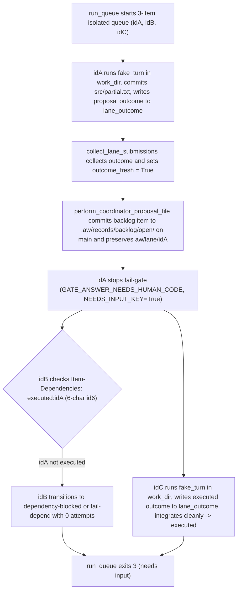

# IPD: Fix test_proposal_continuation_agy and test_proposal_continuation_oc in tests/test_fixfirst_end_to_end.py

- Date: 2026-11-19
- Kind: child
- Concern: `tests/test_fixfirst_end_to_end.py::TestFixFirstEndToEnd._run_proposal_continuation` currently fails for both `oc` (OpenCode runner `oc_runipd`) and `agy` (Antigravity runner `agy_runipd`) with `AssertionError: 1 != 3 : Run exit code must be 3, got 1`. Three test-fixture defects prevent the test from exercising the runner proposal channel under `isolate_worktree=True` and post-cutover `.aw/records/` conventions: 7-character `agy` fixture identifiers (`prp1agy`, `prp2agy`, `prp3agy`) fail `ipd_schema.parse_item_dependencies` (`unparseable dependency token`), `fake_turn` writes outcomes to the driver `outcomes/` directory instead of each isolated lane's `lane_outcome` submission path so `outcome_fresh` remains `False` and `validate_proposal` never runs, and post-run assertions check `.agents/backlog/open` and an inverted `git branch --contains` direction.
- Scope: Update `tests/test_fixfirst_end_to_end.py` (`lane_containment` import and `TestFixFirstEndToEnd._run_proposal_continuation`) to generate 6-character `[0-9a-z]{6}` fixture `id6` identifiers for both `oc` and `agy`, write isolated-turn outcome JSON files to `lane_containment.project_worker_paths(...).lane_outcome` (with an isolated lane commit on `idA`), assert `.aw/records/backlog/open` on `main`, and verify two-way branch non-containment between `main` and `aw/lane/<idA>`. EXCLUDES modifying production runner code (`agent_workflows/runner_shared.py`, `agent_workflows/lane_containment.py`, `agent_workflows/ipd_schema.py`), modifying other tests in `tests/test_fixfirst_end_to_end.py`, or modifying `tests/slow_allowlist.txt`.
- Scope-Paths: tests/test_fixfirst_end_to_end.py, .aw/records/plans/pending/20261119-lflu5y-01-k1qi85-fix-test-proposal-continuation-agy-and-test-proposal-continu.ipd.md
- Item-Dependencies: none
- Status: to-review
- Short-Description: Fix fixture id6 length, isolated lane outcome paths, and post-cutover repo assertions in _run_proposal_continuation
- Work-Kind: bug
- Priority: medium
- From-Backlog: lflu5y
- Blocks-Release: next
- Set: lflu5y
- Order: 1
- Highest E allocated: 03
- Author: Gemini 4 Hydrogen
- Id: k1qi85

> Write and proofread this plan per the technical writing standard, `.aw/system/workflows/technical-writing/technical-writing.md` (`.agents/workflows/technical-writing/technical-writing.md` in a legacy-layout install), including requirement 12 (diagrams).

## Workflow history

- 2026-11-19 to-review (aw set): ready for review: authored for backlog lflu5y
- 2026-11-19 draft (Gemini 4 Hydrogen): created.

## Goal

Restore `tests/test_fixfirst_end_to_end.py::TestFixFirstEndToEnd.test_proposal_continuation_oc` and `test_proposal_continuation_agy` so both tests accurately drive the isolated-worktree proposal continuation flow (`idA` stops `fail-gate` with `GATE_ANSWER_NEEDS_HUMAN_CODE` and files a backlog item under `.aw/records/backlog/open/` on `main`, `idB` cascades to `dependency-blocked` or `fail-depend` on the 6-character `executed:<idA>` edge, `idC` finishes `executed`, and `run_queue` exits `3`).

## Detailed Implementation Checklist (TODO)

Execution-state rule: mark an `E-*` item complete only after performing the action. That mark is not validation. Right-sizing rule: write for a modest executor that cannot hold much in its head. Each E-item is one step (one concern, about one file, executable in one focused pass) and its V-item names each unit it covers with its own check; a plan stays at about 5 E-items and 8 work Scope-Paths, else split it into more child plans (guidance, `IPD-Z603`). Accepted execution states: blocked, failed, pending, performed; terminal gate demands 'performed'.

### Task group 1: Fix fixture id6 identifiers and isolated lane outcome submission

- [ ] E-01 In `tests/test_fixfirst_end_to_end.py::TestFixFirstEndToEnd._run_proposal_continuation`, replace the `prp1{host_label}`, `prp2{host_label}`, and `prp3{host_label}` fixture identifiers with 6-character `[0-9a-z]{6}` `id6` identifiers for both `oc` and `agy` (for example, `suffix = host_label.ljust(3, "0")` giving `pr1oc0`/`pr2oc0`/`pr3oc0` for `oc` and `pr1agy`/`pr2agy`/`pr3agy` for `agy`), and pass those 6-character identifiers to `_write_plan`, `f"Item-Dependencies: executed:{idA}"`, and the queue items (`itemA`, `itemB`, `itemC`).
  - Depends on: none
  - Expected outcome: `agent_workflows/ipd_schema.py::parse_item_dependencies` and `agent_workflows/runner_shared.py::parse_dependency_token` parse `executed:<idA>` cleanly for both `oc` and `agy` without emitting `unparseable dependency token`, and `itemB` evaluates `idA`'s terminal disposition rather than a malformed dependency edge.
  - Execution state: pending

- [ ] E-02 In `tests/test_fixfirst_end_to_end.py`, import `lane_containment` from `agent_workflows`, and update `fake_turn` inside `TestFixFirstEndToEnd._run_proposal_continuation` so that when `work_dir = kw.get("work_dir")` is present under `isolate_worktree=True`: (1) `idA` writes its `failed-safely` outcome payload (with the `tool-defect` proposal) to `lane_containment.project_worker_paths(item=itm, run_id=st["run_id"], run_dir=rd, plan_path=plan_p, lane_root=Path(work_dir)).lane_outcome` (creating parent directories) and commits an isolated lane-local file in `work_dir` (for example `src/partial.txt`), and (2) `idC` writes its `executed` outcome payload to its `paths.lane_outcome` path (falling back to `_write_outcome_file(rd, itm, disposition="executed")` only when `work_dir` is absent) without committing new files in `idC`'s lane.
  - Depends on: E-01
  - Expected outcome: `agent_workflows/runner_shared.py::execute_item_core` collects `"outcome"` via `lane_containment.collect_lane_submissions`, sets `outcome_fresh = True`, runs `validate_proposal` and `perform_coordinator_proposal_file`, commits one open backlog file on `main` under `.aw/records/backlog/open/`, preserves `aw/lane/<idA>` with its unmerged lane commit, marks `idA` as `fail-gate` with `GATE_ANSWER_NEEDS_HUMAN_CODE` (`"awaiting-human-decision"`) and `NEEDS_INPUT_KEY=True`, cascades `idB` to `dependency-blocked` or `fail-depend` with zero attempts, finishes `idC` as `executed`, and returns exit code `3` from `mod.run_queue`.
  - Execution state: pending

### Task group 2: Align repository path and branch assertions with post-cutover behavior

- [ ] E-03 In `tests/test_fixfirst_end_to_end.py::TestFixFirstEndToEnd._run_proposal_continuation`, replace `self.assertIn(".agents/backlog/open", log_out)` with `self.assertIn(".aw/records/backlog/open", log_out)` alongside verifying `len(list((repo / ".aw" / "records" / "backlog" / "open").glob("*.backlog.md"))) == 1`, and verify two-way branch isolation between `main` and `lane_tip_branch = f"aw/lane/{idA}"` by keeping the `git branch --contains` check on `lane_tip_branch` (`self.assertNotIn("main", ...)`) and adding a `git branch --contains main` check asserting `lane_tip_branch` is absent from its output.
  - Depends on: E-02
  - Expected outcome: `python3 -m pytest tests/test_fixfirst_end_to_end.py -k "test_proposal_continuation"` passes both `test_proposal_continuation_oc` and `test_proposal_continuation_agy` with zero skips, and the core suite `python3 -m pytest` passes without regressions.
  - Execution state: pending

Add further leaves as `- [ ] E-NEW <action>` and run `aw ipd sync` to assign ids.

## Project conventions discovered (Step 0)

- `tests/test_fixfirst_end_to_end.py::TestFixFirstEndToEnd` imports `agy_runipd`, `oc_runipd`, `render_stream`, `runner_shared`, and test helpers from `tests/test_turn_fix_it.py` (`_make_test_repo`, `_patch_host_launcher`, `_write_outcome_file`, `_write_plan`).
- Both `test_proposal_continuation_oc` and `test_proposal_continuation_agy` are listed in `tests/slow_allowlist.txt` and are deselected by the default `-m` filter unless targeted explicitly or run via `make test-all` / explicit test path + `-k`.
- Test suite execution rules (`GEMINI.md`): run bare `python3 -m pytest` (or `python3 -m pytest <paths>` for targeted runs); do not pass `-n0`, extra `-q`, or `-p no:randomly`.
- Behavioral test rule (`AGENTS.md`): tests must drive real runner code paths and assert on observable outputs, git state, run state, and exit codes, never pinning production source via `ast`, `inspect`, regex, or line counting.
- Cite code by symbol (`module.function` or `path::Symbol`) or quoted string rather than bare line numbers (`IPD-C801`).

## Findings

| Id | Source inspected | Finding |
|---|---|---|
| F-01 | `tests/test_fixfirst_end_to_end.py::_run_proposal_continuation`, `agent_workflows/ipd_schema.py::parse_item_dependencies`, `agent_workflows/runner_shared.py::parse_dependency_token` | `_run_proposal_continuation` sets `idA = f"prp1{host_label}"` and `idB = f"prp2{host_label}"`. When `host_label == "agy"`, `prp1agy` has 7 characters, so `parse_dependency_token("executed:prp1agy")` fails `ipd_schema.parse_item_dependencies` (`[0-9a-z]{6}`), blocking `prp2agy` with `executed:prp1agy (unparseable dependency token)`. |
| F-02 | `tests/test_fixfirst_end_to_end.py::_run_proposal_continuation`, `agent_workflows/runner_shared.py::execute_item_core`, `agent_workflows/lane_containment.py::collect_lane_submissions` | `_run_proposal_continuation` runs with `isolate_worktree=True`, where `execute_item_core` sets `outcome_fresh = True` only when `collect_lane_submissions` collects `"outcome"` from `project_worker_paths(...).lane_outcome` inside `work_dir`. Writing `idA`'s outcome only to `rd / "outcomes"` leaves `outcome_fresh = False`, skips `validate_proposal` and `perform_coordinator_proposal_file`, lets `reconcile_disposition` map `"failed-safely"` to `"fail-gate"`, and lets mocked `driver_finalize` with `no_verify=True` finalize `idA` to `executed` (run exit code `1`). |
| F-03 | `tests/test_fixfirst_end_to_end.py::_run_proposal_continuation`, `agent_workflows/runner_shared.py::perform_coordinator_proposal_file`, `agent_workflows/project_context.py::project_records_dir` | `_write_plan` places plans under `.aw/records/plans/pending/`, and `perform_coordinator_proposal_file` files material proposals via `aw backlog new` into `project_records_dir(coord.path) / "backlog" / "open"` (`.aw/records/backlog/open/`), whereas `_run_proposal_continuation` asserts `".agents/backlog/open"` in `git log -1 --name-status main`. |
| F-04 | `tests/test_fixfirst_end_to_end.py::_run_proposal_continuation` | Without a lane commit on `work_dir` for `idA`, `aw/lane/<idA>` stays on the pre-proposal base commit, which becomes an ancestor of `main` once `perform_coordinator_proposal_file` commits the backlog record; `git branch --contains aw/lane/<idA>` then includes `main` and fails `assertNotIn("main", contains_out.stdout)`. |
| F-05 | `python3 -m pytest tests/test_fixfirst_end_to_end.py -k "test_proposal_continuation" -v` (observed pre-fix failure) | Both `test_proposal_continuation_oc` and `test_proposal_continuation_agy` fail with `AssertionError: 1 != 3 : Run exit code must be 3, got 1`; `prp1oc`/`prp1agy` and `prp3oc`/`prp3agy` finish `executed`, while `prp2agy` reports `fail-depend (executed:prp1agy (unparseable dependency token))`. |

## Behavior decisions

- **Fix the test fixture rather than loosening `id6` validation or `outcome_fresh` rules.** `ipd_schema.parse_item_dependencies` intentionally enforces 6-character `id6` tokens, `execute_item_core` intentionally requires `collect_lane_submissions` to confirm isolated worker outcomes before honoring proposals, and `perform_coordinator_proposal_file` intentionally files into `.aw/records/backlog/open/` via `project_records_dir`. Aligning `_run_proposal_continuation` with those contracts preserves production guarantees and exercises the real isolated-lane proposal path.
- **Commit a lane-local change on `idA` and check both `git branch --contains` directions.** Making one non-plan commit on `work_dir` during `idA`'s `fake_turn` models partial in-lane work halted by an out-of-scope defect and makes `main` and `aw/lane/<idA>` mutually non-containing, proving both that `aw/lane/<idA>` never merged onto `main` and that `aw/lane/<idA>` does not contain `main`'s proposal commit.

## Proposed changes (ordered, validatable)

1. Update `_run_proposal_continuation` fixture IDs (`idA`, `idB`, `idC`) to 6-character `[0-9a-z]{6}` strings for both `oc` and `agy` (E-01).
2. Import `lane_containment` in `tests/test_fixfirst_end_to_end.py` and write `idA` and `idC` outcomes inside `work_dir` at `lane_containment.project_worker_paths(...).lane_outcome`, committing a lane-local file for `idA` (E-02).
3. Update the proposal path assertion to `.aw/records/backlog/open` (plus checking the single `.backlog.md` file on `main`) and assert mutual non-containment between `main` and `aw/lane/<idA>` (E-03).

## Deferred / out of scope (with reason)

- Rewriting `_write_outcome_file` in `tests/test_turn_fix_it.py` or changing other `TestFixFirstEndToEnd` matrix methods.
  - Carrier-Declined: Existing matrix tests in `tests/test_fixfirst_end_to_end.py` already pass and are outside backlog item `lflu5y`'s scope (`test_proposal_continuation_agy` and `test_proposal_continuation_oc`).

## Scope check

- Over-scope: none.
- Under-scope: none. The only modified test file (`tests/test_fixfirst_end_to_end.py`) and this plan file are listed in `- Scope-Paths:`.

## Required tests / validation

- Targeted proposal continuation tests (explicit file path overrides the default `slow` marker skip):
  `python3 -m pytest tests/test_fixfirst_end_to_end.py -k "test_proposal_continuation" -v`
- Non-core suite parity check for `test_fixfirst_end_to_end.py`:
  `python3 -m pytest tests/test_fixfirst_end_to_end.py`
- Full core test suite before finalizing:
  `python3 -m pytest`

## Spec / documentation sync

N/A with reason: Test-fixture alignment in `tests/test_fixfirst_end_to_end.py`; no runner contracts, CLI flags, schemas, or specs change.

## Open questions

None open. Repository evidence (`agent_workflows/runner_shared.py`, `agent_workflows/lane_containment.py`, `agent_workflows/ipd_schema.py`, and observed pytest failures) establishes all three fixture defects without ambiguity.

## Validation and cross-check (verify before reporting done)

Validation-state rule: inspect evidence in a separate pass. Do not mark a `V-*` item complete from memory or from the matching execution checkmark. Accepted validation results: blocked, failed, pass, pending; terminal gate demands 'pass'. Runtime-demonstration reachability rule: for each `V-*` item demanding the software be observed acting (such as a run, a dispatch, or a transition)—as distinct from items demanding a diff, a file's content, or a test result, which are reachable by construction—name the code path that produces the observation or the sibling `E-*` that creates it, else the demand is UNDER-SCOPE.

- [ ] V-01 validates E-01
  - Required evidence: paste `git diff tests/test_fixfirst_end_to_end.py` showing 6-character `[0-9a-z]{6}` fixture `id6` values for both `oc` and `agy`, and paste `python3 -m pytest tests/test_fixfirst_end_to_end.py -k "test_proposal_continuation" -v` output confirming zero `unparseable dependency token` errors for `idB` in both `test_proposal_continuation_oc` and `test_proposal_continuation_agy`.
  - Observed evidence:
  - Result: pending
- [ ] V-02 validates E-02
  - Required evidence: paste `git diff tests/test_fixfirst_end_to_end.py` showing the `lane_containment` import, `lane_containment.project_worker_paths(...).lane_outcome` writes for `idA` and `idC`, and the `work_dir` commit for `idA`, plus `python3 -m pytest tests/test_fixfirst_end_to_end.py -k "test_proposal_continuation" -v -s` output showing `[V-03] host=oc exit_code=3 statusA=fail-gate refusalA=awaiting-human-decision` and `[V-03] host=agy exit_code=3 statusA=fail-gate refusalA=awaiting-human-decision` with `statusC=executed`.
  - Observed evidence:
  - Result: pending
- [ ] V-03 validates E-03
  - Required evidence: paste `git diff tests/test_fixfirst_end_to_end.py` showing `.aw/records/backlog/open` and two-way `git branch --contains` assertions, paste `python3 -m pytest tests/test_fixfirst_end_to_end.py -k "test_proposal_continuation" -v` output showing `2 passed` (zero skipped), and paste the final `python3 -m pytest` summary after the last edit.
  - Observed evidence:
  - Result: pending

## Approval and execution gate

- Size assessment: standard
- Cohesion rationale: not required

This plan fixes one cohesive test-fixture defect in `tests/test_fixfirst_end_to_end.py::TestFixFirstEndToEnd._run_proposal_continuation` affecting `test_proposal_continuation_oc` and `test_proposal_continuation_agy`. Execution may begin once a human sets `- Status: approved` (or via an authorized automated gate). Upon completion, verify every `V-*` item with pasted tool output, commit only the scoped file through `aw commit k1qi85 -- tests/test_fixfirst_end_to_end.py`, and finalize the plan lifecycle to `executed/`.
