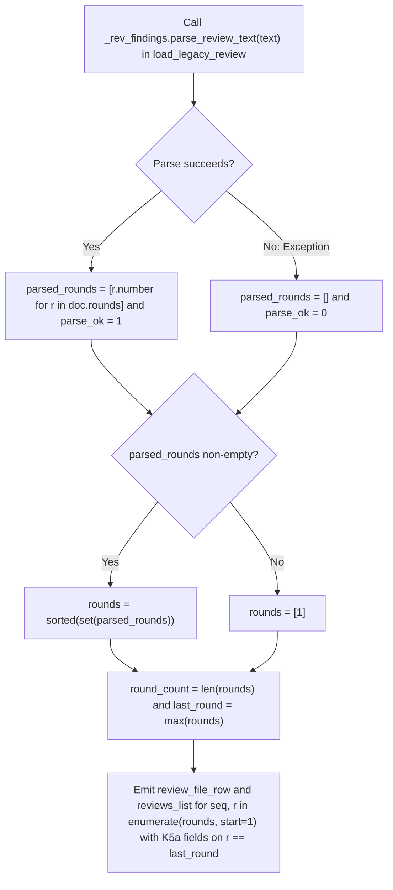

# IPD: Fix load_legacy_review round parsing to match anchored headings and preserve sparse rounds

- Date: 2026-11-19
- Kind: child
- Concern: `agent_workflows/artifact_meta.py::load_legacy_review` (and the matching round check in `agent_workflows/meta_cli.py::check_meta`) parses round headings with the unanchored regex `r"^## Round (\d+)"`, and `load_legacy_review` emits `range(1, max(rounds) + 1)` rows. The unanchored regex falsely matches headings such as `## Round 1 escalation`, ignores fenced code blocks, and diverges from `agent_workflows/review_findings.py::_ROUND_RE` (`r"^##\s+Round\s+(\d+)\s*$"`). Expanding `range(1, max + 1)` invents phantom rounds for sparse review records (for example `[1, 3, 4]` or `[11]`) and reports `max(rounds)` instead of the count of distinct round headings as `round_count`.
- Scope: Update `agent_workflows/artifact_meta.py::load_legacy_review` to derive `rounds` from `agent_workflows/review_findings.py::parse_review_text` (matching anchored `## Round <n>` headings outside fenced code blocks), deduplicate and sort `rounds` ascending (`sorted(set(parsed_rounds))` with `[1]` fallback when empty), set `round_count = len(rounds)` and `last_round = max(rounds)`, and emit one `reviews` row per observed round in `rounds` using contiguous 1-based `seq` values and attaching `Verdict`, `Reviewer`, `Reviewed-At`, `Readiness`, `Review-Depth`, and `Findings` only when `r == last_round`; align `agent_workflows/meta_cli.py::check_meta` to extract review file rounds via `agent_workflows/review_findings.py::parse_review_text` (replacing `_ROUND_HEADING_RE`) and update `tests/test_check_meta.py::test_drift_review_rounds` (which previously depended on phantom round synthesis); add behavioral unit tests in `tests/test_artifact_meta_legacy.py` and end-to-end cache and CLI history tests in `tests/test_show_history.py`; and add one `- Fixed:` entry in `CHANGELOG.md`. EXCLUDES: modifying `agent_workflows/review_sequence.py::_extract_last_round_text` or `agent_workflows/review_tier.py::parse_tier_answers` (which slice prose sections for Step P and Step T rather than populating `review_files` or `reviews`), changing the SQLite `reviews` table primary key `(subject_id6, seq)` for multi-file subjects, and modifying `agent_workflows/migrations/m0001_convert.py`.
- Scope-Paths: agent_workflows/artifact_meta.py, agent_workflows/meta_cli.py, tests/test_artifact_meta_legacy.py, tests/test_show_history.py, tests/test_check_meta.py, CHANGELOG.md, .aw/records/plans/pending/20261119-lz1igw-01-sz4h5i-fix-load-legacy-review-round-parsing-to-match-anchored-headi.ipd.md
- Item-Dependencies: none
- Status: reviewed
- Readiness: go-pending-approval
- Review-Depth: standard
- Short-Description: Use review_findings.parse_review_text in load_legacy_review and preserve sparse round numbers instead of range(1, max+1)
- Work-Kind: bug
- Priority: medium
- From-Backlog: lz1igw
- Blocks-Release: next
- Set: lz1igw
- Order: 1
- Highest E allocated: 05
- Author: antigravity/gemini
- Id: sz4h5i

> Write and proofread this plan per the technical writing standard, `.aw/system/workflows/technical-writing/technical-writing.md` (`.agents/workflows/technical-writing/technical-writing.md` in a legacy-layout install), including requirement 12 (diagrams).

## Workflow history

- 2026-11-21 reviewed (aw set): APPROVE WITH REVISIONS APPLIED; PR-001..PR-004 FIXED
- 2026-11-21 /plan-review (antigravity/gemini-4-neon-high): APPROVE WITH REVISIONS APPLIED; PR-001, PR-002, PR-003, PR-004
- 2026-11-19 to-review (aw set): Authored review-ready plan graduated from backlog lz1igw
- 2026-11-19 draft (antigravity/gemini): created.

## Goal

Align `agent_workflows/artifact_meta.py::load_legacy_review` and `agent_workflows/meta_cli.py::check_meta` with `agent_workflows/review_findings.py::parse_review_text` and `agent_workflows/migrations/m0001_convert.py::_parse_review_file_raw` so review round parsing matches only anchored `## Round <n>` headings outside fenced code blocks and preserves sparse round numbers instead of synthesizing `range(1, max + 1)`.

## Detailed Implementation Checklist (TODO)

Execution-state rule: mark an `E-*` item complete only after performing the action. That mark is not validation. Right-sizing rule: write for a modest executor that cannot hold much in its head. Each E-item is one step (one concern, about one file, executable in one focused pass) and its V-item names each unit it covers with its own check; a plan stays at about 5 E-items and 8 work Scope-Paths, else split it into more child plans (guidance, `IPD-Z603`). Accepted execution states: blocked, failed, pending, performed; terminal gate demands 'performed'.

### Task group 1: Fix load_legacy_review round extraction, add tests, and run gates

- [ ] E-01 Before editing any tracked file, save `aw check --agent > .aw/state/sz4h5i/check-before.jsonl` (`mkdir -p .aw/state/sz4h5i`). In `agent_workflows/artifact_meta.py::load_legacy_review`, replace the `re.findall(r"^## Round (\d+)", text, re.MULTILINE)` block and `for r in range(1, round_count + 1):` loop with a single `_rev_findings.parse_review_text(text)` call inside the `try` block that sets `parse_ok`:
  1. Capture `doc = _rev_findings.parse_review_text(text)` and extract `parsed_rounds = [r.number for r in doc.rounds]`; if `parse_review_text` raises an `Exception`, keep `parse_ok = 0` and `parsed_rounds = []`.
  2. Set `rounds = sorted(set(parsed_rounds)) if parsed_rounds else [1]`, `round_count = len(rounds)`, and `last_round = max(rounds)`.
  3. Build `reviews_list` by iterating `for seq, r in enumerate(rounds, start=1):` with `is_last = r == last_round`, setting `"seq": seq` and `"round": r`, and attaching `verdict`, `legacy_verdict`, `observed_day`, `readiness`, `review_depth`, `findings_summary`, and `reviewer` only when `is_last` is `True`.
  - Depends on: none
  - Expected outcome: `load_legacy_review` emits one `reviews_list` entry per unique `## Round <n>` heading outside fenced code blocks, sets `review_file_row["round_count"]` to `len(rounds)`, and omits synthetic intermediate rounds.
  - Execution state: pending

- [ ] E-02 Add behavioral unit tests to `tests/test_artifact_meta_legacy.py` (which sets module-level `pytestmark = pytest.mark.core`) calling `agent_workflows/artifact_meta.py::load_legacy_review` directly (with zero source-code inspection):
  1. **Sparse rounds** (`## Round 1`, `## Round 3`, `## Round 4`): assert `rf_row["round_count"] == 3`, `[r["round"] for r in reviews] == [1, 3, 4]`, `[r["seq"] for r in reviews] == [1, 2, 3]`, and verdict/reviewer/`observed_day` appear only on round `4`.
  2. **Single high round** (`## Round 11` only): assert `rf_row["round_count"] == 1`, `[r["round"] for r in reviews] == [11]`, `[r["seq"] for r in reviews] == [1]`, and verdict/`observed_day` appear on round `11`.
  3. **Anchored heading and fenced code block exclusion**: include `## Round 2 escalation`, `## Round 99 notes`, and a fenced code block containing `## Round 5` alongside real headings `## Round 1` (plus case/whitespace variant `## round  3  `) and assert only `[1, 3]` are loaded (`rf_row["round_count"] == 2`, `[r["round"] for r in reviews] == [1, 3]`).
  4. **Reverse-chronological and duplicate headings** (`## Round 2`, `## Round 1`, `## Round 2`): assert `rf_row["round_count"] == 2`, `[r["round"] for r in reviews] == [1, 2]`, and verdict/reviewer attach to round `2`.
  5. **Missing round headings**: a `.review.md` file with no `## Round <n>` heading keeps the fallback `rf_row["round_count"] == 1` and `[r["round"] for r in reviews] == [1]`.
  - Depends on: E-01
  - Expected outcome: All existing and new tests in `tests/test_artifact_meta_legacy.py` pass under `python3 -m pytest`.
  - Execution state: pending

- [ ] E-03 Add a behavioral CLI and SQLite cache round-trip test to `tests/test_show_history.py` that writes a legacy plan and a review file containing sparse rounds (`## Round 1`, `## Round 3`), an unanchored heading (`## Round 2 escalation`), and a fenced block containing `## Round 4`, runs `aw show <id6> --history --format json`, and asserts the `review` history events have `[e["round"] for e in review_events] == [1, 3]` with `verdict` only on round `3`, and that `agent_workflows/artifact_meta.py::review_rows` reports `round_count == 2`.
  - Depends on: E-01
  - Expected outcome: `tests/test_show_history.py` passes and verifies end-to-end persistence through `check_freshness`, SQLite `review_files` and `reviews` tables, and `aw show --history --format json`.
  - Execution state: pending

- [ ] E-04 In `agent_workflows/meta_cli.py::check_meta`, replace `_ROUND_HEADING_RE.findall(rf_text)` (and remove the unanchored `_ROUND_HEADING_RE` constant if unused) with `[r.number for r in review_findings.parse_review_text(rf_text).rounds]` (preserving duplicate round occurrences in `doc.rounds` for `len(file_rounds) != len(set(file_rounds))`). In `tests/test_check_meta.py::test_drift_review_rounds`, update the test so it no longer relies on phantom `range(1, max + 1)` synthesis for sparse `[1, 3]` files, and instead verifies: (a) genuine duplicate round headings (`## Round 1` repeated twice) and logged-vs-file round mismatches report `meta.review-rounds-drift`, and (b) a sparse review file (`## Round 1`, `## Round 3`) and a review file containing unanchored (`## Round 2 escalation`) and fenced (`## Round 4`) headings report zero `meta.review-rounds-drift` errors.
  - Depends on: E-01
  - Expected outcome: `agent_workflows/meta_cli.py::check_meta` agrees with `agent_workflows/artifact_meta.py::load_legacy_review` and `agent_workflows/review_findings.py::parse_review_text`, and all tests in `tests/test_check_meta.py` pass under `python3 -m pytest`.
  - Execution state: pending

- [ ] E-05 Add one `- Fixed:` bullet under `CHANGELOG.md#2.0.0 (pending) - AW project layout, storage backends, install wizard, and operational state` (with no em or en dashes): legacy review loading and `aw check meta` now parse only anchored `## Round <n>` headings outside fenced code blocks and preserve sparse round numbers instead of synthesizing intermediate rounds. Run `python3 -m pytest tests/test_artifact_meta_legacy.py tests/test_show_history.py tests/test_check_meta.py`, bare `python3 -m pytest`, `make typecheck`, `aw check --agent` (diffed by `(location, rule)` against `.aw/state/sz4h5i/check-before.jsonl` with zero added error or warning pairs), `aw ipd lint --phase pre-transition --agent` on this plan, and `aw sanitize --agent`, then commit only modified `- Scope-Paths:` files via `aw commit sz4h5i -- <paths>`. Never push.
  - Depends on: E-02, E-03, E-04
  - Expected outcome: All targeted tests, core suite, type checks, repo checks, plan lint, and sanitizer checks pass, and one path-scoped commit is recorded.
  - Execution state: pending

Add further leaves as `- [ ] E-NEW <action>` and run `aw ipd sync` to assign ids.

## Project conventions discovered (Step 0)

- `agent_workflows/review_findings.py::parse_review_text` defines `_ROUND_RE = re.compile(r"^##\s+Round\s+(\d+)\s*$", re.IGNORECASE)` and tracks fenced code blocks (`_FENCE_RE`) so headings with trailing words or headings inside code fences are ignored.
- `agent_workflows/artifact_meta.py` already imports `review_findings as _rev_findings`, and `load_legacy_review` already calls `_rev_findings.parse_review_text(text)` to compute `parse_ok`.
- `agent_workflows/migrations/m0001_convert.py::_parse_review_file_raw` computes review rounds with `doc = review_findings.parse_review_text(work_text, path=review_path)`, `raw_rounds = [r.number for r in doc.rounds] if doc.rounds else [1]`, `rounds = tuple(sorted(set(raw_rounds)))`, and `last_round = max(rounds)`.
- `agent_workflows/artifact_meta.py::history` queries `SELECT r.seq, r.round, ... FROM reviews r WHERE r.subject_id6 = ? ORDER BY r.seq` and outputs `rv[1]` (`round`) without returning `seq`; the SQLite `reviews` primary key is `(subject_id6, seq)`.
- Spec `4sd62s` (`20260925-metastore-01-4sd62s-artifact-metadata-store.spec.md`) defines `REVIEW_FILES.round_count` as the count of `Round n` headings and requires K5a metadata (`Verdict`, `Reviewer`, `Reviewed-At`) on the final round only.
- `AGENTS.md` forbids code-pinning tests (`inspect`, `ast`, regex, or source substring checks) and forbids em or en dashes in user-facing prose such as `CHANGELOG.md`.

## Findings

| Id | Finding | Evidence |
| --- | --- | --- |
| F-01 | `agent_workflows/artifact_meta.py::load_legacy_review` and `agent_workflows/meta_cli.py::check_meta` use the unanchored regex `r"^## Round (\d+)"` and ignore code fences. | Observed on 2026-11-21 across `.aw/records/reviews/` (1,523 `.review.md` files): 4 files contain `## Round 1 escalation` that `r"^## Round (\d+)"` falsely matches while `agent_workflows/review_findings.py::parse_review_text` ignores it. |
| F-02 | `agent_workflows/artifact_meta.py::load_legacy_review` expands `range(1, max(rounds) + 1)` and sets `round_count = max(rounds)`. | Observed on 2026-11-21 across `.aw/records/reviews/`: 29 files have sparse or single high rounds (such as `[1, 3, 4]`, `[6]`, and `[11]`) where `load_legacy_review` invents phantom rounds and reports `max(rounds)` instead of `len(rounds)`, disagreeing with `agent_workflows/migrations/m0001_convert.py::_parse_review_file_raw`. |
| F-03 | Unsorted reverse-chronological headings appear in real review records. | Three files in `.aw/records/reviews/` (`hostdedup-00`, `hostdedup-01`, `hostdedup-02`) place `## Round 2` before `## Round 1`. Sorting deduplicated rounds (`sorted(set(parsed_rounds))`) orders `1` before `2` and anchors `last_round = max(rounds)` on Round 2, matching `agent_workflows/migrations/m0001_convert.py::_parse_review_file_raw`. |
| F-04 | `tests/test_check_meta.py::test_drift_review_rounds` depends on phantom round synthesis and `agent_workflows/meta_cli.py::check_meta` keeps an unanchored `_ROUND_HEADING_RE`. | `tests/test_check_meta.py::test_drift_review_rounds` (core tier) feeds a sparse `[1, 3]` file expecting `load_legacy_review` to cache `[1, 2, 3]` and trigger `meta.review-rounds-drift`; once `E-01` fixes sparse preservation, that test fails unless updated, and `agent_workflows/meta_cli.py::_ROUND_HEADING_RE` would emit false `meta.review-rounds-drift` on unanchored or fenced `## Round` text. |

## Proposed changes (ordered, validatable)

1. **Parse anchored rounds and preserve sparse round numbers (`E-01`)**: Update `agent_workflows/artifact_meta.py::load_legacy_review` to reuse `agent_workflows/review_findings.py::parse_review_text` for round extraction, compute `rounds = sorted(set(parsed_rounds)) if parsed_rounds else [1]`, set `round_count = len(rounds)` and `last_round = max(rounds)`, and iterate `enumerate(rounds, start=1)` to build `reviews_list` with `seq` and `round` (`r`), placing K5a fields on `r == last_round`.
2. **Cover unit edge cases (`E-02`)**: Add behavioral unit tests in `tests/test_artifact_meta_legacy.py` for sparse rounds, single high rounds, unanchored heading and fenced block exclusions, reverse-ordered or duplicate headings, and missing round headings.
3. **Cover cache and CLI history round-trip (`E-03`)**: Add a behavioral test in `tests/test_show_history.py` driving `aw show <id6> --history --format json` and `agent_workflows/artifact_meta.py::review_rows` against a review file with sparse, unanchored, and fenced headings.
4. **Align `check_meta` round extraction and update drift tests (`E-04`)**: Update `agent_workflows/meta_cli.py::check_meta` to extract file rounds via `agent_workflows/review_findings.py::parse_review_text` instead of `_ROUND_HEADING_RE`, and update `tests/test_check_meta.py::test_drift_review_rounds` to cover genuine duplicate/logged-drift errors and zero drift on sparse, unanchored, and fenced review files.
5. **Document fix and run all gates (`E-05`)**: Add one user-facing `- Fixed:` bullet to `CHANGELOG.md` without em or en dashes, run targeted tests, bare `python3 -m pytest`, `make typecheck`, `aw check --agent`, `aw ipd lint --phase pre-transition --agent`, and `aw sanitize --agent`, and commit via `aw commit sz4h5i`.

## Deferred / out of scope (with reason)

- Prose section extractors `agent_workflows/review_sequence.py::_extract_last_round_text` and `agent_workflows/review_tier.py::parse_tier_answers`: intentionally extract the last `## Round` prose block for Step P and Step T rather than populating `review_files` or `reviews`.
  - Carrier-Declined: Intentionally out of scope; backlog `lz1igw` is scoped to review round parsing for metadata cache loading and checks.
- Multi-file review `seq` primary key collisions in the SQLite `reviews` table (`PRIMARY KEY (subject_id6, seq)` when multiple files bind to one `subject_id6` in phase B): pre-existing schema limitation documented in `agent_workflows/artifact_meta.py::review_rows` and tracked separately from round parsing.
  - Carrier-Declined: Intentionally out of scope; changing the SQLite `reviews` primary key schema is outside `load_legacy_review` round parsing.

## Scope check

- Over-scope: none. Only `agent_workflows/artifact_meta.py`, `agent_workflows/meta_cli.py`, `tests/test_artifact_meta_legacy.py`, `tests/test_show_history.py`, `tests/test_check_meta.py`, `CHANGELOG.md`, and this plan are modified.
- Under-scope: none. Fixing round heading matching (via `agent_workflows/review_findings.py::parse_review_text`) and sparse round emission in `load_legacy_review`, aligning `meta_cli.check_meta`, and updating `tests/test_check_meta.py::test_drift_review_rounds` ensures parity with `agent_workflows/migrations/m0001_convert.py::_parse_review_file_raw` across all review files and prevents core-suite regression.

## Required tests / validation

- Targeted suite: `python3 -m pytest tests/test_artifact_meta_legacy.py tests/test_show_history.py tests/test_check_meta.py`
- Full core suite: bare `python3 -m pytest`
- Type check: `make typecheck`
- Repo integrity check: `aw check --agent` compared by `(location, rule)` against `.aw/state/sz4h5i/check-before.jsonl`
- Plan lint and sanitizer: `aw ipd lint --phase pre-transition --agent` on this plan and `aw sanitize --agent`

## Spec / documentation sync

- Aligns `agent_workflows/artifact_meta.py::load_legacy_review` and `agent_workflows/meta_cli.py::check_meta` with artifact metadata store spec `4sd62s` (`.aw/records/specs/approved/20260925-metastore-01-4sd62s-artifact-metadata-store.spec.md`) Sections `4.1a` (`K5a`), `4.6`, and `4.9.1` (`REVIEW_FILES.round_count` and `REVIEWS.round`). User-facing release note: one `- Fixed:` bullet in `CHANGELOG.md` (`E-05`).

## Open questions

### OQ-01: What `seq` values should `load_legacy_review` assign to sparse rounds, and in what order?

- Blocking: no
- Status: resolved
- Owner: plan author
- Resolution or deferral rationale: Sort and deduplicate parsed round numbers with `rounds = sorted(set(parsed_rounds)) if parsed_rounds else [1]`, matching `agent_workflows/migrations/m0001_convert.py::_parse_review_file_raw`, and assign contiguous 1-based `seq` values via `enumerate(rounds, start=1)`. Using `sorted(set(...))` handles reverse-chronological files (`## Round 2` before `## Round 1`) and duplicate headings identically to `m0001_convert`, ensures `last_round = max(rounds)` receives K5a metadata, keeps `seq` identical to `round` for dense `1..N` files, and keeps `artifact_meta.history`'s `ORDER BY r.seq` in ascending round order.

## Validation and cross-check (verify before reporting done)

Validation-state rule: inspect evidence in a separate pass. Do not mark a `V-*` item complete from memory or from the matching execution checkmark. Accepted validation results: blocked, failed, pass, pending; terminal gate demands 'pass'. Runtime-demonstration reachability rule: for each `V-*` item demanding the software be observed acting (such as a run, a dispatch, or a transition)—as distinct from items demanding a diff, a file's content, or a test result, which are reachable by construction—name the code path that produces the observation or the sibling `E-*` that creates it, else the demand is UNDER-SCOPE.

- [ ] V-01 validates E-01
  - Required evidence: paste `git diff agent_workflows/artifact_meta.py` showing `load_legacy_review` calling `_rev_findings.parse_review_text(text)`, computing `rounds = sorted(set(parsed_rounds)) if parsed_rounds else [1]`, setting `round_count = len(rounds)` and `last_round = max(rounds)`, and iterating `enumerate(rounds, start=1)` without `re.findall(r"^## Round (\d+)", ...)` or `range(1, round_count + 1)`.
  - Observed evidence:
  - Result: pending

- [ ] V-02 validates E-02
  - Required evidence: paste `python3 -m pytest -v tests/test_artifact_meta_legacy.py` output showing every existing test and the new sparse-round, single-high-round, anchored-heading/fenced-block, reverse/duplicate-round, and missing-round tests PASSED (0 failures, 0 skips), plus `rg -n "^(import|from) (inspect|ast)\b" tests/test_artifact_meta_legacy.py` exiting 1.
  - Observed evidence:
  - Result: pending

- [ ] V-03 validates E-03
  - Required evidence: paste `python3 -m pytest -v tests/test_show_history.py` output showing all existing tests and the new sparse/anchored/fenced round-trip test PASSED (0 failures, 0 skips), plus `rg -n "^(import|from) (inspect|ast)\b" tests/test_show_history.py` exiting 1.
  - Observed evidence:
  - Result: pending

- [ ] V-04 validates E-04
  - Required evidence: paste `git diff agent_workflows/meta_cli.py tests/test_check_meta.py` showing `check_meta` using `review_findings.parse_review_text` instead of `_ROUND_HEADING_RE` and the updated drift/non-drift assertions in `tests/test_check_meta.py`, plus `python3 -m pytest -v tests/test_check_meta.py` output (0 failures, 0 skips) and `rg -n "^(import|from) (inspect|ast)\b" tests/test_check_meta.py` exiting 1.
  - Observed evidence:
  - Result: pending

- [ ] V-05 validates E-05
  - Required evidence: paste the `CHANGELOG.md` diff hunk (confirming no em or en dashes), `python3 -m pytest tests/test_artifact_meta_legacy.py tests/test_show_history.py tests/test_check_meta.py` output, the bare `python3 -m pytest` summary line, `make typecheck` output, the `(location, rule)` diff of `aw check --agent` against `.aw/state/sz4h5i/check-before.jsonl` showing zero added errors or warnings, `aw ipd lint --phase pre-transition --agent` output on this plan, `aw sanitize --agent` output (`outcome: "clean"`), and `git show --stat` confirming only `- Scope-Paths:` files were committed via `aw commit sz4h5i`.
  - Observed evidence:
  - Result: pending

## Approval and execution gate

- Size assessment: standard
- Cohesion rationale: not required

- **Preconditions**: Execute only after human approval (`- Status: approved`) and with all blocking open questions resolved (`OQ-01` is resolved and non-blocking).
- **Scope fence**: Intended edits are declared in `- Scope-Paths:`. Do not stop over a scope variance; if execution requires editing an undeclared path or leaving a declared path unmodified, complete the work and supply `--scope-reason` per out-of-scope path or `--scope-ack` per unmodified path at finalization.
- **Honesty rule**: You MUST paste the actual runner output for every test, lint, typecheck, and verification claim in `Observed evidence:`. Never claim a check passed without running it.
- **Shared-checkout safety and commit**: Never revert, stage, commit, discard, reformat, or clean up another party's uncommitted changes or untracked files. Verify staged paths and commit only files modified for this plan through `aw commit sz4h5i -- <paths>` (never `git add -A`, `git commit -a`, or `--no-verify`, and never push without explicit human direction).
- **Lifecycle transition**: When dispatched by `aw oc run` or `aw agy run`, leave terminal finalization to the runner; when executed directly by hand, run `aw ipd finalize sz4h5i` after all `E-*` items are `performed` and all `V-*` items are `pass` (never hand-roll `git mv` to `executed/`). After finalization and verification, close backlog item `lz1igw` via `aw backlog set done lz1igw --carrier-evidence ...` as a separate post-finalization step (outside this plan's `- Scope-Paths:`).
