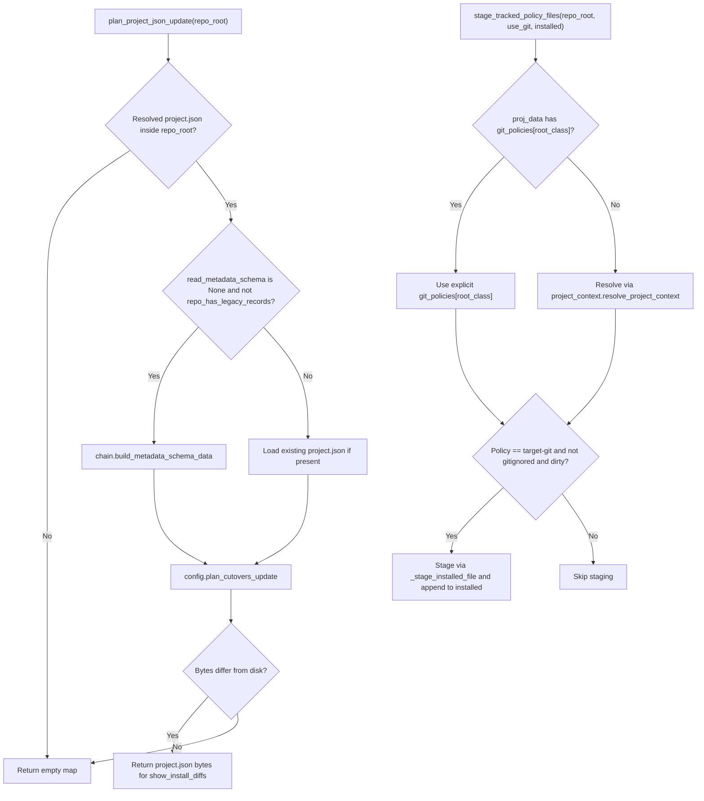

# IPD: Align project.json preview parity and staging when git_policies is absent

- Date: 2026-11-19
- Kind: child
- Concern: `agent_workflows/engine.py::install_into_repo` writes `.aw/config/project.json` outside the `--diff` preview branch (`engine.run`), causing `tests/test_installer_scaffold_preview_parity.py::test_preview_proposed_set_is_superset_of_declarative_scaffolding_parity` to fail. In addition, `install_into_repo` runs `config.sync_cutovers_on_install` before `chain.write_metadata_schema` and `engine.stage_tracked_policy_files` skips `.aw/config/project.json` when `git_policies` is absent, causing `tests/test_installer.py::InstallerEndToEndTests::test_tool_scripts_are_executable_and_staged` to fail on re-run with `M .aw/config/project.json` unstaged.
- Scope: Extract side-effect-free `.aw/config/project.json` update planners in `agent_workflows/migrations/chain.py` and `agent_workflows/config.py`; compose them in a new `engine.plan_project_json_update` helper shared with `engine.run`'s `--diff` preview via `engine.show_install_diffs`; run `chain.write_metadata_schema` before `config.sync_cutovers_on_install` inside `engine.install_into_repo` so fresh installs write both `metadata_schema` and `cutovers` in the first pass; update `engine.stage_tracked_policy_files` to resolve missing `git_policies` entries through `project_context.resolve_project_context`; add behavioral parity and staging tests in `tests/test_installer_scaffold_preview_parity.py` and `tests/test_installer.py` without weakening existing assertions; and add one `- Fixed:` entry to `CHANGELOG.md`. EXCLUDES: adding `.aw/config/project.json` to `allowed_residual_fixed`, adding `.aw/config/project.json` to `collect_scaffold_members`, adding a `--diff` flag to `aw install`, modifying `install_wizard.persist_project_policy`, and changing `--diff` behavior for `.aw/.gitignore`, `AGENTS.md`, root `.gitignore`, `layout.json`, or `managed-sections.json`.
- Scope-Paths: agent_workflows/config.py, agent_workflows/migrations/chain.py, agent_workflows/engine.py, tests/test_installer_scaffold_preview_parity.py, tests/test_installer.py, CHANGELOG.md, .aw/records/plans/pending/20261119-o2or8a-01-ippuby-align-project-json-preview-parity-and-staging-when-git-polic.ipd.md
- Item-Dependencies: none
- Status: to-review
- Short-Description: Preview .aw/config/project.json in --diff alongside install_into_repo and resolve missing git_policies when staging
- Work-Kind: bug
- Priority: medium
- From-Backlog: o2or8a
- Blocks-Release: next
- Set: o2or8a
- Order: 1
- Highest E allocated: 05
- Author: antigravity/gemini
- Id: ippuby

> Write and proofread this plan per the technical writing standard, `.aw/system/workflows/technical-writing/technical-writing.md` (`.agents/workflows/technical-writing/technical-writing.md` in a legacy-layout install), including requirement 12 (diagrams).

## Workflow history

- 2026-11-20 to-review (antigravity/gemini): Authored review-ready plan graduated from backlog o2or8a.
- 2026-11-20 draft (antigravity/gemini): created.

## Goal

Make `engine.run`'s `--diff` preview and `engine.install_into_repo` account identically for `.aw/config/project.json` without widening `allowed_residual_fixed`, and make `install_into_repo` write and stage a minimal `.aw/config/project.json` cleanly in one pass so re-running the installer leaves `git status --porcelain` empty.

## Detailed Implementation Checklist (TODO)

Execution-state rule: mark an `E-*` item complete only after performing the action. That mark is not validation. Right-sizing rule: write for a modest executor that cannot hold much in its head. Each E-item is one step (one concern, about one file, executable in one focused pass) and its V-item names each unit it covers with its own check; a plan stays at about 5 E-items and 8 work Scope-Paths, else split it into more child plans (guidance, `IPD-Z603`). Accepted execution states: blocked, failed, pending, performed; terminal gate demands 'performed'.

### Task group 1: preview parity and idempotent project.json writes

- [ ] E-01 Before editing any tracked file, save `aw check --agent > .aw/state/o2or8a/check-before.jsonl` (`mkdir -p .aw/state/o2or8a`). Factor pure, side-effect-free `.aw/config/project.json` update planners and fix the apply step order:
  1. In `agent_workflows/migrations/chain.py`, extract a pure helper `build_metadata_schema_data(repo, value, *, existing_data=None, config_project=None)` that constructs the updated dictionary (`schema_version` default from `project_schema`, preserving existing keys, setting `metadata_schema`) without writing to disk, and make `chain.write_metadata_schema` call it before atomic write.
  2. In `agent_workflows/config.py`, extract a pure helper `plan_cutovers_update(repo_root, data, *, install_timestamp=None, aw_home=None)` that returns `(updated_data, modified)` on a copy of `data` using `KNOWN_FEATURE_CUTOVERS`, `DEPENDENCY_SCHEMA_CUTOVER_KEY` (`"dependency_schema_cutover"`), and `_find_install_history_cutover` without writing to disk, and make `config.sync_cutovers_on_install` call it before atomic write.
  3. In `agent_workflows/engine.py`, add `plan_project_json_update(repo_root)` using `chain._resolve_project_json`, `project_context._is_safe_subpath`, `chain.read_metadata_schema`, `chain.repo_has_legacy_records`, `chain.build_metadata_schema_data`, and `config.plan_cutovers_update`. When the resolved `project.json` sits inside `repo_root`, parse existing JSON if present (returning `{}` defensively if unreadable, invalid JSON, or non-dict), stamp `CURRENT_METADATA_SCHEMA` if `read_metadata_schema` is `None` and `repo_has_legacy_records` is `False`, sync missing `cutovers` whenever the file exists or was initialized, and return `{rel_posix: payload_bytes}` (`json.dumps(data, indent=2) + "\n"`, UTF-8) only when the file does not exist or the resulting bytes differ from disk, else `{}`.
  4. In `agent_workflows/engine.py::install_into_repo` (`if not dry_run:`), move the `chain.write_metadata_schema` block ahead of `config.sync_cutovers_on_install` so a fresh install creates `.aw/config/project.json` with both `metadata_schema` and `cutovers` in the first pass.
  - Depends on: none
  - Expected outcome: `plan_project_json_update` performs zero filesystem writes, returns identical bytes to what `install_into_repo` writes for `.aw/config/project.json`, returns `{}` when `.aw/config/project.json` is already current, returns `{}` when `repo_has_legacy_records` blocks creation or `project.json` resolves outside `repo_root`, and a second `install_into_repo` on a fresh repo does not modify `.aw/config/project.json`.
  - Execution state: pending

- [ ] E-02 Wire `engine.plan_project_json_update` into `--diff` preview in `agent_workflows/engine.py`:
  1. Add an optional keyword parameter `policy_members: dict[str, bytes] | None = None` to `engine.show_install_diffs` (defaulting to `None` for caller compatibility) and populate `proposed` from `policy_members` alongside `scaffold_members`, `body_members`, and `shim_members`.
  2. In `engine.run`'s `if plan.diff:` branch, call `plan_project_json_update(plan.repo_root)` and pass the result as `policy_members` to `show_install_diffs`. Do NOT add `.aw/config/project.json` to `collect_scaffold_members` and do NOT apply the `not exists()` filter to `policy_members`, because `plan_project_json_update` already computes in-place key additions when keys are missing and returns `{}` when the file is already current.
  - Depends on: E-01
  - Expected outcome: `install-workflows.py --repo <fresh> --diff --no-color` prints `Diff: .aw/config/project.json`, `test_preview_proposed_set_is_superset_of_declarative_scaffolding_parity` passes without editing `allowed_residual_fixed`, and `test_diff_preview_against_already_installed_repo_is_idempotent` still outputs `"No changes (everything is already current)."`.
  - Execution state: pending

### Task group 2: staging minimal project.json and behavioral tests

- [ ] E-03 Update `agent_workflows/engine.py::stage_tracked_policy_files` so a `.aw/config/project.json` lacking `git_policies` (or lacking an entry for `root_class`) resolves its effective git policy instead of silently skipping staging:
  1. Keep the existing early returns when `not use_git`, when `.aw/config/project.json` does not exist, or when JSON parsing fails or yields a non-dict object.
  2. Read `raw_git_policies = proj_data.get("git_policies")`. If `raw_git_policies is not None` and `not isinstance(raw_git_policies, dict)`, return early as today.
  3. For each `rel_path` in `WIZARD_WRITTEN_PATHS`, when `raw_git_policies` is a dict containing `root_class`, use `raw_git_policies[root_class]`; otherwise resolve the effective policy once lazily via `project_context.resolve_project_context(target_repo=str(repo_root)).git_policies.get(root_class)`.
  4. Keep the `policy != GitPolicy.TARGET_GIT.value`, `git check-ignore`, and `git status --porcelain` checks unchanged so ignored paths (including `.aw/config/local.json`, explicit `"ignored"` overrides, and `public-target-private-companion` / `local-only` / `completely-clean-target` presets) are never staged.
  - Depends on: E-01
  - Expected outcome: Running `install_into_repo` or `install-workflows.py` on a fresh git repository stages `.aw/config/project.json` immediately on the first run even when `git_policies` is absent, while re-running after committing leaves `git status --porcelain` empty and `InstallerEndToEndTests::test_tool_scripts_are_executable_and_staged` passes unchanged.
  - Execution state: pending

- [ ] E-04 Add behavioral regression tests (no source-code inspection via `inspect`, `ast`, or regex) in `tests/test_installer_scaffold_preview_parity.py` and `tests/test_installer.py`:
  1. In `tests/test_installer_scaffold_preview_parity.py`, keep `allowed_residual_fixed` unchanged and add tests covering: (a) a repository containing legacy records and no `project.json` (neither `install_into_repo` nor `--diff` creates or previews `.aw/config/project.json`); (b) an existing customized `project.json` preserving custom keys while missing `metadata_schema` and `cutovers` (`--diff` previews only the added keys and preserves custom keys); and (c) a `clean-delta` / `aw_home`-configured `project.json` outside `repo_root` (neither `install_into_repo` nor `--diff` writes or previews `.aw/config/project.json` inside `repo_root`).
  2. In `tests/test_installer.py`, verify `InstallerEndToEndTests::test_tool_scripts_are_executable_and_staged` passes unchanged, and add behavioral tests verifying: (a) a fresh `install_into_repo` on a git repo without `install_wizard` (minimal `project.json` without `git_policies`) stages `.aw/config/project.json` in the git index on the first run and leaves `git status --porcelain` empty on re-run after commit; and (b) explicit `"git_policies": {"config_project": "ignored"}` or `"preset": "public-target-private-companion"` in `.aw/config/project.json` leaves `.aw/config/project.json` unstaged when modified by `install_into_repo`.
  - Depends on: E-02, E-03
  - Expected outcome: Both previously failing tests and all new behavioral tests pass without weakening any existing assertion.
  - Execution state: pending

- [ ] E-05 Add one `- Fixed:` bullet under `## 2.0.0 (pending)` in `CHANGELOG.md` using plain language and zero em or en dashes (`engine.run` `--diff` preview now includes `.aw/config/project.json` updates matching `install_into_repo`, fresh installs stamp `metadata_schema` before `sync_cutovers_on_install`, and `stage_tracked_policy_files` resolves missing `git_policies` defaults so minimal `project.json` files are staged cleanly). Run targeted tests, bare `python3 -m pytest`, the slow installer suites, `make typecheck`, `aw check --agent` (diffed by `(location, rule)` against `.aw/state/o2or8a/check-before.jsonl` with zero new errors or warnings), `aw ipd lint`, and `aw sanitize --agent`, then commit only modified `Scope-Paths` via `aw commit ippuby -- <paths>`. Never push.
  - Depends on: E-04
  - Expected outcome: All targeted core and slow tests, bare `python3 -m pytest`, `make typecheck`, `aw check --agent`, `aw ipd lint`, and `aw sanitize --agent` pass, and one path-scoped commit is recorded.
  - Execution state: pending

Add further leaves as `- [ ] E-NEW <action>` and run `aw ipd sync` to assign ids.

## Project conventions discovered (Step 0)

- `agent_workflows/engine.py::install_into_repo` is the shared install core called by `engine.run`, `cli._install_one`, and direct library callers. Inside its `if not dry_run:` block, it currently runs `config.sync_cutovers_on_install` before `chain.write_metadata_schema`, then calls `engine.stage_tracked_policy_files`.
- `agent_workflows/migrations/chain.py::write_metadata_schema` creates `.aw/config/project.json` with `{"schema_version": <default>, "metadata_schema": <value>}` (no `git_policies` and no `cutovers`) when no `project.json` exists yet, and uses `json.dumps(data, indent=2) + "\n"`.
- `agent_workflows/config.py::sync_cutovers_on_install` returns `{}` without creating a file when `project.json` does not exist yet, and otherwise stamps missing `KNOWN_FEATURE_CUTOVERS` entries and writes atomically with `json.dump(data, f, indent=2)` plus `"\n"`.
- `agent_workflows/engine.py::run`'s `if plan.diff:` branch composes `body_members`, `shim_members`, `skill_members`, and existence-filtered `collect_scaffold_members`, then calls `engine.show_install_diffs` and `continue`s before `ensure_repo_root` and `install_into_repo`.
- `agent_workflows/project_context.py::resolve_project_context` computes effective `git_policies` from `preset`, `delivery_mode`, and `records_backend` when `project.json` omits `git_policies`: `config_project` resolves to `GitPolicy.TARGET_GIT.value` under default `private-target` + `tracked`, and `GitPolicy.IGNORED.value` under `public-target-private-companion`, `local-only`, or `clean-delta`.
- `AGENTS.md` forbids code-pinning tests (`inspect`, `ast`, regex, or source substring assertions) and forbids em or en dashes in user-facing prose (`CHANGELOG.md`).
- Cite code by SYMBOL (`module.function`) or by a quoted content string, with a line number only appended to one of those and never alone: an offset expires before this plan executes (advisory `IPD-C801`).

## Findings

| Id | Finding | Evidence |
| --- | --- | --- |
| F-01 | `engine.run`'s `--diff` branch never accounts for `.aw/config/project.json`, while `engine.install_into_repo` creates `.aw/config/project.json` via `chain.write_metadata_schema` on fresh repositories. | Running `python3 -m pytest tests/test_installer_scaffold_preview_parity.py` fails in `test_preview_proposed_set_is_superset_of_declarative_scaffolding_parity` with `AssertionError: New omission detected! Path '.aw/config/project.json' was written by apply but missing from preview.` |
| F-02 | `install_into_repo` calls `config.sync_cutovers_on_install` before `chain.write_metadata_schema`, so on a fresh `install-workflows.py` run `project.json` is written without `cutovers` and then rewritten on the second run. | Reading `agent_workflows/engine.py::install_into_repo` and `agent_workflows/config.py::sync_cutovers_on_install`: `sync_cutovers_on_install` returns `{}` when `project.json` does not exist yet, then `write_metadata_schema` creates `project.json` without `cutovers`, causing the second run's `sync_cutovers_on_install` to modify `project.json`. |
| F-03 | `engine.stage_tracked_policy_files` skips `.aw/config/project.json` whenever `git_policies` is absent from `project.json`, leaving `M .aw/config/project.json` unstaged. | Running `python3 -m pytest -m "" tests/test_installer.py::InstallerEndToEndTests::test_tool_scripts_are_executable_and_staged` fails with `AssertionError: 'M .aw/config/project.json' != ''`; `stage_tracked_policy_files` evaluates `proj_data.get("git_policies", {}).get(root_class) != GitPolicy.TARGET_GIT.value` and skips when `git_policies` is empty. |

## Proposed changes (ordered, validatable)

1. **Share pure `project.json` planning and fix apply ordering (`E-01`)**: Extract `chain.build_metadata_schema_data` and `config.plan_cutovers_update`, compose them in `engine.plan_project_json_update`, and run `chain.write_metadata_schema` before `config.sync_cutovers_on_install` in `engine.install_into_repo`.
2. **Preview `.aw/config/project.json` in `--diff` (`E-02`)**: Pass `engine.plan_project_json_update(plan.repo_root)` into `engine.show_install_diffs` via a new optional `policy_members` parameter from `engine.run`'s `if plan.diff:` branch.
3. **Resolve missing `git_policies` when staging (`E-03`)**: Update `engine.stage_tracked_policy_files` to fall back to `project_context.resolve_project_context` when `git_policies` (or the class key) is absent from `project.json`.
4. **Verify and expand behavioral tests (`E-04`)**: Confirm both failing tests pass without weakening assertions, and add behavioral coverage for legacy-record skipping, in-place key additions preserving custom keys, clean-delta external `project.json`, and minimal/ignored `git_policies` staging.
5. **Update `CHANGELOG.md` and run gates (`E-05`)**: Add one `- Fixed:` bullet, run core and slow suites, `make typecheck`, `aw check --agent`, `aw ipd lint`, and `aw sanitize --agent`, then commit via `aw commit ippuby`.

## Deferred / out of scope (with reason)

- Adding `.aw/config/project.json` to `allowed_residual_fixed` in `tests/test_installer_scaffold_preview_parity.py`: rejected because it would weaken the parity assertion rather than making `--diff` account for `.aw/config/project.json`.
  - Carrier-Declined: Not owed; `--diff` preview is updated directly to match `install_into_repo`.
- Moving `.aw/config/project.json` into `collect_scaffold_members`: rejected because `collect_scaffold_members` models only-when-absent declarative templates, whereas `install_into_repo` can update an existing `project.json` in place with `metadata_schema` and `cutovers`.
  - Carrier-Declined: Not owed; `policy_members` on `show_install_diffs` models `.aw/config/project.json` accurately.
- Adding `--diff` to `aw install`: outside this defect's scope.
  - Carrier-Declined: Already adjudicated in executed IPD `3pwpq1` (`F-06`) as a separate CLI surface change.

## Scope check

- Over-scope: none. Each file in `Scope-Paths` directly implements or tests the pure `project.json` planner, apply ordering, `--diff` preview wiring, `stage_tracked_policy_files` policy resolution, and changelog note.
- Under-scope: none. Both failing tests in backlog `o2or8a` and the edge cases where `project.json` exists without `metadata_schema`, without `cutovers`, or without `git_policies` are addressed.

## Required tests / validation

- Targeted core parity and config/chain tests: `python3 -m pytest tests/test_installer_scaffold_preview_parity.py tests/test_config.py tests/test_migrations_chain.py`
- Slow installer suites: `python3 -m pytest -m "" tests/test_installer.py tests/test_install_report_truth.py tests/test_install_migrate_prompt.py`
- Full core suite: `python3 -m pytest` (bare, without `-n0`, extra `-q`, or `-p no:randomly`)
- Static type check: `make typecheck`
- Repo integrity check: `aw check --agent` compared by `(location, rule)` against `.aw/state/o2or8a/check-before.jsonl`
- Plan lint and leak check: `aw ipd lint` on this plan and `aw sanitize --agent`

## Spec / documentation sync

- Aligns `engine.install_into_repo` and `engine.run` `--diff` preview with spec `4sd62s` 5.3 (stamping `metadata_schema` at install on repositories without legacy records) and IPD `gzsfqn` (staging tracked `config_project` policy files). User-facing documentation: one `- Fixed:` bullet in `CHANGELOG.md` (`E-05`).

## Open questions

None. Backlog item `o2or8a` defines the two failing tests and acceptance criteria, and the repository's existing `project_context.resolve_project_context`, `chain.write_metadata_schema`, and `config.sync_cutovers_on_install` contracts establish the exact behavior.

## Validation and cross-check (verify before reporting done)

Validation-state rule: inspect evidence in a separate pass. Do not mark a `V-*` item complete from memory or from the matching execution checkmark. Accepted validation results: blocked, failed, pass, pending; terminal gate demands 'pass'. Runtime-demonstration reachability rule: for each `V-*` item demanding the software be observed acting (such as a run, a dispatch, or a transition)—as distinct from items demanding a diff, a file's content, or a test result, which are reachable by construction—name the code path that produces the observation or the sibling `E-*` that creates it, else the demand is UNDER-SCOPE.

- [ ] V-01 validates E-01
  - Required evidence: paste `git diff agent_workflows/migrations/chain.py agent_workflows/config.py agent_workflows/engine.py` showing `build_metadata_schema_data`, `plan_cutovers_update`, `plan_project_json_update`, and `write_metadata_schema` ordered before `sync_cutovers_on_install` in `install_into_repo`, plus `python3 -m pytest tests/test_config.py tests/test_migrations_chain.py` output with all node ids PASSED and 0 failed.
  - Observed evidence:
  - Result: pending

- [ ] V-02 validates E-02
  - Required evidence: paste `git diff agent_workflows/engine.py` showing `policy_members` on `show_install_diffs` and `plan_project_json_update` passed from `engine.run`'s `if plan.diff:` branch, plus `python3 -m pytest -v tests/test_installer_scaffold_preview_parity.py` output showing `test_preview_proposed_set_is_superset_of_declarative_scaffolding_parity` and `test_diff_preview_against_already_installed_repo_is_idempotent` PASSED with `allowed_residual_fixed` unchanged in `git diff tests/test_installer_scaffold_preview_parity.py`.
  - Observed evidence:
  - Result: pending

- [ ] V-03 validates E-03
  - Required evidence: paste `git diff agent_workflows/engine.py` showing the `stage_tracked_policy_files` fallback to `project_context.resolve_project_context` when `git_policies` or `root_class` is absent, plus `python3 -m pytest -m "" -v tests/test_installer.py -k "test_tool_scripts_are_executable_and_staged"` output showing PASSED with 0 failed.
  - Observed evidence:
  - Result: pending

- [ ] V-04 validates E-04
  - Required evidence: paste `python3 -m pytest -v tests/test_installer_scaffold_preview_parity.py` and `python3 -m pytest -m "" -v tests/test_installer.py tests/test_install_report_truth.py tests/test_install_migrate_prompt.py` outputs showing all new and existing node ids PASSED and 0 failed (except any pre-existing `@pytest.mark.xfail` markers), plus `rg -n "^(import|from) (inspect|ast)\b" tests/test_installer_scaffold_preview_parity.py tests/test_installer.py` exiting 1 (no code-pinning imports).
  - Observed evidence:
  - Result: pending

- [ ] V-05 validates E-05
  - Required evidence: paste the `CHANGELOG.md` diff hunk (confirming no em or en dashes), bare `python3 -m pytest` summary line, `make typecheck` output (0 new errors), the `(location, rule)` diff of `aw check --agent` against `.aw/state/o2or8a/check-before.jsonl` (zero added errors or warnings), `aw ipd lint` output on this plan, `aw sanitize --agent` output (`outcome: "clean"`), and `aw commit ippuby` output.
  - Observed evidence:
  - Result: pending

## Approval and execution gate

- Size assessment: standard
- Cohesion rationale: not required

Execute only after human approval (`- Status: approved`). Commit only files modified for this plan, limited to `- Scope-Paths:`, through `aw commit ippuby -- <paths>` (never `git add -A`, `git commit -a`, or `--no-verify`, and never push without explicit human direction). Finalize through `aw ipd finalize ippuby` (performed by the runner when dispatched via `aw oc run` or `aw agy run`), and close backlog item `o2or8a` via `aw backlog set done o2or8a --carrier-evidence ...` once verified.
