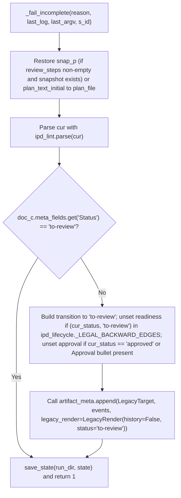

# IPD: Move runner_shared._fail_incomplete status reset onto artifact_meta

- Date: 2026-11-19
- Kind: child
- Concern: In `agent_workflows/runner_shared.py`, the inner helper `run_review_sequence._fail_incomplete` resets a plan's `- Status:` field to `to-review` with `re.sub(r"(?m)^- Status:.*$", "- Status: to-review", cur)` and `plan_file.write_text(...)`, bypassing `artifact_meta` (`xexn45` and `7yr827` missed this writer). This unmigrated regex writer matches the `9o83cr` E-14 single-owner audit pattern (`re.sub` on `^-`), can corrupt `- Status:` lines inside markdown body prose, leaves stale `- Readiness:` or `- Approval:` bullets behind on backward resets, and blocks clean completion before the metastore cutover (`cxxmyv`).
- Scope: Move the `- Status: to-review` reset write inside `agent_workflows/runner_shared.py::run_review_sequence._fail_incomplete` onto `agent_workflows/artifact_meta.py::append` (using `agent_workflows/artifact_meta.py::LegacyTarget`, `agent_workflows/artifact_meta.py::LegacyRender` with `history=False`, `agent_workflows/artifact_meta.py::legacy_context`, `agent_workflows/artifact_core.py::utc_history_date`, and `agent_workflows/ipd_lifecycle.py::_LEGAL_BACKWARD_EDGES`), handling backward transitions to `to-review` by unsetting `readiness` and unsetting `approval` when leaving `approved` or when a stale `Approval` bullet is present so `agent_workflows/artifact_meta.py::_check_owned_fields` passes; add `@pytest.mark.core` behavioral regression tests in `tests/test_review_sequence_runner.py` exercising incomplete review sequences whose restored plan is not `to-review`. EXCLUDES: changing the snapshot restoration (`snap_p` / `plan_text_initial`) above the status check in `_fail_incomplete`, modifying other `agent_workflows/runner_shared.py` helpers already moved by `7yr827` (`mark_plan_attended`, `rederive_front_matter`, `perform_coordinator_proposal_file`), and post-cutover removal of `LegacyTarget` / `LegacyRender` (`2k5t16` / `cxxmyv`).
- Scope-Paths: agent_workflows/runner_shared.py, tests/test_review_sequence_runner.py, .aw/records/plans/pending/20261119-r20qqe-01-rulopj-move-runner-shared-fail-incomplete-status-reset-onto-artifac.ipd.md
- Item-Dependencies: none
- Status: approved
- Readiness: go-pending-approval
- Review-Depth: standard
- Short-Description: Move run_review_sequence._fail_incomplete status reset onto artifact_meta with a regression test
- Work-Kind: bug
- Priority: high
- From-Backlog: r20qqe
- Blocks-Release: next
- Set: r20qqe
- Order: 1
- Highest E allocated: 03
- Author: antigravity/gemini
- Id: rulopj
- Approval: 2026-11-27, recorded via aw ipd set: status set to approved

> Write and proofread this plan per the technical writing standard, `.aw/system/workflows/technical-writing/technical-writing.md` (`.agents/workflows/technical-writing/technical-writing.md` in a legacy-layout install), including requirement 12 (diagrams).

## Workflow history

- 2026-11-27 approved (aw set): status set to approved
- 2026-11-21 reviewed (aw set): APPROVE WITH REVISIONS APPLIED; PR-001..PR-004 FIXED
- 2026-11-21 /plan-review (antigravity/gemini-4-neon-high): APPROVE WITH REVISIONS APPLIED; PR-001, PR-002, PR-003, PR-004 FIXED; review record .aw/records/reviews/20261121-r20qqe-01-rulopj-move-runner-shared-fail-incomplete-status-reset-onto-artifac.review.md
- 2026-11-19 to-review (aw set): authored review-ready for backlog r20qqe
- 2026-11-19 draft (antigravity/gemini): created.

## Goal

Ensure `agent_workflows/runner_shared.py::run_review_sequence._fail_incomplete` performs its `- Status: to-review` reset exclusively through `artifact_meta` before the metastore cutover (`cxxmyv`), and cover the path with core behavioral regression tests in `tests/test_review_sequence_runner.py`.

## Detailed Implementation Checklist (TODO)

Execution-state rule: mark an `E-*` item complete only after performing the action. That mark is not validation. Right-sizing rule: write for a modest executor that cannot hold much in its head. Each E-item is one step (one concern, about one file, executable in one focused pass) and its V-item names each unit it covers with its own check; a plan stays at about 5 E-items and 8 work Scope-Paths, else split it into more child plans (guidance, `IPD-Z603`). Accepted execution states: blocked, failed, pending, performed; terminal gate demands 'performed'.

### Task group 1: Move _fail_incomplete status reset, add regression tests, and validate

- [ ] E-01 Run `python3 -m pytest -o addopts="" -v tests/test_review_sequence_runner.py` on the unmodified code to establish the baseline test run (re-derived at execution time, keeping `pytest-randomly` enabled). Then, in `agent_workflows/runner_shared.py::run_review_sequence`, add `artifact_core` and `artifact_meta` to the local `from agent_workflows import (...)` block, keep the snapshot restore (`snap_p` or `plan_text_initial` written to `plan_file`) and `doc_c = ipd_lint.parse(cur)` check unchanged inside `_fail_incomplete`, and replace `plan_file.write_text(re.sub(r"(?m)^- Status:.*$", "- Status: to-review", cur), encoding="utf-8")` when `doc_c.meta_fields.get("Status") != "to-review"` with an `agent_workflows/artifact_meta.py::append` call:
  1. Read `cur_status = (doc_c.meta_fields.get("Status") or "").strip().lower()` and `plan_id6 = (doc_c.meta_fields.get("Id") or item.get("id6") or "").strip() or None`.
  2. Build `trans_ev: dict[str, Any] = {"op": "transition", "to": "to-review"}`, setting `trans_ev["from"] = cur_status` when `cur_status` is non-empty and `cur_status != "to-review"`, and initialize `events: list[dict[str, Any]] = [trans_ev]`.
  3. Build `unset_fields: list[str] = []`: append `"readiness"` when `(cur_status, "to-review") in ipd_lifecycle._LEGAL_BACKWARD_EDGES` (reusing the single source of truth already imported in `run_review_sequence`), append `"approval"` when `cur_status == "approved"` or `bool(doc_c.meta_fields.get("Approval"))`, and when `unset_fields` is non-empty append `{"op": "unset", "fields": unset_fields}` to `events` so `agent_workflows/artifact_meta.py::_check_owned_fields` permits the transition and strips stale review or approval bullets.
  4. Call `artifact_meta.append(artifact_meta.LegacyTarget(plan_file, "plans", plan_id6), events, legacy_render=artifact_meta.LegacyRender(tag="to-review", day=artifact_core.utc_history_date(), actor_label="aw run", history=False, status="to-review"), repo_root=target_root, project_context=artifact_meta.legacy_context(target_root), from_status=cur_status or None)`.
  - Depends on: none
  - Expected outcome: `agent_workflows/runner_shared.py::run_review_sequence._fail_incomplete` contains no `re.sub` or `plan_file.write_text` for status resetting, routes the reset through `agent_workflows/artifact_meta.py::append`, removes stale `- Readiness:` and `- Approval:` bullets when leaving reviewed or approved states, and preserves any `- Status:` text in body prose.
  - Execution state: pending

- [ ] E-02 Import `pytest` in `tests/test_review_sequence_runner.py` and add `@pytest.mark.core` behavioral regression test(s) to `tests/test_review_sequence_runner.py::TestReviewSequenceRunner` using `tempfile.TemporaryDirectory()` fixtures and driving real `agent_workflows/runner_shared.py::run_review_sequence` (or `agent_workflows/oc_runipd.py::execute_item` with `review_mode="steps"` and a failing postcondition re-ask, never reading production source code):
  1. Verify that when an incomplete review sequence restores a plan snapshot (or initial plan text) carrying `- Status: reviewed` and `- Readiness: go-pending-approval` (and a body section such as `## Goal` containing literal `- Status: reviewed` prose), `_fail_incomplete` resets front-matter `- Status:` to `to-review`, removes `- Readiness: go-pending-approval`, leaves the body prose `- Status: reviewed` untouched, and sets `item["status"] = "fail-gate"` and `attempt["review_outcome"] = "incomplete"`.
  2. Verify the backward reset from `- Status: approved` with `- Approval:` and `- Readiness: go-pending-approval` removes both `- Readiness:` and `- Approval:` while resetting front-matter `- Status:` to `to-review`, and verify a forward reset from `- Status: draft` sets `- Status: to-review` without error.
  3. Verify that the status reset routes through `agent_workflows/artifact_meta.py::append` by wrapping it with `unittest.mock.patch.object(artifact_meta, "append", wraps=artifact_meta.append)` so the real append executes, and asserting `artifact_meta.append` is invoked with `LegacyTarget`, the `transition` event to `"to-review"`, `unset` where required, and `LegacyRender` carrying `history=False` and `status="to-review"`.
  - Depends on: E-01
  - Expected outcome: all new `@pytest.mark.core` regression tests in `tests/test_review_sequence_runner.py` pass without source-inspection assertions, and all existing tests in `tests/test_review_sequence_runner.py` pass unchanged.
  - Execution state: pending

- [ ] E-03 Run the full verification checks, verify zero remaining `^-` `re.sub` metadata bypasses in `_fail_incomplete`, and commit only `- Scope-Paths:` files through `aw commit rulopj -- <paths>` (never push):
  1. Run `python3 -m pytest -o addopts="" -v tests/test_review_sequence_runner.py tests/test_runner_shared.py`.
  2. Run `rg -n "re\.(compile|search|match|finditer|findall|sub|fullmatch)\(\s*r?[\"'](\(\?m\))?\^-" agent_workflows/runner_shared.py` and confirm zero hits inside `run_review_sequence._fail_incomplete`.
  3. Run bare `python3 -m pytest` (core tier), `aw check plans --agent`, `aw ipd lint`, and `aw sanitize --agent`.
  - Depends on: E-02
  - Expected outcome: targeted tests, bare `python3 -m pytest`, `aw check plans --agent`, `aw ipd lint`, and `aw sanitize --agent` pass with zero errors, `_fail_incomplete` has zero `re.sub` hits, and the commit contains only `- Scope-Paths:` files.
  - Execution state: pending

## Project conventions discovered (Step 0)

- `agent_workflows/artifact_meta.py::append` accepts a path-keyed `artifact_meta.LegacyTarget(path, "plans", id6)` and `artifact_meta.LegacyRender(...)` in phase B, dispatching through `artifact_meta.write_legacy`, which acquires `<state>/locks/meta-<key>.lock`, runs `validate_new_events` and `_check_owned_fields`, renders metadata only inside `selectors.metadata_region` (`_render_status` stops at the first `## ` heading), and writes via `artifact_core.atomic_write`.
- `agent_workflows/artifact_meta.py::legacy_context(target_root)` constructs the phase-B context (`records` and `state` roots) for `target_root` (an isolated lane worktree or the repo root), and `LegacyTarget.key` falls back to `"path-" + sha256[:12]` if `id6` is absent.
- `agent_workflows/artifact_meta.py::_check_owned_fields` enforces IPD backward-transition invariants from `ipd_lifecycle._LEGAL_BACKWARD_EDGES`: transitioning backward from `reviewed`, `approved`, or `auto-approved` to `to-review` requires `"readiness"` in an `unset` event, and transitioning away from `approved` requires `"approval"` in an `unset` event; forward transitions such as `draft` to `to-review` forbid `unset` of `readiness`.
- Other `agent_workflows/runner_shared.py` metadata writers (`rederive_front_matter`, `perform_coordinator_proposal_file`) pass `history=False` on internal runner metadata updates (`perform_coordinator_proposal_file` also uses `agent_workflows/artifact_meta.py::append` with `LegacyTarget` and `LegacyRender`), whereas `mark_plan_attended` uses `LegacyRender`'s default `history=True` with a `note` event, and `agent_workflows/review_sequence.py::restore_pre_s7_plan` uses `agent_workflows/artifact_meta.py::restore_legacy_snapshot`.
- `agent_workflows/runner_shared.py::run_review_sequence` already imports `ipd_lifecycle` locally, so checking `(cur_status, "to-review") in ipd_lifecycle._LEGAL_BACKWARD_EDGES` reuses the single source of truth (matching `agent_workflows/status_set.py`) rather than duplicating the backward-edge set.
- `tests/test_runner_shared.py` carries `pytestmark = pytest.mark.core`; individual test methods in `tests/test_review_sequence_runner.py` can be marked `@pytest.mark.core` so bare `python3 -m pytest` executes them.
- Cite code by symbol (`module.function`) or by a quoted content string, with a line number only appended to one of those and never alone (`IPD-C801`).

## Findings

| Id | Evidence | Finding |
|---|---|---|
| F-01 | `agent_workflows/runner_shared.py::run_review_sequence._fail_incomplete` calls `plan_file.write_text(re.sub(r"(?m)^- Status:.*$", "- Status: to-review", cur), encoding="utf-8")` when `doc_c.meta_fields.get("Status") != "to-review"` | Direct regex edit bypasses `artifact_meta`, matches the `9o83cr` E-14 audit regex (`re.sub` on `^-`), can rewrite `- Status:` lines inside markdown body prose, and leaves `- Readiness:` or `- Approval:` bullets behind when resetting from `reviewed` or `approved`. |
| F-02 | `agent_workflows/artifact_meta.py::restore_legacy_snapshot` reads `st_pre` from `pre_pass_text` (`doc_pre.meta_fields.get("Status") or "to-review"`), whereas `artifact_meta.append` runs `validate_new_events`, `_check_owned_fields`, `_render_status`, locking, and `artifact_core.atomic_write` | `restore_legacy_snapshot(cur, plan_text_initial)` preserves `plan_text_initial`'s status instead of forcing `to-review` if `plan_text_initial` was `reviewed`, `approved`, or `draft`; `artifact_meta.append` guarantees `- Status: to-review` across all initial statuses and aligns with the pre-cutover `artifact_meta.append` contract (`cxxmyv` / `2k5t16`). |
| F-03 | Pending plans `y97k46` (`E-06`) and `k3hb06` already defer `run_review_sequence._fail_incomplete` to `Carrier: r20qqe`, and `9o83cr` (`E-14`) audits `re.sub` on `^-` across `agent_workflows` | Moving `_fail_incomplete` onto `artifact_meta.append` removes the last unmigrated runner metadata writer before `9o83cr` and `cxxmyv`. |

## Proposed changes (ordered, validatable)

1. Replace the `re.sub` and `plan_file.write_text` status reset in `agent_workflows/runner_shared.py::run_review_sequence._fail_incomplete` with `agent_workflows/artifact_meta.py::append` using `agent_workflows/artifact_meta.py::LegacyTarget`, `agent_workflows/artifact_meta.py::LegacyRender(history=False, status="to-review")`, `agent_workflows/artifact_meta.py::legacy_context`, `agent_workflows/artifact_core.py::utc_history_date`, and `unset` events driven by `agent_workflows/ipd_lifecycle.py::_LEGAL_BACKWARD_EDGES` and stale `Approval` presence (E-01).
2. Add `@pytest.mark.core` behavioral regression tests in `tests/test_review_sequence_runner.py::TestReviewSequenceRunner` covering `reviewed`, `approved`, and `draft` status resets, stale `Readiness`/`Approval` removal, body prose preservation, and `wraps=artifact_meta.append` routing verification (E-02).
3. Run targeted suites, the bare core gate `python3 -m pytest`, the `9o83cr` E-14 regex check on `agent_workflows/runner_shared.py`, `aw check plans --agent`, `aw ipd lint`, and `aw sanitize --agent`, then commit `- Scope-Paths:` files via `aw commit rulopj` (E-03).

## Deferred / out of scope (with reason)

- Post-cutover removal of `LegacyTarget` and `LegacyRender` at this call site (converting the phase-B `artifact_meta.append` call to the v2 log-only `append` call).
  - Carrier: cxxmyv
- Snapshot file restoration (`snap_p` / `plan_text_initial`) prior to the `Status != "to-review"` check in `_fail_incomplete`: restores full plan text including proofreading edits rather than performing a metadata edit.
  - Carrier-Declined: Full snapshot restoration copies verbatim prior step snapshots and performs no metadata parsing or field mutation.

## Scope check

- Over-scope: none.
- Under-scope: none. The single unmigrated writer site in `agent_workflows/runner_shared.py::run_review_sequence._fail_incomplete`, its backward-transition field cleanup (`readiness`, `approval`), and its core behavioral regression coverage are all included.

## Required tests / validation

- Targeted suites: `python3 -m pytest -o addopts="" -v tests/test_review_sequence_runner.py tests/test_runner_shared.py`
- Core tier gate: bare `python3 -m pytest`
- Regex audit on `agent_workflows/runner_shared.py`: `rg -n "re\.(compile|search|match|finditer|findall|sub|fullmatch)\(\s*r?[\"'](\(\?m\))?\^-" agent_workflows/runner_shared.py`
- Repository checks: `aw check plans --agent`, `aw ipd lint`, and `aw sanitize --agent`

## Spec / documentation sync

N/A with reason: this is a bug fix aligning `run_review_sequence._fail_incomplete` with spec `4sd62s` Section 7 step 4 (`xexn45` / `7yr827`) without changing any documented CLI contract or user-facing behavior.

## Open questions

### OQ-01: Should `_fail_incomplete` use `artifact_meta.append` or `artifact_meta.restore_legacy_snapshot`?

- Blocking: no
- Status: resolved
- Owner: plan author
- Resolution or deferral rationale: Use `artifact_meta.append` (with `LegacyTarget`, `LegacyRender(..., history=False, status="to-review")`, and `unset` of `readiness`/`approval` on backward transitions from `reviewed`/`approved`/`auto-approved`). Unlike `restore_legacy_snapshot(cur, plan_text_initial)`, which restores `plan_text_initial`'s status rather than enforcing `to-review`, `artifact_meta.append` guarantees `- Status: to-review` regardless of `plan_text_initial`'s status, enforces `_check_owned_fields` invariants, acquires the artifact lock, writes atomically, and uses the permanent `artifact_meta.append` entry point ahead of `cxxmyv`.

## Validation and cross-check (verify before reporting done)

Validation-state rule: inspect evidence in a separate pass. Do not mark a `V-*` item complete from memory or from the matching execution checkmark. Accepted validation results: blocked, failed, pass, pending; terminal gate demands 'pass'. Runtime-demonstration reachability rule: for each `V-*` item demanding the software be observed acting (such as a run, a dispatch, or a transition)—as distinct from items demanding a diff, a file's content, or a test result, which are reachable by construction—name the code path that produces the observation or the sibling `E-*` that creates it, else the demand is UNDER-SCOPE.

- [ ] V-01 validates E-01
  - Required evidence: paste the re-derived baseline output of `python3 -m pytest -o addopts="" -v tests/test_review_sequence_runner.py` (all collected existing tests PASSED, 0 failures, 0 errors), and paste `git diff agent_workflows/runner_shared.py` showing `artifact_core` and `artifact_meta` imported in `run_review_sequence` and `re.sub` + `plan_file.write_text` replaced by `artifact_meta.append` with lowercased `cur_status`, `ipd_lifecycle._LEGAL_BACKWARD_EDGES` check for unsetting `readiness`, `approval` unset when leaving `approved` or when a stale `Approval` bullet is present, `LegacyTarget`, `LegacyRender(..., history=False, status="to-review")`, and `legacy_context`.
  - Observed evidence:
  - Result: pending

- [ ] V-02 validates E-02
  - Required evidence: paste `python3 -m pytest -o addopts="" -v tests/test_review_sequence_runner.py` showing every existing and new `@pytest.mark.core` regression test PASSED (0 failures, 0 errors, 0 skips), covering `reviewed` + `Readiness` reset with body `- Status:` preservation, `approved` + `Approval` + `Readiness` reset, `draft` forward reset, and `wraps=artifact_meta.append` call verification, plus `rg -n "^(import|from) (inspect|ast)\b" tests/test_review_sequence_runner.py` exiting 1 (no code-pinning tests).
  - Observed evidence:
  - Result: pending

- [ ] V-03 validates E-03
  - Required evidence: paste the summary lines of `python3 -m pytest -o addopts="" -v tests/test_review_sequence_runner.py tests/test_runner_shared.py` and bare `python3 -m pytest`, the output of `rg -n "re\.(compile|search|match|finditer|findall|sub|fullmatch)\(\s*r?[\"'](\(\?m\))?\^-" agent_workflows/runner_shared.py` showing zero hits in `_fail_incomplete`, the outputs of `aw check plans --agent`, `aw ipd lint`, and `aw sanitize --agent`, and `git show --stat` confirming only `- Scope-Paths:` files were committed via `aw commit rulopj`.
  - Observed evidence:
  - Result: pending

## Approval and execution gate

- Size assessment: standard
- Cohesion rationale: not required

Execute only after human approval (`- Status: approved`) and after all blocking open questions are resolved, under the repository execution contract:
- Scope fence: modify only `- Scope-Paths:` files unless an additional edit is genuinely required; justify any out-of-scope edit with `--scope-reason` and any unmodified declared path with `--scope-ack` (do not stop over scope variance; stop only on an unresolvable concurrent-edit conflict or missing prerequisite symbols).
- Shared-checkout safety: uncommitted changes and untracked files you did not create are not yours; never revert, stage, commit, discard, or clean up another party's work.
- Commits and pushing: commit only files you changed through `aw commit rulopj -- <paths>` (never `git add -A`, bare `git add`, or `git commit -a`; never push without an explicit human directive).
- Verification honesty (hard MUST): paste the actual runner output for every `V-*` item; write no code-pinning tests (`inspect`/`ast`/source-reading assertions).
- Lifecycle transition: never hand-`git mv` this plan to `.aw/records/plans/executed/`. When executing under `aw oc run` or `aw agy run`, leave the plan in `.aw/records/plans/pending/` for the runner to self-finalize; in a standalone session, transition to `.aw/records/plans/executed/` only via `aw ipd finalize rulopj` after `aw ipd lint --phase pre-transition` conforms and all `V-*` items hold `Result: pass`.
