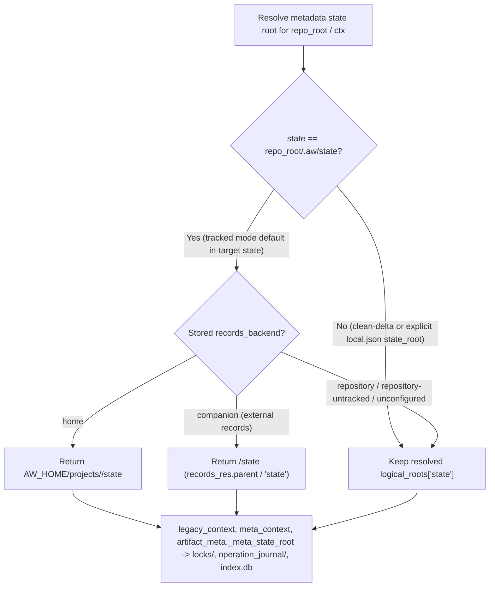

# IPD: Route artifact_meta state and lock paths to AW_HOME when records_backend is home

- Date: 2026-11-19
- Kind: child
- Concern: Backlog `vo0y6q` reported that running `aw backlog new --apply --dir <target>` against a repository with `records_backend: "home"` in `.aw/config/project.json` created `<target>/.aw/state/locks/meta-<id6>.lock` inside the target checkout, causing `tests/test_records_root_accessor.py::test_home_records_reproduction_backlog` to fail with `?? .aw/state/`. Commit `5ca9a65a2` (2026-11-20) partially mitigated this in `agent_workflows/artifact_meta.py::legacy_context` by returning `records_res.parent / "state"` whenever `not records_res.is_relative_to(root)`, which makes `test_home_records_reproduction_backlog` pass at current HEAD, but leaves three gaps: (1) `agent_workflows/meta_cli.py::meta_context` still reads `logical_roots["state"]` directly from `agent_workflows/project_context.py::resolve_project_context`, so `aw show` and `aw index rebuild` still create `<target>/.aw/state/index.db` inside a clean `records_backend: "home"` repository; (2) all 13 `agent_workflows/artifact_meta.py` reader/writer entry points still read `Path(ctx.logical_roots["state"])` directly when passed a `ProjectContext` (such as from `agent_workflows/ipd_lint.py::_meta_context_and_state_map`); and (3) `legacy_context`'s shortcut skips `resolve_project_context` on external records roots, silently ignoring explicit `local.json` `state_root` overrides.
- Scope: Unify `artifact_meta` metadata state-root resolution (used for `locks/meta-<key>.lock`, `operation_journal/`, and `index.db`) across `agent_workflows/artifact_meta.py::legacy_context`, all 13 `agent_workflows/artifact_meta.py` entry points (`read`, `history`, `resolve`, `query`, `query_lineage`, `review_rows`, `resolve_mirror_at`, `read_path_at`, `read_at`, `write_legacy`, `append`, `create`, `repair`), and `agent_workflows/meta_cli.py::meta_context`: honor any explicit `local.json` `state_root` override first, route default `<repo>/.aw/state` to `<AW_HOME>/projects/<project_id>/state` when `records_backend` resolves to stored `home`, preserve `<companion>/state` (`records_res.parent / "state"`) for external `companion` records roots when no explicit `state_root` override exists (preserving commit `5ca9a65a2`'s clean-target protection), keep `agent_workflows/project_context.py::resolve_project_context` unchanged for `spec 20260810-1447-01` Section 5, keep unconfigured (`builtin_defaults`) and `repository`/`repository-untracked` repositories unchanged, and expand `tests/test_records_root_accessor.py` to pin lock/cache placement, `meta_context`/`legacy_context` parity, direct `ProjectContext` callers, and clean-target behavior.
- Scope-Paths: agent_workflows/artifact_meta.py, agent_workflows/meta_cli.py, tests/test_records_root_accessor.py, .aw/records/plans/pending/20261119-vo0y6q-01-rntx9a-route-artifact-meta-state-and-lock-paths-to-aw-home-when-rec.ipd.md
- Item-Dependencies: none
- Status: reviewed
- Readiness: go-pending-approval
- Review-Depth: standard
- Short-Description: Route artifact_meta state and meta locks under AW_HOME when records_backend resolves to home
- Work-Kind: bug
- Priority: medium
- From-Backlog: vo0y6q
- Blocks-Release: next
- Set: vo0y6q
- Order: 1
- Highest E allocated: 04
- Author: antigravity/gemini
- Id: rntx9a

> Write and proofread this plan per the technical writing standard, `.aw/system/workflows/technical-writing/technical-writing.md` (`.agents/workflows/technical-writing/technical-writing.md` in a legacy-layout install), including requirement 12 (diagrams).

## Workflow history

- 2026-11-21 reviewed (aw set): APPROVE WITH REVISIONS APPLIED; PR-001..PR-005 FIXED
- 2026-11-21 /plan-review (antigravity/gemini-4-neon-high): APPROVE WITH REVISIONS APPLIED; PR-001, PR-002, PR-003, PR-004, PR-005 FIXED; review record .aw/records/reviews/20261121-vo0y6q-01-rntx9a-route-artifact-meta-state-and-lock-paths-to-aw-home-when-rec.review.md
- 2026-11-19 to-review (aw set): authored review-ready plan from backlog vo0y6q
- 2026-11-19 draft (antigravity/gemini): created.

## Goal

Ensure every `agent_workflows/artifact_meta.py` reader and writer and `agent_workflows/meta_cli.py::meta_context` place metadata locks (`locks/meta-*.lock`), operation journals, and `index.db` under `<AW_HOME>/projects/<project_id>/state` for stored `records_backend: "home"` (and preserve `<companion>/state` for external `companion` records roots) while honoring explicit `local.json` `state_root` overrides and preserving existing `<repo>/.aw/state` behavior for unconfigured and `repository`/`repository-untracked` repositories.

## Detailed Implementation Checklist (TODO)

Execution-state rule: mark an `E-*` item complete only after performing the action. That mark is not validation. Right-sizing rule: write for a modest executor that cannot hold much in its head. Each E-item is one step (one concern, about one file, executable in one focused pass) and its V-item names each unit it covers with its own check; a plan stays at about 5 E-items and 8 work Scope-Paths, else split it into more child plans (guidance, `IPD-Z603`). Accepted execution states: blocked, failed, pending, performed; terminal gate demands 'performed'.

### Task group 1: Metadata state-root routing and tests

- [ ] E-01 In `agent_workflows/artifact_meta.py`, add one shared helper `_meta_state_root(ctx: Any) -> Path` (plus a small helper `_external_records_state_override(resolved_ctx: Any, repo_root: Path, current_state: Path, records_res: Path) -> Path`) and update `agent_workflows/artifact_meta.py::legacy_context(repo_root)` and all 13 `artifact_meta` reader and writer entry points that read `ctx.logical_roots["state"]` (`read`, `history`, `resolve`, `query`, `query_lineage`, `review_rows`, `resolve_mirror_at`, `read_path_at`, `read_at`, `write_legacy`, `append`, `create`, `repair`) to use `_meta_state_root(ctx)`. Apply this rule:
  1. Start from `state = Path(ctx.logical_roots["state"])`. Read `rec_prov = (getattr(ctx, "provenance", None) or {}).get("records_backend")` and extract `rec_src = rec_prov.get("source") if isinstance(rec_prov, dict) else getattr(rec_prov, "source", None)`.
  2. When `ctx` represents a `ProjectContext` with `target_repo` and `state.resolve() == (Path(target_repo).resolve() / ".aw" / "state").resolve()` (meaning no explicit `local.json` `state_root` override moved `state` away from the default tracked in-target path):
     - If `ctx.records_backend == project_context.RecordsBackend.HOME.value` and (`rec_src in ("project_durable_config", "machine_local_binding")` or `ctx.delivery_mode == "clean-delta"`), return `Path(ctx.effective_aw_home) / "projects" / ctx.project_id / "state"`.
     - If `ctx.records_backend == project_context.RecordsBackend.COMPANION.value` and `rec_src in ("project_durable_config", "machine_local_binding")`, return `Path(ctx.logical_roots["records"]).resolve().parent / "state"` (preserving commit `5ca9a65a2`'s clean-target routing for companion records).
  3. In `legacy_context(repo_root)`, resolve `records = Path(_proj_ctx.project_records_dir(root))` and `records_res = records.resolve()`, then call `_proj_ctx.resolve_project_context(target_repo=str(root))` (under `contextlib.suppress(Exception)`):
     - When `resolved` succeeds and `Path(resolved.logical_roots["records"]).resolve() == records_res`, start from `Path(resolved.logical_roots["state"])` and pass through `_external_records_state_override` (honoring any explicit `local.json` `state_root` override while redirecting default `<root>/.aw/state` to `<AW_HOME>/projects/<project_id>/state` for stored `home` and `<companion>/state` for external `companion`).
     - When `resolved` fails or disagrees on `records`: if `not records_res.is_relative_to(root)`, fall back to `records_res.parent / "state"`, else `root / ".aw" / "state"`.
  4. In all other cases (unconfigured repositories where `records_backend` provenance is `builtin_defaults` and `project_records_dir` returns `<repo>/.aw/records`, explicit `local.json` `state_root` overrides, `clean-delta` which already resolves to `AW_HOME`, `repository`/`repository-untracked`, and synthetic `Ctx` objects without `records_backend`), keep `state` unchanged. Do not modify `agent_workflows/project_context.py::resolve_project_context`.
  - Depends on: none
  - Expected outcome: `agent_workflows/artifact_meta.py::legacy_context(target)` and `agent_workflows/artifact_meta.py::_meta_state_root(resolved_ctx)` both return `<AW_HOME>/projects/<project_id>/state` for stored `records_backend: "home"` (whether configured in `<target>/.aw/config/project.json`, `<target>/.aw/config/local.json`, or `<AW_HOME>/projects/<project_id>/config/project.json`), return `<companion>/state` for external `companion` records without explicit `state_root`, honor any explicit `local.json` `state_root` binding on all backends, and return `<target>/.aw/state` for unconfigured or `repository`/`repository-untracked` repositories; all 13 `artifact_meta` entry points use `_meta_state_root(ctx)` with zero writes to `<target>/.aw/state/` for `home` or `companion` targets.
  - Execution state: pending

- [ ] E-02 In `agent_workflows/meta_cli.py`, update `meta_context(repo_root)` to delegate to `agent_workflows/artifact_meta.py::legacy_context(repo_root)` (`ctx = _meta.legacy_context(repo_root); return MetaContext(logical_roots=dict(ctx.logical_roots), repo_root=ctx.repo_root)`) instead of duplicating `project_records_dir` and `resolve_project_context` state resolution.
  - Depends on: E-01
  - Expected outcome: `agent_workflows/meta_cli.py::meta_context` and `agent_workflows/artifact_meta.py::legacy_context` return identical `records` and `state` roots across every backend (`home`, `repository`, `repository-untracked`, `companion`, `clean-delta`, explicit `state_root`, and unconfigured), and `aw show` plus `aw index rebuild` write `index.db` under `<AW_HOME>/projects/<project_id>/state/index.db` on a stored `records_backend: "home"` repository instead of creating `<target>/.aw/state/`.
  - Execution state: pending

- [ ] E-03 In `tests/test_records_root_accessor.py`, keep `test_home_records_reproduction_backlog` unmodified and add behavioral outcome tests (zero production source-code inspection) covering:
  1. `aw backlog new --apply --dir <target>` on `home_records_env` creates `meta-<id6>.lock` under `<AW_HOME>/projects/*/state/locks/` and does not create `<target>/.aw/state`.
  2. `aw backlog note --dir <target>` on `home_records_env` leaves `git status --porcelain --ignored` free of `??` entries and places its lock under `<AW_HOME>/projects/*/state/locks/`.
  3. `aw specs new --apply --dir <target>`, `aw show <id6> --dir <target>`, and `aw index rebuild --dir <target>` on `home_records_env` leave `git status --porcelain --ignored` free of `??` entries, create no `<target>/.aw/state`, and write `index.db` under `<AW_HOME>/projects/*/state/index.db`.
  4. Direct `ProjectContext` caller parity: passing `project_context.resolve_project_context(target_repo=str(target))` directly to `artifact_meta.query(project_context=ctx)` on `home_records_env` writes `index.db` under `<AW_HOME>/projects/*/state/index.db` and does not create `<target>/.aw/state`.
  5. `artifact_meta.legacy_context` and `meta_cli.meta_context` agree on `state` across: stored `project.json` `records_backend: "home"` (`delivery_mode: "tracked"`), `local.json`-only `records_backend: "home"`, `AW_HOME`-stored `project.json` `records_backend: "home"`, explicit `local.json` `state_root` override on both `home` and `companion` (must keep the explicit override), `records_backend: "companion"` without explicit `state_root` (must return `<companion>/state`), `records_backend: "repository"` (must return `<target>/.aw/state`), and unconfigured repository (must return `<target>/.aw/state`).
  6. Run a mutation proof by temporarily disabling `_external_records_state_override` in `agent_workflows/artifact_meta.py` (so default tracked state is returned), confirming `test_home_records_reproduction_backlog` and the new `aw show` / `aw index rebuild` clean-target tests fail with `?? .aw/state/`, and restoring the fix.
  - Depends on: E-02
  - Expected outcome: `python3 -m pytest -o addopts="" tests/test_records_root_accessor.py` passes all tests including `test_home_records_reproduction_backlog`, and the mutation proof demonstrates falsifiability across both `legacy_context` and `meta_context`.
  - Execution state: pending

- [ ] E-04 Run the related test modules (`python3 -m pytest -o addopts="" tests/test_records_root_accessor.py tests/test_artifact_meta_legacy_writer.py tests/test_artifact_meta_cache.py tests/test_artifact_meta_shapes.py tests/test_index_rebuild.py tests/test_project_layout.py tests/test_m0001_layout_stage.py tests/test_backlog.py tests/test_writers_obligations.py`), run bare `python3 -m pytest`, run `aw sanitize --agent`, and run `aw ipd lint --phase pre-transition rntx9a`.
  - Depends on: E-03
  - Expected outcome: All targeted test modules pass, bare `python3 -m pytest` passes with zero regressions, `aw sanitize --agent` reports clean, and `aw ipd lint --phase pre-transition rntx9a` reports conforming.
  - Execution state: pending

## Project conventions discovered (Step 0)

- Cite code by SYMBOL (`module.function`) or by a quoted content string, never by a line number alone (advisory `IPD-C801`).
- `agent_workflows/project_context.py::resolve_project_context` sets `state_root` to `<repo>/.aw/state` whenever `delivery_mode` is `tracked` (even when `records_backend` is `home`), unless `local.json` binds `state_root`. That behavior is governed by `spec 20260810-1447-01` Section 5 (tracked `state_durable` and `state_runtime` stay in the repository; only `clean-delta` moves general project state to `AW_HOME`) and is pinned for unconfigured repositories by `tests/test_project_layout.py::PhysicalPolicyMatrixTests::test_e01` and for in-place switching by `tests/test_records_root_switch_execute.py`.
- `agent_workflows/project_context.py::project_records_dir` returns `<repo>/.aw/records` for unconfigured repositories (whose `resolve_project_context` provenance for `records_backend` is `builtin_defaults`) and returns `AW_HOME/projects/<project_id>/records` only when `has_stored_records_placement` is true (`project_durable_config`, `machine_local_binding`, or `delivery_mode == "clean-delta"`).
- `tests/test_artifact_meta_legacy_writer.py::_init_repo` initializes an unconfigured git repository with `.aw/records` and `.aw/state` (no `.aw/config/project.json`) and `test_phase_b_create_preview_apply_lock_and_source_digest_refusal` asserts `(root / ".aw" / "state" / "locks" / "meta-cr0001.lock").exists()`.
- Phase-B writers (`backlog.run_new`, `backlog.run_note`, `specs.run_new`, `prompts.run_new`, `research_cmd._research_legacy_context`, `artifact_adopt`, `set_records._records_legacy_context`, `status_set`) all obtain `logical_roots["state"]` from `artifact_meta.legacy_context(repo_root)`.
- Core test suite runs with bare `python3 -m pytest`; narrowed runs use `-o addopts=""`. Tests must assert observable behavior and outcomes, never inspect production source (`AGENTS.md` "TEST OUTCOMES, NOT CODE STRUCTURE").
- Commit only changed paths through `aw commit rntx9a -- <paths>`; never run `git add -A` or `git push`.

## Findings

| # | Severity | Location | Finding |
| - | -------- | -------- | ------- |
| F-01 | High | `tests/test_records_root_accessor.py::test_home_records_reproduction_backlog`, `agent_workflows/artifact_meta.py::legacy_context` | At authoring (`8a1bdc631`, 2026-11-19), `test_home_records_reproduction_backlog` failed with `?? .aw/state/` because `legacy_context` returned `<target>/.aw/state`. Commit `5ca9a65a2` (2026-11-20) subsequently added `if not records_res.is_relative_to(root): state = records_res.parent / "state"` to `legacy_context`, fixing that single failure for `backlog new`, but without fixing `meta_cli.meta_context`, direct `ProjectContext` callers in `artifact_meta`, or `local.json` `state_root` precedence. |
| F-02 | High | `agent_workflows/artifact_meta.py::legacy_context` | Commit `5ca9a65a2`'s `if not records_res.is_relative_to(root): state = records_res.parent / "state"` skips `resolve_project_context` on external records roots (`home` and `companion`), silently ignoring an explicit `local.json` `state_root` override. Resolving `project_context` first and redirecting only when `state == repo_root / ".aw" / "state"` honors explicit `local.json` `state_root` bindings while keeping both `home` (`AW_HOME/projects/<id>/state`) and `companion` (`<companion>/state`) clean of target `.aw/state/` writes. |
| F-03 | High | `agent_workflows/specs.py::run_new`, `agent_workflows/prompts.py::run_new`, `agent_workflows/research_cmd.py::_research_legacy_context`, `agent_workflows/artifact_adopt.py`, `agent_workflows/set_records.py`, `agent_workflows/status_set.py` | Every phase-B writer derives `state` from `agent_workflows/artifact_meta.py::legacy_context(repo_root)` (or passes no `project_context` so `write_legacy` calls `legacy_context(rroot)`). `test_home_records_reproduction_specs` never asserted `git status --porcelain --ignored` clean on `<target>`, and no test yet pins `meta-*.lock` location under `AW_HOME`. |
| F-04 | High | `agent_workflows/meta_cli.py::meta_context`, `agent_workflows/artifact_meta.py` (`read`, `history`, `resolve`, `query`, `query_lineage`, `review_rows`, `resolve_mirror_at`, `read_path_at`, `read_at`, `write_legacy`, `append`, `create`, `repair`) | `agent_workflows/meta_cli.py::meta_context` still resolves `state` directly from `resolve_project_context(...).logical_roots["state"]` (creating `index.db` under `<target>/.aw/state` during `aw show` or `aw index rebuild`), and all 13 `artifact_meta` entry points still read `Path(ctx.logical_roots["state"])` directly when passed a `ProjectContext` (e.g. from `agent_workflows/ipd_lint.py::_meta_context_and_state_map`). Routing both through one helper prevents write locks and `index.db` from splitting across `<target>/.aw/state` and `<AW_HOME>/projects/<id>/state`. |
| F-05 | Low | Authoring-time related modules baseline | Context measured at authoring (re-derived at execution in E-04): related `artifact_meta` and `project_layout` test modules passed with zero failures before this change. |

## Proposed changes (ordered, validatable)

1. In `agent_workflows/artifact_meta.py`, add `_meta_state_root(ctx)` and `_external_records_state_override(resolved_ctx, repo_root, current_state, records_res)` and route `agent_workflows/artifact_meta.py::legacy_context` plus all 13 entry points (`read`, `history`, `resolve`, `query`, `query_lineage`, `review_rows`, `resolve_mirror_at`, `read_path_at`, `read_at`, `write_legacy`, `append`, `create`, `repair`) through them (E-01).
2. In `agent_workflows/meta_cli.py`, delegate `meta_context(repo_root)` to `agent_workflows/artifact_meta.py::legacy_context(repo_root)` so `aw show` and `aw index rebuild` share the same `records` and `state` roots (E-02).
3. Expand `tests/test_records_root_accessor.py` with lock-location, `aw backlog note`, `aw specs new`, `aw show`, `aw index rebuild`, direct `ProjectContext` `artifact_meta.query`, and `legacy_context`/`meta_context` parity tests across `home`, `companion`, `local.json` `state_root`, `repository`, and unconfigured repos, plus a mutation proof (E-03).
4. Run the narrowed test suites (including `tests/test_artifact_meta_shapes.py`), bare `python3 -m pytest`, `aw sanitize --agent`, and `aw ipd lint --phase pre-transition rntx9a` (E-04).

## Deferred / out of scope (with reason)

- Changing `project_context.resolve_project_context` `logical_roots["state"]` or `physical_classes["state_durable"]`/`["state_runtime"]` for `delivery_mode: tracked` with `records_backend: home`: governed by `spec 20260810-1447-01` Section 5 (`delivery_mode` controls `state_durable` and `state_runtime`, while `records_backend` controls `records`) and outside backlog `vo0y6q`.
  - Carrier-Declined: `spec 20260810-1447-01` Section 5 already defines the `tracked` vs `clean-delta` split for general project state; only `artifact_meta` locks, journals, and cache tied to `home`-backed records need `AW_HOME` routing here.
- Routing `aw specs new --apply` locks on a bare UNCONFIGURED repository (no stored `project.json`): `kfnfji` OQ-04 declined unifying unconfigured-repo divergence (`aw specs new` vs `aw backlog new`) as pre-existing behavior outside stored `records_backend: home`.
  - Carrier-Evidence: .aw/records/plans/executed/20261015-cleantgt-01-kfnfji-route-every-records-reader-and-writer-through-one-records-ro.ipd.md

## Scope check

- Over-scope: none. Every listed file directly owns `artifact_meta` state resolution (`agent_workflows/artifact_meta.py`), the CLI `MetaContext` wrapper (`agent_workflows/meta_cli.py`), or the home-records outcome suite (`tests/test_records_root_accessor.py`).
- Under-scope: none. `backlog.py`, `specs.py`, `prompts.py`, `research_cmd.py`, `artifact_adopt.py`, `set_records.py`, and `status_set.py` all obtain their state root from `artifact_meta.legacy_context`, so fixing `artifact_meta.py` covers every metadata writer and reader without touching each caller module.

## Required tests / validation

- `python3 -m pytest -o addopts="" tests/test_records_root_accessor.py` (all tests pass, including `test_home_records_reproduction_backlog` and the new lock-path, `aw show`, `aw index rebuild`, direct `ProjectContext`, and parity cases).
- Mutation proof on `_external_records_state_override` in `agent_workflows/artifact_meta.py` demonstrating `test_home_records_reproduction_backlog` and the `aw show` / `aw index rebuild` clean-target tests fail with `?? .aw/state/` when disabled and pass when restored.
- `python3 -m pytest -o addopts="" tests/test_records_root_accessor.py tests/test_artifact_meta_legacy_writer.py tests/test_artifact_meta_cache.py tests/test_artifact_meta_shapes.py tests/test_index_rebuild.py tests/test_project_layout.py tests/test_m0001_layout_stage.py tests/test_backlog.py tests/test_writers_obligations.py`.
- Bare `python3 -m pytest` (paste actual summary line).
- `aw sanitize --agent` clean and `aw ipd lint --phase pre-transition rntx9a` conforming.

## Spec / documentation sync

- None. `spec 4sd62s` Section 4.5 already states that records, `meta/*.jsonl`, and the cache follow the resolved project placement without assuming `<repo>/.aw/`. No CLI flags or user-facing documentation change.

## Open questions

### OQ-01: Should `project_context.resolve_project_context` itself move `logical_roots["state"]` to `AW_HOME` when `records_backend` is stored `home` and `delivery_mode` is `tracked`?

- Blocking: no
- Status: resolved
- Owner: plan author
- Resolution or deferral rationale: No. Measured in `agent_workflows/project_context.py::resolve_project_context`, `agent_workflows/placement_switch.py`, `tests/test_project_layout.py::PhysicalPolicyMatrixTests::test_e01`, and `tests/test_records_root_switch_execute.py`: `delivery_mode` (`tracked` vs `clean-delta`) governs `state_durable` (`install.json`, `history/`) and `state_runtime` under `spec 20260810-1447-01` Section 5. Moving `artifact_meta`'s metadata state (`locks/meta-*.lock`, `operation_journal/`, `index.db`) in `artifact_meta.legacy_context`, `artifact_meta._meta_state_root`, and `meta_cli.meta_context` resolves `vo0y6q` without altering `install_history` or `placement_switch` contracts.

### OQ-02: Should `artifact_meta` keep an explicit `local.json` `state_root` override if one is present alongside `records_backend: "home"`?

- Blocking: no
- Status: resolved
- Owner: plan author
- Resolution or deferral rationale: Yes. In `agent_workflows/project_context.py::resolve_project_context`, `merged_local_binding.get("state_root")` takes precedence over `delivery_mode`. Checking `state.resolve() == (repo_root / ".aw" / "state").resolve()` before redirecting to `AW_HOME` ensures an explicit machine-local `state_root` binding is preserved while the default in-target `.aw/state` fallback is redirected to `AW_HOME`.

## Validation and cross-check (verify before reporting done)

Validation-state rule: inspect evidence in a separate pass. Do not mark a `V-*` item complete from memory or from the matching execution checkmark. Accepted validation results: blocked, failed, pass, pending; terminal gate demands 'pass'. Runtime-demonstration reachability rule: for each `V-*` item demanding the software be observed acting (such as a run, a dispatch, or a transition)—as distinct from items demanding a diff, a file's content, or a test result, which are reachable by construction—name the code path that produces the observation or the sibling `E-*` that creates it, else the demand is UNDER-SCOPE.

- [ ] V-01 validates E-01
  - Required evidence: paste `git diff agent_workflows/artifact_meta.py` showing `_external_records_state_override`, `_meta_state_root`, `legacy_context`, and all 13 `artifact_meta` state lookups (`read`, `history`, `resolve`, `query`, `query_lineage`, `review_rows`, `resolve_mirror_at`, `read_path_at`, `read_at`, `write_legacy`, `append`, `create`, `repair`) routed through `_meta_state_root` with `agent_workflows/project_context.py` untouched (`git diff agent_workflows/project_context.py` empty), plus pasted Python output showing `artifact_meta.legacy_context(target)` and `artifact_meta._meta_state_root(project_context.resolve_project_context(target_repo=str(target)))` return `<AW_HOME>/projects/<id>/state` for stored `records_backend: "home"`, `<companion>/state` for external `companion`, the explicit path when `local.json` sets `state_root`, and `<target>/.aw/state` for an unconfigured repo.
  - Observed evidence:
  - Result: pending

- [ ] V-02 validates E-02
  - Required evidence: paste `git diff agent_workflows/meta_cli.py` showing `meta_context` delegating to `agent_workflows/artifact_meta.py::legacy_context`, plus pasted output showing `meta_cli.meta_context(target).state_root == Path(artifact_meta.legacy_context(target).logical_roots["state"])` for stored `records_backend: "home"`, `companion`, explicit `local.json` `state_root`, and `repository`-backed repos.
  - Observed evidence:
  - Result: pending

- [ ] V-03 validates E-03
  - Required evidence: paste `python3 -m pytest -o addopts="" -v tests/test_records_root_accessor.py` output showing all tests including `test_home_records_reproduction_backlog` and every added lock-location, `backlog note`, `specs new`, `aw show`, `aw index rebuild`, direct `ProjectContext` `artifact_meta.query`, and parity test PASSED (0 failures, 0 errors, 0 skips), `rg -n "^(import|from) (inspect|ast)\b" tests/test_records_root_accessor.py` exiting 1 (no code-pinning tests), plus the pasted failure output from the mutation proof (showing `?? .aw/state/`) and the subsequent restored pass output.
  - Observed evidence:
  - Result: pending

- [ ] V-04 validates E-04
  - Required evidence: paste the actual summary line of `python3 -m pytest -o addopts="" tests/test_records_root_accessor.py tests/test_artifact_meta_legacy_writer.py tests/test_artifact_meta_cache.py tests/test_artifact_meta_shapes.py tests/test_index_rebuild.py tests/test_project_layout.py tests/test_m0001_layout_stage.py tests/test_backlog.py tests/test_writers_obligations.py`, the actual summary line of bare `python3 -m pytest`, the clean output of `aw sanitize --agent`, and the `aw ipd lint --phase pre-transition rntx9a` conforming output.
  - Observed evidence:
  - Result: pending

## Approval and execution gate

- Size assessment: standard
- Cohesion rationale: not required

Execute only after human approval (`- Status: approved`, e.g. `aw ipd set approved rntx9a --by-human`) and after all blocking open questions are resolved, under the repository execution contract:
- Isolation and ordering: execute in an isolated worktree via `aw work begin rntx9a` (or under `aw oc run` / `aw agy run`), then perform E-01..E-04 in order.
- Scope fence: modify only `- Scope-Paths:` files unless an additional edit is genuinely required; justify any out-of-scope edit with `--scope-reason` and any unmodified declared path with `--scope-ack` (do not stop over scope variance; stop only on an unresolvable concurrent-edit conflict or missing prerequisite symbols).
- Shared-checkout safety: uncommitted changes and untracked files you did not create are not yours; never revert, stage, commit, discard, or clean up another party's work.
- Commits and pushing: commit only files you changed through `aw commit rntx9a -- <paths>` (never `git add -A`, bare `git add`, or `git commit -a`; never push or tag without an explicit human directive).
- Verification honesty (hard MUST): paste the actual runner output for every `V-*` item; write no code-pinning tests (`inspect`/`ast`/source-reading assertions).
- Lifecycle transition: never hand-`git mv` this plan to `.aw/records/plans/executed/`. When executing under `aw oc run` or `aw agy run`, leave the plan in `.aw/records/plans/pending/` for the runner to self-finalize; in a standalone session, transition to `.aw/records/plans/executed/` only via `aw ipd finalize rntx9a` after `aw ipd lint --phase pre-transition rntx9a` conforms and all `V-*` items hold `Result: pass`. Inherits `- Blocks-Release: next` and `- From-Backlog: vo0y6q` from backlog item `vo0y6q`.
