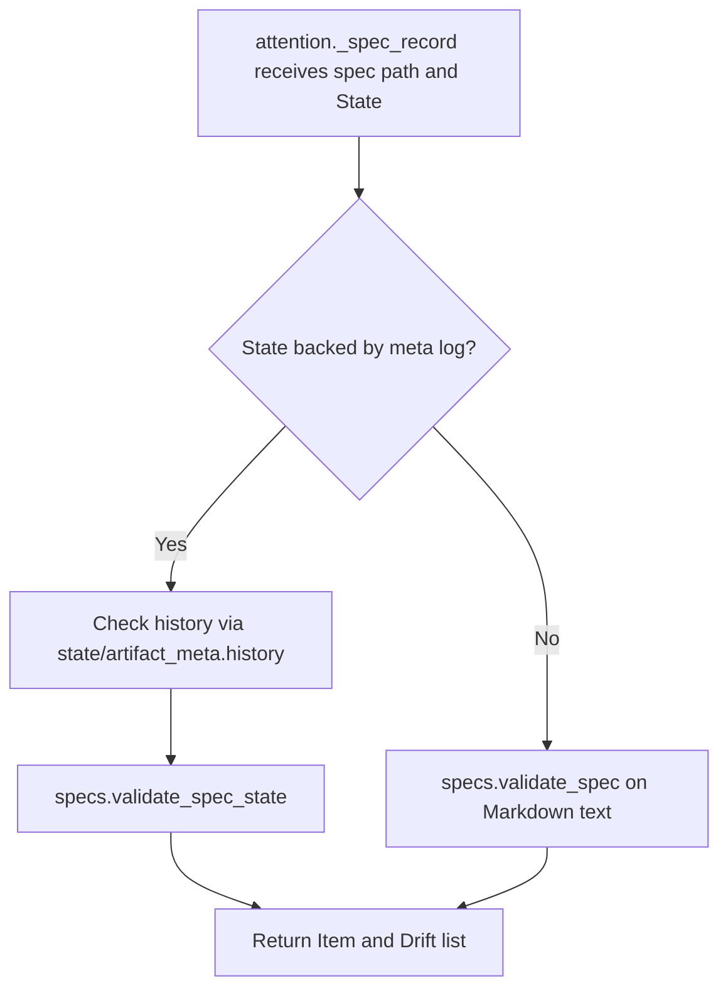

# IPD: Validate v2 log-backed specs against artifact_meta state in attention

- Date: 2026-11-21
- Kind: child
- Concern: `agent_workflows/attention.py::_spec_record` calls legacy `agent_workflows/specs.py::validate_spec(path, text)` unconditionally on every specification file, even when `state` comes from a migrated metadata-v2 event log (`meta/<id6>.jsonl`). After `aw migrate metadata --apply` strips `- Status:`, gate bullets, `- Priority:`, `- Work-Kind:`, and `## Workflow history` into `meta/<id6>.jsonl`, `specs.validate_spec` parses the stripped Markdown body and emits false `attention.missing-status`, `attention.history-missing`, and `attention.gate-missing` violations on every migrated specification. Measured during IPD `60mazt`, this caused 100 false violations across all 50 migrated specifications on a disposable clone of this repository and failed the `no_sidecar`, `mixed_layout`, and `legacy_agents_layout` AC-42 corpus tests, blocking `60mazt`, `5qyba0` rehearsal, and `cxxmyv` cutover.
- Scope: Add state-aware validation for metadata-v2 log-backed specifications in `agent_workflows/specs.py` and route `agent_workflows/attention.py::_spec_record` through it when `state` is log-backed (`state.created_at` or `state.updated_at` is set, or an event log backs the record), validating status enum membership, deferred gate rules (`gate_kind`, `gate_ref`, `gate_summary`), descriptive safety (`scope`, `summary`), optional `priority` and `work_kind` vocabularies, and workflow history presence against `artifact_meta.State` and `artifact_meta.history` while keeping legacy Markdown spec validation unchanged. Add behavioral regression tests in `tests/test_readers_attention.py` covering migrated v2 specifications (valid, deferred with/without gate, missing history, invalid priority/work-kind) alongside legacy Markdown specifications. EXCLUDES: status-less research conversion (`fnabjy` / `s4utmv`), `aw migrate metadata` conversion code, and modifying `tests/test_m0001_any_repo.py` (`60mazt`).
- Scope-Paths: agent_workflows/attention.py, agent_workflows/specs.py, tests/test_readers_attention.py, .aw/records/plans/pending/20261121-0dsjzl-01-zgxig2-validate-v2-log-backed-specs-against-artifact-meta-state-in.ipd.md
- Item-Dependencies: none
- Status: to-review
- Short-Description: Validate log-backed specs from artifact_meta state and history in attention._spec_record instead of parsing stripped Markdown bullets.
- Work-Kind: bug
- Priority: high
- From-Backlog: 0dsjzl
- From-Spec: 4sd62s
- Blocks-Release: next
- Set: 0dsjzl
- Order: 1
- Highest E allocated: 03
- Author: antigravity/gemini
- Id: zgxig2

> Write and proofread this plan per the technical writing standard, `.aw/system/workflows/technical-writing/technical-writing.md` (`.agents/workflows/technical-writing/technical-writing.md` in a legacy-layout install), including requirement 12 (diagrams).

## Workflow history

- 2026-11-21 to-review (aw set): Authored review-ready child plan graduated from backlog 0dsjzl
- 2026-11-21 draft (antigravity/gemini): created.

## Goal

Stop `aw attention` from reporting false `attention.missing-status`, `attention.history-missing`, and `attention.gate-missing` violations on migrated metadata-v2 specifications by validating log-backed specifications against `artifact_meta.State` and `artifact_meta.history` while preserving all legacy Markdown specification checks.

## Detailed Implementation Checklist (TODO)

Execution-state rule: mark an `E-*` item complete only after performing the action. That mark is not validation. Right-sizing rule: write for a modest executor that cannot hold much in its head. Each E-item is one step (one concern, about one file, executable in one focused pass) and its V-item names each unit it covers with its own check; a plan stays at about 5 E-items and 8 work Scope-Paths, else split it into more child plans (guidance, `IPD-Z603`). Accepted execution states: blocked, failed, pending, performed; terminal gate demands 'performed'.

### Task group 1: State-aware v2 specification validation

- [ ] E-01 Add a pure state-aware specification validator `validate_spec_state(path: Path, state: Any, *, has_history: bool) -> List[core.Drift]` in `agent_workflows/specs.py`. It must enforce the same specification contract rules as `specs.validate_spec` using `artifact_meta.State` fields rather than raw Markdown bullets:
  1. `attention.missing-status` when `state.status` is missing or blank, or `attention.unknown-status` when `state.status` is not in `attention_contract.SPEC_STATUSES`.
  2. Deferred gate rules (`attention.gate-missing`, `attention.gate-malformed`, `attention.gate-forbidden`, and `attention.unsafe-field` on `gate_summary`) from `state.fields.get("gate_kind")`, `state.fields.get("gate_ref")`, and `state.fields.get("gate_summary")`.
  3. Descriptive safety (`attention.unsafe-field`) on `state.fields.get("scope")` (`is_safe_prose_descriptive`) and `state.fields.get("summary")` (`is_safe_descriptive`).
  4. Workflow history presence (`attention.history-missing`) when `not has_history`.
  5. Optional vocabulary checks (`spec.priority-invalid` against `backlog.PRIORITIES` and `spec.work-kind-invalid` against `backlog.KINDS`) on `state.fields.get("priority")` and `state.fields.get("work_kind")`.
  Keep `specs.validate_spec(path, text)` intact for legacy Markdown specifications and direct callers.
  - Depends on: none
  - Expected outcome: `agent_workflows/specs.py::validate_spec_state` validates v2 specification state with identical rule IDs and locations (`specs.drift_location(path)`) without parsing stripped Markdown bullets.
  - Execution state: pending

- [ ] E-02 Update `agent_workflows/attention.py::_spec_record` to detect log-backed specification state (matching `_research_record` via `bool(getattr(state, "created_at", None) or getattr(state, "updated_at", None))` or `state.last_seq > 0` / non-legacy source). When the specification is log-backed, determine `has_history` from `_last_history_at_for_state(state, project_context=project_context)` or `artifact_meta.history(state.id6, project_context=project_context)` (checking whether at least one history entry or migrated `last_history_day` exists) and call `specs_mod.validate_spec_state(path, state, has_history=has_history)` instead of `specs_mod.validate_spec(path, text)`. Keep the legacy path calling `specs_mod.validate_spec(path, text)` unchanged when `state` is not log-backed.
  - Depends on: E-01
  - Expected outcome: `attention._spec_record` validates log-backed v2 specifications from `artifact_meta.State` and history, returning zero false `attention.missing-status` or `attention.history-missing` violations on migrated specifications while preserving exact legacy behavior.
  - Execution state: pending

- [ ] E-03 Add behavioral tests in `tests/test_readers_attention.py` that construct migrated v2 log-backed specifications (via real `meta/<id6>.jsonl` event logs and v2 `---` mirror files stripped of `- Status:` and `## Workflow history`, or real `m0001_convert.convert_records` output) and run `attention.scan` and `aw attention --all --format json` to verify:
  1. A migrated `approved` specification with checkpoint history returns `valid: true`, `native_status: "approved"`, `last_history_at`, and zero violations.
  2. A migrated `deferred` specification with valid `gate_kind`/`gate_ref` returns zero violations; a migrated `deferred` specification missing `gate_kind`/`gate_ref` reports `attention.gate-missing`; a non-deferred specification carrying gate fields reports `attention.gate-forbidden`.
  3. A migrated specification with no history entries and no `last_history_day` reports `attention.history-missing`.
  4. A migrated specification with invalid `priority` or `work_kind` reports `spec.priority-invalid` or `spec.work-kind-invalid`.
  5. Existing legacy Markdown specification tests continue to pass unchanged.
  Run `python3 -m pytest -o addopts="" -v tests/test_readers_attention.py tests/test_attention.py tests/test_specs_verbs.py`, `aw suite`, `make typecheck`, `aw ipd lint --phase pre-transition` on this plan, and `aw sanitize --agent`.
  - Depends on: E-02
  - Expected outcome: All targeted tests, `aw suite`, `make typecheck`, `aw ipd lint --phase pre-transition`, and `aw sanitize --agent` pass with zero regressions and zero source-code inspection tests.
  - Execution state: pending

## Project conventions discovered (Step 0)

- `agent_workflows/attention.py::_spec_record` calls `specs_mod.validate_spec(path, text)` unconditionally even after `dqutt8` moved `_spec_record` field extraction onto `artifact_meta.State`.
- `agent_workflows/attention.py::_research_record` already detects log-backed records via `bool(getattr(state, "created_at", None) or getattr(state, "updated_at", None))`; note that migrated v2 records created by `m0001_convert` have `created_at=None` and `updated_at=None` when no post-cutover event has occurred (spec `4sd62s` 4.2b: "`created_at` is the `at` of the `create` event, or NULL for a migrated artifact"), so log-backed detection MUST check whether the record comes from a log (e.g. `getattr(state, "last_seq", 0) > 0` or `getattr(state, "last_history_day", None)` / `state.source == "log"`; inspect `artifact_meta.State` attributes before choosing the exact predicate).
- `agent_workflows/specs.py::validate_spec` emits `core.Drift` records using `drift_location(path)` and rule IDs `attention.missing-status`, `attention.unknown-status`, `attention.gate-missing`, `attention.gate-malformed`, `attention.gate-forbidden`, `attention.unsafe-field`, `attention.history-missing`, `spec.priority-invalid`, and `spec.work-kind-invalid`.
- `tests/test_readers_attention.py` pins behavioral `aw attention` contracts across all tracked trees and is marked `@pytest.mark.core`.

## Findings

| Id | Finding | Evidence |
|---|---|---|
| F-01 | `attention._spec_record` unconditionally calls legacy Markdown parser `specs.validate_spec(path, text)`. | `agent_workflows/attention.py::_spec_record`; measured during IPD `60mazt` (`50 attention.missing-status` + `50 attention.history-missing` across all 50 migrated specs on a repo clone, plus `no_sidecar`, `mixed_layout`, and `legacy_agents_layout`). |
| F-02 | Migrated v2 logs have `created_at = None` and `updated_at = None` until a post-cutover event is appended, so `created_at or updated_at` alone would misclassify a freshly migrated spec as legacy. | Spec `4sd62s` SQLite `artifacts` table definition (`created_at` is NULL for a migrated artifact; `updated_at` is NULL if there is no post-cutover event); verify `artifact_meta.State` log-source signal (`last_seq >= 1` or `legacy_raw_status is None` vs log table) during E-02. |

## Proposed changes (ordered, validatable)

1. Add `validate_spec_state` to `agent_workflows/specs.py` enforcing the full specification contract over `artifact_meta.State` and history presence (`E-01`).
2. Route log-backed specifications in `agent_workflows/attention.py::_spec_record` to `specs_mod.validate_spec_state` while keeping legacy Markdown specifications on `specs_mod.validate_spec` (`E-02`).
3. Add behavioral v2 specification attention tests to `tests/test_readers_attention.py` and run all verification gates (`E-03`).

## Deferred / out of scope (with reason)

- Fixing fabricated `status: "draft"` on status-less `research` records (`m0001_convert` / `artifact_meta`): owned by sibling plan `s4utmv` (from backlog `fnabjy`).
  - Carrier: s4utmv
- Re-running AC-42 corpus and clone verification in `tests/test_m0001_any_repo.py`: owned by pending plan `60mazt`.
  - Carrier: 60mazt

## Scope check

- Over-scope: none. Only `agent_workflows/specs.py`, `agent_workflows/attention.py`, `tests/test_readers_attention.py`, and this plan are modified.
- Under-scope: none. Covers migrated v2 specifications with or without post-cutover events (`last_seq >= 1` / `last_history_day`), deferred gates, descriptive safety, priority/work-kind vocabularies, and history presence.

## Required tests / validation

- `python3 -m pytest -o addopts="" -v tests/test_readers_attention.py tests/test_attention.py tests/test_specs_verbs.py` (all tests pass, including new migrated v2 specification cases)
- `aw suite` (full core suite passes)
- `make typecheck` (0 mypy errors)
- `aw ipd lint --phase pre-transition` on this plan (`outcome: "clean"`)
- `aw sanitize --agent` (`outcome: "clean"`)

## Spec / documentation sync

N/A: spec `4sd62s` already designates `meta/<id6>.jsonl` as the sole metadata and history authority for migrated v2 records; this plan brings `attention._spec_record` into compliance with spec `4sd62s`.

## Open questions

None.

## Validation and cross-check (verify before reporting done)

Validation-state rule: inspect evidence in a separate pass. Do not mark a `V-*` item complete from memory or from the matching execution checkmark. Accepted validation results: blocked, failed, pass, pending; terminal gate demands 'pass'. Runtime-demonstration reachability rule: for each `V-*` item demanding the software be observed acting (such as a run, a dispatch, or a transition), as distinct from items demanding a diff, a file's content, or a test result (which are reachable by construction), name the code path that produces the observation or the sibling `E-*` that creates it, else the demand is UNDER-SCOPE.

- [ ] V-01 validates E-01
  - Required evidence: paste the `git diff agent_workflows/specs.py` summary showing `validate_spec_state` covers status enum, deferred gate rules, descriptive safety, history presence, and optional `priority`/`work_kind` vocabularies while preserving `validate_spec`.
  - Observed evidence:
  - Result: pending

- [ ] V-02 validates E-02
  - Required evidence: paste the `git diff agent_workflows/attention.py` summary showing log-backed detection (including migrated v2 specs with `created_at=None` and `updated_at=None`) and routing to `specs_mod.validate_spec_state`, plus confirmation that legacy Markdown specs still call `specs_mod.validate_spec`.
  - Observed evidence:
  - Result: pending

- [ ] V-03 validates E-03
  - Required evidence: paste actual output from `python3 -m pytest -o addopts="" -v tests/test_readers_attention.py tests/test_attention.py tests/test_specs_verbs.py`, `aw suite`, `make typecheck`, `aw ipd lint --phase pre-transition` on this plan, and `aw sanitize --agent`, plus confirmation that no added test uses `inspect`, `ast`, or source-code regex checks.
  - Observed evidence:
  - Result: pending

## Approval and execution gate

- Size assessment: standard
- Cohesion rationale: not required

Execute after review and approval (`approved` or `auto-approved`). Commit only files changed for this plan through `aw commit zgxig2 -- <paths>` (never `git add -A`, bare `git add`, `git commit -a`, or `--no-verify`; never push). Finalize to `.aw/records/plans/executed/` only via `aw ipd finalize` after `aw ipd lint --phase pre-transition` conforms and every `V-*` reads `pass` with pasted evidence.
