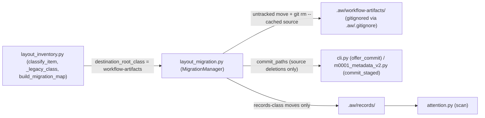
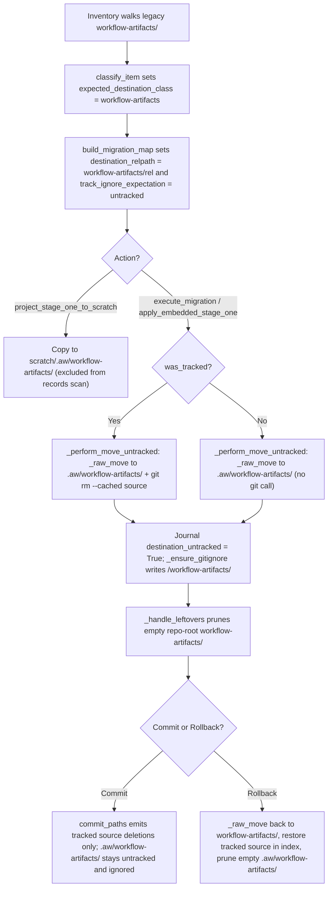

# IPD: Route legacy workflow-artifacts to .aw/workflow-artifacts in layout migration

- Date: 2026-11-21
- Kind: child
- Concern: Backlog `2biutm` (`Work-Kind: bug`, `Priority: high`, `Blocks-Release: next`) reports that migrating a legacy 1.2.1 repository containing tracked repo-root `workflow-artifacts/<workflow>/<run-id>/` directories moves those directories directly into `.aw/records/<workflow>/` (for example `.aw/records/assess-bugs`, `.aw/records/advise-architect`, and `.aw/records/plan-review`). Immediately after migration, `aw att` fails with `attention.uninventoried-tree` for every migrated workflow directory under `.aw/records/`. In `agent_workflows/layout_inventory.py::classify_item`, both the root-of-root branch and the descendant branch classify `label == "workflow-artifacts"` as `records`, so `agent_workflows/layout_inventory.py::build_migration_map` routes every file under `records/<relpath>` instead of `workflow-artifacts/<relpath>`. In addition, `agent_workflows/layout_migration.py::MigrationManager` treats every tracked migrated file as a tracked destination (`git mv` plus destination inclusion in `commit_paths`), which would commit run scratch into `.aw/workflow-artifacts/` during `aw migrate metadata --apply` or leave it staged after `aw migrate-layout --no-commit` in violation of the `.aw/workflow-artifacts/` gitignore contract (`DECISIONS.md` D92).
- Scope: IN: (1) reclassify `label == "workflow-artifacts"` in `agent_workflows/layout_inventory.py` (`classify_item`, `_legacy_class`, and `build_migration_map`) to `ownership: "state-runtime"`, `lifecycle_class: "state-runtime"`, `expected_destination_class: "workflow-artifacts"`, `disposition: "migrate"`, `destination_relpath: "workflow-artifacts"` or `"workflow-artifacts/<source_relpath>"`, and `track_ignore_expectation: "untracked"`; (2) update `agent_workflows/layout_migration.py::MigrationManager` so `destination_root_class == "workflow-artifacts"` files move to `.aw/workflow-artifacts/` as untracked files (removing tracked legacy sources from the git index via `git rm --cached` without staging the destination), omit `destination_untracked` destinations from `commit_paths`, reverse untracked-destination moves cleanly in `rollback_migration` and `rollback_embedded_stage_one`, and track and prune `self.workflow_artifacts_dir` in embedded stage-one `pre_existing_dirs` and `prune_roots`; (3) add behavioral regression tests in `tests/test_layout_inventory.py` covering inventory classification, migration mapping, `aw migrate-layout --yes`, immediate `aw att` / `aw attention --check` validity, git index untracking and `.aw/.gitignore` attribution, pre-existing `.aw/workflow-artifacts/` non-colliding merge and fail-closed non-identical collision refusal, configured `home` backend placement (confirming records move to `AW_HOME` while `workflow-artifacts/` stays repo-local), `--rename-to-grammar`, and `rollback_migration` (including legacy root `.gitignore` fallback); and (4) add behavioral regression tests in `tests/test_m0001_layout_stage.py` covering embedded stage-one planning, scratch projection, `m0001_metadata_v2.run(apply=True, commit=True)`, post-migration `aw attention --check` validity, untracked `.aw/workflow-artifacts/` with clean `git status`, and `stage2-failure` rollback. OUT: changing `agent_workflows/engine.py::migrate_root_workflow_artifacts`, modifying `agent_workflows/attention.py` or `agent_workflows/attention_contract.py`, adding workflow-artifacts cleanup to `agent_workflows/migrations/m0001_discover.py::_compute_layout_stage_needed`, or creating two-commit `git mv` + untrack histories inside `MigrationManager`.
- Scope-Paths: agent_workflows/layout_inventory.py, agent_workflows/layout_migration.py, tests/test_layout_inventory.py, tests/test_m0001_layout_stage.py
- Item-Dependencies: none
- Status: reviewed
- Readiness: go-pending-approval
- Review-Depth: standard
- Short-Description: Reclassify legacy workflow-artifacts in layout_inventory and untrack-on-relocate into .aw/workflow-artifacts in layout_migration
- Work-Kind: bug
- Priority: high
- From-Backlog: 2biutm
- Blocks-Release: next
- Set: 2biutm
- Order: 1
- Highest E allocated: 05
- Author: antigravity/gemini-4-neon-high
- Id: 0hdqbw

> Write and proofread this plan per the technical writing standard, `.aw/system/workflows/technical-writing/technical-writing.md` (`.agents/workflows/technical-writing/technical-writing.md` in a legacy-layout install), including requirement 12 (diagrams).

## Workflow history

- 2026-11-22 reviewed (aw set): APPROVE WITH REVISIONS APPLIED; PR-001..PR-005 FIXED
- 2026-11-21 /plan-review (antigravity/gemini-4-neon-high): APPROVE WITH REVISIONS APPLIED; PR-001, PR-002, PR-003, PR-004, PR-005
- 2026-11-21 to-review (aw set): Authored review-ready child plan graduated from backlog 2biutm
- 2026-11-21 draft (antigravity/gemini-4-neon-high): created.

## Goal

Ensure layout migration (`aw migrate-layout` and embedded stage one of `aw migrate metadata`) routes legacy repo-root `workflow-artifacts/` files into the gitignored `.aw/workflow-artifacts/` directory rather than `.aw/records/`, removes tracked legacy source paths from git without staging the migrated destinations, supports clean rollback, and leaves `aw att` / `aw attention --check` valid immediately after migration.

## Detailed Implementation Checklist (TODO)

Execution-state rule: mark an `E-*` item complete only after performing the action. That mark is not validation. Right-sizing rule: write for a modest executor that cannot hold much in its head. Each E-item is one step (one concern, about one file, executable in one focused pass) and its V-item names each unit it covers with its own check; a plan stays at about 5 E-items and 8 work Scope-Paths, else split it into more child plans (guidance, `IPD-Z603`). Accepted execution states: blocked, failed, pending, performed; terminal gate demands 'performed'.

### Task group 1: Reclassify and map legacy `workflow-artifacts/` in `layout_inventory.py`

- [ ] E-01 In `agent_workflows/layout_inventory.py`, update classification and mapping for `label == "workflow-artifacts"`:
  1. In `classify_item` (both the root-of-root `if not posix or posix == ".":` branch and the descendant `if label == "workflow-artifacts":` branch), return `{"ownership": "state-runtime", "lifecycle_class": "state-runtime", "expected_destination_class": "workflow-artifacts", "disposition": "migrate"}` with a brief comment citing `engine.ARTIFACTS_DIR` (`.aw/workflow-artifacts/`) and the D92 gitignore contract.
  2. In `_legacy_class`, change the `if label == "workflow-artifacts":` return value from `"records"` to `"state-runtime"`.
  3. In `build_migration_map`, add an explicit `elif dest_class == "workflow-artifacts":` branch setting `dest_relpath = "workflow-artifacts"` when `source_relpath in ("", ".")` and `f"workflow-artifacts/{source_relpath}"` otherwise.
  4. In `build_migration_map`, set `"track_ignore_expectation"` to `"untracked"` whenever `dest_class == "workflow-artifacts"`, keeping `"tracked" if item.get("git_state") == "tracked" else "untracked"` for all other destination classes.
  - Depends on: none
  - Expected outcome: `classify_item("workflow-artifacts", ...)` returns `expected_destination_class == "workflow-artifacts"` and `ownership == "state-runtime"`; `build_migration_map` maps `workflow-artifacts/<rel>` to `destination_root_class == "workflow-artifacts"`, `destination_relpath == "workflow-artifacts/<rel>"`, and `track_ignore_expectation == "untracked"`; no `workflow-artifacts` entry maps under `records/`.
  - Execution state: pending

### Task group 2: Relocate `workflow-artifacts` as untracked in `layout_migration.py`

- [ ] E-02 In `agent_workflows/layout_migration.py`, update `MigrationManager` to move `destination_root_class == "workflow-artifacts"` items into `.aw/workflow-artifacts/` as untracked files and reverse them cleanly on rollback:
  1. In `MigrationManager.__init__`, add `self.workflow_artifacts_dir = self.aw_dir / "workflow-artifacts"`.
  2. Add a helper `_perform_move_untracked(self, src_p: Path, dst_p: Path, was_tracked: bool) -> None` (or a private collision-checking helper shared with `_perform_move`) that enforces the same fail-closed pre-existing non-identical destination guard as `_perform_move`, resolves `src_top = self._git_toplevel(src_p)` before moving (falling back to `Path(self.target_repo).resolve()` as `rm_top`), moves `src_p` to `dst_p` via `self._raw_move(src_p, dst_p)`, and if `was_tracked` runs `_run_git(rm_top, ["rm", "--cached", "--", str(src_p)])` without staging `dst_p`. Keep the existing 3-argument call `self._perform_move(src_p, dst_p, was_tracked)` unchanged for all other classes so callers and existing tests that mock `_perform_move` with three arguments remain compatible.
  3. In both `execute_migration` and `apply_embedded_stage_one`, detect `untrack_dest = mapping.get("destination_root_class") == "workflow-artifacts"`. When `untrack_dest` is `True`, invoke `_perform_move_untracked(src_p, dst_p, was_tracked)` and record `"destination_untracked": True` in the `move_journal` entry.
  4. In `commit_paths`, exclude `e["destination"]` when `e.get("destination_untracked")` is `True`, while continuing to include `e["source"]` when `e.get("was_tracked")` is `True` so the migration commit records the deletion of the legacy tracked source path without attempting to commit the gitignored destination.
  5. Add a helper `_restore_tracked_source(self, target_top: Path, src_p: Path) -> None` that runs `_run_git(target_top, ["add", "--", str(src_p)])` and falls back to `_run_git(target_top, ["reset", "--quiet", "HEAD", "--", str(src_p)])` if `git add` exits nonzero (for example when a legacy root `.gitignore` ignores `workflow-artifacts/` while the file was force-tracked in `HEAD`). In both `rollback_migration` and `rollback_embedded_stage_one`, when reversing a `move_journal` entry with `entry.get("destination_untracked")`, move `dst_p` back to `src_p` via `self._raw_move(dst_p, src_p)` (ensuring `src_p.parent` exists) and call `_restore_tracked_source(target_top, src_p)` when `was_tracked` is `True` (and use `_restore_tracked_source` on `dedup-remove` / `dst_existed_before` reversals for `was_tracked` entries as well).
  6. In `apply_embedded_stage_one`, include `self.workflow_artifacts_dir` in `ls["pre_existing_dirs"]`; in `rollback_embedded_stage_one`, include `(self.workflow_artifacts_dir, bool(pre_existing_dirs.get(str(self.workflow_artifacts_dir), False)))` in `prune_roots` so rollback removes newly created empty `.aw/workflow-artifacts/` directories.
  - Depends on: E-01
  - Expected outcome: Both `MigrationManager.execute_migration` and `MigrationManager.apply_embedded_stage_one` relocate `workflow-artifacts/<workflow>/<run-id>/...` into `.aw/workflow-artifacts/<workflow>/<run-id>/...`, untrack tracked legacy sources in the git index without staging `.aw/workflow-artifacts/...`, exclude `.aw/workflow-artifacts/...` from `commit_paths()`, prune empty repo-root `workflow-artifacts/`, and reverse both filesystem and git index state cleanly on rollback.
  - Execution state: pending

### Task group 3: Add behavioral regression coverage and validate repository gates

- [ ] E-03 In `tests/test_layout_inventory.py`, add fast (< 2s per test) behavioral tests using zero `inspect`, `ast`, or source-regex checks against production code:
  1. Direct classification and mapping test: assert `layout_inventory.classify_item("workflow-artifacts", ".")` and `layout_inventory.classify_item("workflow-artifacts", "assess-bugs/20260726-115243/report.md")` return `ownership == "state-runtime"`, `lifecycle_class == "state-runtime"`, `expected_destination_class == "workflow-artifacts"`, and `disposition == "migrate"`. Assert `layout_inventory._legacy_class("workflow-artifacts", "assess-bugs/20260726-115243/report.md") == "state-runtime"`. Assert `build_migration_map` maps `workflow-artifacts/assess-bugs/20260726-115243/report.md` and `workflow-artifacts/README.md` under `workflow-artifacts/` with `destination_root_class == "workflow-artifacts"` and `track_ignore_expectation == "untracked"`.
  2. End-to-end legacy 1.2.1 migration and attention test: build a temporary git repository with `.agents/workflows/` (`VERSION`, `index.md`), `.agents/plans/pending/20260701-01-plan.md` containing valid minimal plan metadata (for example `# IPD: Sample\n\n- Status: approved\n`), tracked `workflow-artifacts/assess-bugs/20260726-115243/report.md`, `workflow-artifacts/advise-architect/20260727-100000/notes.md`, `workflow-artifacts/plan-review/20260728-090000/review.md`, and `workflow-artifacts/README.md`, plus an untracked run file `workflow-artifacts/verify/20260729-080000/evidence.txt`. Run the Command-Line Interface (CLI) entry point `cli.main(["migrate-layout", "--yes"])` in-process with `cwd` isolated. Assert that every file landed byte-identically under `.aw/workflow-artifacts/`, repo-root `workflow-artifacts/` is removed, and `.aw/records/` contains none of the workflow directories or `README.md` from `workflow-artifacts/`. Assert that `git status --porcelain` is empty, `git ls-files -- .aw/workflow-artifacts workflow-artifacts` is empty, and `git check-ignore -v .aw/workflow-artifacts/assess-bugs/20260726-115243/report.md` exits `0` attributed to `.aw/.gitignore`. Assert that `json.loads(attention.render_json(*attention.scan(repo), repo_root=repo))` reports `valid: True` with zero `attention.uninventoried-tree` violations and that `cli.main(["attention", "--check", "--dir", str(repo)])` exits `0`.
  3. Edge-case test covering four cases: (a) pre-existing `.aw/workflow-artifacts/assess-bugs/20260901-101010/report.md` merges cleanly with legacy `workflow-artifacts/assess-bugs/20260726-115243/report.md` without overwriting or refusing, while a pre-existing non-identical `.aw/workflow-artifacts/assess-bugs/20260726-115243/report.md` fails closed with `MigrationError` and leaves both source and destination bytes untouched; (b) `rename_to_grammar=True` leaves `.aw/workflow-artifacts/.../report.md` filenames unchanged; (c) on a fixture configured with `records_backend: "home"` and `aw_home` set before instantiating `MigrationManager(str(repo), aw_home=...)`, `execute_migration(target_backend="home")` moves records-class files under `AW_HOME` while placing `workflow-artifacts/` under `<repo>/.aw/workflow-artifacts/` (not under `AW_HOME`); and (d) `MigrationManager.execute_migration(dry_run=False)` followed by `rollback_migration()` restores tracked `workflow-artifacts/` files byte-identically, removes empty `.aw/workflow-artifacts/`, leaves `git status --porcelain -- workflow-artifacts .agents` empty (standalone `rollback_migration` retains untracked `.aw/` config and state residue by design), and preserves tracking in `git ls-files -- workflow-artifacts`, including a subcase where a legacy root `.gitignore` ignores `workflow-artifacts/` while the file was force-tracked in `HEAD` (exercising `_restore_tracked_source`'s `git reset --quiet HEAD` fallback).
  - Depends on: E-02
  - Expected outcome: All existing and new tests in `tests/test_layout_inventory.py` pass with `0 unlisted slow tests`.
  - Execution state: pending

- [ ] E-04 In `tests/test_m0001_layout_stage.py`, add fast (< 2s per test) behavioral tests using zero `inspect`, `ast`, or source-regex checks against production code:
  1. Legacy 1.2.1 two-stage `aw migrate metadata` test: start from `migration_corpus.legacy_agents_layout` augmented with tracked `workflow-artifacts/assess-bugs/20260726-115243/report.md` and `workflow-artifacts/plan-review/20260728-090000/review.md`. Verify `plan_embedded_stage_one()` and `project_stage_one_to_scratch()` place those files under `scratch/.aw/workflow-artifacts/` and not `scratch/.aw/records/`. Run `m0001_metadata_v2.run(repo, apply=True, describer=_stub_describer, commit=True)`. Assert that `applied["status"] == "applied"`, `git status --porcelain` is empty, `git ls-files -- .aw/workflow-artifacts workflow-artifacts` is empty, and `git check-ignore -v .aw/workflow-artifacts/assess-bugs/20260726-115243/report.md` exits `0` attributed to `.aw/.gitignore`. Assert that the files exist byte-identically under `.aw/workflow-artifacts/`, repo-root `workflow-artifacts/` is removed, and `cli.main(["attention", "--check", "--dir", str(repo)])` exits `0` with zero `attention.uninventoried-tree` violations.
  2. Embedded stage-one rollback test: on a second fixture carrying the same tracked `workflow-artifacts/` files, run `m0001_metadata_v2.run` with `apply=True` and `fault_injection="stage2-failure"`. Assert that rollback restores `workflow-artifacts/` byte-identically, removes `.aw/workflow-artifacts/`, and leaves `git status --porcelain` empty.
  - Depends on: E-02
  - Expected outcome: All existing and new tests in `tests/test_m0001_layout_stage.py` pass with `0 unlisted slow tests`.
  - Execution state: pending

- [ ] E-05 After the final edit, run the targeted layout-migration suites (`python3 -m pytest tests/test_layout_inventory.py tests/test_awphysical_tools.py tests/test_layout_migration.py tests/test_m0001_layout_stage.py tests/test_m0001_any_repo.py tests/test_root_run_scratch_migration.py -v`), bare `python3 -m pytest`, `make test-all`, `aw check all --agent`, and `aw sanitize --agent`, then commit only the four modified `- Scope-Paths:` files through `aw commit 0hdqbw`.
  - Depends on: E-03, E-04
  - Expected outcome: Targeted suites, bare `python3 -m pytest`, `make test-all`, `aw check all --agent`, `aw sanitize --agent`, and the path-scoped `aw commit 0hdqbw` commit all succeed with zero failures.
  - Execution state: pending

Add further leaves as `- [ ] E-NEW <action>` and run `aw ipd sync` to assign ids.

## Project conventions discovered (Step 0)

- `agent_workflows/engine.py::ARTIFACTS_DIR` defines the run-scratch tree as `.aw/workflow-artifacts/`, a sibling of `.aw/records/`, ignored unconditionally by the framework-owned `.aw/.gitignore` anchored pattern `/workflow-artifacts/` (`agent_workflows/engine.py::_ensure_aw_gitignore` and D92 leak containment).
- `agent_workflows/record_producers.py::guard_write` rejects writes targeting legacy `.agents/` or `workflow-artifacts/` paths, and `agent_workflows/record_producers.py::RecordClass` documents `.aw/workflow-artifacts/<workflow>/<RUN_ID>/` as a sibling of `.aw/records/`.
- `tools/awphysical/aw_layout_inventory.py` is a backward-compatibility re-export shim over `agent_workflows/layout_inventory.py`; editing `agent_workflows/layout_inventory.py` updates both entry points without duplicating code.
- `agent_workflows/layout_migration.py::MigrationManager._resolve_destination_path` maps `records/...` onto `_records_root_for_backend(target_backend)` and maps every other destination class onto `self.aw_dir / rel`, so `destination_relpath == "workflow-artifacts/<rel>"` automatically resolves to `<target_repo>/.aw/workflow-artifacts/<rel>` across `repository`, `companion`, and `home` backends.
- `agent_workflows/layout_migration.py::MigrationManager._LEGACY_LEFTOVER_ROOTS` already includes `"workflow-artifacts"`, so `_handle_leftovers` automatically prunes empty repo-root `workflow-artifacts/` directories after files move out.
- `tests/test_layout_migration.py::MoveNotCopyTests.test_move_mutation_probe` monkeypatches `MigrationManager._perform_move` with a 3-parameter lambda `(self, s, d, t)`; introducing a separate `_perform_move_untracked` helper preserves that mock signature without touching existing tests.
- `agent_workflows/git_commit_helper.py::_ignored_paths` uses `git check-ignore`, which does not drop paths already staged in the git index. Keeping `.aw/workflow-artifacts/` out of the git index at move time and out of `commit_paths()` prevents both `aw migrate-layout` and `aw migrate metadata` (`m0001_metadata_v2.py::_collect_stageable_paths` -> `commit_staged`) from committing run scratch into git.
- `tests/fixtures/awphysical/order06/e03-classification.json` defines the closed classification vocabulary `["system", "records", "state-runtime", "config", "host-adapter-candidate", "review-required"]`; classifying `workflow-artifacts` with `ownership: "state-runtime"` and `lifecycle_class: "state-runtime"` stays within that vocabulary.
- Cite code by SYMBOL (`module.function`) or by a quoted content string, with a line number only appended to one of those and never alone: an offset expires before this plan executes (advisory `IPD-C801`).

## Findings

| Id | Source inspected | Finding |
|---|---|---|
| F-01 | `agent_workflows/layout_inventory.py::classify_item`, `_legacy_class`, and `build_migration_map` | Both branches of `classify_item` for `label == "workflow-artifacts"` return `ownership: "records"`, `lifecycle_class: "records"`, `expected_destination_class: "records"`, `disposition: "migrate"`; `_legacy_class` returns `"records"`; `build_migration_map` has no `workflow-artifacts` destination branch and therefore prefixes `records/`, routing `workflow-artifacts/<workflow>/<run-id>/...` to `.aw/records/<workflow>/<run-id>/...` and `workflow-artifacts/README.md` to `.aw/records/README.md`. |
| F-02 | Direct reproduction using `MigrationManager.execute_migration` and `attention.scan` on a temporary legacy 1.2.1 repository with tracked `workflow-artifacts/README.md`, `assess-bugs`, `advise-architect`, and `plan-review` | `execute_migration` moved all four paths into `.aw/records/` (`workflow-artifacts/assess-bugs -> .aw/records/assess-bugs`, `workflow-artifacts/advise-architect -> .aw/records/advise-architect`, `workflow-artifacts/plan-review -> .aw/records/plan-review`, `workflow-artifacts/README.md -> .aw/records/README.md`). Immediately afterward, `attention.render_json` returned `valid: False` with three `attention.uninventoried-tree` violations (`.aw/records/advise-architect`, `.aw/records/assess-bugs`, `.aw/records/plan-review`). |
| F-03 | `agent_workflows/layout_migration.py::MigrationManager._perform_move`, `execute_migration`, `apply_embedded_stage_one`, `commit_paths`, and `agent_workflows/migrations/m0001_metadata_v2.py::_collect_stageable_paths` plus `agent_workflows/git_commit_helper.py::_ignored_paths` | If `workflow-artifacts` were merely remapped to `.aw/workflow-artifacts/` while still using tracked `git mv` and including `e["destination"]` in `commit_paths()`, two defects would remain: (a) `m0001_metadata_v2` would see `.aw/workflow-artifacts/...` in the git index (`tracked_set`) and commit it as tracked because `git check-ignore` never filters already-indexed paths, violating D92; and (b) `aw migrate-layout --yes` would emit noisy `not committing gitignored path(s)` stderr warnings, while `--no-commit` would leave `.aw/workflow-artifacts/...` staged in the git index. |
| F-04 | `agent_workflows/layout_migration.py::MigrationManager.apply_embedded_stage_one` and `rollback_embedded_stage_one` | `ls["pre_existing_dirs"]` and `prune_roots` track only `records_dir`, `system_dir`, and `config_dir`; rolling back an embedded stage-one migration that created `.aw/workflow-artifacts/` would leave an empty `.aw/workflow-artifacts/` directory behind unless `self.workflow_artifacts_dir` is added to both. |
| F-05 | `tests/test_layout_migration.py::MoveNotCopyTests.test_move_mutation_probe` and baseline pytest run (`tests/test_layout_inventory.py`, `tests/test_awphysical_tools.py`, `tests/test_layout_migration.py`, `tests/test_m0001_layout_stage.py`) | Baseline suite passed (`109 passed in 8.65s`, `0 unlisted slow tests`). `test_move_mutation_probe` monkeypatches `MigrationManager._perform_move` with a 3-argument lambda `(self, s, d, t)`, so untracked moves must use a separate helper (`_perform_move_untracked`) rather than changing `_perform_move`'s call signature for normal moves. |

## Proposed changes (ordered, validatable)

The component diagram below shows how the four affected modules coordinate during layout migration and rollback:

The flowchart below shows the branching move, commit, and rollback flow for legacy `workflow-artifacts/` items after `E-01` and `E-02`:

1. **Reclassify and map `workflow-artifacts` (`E-01`)**: Update `agent_workflows/layout_inventory.py::classify_item`, `_legacy_class`, and `build_migration_map` so `label == "workflow-artifacts"` classifies as `state-runtime` with `expected_destination_class: "workflow-artifacts"`, maps directly to `workflow-artifacts/...`, and expects `track_ignore_expectation: "untracked"`.
2. **Untrack-on-relocate and rollback support (`E-02`)**: Update `agent_workflows/layout_migration.py::MigrationManager` to add `self.workflow_artifacts_dir`, move `destination_root_class == "workflow-artifacts"` entries via `_perform_move_untracked`, journal `destination_untracked: True`, omit untracked destinations from `commit_paths()`, restore moved files and git index entries via `_restore_tracked_source` on rollback, and prune newly created `.aw/workflow-artifacts/` directories on embedded stage-one rollback.
3. **Behavioral regression coverage (`E-03`, `E-04`)**: Add unit and end-to-end tests in `tests/test_layout_inventory.py` and `tests/test_m0001_layout_stage.py` proving classification, mapping, `aw migrate-layout --yes`, two-stage `aw migrate metadata`, immediate `aw att` / `aw attention --check` validity, `.aw/.gitignore` enforcement, pre-existing destination merge and fail-closed non-identical collision refusal, configured `home` backend placement, `--rename-to-grammar` safety, and clean rollback (including legacy root `.gitignore` fallback).
4. **Full validation and commit (`E-05`)**: Run targeted suites, bare `python3 -m pytest`, `make test-all`, `aw check all --agent`, and `aw sanitize --agent`, then commit through `aw commit 0hdqbw`.

## Deferred / out of scope (with reason)

- Creating a two-commit `git mv` + `git rm --cached` history inside `MigrationManager` to mirror `engine.migrate_root_workflow_artifacts`:
  - Carrier-Declined: `MigrationManager.execute_migration` and `apply_embedded_stage_one` are transactional working-tree/index movers that never create git commits directly (so `--no-commit`, preview, and rollback stay commit-free). Removing tracked legacy `workflow-artifacts/` paths in the migration commit preserves all pre-migration history under `git log -- workflow-artifacts/<path>` while guaranteeing `.aw/workflow-artifacts/` never enters a commit. Operators who specifically want `git log --follow` rename commits across the boundary already have `aw install` (`engine.migrate_root_workflow_artifacts`) and `tools/untrack-workflow-artifacts.py`.
- Triggering embedded stage one in `agent_workflows/migrations/m0001_discover.py::_compute_layout_stage_needed` for repositories that have repo-root `workflow-artifacts/` without `.agents/`:
  - Carrier-Declined: A repository already on `.aw/` without `.agents/` is already handled by `aw install` (`engine.migrate_root_workflow_artifacts`) and `tools/untrack-workflow-artifacts.py`; `m0001` stage one is scoped specifically to legacy `.agents/` layout migration.
- Special-casing legacy `workflow-artifacts/README.md` deletion when `.aw/workflow-artifacts/README.md` already exists with different bytes:
  - Carrier-Declined: Existing fail-closed collision refusal in `_perform_move` / `_perform_move_untracked` prevents silent overwrites of pre-existing destinations, and `aw install` already handles legacy stray README replacement before writing `.aw/workflow-artifacts/README.md`.

## Scope check

- Over-scope: none. `- Scope-Paths:` contains only `agent_workflows/layout_inventory.py`, `agent_workflows/layout_migration.py`, `tests/test_layout_inventory.py`, and `tests/test_m0001_layout_stage.py`.
- Under-scope: none. Covers `layout_inventory` classification and mapping, both `aw migrate-layout` and `aw migrate metadata` (embedded stage one) execution and commit scoping, untracking per the `.aw/workflow-artifacts/` D92 contract, configured `home` backend placement, `--rename-to-grammar` safety, pre-existing destination merge and fail-closed non-identical collision refusal, clean rollback (including legacy root `.gitignore` fallback), immediate `aw att` / `aw attention --check` validity, and repository test gates.

## Required tests / validation

- Targeted suites:
  `python3 -m pytest tests/test_layout_inventory.py tests/test_awphysical_tools.py tests/test_layout_migration.py tests/test_m0001_layout_stage.py tests/test_m0001_any_repo.py tests/test_root_run_scratch_migration.py -v`
- Repository gates:
  - `python3 -m pytest`
  - `make test-all`
  - `aw check all --agent`
  - `aw sanitize --agent`

## Spec / documentation sync

N/A with reason: this bug fix aligns `agent_workflows/layout_inventory.py` and `agent_workflows/layout_migration.py` with the already-implemented `.aw/workflow-artifacts/` contract in `spec 20260817-2124-01` (Order 07, `u7xtni`), `spec 20260810-1447-01`, `agent_workflows/engine.py::ARTIFACTS_DIR`, and `agent_workflows/record_producers.py`, introducing no new CLI flags, rule identifiers, or specification requirements.

## Open questions

### OQ-01: Should layout migration untrack migrated `workflow-artifacts/` destinations rather than staging `git mv` renames into `.aw/workflow-artifacts/`?

- Blocking: no
- Status: resolved
- Owner: plan author
- Resolution or deferral rationale: RESOLVED from repository evidence in `agent_workflows/engine.py::ARTIFACTS_DIR`, `agent_workflows/engine.py::_ensure_aw_gitignore` (`/workflow-artifacts/`), `agent_workflows/engine.py::migrate_root_workflow_artifacts`, `agent_workflows/git_commit_helper.py::_ignored_paths`, and `agent_workflows/migrations/m0001_metadata_v2.py::_collect_stageable_paths` (`F-03`). Because `.aw/workflow-artifacts/` is unconditionally gitignored for D92 leak containment, staging a `git mv` into `.aw/workflow-artifacts/` causes `m0001_metadata_v2` to commit run scratch as tracked (since `git check-ignore` ignores already-indexed paths) and leaves `.aw/workflow-artifacts/` staged under `--no-commit`. Moving files to `.aw/workflow-artifacts/` on disk while running `git rm --cached` on tracked legacy `workflow-artifacts/` sources and omitting untracked destinations from `commit_paths()` guarantees `.aw/workflow-artifacts/` is untracked and governed by `.aw/.gitignore` across both `aw migrate-layout` and `aw migrate metadata`, while keeping migration commits single-commit and rollback reversible.

### OQ-02: What `ownership`, `lifecycle_class`, `expected_destination_class`, and `_legacy_class` values should `layout_inventory.py` emit for `workflow-artifacts`?

- Blocking: no
- Status: resolved
- Owner: plan author
- Resolution or deferral rationale: RESOLVED from repository evidence in `tests/fixtures/awphysical/order06/e03-classification.json`, `agent_workflows/layout_inventory.py`, and `agent_workflows/layout_migration.py`. `e03-classification.json` defines the closed classification set `["system", "records", "state-runtime", "config", "host-adapter-candidate", "review-required"]`. Setting `ownership: "state-runtime"`, `lifecycle_class: "state-runtime"`, and `_legacy_class == "state-runtime"` stays within that closed set, while `expected_destination_class: "workflow-artifacts"` gives `build_migration_map` and `MigrationManager` an unambiguous destination class separate from `"records"` (preventing routing to `.aw/records/`, companion/home records backends, or `--rename-to-grammar`) and separate from `"durable_state"` (preventing routing to `.aw/state/durable/`).

## Validation and cross-check (verify before reporting done)

Validation-state rule: inspect evidence in a separate pass. Do not mark a `V-*` item complete from memory or from the matching execution checkmark. Accepted validation results: blocked, failed, pass, pending; terminal gate demands 'pass'. Runtime-demonstration reachability rule: for each `V-*` item demanding the software be observed acting (such as a run, a dispatch, or a transition; as distinct from items demanding a diff, a file's content, or a test result, which are reachable by construction), name the code path that produces the observation or the sibling `E-*` that creates it, else the demand is UNDER-SCOPE.

- [ ] V-01 validates E-01
  - Required evidence: paste `git diff -- agent_workflows/layout_inventory.py` showing updated `classify_item` (both root and descendant branches), `_legacy_class`, and `build_migration_map` (`dest_class == "workflow-artifacts"` and `track_ignore_expectation == "untracked"`), plus the passing `tests/test_layout_inventory.py` and `tests/test_awphysical_tools.py` output from `E-03`.
  - Observed evidence:
  - Result: pending
- [ ] V-02 validates E-02
  - Required evidence: paste `git diff -- agent_workflows/layout_migration.py` showing `self.workflow_artifacts_dir`, `_perform_move_untracked`, `destination_untracked` journaling in `execute_migration` and `apply_embedded_stage_one`, destination omission in `commit_paths`, `_restore_tracked_source` rollback handling, and `pre_existing_dirs`/`prune_roots` updates, plus the passing `tests/test_layout_migration.py`, `tests/test_layout_inventory.py`, and `tests/test_m0001_layout_stage.py` output from `E-03` and `E-04`.
  - Observed evidence:
  - Result: pending
- [ ] V-03 validates E-03
  - Required evidence: paste `git diff -- tests/test_layout_inventory.py`, the `python3 -m pytest tests/test_layout_inventory.py -v` output showing every existing and new test passing with `0 unlisted slow tests`, and confirmation that `rg -n "inspect\.|getsource|\bast\." tests/test_layout_inventory.py` returns no matches.
  - Observed evidence:
  - Result: pending
- [ ] V-04 validates E-04
  - Required evidence: paste `git diff -- tests/test_m0001_layout_stage.py`, the `python3 -m pytest tests/test_m0001_layout_stage.py -v` output showing every existing and new test passing with `0 unlisted slow tests`, and confirmation that `rg -n "inspect\.|getsource|\bast\." tests/test_m0001_layout_stage.py` returns no matches.
  - Observed evidence:
  - Result: pending
- [ ] V-05 validates E-05
  - Required evidence: paste actual runner output and summary lines from `python3 -m pytest tests/test_layout_inventory.py tests/test_awphysical_tools.py tests/test_layout_migration.py tests/test_m0001_layout_stage.py tests/test_m0001_any_repo.py tests/test_root_run_scratch_migration.py -v`, bare `python3 -m pytest`, `make test-all`, `aw check all --agent`, and `aw sanitize --agent`, plus `git show --stat` of the `aw commit 0hdqbw` commit confirming only `- Scope-Paths:` files changed.
  - Observed evidence:
  - Result: pending

## Approval and execution gate

- Size assessment: standard
- Cohesion rationale: not required

Execute only after explicit human approval (`- Status: approved`, or an authorized automated gate) with `- Item-Dependencies: none` confirmed. All open questions are resolved (`OQ-01`, `OQ-02`).

SCOPE FENCE. `- Scope-Paths:` declares `agent_workflows/layout_inventory.py`, `agent_workflows/layout_migration.py`, `tests/test_layout_inventory.py`, and `tests/test_m0001_layout_stage.py`. Do not expand scope casually; if execution genuinely requires editing a file outside the fence, make the edit and justify it in two-way scope reconciliation at finalize (`--scope-reason`), and acknowledge any declared-but-unmodified path with `--scope-ack`. Stop and report only on a genuinely unsafe condition such as an unresolvable concurrent-edit conflict or missing target symbols in `agent_workflows/layout_inventory.py` or `agent_workflows/layout_migration.py`.

HONESTY. Every `V-*` evidence block must paste the actual observed output from commands run after the final edit; never claim success you did not run.

COMMIT. Other agents or humans may work concurrently in a shared checkout; never alter, revert, stage, or commit unrelated changes you did not create. Commit only files changed for this plan through `aw commit 0hdqbw -- agent_workflows/layout_inventory.py agent_workflows/layout_migration.py tests/test_layout_inventory.py tests/test_m0001_layout_stage.py`; verify `git diff --cached --name-only` contains only your paths; never use `git add -A`, a bare `git add`, or `git commit -a`; never push without an explicit human request.

POST-GATE LIFECYCLE. Once every `E-*` item has `Execution state: performed`, every `V-*` item has `Result: pass`, and `aw ipd lint --phase pre-transition` reports `conforming`, move the plan to `.aw/records/plans/executed/` through `aw ipd finalize 0hdqbw --actor <agent/model> --message "
" --apply` (when executed by `aw oc run` or `aw agy run`, the runner owns finalization; a standalone executor runs `aw ipd finalize 0hdqbw`). Never `git mv` the plan by hand. This plan inherits `- Blocks-Release: next` from backlog `2biutm`, so closing `2biutm` as `done` after execution follows the executed-carrier HANDOFF path.
