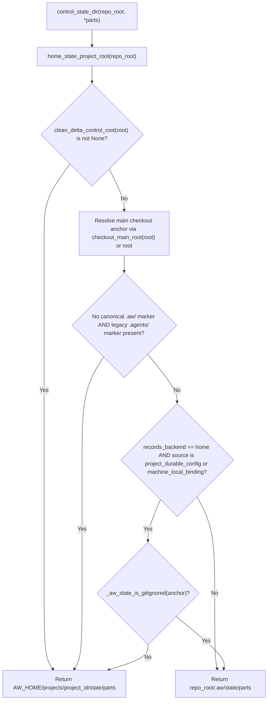

# IPD: Route control state to AW_HOME for legacy .agents and unignored home-backend repos

- Date: 2026-11-21
- Kind: child
- Concern: Backlog `2vj8w3` (`Work-Kind: bug`, `Priority: high`, `Blocks-Release: next`) reports that running `aw checkup` in a legacy `.agents/` repository (such as `pubrun` before `--to-aw`, which resolves to `Backend: home` and has no `.aw/.gitignore`) writes `<repo>/.aw/state/checkup/last.json` directly inside the target checkout. `agent_workflows/checkup.py::checkup_dir` delegates to `agent_workflows/ipd_lifecycle.py::control_state_dir`, which currently redirects to `AW_HOME` (the user's agent-workflows home directory) only for `clean-delta` repositories. Because `.aw/state/` is not gitignored in a legacy `.agents/` repository or in a `Backend: home` repository lacking `.aw/.gitignore`, writing runtime state there leaves untracked `.aw/state/` files in `git status` and risks accidental commits of machine-local runtime state.
- Scope: IN: (1) add `_aw_state_is_gitignored` and `home_state_project_root` in `agent_workflows/ipd_lifecycle.py` and route `agent_workflows/ipd_lifecycle.py::control_state_dir` through `home_state_project_root` so clean-delta repositories, legacy `.agents/` repositories without canonical `.aw/` layout, and explicitly configured `Backend: home` repositories whose `.aw/state/` is not gitignored all store runtime state under `<AW_HOME>/projects/<project_id>/state/`; (2) update `agent_workflows/checkup.py::run_checkup_cli` to relativize `Saved record:` via `ipd_lifecycle.home_state_project_root` as `<project home>/state/checkup/last.json` instead of printing a raw absolute machine path, and update `agent_workflows/checkup.py::checkup_dir` and `CHECKUP_STATE_REL` documentation; and (3) add behavioral outcome tests in `tests/test_checkup_legacy_state_routing.py`. OUT: changing `agent_workflows/ipd_lifecycle.py::clean_delta_control_root` or `checkout_control_root` semantics, creating `.aw/.gitignore` or editing `.git/info/exclude` during `aw checkup`, changing `agent_workflows/project_context.py::resolve_project_context` precedence rules, or altering `aw checkup --agent` / `--json` schemas.
- Scope-Paths: agent_workflows/ipd_lifecycle.py, agent_workflows/checkup.py, tests/test_checkup_legacy_state_routing.py
- Item-Dependencies: none
- Status: approved
- Readiness: go-pending-approval
- Review-Depth: standard
- Short-Description: Route control_state_dir to AW_HOME for legacy .agents/ and unignored Backend: home repositories
- Work-Kind: bug
- Priority: high
- From-Backlog: 2vj8w3
- Blocks-Release: next
- Set: 2vj8w3
- Order: 1
- Highest E allocated: 04
- Author: antigravity
- Id: 53z4se
- Approval: 2026-11-27, recorded via aw ipd set: status set to approved

> Write and proofread this plan per the technical writing standard, `.aw/system/workflows/technical-writing/technical-writing.md` (`.agents/workflows/technical-writing/technical-writing.md` in a legacy-layout install), including requirement 12 (diagrams).

## Workflow history

- 2026-11-27 approved (aw set): status set to approved
- 2026-11-24 reviewed (opencode/its_direct/pt3-claude-opus-5.5-1m-us): APPROVE WITH REVISIONS APPLIED; PR-001..PR-006 FIXED
- 2026-11-24 /plan-review (opencode/its_direct/pt3-claude-opus-5.5-1m-us): APPROVE WITH REVISIONS APPLIED; PR-001..PR-006 FIXED
- 2026-11-22 to-review (aw set): Authored review-ready child plan graduated from backlog 2vj8w3
- 2026-11-22 draft (antigravity): created.

## Goal

Prevent `aw checkup` and other `control_state_dir` callers from writing unignored `.aw/state/` files into a legacy `.agents/` repository or an explicitly configured `Backend: home` repository lacking `.aw/.gitignore`, by routing their runtime control state to `<AW_HOME>/projects/<project_id>/state/` and preserving clean `git status --porcelain` output and machine-path-free `Saved record:` display.

`G` probes the `.aw/state/` directory itself, so a rule that ignores only one subtree (for example `/.aw/state/checkup/`) answers No.

## Detailed Implementation Checklist (TODO)

Execution-state rule: mark an `E-*` item complete only after performing the action. That mark is not validation. Right-sizing rule: write for a modest executor that cannot hold much in its head. Each E-item is one step (one concern, about one file, executable in one focused pass) and its V-item names each unit it covers with its own check; a plan stays at about 5 E-items and 8 work Scope-Paths, else split it into more child plans (guidance, `IPD-Z603`). Accepted execution states: blocked, failed, pending, performed; terminal gate demands 'performed'.

### Task group 1: Route non-canonical and unignored home-backend control state to AW_HOME

- [ ] E-01 In `agent_workflows/ipd_lifecycle.py`, add `_aw_state_is_gitignored(anchor: Path) -> bool` and `home_state_project_root(repo_root: Path | str) -> Optional[Path]`, and update `control_state_dir(repo_root: Path | str, *parts: str | Path) -> Path`:
  1. Implement `_aw_state_is_gitignored(anchor: Path) -> bool`:
     - If `(anchor / ".aw" / ".gitignore")` is a regular file, read its lines, strip whitespace, ignore blank lines and `#` comments, and check whether any line equals `"/state/"`, `"state/"`, `"/state"`, `"state"`, or `"*"` while no negation line (`"!/state"`, `"!/state/"`, `"!state"`, `"!state/"`) is present; if so, return `True` without spawning a subprocess.
     - Otherwise, if `(anchor / ".git").exists()`, run `_git(anchor, ["check-ignore", "-q", "--", ".aw/state/"])` and return `rc == 0` so root `.gitignore`, `.git/info/exclude`, nested `.aw/.gitignore` patterns, and global ignore rules are honored. Probe the `.aw/state/` directory itself (trailing slash), NOT a checkup-specific file: `control_state_dir` also serves `work/` (`work_cmd._work_dir`) and `suite-baselines/` (`runner_shared.suite_baseline_checkout_path`), so a narrower rule such as `/.aw/state/checkup/` must NOT count as protecting the whole state tree. Measured with git 2.43 in a scratch repository: with a root `.gitignore` of `/.aw/state/checkup/`, `git check-ignore -q -- .aw/state/checkup/last.json` exits 0 while `.aw/state/` and `.aw/state/work/x/l.json` exit 1; with `.aw/state/` or `.aw/state/*`, the `.aw/state/` probe exits 0.
     - Otherwise (non-git directory lacking a matching `.aw/.gitignore` rule), return `False`.
     - Catch `OSError` and return `False` so the predicate is total.
     - Memoize the answer per resolved `anchor` in a bounded module-level dict (mirror `_CONTROL_ROOT_CACHE` / `_CONTROL_ROOT_CACHE_MAX`), and clear that dict from `clear_checkout_control_root_cache()` so existing test fixtures that call it also drop this cache. Reason: `checkup.checkup_dir` is reached several times per `aw checkup` (record path, lock path, read, write, and the `Saved record:` display), and every `aw work` lease and evidence path also calls `control_state_dir`, so an uncached `git check-ignore` subprocess would run on each call in a Condition-B repository.
  2. Implement `home_state_project_root(repo_root: Path | str) -> Optional[Path]`:
     - Fast path: call `cd_root = clean_delta_control_root(root)`; if `cd_root is not None`, return `cd_root`.
     - If `not root.is_dir()`, return `None`.
     - Inside a `try ... except (OSError, ValueError, RuntimeError, project_context.ProjectContextError): return None` guard (keeping the accessor total):
       - Resolve `anchor = project_context.checkout_main_root(root) or root` so linked worktrees share the primary checkout's identity without spawning git.
       - Condition A (legacy `.agents/` layout without canonical `.aw/`): compute `has_aw_layout = project_context._is_project_marker(anchor / ".aw")` and `has_legacy_agents = project_context._is_project_marker(anchor / ".agents", legacy=True)`. If `not has_aw_layout and has_legacy_agents`, call `ctx = project_context.resolve_project_context(target_repo=str(anchor))` and return `Path(ctx.effective_aw_home) / "projects" / ctx.project_id`.
       - Condition B (configured `Backend: home` lacking gitignore protection for `.aw/state/`): call `ctx = project_context.resolve_project_context(target_repo=str(anchor))`, read `rec_prov = ctx.provenance.get("records_backend")`, and extract `rec_source = rec_prov.get("source") if isinstance(rec_prov, dict) else getattr(rec_prov, "source", None)`. If `ctx.records_backend == RecordsBackend.HOME.value` and `rec_source in (PrecedenceLevel.PROJECT_DURABLE_CONFIG.value, PrecedenceLevel.MACHINE_LOCAL_BINDING.value)` and `not _aw_state_is_gitignored(anchor)`, return `Path(ctx.effective_aw_home) / "projects" / ctx.project_id`. Import `RecordsBackend` and `PrecedenceLevel` from `agent_workflows.project_schema` (they are defined there, not in `project_context`), lazily inside the function like the existing `project_context` imports. The allowed sources match the "stored placement" predicate in `project_context._stored_physical_classes` (used by `has_stored_records_placement`), which treats `records_backend` as configured only when its provenance source is `project_durable_config` or `machine_local_binding`. Do NOT use `!= builtin_defaults`: that would also count `global_defaults` (the user's `default_records_backend` in global config) and `named_global_profile`, so one user-level default would silently reroute the state of every unconfigured `.aw/` fixture and repository on the machine.
       - Otherwise return `None`.
  3. Update `control_state_dir(repo_root: Path | str, *parts: str | Path) -> Path` to call `home_root = home_state_project_root(root)` instead of `clean_delta_control_root(root)`, returning `(home_root / "state").joinpath(*parts)` when `home_root is not None` and `(root / ".aw" / "state").joinpath(*parts)` otherwise. Update its docstring to document all three `AW_HOME` routing conditions.
  4. Leave `clean_delta_control_root` and `checkout_control_root` behavior unchanged so `agent_workflows/worktree_lease.py`, `agent_workflows/oc_runipd.py`, and `tests/test_clean_target_control_state.py` keep exact clean-delta-only semantics.
  - Depends on: none
  - Expected outcome: `control_state_dir` routes to `<AW_HOME>/projects/<project_id>/state/...` for clean-delta repositories, legacy `.agents/` repositories without canonical `.aw/` (including those with a stray `.aw/state/` directory), and explicitly configured `Backend: home` repositories whose `.aw/state/` is not gitignored, while preserving `<repo_root>/.aw/state/...` for tracked canonical `.aw/` repositories, `Backend: home` repositories whose `.aw/state/` is gitignored, and unconfigured `.aw/config/` fixtures.
  - Execution state: pending

### Task group 2: Relativize Saved record display in checkup Command-Line Interface (CLI)

- [ ] E-02 In `agent_workflows/checkup.py`, update `run_checkup_cli` and the `CHECKUP_STATE_REL` / `checkup_dir` documentation:
  1. In `run_checkup_cli`, inside the `Saved record:` relativization `except Exception:` block, replace `ipd_lifecycle.clean_delta_control_root(Path(repo_root))` with `ipd_lifecycle.home_state_project_root(Path(repo_root))`. When `home_root is not None`, format `rel_record = f"<project home>/{rel_record_raw.relative_to(home_root).as_posix()}"` so legacy `.agents/` and unignored `Backend: home` repositories never print raw absolute machine paths.
  2. Update the comment on `CHECKUP_STATE_REL` and the docstring on `checkup_dir` to state that `control_state_dir` routes to `<AW_HOME>/projects/<project_id>/state/checkup` for clean-delta repositories, legacy `.agents/` repositories without canonical `.aw/`, and configured `Backend: home` repositories lacking gitignore protection for `.aw/state/`.
  - Depends on: E-01
  - Expected outcome: Running `aw checkup` in a legacy `.agents/` repository or an unignored `Backend: home` repository prints `Saved record: <project home>/state/checkup/last.json` with no absolute machine paths, while `checkup.checkup_dir`, `checkup.write_checkup_record`, `checkup.read_checkup_record`, and `checkup.checkup_lock_path` all resolve consistently through `control_state_dir`.
  - Execution state: pending

### Task group 3: Add behavioral outcome tests

- [ ] E-03 Create `tests/test_checkup_legacy_state_routing.py` with behavioral tests (using zero `inspect`, `ast`, or source-regex checks against production code) using an isolated temporary `AW_HOME`, a stub `gh` executable, and a committed `.github/workflows/tests.yml` in test fixtures so the tests remain independent of local workflow pre-checks:
  1. **Legacy `.agents/` git repository (`aw checkup` end-to-end):** create a clean git repository with `.agents/workflows/index.md` committed and no `.aw/` directory; run `cli.main(["checkup", "--dir", str(repo)])` with captured stdout; assert exit code `0`, `<AW_HOME>/projects/<project_id>/state/checkup/last.json` exists and parses as valid JSON, `(repo / ".aw").exists()` is `False`, `git status --porcelain` is `""`, stdout contains `Saved record: <project home>/state/checkup/last.json` and contains neither `str(aw_home)` nor `str(repo)`, `checkup.read_checkup_record(repo)` returns the saved record (not `None`), and `doctor.inspect_repo(repo).evidence` contains an `Evidence` whose `key == "checkup"` and whose `value["record"]` is not `None` (`doctor.inspect_repo` reads the record through `checkup.read_checkup_record` and appends that evidence entry). Also assert that `ipd_lifecycle.control_state_dir(repo, "work", "wk0001")` and `ipd_lifecycle.control_state_dir(repo, "suite-baselines")` both resolve under `<AW_HOME>/projects/<project_id>/state/`, since `work_cmd._work_dir` and `runner_shared.suite_baseline_checkout_path` share the same accessor.
  2. **Linked worktree of a legacy `.agents/` repository:** attach a linked `git worktree` to the legacy `.agents/` repository; run `checkup.perform_checkup(lane)`; assert `checkup.checkup_dir(lane) == checkup.checkup_dir(repo)`, `last.json` is written under `AW_HOME`, and `git status --porcelain` is `""` in both `repo` and `lane`.
  3. **Legacy `.agents/` repository containing stray `.aw/state/`:** create an empty `.aw/state/` directory inside a legacy `.agents/` repository (no `.aw/system`, `.aw/records`, or `.aw/config`); assert `checkup.checkup_dir(repo)` still resolves under `<AW_HOME>/projects/<project_id>/state/checkup` rather than `<repo>/.aw/state/checkup`.
  4. **Explicitly configured `Backend: home` repository lacking `.aw/.gitignore`:** create a clean git repository with `.aw/config/project.json` containing `{"schema_version": 2, "records_backend": "home"}` committed and no `.aw/.gitignore` (and no root `.gitignore` rule for `.aw/state/`); run `cli.main(["checkup", "--dir", str(repo)])`; assert exit code `0`, `last.json` is written under `<AW_HOME>/projects/<project_id>/state/checkup/last.json`, `(repo / ".aw" / "state").exists()` is `False`, `git status --porcelain` is `""`, and stdout contains `Saved record: <project home>/state/checkup/last.json`.
  5. **Explicitly configured `Backend: home` repository with partial or complete gitignore rules:**
     - With `.aw/.gitignore` containing `/state/`: assert `checkup.checkup_dir(repo) == repo / ".aw" / "state" / "checkup"` and `git status --porcelain` is `""` after `checkup.perform_checkup(repo)`.
     - With root `.gitignore` containing `.aw/state/` (and no `.aw/.gitignore`): assert `checkup.checkup_dir(repo) == repo / ".aw" / "state" / "checkup"` and `git status --porcelain` is `""` after `checkup.perform_checkup(repo)`.
     - With `.aw/.gitignore` containing only `records/*/untracked/` (missing `/state/`): assert `checkup.checkup_dir(repo)` routes under `<AW_HOME>/projects/<project_id>/state/checkup` and `git status --porcelain` is `""` after `checkup.perform_checkup(repo)`.
     - With root `.gitignore` containing only `/.aw/state/checkup/` (a subtree rule that leaves `work/` and `suite-baselines/` unprotected): assert `checkup.checkup_dir(repo)` and `ipd_lifecycle.control_state_dir(repo, "work", "wk0001")` both route under `<AW_HOME>/projects/<project_id>/state/`.
  6. **Tracked and unconfigured control cases:** verify that a canonical `.aw/` repository with `records_backend: "repository"` and `.aw/.gitignore`, and an unconfigured `.aw/config/` fixture without `project.json` (matching `tests/test_checkup.py::_init_repo`), both return `home_state_project_root(repo) is None` and `checkup.checkup_dir(repo) == repo / ".aw" / "state" / "checkup"`. Repeat the unconfigured `.aw/config/` case with a user-level global default: write `{"default_records_backend": "home"}` to `config.json` under the test's sandboxed user config directory (`agent_workflows.config.config_dir()`, which follows the `XDG_CONFIG_HOME` that `conftest.py` already sandboxes), and assert `home_state_project_root(repo) is None` and `checkup.checkup_dir(repo) == repo / ".aw" / "state" / "checkup"`, proving a `global_defaults` provenance does not trigger Condition B. Call `ipd_lifecycle.clear_checkout_control_root_cache()` in `setUp` and `tearDown` so a fresh fixture at a reused temporary path cannot read a cached answer.
  - Depends on: E-01, E-02
  - Expected outcome: Every test in `tests/test_checkup_legacy_state_routing.py` passes, and all existing tests in `tests/test_checkup.py`, `tests/test_clean_target_control_state.py`, `tests/test_red_ci_stop.py`, `tests/test_work_gate_severity.py`, `tests/test_work_begin_plan_path_outside_root.py`, `tests/test_resolve_plan_path_typed.py` (which writes in-repo `.aw/state/suite-baselines/` fixtures), and `tests/test_legacy_finalize.py` (which mixes `.agents/` and `.aw/` trees) remain green.
  - Execution state: pending

### Task group 4: Validate suites and commit path-scoped changes

- [ ] E-04 After the final edit, run targeted suites (`python3 -m pytest tests/test_checkup_legacy_state_routing.py tests/test_checkup.py tests/test_clean_target_control_state.py tests/test_red_ci_stop.py tests/test_work_gate_severity.py tests/test_work_begin_plan_path_outside_root.py tests/test_resolve_plan_path_typed.py tests/test_legacy_finalize.py`), bare `python3 -m pytest`, `make typecheck`, `aw check all --agent`, and `aw sanitize --agent`, then commit only modified `- Scope-Paths:` files through `aw commit 53z4se -- agent_workflows/ipd_lifecycle.py agent_workflows/checkup.py tests/test_checkup_legacy_state_routing.py`.
  - Depends on: E-03
  - Expected outcome: All targeted suites, the full test suite, type checks, repository checks, leak scan, and the path-scoped commit succeed with zero errors.
  - Execution state: pending

## Project conventions discovered (Step 0)

- `agent_workflows/checkup.py::checkup_dir` resolves the primary checkout via `agent_workflows/runner_shared.py::runs_repo_root` and delegates to `agent_workflows/ipd_lifecycle.py::control_state_dir(primary, "checkup")`. All checkup readers and writers (`write_checkup_record`, `read_checkup_record`, `checkup_lock_path`, `attention.py`, `doctor.py`, `runner_shared.py`, `render_stream.py`) flow through `checkup_dir`.
- `agent_workflows/ipd_lifecycle.py::control_state_dir` also serves `agent_workflows/work_cmd.py::_work_dir` and `agent_workflows/runner_shared.py::suite_baseline_checkout_path`, so routing `control_state_dir` through `home_state_project_root` protects all three runtime state subtrees uniformly. One visible consequence: in a legacy `.agents/` repository or a Condition-B repository, `suite_baseline_checkout_path` now places the detached suite-baseline `git worktree` under `<AW_HOME>/projects/<project_id>/state/suite-baselines/` instead of inside the checkout. That is intended (a worktree inside an unignored `.aw/state/` would itself show in `git status`), and the existing in-repo suite-baseline fixtures in `tests/test_resolve_plan_path_typed.py` declare neither `.agents/` nor `records_backend`, so they keep the in-repo path.
- `agent_workflows/project_context.py::_is_project_marker` distinguishes real canonical `.aw/` layouts (requiring at least one durable child directory: `system`, `records`, or `config`) from stray `.aw/state/` directories, and recognizes legacy `.agents/` layouts via `legacy=True` (`workflows`, `plans`, `docs`, `prompts`, `comms`, `backlog`).
- `agent_workflows/project_context.py::checkout_main_root` is pure and subprocess-free; it resolves both main checkouts and linked worktrees to the primary checkout root without spawning git.
- `agent_workflows/project_context.py::resolve_project_context` defaults `records_backend` to `RecordsBackend.HOME.value` with provenance source `PrecedenceLevel.BUILTIN_DEFAULTS.value` whenever no `records_backend` is configured; a user-level `default_records_backend` yields `PrecedenceLevel.GLOBAL_DEFAULTS.value` and a named profile yields `PrecedenceLevel.NAMED_GLOBAL_PROFILE.value` (both enum members live in `agent_workflows/project_schema.py`). Requiring `rec_source` to be `project_durable_config` or `machine_local_binding` for Condition B (the same predicate `project_context._stored_physical_classes` uses for a stored records placement) prevents unintended rerouting on synthetic `.aw/config/` or `.aw/records/` test fixtures (`tests/test_checkup.py::_init_repo`, `tests/test_red_ci_stop.py::_setup_repo`, `tests/test_work_gate_severity.py::WorkGateSeverityTest.setUp`) that assert in-repo `.aw/state/` paths without declaring `records_backend`.
- Writing `<repo>/.aw/.gitignore` inside a legacy `.agents/` repository during `aw checkup` would itself introduce an untracked `?? .aw/` entry in `git status --porcelain`; routing runtime state to `<AW_HOME>/projects/<project_id>/state/` keeps the target checkout untouched and clean.
- `agent_workflows/ipd_lifecycle.py::clean_delta_control_root` must remain strictly clean-delta-only because `agent_workflows/worktree_lease.py`, `agent_workflows/oc_runipd.py`, and `tests/test_clean_target_control_state.py` rely on it returning `None` for non-clean-delta repositories.
- Cite code by SYMBOL (`module.function`) or by a quoted content string, with a line number only appended to one of those and never alone: an offset expires before this plan executes (advisory `IPD-C801`).

## Findings

| ID | Severity | Area | Finding |
| --- | --- | --- | --- |
| F-01 | High | `agent_workflows/ipd_lifecycle.py::control_state_dir` | `control_state_dir` redirects to `AW_HOME` only when `clean_delta_control_root(root)` is not `None`, causing legacy `.agents/` repositories and unignored `Backend: home` repositories to receive untracked `<repo>/.aw/state/checkup/last.json` files on `aw checkup`. |
| F-02 | Medium | `agent_workflows/checkup.py::run_checkup_cli` | The `Saved record:` path relativizer checks only `ipd_lifecycle.clean_delta_control_root`; once non-clean-delta repositories route checkup records under `AW_HOME`, `run_checkup_cli` would print a raw absolute machine path unless updated to use `ipd_lifecycle.home_state_project_root`. |

## Proposed changes (ordered, validatable)

1. `agent_workflows/ipd_lifecycle.py` (`E-01`): Add `_aw_state_is_gitignored` and `home_state_project_root`, and update `control_state_dir` to delegate to `home_state_project_root` while leaving `clean_delta_control_root` and `checkout_control_root` unchanged.
2. `agent_workflows/checkup.py` (`E-02`): Update `run_checkup_cli` to relativize `Saved record:` through `ipd_lifecycle.home_state_project_root` as `<project home>/state/checkup/last.json`, and update `CHECKUP_STATE_REL` and `checkup_dir` documentation.
3. `tests/test_checkup_legacy_state_routing.py` (`E-03`): Add behavioral tests covering legacy `.agents/` repositories, linked worktrees, stray `.aw/state/`, unignored `Backend: home` repositories, ignored `Backend: home` repositories (both `.aw/.gitignore` and root `.gitignore`), partial `.aw/.gitignore` missing `/state/`, a subtree-only root rule `/.aw/state/checkup/`, a user-level `default_records_backend` that must not reroute, and tracked/unconfigured controls.
4. Verification and path-scoped commit (`E-04`): Run targeted tests, full `python3 -m pytest`, `make typecheck`, `aw check all --agent`, and `aw sanitize --agent`, and commit via `aw commit 53z4se`.

## Deferred / out of scope (with reason)

- Migrating an existing stray `<repo>/.aw/state/checkup/last.json` file out of a legacy `.agents/` checkout during `aw checkup` is out of scope: `aw checkup` should not delete files inside the user's working tree without explicit consent.
  - Carrier-Declined: Automatic deletion of pre-existing working-tree files during a read-mostly health command carries unnecessary data-loss risk; preventing creation on all subsequent runs satisfies `2vj8w3`.
- Rewriting `aw checkup --agent` / `--json` `data.record_path` formatting is out of scope because no schema change is requested by `2vj8w3`.
  - Carrier-Declined: Machine output schema changes are separate from preventing unignored `.aw/state/` writes and keeping human `Saved record:` output machine-path-free.

## Scope check

- Over-scope: none. Only `agent_workflows/ipd_lifecycle.py`, `agent_workflows/checkup.py`, and the new test module `tests/test_checkup_legacy_state_routing.py` are modified or created.
- Under-scope: none. Both legacy `.agents/` repositories and `Backend: home` repositories lacking `.aw/.gitignore` are routed cleanly to `AW_HOME`, CLI display avoids machine-path leaks, and all existing `control_state_dir` consumers inherit the fix automatically.

## Required tests / validation

- Run targeted suites: `python3 -m pytest tests/test_checkup_legacy_state_routing.py tests/test_checkup.py tests/test_clean_target_control_state.py tests/test_red_ci_stop.py tests/test_work_gate_severity.py tests/test_work_begin_plan_path_outside_root.py tests/test_resolve_plan_path_typed.py tests/test_legacy_finalize.py`.
- Run full test suite: `python3 -m pytest`.
- Run static and repository hygiene gates: `make typecheck`, `aw check all --agent`, and `aw sanitize --agent`.

## Spec / documentation sync

No separate specification or user-facing documentation files require edits. The only spec that names the path, `.aw/records/specs/approved/20260826-25kzda-01-25kzda-aw-run-deterministic-run-and-verify.spec.md` (red-CI gate), says the gate "reads the saved checkup record from `.aw/state/checkup/last.json`" through `checkup.run_start_checkup` and the saved-record readers; it describes the default in-repo location, which clean-delta repositories already reroute through `control_state_dir`, and this plan changes only which repositories are rerouted, not the gate contract. That spec is therefore left unamended and is not listed in `- Scope-Paths:`. In-code docstrings and comments on `agent_workflows/ipd_lifecycle.py::control_state_dir`, `agent_workflows/ipd_lifecycle.py::home_state_project_root`, `agent_workflows/checkup.py::CHECKUP_STATE_REL`, and `agent_workflows/checkup.py::checkup_dir` are updated directly in `E-01` and `E-02`.

## Open questions

None.

## Validation and cross-check (verify before reporting done)

Validation-state rule: inspect evidence in a separate pass. Do not mark a `V-*` item complete from memory or from the matching execution checkmark. Accepted validation results: blocked, failed, pass, pending; terminal gate demands 'pass'. Runtime-demonstration reachability rule: for each `V-*` item demanding the software be observed acting (such as a run, a dispatch, or a transition) (as distinct from items demanding a diff, a file's content, or a test result, which are reachable by construction) name the code path that produces the observation or the sibling `E-*` that creates it, else the demand is UNDER-SCOPE.

- [ ] V-01 validates E-01
  - Required evidence: Paste `git diff -- agent_workflows/ipd_lifecycle.py` showing `_aw_state_is_gitignored`, `home_state_project_root`, and the updated `control_state_dir` (with `clean_delta_control_root` and `checkout_control_root` unchanged), plus pasted `python3 -m pytest tests/test_checkup_legacy_state_routing.py tests/test_clean_target_control_state.py` output proving legacy `.agents/`, unignored `Backend: home`, ignored `Backend: home`, subtree-only ignore rule (`/.aw/state/checkup/`), user-level `default_records_backend` (no reroute), clean-delta, and tracked control routing all pass.
  - Observed evidence:
  - Result: pending

- [ ] V-02 validates E-02
  - Required evidence: Paste `git diff -- agent_workflows/checkup.py` showing `run_checkup_cli` relativizing `Saved record:` via `ipd_lifecycle.home_state_project_root` and updated docstrings, plus pasted `python3 -m pytest tests/test_checkup_legacy_state_routing.py tests/test_checkup.py` output proving `Saved record: <project home>/state/checkup/last.json` is emitted without machine paths and existing checkup tests remain green.
  - Observed evidence:
  - Result: pending

- [ ] V-03 validates E-03
  - Required evidence: Paste full `python3 -m pytest tests/test_checkup_legacy_state_routing.py` output showing all six behavioral test groups pass with zero failures and zero source-inspection tests.
  - Observed evidence:
  - Result: pending

- [ ] V-04 validates E-04
  - Required evidence: Paste full outputs of targeted `python3 -m pytest`, bare `python3 -m pytest`, `make typecheck`, `aw check all --agent`, `aw sanitize --agent`, and `git show --stat HEAD` after `aw commit 53z4se -- agent_workflows/ipd_lifecycle.py agent_workflows/checkup.py tests/test_checkup_legacy_state_routing.py`, confirming all checks pass and only `- Scope-Paths:` files are in the commit.
  - Observed evidence:
  - Result: pending

## Approval and execution gate

- Size assessment: standard
- Cohesion rationale: not required

This plan must reach `approved` before execution. Execute inside an isolated worktree, commit only `- Scope-Paths:` files via `aw commit 53z4se -- <paths>`, paste actual command output into each `V-*` Observed evidence block, and finalize via `aw ipd finalize 53z4se` (or write the lane outcome file when run under a driver that owns lifecycle transitions).
