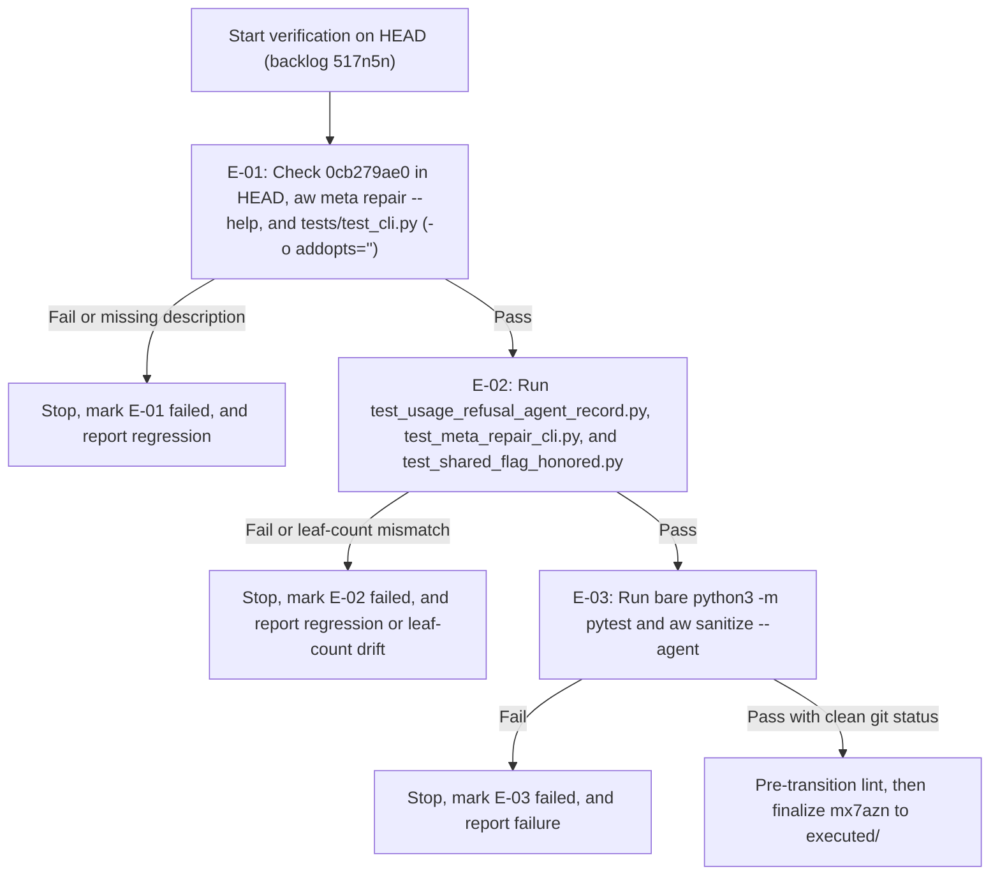

# IPD: Verify aw meta repair subparser description and REQUIRED_LEAVES count

- Date: 2026-11-21
- Kind: child
- Concern: Backlog `517n5n` (`Work-Kind: bug`, `Blocks-Release: next`) reports two thorough-tier test failures caused by Implementation Plan Document (IPD) `a5ijjx` adding `aw meta repair <id6>` in `agent_workflows/cli.py`: `tests/test_cli.py::SubcommandDescriptionTests.test_every_subparser_has_fuller_description` failed with `['meta repair: empty description']`, and `tests/test_usage_refusal_agent_record.py::test_exclusion_set_size_and_members` failed with `assert 70 == 69` because the required positional `id6` argument increased `REQUIRED_LEAVES` from 69 to 70. Commit `0cb279ae0` (landed `2026-11-21 00:11:45 -0500`, after `6de2e014d` filed `517n5n` at `2026-11-20 23:51:17 -0500`) already added `description=` to the `meta repair` subparser in `agent_workflows/cli.py` and updated `test_exclusion_set_size_and_members` to `70` in `tests/test_usage_refusal_agent_record.py`. Commit `6be40f11b` (plan `724acb`) later added `reviews record` and `walkthrough new`, so at review HEAD the assertion reads `assert len(REQUIRED_LEAVES) == 72` and `"meta repair"` is still a member. This plan verifies on the executing commit (`HEAD`) that both fixes remain intact and both tests pass so `517n5n` can close on observed evidence.
- Scope: IN: (1) verify commit `0cb279ae0` is an ancestor of `HEAD`, inspect `aw meta repair --help`, and run the slow-marked `tests/test_cli.py` suite including `SubcommandDescriptionTests.test_every_subparser_has_fuller_description` with `-o addopts=""`; (2) run `tests/test_usage_refusal_agent_record.py`, `tests/test_meta_repair_cli.py`, and the `meta repair` case in `tests/test_shared_flag_honored.py::test_parser_usage_refusal_fields_honored_required_leaves`; and (3) run bare `python3 -m pytest`, `aw ipd lint`, and `aw sanitize --agent` with zero source modifications. OUT: modifying `agent_workflows/cli.py` or `tests/test_usage_refusal_agent_record.py` (already fixed by `0cb279ae0`; if any check fails, the executor stops and reports rather than expanding scope), running a full 10-minute `aw suite --thorough` sweep across unrelated slow failures (such as `rryabb`), and updating pre-existing stale leaf-count comments outside `test_exclusion_set_size_and_members`.
- Scope-Paths: .aw/records/plans/pending/20261121-517n5n-01-mx7azn-verify-aw-meta-repair-subparser-description-and-required-lea.ipd.md
- Item-Dependencies: none
- Status: reviewed
- Readiness: go-pending-approval
- Review-Depth: simple
- Short-Description: Verify commit 0cb279ae0 fixed the meta repair subparser description and REQUIRED_LEAVES count for backlog 517n5n
- Work-Kind: bug
- Priority: medium
- From-Backlog: 517n5n
- Blocks-Release: next
- Set: 517n5n
- Order: 1
- Highest E allocated: 03
- Author: antigravity/gemini-4-hydrogen-xhigh
- Id: mx7azn

> Write and proofread this plan per the technical writing standard, `.aw/system/workflows/technical-writing/technical-writing.md` (`.agents/workflows/technical-writing/technical-writing.md` in a legacy-layout install), including requirement 12 (diagrams).

## Workflow history

- 2026-11-25 reviewed (uri/its_direct/pt3-claude-opus-5.5-1m-us): plan-review (simple): APPROVE WITH REVISIONS APPLIED; PR-001..PR-004 fixed; review record .aw/records/reviews/20261121-517n5n-01-mx7azn-verify-aw-meta-repair-subparser-description-and-required-lea.review.md
- 2026-11-21 to-review (aw set): Authored review-ready verification plan for backlog 517n5n
- 2026-11-21 draft (antigravity/gemini-4-hydrogen-xhigh): created.

## Goal

Verify on the executing `HEAD` that commit `0cb279ae0` keeps `aw meta repair <id6>` equipped with a fuller `description=` parameter in `agent_workflows/cli.py` and keeps `"meta repair"` counted in `REQUIRED_LEAVES` in `tests/test_usage_refusal_agent_record.py` (whose pinned total is `72` at review HEAD, not `70`, because later commit `6be40f11b` added two leaves), and confirm all affected command-line interface (CLI) and usage-refusal tests pass without further code edits.

## Detailed Implementation Checklist (TODO)

Execution-state rule: mark an `E-*` item complete only after performing the action. That mark is not validation. Right-sizing rule: write for a modest executor that cannot hold much in its head. Each E-item is one step (one concern, about one file, executable in one focused pass) and its V-item names each unit it covers with its own check; a plan stays at about 5 E-items and 8 work Scope-Paths, else split it into more child plans (guidance, `IPD-Z603`). Accepted execution states: blocked, failed, pending, performed; terminal gate demands 'performed'.

### Task group 1: Verify subparser description, leaf count, and regression gates

- [ ] E-01 Confirm commit `0cb279ae0` is present in `HEAD` (`git merge-base --is-ancestor 0cb279ae0c1f2778e89b862ea80cb80f555ef733 HEAD`), run `aw meta repair --help`, and run `python3 -m pytest -o addopts="" tests/test_cli.py -k "SubcommandDescriptionTests" -v` followed by `python3 -m pytest -o addopts="" tests/test_cli.py`. If `git merge-base` exits nonzero or any test in `tests/test_cli.py` fails, mark `E-01` `failed`, stop execution, and report the regression instead of editing `agent_workflows/cli.py`.
  - Depends on: none
  - Expected outcome: `git merge-base` exits `0`, `aw meta repair --help` prints the multi-line `description=` text for `p_meta_repair`, `SubcommandDescriptionTests.test_every_subparser_has_fuller_description` passes, and every collected test in `tests/test_cli.py` passes with zero failed and zero deselected tests.
  - Execution state: pending

- [ ] E-02 Run `python3 -m pytest -o addopts="" tests/test_usage_refusal_agent_record.py -k "test_exclusion_set_size_and_members or (test_required_arg_leaf_modes and meta)" -v`, `python3 -m pytest tests/test_usage_refusal_agent_record.py tests/test_meta_repair_cli.py`, and `python3 -m pytest -o addopts="" tests/test_shared_flag_honored.py -k "test_parser_usage_refusal_fields_honored_required_leaves and meta" -v` to confirm `REQUIRED_LEAVES` and `meta repair` usage refusal behavior remain green. If `test_exclusion_set_size_and_members` or any `meta repair` test fails, mark `E-02` `failed`, stop execution, and report whether `meta repair` regressed or an unrelated commit changed the total leaf count.
  - Depends on: E-01
  - Expected outcome: `tests/test_usage_refusal_agent_record.py::test_exclusion_set_size_and_members` (which pins the current total, `72` at review HEAD; a pass at a total other than `70` is the expected result, not drift), `test_required_arg_leaf_modes[meta repair]`, `tests/test_meta_repair_cli.py`, and `tests/test_shared_flag_honored.py::test_parser_usage_refusal_fields_honored_required_leaves[meta repair]` all pass.
  - Execution state: pending

- [ ] E-03 Run bare `python3 -m pytest`, run `aw sanitize --agent`, and run `git status --short -- agent_workflows tests` to confirm this execution edited no Python source or test file. Pre-transition lint is NOT part of this item: it runs after every `V-*` reads `pass` (see the gate's POST-GATE LIFECYCLE clause), because it refuses while this item is still `pending`.
  - Depends on: E-02
  - Expected outcome: Bare `python3 -m pytest` passes the core suite, `aw sanitize --agent` returns `"outcome":"clean"`, and `git status --short -- agent_workflows tests` prints nothing.
  - Execution state: pending

## Project conventions discovered (Step 0)

- `tests/test_cli.py` sets module-level `pytestmark = pytest.mark.slow`, and `pyproject.toml` sets `addopts = "-q -n auto --dist=worksteal -m 'not slow and not livecorpus'"`. Running `python3 -m pytest tests/test_cli.py` without `-o addopts=""` deselects all 65 tests in that file, so slow-tier verification of `SubcommandDescriptionTests.test_every_subparser_has_fuller_description` must pass `-o addopts=""`.
- In `agent_workflows/cli.py::_build_parser`, `p_meta` receives its `description` from `_DESCRIPTIONS["meta"]` via `_apply_descriptions`, whereas `p_meta_repair` passes `description=` directly to `meta_sub.add_parser("repair", ...)`. Both satisfy `tests/test_cli.py::SubcommandDescriptionTests.test_every_subparser_has_fuller_description` because `len(desc) > len(help)` and `desc != help` (measured at review HEAD: `280 > 92` characters for `meta repair`; `201 > 62` characters for `meta`).
- `tests/test_usage_refusal_agent_record.py::REQUIRED_LEAVES` is populated dynamically by `_discover_required_arg_leaves()`, which walks `cli._build_parser()` and includes every canonical leaf parser carrying a required positional or flag argument. Adding `aw meta repair <id6>` in `a5ijjx` (`92a2865db`) added `"meta repair"` to `REQUIRED_LEAVES`, raising its count from `69` to `70`. Commit `6be40f11b` (plan `724acb`) then added `reviews record` and `walkthrough new`, raising it to `72`, which is the value the test pins at review HEAD.
- `tests/test_shared_flag_honored.py::test_parser_usage_refusal_fields_honored_required_leaves` imports `REQUIRED_LEAVES` from `tests/test_usage_refusal_agent_record.py` and parametrizes over every entry, so `meta repair` is exercised there as well.
- Bare `python3 -m pytest` runs the core test tier (without `-n0`, extra `-q`, or `-p no:randomly`, per `AGENTS.md`).
- Cite code by symbol (`module.function` or `path::Class.method`) or quoted content string rather than bare line numbers (`IPD-C801`).

## Findings

| Id | Source inspected | Finding |
| --- | --- | --- |
| F-01 | `git log --oneline b61073951..HEAD` and `git show 0cb279ae0` | Commit `6de2e014d` (`2026-11-20 23:51:17 -0500`) filed backlog `517n5n` against `main` (`b61073951`). Commit `0cb279ae0` (`2026-11-21 00:11:45 -0500`) landed on `main` (`fix(ci): add meta repair subparser description, update REQUIRED_LEAVES count to 70, and use _display_path in test_aw_profile for Windows TEMP under HOME`), implementing both fixes requested by `517n5n`. |
| F-02 | `agent_workflows/cli.py::_build_parser` (`p_meta_repair`), `aw meta repair --help`, and `python3 -m pytest -o addopts="" tests/test_cli.py` | `p_meta_repair` now passes a 280-character `description=` string (`Preview or apply metadata repairs for a single tracked artifact identified by its stable id6...`) distinct from its 92-character `help=`. At authoring `HEAD`, `tests/test_cli.py` passes all `65 passed` tests including `SubcommandDescriptionTests.test_every_subparser_has_fuller_description` and `AlphabeticalHelpTests`. |
| F-03 | `tests/test_usage_refusal_agent_record.py::test_exclusion_set_size_and_members` and `python3 -m pytest tests/test_usage_refusal_agent_record.py` | Commit `0cb279ae0` added comment `# 70: \`meta repair\` added in metastore a5ijjx (requires <id6>).` and updated the assertion to `assert len(REQUIRED_LEAVES) == 70`. Commit `6be40f11b` (plan `724acb`) since changed it to `assert len(REQUIRED_LEAVES) == 72` (comment `# 72: \`reviews record\` ... and \`walkthrough new\` ... added in metastore 724acb.`); at review HEAD the module collects 187 tests. At authoring `HEAD`, `tests/test_usage_refusal_agent_record.py` passes all `185 passed` tests including `test_exclusion_set_size_and_members` and `test_required_arg_leaf_modes[meta repair]`. |
| F-04 | `tests/test_meta_repair_cli.py` and `tests/test_shared_flag_honored.py::test_parser_usage_refusal_fields_honored_required_leaves` | At authoring `HEAD`, `tests/test_meta_repair_cli.py` passes `7 passed` and `tests/test_shared_flag_honored.py -k "test_parser_usage_refusal_fields_honored_required_leaves and meta"` passes `1 passed` for `[meta repair]`. |
| F-05 | `tests/test_usage_refusal_agent_record.py` (`EXCLUDED_LEAVES` comment) and `tests/test_shared_flag_honored.py::test_parser_usage_refusal_fields_honored_required_leaves` docstring | Two pre-existing comments still mention older leaf counts (`all 68 required-argument leaves` above `EXCLUDED_LEAVES` and `All 67 canonical required-argument leaves` in the docstring). Both predate `517n5n` and do not affect test assertions or runtime behavior. |

## Proposed changes (ordered, validatable)

This plan performs verification only because commit `0cb279ae0` already landed both code and test fixes requested by backlog `517n5n`. No production or test file is edited unless execution uncovers a regression, in which case the executor stops and reports.

1. Confirm commit `0cb279ae0` is an ancestor of `HEAD`, inspect `aw meta repair --help`, and pass `tests/test_cli.py` including `SubcommandDescriptionTests.test_every_subparser_has_fuller_description` (`E-01`).
2. Pass `tests/test_usage_refusal_agent_record.py` (including `test_exclusion_set_size_and_members` and `test_required_arg_leaf_modes[meta repair]`), `tests/test_meta_repair_cli.py`, and `tests/test_shared_flag_honored.py` for `[meta repair]` (`E-02`).
3. Pass the bare core suite `python3 -m pytest` and `aw sanitize --agent` with zero source or test edits (`E-03`). Pre-transition lint and finalize follow in the gate's POST-GATE LIFECYCLE clause.

## Deferred / out of scope (with reason)

- Editing `agent_workflows/cli.py` (`p_meta_repair`) or `tests/test_usage_refusal_agent_record.py` (`test_exclusion_set_size_and_members`): commit `0cb279ae0` already added the `description=` parameter and updated the leaf-count assertion on `main` (now `== 72` after `6be40f11b`).
  - Carrier-Declined: Already implemented in commit `0cb279ae0` on `main`; this plan verifies that landed fix on observed output rather than re-editing already-fixed files.
- Updating pre-existing leaf-count comments (`all 68 required-argument leaves` in `tests/test_usage_refusal_agent_record.py` and `All 67 canonical required-argument leaves` in `tests/test_shared_flag_honored.py`): cosmetic comments predating `517n5n` with no impact on test execution or assertions.
  - Carrier-Declined: Pre-existing cosmetic comment mismatch outside backlog `517n5n` scope; leaving shared test files untouched avoids merge contention.
- Running the full 10-minute `aw suite --thorough` sweep across unrelated tests: backlog `rryabb` already tracks pre-existing thorough-tier failures in `tests/test_runner_resume_clears_stop.py`.
  - Carrier-Declined: Running `tests/test_cli.py` with `-o addopts=""` and `tests/test_usage_refusal_agent_record.py` directly exercises both thorough-tier tests named in `517n5n` without blocking on unrelated slow-tier failures tracked by `rryabb`.

## Scope check

- Over-scope: none. `- Scope-Paths:` declares only this plan file; zero Python or test files are modified.
- Under-scope: none. `E-01` through `E-03` verify commit `0cb279ae0`, `aw meta repair --help`, `SubcommandDescriptionTests.test_every_subparser_has_fuller_description`, `test_exclusion_set_size_and_members`, `test_required_arg_leaf_modes[meta repair]`, `tests/test_meta_repair_cli.py`, `test_shared_flag_honored.py`, and the bare core suite `python3 -m pytest`.

## Required tests / validation

- Slow-marked CLI tests (must use `-o addopts=""` so `pytestmark = pytest.mark.slow` is not deselected):
  `python3 -m pytest -o addopts="" tests/test_cli.py -k "SubcommandDescriptionTests" -v`
  `python3 -m pytest -o addopts="" tests/test_cli.py`
- Usage refusal, leaf-count, `aw meta repair`, and `--fields` tests:
  `python3 -m pytest tests/test_usage_refusal_agent_record.py tests/test_meta_repair_cli.py`
  `python3 -m pytest -o addopts="" tests/test_shared_flag_honored.py -k "test_parser_usage_refusal_fields_honored_required_leaves and meta" -v`
- Core regression, lint, and leak gates:
  `python3 -m pytest`
  `aw sanitize --agent`
- Lifecycle gate, after every `V-*` reads `pass`: `aw ipd lint --phase pre-transition --agent` on this plan reports `conforming`.

## Spec / documentation sync

N/A with reason: `docs/cli-output-contract.md` Section 15 and `CHANGELOG.md` already document `aw meta repair <id6> [--apply] [--confirm]`; commit `0cb279ae0` added only the subparser `description=` string and updated the `REQUIRED_LEAVES` count assertion in `tests/test_usage_refusal_agent_record.py`, requiring no specification or documentation changes.

## Open questions

### OQ-01: Should this plan modify agent_workflows/cli.py and tests/test_usage_refusal_agent_record.py or verify commit 0cb279ae0?

- Blocking: no
- Status: resolved
- Owner: plan author
- Resolution or deferral rationale: RESOLVED from repository evidence: verify only. Commit `0cb279ae0` already added `description=` to `p_meta_repair` in `agent_workflows/cli.py` and updated `test_exclusion_set_size_and_members` to `assert len(REQUIRED_LEAVES) == 70` in `tests/test_usage_refusal_agent_record.py`, since raised to `72` by `6be40f11b` (`F-01`, `F-02`, `F-03`). Both targeted test suites pass at authoring `HEAD`, so re-editing those files would duplicate completed work; `E-01` and `E-02` stop and report if any regression appears before execution.

## Validation and cross-check (verify before reporting done)

Validation-state rule: inspect evidence in a separate pass. Do not mark a `V-*` item complete from memory or from the matching execution checkmark. Accepted validation results: blocked, failed, pass, pending; terminal gate demands 'pass'. Runtime-demonstration reachability rule: for each `V-*` item demanding the software be observed acting (such as a run, a dispatch, or a transition), as distinct from items demanding a diff, a file's content, or a test result (which are reachable by construction), name the code path that produces the observation or the sibling `E-*` that creates it, else the demand is UNDER-SCOPE.

- [ ] V-01 validates E-01
  - Required evidence: paste the `git merge-base --is-ancestor 0cb279ae0c1f2778e89b862ea80cb80f555ef733 HEAD` exit status (`0`), the `aw meta repair --help` output showing the multi-line description, the `python3 -m pytest -o addopts="" tests/test_cli.py -k "SubcommandDescriptionTests" -v` output showing `test_every_subparser_has_fuller_description PASSED`, and the full `python3 -m pytest -o addopts="" tests/test_cli.py` summary line showing `N passed` with zero failed and zero deselected tests.
  - Observed evidence:
  - Result: pending
- [ ] V-02 validates E-02
  - Required evidence: paste the `python3 -m pytest -o addopts="" tests/test_usage_refusal_agent_record.py -k "test_exclusion_set_size_and_members or (test_required_arg_leaf_modes and meta)" -v` output showing both tests `PASSED`, the summary lines for `python3 -m pytest tests/test_usage_refusal_agent_record.py tests/test_meta_repair_cli.py`, and the `python3 -m pytest -o addopts="" tests/test_shared_flag_honored.py -k "test_parser_usage_refusal_fields_honored_required_leaves and meta" -v` output showing `[meta repair] PASSED`.
  - Observed evidence:
  - Result: pending
- [ ] V-03 validates E-03
  - Required evidence: paste the bare `python3 -m pytest` final `N passed` summary line, the `aw sanitize --agent` result showing `"outcome":"clean"`, and the `git status --short -- agent_workflows tests` output (empty).
  - Observed evidence:
  - Result: pending

## Approval and execution gate

- Size assessment: standard
- Cohesion rationale: not required

Execute only after explicit human approval (`- Status: approved`, or an authorized automated gate). All open questions are resolved (`OQ-01`).

SCOPE FENCE. `- Scope-Paths:` declares only this plan file because commit `0cb279ae0` already landed the fix. Do not expand scope casually; if the work genuinely requires editing a file outside the fence, make the edit and justify it in the two-way scope reconciliation at finalize (`--scope-reason`), or acknowledge any declared-but-unmodified path with `--scope-ack`. However, if `E-01` or `E-02` detects a missing `meta repair` description or a `REQUIRED_LEAVES` failure, STOP and report the regression rather than modifying Python source or test files under this verification plan.

HONESTY. Every `V-*` evidence block must paste the actual runner or command output observed during execution; never claim a pass that was not run.

COMMIT. Commit only this plan's changed path through `aw commit mx7azn -- <plan-path>`; verify `git diff --cached --name-only` contains only that path; never use `git add -A` or `-a`; never push without an explicit human request.

POST-GATE LIFECYCLE. Once every `E-*` item has `Execution state: performed`, every `V-*` item has `Result: pass`, and `aw ipd lint --phase pre-transition` reports `conforming`, the plan moves to `.aw/records/plans/executed/` only through `aw ipd finalize`, never a hand `git mv`. When `aw oc run` or `aw agy run` executes this plan, the runner owns the begin receipt and the finalize. When this plan is executed by hand or by a direct agent turn, start with `aw ipd begin mx7azn --actor <agent/model>` and end, after the evidence commit, with `aw ipd finalize mx7azn --actor <agent/model> --message "
" --apply`. This plan inherits `- Blocks-Release: next` from backlog `517n5n`, so closing `517n5n` as `done` after execution uses the executed-carrier HANDOFF path.
