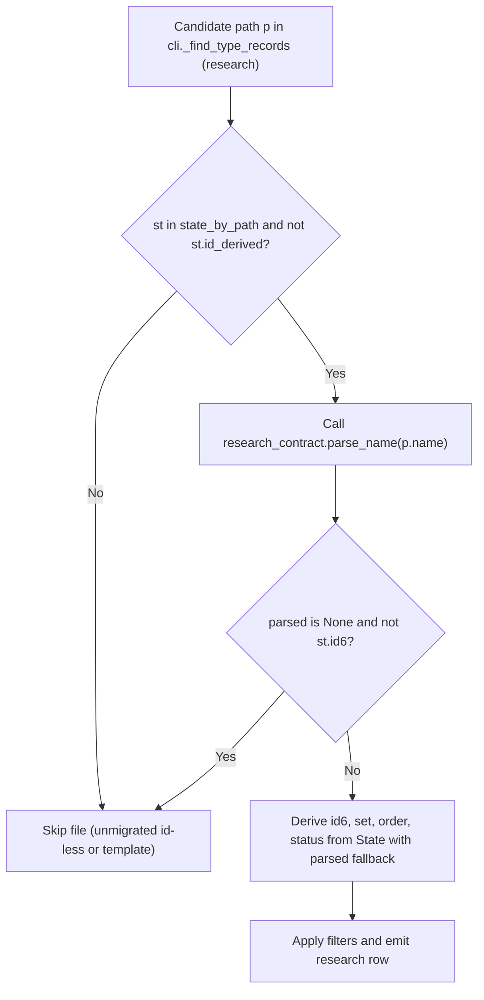

# IPD: Return migrated legacy research records lacking a kind facet from aw find

- Date: 2026-11-21
- Kind: child
- Concern: `agent_workflows/cli.py::_find_type_records` (the `artifact_type == "research"` branch) skips every file for which `agent_workflows/research_contract.py::parse_name(p.name, repo_root=repo_root)` returns `None`. When `aw migrate metadata` mints an `id6` for a legacy research note whose filename has no `.<kind>.md` facet (such as `20260708-survey-notes.md` renamed to `research/20260708-<id6>-01-<id6>-survey-notes.md` in `tests/migration_corpus.py::legacy_agents_layout`), querying `aw find <minted_id6> --agent` resolves the selector (exit 0) and then drops the record in `_find_type_records`, returning `total: 0` with zero items even though `agent_workflows/artifact_meta.py::query` indexes the record with `not st.id_derived`.
- Scope: Update the `artifact_type == "research"` branch of `agent_workflows/cli.py::_find_type_records` to look up `st = state_by_path.get(p.resolve())` before dropping on `parsed is None`, falling back to `agent_workflows/artifact_meta.py::State` (`st.id6`, `st.set_id`, `st.order_nn`, and `st.status` when `st.legacy_raw_status` is `None`) when `st is not None and not st.id_derived`, while still skipping unmigrated id-less research files where `st is None or st.id_derived` (or `parsed is None and not st.id6`). Add behavioral regression tests in `tests/test_find_filters.py` (using an isolated temporary repository) verifying `aw find <minted_id6> --agent` and `aw find research --agent` return a migrated legacy research record lacking a kind facet while still skipping an unmigrated id-less research file. EXCLUDES: changing `agent_workflows/migrations/m0001_renames.py` filename rules and status-less research conversion (`fnabjy` / `s4utmv`).
- Scope-Paths: agent_workflows/cli.py, tests/test_find_filters.py, .aw/records/plans/pending/20261121-7mmhlp-01-vvxbbl-return-migrated-legacy-research-records-lacking-a-kind-facet.ipd.md
- Item-Dependencies: none
- Status: reviewed
- Readiness: go-pending-approval
- Review-Depth: standard
- Short-Description: Fall back to artifact_meta state in cli._find_type_records when research_contract.parse_name returns None for a migrated research record with a non-derived id6.
- Work-Kind: bug
- Priority: medium
- From-Backlog: 7mmhlp
- Blocks-Release: next
- Set: 7mmhlp
- Order: 1
- Highest E allocated: 02
- Author: antigravity/gemini
- Id: vvxbbl

> Write and proofread this plan per the technical writing standard, `.aw/system/workflows/technical-writing/technical-writing.md` (`.agents/workflows/technical-writing/technical-writing.md` in a legacy-layout install), including requirement 12 (diagrams).

## Workflow history

- 2026-11-21 reviewed (aw set): APPROVE WITH REVISIONS APPLIED; PR-001..PR-004 FIXED
- 2026-11-21 /plan-review (antigravity/gemini-4-neon-high): APPROVE WITH REVISIONS APPLIED; PR-001..PR-004 FIXED; review record .aw/records/reviews/20261121-7mmhlp-01-vvxbbl-return-migrated-legacy-research-records-lacking-a-kind-facet.review.md
- 2026-11-21 to-review (aw set): Authored review-ready child plan graduated from backlog 7mmhlp
- 2026-11-21 draft (antigravity/gemini): created.

## Goal

Make `aw find` return migrated legacy research records that carry a real non-derived `id6` in `agent_workflows/artifact_meta.py::State` even when their filename lacks a research `.<kind>.md` facet, without re-admitting unmigrated id-less prose files or breaking `tests/test_find_single_read.py::test_e_unparseable_research_doc_produces_no_rows`.

## Detailed Implementation Checklist (TODO)

Execution-state rule: mark an `E-*` item complete only after performing the action. That mark is not validation. Right-sizing rule: write for a modest executor that cannot hold much in its head. Each E-item is one step (one concern, about one file, executable in one focused pass) and its V-item names each unit it covers with its own check; a plan stays at about 5 E-items and 8 work Scope-Paths, else split it into more child plans (guidance, `IPD-Z603`). Accepted execution states: blocked, failed, pending, performed; terminal gate demands 'performed'.

### Task group 1: Research find fallback onto artifact_meta.State

- [ ] E-01 Update the `artifact_type == "research"` loop in `agent_workflows/cli.py::_find_type_records`:
  1. Look up `st = state_by_path.get(p.resolve())` first and keep the existing `if st is None or st.id_derived: continue` guard so unmigrated id-less files (including `conformance-results-template.md` in `tests/test_find_single_read.py::test_e_unparseable_research_doc_produces_no_rows`) stay excluded.
  2. Call `parsed, _ = _rc.parse_name(p.name, repo_root=repo_root)`, but do NOT `continue` when `parsed is None` if `st.id6` is non-empty and `not st.id_derived` (a log-backed or explicitly ID-bearing research record). When `parsed is None` and `not st.id6`, `continue`.
  3. Derive `res_id = st.id6 or (parsed.id6 if parsed is not None else "")`, `set_val = st.set_id or (parsed.set_id if parsed is not None else None)`, `raw_st = st.legacy_raw_status if st.legacy_raw_status is not None else (st.status or "")`, and `order_val = st.order_nn if st.order_nn is not None else (parsed.order if (parsed is not None and parsed.order is not None) else 0)`.
  - Depends on: none
  - Expected outcome: `aw find <minted_id6>` and `aw find research` emit migrated legacy research records lacking a kind facet using their `agent_workflows/artifact_meta.py::State` metadata while continuing to exclude unmigrated id-less files and preserving all existing `--id`/`--set`/`--topic`/`--status`/`--status-not` filters.
  - Execution state: pending

- [ ] E-02 Add behavioral tests in `tests/test_find_filters.py` using an isolated temporary repository (separate from `TestFindFilters.setUp`'s `self.repo_root`, which already contains `res001`) containing: (a) a migrated v2 research record at `.aw/records/research/20260708-ab12cd-01-ab12cd-survey-notes.md` (with `meta/ab12cd.jsonl` containing a `v: 1, seq: 0, append: 0, op: "checkpoint"` event with `path: "research/20260708-ab12cd-01-ab12cd-survey-notes.md"` and `fields: {"id": "ab12cd", "type": "research", "set": "ab12cd", "order": 1}` and no `.<kind>.md` facet, independent of `s4utmv`), and (b) an unmigrated id-less research prose file `.aw/records/research/20260708-unmigrated-notes.md` without a log or front-matter `id`. Assert via real CLI invocation (`aw find ab12cd --agent`, `aw find research --agent`, and `aw find research --set ab12cd --agent`) that `ab12cd` is returned (`total == 1`, `id6 == "ab12cd"`, `status == "-"`) and the unmigrated id-less file is not returned. Keep all tests purely behavioral with zero `inspect`, `ast`, or production source-code regex checks. Run `python3 -m pytest -o addopts="" -v tests/test_find_filters.py tests/test_find_agent_stream.py tests/test_find_single_read.py`, `aw suite`, `make typecheck`, `aw ipd lint --phase pre-transition` on this plan, and `aw sanitize --agent`.
  - Depends on: E-01
  - Expected outcome: All targeted find tests (including `tests/test_find_single_read.py::test_e_unparseable_research_doc_produces_no_rows`), `aw suite`, `make typecheck`, `aw ipd lint --phase pre-transition`, and `aw sanitize --agent` pass with zero regressions and zero source-code inspection tests.
  - Execution state: pending

## Project conventions discovered (Step 0)

- `agent_workflows/cli.py::_find_type_records` queries `agent_workflows/artifact_meta.py::query` once per call (`state_by_path = _query_by_path("research")`) and resolves selectors through `agent_workflows/cli.py::_resolve_selectors_with_kinds` before filtering rows in the `artifact_type == "research"` loop.
- Previously, `if parsed is None: continue` ran BEFORE checking `state_by_path`, discarding any migrated research file whose renamed filename omitted a `.<kind>.md` facet even though `selectors` matched its minted `id6` and `agent_workflows/artifact_meta.py::query` returned its `State`.
- Pre-migration parity and template exclusion: unmigrated id-less files (including `conformance-results-template.md` in `tests/test_find_single_read.py::test_e_unparseable_research_doc_produces_no_rows`) have `st is None` or `st.id_derived == True`, so keeping `if st is None or st.id_derived: continue` preserves pre-migration exclusion exactly.
- `tests/test_find_filters.py::TestFindFilters.setUp` populates `self.repo_root` with a pre-existing `res001` research record, so tests asserting `total == 1` on `aw find research --agent` must use an isolated temporary repository.

## Findings

| Id | Finding | Evidence |
|---|---|---|
| F-01 | `agent_workflows/cli.py::_find_type_records` drops migrated legacy research files lacking a `.<kind>.md` facet before consulting `state_by_path`. | `agent_workflows/cli.py::_find_type_records`; measured during IPD `60mazt` on `legacy_agents_layout`, where `aw find <minted_id6> --agent` exited 0 with `total: 0, emitted: 0`. |

## Proposed changes (ordered, validatable)

1. Check `state_by_path` first and fall back to `agent_workflows/artifact_meta.py::State` fields when `agent_workflows/research_contract.py::parse_name` returns `None` for a non-derived research record in `agent_workflows/cli.py::_find_type_records` (`E-01`).
2. Add isolated behavioral tests in `tests/test_find_filters.py` and run all validation gates (`E-02`).

## Deferred / out of scope (with reason)

- Changing `agent_workflows/migrations/m0001_renames.py` to invent a synthetic research kind facet on legacy files: not needed once `agent_workflows/cli.py::_find_type_records` honors `agent_workflows/artifact_meta.py::State`, and avoids fabricating ungrounded kind metadata (spec `4sd62s` C1/4.2a).
  - Carrier-Declined: not needed once cli._find_type_records honors artifact_meta.State

## Scope check

- Over-scope: none. Only `agent_workflows/cli.py`, `tests/test_find_filters.py`, and this plan are modified.
- Under-scope: none. Preserves all existing filters (`--id`, `--set`, `--topic`, `--status`, `--status-not`), `tests/test_find_single_read.py::test_e_unparseable_research_doc_produces_no_rows`, and pre-migration id-less exclusion.

## Required tests / validation

- `python3 -m pytest -o addopts="" -v tests/test_find_filters.py tests/test_find_agent_stream.py tests/test_find_single_read.py`
- `aw suite` (core tier passes)
- `make typecheck` (0 mypy errors)
- `aw ipd lint --phase pre-transition` on this plan (`outcome: "clean"`)
- `aw sanitize --agent` (`outcome: "clean"`)

## Spec / documentation sync

N/A: brings `aw find research` into compliance with spec `4sd62s` (where `artifact_meta` is the authority for migrated record identity and metadata) with no CLI flag or output schema change.

## Open questions

None.

## Validation and cross-check (verify before reporting done)

Validation-state rule: inspect evidence in a separate pass. Do not mark a `V-*` item complete from memory or from the matching execution checkmark. Accepted validation results: blocked, failed, pass, pending; terminal gate demands 'pass'. Runtime-demonstration reachability rule: for each `V-*` item demanding the software be observed acting (such as a run, a dispatch, or a transition), as distinct from items demanding a diff, a file's content, or a test result (which are reachable by construction), name the code path that produces the observation or the sibling `E-*` that creates it, else the demand is UNDER-SCOPE.

- [ ] V-01 validates E-01
  - Required evidence: paste the `git diff agent_workflows/cli.py` summary showing the `artifact_type == "research"` branch checks `state_by_path` first, falls back to `artifact_meta.State` (`id6`, `set_id`, `order_nn`, `status`) when `parsed is None` and `not st.id_derived`, and still skips `st is None or st.id_derived` or `(parsed is None and not st.id6)`.
  - Observed evidence:
  - Result: pending

- [ ] V-02 validates E-02
  - Required evidence: paste actual output from `python3 -m pytest -o addopts="" -v tests/test_find_filters.py tests/test_find_agent_stream.py tests/test_find_single_read.py` (showing the new isolated migrated-research test and `test_e_unparseable_research_doc_produces_no_rows` passing), `aw suite`, `make typecheck`, `aw ipd lint --phase pre-transition` on this plan, and `aw sanitize --agent`, plus confirmation that no added test uses `inspect`, `ast`, or source-code regex checks.
  - Observed evidence:
  - Result: pending

## Approval and execution gate

- Size assessment: standard
- Cohesion rationale: not required

Execute only after human approval (`- Status: approved` or `auto-approved`). Open questions: none open.

Scope fence: the paths in `- Scope-Paths:` are a declaration. If execution must edit a file outside the fence, make the needed edit and justify it at finalize (`--scope-reason`), and acknowledge any declared path left unmodified (`--scope-ack`).

Safety rule: uncommitted changes and untracked files you did not create are not yours; never revert, stage, commit, discard, reformat, or clean up another party's work. Stop and report if a file you must edit has an unresolvable concurrent-edit conflict.

Honesty rule: run all required tests and checks and paste the ACTUAL runner output and summary lines; never claim a result you did not run.

Commits: commit only files modified for this plan through `aw commit vvxbbl -- <paths>`; never `git add -A`, a bare `git add`, `git commit -a`, or `--no-verify`; never push without explicit human instruction.

Lifecycle transition: this plan moves to `.aw/records/plans/executed/` only through `aw ipd finalize`, never a hand `git mv`, and only after `aw ipd lint --phase pre-transition` conforms and every `V-*` reads `pass` with pasted evidence. When `aw oc run` or `aw agy run` executes this plan, the runner owns retirement to `executed/` and runs finalize automatically upon task completion; when executed standalone by hand or direct agent turn, the executor runs `aw ipd finalize vvxbbl`.
