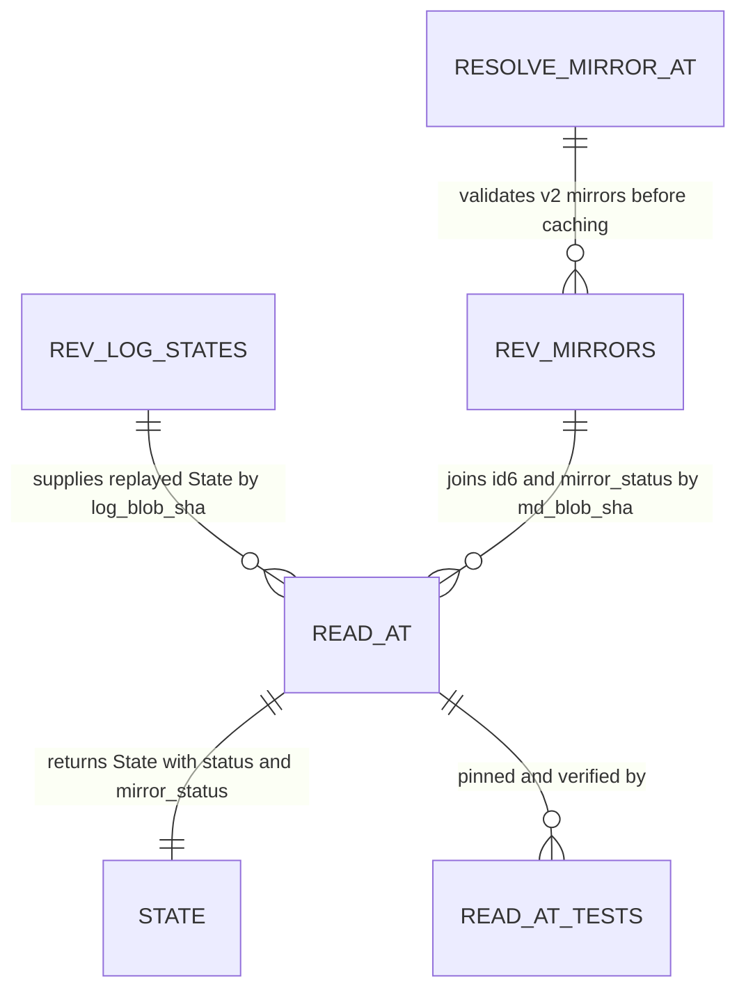
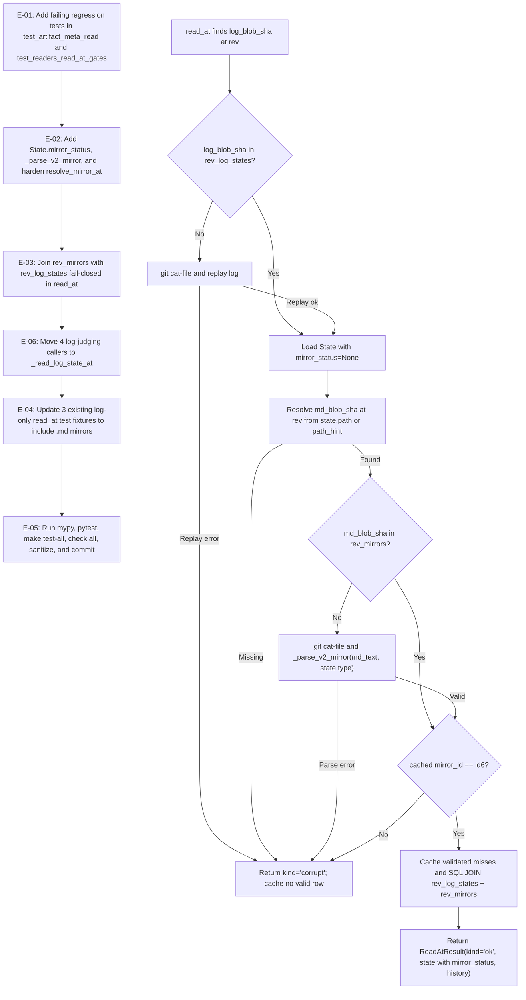

# IPD: Join rev_mirrors with rev_log_states in artifact_meta.read_at for v2 log-backed records

- Date: 2026-11-21
- Kind: child
- Concern: Backlog `83kkzh` (`Work-Kind: bug`, `Blocks-Release: next`, discovered during Implementation Plan Document (IPD) `snh19k`) reports that `agent_workflows/artifact_meta.py::read_at` skips mirror resolution, validation, and cache joining for version 2 (v2) log-backed records (`meta/<id6>.jsonl`). Spec `4sd62s` Sections 4.4, 4.5a, and 4.9.4, plus Acceptance Criterion `AC-33`, require `read_at` to look up both the log git blob Secure Hash Algorithm (SHA) in `rev_log_states` and the Markdown (`.md`) mirror git blob SHA at that revision in `rev_mirrors`, fail closed with no valid cache rows on loader or mirror validation errors, and return a `State` containing both the replayed log state and the mirrored `status`. In addition, `agent_workflows/artifact_meta.py::resolve_mirror_at` omits `record_type` when calling `read_text` (missing staged prompt `aw-managed-prompt` comments) and caches `.md` blobs into `rev_mirrors` without v2 mirror validation, which can poison `rev_mirrors` before `read_at` runs.
- Scope: IN: (1) add behavioral regression tests in `tests/test_artifact_meta_read.py` and `tests/test_readers_read_at_gates.py` pinning the missing `rev_mirrors` join, `State.mirror_status` divergence across shared log blobs, fail-closed mirror validation across record types, and `resolve_mirror_at` cache-poisoning prevention; (2) add `mirror_status: Optional[str] = None` to `agent_workflows/artifact_meta.py::State`, extract shared helpers `_infer_record_type_from_rel_path` and `_parse_v2_mirror` covering all eight `SUPPORTED_TYPES`, update `agent_workflows/artifact_meta.py::resolve_mirror_at` to infer `record_type` (including staged prompts) and validate v2 mirrors before writing to `rev_mirrors`, stop `_load_legacy_at_blob` from writing `rev_mirrors` rows for v2 log-backed blobs, and bump `LEGACY_LOADER_VERSION` so existing caches rebuild; (3) update the v2 `meta/<id6>.jsonl` branch in `agent_workflows/artifact_meta.py::read_at` (cold and warm `rev_log_states` paths) to resolve the `.md` mirror blob at `rev` (from `state.path`, or `path_hint` when moved without a log event), validate and cache `rev_mirrors` and `rev_log_states` only when both succeed, fail closed with `kind="corrupt"` and a `mirror-` error prefix on missing, invalid, or mismatched-`id6` mirrors, and join `rev_log_states` with `rev_mirrors` in Structured Query Language (SQL) to populate `State.mirror_status`, building `read_at` on a private log-only reader `_read_log_state_at` (replay and `rev_log_states` only, no mirror); (4) switch the four callers that judge the LOG rather than the record (`agent_workflows/artifact_meta.py::check_staged_log_append`, `agent_workflows/check_engine.py::check_staged_meta_mirror_drift`, `agent_workflows/hooks/executed_transition_gate.py::_staged_log_only_executed_transitions`, `agent_workflows/hooks/meta_log_append_gate.py::terminal_log_refusals`) from `read_at` to `_read_log_state_at`, so a mirror fault is still reported by the drift rule instead of being silently skipped or mislabeled "loader refused staged log", with tests in `tests/test_cutover_log_gates.py`; and (5) update the existing v2 `read_at` test fixtures in `tests/test_artifact_meta_read.py` and `tests/test_readers_read_at_gates.py` that commit logs without `.md` mirror files so every v2 revision read supplies both source blobs (the log-only fixtures in `tests/test_meta_log_append_gate.py` need no change once (4) lands, and that file runs as a regression check). OUT: new post-cutover drift or hook rules beyond the caller adaptation in (4) (the existing rules shipped with executed plan `6jd6mh`), modifying the `rev_log_states` or `rev_mirrors` table schemas in `agent_workflows/artifact_meta.py::generate_schema`, altering Phase B legacy `read_at` behavior (`_load_legacy_at_blob` and `read_path_at` keep every pre-cutover result; the only change is the skipped `rev_mirrors` write when a `meta/<id6>.jsonl` exists at `rev`), working-tree cache reads (`read`, `history`, `resolve`, `query`), and the advisory `read_path_at` fallbacks in `agent_workflows/runner_shared.py::_read_record_state_at_rev` and `agent_workflows/status_set.py`.
- Scope-Paths: agent_workflows/artifact_meta.py, agent_workflows/check_engine.py, agent_workflows/hooks/executed_transition_gate.py, agent_workflows/hooks/meta_log_append_gate.py, tests/test_artifact_meta_read.py, tests/test_readers_read_at_gates.py, tests/test_cutover_log_gates.py
- Item-Dependencies: none
- Status: approved
- Readiness: go-pending-approval
- Review-Depth: standard
- Short-Description: Join rev_mirrors with rev_log_states in artifact_meta.read_at for v2 log-backed records, validate v2 mirrors fail-closed, and expose mirror_status on State
- Work-Kind: bug
- Priority: medium
- From-Backlog: 83kkzh
- Blocks-Release: next
- Set: 83kkzh
- Order: 1
- Highest E allocated: 06
- Author: antigravity/gemini-4-hydrogen-xhigh
- Id: bebahq
- Approval: 2026-11-27, recorded via aw ipd set: status set to approved

> Write and proofread this plan per the technical writing standard, `.aw/system/workflows/technical-writing/technical-writing.md` (`.agents/workflows/technical-writing/technical-writing.md` in a legacy-layout install), including requirement 12 (diagrams).

## Workflow history

- 2026-11-27 approved (aw set): status set to approved
- 2026-11-24 reviewed (aw set): plan-review (opencode/its_direct/pt3-claude-opus-5.5-1m-us): APPROVE WITH REVISIONS APPLIED; PR-001..PR-007 fixed (caller-impact table and E-06 log-only reader, cache invalidation, fallback contract, @repo/ paths, warm-hit join, baseline refresh, join wording); review record .aw/records/reviews/20261121-83kkzh-01-bebahq-join-rev-mirrors-with-rev-log-states-in-artifact-meta-read-a.review.md
- 2026-11-21 to-review (aw set): Authored review-ready plan for backlog 83kkzh
- 2026-11-21 draft (antigravity/gemini-4-hydrogen-xhigh): created.

## Goal

Update `agent_workflows/artifact_meta.py::read_at` and `agent_workflows/artifact_meta.py::resolve_mirror_at` so v2 log-backed revision reads validate and cache the `.md` mirror blob in `rev_mirrors`, join `rev_mirrors` with `rev_log_states`, fail closed with no invalid cache rows on mirror errors, and return a `State` carrying both replayed log metadata and `mirror_status`.

## Detailed Implementation Checklist (TODO)

Execution-state rule: mark an `E-*` item complete only after performing the action. That mark is not validation. Right-sizing rule: write for a modest executor that cannot hold much in its head. Each E-item is one step (one concern, about one file, executable in one focused pass) and its V-item names each unit it covers with its own check; a plan stays at about 5 E-items and 8 work Scope-Paths, else split it into more child plans (guidance, `IPD-Z603`). Accepted execution states: blocked, failed, pending, performed; terminal gate demands 'performed'.

### Task group 1: Pin v2 rev_mirrors join behavior, harden mirror helpers, and validate gates

- [ ] E-01 Before modifying `agent_workflows/artifact_meta.py`, add behavioral tests in `tests/test_artifact_meta_read.py` and `tests/test_readers_read_at_gates.py` (without altering existing Phase B or working-tree tests) covering: (1) cold and warm `read_at` cache hits populating `rev_log_states` and `rev_mirrors` and setting `state.mirror_status`; (2) two revisions sharing one `log_blob_sha` with distinct `.md` mirror statuses returning identical `state.status` and revision-specific `state.mirror_status`; (3) type-specific mirror validation across `prompt` (`<!-- aw-managed-prompt: ... -->`), `walkthrough`/`roadmap` (1-key `id`), `research` (1-key status-less and 2-key status-bearing), and `ipd`/`spec`/`backlog`/`release` (strict 2-key `id` and `status`); (4) staged `:0:` and `path_hint` mirror reads after a hand `git mv` without a log update; and (5) fail-closed `kind="corrupt"` responses with zero new rows in `rev_log_states` or `rev_mirrors` on malformed mirrors, 1-key `ipd` mirrors, 2-key `walkthrough` mirrors, mismatched `id6` mirrors, missing `.md` mirrors, and `resolve_mirror_at` called prior to `read_at` on an invalid v2 mirror. Run `python3 -m pytest tests/test_artifact_meta_read.py tests/test_readers_read_at_gates.py tests/test_migrations_chain.py -v` on unmodified `HEAD` to record baseline failures.
  - Depends on: none
  - Expected outcome: `git diff --stat agent_workflows/` is empty, existing passing tests stay green, and the new `E-01` tests fail on unmodified `HEAD` due to missing `State.mirror_status`, unvalidated mirrors, and empty `rev_mirrors` rows for v2 logs.
  - Execution state: pending

- [ ] E-02 In `agent_workflows/artifact_meta.py`, add `mirror_status: Optional[str] = None` to `State` (keeping `mirror_status=None` in replayed `state_json` stored in `rev_log_states`), extract shared helpers `_infer_record_type_from_rel_path` and `_parse_v2_mirror(text, art_type)` dispatching across all eight `SUPPORTED_TYPES`, and update `resolve_mirror_at` to infer `record_type` (and recognize leading `<!-- aw-managed-prompt:` comments) and validate v2 mirrors via `_parse_v2_mirror` before inserting into `rev_mirrors` whenever `meta/<declared>.jsonl` exists at `rev`. When that strict parse fails, `resolve_mirror_at` returns `(fallback.id6 or None, fallback.status, True)` from `read_text(text, record_type=art_type)` (the same best-effort fallback `agent_workflows/meta_cli.py::_parse_log_backed_mirror` uses) and writes NO `rev_mirrors` row, so the drift rule and `executed_transition_gate` still see the file exists and can report drift. Apply the same skip to `_load_legacy_at_blob`: it writes no `rev_mirrors` row when `meta/<id6>.jsonl` exists at `rev`. Finally bump `LEGACY_LOADER_VERSION` from `"legacy_v10"` to `"legacy_v11"`, adding a `#: "legacy_v11" (2026-11-2x, bebahq): ...` line in the existing comment style, so `compute_schema_hash` changes and `open_cache` rebuilds any `index.db` that already holds unvalidated `rev_mirrors` rows.
  - Depends on: E-01
  - Expected outcome: `State` carries `mirror_status` with default `None`, `_parse_v2_mirror` enforces type-specific rules uniformly, `resolve_mirror_at` parses staged v2 prompts accurately, returns `exists=True` with best-effort id and status on an invalid v2 mirror, and never caches a malformed v2 mirror into `rev_mirrors`, and a pre-existing cache is rebuilt on first open.
  - Execution state: pending

- [ ] E-03 Move the existing log lookup, replay, and `rev_log_states` caching of the v2 `if log_blob_sha:` branch of `agent_workflows/artifact_meta.py::read_at` (both the warm cached-row path that currently returns early and the cold replay path) into a private `_read_log_state_at` taking the same arguments as `read_at` and returning `ReadAtResult` with no mirror work, then make `read_at` call it and, on BOTH warm and cold paths, resolve `md_blob_sha` at `rev` from `state.path` (a records-relative path is prefixed with the records-to-repo prefix derived from `rel_repo`; an `@repo/...` path is stripped to `sp[len("@repo/"):]`, matching `agent_workflows/check_engine.py::check_staged_meta_mirror_drift`; fall back to `path_hint` only if `state.path` is absent at `rev`), check `rev_mirrors` on `md_blob_sha`, read and validate any cache miss via `_parse_v2_mirror(md_text, state.type)`, enforce `mirror_id == id6`, fail closed with `ReadAtResult(kind="corrupt", error=...)` (error prefixed `mirror-missing:`, `mirror-invalid:`, or `mirror-id-mismatch:` so a caller can tell a mirror fault from a log fault) and zero new `rev_log_states` or `rev_mirrors` cache writes if either log or mirror validation fails or the `.md` mirror is absent, persist valid miss rows, and assemble the result as the join of the two rows: run `SELECT l.state_json, m.status FROM rev_log_states l JOIN rev_mirrors m ON l.id6 = m.id6 WHERE l.log_blob_sha = ? AND m.md_blob_sha = ?` when both rows are on disk, and otherwise (transient lock contention skipped persistence) combine the two validated in-memory values with `dataclasses.replace(state, mirror_status=...)`, which yields the same `State`. Return `ReadAtResult(kind="ok", state=joined_state, history=hist_events)`.
  - Depends on: E-02
  - Expected outcome: `read_at` validates both blobs before caching either on miss, applies the mirror join on warm and cold `rev_log_states` paths alike, resolves both records-relative and `@repo/` `state.path` values, and passes all new `E-01` tests for valid, drifted, staged, multi-type, and corrupt mirrors.
  - Execution state: pending

- [ ] E-06 Switch the four callers that judge a LOG rather than a record from `read_at` to `agent_workflows/artifact_meta.py::_read_log_state_at`: `agent_workflows/artifact_meta.py::check_staged_log_append` (HEAD and `:0:` reads), `agent_workflows/check_engine.py::check_staged_meta_mirror_drift`, `agent_workflows/hooks/executed_transition_gate.py::_staged_log_only_executed_transitions` (staged and HEAD reads), and `agent_workflows/hooks/meta_log_append_gate.py::terminal_log_refusals` (HEAD and staged reads). Without this, a missing or invalid mirror makes the drift rule skip the record silently, the log-only executed check skip the log, the terminal-log rule return no refusals, and `check_staged_log_append` refuse a valid append as "loader refused staged log". Add tests to `tests/test_cutover_log_gates.py` that stage a valid log with (a) a mirror whose status disagrees with the log, asserting `check_staged_meta_mirror_drift` still reports `meta.mirror-drift`, and (b) a log appending a transition to `executed` with a status-drifted mirror, asserting `executed_transition_gate.check` still refuses. Run `python3 -m pytest -o addopts="" -q --no-cov tests/test_cutover_log_gates.py tests/test_meta_log_append_gate.py`.
  - Depends on: E-03
  - Expected outcome: The four log-judging callers produce the same verdicts as before for a repository whose mirrors are valid, still report drift when a mirror is invalid or drifted, and the two new `tests/test_cutover_log_gates.py` tests pass. Every other `read_at` caller keeps calling `read_at` unchanged.
  - Execution state: pending

- [ ] E-04 Update the three existing log-only `read_at` fixtures in `tests/test_artifact_meta_read.py::test_read_at_rename_case`, `tests/test_artifact_meta_read.py::test_read_at_companion_backend`, and `tests/test_readers_read_at_gates.py::test_read_at_commits_rev_mirrors_and_rev_log_states_cache` so each commits its `.md` mirror file alongside `meta/<id6>.jsonl`, asserting `state.mirror_status` and verifying `cm0002` in both `rev_log_states` and `rev_mirrors` (leaving non-`read_at` working-tree tests untouched). Re-run `python3 -m pytest -o addopts="" --no-cov tests/test_artifact_meta_read.py tests/test_readers_read_at_gates.py tests/test_migrations_chain.py tests/test_meta_log_append_gate.py tests/test_cutover_log_gates.py tests/test_readers_gate_cache_parity.py -v`.
  - Depends on: E-03, E-06
  - Expected outcome: Every existing and new test across those six files passes with zero failures and zero skips; `tests/test_meta_log_append_gate.py` (whose `_seed_committed_log` commits logs with no `.md` mirror) and `tests/test_readers_gate_cache_parity.py` stay green unmodified.
  - Execution state: pending

- [ ] E-05 Run `make typecheck`, bare `python3 -m pytest`, `make test-all`, `aw check all --agent`, and `aw sanitize --agent`, confirm no test inspects production source code via `inspect`, `ast`, or regex, and commit only modified `- Scope-Paths:` files through `aw commit bebahq -- <paths>`.
  - Depends on: E-04, E-06
  - Expected outcome: `mypy`, the core tier, the thorough tier, `aw check all --agent`, and `aw sanitize --agent` pass cleanly, and commits stay strictly within `- Scope-Paths:`.
  - Execution state: pending

## Project conventions discovered (Step 0)

- `agent_workflows/artifact_meta.py::CACHE_TABLES_4_5A` and `agent_workflows/artifact_meta.py::generate_schema` define `rev_log_states` (`log_blob_sha PK, id6, status, last_seq, state_json`) and `rev_mirrors` (`md_blob_sha PK, id6, status`). `tests/test_artifact_meta_cache.py::test_cache_schema_tables` and `test_cache_schema_columns` assert exact table and column parity with spec `4sd62s` Section 4.5a, so neither table may add or drop columns.
- `agent_workflows/artifact_meta.py::State` currently has no `mirror_status` attribute, and `read_at` deserializes cached rows via `State(**s_dict)`. Adding `mirror_status: Optional[str] = None` keeps existing `State(...)` instantiations and prior `state_json` payloads compatible. Storing `mirror_status=None` in `rev_log_states.state_json` ensures a single `log_blob_sha` never caches one revision's mirror status across revisions whose `.md` blobs differ.
- `agent_workflows/artifact_meta.py` already defines the canonical strict v2 mirror parsers (`parse_artifact_mirror`, `parse_walkthrough_mirror`, `parse_staged_prompt_mirror`), and `agent_workflows/meta_cli.py::_parse_log_backed_mirror` shows the exact per-type dispatch: `"prompt"` uses `parse_staged_prompt_mirror`, `"walkthrough"` and `"roadmap"` use `parse_walkthrough_mirror`, `"research"` uses `parse_artifact_mirror(text, allow_statusless=True)`, and `"ipd"`, `"spec"`, `"backlog"`, and `"release"` use `parse_artifact_mirror(text, allow_statusless=False)`.
- `agent_workflows/artifact_meta.py::resolve_mirror_at` and `resolve_id_at` are called ahead of `read_at` by `agent_workflows/hooks/executed_transition_gate.py::_staged_plan_executed_transitions`, `agent_workflows/hooks/ipd_dependency_statement_gate.py::_staged_ipd_overlay`, `agent_workflows/check_engine.py::_read_plan_state_at`, `check_staged_illegal_backlog_transition`, `_lane_carrier_is_executed`, `check_release_gate_consistency`, and `agent_workflows/runner_shared.py::_read_record_state_at_rev`. Because `resolve_mirror_at` currently calls `read_text(text)` without `record_type`, it fails to parse staged prompt HTML comments and can write unvalidated v2 mirrors into `rev_mirrors`.
- `agent_workflows/artifact_meta.py::_cache_rev_write` intentionally suppresses transient SQLite lock errors (`_is_sqlite_lock_error`). Spec `4sd62s` Section 4.5a says `read_at` "joins this table with `rev_log_states`"; the join is the contract, and when lock contention prevented a row from reaching disk `read_at` assembles the same joined `State` in memory with `dataclasses.replace`.
- `read_at` has 13 production call sites outside `artifact_meta.py` (`grep -rn "read_at(" agent_workflows/`). The caller-impact table under `## Findings` records what each does with a non-`ok` result once a mirror fault makes `read_at` return `corrupt`.
- `agent_workflows/artifact_meta.py::compute_schema_hash` hashes `LAYOUT_VERSION`, `LEGACY_LOADER_VERSION`, and the registry, and `open_cache` rebuilds `index.db` only when that hash changes. Rows already written to `rev_mirrors` by the unvalidated path therefore survive the fix unless `LEGACY_LOADER_VERSION` is bumped; each earlier bump carries a `#: "legacy_vN" (date, id6): reason` comment.
- `State.path` holds either a records-relative path or an `@repo/...` path (`agent_workflows/artifact_meta.py` stored-path helpers near `_to_stored_path`), and `agent_workflows/check_engine.py::check_staged_meta_mirror_drift` already converts both forms to a repo-relative path.
- Cite code by repo-relative `path::Symbol` identifiers rather than bare line numbers (`IPD-C801`, `.aw/system/workflows/technical-writing/technical-writing.md` Requirement 7).

## Findings

| Id | Source inspected | Finding |
|---|---|---|
| F-01 | `agent_workflows/artifact_meta.py::read_at` (`if log_blob_sha:` branch) | When `meta/<id6>.jsonl` exists at `rev`, `read_at` looks up or populates `rev_log_states` and immediately returns `ReadAtResult` without resolving `md_blob_sha`, validating the `.md` mirror, populating `rev_mirrors`, or joining `rev_mirrors` with `rev_log_states`. |
| F-02 | `agent_workflows/artifact_meta.py::State` | `State` has `status`, `legacy_raw_status`, and `loose_status`, but no `mirror_status` field to return the revision's mirrored `.md` status alongside the replayed log state as required by `4sd62s` Section 4.4. |
| F-03 | `agent_workflows/artifact_meta.py::resolve_mirror_at` and `read_text` | `resolve_mirror_at` invokes `read_text(text)` without `record_type`, defaulting to `"ipd"`, so v2 staged prompt comments (`<!-- aw-managed-prompt: ... -->`) return `None`, and malformed v2 `.md` blobs get cached into `rev_mirrors` prior to `read_at`. |
| F-04 | `tests/test_artifact_meta_read.py` (`test_read_at_rename_case`, `test_read_at_companion_backend`) and `tests/test_readers_read_at_gates.py` (`test_read_at_commits_rev_mirrors_and_rev_log_states_cache`) | All three tests write synthetic `meta/<id6>.jsonl` logs and invoke `read_at` without creating `.md` mirror files at `state.path`. Conversely, `test_read_valid_record`, `test_history_event_log`, `test_resolve_path_and_id6`, and `test_query_filters` test working-tree `read`, `history`, `resolve`, and `query`, not `read_at`. |
| F-05 | `python3 -m pytest tests/test_artifact_meta_read.py tests/test_readers_read_at_gates.py tests/test_migrations_chain.py -v` on `HEAD` (`b7a0b2376`; re-run by `/plan-review` on `b5dcb3275`) | Baseline passes (`47 passed in 8.25s` at authoring, `47 passed in 9.02s` at review), confirming a clean starting point before `E-01` adds failing regression cases. The executor re-records the baseline on its own `HEAD` in `V-01`. |
| F-06 | Every production `read_at` caller (`agent_workflows/check_engine.py`, `agent_workflows/hooks/*.py`, `agent_workflows/runner_shared.py`, `agent_workflows/status_set.py`, `agent_workflows/artifact_meta.py::check_staged_log_append`) | Once a missing or invalid mirror makes `read_at` return `corrupt`, callers split three ways; see the caller-impact table below. Four callers judge the LOG, not the record, and would silently skip or wrongly refuse; `E-06` moves them to the log-only reader. |
| F-07 | `agent_workflows/artifact_meta.py::_load_legacy_at_blob` and `LEGACY_LOADER_VERSION` (`"legacy_v10"`) | `_load_legacy_at_blob` also writes `rev_mirrors` keyed by `md_blob_sha`, and nothing invalidates rows already on disk, so `E-02` skips that write for log-backed blobs and bumps the loader version. |

Caller-impact table (behavior when `read_at` returns `corrupt` because of a mirror fault):

| Caller | Current handling of non-`ok` | Effect without `E-06` | Disposition |
|---|---|---|---|
| `artifact_meta.py::check_staged_log_append` (HEAD and `:0:`) | staged: refuses "loader refused staged log"; HEAD: skips seq checks | valid append refused; `tests/test_meta_log_append_gate.py` fails (logs committed without `.md`) | `E-06`: use `_read_log_state_at` |
| `check_engine.py::check_staged_meta_mirror_drift` | `continue` | drifted or invalid mirror never reported (fails open) | `E-06`: use `_read_log_state_at` |
| `hooks/executed_transition_gate.py::_staged_log_only_executed_transitions` | `continue` | log-only `executed` transition not judged (fails open) | `E-06`: use `_read_log_state_at` |
| `hooks/meta_log_append_gate.py::terminal_log_refusals` | `return []` | terminal-log rules skipped (fails open) | `E-06`: use `_read_log_state_at` |
| `hooks/executed_transition_gate.py` staged branch (`_staged_plan_executed_transitions`) | records `corrupt:` refusal | refuses the commit | correct per spec 4.4; unchanged |
| `check_engine.py::_read_plan_state_at_checked` | returns corrupt flag | refuses | correct; unchanged |
| `check_engine.py::check_release_gate_consistency`, `_lane_carrier_is_executed`, `executed_transition_gate.py::_log_executed_append_verdict` | fail closed (refuse or `False`) | refuses or treats as not executed | correct; unchanged |
| `check_engine.py::check_staged_illegal_backlog_transition` (`_record_at`), `hooks/ipd_dependency_statement_gate.py::_staged_ipd_overlay` | skip the record | the record's own rule is skipped, but `E-06` keeps the drift rule reporting the mirror fault in the same commit | accepted; unchanged |
| `runner_shared.py::_read_record_state_at_rev`, `status_set.py` | fall back to `read_path_at` | advisory read uses the legacy loader | accepted; out of scope |

## Proposed changes (ordered, validatable)

The entity-relationship diagram below maps the cache tables, helpers, and test suites connected by this fix:

The flowchart below shows the execution order (`E-01` to `E-05`) and the v2 `read_at` resolution, validation, caching, and join branches:

1. **Pin failing cases (`E-01`)**: Add behavioral regression tests in `tests/test_artifact_meta_read.py` and `tests/test_readers_read_at_gates.py` covering the `rev_mirrors` join, shared-log mirror drift, type-specific mirror parsing, staged `:0:` / `path_hint` reads, fail-closed `kind="corrupt"` with zero cache rows, and `resolve_mirror_at` poisoning prevention. Run baseline tests on unmodified `HEAD` to observe the failures.
2. **Add `State.mirror_status`, shared mirror parser, and hardened `resolve_mirror_at` (`E-02`)**: Add `mirror_status: Optional[str] = None` to `agent_workflows/artifact_meta.py::State`, define `_infer_record_type_from_rel_path` and `_parse_v2_mirror` across all eight `SUPPORTED_TYPES`, and update `resolve_mirror_at` to infer `record_type` (including staged prompts) and validate v2 mirrors before writing `rev_mirrors`.
3. **Implement the fail-closed `rev_mirrors` join in `read_at` (`E-03`)**: In the v2 `if log_blob_sha:` branch of `agent_workflows/artifact_meta.py::read_at`, resolve `md_blob_sha` at `rev` from `state.path` (with `path_hint` fallback when absent at `state.path`), validate any `rev_mirrors` miss via `_parse_v2_mirror`, require `mirror_id == id6`, fail closed (`kind="corrupt"`, zero new valid rows in `rev_log_states` or `rev_mirrors`) on any error or missing mirror, persist validated miss rows, and join `rev_log_states` with `rev_mirrors` to return `State` carrying both replayed metadata and `mirror_status`.
4. **Update existing log-only `read_at` test fixtures (`E-04`)**: Add matching `.md` mirror files to `test_read_at_rename_case`, `test_read_at_companion_backend`, and `test_read_at_commits_rev_mirrors_and_rev_log_states_cache`, verify `mirror_status` and `rev_mirrors` population, and pass all targeted tests.
5. **Move log-judging callers to the log-only reader (`E-06`)**: Switch `check_staged_log_append`, `check_staged_meta_mirror_drift`, `_staged_log_only_executed_transitions`, and `terminal_log_refusals` to `_read_log_state_at`, and pin the drift and executed-gate verdicts with two `tests/test_cutover_log_gates.py` tests.
6. **Run repository gates and commit (`E-05`)**: Verify `make typecheck`, bare `python3 -m pytest`, `make test-all`, `aw check all --agent`, and `aw sanitize --agent`, and commit via `aw commit bebahq -- <paths>`.

## Deferred / out of scope (with reason)

- New post-cutover `check_engine` mirror-drift rules (for example a rule reading `state.mirror_status != state.status`) and new hook rules in `agent_workflows/check_engine.py` and `agent_workflows/hooks/`; the existing rules shipped with executed plan `6jd6mh`, and this plan changes only which reader four of them call (`E-06`):
  - Carrier: 6jd6mh
  - Carrier-Evidence: .aw/records/plans/executed/20261109-metastore-266-6jd6mh-build-the-dormant-post-cutover-gates-for-log-format-records.ipd.md
- Modifying `rev_log_states` or `rev_mirrors` columns in `agent_workflows/artifact_meta.py::generate_schema`:
  - Carrier-Declined: `4sd62s` Section 4.5a and `tests/test_artifact_meta_cache.py` lock `rev_log_states` and `rev_mirrors` to their existing columns, and joining on `l.id6 = m.id6` works without schema changes.
- Changing working-tree cache queries (`read`, `history`, `resolve`, `query`) or the pre-cutover results of Phase B legacy helpers (`_load_legacy_at_blob`, `read_path_at`); the only legacy-helper change is the skipped `rev_mirrors` write for log-backed blobs in `E-02`:
  - Carrier-Declined: Outside backlog `83kkzh`'s v2 `meta/<id6>.jsonl` `read_at` `rev_mirrors` join defect; Phase B legacy paths must remain unchanged per `4sd62s` C10a until cutover.
- Making the skip-on-corrupt callers `check_staged_illegal_backlog_transition` and `_staged_ipd_overlay`, and the `read_path_at` fallbacks in `runner_shared.py::_read_record_state_at_rev` and `status_set.py`, report mirror faults themselves:
  - Carrier-Declined: the drift rule reports the same mirror fault in the same commit once `E-06` lands, and the runner and setter reads are advisory; duplicating the refusal in every rule adds no protection.

## Scope check

- Over-scope: none. `- Scope-Paths:` names `agent_workflows/artifact_meta.py`, the three log-judging caller modules (`agent_workflows/check_engine.py`, `agent_workflows/hooks/executed_transition_gate.py`, `agent_workflows/hooks/meta_log_append_gate.py`), and the three test files `tests/test_artifact_meta_read.py`, `tests/test_readers_read_at_gates.py`, and `tests/test_cutover_log_gates.py`; each caller module changes only its reader call (`E-06`).
- Under-scope: none. Covers `read_at` v2 `rev_mirrors` lookup, validation, fail-closed cache isolation, SQL join onto `State.mirror_status`, `resolve_mirror_at` prompt and validation parity, all eight `SUPPORTED_TYPES`, cache invalidation of pre-existing `rev_mirrors` rows, and every `read_at` caller in the caller-impact table.

## Required tests / validation

- Targeted revision-read and gate suites:
  `python3 -m pytest -o addopts="" --no-cov tests/test_artifact_meta_read.py tests/test_readers_read_at_gates.py tests/test_migrations_chain.py tests/test_meta_log_append_gate.py tests/test_cutover_log_gates.py tests/test_readers_gate_cache_parity.py -v`
- Static typecheck:
  `make typecheck`
- Core tier, thorough tier, check engine, and leak scan:
  `python3 -m pytest`
  `make test-all`
  `aw check all --agent`
  `aw sanitize --agent`

## Spec / documentation sync

N/A with reason: spec `4sd62s` Sections 4.4, 4.5a, 4.9.4, and `AC-33` already define the `rev_mirrors` join, fail-closed mirror validation, and returned `State` carrying both replayed and mirrored status; no CLI flag, cache schema column, or spec requirement changes.

## Open questions

### OQ-01: How should State carry the mirrored status without polluting rev_log_states across revisions?

- Blocking: no
- Status: resolved
- Owner: plan author
- Resolution or deferral rationale: RESOLVED from spec `4sd62s` Sections 4.4 and 4.5a and `agent_workflows/artifact_meta.py` (`State`, `read_at`). Add `mirror_status: Optional[str] = None` to `State`. Keep `mirror_status=None` in `rev_log_states.state_json` (which is keyed only by `log_blob_sha`) and attach `rev_mirrors.status` per revision via the SQL join (or `dataclasses.replace`) in `read_at`. That keeps `State(**s_dict)` backwards-compatible with existing cached rows while ensuring two revisions with the same `log_blob_sha` and different `.md` blobs return distinct `mirror_status` values.

### OQ-02: Should read_at fail closed when a v2 log exists at rev without its .md mirror file, and should existing log-only read_at tests be updated?

- Blocking: no
- Status: resolved
- Owner: plan author
- Resolution or deferral rationale: RESOLVED from spec `4sd62s` Sections 4.4 step 1, 4.6 (`Orphans`), 4.9.4, and `AC-33` ("Revision reads use that revision's paths and both source blobs"). When `meta/<id6>.jsonl` exists at `rev` and no `.md` mirror blob resolves at `state.path` (or `path_hint`), `read_at` must fail closed with `kind="corrupt"` and write no valid cache row. Repository inspection confirmed only three existing `read_at` tests (`tests/test_artifact_meta_read.py::test_read_at_rename_case`, `test_read_at_companion_backend`, and `tests/test_readers_read_at_gates.py::test_read_at_commits_rev_mirrors_and_rev_log_states_cache`) create v2 logs without `.md` files; `E-04` updates those three fixtures to commit matching `.md` mirrors while leaving working-tree `read`/`query` tests untouched.

## Validation and cross-check (verify before reporting done)

Validation-state rule: inspect evidence in a separate pass. Do not mark a `V-*` item complete from memory or from the matching execution checkmark. Accepted validation results: blocked, failed, pass, pending; terminal gate demands 'pass'. Runtime-demonstration reachability rule: for each `V-*` item demanding the software be observed acting (such as a run, a dispatch, or a transition)—as distinct from items demanding a diff, a file's content, or a test result, which are reachable by construction—name the code path that produces the observation or the sibling `E-*` that creates it, else the demand is UNDER-SCOPE.

- [ ] V-01 validates E-01
  - Required evidence: paste `git diff --stat agent_workflows/` empty before `E-02` starts, `git diff --stat tests/test_artifact_meta_read.py tests/test_readers_read_at_gates.py`, and `python3 -m pytest tests/test_artifact_meta_read.py tests/test_readers_read_at_gates.py tests/test_migrations_chain.py -v` output on unmodified `HEAD` showing existing tests passing and each new `E-01` test failing with explicit node IDs.
  - Observed evidence:
  - Result: pending

- [ ] V-02 validates E-02
  - Required evidence: paste the `git diff -- agent_workflows/artifact_meta.py` hunks showing `State.mirror_status`, `_infer_record_type_from_rel_path`, `_parse_v2_mirror`, `resolve_mirror_at` type inference plus v2 validation before `rev_mirrors` writes, the uncached best-effort `(id, status, True)` return on an invalid mirror, the skipped `rev_mirrors` write in `_load_legacy_at_blob`, and `LEGACY_LOADER_VERSION = "legacy_v11"` with its comment line; plus the node ID and `PASSED` line of an `E-01` test showing that an `index.db` built before the bump is rebuilt (its old `rev_mirrors` row is gone) on first open.
  - Observed evidence:
  - Result: pending

- [ ] V-03 validates E-03
  - Required evidence: paste the `git diff -- agent_workflows/artifact_meta.py` hunks for `read_at` showing `_read_log_state_at`, `.md` blob resolution on both warm and cold paths (including the `@repo/` branch), fail-closed `_parse_v2_mirror` and `id6` validation before cache inserts, and the `rev_log_states` + `rev_mirrors` SQL join, plus `python3 -m pytest tests/test_artifact_meta_read.py tests/test_readers_read_at_gates.py -v` showing all new `E-01` tests `PASSED`.
  - Observed evidence:
  - Result: pending

- [ ] V-04 validates E-04
  - Required evidence: paste the `git diff -- tests/test_artifact_meta_read.py tests/test_readers_read_at_gates.py` hunks for the three updated fixtures (`test_read_at_rename_case`, `test_read_at_companion_backend`, `test_read_at_commits_rev_mirrors_and_rev_log_states_cache`) and full `python3 -m pytest -o addopts="" --no-cov tests/test_artifact_meta_read.py tests/test_readers_read_at_gates.py tests/test_migrations_chain.py tests/test_meta_log_append_gate.py tests/test_cutover_log_gates.py tests/test_readers_gate_cache_parity.py -v` output showing `0 failed` and `0 skipped`.
  - Observed evidence:
  - Result: pending

- [ ] V-05 validates E-05
  - Required evidence: paste actual runner output and summary lines from `make typecheck`, bare `python3 -m pytest`, `make test-all`, `aw check all --agent`, `aw sanitize --agent` (`"outcome":"clean"`), confirmation that no added test inspects production source code, and `git show --stat` of the `aw commit bebahq` commit(s) confirming only `- Scope-Paths:` files changed.
  - Observed evidence:
  - Result: pending

- [ ] V-06 validates E-06
  - Required evidence: paste the `git diff` hunks in `agent_workflows/artifact_meta.py::check_staged_log_append`, `agent_workflows/check_engine.py::check_staged_meta_mirror_drift`, `agent_workflows/hooks/executed_transition_gate.py::_staged_log_only_executed_transitions`, and `agent_workflows/hooks/meta_log_append_gate.py::terminal_log_refusals` showing each now calls `_read_log_state_at`, the two new `tests/test_cutover_log_gates.py` test functions, and `python3 -m pytest -o addopts="" -q --no-cov tests/test_cutover_log_gates.py tests/test_meta_log_append_gate.py` output with `0 failed`.
  - Observed evidence:
  - Result: pending

## Approval and execution gate

- Size assessment: standard
- Cohesion rationale: not required

Execute only after human approval (`- Status: approved` or authorized automated approval) and after confirming `- Item-Dependencies: none`. All open questions are resolved (`OQ-01`, `OQ-02`).

SCOPE FENCE. `- Scope-Paths:` declares `agent_workflows/artifact_meta.py`, `agent_workflows/check_engine.py`, `agent_workflows/hooks/executed_transition_gate.py`, `agent_workflows/hooks/meta_log_append_gate.py`, `tests/test_artifact_meta_read.py`, `tests/test_readers_read_at_gates.py`, and `tests/test_cutover_log_gates.py`. Do not expand scope casually; if the work genuinely requires editing a file outside the fence, make the edit and justify it in the two-way scope reconciliation at finalize (`--scope-reason`), and acknowledge any declared-but-unmodified path with `--scope-ack`. Stop and report only on a genuinely unsafe condition such as an unresolvable concurrent-edit conflict or missing prerequisite symbols in `agent_workflows/artifact_meta.py` (`read_at`, `resolve_mirror_at`, `parse_artifact_mirror`, `parse_walkthrough_mirror`, `parse_staged_prompt_mirror`).

HONESTY. Every `V-*` evidence block must paste actual observed runner output from checks run after the final edit; never claim success you did not run.

COMMIT. Commit only files modified for this plan through `aw commit bebahq -- <paths>`; verify `git diff --cached --name-only` contains only your paths; never use `git add -A`, bare `git add`, or `git commit -a`; never push without an explicit human request.

POST-GATE LIFECYCLE. Once every `E-*` item has `Execution state: performed`, every `V-*` item has `Result: pass`, and `aw ipd lint --phase pre-transition` reports `conforming`, move the plan to `.aw/records/plans/executed/` through `aw ipd finalize bebahq --actor <agent/model> --message "
" --apply` (under `aw oc run` or `aw agy run`, the runner owns finalize; a standalone executor runs `aw ipd finalize bebahq`). Never `git mv` the plan by hand. This plan inherits `- Blocks-Release: next` from backlog `83kkzh`, so closing `83kkzh` as `done` after execution follows the executed-carrier handoff path.
