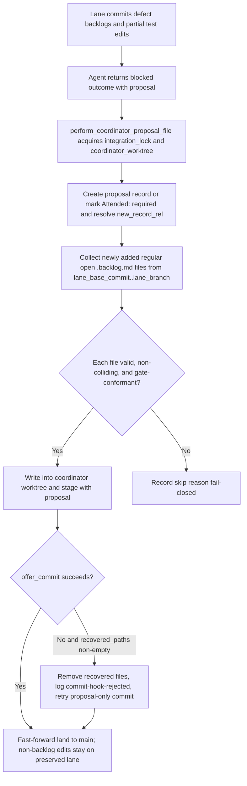

# IPD: Land agent-filed defect backlog items on main when a lane stops with a proposal

- Date: 2026-11-21
- Kind: child
- Concern: The runner prompt directs an executing agent to file a backlog item with `aw backlog new --apply` for every defect it discovers. When an agent commits newly filed defect backlog items on its isolated lane branch and then stops with a `proposal` (`fail-gate`), `agent_workflows/runner_shared.py::perform_coordinator_proposal_file` commits the proposal record directly onto `main` while the driver preserves the lane branch unmerged. The agent-filed defect backlog items stay stranded on the unmerged lane branch, leaving the proposal record on `main` citing dangling IDs that do not exist on `main`. Observed in `run-20261121T014040Z-2638602`, where IPD `60mazt` committed `0dsjzl`, `fnabjy`, `xl9xrm`, and `7mmhlp` on `aw/lane/60mazt`, the driver filed proposal `735ium` on `main` citing `0dsjzl` and `fnabjy`, and all four defect backlog files had to be recovered manually.
- Scope: Update `agent_workflows/runner_shared.py::perform_coordinator_proposal_file` and its call site in `agent_workflows/runner_shared.py::execute_item` (passing both `lane_branch=wt_handle.branch` and `lane_base_commit=wt_handle.base_commit` when `wt_handle is not None`, with clean no-op recovery when absent) to detect newly added regular-file open backlog items directly under `.aw/records/backlog/open/` or legacy `.agents/backlog/open/` on `lane_base_commit..lane_branch`, validate each item against `agent_workflows/backlog.py::validate_item`, filename-to-id6 agreement, `agent_workflows/artifact_core.py::global_id6s` and batch id6 non-collision, `agent_workflows/config.py::validate_setid_length_for_authoring`, and release-gate conformance (`agent_workflows/config.py::release_gate_work_kinds`, `agent_workflows/releases.py::resolve_release`, and typed `Release-Exempt-*` matching `agent_workflows/check_engine.py::check_live_bug_gate` and `check.blocks-release-dangling`), and commit and land valid files alongside the proposal record inside the same coordinator worktree and repository integration lock (after resolving `new_record_rel`/`record_id6`, handling `PROPOSAL_KIND_NEEDS_ATTENDED` already-marked plans, and falling back to committing `[new_record_rel]` alone if a commit hook rejects the combined commit) while leaving all non-backlog lane edits exclusively on the lane branch. Append backward-compatible defaulted fields `recovered_backlog_paths` and `skipped_backlog_reasons` to `agent_workflows/runner_shared.py::ProposalFilingResult` and propagate them to `item["proposal_record"]`, `attempt["proposal_record"]`, and `events.jsonl` (`agent-proposal-filed` / `agent-proposal-refused`). Add behavioral tests in `tests/test_run_proposal_channel.py` across both `oc` and `agy` hosts plus direct unit coverage for happy-path recovery, fail-closed rejections (malformed, ungated bug vs. valid exemption, dangling release, id6 collision, symlink/nested path, modified existing backlog, attempt-scoped branch), commit-hook fallback, and `needs-attended` already-marked plans. EXCLUDES: proposal summary truncation (`68ympf` / `l7d19a`) and non-proposal lane preservation paths.
- Scope-Paths: agent_workflows/runner_shared.py, tests/test_run_proposal_channel.py, .aw/records/plans/pending/20261121-8s4qhh-01-8h1q1k-land-agent-filed-defect-backlog-items-on-main-when-a-lane-st.ipd.md
- Item-Dependencies: none
- Status: reviewed
- Readiness: go-pending-approval
- Review-Depth: standard
- Short-Description: Recover and validate newly added open defect backlog files from preserved fail-gate proposal lanes and land them onto main with the proposal record.
- Work-Kind: bug
- Priority: high
- From-Backlog: 8s4qhh
- Blocks-Release: next
- Set: 8s4qhh
- Order: 1
- Highest E allocated: 03
- Author: antigravity/gemini
- Id: 8h1q1k

> Write and proofread this plan per the technical writing standard, `.aw/system/workflows/technical-writing/technical-writing.md` (`.agents/workflows/technical-writing/technical-writing.md` in a legacy-layout install), including requirement 12 (diagrams).

## Workflow history

- 2026-11-21 reviewed (aw set): APPROVE WITH REVISIONS APPLIED; PR-001..PR-005 FIXED
- 2026-11-21 /plan-review (antigravity/gemini-4-neon-high): APPROVE WITH REVISIONS APPLIED; PR-001..PR-005 FIXED; review record .aw/records/reviews/20261121-8s4qhh-01-8h1q1k-land-agent-filed-defect-backlog-items-on-main-when-a-lane-st.review.md
- 2026-11-21 to-review (aw set): Authored review-ready child plan graduated from backlog 8s4qhh
- 2026-11-21 draft (antigravity/gemini): created.

## Goal

Ensure agent-filed defect backlog items committed in a preserved proposal lane land cleanly on `main` alongside the coordinator-filed proposal record, without merging incomplete code or test changes from the lane and without allowing an invalid lane file to corrupt `main` or block the proposal record from landing.

## Detailed Implementation Checklist (TODO)

Execution-state rule: mark an `E-*` item complete only after performing the action. That mark is not validation. Right-sizing rule: write for a modest executor that cannot hold much in its head. Each E-item is one step (one concern, about one file, executable in one focused pass) and its V-item names each unit it covers with its own check; a plan stays at about 5 E-items and 8 work Scope-Paths, else split it into more child plans (guidance, `IPD-Z603`). Accepted execution states: blocked, failed, pending, performed; terminal gate demands 'performed'.

### Task group 1: Harvest newly added defect backlog files from proposal lanes

- [ ] E-01 Add a helper in `agent_workflows/runner_shared.py` (for example `_collect_lane_added_open_backlogs(repo: Path, lane_branch: str | None, base_commit: str | None, *, max_bytes: int = 500 * 1024) -> tuple[list[tuple[str, bytes]], list[tuple[str, str]]]`) that:
  1. Returns `([], [])` cleanly when `lane_branch` or `base_commit` is empty/absent, or when git cannot resolve the range (fail-safe so non-isolated runs and direct unit calls without a lane branch are unaffected).
  2. Queries `git diff --raw -z --diff-filter=A <base_commit>..<lane_branch> -- .aw/records/backlog/open .agents/backlog/open` so only newly added entries are inspected (never modified or deleted backlog files and never any non-backlog path).
  3. Parses each NUL-delimited `--raw` record: records a skip reason and rejects any entry whose destination mode is not a regular file (`100644` or `100755`, blocking symlinks `120000` and submodules `160000`), whose path is absolute, contains `..`, NUL, or control characters, is not a direct child of `.aw/records/backlog/open` or `.agents/backlog/open` (`Path(rel_path).parent.as_posix() in (".aw/records/backlog/open", ".agents/backlog/open")`), or does not end with `.backlog.md`.
  4. Checks blob size against `max_bytes` (`500 * 1024` bytes, matching `.pre-commit-config.yaml` `check-added-large-files`) before reading blob content (`git cat-file -s` / `git show <lane_branch>:<rel_path>`), recording oversized blobs in the skipped list instead of loading them.
  - Depends on: none
  - Expected outcome: A pure, bounded helper collects only newly added regular-file open `.backlog.md` blobs directly under `.aw/records/backlog/open/` or `.agents/backlog/open/` from `base_commit..lane_branch`, returning both candidate blobs and pre-validation skip reasons.
  - Execution state: pending

- [ ] E-02 Wire `_collect_lane_added_open_backlogs` into `agent_workflows/runner_shared.py::perform_coordinator_proposal_file` and its call site in `agent_workflows/runner_shared.py::execute_item`:
  1. Add optional keyword parameters `lane_branch: str | None = None` and `lane_base_commit: str | None = None` to `perform_coordinator_proposal_file`. At the `execute_item` call site, pass `lane_branch=wt_handle.branch` and `lane_base_commit=wt_handle.base_commit` when `wt_handle is not None` (fixing attempt-scoped branch names such as `aw/lane/<id6>_attempt2` that `item.get("lane_branch") or f"aw/lane/{item_id6}"` misses). Run lane backlog collection only when both `effective_lane_branch` and `lane_base_commit` are non-empty.
  2. Inside `agent_workflows/commit_lock.py::coordinator_worktree` on each race-retry iteration, FIRST complete the existing proposal creation or `PROPOSAL_KIND_NEEDS_ATTENDED` marking so `new_record_rel` and `record_id6` are resolved before writing any recovered lane backlog file into `coord.path` (avoiding the `st_mtime`-based file-selection hazard in `perform_coordinator_proposal_file` after `aw backlog new`).
  3. Validate each collected `(rel_path, blob_bytes)` against the fresh `coord.path` tree (re-evaluated on every `RECONCILED_RACED` retry against the new `cur_base`):
     - Skip if `(coord.path / rel_path).exists()` (`path-already-exists`).
     - Decode UTF-8 strictly (`invalid-utf8`).
     - Parse with `agent_workflows/backlog.py::parse_item` and validate with `agent_workflows/backlog.py::validate_item(coord.path / rel_path, text)`, rejecting on any drift finding (`backlog-validation-failed`).
     - Confirm filename-to-id6 agreement (`f"-{parsed.id}-"` in `Path(rel_path).name`, else `filename-id-mismatch`).
     - Reject if `parsed.id` collides with `agent_workflows/artifact_core.py::global_id6s(coord.path)`, `record_id6`, or an earlier accepted recovered item in the same batch (`id6-collision`).
     - Enforce `check.setid-length-error` via `agent_workflows/config.py::validate_setid_length_for_authoring(coord.path, parsed.set, verb="perform_coordinator_proposal_file")`, rejecting only on error (allowing warnings).
     - Enforce release-gate rules matching `agent_workflows/check_engine.py::check_live_bug_gate` and `check.blocks-release-dangling`: if `parsed.blocks_release` is set (and not `"-"`), require `agent_workflows/releases.py::resolve_release(coord.path, parsed.blocks_release) is not None` (`blocks-release-dangling`); if `parsed.kind` is in `agent_workflows/config.py::release_gate_work_kinds(coord.path)` and `agent_workflows/releases.py::resolve_release(coord.path, "next") is not None` and `parsed.blocks_release` is absent or `"-"`, require a valid typed exemption (`parsed.release_exempt_kind in attention_contract.GATE_KINDS` and `attention_contract.validate_gate_ref(parsed.release_exempt_kind, parsed.release_exempt_ref)`), else reject (`live-bug-ungated`).
     - Write each valid file atomically via `agent_workflows/artifact_core.py::atomic_write(coord.path / rel_path, text)`.
  4. Handle `PROPOSAL_KIND_NEEDS_ATTENDED` when `marked == target_text`: return early without committing only when zero recovered backlog files exist; when recovered files exist, commit `recovered_paths` with a coordinator commit message for recovered lane defect backlogs (if `offer_commit` rejects that recovered-only commit, record `commit-hook-rejected` in skipped reasons and return `filed=True` with empty `recovered_backlog_paths`).
  5. For all other branches (and `needs-attended` when `marked != target_text`), pass `[new_record_rel, *recovered_paths]` to `agent_workflows/git_commit_helper.py::offer_commit` so the proposal record and validated lane defect backlogs land atomically under the existing `integration_lock` and `RECONCILED_RACED` retry loop. If `offer_commit` rejects or raises while `recovered_paths` is non-empty, remove the written recovered files from `coord.path`, record each as skipped (`commit-hook-rejected`), and retry `offer_commit` once with `[new_record_rel]` alone so a recovered lane file failing a repo hook (`local-leaks`, `gitleaks`) cannot prevent the proposal record from landing.
  6. Append backward-compatible defaulted fields to `agent_workflows/runner_shared.py::ProposalFilingResult`: `recovered_backlog_paths: tuple[str, ...] = ()` and `skipped_backlog_reasons: tuple[tuple[str, str], ...] = ()`. At the `execute_item` call site, propagate `recovered_backlog_paths` (list) and `skipped_backlog_reasons` (dict) into `prop_rec` (`item["proposal_record"]` and `attempt["proposal_record"]`) and into the `events.jsonl` event (`agent-proposal-filed` / `agent-proposal-refused`).
  - Depends on: E-01
  - Expected outcome: Valid newly added defect backlog items from a blocked proposal lane land atomically with the proposal record on `main`; invalid or hook-rejected files are skipped fail-closed and recorded without blocking proposal landing; non-backlog lane edits remain solely on the preserved lane branch.
  - Execution state: pending

- [ ] E-03 Add behavioral tests in `tests/test_run_proposal_channel.py` driving real git repos, `agent_workflows/runner_shared.py::perform_coordinator_proposal_file`, and full `execute_item` proposal handling (strictly behavioral, zero source-code inspection via `inspect`/`ast`/regex/`read_text` per `GUIDING_PRINCIPLES` P16) to verify:
  1. End-to-end across both `"oc"` and `"agy"` hosts (`@pytest.mark.parametrize("runner_name", ["oc", "agy"])`) with isolated lane worktrees (`isolate_worktree=True`): when a lane commits a conformant open defect backlog item (`Work-Kind: bug`, `Blocks-Release: next`) AND a failing test file edit on its lane branch, and exits with a material proposal, both the proposal backlog item and the lane's defect backlog item exist on `main` after landing, the failing test edit is NOT on `main` (preserved only on the lane branch), and both `item["proposal_record"]` and the `agent-proposal-filed` event list the recovered backlog path.
  2. Fail-closed validation and containment via `perform_coordinator_proposal_file`: malformed open backlog (missing required fields), ungated `Work-Kind: bug` when a planned release exists (contrast with a bug carrying a valid `Release-Exempt-Kind`/`Release-Exempt-Ref`, which DOES land), dangling `- Blocks-Release:`, `id6` collision with an existing record on `main`, symlink (`120000`) and nested-subdirectory paths under `.aw/records/backlog/open/`, and attempt-scoped lane branch (`aw/lane/<id6>_attempt2`) are all handled accurately while the proposal record still lands cleanly.
  3. When a lane modifies an existing backlog file on `main` rather than adding a new one, the modification is NOT copied to `main`.
  4. When `agent_workflows/git_commit_helper.py::offer_commit` rejects the combined commit containing a recovered lane backlog file, `perform_coordinator_proposal_file` cleans up the recovered file, records `commit-hook-rejected` in `skipped_backlog_reasons`, and retries with `[new_record_rel]` alone so the proposal still lands on `main`.
  5. When `kind == PROPOSAL_KIND_NEEDS_ATTENDED` and the proposing plan is already marked `Attended: required` (`marked == target_text`), a valid defect backlog committed on the lane still lands on `main`.
  Run `python3 -m pytest -o addopts="" -v tests/test_run_proposal_channel.py`, `aw suite`, `make typecheck`, `aw ipd lint --phase pre-transition` on this plan, and `aw sanitize --agent`.
  - Depends on: E-02
  - Expected outcome: All new and existing proposal-channel tests, `aw suite`, `make typecheck`, `aw ipd lint --phase pre-transition`, and `aw sanitize --agent` pass.
  - Execution state: pending

## Project conventions discovered (Step 0)

- `agent_workflows/runner_shared.py::execute_item` handles valid proposals (`validate_proposal` -> `perform_coordinator_proposal_file` -> `agent_workflows/lane_containment.py::record_lane_preserved`), where `wt_handle` (`branch` and `base_commit`) is already in scope and recorded on `attempt["worktree_branch"]` / `attempt["worktree_base"]` (`item["lane_branch"]` is not populated by `execute_item`, so attempt-scoped lanes such as `aw/lane/<id6>_attempt2` from `agent_workflows/worktree_lease.py::_attempt_scoped_lane_id` require passing `wt_handle.branch` explicitly).
- `agent_workflows/runner_shared.py::perform_coordinator_proposal_file` already holds `integration_lock`, creates an isolated `agent_workflows/commit_lock.py::coordinator_worktree`, commits via `agent_workflows/git_commit_helper.py::offer_commit`, and lands via `agent_workflows/ipd_lifecycle.py::land_worktree_commit` with race retry (`RECONCILED_RACED`).
- After `aw backlog new`, `perform_coordinator_proposal_file` selects `created_backlog` by sorting `backlog_dir.glob("*.backlog.md")` by `st_mtime` descending, so recovered lane backlog files must be written only after `new_record_rel` and `record_id6` are resolved.
- For `PROPOSAL_KIND_NEEDS_ATTENDED`, `perform_coordinator_proposal_file` currently returns early when `marked == target_text`, which must be gated on `not recovered_paths` so recovered defect backlogs are still committed and landed.
- `agent_workflows/runner_shared.py::ProposalFilingResult` is a `NamedTuple`; appending defaulted immutable tuple fields mirrors `agent_workflows/runner_shared.py::SuiteCheckResult` so existing positional and keyword callers remain compatible.
- `agent_workflows/check_engine.py::check_live_bug_gate` reads gating work-kinds from `agent_workflows/config.py::release_gate_work_kinds` and accepts a valid typed `Release-Exempt-Kind`/`Release-Exempt-Ref` pair validated by `agent_workflows/attention_contract.py::GATE_KINDS` and `validate_gate_ref`; `agent_workflows/artifact_core.py::global_id6s` checks repository-wide `id6` uniqueness; `.pre-commit-config.yaml` enforces `check-added-large-files` (`--maxkb=500`), `local-leaks`, and `gitleaks` at commit time.
- `tests/test_run_proposal_channel.py` already sets up real isolated git repos with `.aw/records/plans/pending`, `.aw/records/backlog/open`, and `.aw/records/releases` to test proposal filing end to end across both `oc` and `agy` hosts.

## Findings

| Id | Finding | Evidence |
|---|---|---|
| F-01 | `agent_workflows/runner_shared.py::perform_coordinator_proposal_file` commits only `[new_record_rel]` and never recovers newly added defect backlog files from the preserved lane branch. | `agent_workflows/runner_shared.py::perform_coordinator_proposal_file`; observed in `run-20261121T014040Z-2638602` (`60mazt` filed `0dsjzl`, `fnabjy`, `xl9xrm`, `7mmhlp` on `aw/lane/60mazt` while `735ium` landed on `main` citing dangling IDs `0dsjzl` and `fnabjy`). |

## Proposed changes (ordered, validatable)

1. Add `_collect_lane_added_open_backlogs` in `agent_workflows/runner_shared.py` using `git diff --raw -z --diff-filter=A` to collect only newly added, bounded, regular-file direct-child open `.backlog.md` blobs from `lane_base_commit..lane_branch` (`E-01`).
2. Thread `lane_branch` and `lane_base_commit` from `wt_handle` into `perform_coordinator_proposal_file`, resolve the proposal record first, validate and atomically write qualifying lane open backlogs, handle `PROPOSAL_KIND_NEEDS_ATTENDED`, commit atomically with a proposal-only fallback on hook rejection, and propagate `recovered_backlog_paths` and `skipped_backlog_reasons` on `ProposalFilingResult`, `proposal_record`, and `events.jsonl` (`E-02`).
3. Add behavioral unit and `oc`/`agy` integration tests in `tests/test_run_proposal_channel.py` and run all validation gates (`E-03`).

## Deferred / out of scope (with reason)

- Fixing mid-word 24-character summary truncation in `agent_workflows/runner_shared.py::perform_coordinator_proposal_file`: owned by sibling plan `l7d19a` (from backlog `68ympf`).
  - Carrier: l7d19a
  - Carrier-Evidence: .aw/records/plans/executed/20261121-68ympf-01-l7d19a-truncate-proposal-summaries-on-word-boundaries-in-perform-co.ipd.md
- Recovering defect backlog files from non-proposal preserved lanes (for example `partial`, `merge-conflict`, or non-proposal `fail-gate` lanes whose `defect_report` reports findings): intentionally excluded from this plan because non-proposal lanes do not write a coordinator commit onto `main` and remain preserved for resume/merge rather than creating dangling proposal references on `main`.
  - Carrier-Declined: non-proposal preserved lanes have no coordinator main-commit path and are resumed/merged via lane preservation rather than publishing a proposal record with dangling IDs on main; file a separate backlog item only if stranding is observed outside proposal lanes.

## Scope check

- Over-scope: none. Only `agent_workflows/runner_shared.py`, `tests/test_run_proposal_channel.py`, and this plan are modified.
- Under-scope: none. Covers newly added regular-file open backlogs in both `.aw/records/backlog/open/` and legacy `.agents/backlog/open/`, symlink/nested-path/size containment, `validate_item`, `global_id6s` and path collision avoidance, `setid` length error and release-gate/exemption conformance, post-proposal write ordering, attempt-scoped `wt_handle.branch`, `PROPOSAL_KIND_NEEDS_ATTENDED`, commit-hook fallback, race retry, and state/event logging.

## Required tests / validation

- `python3 -m pytest -o addopts="" -v tests/test_run_proposal_channel.py`
- `aw suite` (core tier passes)
- `make typecheck` (0 mypy errors)
- `aw ipd lint --phase pre-transition` on this plan (`outcome: "clean"`)
- `aw sanitize --agent` (`outcome: "clean"`)

## Spec / documentation sync

N/A: fixes a runner coordinator defect so agent-filed defect carriers referenced by proposals are not stranded off `main`; no CLI flags, user-facing documentation, or specification contracts change.

## Open questions

None.

## Validation and cross-check (verify before reporting done)

Validation-state rule: inspect evidence in a separate pass. Do not mark a `V-*` item complete from memory or from the matching execution checkmark. Accepted validation results: blocked, failed, pass, pending; terminal gate demands 'pass'. Runtime-demonstration reachability rule: for each `V-*` item demanding the software be observed acting (such as a run, a dispatch, or a transition), as distinct from items demanding a diff, a file's content, or a test result (which are reachable by construction), name the code path that produces the observation or the sibling `E-*` that creates it, else the demand is UNDER-SCOPE.

- [ ] V-01 validates E-01
  - Required evidence: paste the `git diff agent_workflows/runner_shared.py` summary showing `_collect_lane_added_open_backlogs` uses `git diff --raw -z --diff-filter=A`, restricts to regular-file (`100644`/`100755`) direct children of `.aw/records/backlog/open` or `.agents/backlog/open` ending in `.backlog.md`, enforces the `max_bytes` bound, and returns `([], [])` cleanly when `lane_branch` or `base_commit` is absent.
  - Observed evidence:
  - Result: pending

- [ ] V-02 validates E-02
  - Required evidence: paste the `git diff agent_workflows/runner_shared.py` summary showing `lane_branch`/`lane_base_commit` threading from `wt_handle`, post-proposal write ordering, full conformance/collision/release-gate validation, `PROPOSAL_KIND_NEEDS_ATTENDED` handling, atomic coordinator commit with proposal-only fallback on hook rejection, defaulted `ProposalFilingResult` fields, and `proposal_record` + `events.jsonl` propagation.
  - Observed evidence:
  - Result: pending

- [ ] V-03 validates E-03
  - Required evidence: paste actual output from `python3 -m pytest -o addopts="" -v tests/test_run_proposal_channel.py` (showing new behavioral tests passing across both `oc` and `agy` hosts and unit paths, with zero source-code inspection), `aw suite`, `make typecheck`, `aw ipd lint --phase pre-transition` on this plan, and `aw sanitize --agent`.
  - Observed evidence:
  - Result: pending

## Approval and execution gate

- Size assessment: standard
- Cohesion rationale: not required

Execute only after review (`Status: reviewed`), human approval (`Status: approved` or `auto-approved`), and with all blocking open questions resolved. Scope fence: edits are declared in `- Scope-Paths:` (`agent_workflows/runner_shared.py`, `tests/test_run_proposal_channel.py`, and this plan); if execution requires touching an undeclared path or leaving a declared path unmodified, document it at finalization with `--scope-reason PATH=WHY` or `--scope-ack PATH[=NOTE]`. Shared-checkout safety: never revert, stage, commit, discard, or reformat unrelated changes or untracked files belonging to another agent or human. Honesty rule (hard MUST): paste the actual runner output for every required test and validation command in `V-01..V-03`; never claim a check passed without running it. Commit only files changed for this plan through `aw commit 8h1q1k -- <paths>` (never `git add -A`, bare `git add`, `git commit -a`, or `--no-verify`; never push). Lifecycle transition: never hand-roll `git mv` into `.aw/records/plans/executed/`; after `aw ipd lint --phase pre-transition` reports `clean` and every `V-*` reads `pass` with pasted evidence, when executed by a runner with `self_finalize=True` leave finalization to the driver, and when executed directly or attended run `aw ipd finalize 8h1q1k` to move the plan to `.aw/records/plans/executed/`.
