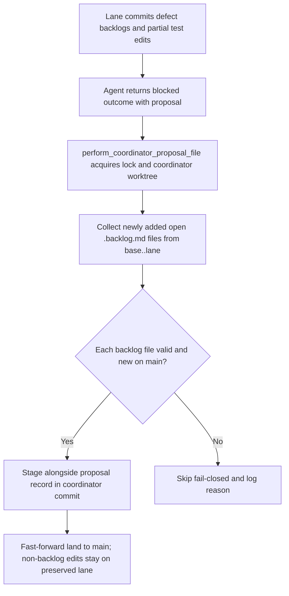

# IPD: Land agent-filed defect backlog items on main when a lane stops with a proposal

- Date: 2026-11-21
- Kind: child
- Concern: The runner prompt directs an executing agent to file a backlog item with `aw backlog new --apply` for every defect it discovers. When an agent commits newly filed defect backlog items on its isolated lane branch and then stops with a `proposal` (`fail-gate`), `agent_workflows/runner_shared.py::perform_coordinator_proposal_file` commits the proposal record directly onto `main` while the driver preserves the lane branch unmerged. The agent-filed defect backlog items stay stranded on the unmerged lane branch, leaving the proposal record on `main` citing dangling IDs that do not exist on `main`. Observed in `run-20261121T014040Z-2638602`, where IPD `60mazt` committed `0dsjzl`, `fnabjy`, `xl9xrm`, and `7mmhlp` on `aw/lane/60mazt`, the driver filed proposal `735ium` on `main` citing `0dsjzl` and `fnabjy`, and all four defect backlog files had to be recovered manually.
- Scope: Update `agent_workflows/runner_shared.py::perform_coordinator_proposal_file` (and its call site in `runner_shared.py` where `wt_handle` is available) to detect newly added open backlog files (`.aw/records/backlog/open/*.backlog.md` and legacy `.agents/backlog/open/*.backlog.md`) committed on the preserved lane branch relative to its base commit (`wt_handle.base_commit`), validate each file with `backlog.validate_item` (plus `check_engine` live-bug gate rule `check.live-bug-ungated` / `backlog` conformance and non-collision with existing `main` paths), and commit and land the valid newly added backlog files alongside the proposal record inside the same coordinator worktree and repository integration lock while leaving all non-backlog lane edits (incomplete code/tests) preserved exclusively on the lane branch. Record landed and skipped/invalid lane backlog files in `ProposalFilingResult` and the `agent-proposal-filed` event. Add behavioral tests in `tests/test_run_proposal_channel.py` driving both happy-path recovery (proposal + lane defect backlog land on `main`, failing test edit stays only on the lane branch) and fail-closed invalid-backlog handling (malformed backlog file in the lane is not landed on `main`, recorded as skipped/refused, while the proposal still lands). EXCLUDES: proposal summary truncation (`68ympf` / `l7d19a`) and non-proposal lane preservation paths.
- Scope-Paths: agent_workflows/runner_shared.py, tests/test_run_proposal_channel.py, .aw/records/plans/pending/20261121-8s4qhh-01-8h1q1k-land-agent-filed-defect-backlog-items-on-main-when-a-lane-st.ipd.md
- Item-Dependencies: none
- Status: to-review
- Short-Description: Recover and validate newly added open defect backlog files from preserved fail-gate proposal lanes and land them onto main with the proposal record.
- Work-Kind: bug
- Priority: high
- From-Backlog: 8s4qhh
- Blocks-Release: next
- Set: 8s4qhh
- Order: 1
- Highest E allocated: 03
- Author: antigravity/gemini
- Id: 8h1q1k

> Write and proofread this plan per the technical writing standard, `.aw/system/workflows/technical-writing/technical-writing.md` (`.agents/workflows/technical-writing/technical-writing.md` in a legacy-layout install), including requirement 12 (diagrams).

## Workflow history

- 2026-11-21 to-review (aw set): Authored review-ready child plan graduated from backlog 8s4qhh
- 2026-11-21 draft (antigravity/gemini): created.

## Goal

Ensure agent-filed defect backlog items committed in a preserved proposal lane land cleanly on `main` alongside the coordinator-filed proposal record, without merging incomplete code or test changes from the lane.

## Detailed Implementation Checklist (TODO)

Execution-state rule: mark an `E-*` item complete only after performing the action. That mark is not validation. Right-sizing rule: write for a modest executor that cannot hold much in its head. Each E-item is one step (one concern, about one file, executable in one focused pass) and its V-item names each unit it covers with its own check; a plan stays at about 5 E-items and 8 work Scope-Paths, else split it into more child plans (guidance, `IPD-Z603`). Accepted execution states: blocked, failed, pending, performed; terminal gate demands 'performed'.

### Task group 1: Harvest newly added defect backlog files from proposal lanes

- [ ] E-01 Add a helper in `agent_workflows/runner_shared.py` (e.g. `_collect_lane_added_open_backlogs(repo: Path, lane_branch: str, base_commit: str) -> List[Tuple[str, bytes]]`) that queries `git diff --name-status --diff-filter=A <base_commit>..<lane_branch> -- .aw/records/backlog/open .agents/backlog/open`, keeps only newly added `*.backlog.md` paths (strictly relative, no `..`, matching open backlog directory prefixes), and reads each blob via `git show <lane_branch>:<rel_path>`. Never reads modified or deleted backlog files and never reads any non-backlog path.
  - Depends on: none
  - Expected outcome: A pure, bounded helper collects only newly added open `.backlog.md` blobs from the lane branch relative to its base commit.
  - Execution state: pending

- [ ] E-02 Wire `_collect_lane_added_open_backlogs` into `agent_workflows/runner_shared.py::perform_coordinator_proposal_file` (passing `lane_base_commit` from `wt_handle.base_commit` when available at the proposal call site):
  1. Inside the coordinator worktree (`coord.path`), for each collected `(rel_path, blob_bytes)`: skip if `rel_path` already exists on `coord.path`; decode UTF-8 and validate it with `backlog.validate_item` (confirming zero drift errors, and rejecting any `Work-Kind: bug` item that lacks `- Blocks-Release:` when the repo has a planned release); write valid files atomically into `coord.path / rel_path`.
  2. Include all validated newly added backlog paths alongside `[new_record_rel]` in the single coordinator commit (`_gch.offer_commit`) so the proposal record and its referenced defect backlog items land atomically on `main` under the existing integration lock and race-retry loop.
  3. Record `recovered_backlog_paths` and `skipped_backlog_reasons` on `ProposalFilingResult` and emit them in the `agent-proposal-filed` event in `events.jsonl` so operators have an auditable record of what landed and why any invalid file was rejected.
  - Depends on: E-01
  - Expected outcome: Valid newly added defect backlog items from a blocked proposal lane land atomically with the proposal record on `main`; invalid files are skipped fail-closed and logged; non-backlog lane edits remain solely on the preserved lane branch.
  - Execution state: pending

- [ ] E-03 Add behavioral tests in `tests/test_run_proposal_channel.py` driving real git repos and `perform_coordinator_proposal_file` / runner proposal handling to verify:
  1. When a lane commits a conformant open defect backlog item (`Work-Kind: bug`, `Blocks-Release: next`) AND a failing test file edit on `aw/lane/<id6>`, and exits with a material proposal, both the proposal backlog item and the lane's defect backlog item exist on `main` after landing, the failing test file edit is NOT on `main` (preserved only on `aw/lane/<id6>`), and the `agent-proposal-filed` event lists the recovered backlog path.
  2. When a lane commits a malformed open backlog file (e.g. missing required fields or ungated bug) alongside a valid proposal, the malformed backlog file does NOT land on `main`, its skip reason is recorded, and the proposal record still lands cleanly.
  3. When a lane modifies an existing backlog file on `main` rather than adding a new one, the modification is NOT copied to `main`.
  Run `python3 -m pytest -o addopts="" -v tests/test_run_proposal_channel.py`, `aw suite`, `make typecheck`, `aw ipd lint --phase pre-transition` on this plan, and `aw sanitize --agent`.
  - Depends on: E-02
  - Expected outcome: All new and existing proposal-channel tests, `aw suite`, `make typecheck`, `aw ipd lint --phase pre-transition`, and `aw sanitize --agent` pass.
  - Execution state: pending

## Project conventions discovered (Step 0)

- `agent_workflows/runner_shared.py` handles valid proposals inside the execution loop (`validate_proposal` -> `perform_coordinator_proposal_file` -> `lane_containment.record_lane_preserved`), where `wt_handle` (`branch` and `base_commit`) is already in scope.
- `perform_coordinator_proposal_file` already holds `integration_lock`, creates an isolated `commit_lock.coordinator_worktree`, commits via `_gch.offer_commit`, and lands via `ipd_lifecycle.land_worktree_commit` with race retry (`RECONCILED_RACED`).
- `tests/test_run_proposal_channel.py` already sets up real isolated git repos with `.aw/records/plans/pending`, `.aw/records/backlog/open`, and `.aw/records/releases` to test proposal filing end to end.

## Findings

| Id | Finding | Evidence |
|---|---|---|
| F-01 | `perform_coordinator_proposal_file` commits only `[new_record_rel]` and never recovers newly added defect backlog files from the preserved lane branch. | `agent_workflows/runner_shared.py::perform_coordinator_proposal_file`; observed in `run-20261121T014040Z-2638602` (`60mazt` filed `0dsjzl`, `fnabjy`, `xl9xrm`, `7mmhlp` on `aw/lane/60mazt` while `735ium` landed on `main` citing dangling IDs `0dsjzl` and `fnabjy`). |

## Proposed changes (ordered, validatable)

1. Add `_collect_lane_added_open_backlogs` in `agent_workflows/runner_shared.py` to collect newly added open `.backlog.md` blobs from `<base_commit>..<lane_branch>` (`E-01`).
2. Validate and land those newly added backlog files inside `perform_coordinator_proposal_file`'s coordinator worktree commit and record them in `ProposalFilingResult` and `agent-proposal-filed` (`E-02`).
3. Add behavioral tests in `tests/test_run_proposal_channel.py` and run all validation gates (`E-03`).

## Deferred / out of scope (with reason)

- Fixing mid-word 24-character summary truncation in `perform_coordinator_proposal_file`: owned by sibling plan `l7d19a` (from backlog `68ympf`).
  - Carrier: l7d19a

## Scope check

- Over-scope: none. Only `agent_workflows/runner_shared.py`, `tests/test_run_proposal_channel.py`, and this plan are modified.
- Under-scope: none. Covers newly added open backlogs in both `.aw/records/backlog/open/` and legacy `.agents/backlog/open/`, validation, collision avoidance, race retry, and event logging.

## Required tests / validation

- `python3 -m pytest -o addopts="" -v tests/test_run_proposal_channel.py`
- `aw suite` (core tier passes)
- `make typecheck` (0 mypy errors)
- `aw ipd lint --phase pre-transition` on this plan (`outcome: "clean"`)
- `aw sanitize --agent` (`outcome: "clean"`)

## Spec / documentation sync

N/A: fixes a runner coordinator defect so agent-filed defect carriers referenced by proposals are not stranded off `main`.

## Open questions

None.

## Validation and cross-check (verify before reporting done)

Validation-state rule: inspect evidence in a separate pass. Do not mark a `V-*` item complete from memory or from the matching execution checkmark. Accepted validation results: blocked, failed, pass, pending; terminal gate demands 'pass'. Runtime-demonstration reachability rule: for each `V-*` item demanding the software be observed acting (such as a run, a dispatch, or a transition), as distinct from items demanding a diff, a file's content, or a test result (which are reachable by construction), name the code path that produces the observation or the sibling `E-*` that creates it, else the demand is UNDER-SCOPE.

- [ ] V-01 validates E-01
  - Required evidence: paste the `git diff agent_workflows/runner_shared.py` summary showing `_collect_lane_added_open_backlogs` restricts strictly to `git diff --diff-filter=A` newly added open `*.backlog.md` files.
  - Observed evidence:
  - Result: pending

- [ ] V-02 validates E-02
  - Required evidence: paste the `git diff agent_workflows/runner_shared.py` summary showing validation, fail-closed skipping, atomic coordinator commit alongside the proposal record, and `agent-proposal-filed` event fields.
  - Observed evidence:
  - Result: pending

- [ ] V-03 validates E-03
  - Required evidence: paste actual output from `python3 -m pytest -o addopts="" -v tests/test_run_proposal_channel.py`, `aw suite`, `make typecheck`, `aw ipd lint --phase pre-transition` on this plan, and `aw sanitize --agent`.
  - Observed evidence:
  - Result: pending

## Approval and execution gate

- Size assessment: standard
- Cohesion rationale: not required

Execute after review and approval (`approved` or `auto-approved`). Commit only files changed for this plan through `aw commit 8h1q1k -- <paths>` (never `git add -A`, bare `git add`, `git commit -a`, or `--no-verify`; never push). Finalize to `.aw/records/plans/executed/` only via `aw ipd finalize` after `aw ipd lint --phase pre-transition` conforms and every `V-*` reads `pass` with pasted evidence.
