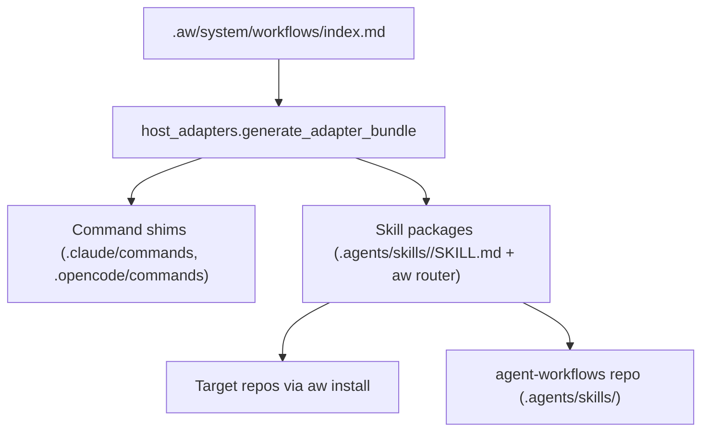

# IPD: Emit .agents/skills packages for all manifest workflows, sync in agent-workflows, and make setup-repo reminder host-neutral

- Date: 2026-11-21
- Kind: child
- Concern: `agent_workflows/host_adapters.py::generate_adapter_bundle` omits all workflows classified as `POLICY_GENERATED_COMMAND` (including `setup-repo`, `verify`, `plan-review`, `spec`, `scaffold`, `release-review`) from `.agents/skills/`, leaving them invisible in Antigravity (`agy`); `agent-workflows` itself has no `.agents/skills/` directory; and `agent_workflows/attention.py` prints Claude/OpenCode-only `/aw setup-repo` syntax that errors in `agy`.
- Scope: Emit `.agents/skills/<name>/SKILL.md` packages for every manifest workflow in `host_adapters.generate_adapter_bundle` (preserving `classify_discovery_policy`), sync `.agents/skills/` in `agent-workflows`, add host-neutral invocation phrasing to the `setup-repo` footer in `agent_workflows/attention.py`, and add behavioral tests.
- Scope-Paths: agent_workflows/host_adapters.py, agent_workflows/attention.py, tests/test_agy_skill_install.py, tests/test_attention.py, .agents/skills/**, .aw/records/plans/pending/20261121-agy-skills-01-h1mouy-emit-agents-skills-packages-for-all-manifest-workflows-sync.ipd.md
- Item-Dependencies: none
- Status: approved
- Readiness: go-pending-approval
- Short-Description: Emit skills for every workflow in generate_adapter_bundle, sync .agents/skills in agent-workflows, and add host-neutral setup-repo wording in aw attention
- Work-Kind: bug
- Priority: high
- From-Backlog: wjen3s
- Blocks-Release: next
- Set: agy-skills
- Order: 1
- Highest E allocated: 04
- Author: antigravity
- Id: h1mouy
- Approval: 2026-11-21, human ("approved"): Approved per user directive: file, graduate, review, execute.

> Write and proofread this plan per the technical writing standard, `.aw/system/workflows/technical-writing/technical-writing.md` (`.agents/workflows/technical-writing/technical-writing.md` in a legacy-layout install), including requirement 12 (diagrams).

## Workflow history

- 2026-11-21 approved (aw set, --by-human): Approved per user directive: file, graduate, review, execute.
- 2026-11-21 plan-review (antigravity): verdict GO — Readiness: go-pending-approval; verified generate_adapter_bundle, validate_skill_package, attention footer test, and .agents/skills layout compatibility.
- 2026-11-21 reviewed (aw set): Reviewed: verified generate_adapter_bundle, classify_discovery_policy preservation, attention footer test, and .agents/skills layout compatibility
- 2026-11-21 to-review (aw set): Review-ready plan for agy-skills
- 2026-11-21 draft (antigravity): created.

## Goal

Make every workflow in `.aw/system/workflows/index.md` (including `setup-repo`, `verify`, `plan-review`, `spec`, `scaffold`, and `release-review`) discoverable as an Agent Skill under `.agents/skills/` in both installed target repositories and `agent-workflows` itself, while showing host-neutral setup-repo guidance in `aw attention`.

## Detailed Implementation Checklist (TODO)

Execution-state rule: mark an `E-*` item complete only after performing the action. That mark is not validation. Right-sizing rule: write for a modest executor that cannot hold much in its head. Each E-item is one step (one concern, about one file, executable in one focused pass) and its V-item names each unit it covers with its own check; a plan stays at about 5 E-items and 8 work Scope-Paths, else split it into more child plans (guidance, `IPD-Z603`). Accepted execution states: blocked, failed, pending, performed; terminal gate demands 'performed'.

### Task group 1: Emit skill packages for all manifest workflows

- [ ] E-01 Update `agent_workflows/host_adapters.py::generate_adapter_bundle` to build a `SkillPackage` via `build_skill_package` for every workflow in `workflows` (plus the unified `aw` router skill via `build_aw_router_skill_package`) instead of filtering out workflows where `classify_discovery_policy` returns `POLICY_GENERATED_COMMAND`. Keep `classify_discovery_policy` itself unchanged so complexity classification tests in `tests/test_host_adapters_skills.py` remain green.
  - Depends on: none
  - Expected outcome: `generate_adapter_bundle` emits valid `SkillPackage` entries for every workflow in `.aw/system/workflows/index.md` (including `setup-repo`, `verify`, `plan-review`, `spec`, `spec-review`, `scaffold`, `release-review`, `release-notes`, `benchmark`, `incident`, `migrate`, `getting-started`, `ipd-lifecycle`, `verify-execution`, `assess-all`) with zero name collisions (`guard_skill_package_collision` passes) and every package passes `validate_skill_package` and `within_budget()`.
  - Execution state: pending

### Task group 2: Host-neutral setup-repo reminder in aw attention

- [ ] E-02 Update the `setup-repo` footer in `agent_workflows/attention.py::run` to emit `TODO: Run \`/aw setup-repo\` (or ask your agent to "run setup-repo") to set up this repo.` and update the matching assertion in `tests/test_attention.py`.
  - Depends on: none
  - Expected outcome: `aw attention` still includes `TODO: Run \`/aw setup-repo\`` for Claude Code and OpenCode users while giving Antigravity and other skill-based agents an invocation that does not trigger `unknown command`.
  - Execution state: pending

### Task group 3: Sync .agents/skills/ in agent-workflows itself

- [ ] E-03 Generate and write `.agents/skills/<name>/SKILL.md` and `reference/` files into `agent-workflows` using `agent_workflows/host_adapters.py::generate_adapter_bundle` over `.aw/system/workflows`, ensuring every workflow skill (including `setup-repo` and `aw`) is present and passes `aw sanitize --agent`.
  - Depends on: E-01
  - Expected outcome: `.agents/skills/setup-repo/SKILL.md`, `.agents/skills/aw/SKILL.md`, and all sibling manifest workflow skill packages exist in `agent-workflows`, match `generate_adapter_bundle` byte-for-byte, and produce zero `aw sanitize --agent` findings and zero `aw doctor` layout regressions.
  - Execution state: pending

### Task group 4: Behavioral tests and full verification

- [ ] E-04 Add behavioral tests in `tests/test_agy_skill_install.py` proving `engine.install_into_repo` emits `.agents/skills/<cmd>/SKILL.md` for every manifest workflow (explicitly checking `setup-repo`, `verify`, `plan-review`, `spec`, `release-review`, and `aw`), that every generated package validates cleanly via `host_adapters.validate_skill_package`, and run affected pytest suites, `make typecheck`, and `aw sanitize --agent`.
  - Depends on: E-01, E-02, E-03
  - Expected outcome: All targeted suites (`test_agy_skill_install.py`, `test_host_adapters_skills.py`, `test_installer.py`, `test_attention.py`, `test_doctor.py`, `test_layout_migration.py`, `test_layout_inventory.py`, `test_migration_compact_shims.py`, `test_aw_upgrade_test.py`) plus bare `python3 -m pytest`, `make typecheck`, and `aw sanitize --agent` pass with zero failures.
  - Execution state: pending

## Project conventions discovered (Step 0)

- `agent_workflows/host_adapters.py::classify_discovery_policy` is explicitly tested by `tests/test_host_adapters_skills.py::POLICIES` to classify argument-less listing commands (`arg_hint="none"`) as `POLICY_GENERATED_COMMAND`; keeping `classify_discovery_policy` unchanged while emitting skills for all workflows in `generate_adapter_bundle` fixes Antigravity discovery without breaking complexity classification.
- `agent_workflows/engine.py::_build_skill_members` delegates directly to `host_adapters.generate_adapter_bundle`, so updating `generate_adapter_bundle` automatically covers `aw install` and every target repository.
- `.agents/skills` is explicitly preserved across layout migrations (`tests/test_layout_migration.py`, `tests/test_layout_inventory.py`, `tests/test_doctor.py`).
- `tests/test_attention.py` asserts exact footer text ending in `TODO: Run \`/aw setup-repo\` to set up this repo.\n` (updated in `E-02`) and substring `TODO: Run \`/aw setup-repo\`` (preserved).

## Findings

| ID | Severity | Area | Finding |
|---|---|---|---|
| AGY-01 | High | `agent_workflows/host_adapters.py::generate_adapter_bundle` | Workflows without a `lens`, non-empty `arg_hint`, or >1400B shim (including `setup-repo`, `verify`, `plan-review`, `spec`, `release-review`, `scaffold`) were filtered out of `.agents/skills/`, making them undiscoverable in Antigravity (`agy`). |
| AGY-02 | High | `agent-workflows` root (`.agents/skills/`) | `agent-workflows` tracked `.claude/commands/` and `.opencode/commands/` but had no `.agents/skills/` directory, so `agy` saw zero `aw` workflow skills in `agent-workflows`. |
| AGY-03 | Medium | `agent_workflows/attention.py::run` | Footer printed `TODO: Run \`/aw setup-repo\` to set up this repo.`, causing `unknown command` when typed literally in `agy`. |

## Proposed changes (ordered, validatable)

1. `agent_workflows/host_adapters.py::generate_adapter_bundle` (`E-01`): Remove the `if classify_discovery_policy(...) == POLICY_SKILL_ENTRY_POINT` filter when constructing `skill_packages` so every workflow in `workflows` gets a generated `.agents/skills/<name>/SKILL.md` package alongside the `aw` router skill.
2. `agent_workflows/attention.py::run` and `tests/test_attention.py` (`E-02`): Add `(or ask your agent to "run setup-repo")` to the `setup-repo` reminder footer and update the endswith test assertion.
3. `.agents/skills/**` (`E-03`): Sync generated skill packages into `agent-workflows` from `.aw/system/workflows`.
4. `tests/test_agy_skill_install.py` (`E-04`): Add behavioral tests asserting every manifest workflow (including `setup-repo`, `verify`, `plan-review`, `spec`, `release-review`) is installed under `.agents/skills/` and validates cleanly.

## Deferred / out of scope (with reason)

- Rewriting `agent_workflows/migration_inventory.py` tier metadata or changing `classify_discovery_policy` return values is out of scope because `classify_discovery_policy` continues to serve compact-migration classification (`tests/test_host_adapters_skills.py`, `tests/test_migration_compact_shims.py`).
  - Carrier-Declined: Preserving `classify_discovery_policy` keeps compact-migration contracts intact while `generate_adapter_bundle` ensures full Antigravity skill discovery.

## Scope check

- Over-scope: none. Every touched file directly fixes Antigravity skill discovery, `agent-workflows` skill parity, or the `setup-repo` reminder wording.
- Under-scope: none. Covers installer generation, `agent-workflows` itself, `aw attention` reminder text, and behavioral tests.

## Required tests / validation

- Run `python3 -m pytest tests/test_agy_skill_install.py tests/test_host_adapters_skills.py tests/test_installer.py tests/test_attention.py tests/test_doctor.py tests/test_layout_migration.py tests/test_layout_inventory.py tests/test_migration_compact_shims.py tests/test_aw_upgrade_test.py`.
- Run bare `python3 -m pytest` (core suite), `make typecheck`, and `aw sanitize --agent`.

## Spec / documentation sync

N/A with reason: `AGENTS.md` and `.aw/system/workflows/index.md` already document skill discovery under `.agents/skills/` and natural-language invocation (`"run setup-repo"`) for Antigravity.

## Open questions

None.

## Validation and cross-check (verify before reporting done)

Validation-state rule: inspect evidence in a separate pass. Do not mark a `V-*` item complete from memory or from the matching execution checkmark. Accepted validation results: blocked, failed, pass, pending; terminal gate demands 'pass'. Runtime-demonstration reachability rule: for each `V-*` item demanding the software be observed acting (such as a run, a dispatch, or a transition) (as distinct from items demanding a diff, a file's content, or a test result, which are reachable by construction) name the code path that produces the observation or the sibling `E-*` that creates it, else the demand is UNDER-SCOPE.

- [ ] V-01 validates E-01
  - Required evidence: Paste `git diff -- agent_workflows/host_adapters.py` showing `generate_adapter_bundle` builds skill packages for all `workflows`, plus pasted test output proving `setup-repo`, `verify`, `plan-review`, `spec`, and `release-review` appear in `bundle.skill_packages` and pass `validate_skill_package` with 0 findings.
  - Observed evidence:
  - Result: pending

- [ ] V-02 validates E-02
  - Required evidence: Paste `git diff -- agent_workflows/attention.py tests/test_attention.py` showing the host-neutral `setup-repo` reminder footer, plus pasted `python3 -m pytest tests/test_attention.py` pass summary.
  - Observed evidence:
  - Result: pending

- [ ] V-03 validates E-03
  - Required evidence: Paste directory count/listing confirming `.agents/skills/setup-repo/SKILL.md` and `.agents/skills/aw/SKILL.md` exist in `agent-workflows`, plus `aw sanitize --agent` showing 0 findings.
  - Observed evidence:
  - Result: pending

- [ ] V-04 validates E-04
  - Required evidence: Paste full output of the targeted pytest suites, bare `python3 -m pytest`, `make typecheck`, and `aw sanitize --agent` showing zero failures, 0 mypy errors, and 0 leak findings.
  - Observed evidence:
  - Result: pending

## Approval and execution gate

- Size assessment: standard
- Cohesion rationale: not required

This plan must reach `approved` before execution. Execute inside an isolated worktree, commit only `Scope-Paths` files via `aw commit h1mouy -- <paths>`, paste actual command output into each `V-*` Observed evidence block, and finalize via `aw ipd finalize h1mouy`.
