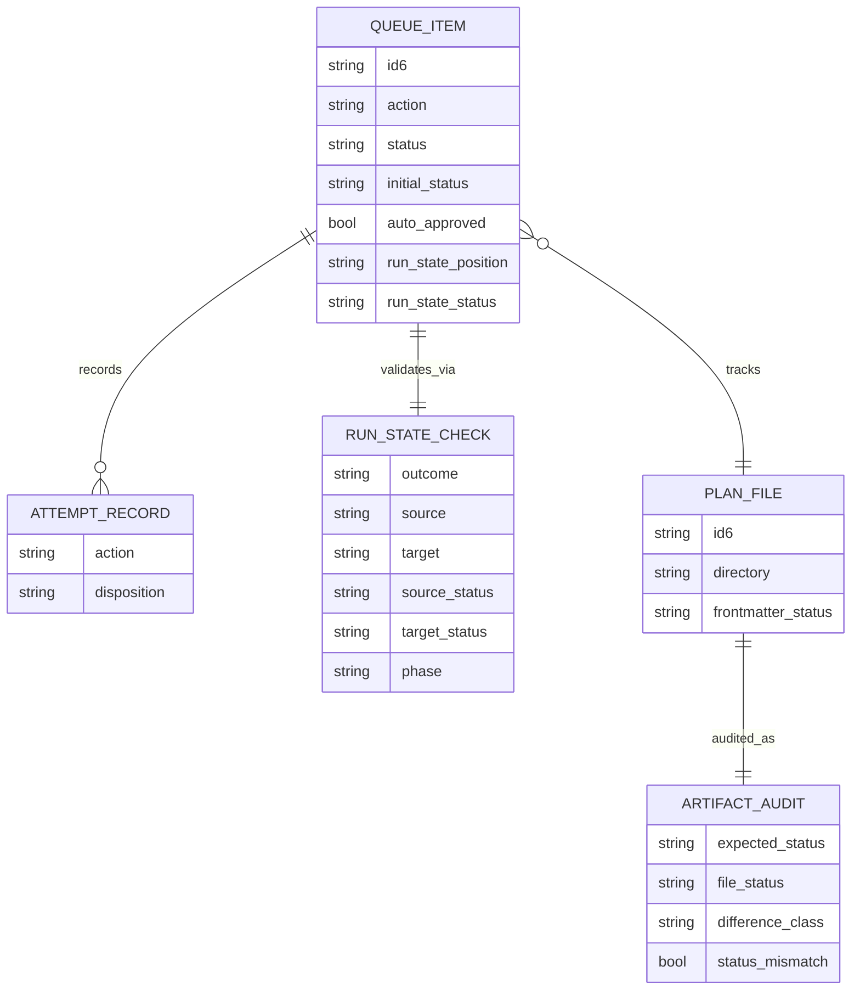
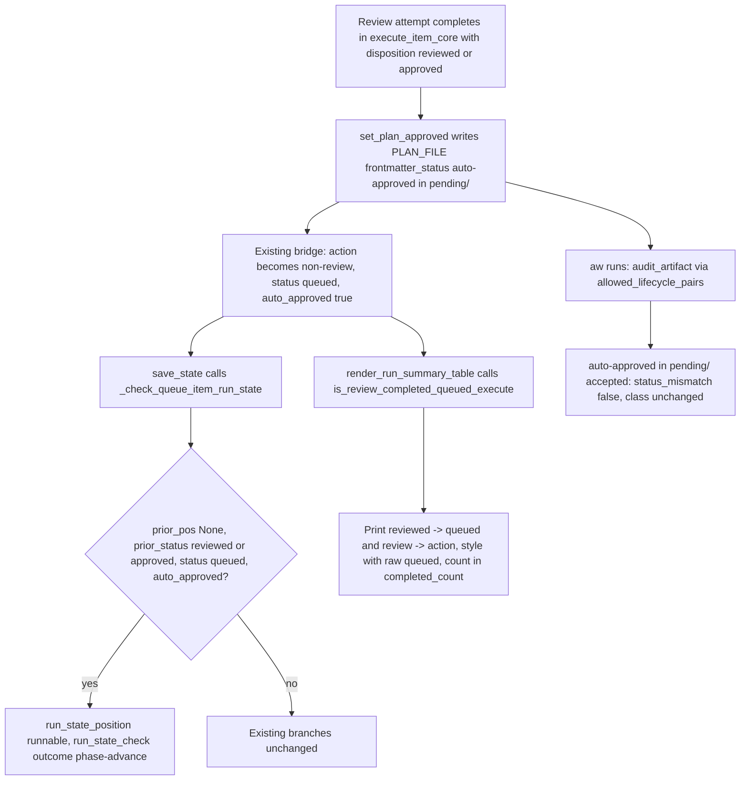

# IPD: Preserve completed review phase across full-auto approval and run reporting

- Date: 2026-11-21
- Kind: child
- Concern: full-auto review-to-execute phase preservation across queue state and run reporting
- Scope: Preserve completed review visibility in AW RUN SUMMARY, accept auto-approved pre-terminal status in aw runs artifact audit, and record phase-advance transitions for reviewed-to-queued handoff in run_state_check
- Scope-Paths: agent_workflows/runner_shared.py, agent_workflows/render_stream.py, agent_workflows/artifact_audit.py, tests/test_runwire_state_translation.py, tests/test_run_summary_table.py, tests/test_artifact_audit.py, tests/test_runner_fullauto_and_sweep_fixes.py
- Item-Dependencies: none
- Status: approved
- Readiness: go-pending-approval
- Review-Depth: standard
- Short-Description: Preserve completed review visibility in AW RUN SUMMARY, recognize auto-approved status in aw runs, and map reviewed->queued in run_state_check
- Work-Kind: bug
- Priority: medium
- From-Backlog: b0en28
- Blocks-Release: next
- Set: b0en28
- Order: 1
- Highest E allocated: 05
- Author: antigravity
- Id: feol8w
- Approval: 2026-11-27, recorded via aw ipd set: status set to approved

> Write and proofread this plan per the technical writing standard, `.aw/system/workflows/technical-writing/technical-writing.md` (`.agents/workflows/technical-writing/technical-writing.md` in a legacy-layout install), including requirement 12 (diagrams).

## Workflow history

- 2026-11-27 approved (aw set): status set to approved
- 2026-11-25 reviewed (uri/its_direct/pt3-claude-opus-5.5-1m-us): plan-review (uri/its_direct/pt3-claude-opus-5.5-1m-us): APPROVE WITH REVISIONS APPLIED; PR-001..PR-009 fixed (frozen initial_status kept, auto-approved pre-terminal pair instead of audit/viewer threading, no banner change, display fields, lifecycle finalize clause, check-all baseline, reachable V-02, behm9r orchestrate compatibility, uonrjg citation); review record .aw/records/reviews/20261121-b0en28-01-feol8w-preserve-completed-review-phase-across-full-auto-approval-an.review.md
- 2026-11-21 to-review (antigravity): Authored review-ready child plan for backlog b0en28 covering summary phase rendering, auto-approved artifact auditing, and reviewed-to-queued state transition recording.
- 2026-11-21 draft (antigravity): created.

## Goal

Fix three coupled defects that appear when `agent_workflows/runner_shared.py::execute_item_core` rewrites one queue item from `review` to `execute` during `--full-auto` auto-approval and the run then stops before the execute turn (for example with `--after-call`). After the fix, `AW RUN SUMMARY` shows the completed review, `aw runs` accepts the on-disk `- Status: auto-approved` plan as expected, and `state.json` records an explicit `phase-advance` run-state outcome instead of `skipped-unmapped`. The fix must hold for both newly written runs and historical `state.json` files such as `run-20261121T141636Z-2560095`, so it reads only fields the runner already writes (`auto_approved` and the attempt list) and adds no new queue-item field.

## Detailed Implementation Checklist (TODO)

Execution-state rule: mark an `E-*` item complete only after performing the action. That mark is not validation. Right-sizing rule: write for a modest executor that cannot hold much in its head. Each E-item is one step (one concern, about one file, executable in one focused pass) and its V-item names each unit it covers with its own check; a plan stays at about 5 E-items and 8 work Scope-Paths, else split it into more child plans (guidance, `IPD-Z603`). Accepted execution states: blocked, failed, pending, performed; terminal gate demands 'performed'.

### Task group 1: Regression tests first

- [ ] E-01 Author failing behavioral regression tests for all three defects, then run pytest on the four target test files to record the baseline failures. Also save the pre-change `aw check all --agent` output to `/tmp/opencode/feol8w-check-all-before.jsonl` for the E-05 comparison.
  - Depends on: none
  - Expected outcome: These tests fail before any production edit:
    - (a) `tests/test_runwire_state_translation.py`: drive `runner_shared.save_state` through `queued` -> `running` -> `reviewed` -> (`action="execute"`, `status="queued"`, `auto_approved=True`), then assert that the last save records `run_state_check["outcome"] == "phase-advance"`.
    - (b) `tests/test_run_summary_table.py`: call `render_run_summary_table` on a state whose item is `action="execute"`, `status="queued"`, `auto_approved=True`, with attempts `[{"action": "review", "disposition": "reviewed"}]` and no `review_completed` key (the historical shape). Assert `reviewed -> queued` and `review -> execute` in the row, `1 reviewed -> queued` in `Progress:`, and `Total (1/1 items run)`.
    - (c) `tests/test_artifact_audit.py`: call `audit_artifact(status="queued", action="execute", initial_status="to-review", artifact_type="ipd")` on a `pending/` plan declaring `- Status: auto-approved`, and assert `status_mismatch is False`.
    - (d) `tests/test_runner_fullauto_and_sweep_fixes.py`: the in-process end-to-end drive described in V-02.

    Every test calls runtime functions and asserts on returned values, `state.json` fields, or rendered text. No test uses AST or source-text assertions. `tests/test_run_summary_table.py` is in the core tier (`pytestmark = pytest.mark.core`), so its new tests build state in memory and must each finish in under 2 seconds.
  - Execution state: pending

### Task group 2: Run-state check phase advance

- [ ] E-02 In `agent_workflows/runner_shared.py::_check_queue_item_run_state`, record the `--full-auto` review-to-execute handoff as `phase-advance` instead of the generic `skipped-unmapped` fallback. Do not edit `execute_item_core`, and add no queue-item field.
  - Depends on: E-01
  - Expected outcome: Insert the new check immediately before branch 3 (`if prior_pos is None or target_pos is None:`). It matches when all of these hold:
    - `prior_pos is None`
    - `prior_status in ("reviewed", "approved")`
    - `status == "queued"`
    - `target_pos is not None`
    - `item.get("auto_approved")` is truthy

    On a match, set `item["run_state_position"] = target_pos` (`"runnable"`) and `item["run_state_status"] = status`, and record `item["run_state_check"] = {"outcome": "phase-advance", "source": prior_pos, "target": target_pos, "source_status": prior_status, "target_status": status, "phase": "review -> execute"}`. `source` and `target` stay positions, as in every other outcome, and `source` is `None` here. Append no violation. A `reviewed` -> `queued` change without `auto_approved` (for example a resume requeue) still records `skipped-unmapped`. `INTENTIONALLY_UNMAPPED_DRIVER_STATUSES` is unchanged.
  - Execution state: pending

### Task group 3: Run summary phase display and progress counting

- [ ] E-03 Add the pure helper `agent_workflows/render_stream.py::is_review_completed_queued_execute`, and use it in `agent_workflows/render_stream.py::render_run_summary_table` to display and count an item whose review completed.
  - Depends on: E-01
  - Expected outcome: The helper returns `True` only when all of these hold:
    - `item.get("status") == "queued"`
    - `item.get("action")` is present and is not `"review"`
    - `item.get("auto_approved")` is truthy
    - the last attempt in `item.get("attempts")` has `action == "review"` and `disposition in ("reviewed", "approved")`

    The helper accepts any non-review action, so it also covers the `orchestrate` action that pending plan `behm9r` assigns to an auto-approved orchestrator.

    For a matching item, `render_run_summary_table` does three things:
    - It prints `Status` as `reviewed -> queued` and `Action` as `review -> <action>`.
    - It keys `status_counts` by the displayed status.
    - It counts the item in `completed_count`, so both `Progress:` and `Total (k/N items run)` include it.

    `resolve_item_lifecycle` still receives the raw `status` and `action`, so the glyph and color stay the `queued` ones. `items_data` therefore carries the display strings beside the raw values, and `lifecycle_style._RUNNER_ITEM_PAIRS` is unchanged. The outcome word needs no edit: with `exit_reason` unset and no failed, blocked, or success item, the existing chain already yields `PARTIAL` once `completed_count > 0`. With `exit_reason` set (the `--after-call` case), the banner prints `exit_reason` as it does today.
  - Execution state: pending

### Task group 4: Artifact audit recognition of auto-approved plans

- [ ] E-04 In `agent_workflows/artifact_audit.py::allowed_lifecycle_pairs`, accept `("auto-approved", "pending")` for a plan in every pre-terminal branch that already accepts `("approved", "pending")`. Do not add a parameter to `audit_artifact`, and do not edit `agent_workflows/run_viewer.py`.
  - Depends on: E-01
  - Expected outcome: The three pre-terminal plan branches that list `"approved"` (the `initial_status` branch, the explicit-type fallback, and the legacy untyped branch) also list `"auto-approved"`, kept after `"approved"` and skipped when it equals `init_st`. As a result, `audit_artifact` on a `pending/` plan declaring `- Status: auto-approved` returns `status_mismatch=False`, `has_discrepancy=False`, `difference_class="unchanged"`, and `expected_status="auto-approved"`. This holds for run statuses `queued`, `interrupted`, and `failed` with `initial_status` set to `"to-review"`, `"auto-approved"`, or `None`. The success branches are unchanged, so a run status of `executed` still requires `executed/` with an executed-family status.
  - Execution state: pending

### Task group 5: Full validation, hygiene checks, and scoped commit

- [ ] E-05 Run the targeted and repository-wide gates after the final edits (`make typecheck`, bare `python3 -m pytest`, `make test-all`, `aw check all --agent` compared against the E-01 baseline, and `aw sanitize --agent`). Confirm that no new test pins code structure, then commit only `- Scope-Paths:` files through `aw commit feol8w -- <paths>`.
  - Depends on: E-02, E-03, E-04
  - Expected outcome: These gates exit 0: the targeted pytest files, `make typecheck`, bare `python3 -m pytest`, `make test-all`, and `aw sanitize --agent`. The thorough-tier slow report prints `0 unlisted slow tests`. `aw check all --agent` adds no `(rule, location)` pair that is absent from `/tmp/opencode/feol8w-check-all-before.jsonl`; the tree already reports error-severity findings unrelated to this plan, so an exit-0 demand would be unreachable. `aw commit` records a work commit that touches only paths listed in `- Scope-Paths:`.
  - Execution state: pending

## Project conventions discovered (Step 0)

- Both host drivers (`agent_workflows/agy_runipd.py` and `agent_workflows/oc_runipd.py`), `agent_workflows/runner_shutdown.py::KNOWN_ITEM_STATUSES`, `agent_workflows/runner_stop.py::forced_disposition`, and `agent_workflows/run_viewer.py::load_run_summary` require each entry in `state["queue"]` to remain a single dictionary whose queued execution token is `"queued"`.
- `tests/test_runwire_state_translation.py` checks total status coverage against `agent_workflows/runner_shared.py::INTENTIONALLY_UNMAPPED_DRIVER_STATUSES`. `"reviewed"` must therefore stay in `INTENTIONALLY_UNMAPPED_DRIVER_STATUSES`; do not add a synthetic execution state to `agent_workflows/run_state.py`.
- `tests/test_lifecycle_style.py` and `agent_workflows/lifecycle_style.py` restrict `_RUNNER_ITEM_PAIRS` and canonical statuses to single tokens (`queued`, `reviewed`, `executed`, and peers). Compound display labels therefore belong only in `agent_workflows/render_stream.py::render_run_summary_table`.
- The queue item's `initial_status` is the plan's on-disk status FROZEN at queue build. `agent_workflows/runner_shared.py::item_needs_approval` and the `SKIP_NOT_RUNNABLE` evidence text in `agent_workflows/run_selection_policy.py` both describe it that way. This plan keeps that invariant and does not rewrite `initial_status` mid-run.
- `agent_workflows/artifact_audit.py::allowed_lifecycle_pairs` already accepts a human `approved` status in `pending/` for any pre-terminal outcome, whatever `initial_status` is. Measured: an `approved` plan audited with `initial_status="to-review"` returns `difference_class="unchanged"`. `auto-approved` is the machine form of the same readiness (`.aw/records/plans/README.md`), so it receives the same tolerance.
- `tests/test_run_viewer.py` pins dead-run projection of unreached `"queued"` steps (`unreached in run (runner not live)`). Only the `on-disk status disagrees with the run record` reason is defective here.
- `agent_workflows/production_checks.py` and `agent_workflows/ipd_lint.py` enforce the `IPD-Z603` followability thresholds (at most 5 E-items, 8 countable work `Scope-Paths`, and 8 named units per E-item) and symbol-based citations (`IPD-C801`, no bare line numbers).
- `conftest.py::pytest_sessionfinish` enforces a 30-second wall budget on the core tier and reports any test over 2 seconds that is missing from `tests/slow_allowlist.txt`.

## Findings

All findings come from the observed evidence in backlog `b0en28` (`run-20261121T141636Z-2560095`, `pbdtss`, commit `53a698394`), from direct reading of the affected modules, and from review-time probes on the current tree:

| Finding | Observed symptom | Code location | Mechanism |
| --- | --- | --- | --- |
| F-01 | `AW RUN SUMMARY` prints `Action: execute`, `Status: queued`, `Progress: 0/N`, and `Total (0/N items run)` after the review finishes and the item is promoted, if the run stops before the execute turn | `agent_workflows/runner_shared.py::execute_item_core`; `agent_workflows/render_stream.py::render_run_summary_table` | `execute_item_core` overwrites `item["action"] = "execute"` and `item["status"] = "queued"` in place. `render_run_summary_table` prints the raw `action` and `status`, keys `status_counts` on the raw `status`, and excludes `"queued"` from `completed_count`. Measured: `Outcome: QUEUED`, `Progress: 0/1 ... (1 queued)`, `Total (0/1 items run)` |
| F-02 | `aw runs <run-id>` flags `Artifact & Status Differences` with `Expected Status: to-review`, `Actual Status: auto-approved`, and `"on-disk status disagrees with the run record"` | `agent_workflows/runner_shared.py::execute_item_core`; `agent_workflows/artifact_audit.py::allowed_lifecycle_pairs`; `agent_workflows/artifact_audit.py::audit_artifact` | `set_plan_approved` writes `- Status: auto-approved` in `pending/`. `allowed_lifecycle_pairs` accepts `approved`, `to-review`, `draft`, `reviewed`, `queued`, and `running` in `pending/`, but not `auto-approved`. Measured with `initial_status="to-review"`: `status_mismatch=True`, `has_discrepancy=True`, `difference_class="unknown"`. Adding `("auto-approved", "pending")` alone makes the same audit `unchanged` |
| F-03 | `state.json` stores `run_state_check.outcome = "skipped-unmapped"` with `unmapped_side = "source"`, `source = None`, `target = "runnable"` | `agent_workflows/runner_shared.py::execute_item_core`; `agent_workflows/runner_shared.py::map_driver_status_to_run_state`; `agent_workflows/runner_shared.py::_check_queue_item_run_state` | `execute_item_core` saves `status = "reviewed"`, for which `map_driver_status_to_run_state` returns `None`. It then saves `status = "queued"`, which maps to `"runnable"`. That second save reaches the generic `prior_pos is None or target_pos is None` fallback. Measured on the current tree |

## Proposed changes (ordered, validatable)

### Data and State Model

No field is added to `QUEUE_ITEM`. `auto_approved` and the attempt list are already written by `execute_item_core`, so historical and new `state.json` files take the same path.

### Flow across Review Promotion, State Check, Summary, and Viewer

### Ordered Changes

1. **Record the phase advance in the run-state check (`agent_workflows/runner_shared.py`)**:
   - In `_check_queue_item_run_state`, before branch 3, match `prior_pos is None and prior_status in ("reviewed", "approved") and status == "queued" and target_pos is not None and item.get("auto_approved")`. On a match, write `run_state_position`, `run_state_status`, and the `phase-advance` record exactly as E-02 states, then return. `source` stays the prior position (`None`), which keeps the meaning of `source` and `target` the same across every outcome.
   - `execute_item_core` is not edited. The bridge already sets `auto_approved = True` in the same pass that rewrites the status and before the `save_state` that triggers the check. Rewriting `initial_status` to `"auto-approved"` was considered and rejected: it would break the frozen-at-queue-build contract that `item_needs_approval` and `run_selection_policy` document, and E-04 makes the rewrite unnecessary.

2. **Display the completed review handoff and count it (`agent_workflows/render_stream.py`)**:
   - Define the pure helper `is_review_completed_queued_execute(item: Mapping[str, Any]) -> bool` with the conditions in E-03. Testing the LAST attempt excludes an item that already started its execute turn and was requeued after an interruption, because that item's last attempt is not a review.
   - In `render_run_summary_table`:
     - Compute `completed_review_handoff = is_review_completed_queued_execute(item)`.
     - Set `display_status = "reviewed -> queued"` and `display_action = f"review -> {action}"` when `completed_review_handoff` is `True`. Otherwise use the raw `status` and `action`.
     - Key `status_counts` by `display_status`, so `Progress:` reports `reviewed -> queued` separately from unreviewed `queued` items.
     - Increment `completed_count` when `(canonical_terminal_status(status) not in ("queued", "not-run") or completed_review_handoff) and item_is_dispatchable_work(item)`.
     - Store `display_status` and `display_action` in `items_data` beside the raw values. In the row loop, pass the raw values to `resolve_item_lifecycle` and print the display values, so the glyph and color stay those of `queued`.
   - Leave the outcome-word chain unchanged. E-03 explains why `PARTIAL` already follows.

3. **Accept `auto-approved` pre-terminal plans in the audit (`agent_workflows/artifact_audit.py`)**:
   - In `allowed_lifecycle_pairs`, add `"auto-approved"` next to `"approved"` in the three pre-terminal plan branches named in E-04. `aw runs` (`agent_workflows/run_viewer.py::audit_step_artifact` -> `audit_artifact`) then accepts the on-disk status with no viewer change, for both historical runs (`initial_status="to-review"`) and new runs.

## Deferred / out of scope (with reason)

- Splitting a queue item in `state["queue"]` into separate review and execute rows.
  - Carrier-Declined: rejected design alternative, not pending follow-up work; `agy_runipd.py`, `oc_runipd.py`, `runner_shutdown.py`, `runner_stop.py`, `run_viewer.py` deduplication, and `tests/test_oc_runipd.py::test_full_auto_reviews_approves_and_executes_plan` require one queue object per item.
- Altering `completed_work_count`, `compute_queue_tally` live statuslines, or `runner_shared.py::write_report` (`execution-report.md` Markdown table).
  - Carrier-Declined: intentional scope boundary, not deferred work; live statuslines track remaining execute queue work and `write_report` requires single-token `status` for fallback Markdown table parsing.
- Removing `queued` to `queued?` (`unreached in run (runner not live)`) projection in `run_viewer.py`.
  - Carrier-Declined: intentional scope boundary, not deferred work; `tests/test_run_viewer.py::test_dead_run_queued_and_running_steps_projected_and_flagged_as_issues` pins dead-run projection for unreached execution steps, whereas only the false `to-review` vs `auto-approved` status disagreement is defective.
- Removing `"reviewed"` from `runner_shared.py::INTENTIONALLY_UNMAPPED_DRIVER_STATUSES`.
  - Carrier-Declined: intentional invariant, not deferred work; `tests/test_runwire_state_translation.py` pins this boundary between review dispositions and `run_state.py` execution states.
- Rewriting the queue item's `initial_status` to `"auto-approved"`, or threading an `auto_approved` flag through `audit_artifact` and `run_viewer.StepSummary`.
  - Carrier-Declined: rejected design alternative (review PR-001, PR-002), not pending follow-up work; the `allowed_lifecycle_pairs` change fixes the audit for historical and new runs alike, and the rewrite would break the frozen `initial_status` contract.

## Scope check

- Over-scope: none. Edits stay within three runtime modules and four test files. Dispatch loops, `execute_item_core`, live statuslines, Markdown report writers, `run_viewer.py`, and `INTENTIONALLY_UNMAPPED_DRIVER_STATUSES` are unchanged.
- Under-scope: verified none. Every symptom in backlog `b0en28` has a targeted runtime fix and regression coverage for both historical and newly written state: the `AW RUN SUMMARY` display and counts, the false `to-review` vs `auto-approved` discrepancy in `aw runs`, and the `skipped-unmapped` outcome in `run_state_check`.

## Required tests / validation

- Targeted unit and integration suites (added in `E-01`, verified passing in `E-05`):
  - `python3 -m pytest -o addopts="" -q tests/test_runwire_state_translation.py tests/test_run_summary_table.py tests/test_artifact_audit.py tests/test_runner_fullauto_and_sweep_fixes.py`
  - Existing `--full-auto`, viewer, and vocabulary suites: `python3 -m pytest -o addopts="" -q tests/test_oc_runipd.py tests/test_runner_fallback_bindings.py tests/test_run_viewer.py tests/test_artifact_audit_verdicts.py tests/test_lifecycle_style.py tests/test_terminal_status_vocabulary.py`
- Repository-wide gates after final edits (`E-05`):
  - `make typecheck`
  - `python3 -m pytest`
  - `make test-all`
  - `aw check all --agent`, compared against the E-01 baseline (no new `(rule, location)` pair)
  - `aw sanitize --agent`
- Behavior-only testing requirement: every added test calls runtime functions (`_check_queue_item_run_state` via `save_state`, `render_run_summary_table`, `is_review_completed_queued_execute`, `allowed_lifecycle_pairs`, `audit_artifact`, `load_run_summary` / `audit_step_artifact`, `oc_runipd.execute_item`) and asserts on return values, state JSON fields, exit codes, and formatted text. No test inspects source text with `inspect`, `ast`, regex, or substring matching.

## Spec / documentation sync

- No spec edit is required, and no `.spec.md` path is in `- Scope-Paths:`. The plan adds no CLI subcommand, front-matter status, or file format; `auto-approved` is already defined in `.aw/records/plans/README.md`. The compound `reviewed -> queued` label stays within `uonrjg` Section 0 ("the word is authoritative") and Section 7.2: the cell still prints the native word `queued`, the glyph and color still resolve from the raw `queued` status through `resolve_item_lifecycle`, and `reviewed ->` adds history without replacing the native word. `run_state_check` outcomes are not specified in any spec. The executed plan `32jpl1` defines them, and `phase-advance` is a new value alongside `initial`, `checked-legal`, `checked-illegal`, and `skipped-unmapped`.

## Open questions

### OQ-01: Historical run compatibility when no new field exists in older `state.json` files

- Blocking: no
- Status: resolved
- Owner: plan-author
- Resolution or deferral rationale: Resolved by adding no new field. `is_review_completed_queued_execute` and the `phase-advance` check read only `auto_approved` and the attempt list, which `execute_item_core` already writes. The audit fix is a status-pair change that does not depend on `initial_status`. Historical runs (`initial_status="to-review"`) and new runs therefore resolve the same way. Amended at review (PR-001, PR-002), which removed the planned `review_completed` and `review_initial_status` fields.

### OQ-02: Precedence when a `--full-auto` item executes after auto-approval in the same run

- Blocking: no
- Status: resolved
- Owner: plan-author
- Resolution or deferral rationale: Resolved from the branch structure of `allowed_lifecycle_pairs`. The new `("auto-approved", "pending")` pair is added only to pre-terminal branches. Once execution finishes (`status="executed"`), the success branch still requires `executed/` with an executed-family status, and `is_review_completed_queued_execute` returns `False` once `status != "queued"` or the last attempt is not a review.

## Validation and cross-check (verify before reporting done)

Validation-state rule: inspect evidence in a separate pass. Do not mark a `V-*` item complete from memory or from the matching execution checkmark. Accepted validation results: blocked, failed, pass, pending; terminal gate demands 'pass'. Runtime-demonstration reachability rule: for each `V-*` item demanding the software be observed acting (such as a run, a dispatch, or a transition), as distinct from items demanding a diff, a file's content, or a test result, which are reachable by construction, name the code path that produces the observation or the sibling `E-*` that creates it, else the demand is UNDER-SCOPE.

- [ ] V-01 validates E-01
  - Required evidence: The diff of the new behavioral tests in the four target files, plus pasted pytest output showing that cases (a) through (d) of E-01 fail before the runtime edits, and the path and line count of `/tmp/opencode/feol8w-check-all-before.jsonl`.
  - Observed evidence:
  - Result: pending
- [ ] V-02 validates E-02
  - Required evidence: Pasted pytest output for two kinds of test. The first is the `tests/test_runwire_state_translation.py` tests that drive `runner_shared.save_state`. They must show `run_state_check["outcome"] == "phase-advance"`, `source is None`, `target == "runnable"`, `source_status == "reviewed"`, `run_state_position == "runnable"`, and an empty `run_state_violations` for an `auto_approved` item. They must also show that the same `reviewed` -> `queued` change without `auto_approved` still records `skipped-unmapped`. The second is the in-process end-to-end test in `tests/test_runner_fullauto_and_sweep_fixes.py`. It drives `oc_runipd.execute_item` on a `to-review` plan in a temporary git repository with `options.full_auto: True` and `options.isolate_worktree: False`, patching `oc_runipd.run_opencode` with a fake review turn that writes `- Status: reviewed`, `- Readiness: go-pending-approval`, and a review-provenance history line. It follows `tests/test_rereview_reviewed_plan.py::TestRereviewExecutionTurn`. The item that `execute_item` returns in is the state an `--after-call` stop leaves (reachable through `runner_shared.execute_item_core`'s full-auto bridge). The test must show `phase-advance` in the saved `state.json`, the E-03 summary row from `render_run_summary_table`, and no `on-disk status disagrees with the run record` reason from `run_viewer.load_run_summary` + `run_viewer.audit_step_artifact` + `run_viewer.step_issue_reasons`.
  - Observed evidence:
  - Result: pending
- [ ] V-03 validates E-03
  - Required evidence: Pasted pytest output from `tests/test_run_summary_table.py`, calling `agent_workflows/render_stream.py::is_review_completed_queued_execute` and `agent_workflows/render_stream.py::render_run_summary_table`, with assertions on each of these:
    - a historical-shape item (`auto_approved=True`, last attempt a completed review, no other new field) renders `reviewed -> queued`, `review -> execute`, the `queued` glyph, `1 reviewed -> queued` in `Progress:`, `Total (1/1 items run)`, and `PARTIAL` when `exit_reason` is unset;
    - an `orchestrate` action renders `review -> orchestrate`;
    - an item whose last attempt is `execute` renders as plain `queued`;
    - an item without `auto_approved` renders as plain `queued`.
  - Observed evidence:
  - Result: pending
- [ ] V-04 validates E-04
  - Required evidence: Pasted pytest output from `tests/test_artifact_audit.py` driving `agent_workflows/artifact_audit.py::allowed_lifecycle_pairs` and `agent_workflows/artifact_audit.py::audit_artifact`. It must show `status_mismatch=False`, `has_discrepancy=False`, `difference_class="unchanged"`, and `expected_status="auto-approved"` for a `pending/` plan declaring `- Status: auto-approved`, across run statuses `queued`, `interrupted`, and `failed` and `initial_status` values `"to-review"`, `"auto-approved"`, and `None`. It must also show that a run status of `executed` against that `pending/` plan still reports a discrepancy, and that the existing `test_substantially_complete_and_complete_plans_lifecycle_symmetry` matrix still passes.
  - Observed evidence:
  - Result: pending
- [ ] V-05 validates E-05
  - Required evidence: Pasted exit codes and summary lines from post-final-edit runs of these commands:
    - the targeted pytest files
    - `make typecheck`
    - bare `python3 -m pytest`
    - `make test-all`, including the `0 unlisted slow tests` line
    - `aw sanitize --agent`
    - `aw check all --agent`, with the `(rule, location)` comparison against the E-01 baseline

    Also paste `git show --stat` for the `aw commit` work commit, showing that it changed only paths in `- Scope-Paths:`.
  - Observed evidence:
  - Result: pending

## Approval and execution gate

- Size assessment: standard
- Cohesion rationale: not required

Execute only after human approval (`- Status: approved`, recorded with `aw ipd set approved feol8w --by-human`) or an authorized automated gate. Open questions: none open.

Execution contract for the implementing agent:
1. SCOPE FENCE. `- Scope-Paths:` is a declaration. If execution must edit a file outside it, make the edit and justify it at finalize with `--scope-reason`. Acknowledge any declared path left unmodified with `--scope-ack`. Stop and report only on a genuinely unsafe condition: an unresolvable concurrent-edit conflict, or a missing prerequisite symbol (`_check_queue_item_run_state`, `render_run_summary_table`, `allowed_lifecycle_pairs`).
2. SAFETY. Uncommitted changes and untracked files you did not create are not yours; never revert, stage, commit, discard, reformat, or clean up another party's work.
3. ORDER. Execute `E-01` through `E-05` in dependency order. Set each `E-*` `- Execution state:` to `performed` when it is done. In a separate verification pass, fill in every `V-*` `- Observed evidence:` with pasted command output before setting `- Result: pass`.
4. HONESTY. Paste the ACTUAL runner output and summary lines for every test and check; never claim a result you did not run. Author only behavioral tests that assert on observable outputs, state files, exit codes, and rendered text; never inspect source files via `inspect`, `ast`, regex, or substring matching.
5. COMMIT. Commit only the modified `- Scope-Paths:` files through `aw commit feol8w -- <paths>`, and verify that `git diff --cached --name-only` lists only your paths. Never use `git add -A`, a bare `git add`, or `git commit -a`, and never push without an explicit human request.
6. LIFECYCLE. Once every `E-*` is `performed`, every `V-*` reads `pass`, and `aw ipd lint --phase pre-transition` reports `conforming`, the plan moves to `.aw/records/plans/executed/` only through `aw ipd finalize`, never a hand `git mv`. When `aw oc run` or `aw agy run` executes this plan, the runner owns the finalize. When this plan is executed by hand or by a direct agent turn, start with `aw ipd begin feol8w --actor <agent/model>` and end with `aw ipd finalize feol8w --actor <agent/model> --message "
" --apply` after the work commit. This plan inherits `- Blocks-Release: next` from backlog `b0en28`, so closing `b0en28` as `done` uses the executed-carrier handoff once this plan is executed.
