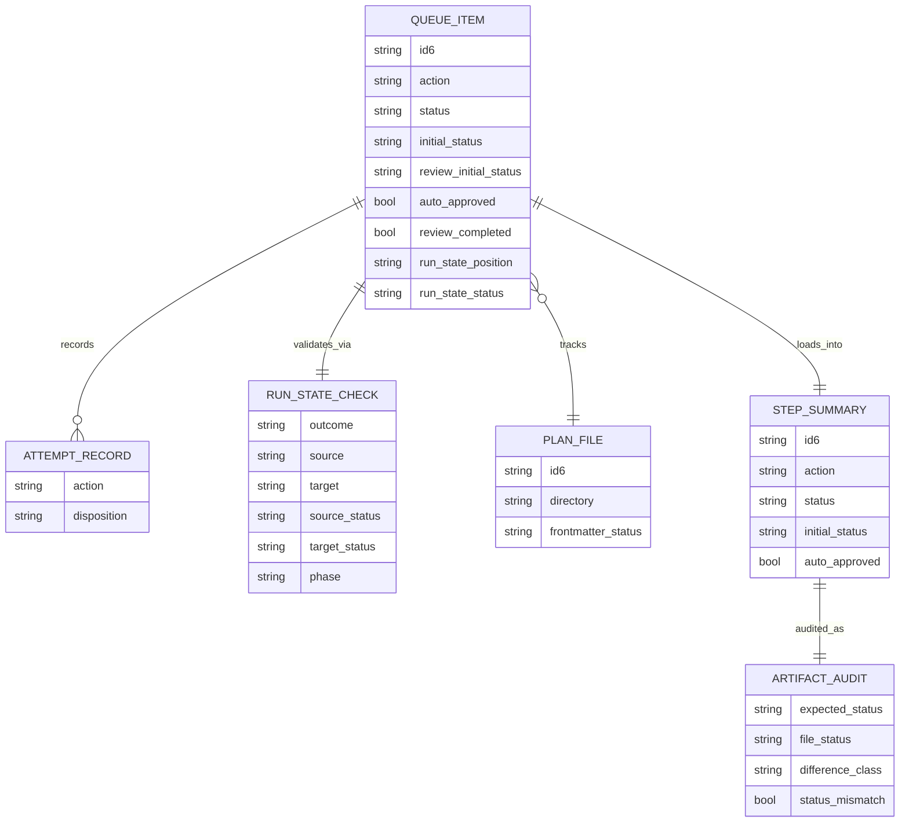
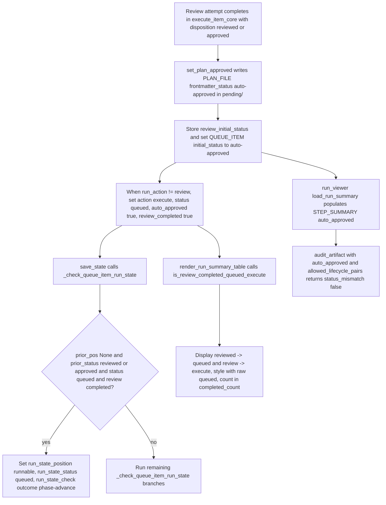

# IPD: Preserve completed review phase across full-auto approval and run reporting

- Date: 2026-11-21
- Kind: child
- Concern: full-auto review-to-execute phase preservation across queue state and run reporting
- Scope: Preserve completed review visibility in AW RUN SUMMARY, accept auto-approved pre-terminal status in aw runs artifact audit, and record phase-advance transitions for reviewed-to-queued handoff in run_state_check
- Scope-Paths: agent_workflows/runner_shared.py, agent_workflows/render_stream.py, agent_workflows/artifact_audit.py, agent_workflows/run_viewer.py, tests/test_runwire_state_translation.py, tests/test_run_summary_table.py, tests/test_artifact_audit.py, tests/test_runner_fullauto_and_sweep_fixes.py
- Item-Dependencies: none
- Status: to-review
- Short-Description: Preserve completed review visibility in AW RUN SUMMARY, recognize auto-approved status in aw runs, and map reviewed->queued in run_state_check
- Work-Kind: bug
- Priority: medium
- From-Backlog: b0en28
- Blocks-Release: next
- Set: b0en28
- Order: 1
- Highest E allocated: 05
- Author: antigravity
- Id: feol8w

> Write and proofread this plan per the technical writing standard, `.aw/system/workflows/technical-writing/technical-writing.md` (`.agents/workflows/technical-writing/technical-writing.md` in a legacy-layout install), including requirement 12 (diagrams).

## Workflow history

- 2026-11-21 to-review (antigravity): Authored review-ready child plan for backlog b0en28 covering summary phase rendering, auto-approved artifact auditing, and reviewed-to-queued state transition recording.
- 2026-11-21 draft (antigravity): created.

## Goal

Fix three coupled defects caused when `agent_workflows/runner_shared.py::execute_item_core` overwrites a single queue item during `--full-auto` review-to-execute promotion, so interrupted or `--after-call` `--full-auto` runs show the completed review phase in `AW RUN SUMMARY`, reconcile `- Status: auto-approved` on-disk plans in `aw runs`, and record an explicit `phase-advance` outcome instead of `skipped-unmapped` in `state.json`.

## Detailed Implementation Checklist (TODO)

Execution-state rule: mark an `E-*` item complete only after performing the action. That mark is not validation. Right-sizing rule: write for a modest executor that cannot hold much in its head. Each E-item is one step (one concern, about one file, executable in one focused pass) and its V-item names each unit it covers with its own check; a plan stays at about 5 E-items and 8 work Scope-Paths, else split it into more child plans (guidance, `IPD-Z603`). Accepted execution states: blocked, failed, pending, performed; terminal gate demands 'performed'.

### Task group 1: Regression tests first

- [ ] E-01 Author failing behavioral regression tests covering all three defects across `tests/test_runwire_state_translation.py`, `tests/test_run_summary_table.py`, `tests/test_artifact_audit.py`, and `tests/test_runner_fullauto_and_sweep_fixes.py`, then run pytest on those four files to establish baseline failures.
  - Depends on: none
  - Expected outcome: Targeted tests fail before production edits on all three observed defects (`AW RUN SUMMARY` omitting the completed review, `audit_artifact` and `run_viewer` reporting `to-review` vs `auto-approved` status mismatch, and `_check_queue_item_run_state` emitting `skipped-unmapped` for `reviewed` to `queued`), using direct calls and observable outputs without AST or source-text assertions.
  - Execution state: pending

### Task group 2: Runner state handoff and run-state check

- [ ] E-02 Update `agent_workflows/runner_shared.py::execute_item_core` and `agent_workflows/runner_shared.py::_check_queue_item_run_state` to preserve prior review metadata on full-auto promotion and record `reviewed` or `approved` to `queued` as `phase-advance`.
  - Depends on: E-01
  - Expected outcome: Immediately after `set_plan_approved` succeeds in `execute_item_core`, `review_initial_status` stores the original `initial_status` (`to-review`), `initial_status` updates to `"auto-approved"`, and `review_completed = True` is set when `run_action != "review"` promotes `action` to `"execute"` and `status` to `"queued"`; `_check_queue_item_run_state` writes `outcome = "phase-advance"`, `run_state_position = "runnable"`, and `run_state_status = "queued"` with zero violations.
  - Execution state: pending

### Task group 3: Run summary phase display and progress counting

- [ ] E-03 Add `agent_workflows/render_stream.py::is_review_completed_queued_execute` and update `agent_workflows/render_stream.py::render_run_summary_table` to display and tally completed-review queued items.
  - Depends on: E-01, E-02
  - Expected outcome: For both newly persisted state (`review_completed=True`) and historical state (`auto_approved=True`), when a queued execute item has a completed `review` attempt with no later non-review attempt, `render_run_summary_table` renders `Status` as `"reviewed -> queued"` and `Action` as `"review -> execute"` while resolving `resolve_item_lifecycle` against raw `"queued"`, counts `"reviewed -> queued"` in `status_counts`, includes the item in `completed_count` for `Progress:` and `Total (k/N items run)`, and emits `PARTIAL` rather than `QUEUED` when `completed_count > 0` and `exit_reason` is unset.
  - Execution state: pending

### Task group 4: Artifact audit and run viewer recognition of auto-approved plans

- [ ] E-04 Add `"auto-approved"` support to `agent_workflows/artifact_audit.py::allowed_lifecycle_pairs` and `agent_workflows/artifact_audit.py::audit_artifact`, and thread `auto_approved` through `agent_workflows/run_viewer.py` (`StepSummary`, `load_run_summary`, and `audit_step_artifact`).
  - Depends on: E-01, E-02
  - Expected outcome: Pre-terminal `pending/` IPDs with `- Status: auto-approved` satisfy `allowed_lifecycle_pairs`; `audit_artifact(..., auto_approved=True)` resolves expected pre-terminal plan status as `"auto-approved"` for both `"to-review"` and `"auto-approved"` `initial_status` while preserving `executed/` terminal checks when `status == "executed"`, so `aw runs` produces `status_mismatch=False`, `has_discrepancy=False`, `difference_class="unchanged"`, and zero `"on-disk status disagrees with the run record"` rows.
  - Execution state: pending

### Task group 5: Full validation, hygiene checks, and scoped commit

- [ ] E-05 Execute targeted and full test suites (`make typecheck`, bare `python3 -m pytest`, `make test-all`, `aw check all --agent`, and `aw sanitize --agent`), confirm zero code-pinning tests, run `aw ipd finalize feol8w`, and commit only `- Scope-Paths:` files via `aw commit feol8w -- <paths>`.
  - Depends on: E-02, E-03, E-04
  - Expected outcome: Every test suite, static check, and hygiene gate exits 0 after final edits, and `aw commit` records a commit touching only paths listed in `- Scope-Paths:`.
  - Execution state: pending

## Project conventions discovered (Step 0)

- Both host drivers (`agent_workflows/agy_runipd.py` and `agent_workflows/oc_runipd.py`), `agent_workflows/runner_shutdown.py::KNOWN_ITEM_STATUSES`, `agent_workflows/runner_stop.py::forced_disposition`, and `agent_workflows/run_viewer.py::load_run_summary` require each entry in `state["queue"]` to remain a single dictionary whose queued execution token is `"queued"` with `action == "execute"`.
- `tests/test_runwire_state_translation.py` checks total status coverage against `agent_workflows/runner_shared.py::INTENTIONALLY_UNMAPPED_DRIVER_STATUSES`, so `"reviewed"` must remain in `INTENTIONALLY_UNMAPPED_DRIVER_STATUSES` rather than adding a synthetic execution state in `agent_workflows/run_state.py`.
- `tests/test_lifecycle_style.py` and `agent_workflows/lifecycle_style.py` restrict `_RUNNER_ITEM_PAIRS` and canonical statuses to single tokens (`queued`, `reviewed`, `executed`, and peers), so compound display labels belong exclusively in `agent_workflows/render_stream.py::render_run_summary_table`.
- `tests/test_run_viewer.py` pins dead-run projection of unreached `"queued"` steps (`unreached in run (runner not live)`), while status reconciliation (`Artifact & Status Differences` and `"on-disk status disagrees with the run record"`) must pass when disk `- Status: auto-approved` matches a full-auto auto-approved queue item.
- `agent_workflows/production_checks.py` and `agent_workflows/ipd_lint.py` enforce `IPD-Z603` followability thresholds (maximum 5 E-items, 8 countable work `Scope-Paths`, and 8 named units per E-item) and symbol-based citations (`IPD-C801`, no bare line numbers).

## Findings

All findings below come from backlog `b0en28` observed evidence (`run-20261121T141636Z-2560095`, `pbdtss`, commit `53a698394`) and direct reading of the affected modules:

| Finding | Observed symptom | Code location | Mechanism |
| --- | --- | --- | --- |
| F-01 | `AW RUN SUMMARY` prints `Action: execute`, `Status: queued`, `Progress: 0/N`, and `Total (0/N items run)` after review finishes and promotes before interruption or `--after-call` | `agent_workflows/runner_shared.py::execute_item_core`; `agent_workflows/render_stream.py::render_run_summary_table` | `execute_item_core` overwrites `item["action"] = "execute"` and `item["status"] = "queued"` in place; `render_run_summary_table` prints raw `action` and `status`, keys `status_counts` on raw `status`, and excludes `"queued"` from `completed_count` |
| F-02 | `aw runs <run-id>` flags `Artifact & Status Differences` with `Expected Status: to-review`, `Actual Status: auto-approved`, and `"on-disk status disagrees with the run record"` | `agent_workflows/runner_shared.py::initialize_run_core`; `agent_workflows/runner_shared.py::execute_item_core`; `agent_workflows/artifact_audit.py::allowed_lifecycle_pairs`; `agent_workflows/artifact_audit.py::audit_artifact`; `agent_workflows/run_viewer.py::audit_step_artifact` | `initialize_run_core` records `initial_status = "to-review"`; `execute_item_core` invokes `set_plan_approved` (`- Status: auto-approved` in `pending/`) without updating `initial_status`; `allowed_lifecycle_pairs` omits `"auto-approved"` from pre-terminal `pending/` tuples; `audit_artifact` receives `initial_status="to-review"` without `auto_approved` and returns `difference_class = "unknown"` |
| F-03 | `state.json` stores `run_state_check.outcome = "skipped-unmapped"` with `unmapped_side = "source"`, `source = None`, `target = "runnable"` | `agent_workflows/runner_shared.py::execute_item_core`; `agent_workflows/runner_shared.py::map_driver_status_to_run_state`; `agent_workflows/runner_shared.py::_check_queue_item_run_state` | `execute_item_core` saves `status = "reviewed"` (`map_driver_status_to_run_state("reviewed")` is `None`), then saves `status = "queued"` (`target_pos = "runnable"`); `_check_queue_item_run_state` hits the generic `prior_pos is None or target_pos is None` unmapped fallback |

## Proposed changes (ordered, validatable)

### Data and State Model

### Flow across Review Promotion, State Check, Summary, and Viewer

### Ordered Changes

1. **Preserve review provenance on full-auto promotion and validate phase advance (`agent_workflows/runner_shared.py`)**:
   - In `execute_item_core`, inside the `full_auto` branch immediately after `set_plan_approved(repo, item["id6"])` succeeds (before the `run_action != "review"` check), preserve `item.setdefault("review_initial_status", item.get("initial_status"))` and set `item["initial_status"] = "auto-approved"` so both default `--full-auto` and `--action review --full-auto` match the on-disk `- Status: auto-approved` plan header in `pending/`.
   - When `run_action != "review"` switches `item["action"] = "execute"` and `item["status"] = "queued"`, set `item["review_completed"] = True` alongside `item["auto_approved"] = True`. Keep the queue item as one dictionary with `status == "queued"` and `action == "execute"` so dispatch loops, shutdown handling, and stop-exit logic remain intact.
   - In `_check_queue_item_run_state`, before branch 3 (`if prior_pos is None or target_pos is None:`), match the `--full-auto` phase advance: `prior_pos is None`, `prior_status in ("reviewed", "approved")`, `status == "queued"`, `target_pos is not None`, and `(item.get("auto_approved") or item.get("review_completed") or any(attempt.get("action") == "review" and attempt.get("disposition") in ("reviewed", "approved") for attempt in item.get("attempts", [])))`. On match, update `item["run_state_position"] = target_pos` (`"runnable"`), `item["run_state_status"] = status` (`"queued"`), and record `item["run_state_check"] = {"outcome": "phase-advance", "source": prior_status, "target": target_pos, "source_status": prior_status, "target_status": status, "phase": "review -> execute"}` with zero violations and zero `"skipped-unmapped"` outcomes. Leave `INTENTIONALLY_UNMAPPED_DRIVER_STATUSES` unchanged.

2. **Display completed review handoff and count completed work (`agent_workflows/render_stream.py`)**:
   - Define pure helper `is_review_completed_queued_execute(item: Mapping[str, Any]) -> bool`. Return `True` when `item.get("status") == "queued"`, `item.get("action", "execute") == "execute"`, `bool(item.get("auto_approved") or item.get("review_completed"))`, and `item.get("attempts")` includes a completed review attempt (`attempt.get("action") == "review"` and `attempt.get("disposition") in ("reviewed", "approved")`) with no subsequent non-review (`execute`) attempt. Detecting `auto_approved` plus the review attempt covers both newly saved state (`review_completed=True`) and historical frozen runs such as `run-20261121T141636Z-2560095`.
   - In `render_run_summary_table`:
     - Compute `completed_review_handoff = is_review_completed_queued_execute(item)`.
     - Use `display_status = "reviewed -> queued"` and `display_action = "review -> execute"` when `completed_review_handoff` is `True`; otherwise use raw `status` and `action`.
     - Key `status_counts` by `display_status` so `Progress:` reports `"reviewed -> queued"` separately from unreviewed `"queued"` items.
     - Increment `completed_count` when `(canonical_terminal_status(status) not in ("queued", "not-run") or completed_review_handoff) and item_is_dispatchable_work(item)` so `Progress:` and `Total (k/N items run)` count completed reviews; update the summary outcome banner logic in `render_run_summary_table` so `completed_count > 0` with remaining queued items yields `PARTIAL` rather than `QUEUED` when `exit_reason` is unset.
     - Pass raw `status` (`"queued"`) and raw `action` (`"execute"`) into `resolve_item_lifecycle` while printing `display_status` and `display_action`, retaining standard queued glyph and color formatting without modifying `lifecycle_style._RUNNER_ITEM_PAIRS`.

3. **Accept `auto-approved` pre-terminal plans in audit and viewer (`agent_workflows/artifact_audit.py`, `agent_workflows/run_viewer.py`)**:
   - In `agent_workflows/artifact_audit.py::allowed_lifecycle_pairs`, include `"auto-approved"` next to `"approved"` in all three pre-terminal `pending/` IPD status tuples (non-terminal queued/running tuples, reviewed tuples, and blocked/interrupted pre-terminal tuples).
   - Add keyword parameter `auto_approved: bool = False` to `agent_workflows/artifact_audit.py::audit_artifact`. When `auto_approved` is `True` on an IPD/plans item whose run status has not entered an executed or parked terminal state, expect `- Status: auto-approved` in `pending/` whether `initial_status` is `"to-review"` (historical runs) or `"auto-approved"` (new runs). Preserve existing `executed/` terminal verification when execution completes (`status == "executed"`).
   - In `agent_workflows/run_viewer.py`:
     - Add `auto_approved: bool = False` to `StepSummary`.
     - Set `auto_approved=bool(item.get("auto_approved", False))` in `load_run_summary`.
     - Pass `auto_approved=step.auto_approved` from `audit_step_artifact` to `_audit.audit_artifact(...)`.

## Deferred / out of scope (with reason)

- Splitting a queue item in `state["queue"]` into separate review and execute rows.
  - Carrier-Declined: rejected design alternative, not pending follow-up work; `agy_runipd.py`, `oc_runipd.py`, `runner_shutdown.py`, `runner_stop.py`, `run_viewer.py` deduplication, and `tests/test_oc_runipd.py::test_full_auto_reviews_approves_and_executes_plan` require one queue object per item.
- Altering `completed_work_count`, `compute_queue_tally` live statuslines, or `runner_shared.py::write_report` (`execution-report.md` Markdown table).
  - Carrier-Declined: intentional scope boundary, not deferred work; live statuslines track remaining execute queue work and `write_report` requires single-token `status` for fallback Markdown table parsing.
- Removing `queued` to `queued?` (`unreached in run (runner not live)`) projection in `run_viewer.py`.
  - Carrier-Declined: intentional scope boundary, not deferred work; `tests/test_run_viewer.py::test_dead_run_queued_and_running_steps_projected_and_flagged_as_issues` pins dead-run projection for unreached execution steps, whereas only the false `to-review` vs `auto-approved` status disagreement is defective.
- Removing `"reviewed"` from `runner_shared.py::INTENTIONALLY_UNMAPPED_DRIVER_STATUSES`.
  - Carrier-Declined: intentional invariant, not deferred work; `tests/test_runwire_state_translation.py` pins this boundary between review dispositions and `run_state.py` execution states.

## Scope check

- Over-scope: none; edits stay within the four runtime modules named in Findings plus the four targeted test files, leaving dispatch loops, live statuslines, Markdown report writers, and `INTENTIONALLY_UNMAPPED_DRIVER_STATUSES` unchanged.
- Under-scope: verified none; every symptom in backlog `b0en28` (`AW RUN SUMMARY` display/counts, `aw runs` false `to-review` vs `auto-approved` discrepancy, and `run_state_check` `skipped-unmapped`) has a targeted runtime fix and dedicated regression coverage across both historical and newly written state formats.

## Required tests / validation

- Targeted unit and integration suites (added in `E-01`, verified passing in `E-05`):
  - `python3 -m pytest tests/test_runwire_state_translation.py tests/test_run_summary_table.py tests/test_artifact_audit.py tests/test_runner_fullauto_and_sweep_fixes.py`
  - Existing `--full-auto`, viewer, and vocabulary suites: `python3 -m pytest tests/test_oc_runipd.py tests/test_runner_fallback_bindings.py tests/test_run_viewer.py tests/test_artifact_audit_verdicts.py tests/test_lifecycle_style.py tests/test_terminal_status_vocabulary.py`
- Repository-wide gates after final edits (`E-05`):
  - `make typecheck`
  - `python3 -m pytest`
  - `make test-all`
  - `aw check all --agent`
  - `aw sanitize --agent`
- Behavior-only testing requirement: every added test calls runtime functions (`_check_queue_item_run_state`, `save_state`, `render_run_summary_table`, `audit_artifact`, `load_run_summary` / `run_viewer_cli`, `execute_item_core`) and asserts return values, state JSON fields, exit codes, and formatted text; no test inspects source text with `inspect`, `ast`, regex, or substring matching.

## Spec / documentation sync

- None required (`N/A`): this plan fixes runtime queue-state tracking, summary rendering, run-viewer audit expectations, and transition checks without introducing new CLI subcommands, front-matter statuses, or spec contracts (`auto-approved` is already specified in `.aw/records/plans/README.md`).

## Open questions

### OQ-01: Historical run compatibility when `review_completed` is absent in older `state.json` files

- Blocking: no
- Status: resolved
- Owner: plan-author
- Resolution or deferral rationale: Resolved from frozen run schema and `execute_item_core` attempt history. `is_review_completed_queued_execute` checks `item.get("auto_approved") or item.get("review_completed")` plus a completed `review` attempt (`disposition in ("reviewed", "approved")` with no later non-review attempt), and `audit_artifact` uses `auto_approved=True` directly from `StepSummary.auto_approved`. Both historical runs (`initial_status="to-review"`, no `review_completed`) and newly written runs resolve accurately.

### OQ-02: Precedence when a `--full-auto` item executes after auto-approval in the same run

- Blocking: no
- Status: resolved
- Owner: plan-author
- Resolution or deferral rationale: Resolved from `allowed_lifecycle_pairs` and `audit_artifact` terminal branch rules. Setting `initial_status = "auto-approved"` and `auto_approved=True` applies only while the item remains pre-terminal in `pending/`; once execution finishes (`status="executed"` and plan moves to `executed/`), `audit_artifact` enforces `executed/` + `- Status: executed`, and `is_review_completed_queued_execute` returns `False` once `status != "queued"`.

## Validation and cross-check (verify before reporting done)

Validation-state rule: inspect evidence in a separate pass. Do not mark a `V-*` item complete from memory or from the matching execution checkmark. Accepted validation results: blocked, failed, pass, pending; terminal gate demands 'pass'. Runtime-demonstration reachability rule: for each `V-*` item demanding the software be observed acting (such as a run, a dispatch, or a transition)—as distinct from items demanding a diff, a file's content, or a test result, which are reachable by construction—name the code path that produces the observation or the sibling `E-*` that creates it, else the demand is UNDER-SCOPE.

- [ ] V-01 validates E-01
  - Required evidence: Diff showing new behavioral tests in `tests/test_runwire_state_translation.py`, `tests/test_run_summary_table.py`, `tests/test_artifact_audit.py`, and `tests/test_runner_fullauto_and_sweep_fixes.py`, plus pasted `python3 -m pytest` baseline failure output proving all three defects fail prior to runtime edits.
  - Observed evidence:
  - Result: pending
- [ ] V-02 validates E-02
  - Required evidence: Pasted pytest output exercising `agent_workflows/runner_shared.py::execute_item_core` and `agent_workflows/runner_shared.py::_check_queue_item_run_state` (via `tests/test_runwire_state_translation.py` and end-to-end `--full-auto --after-call` coverage in `tests/test_runner_fullauto_and_sweep_fixes.py`) confirming `review_initial_status == "to-review"`, `initial_status == "auto-approved"`, `review_completed is True`, `run_state_position == "runnable"`, and `run_state_check["outcome"] == "phase-advance"` with zero `skipped-unmapped` records or totality failures.
  - Observed evidence:
  - Result: pending
- [ ] V-03 validates E-03
  - Required evidence: Pasted pytest output from `tests/test_run_summary_table.py` and `tests/test_runner_fullauto_and_sweep_fixes.py` calling `agent_workflows/render_stream.py::is_review_completed_queued_execute` and `agent_workflows/render_stream.py::render_run_summary_table` on both new (`review_completed=True`) and historical (`auto_approved=True`, completed review attempt, no `review_completed`) cases, showing `reviewed -> queued`, `review -> execute`, queued glyph/style resolution, `1 reviewed -> queued` in `Progress:`, and `1/N` totals with `PARTIAL` outcome.
  - Observed evidence:
  - Result: pending
- [ ] V-04 validates E-04
  - Required evidence: Pasted pytest output from `tests/test_artifact_audit.py` and `agent_workflows/run_viewer.py` tests in `tests/test_runner_fullauto_and_sweep_fixes.py` driving `agent_workflows/artifact_audit.py::allowed_lifecycle_pairs`, `agent_workflows/artifact_audit.py::audit_artifact`, `agent_workflows/run_viewer.py::load_run_summary`, `agent_workflows/run_viewer.py::audit_step_artifact`, and `agent_workflows/run_viewer.py::run_viewer_cli`, confirming `status_mismatch=False`, `has_discrepancy=False`, `difference_class="unchanged"`, zero `Artifact & Status Differences` rows for both `initial_status="to-review"` + `auto_approved=True` and `initial_status="auto-approved"`, plus normal `executed/` reconciliation after execution finishes.
  - Observed evidence:
  - Result: pending
- [ ] V-05 validates E-05
  - Required evidence: Pasted exit codes and summaries from post-final-edit runs of targeted pytest, `make typecheck`, bare `python3 -m pytest`, `make test-all`, `aw check all --agent`, `aw sanitize --agent`, `aw ipd finalize feol8w`, and `git show --stat` confirming only paths in `- Scope-Paths:` changed and worktree is clean.
  - Observed evidence:
  - Result: pending

## Approval and execution gate

- Size assessment: standard
- Cohesion rationale: not required

Execution contract for the implementing agent:
1. Edit strictly within `- Scope-Paths:`; do not touch unrelated runtime modules, test files, or `b0en28`'s backlog file. Pass `--scope-reason` (or `--scope-ack` when no test file changed) to `aw ipd finalize feol8w` if actual edited paths differ from `- Scope-Paths:`.
2. Execute `E-01` through `E-05` in dependency order, updating each `E-*` `- Execution state:` to `performed` upon completion and populating every `V-*` `- Observed evidence:` with pasted command output in a separate verification pass before setting `- Result: pass`.
3. Author only behavioral tests asserting observable outputs, state files, exit codes, and rendered text; never inspect source files via `inspect`, `ast`, regex, or substring matching.
4. Run `aw ipd finalize feol8w` after `E-05` verification succeeds, then commit only the modified `- Scope-Paths:` files via `aw commit feol8w -- <paths>` (never `git add -A` and never push without explicit instruction).
