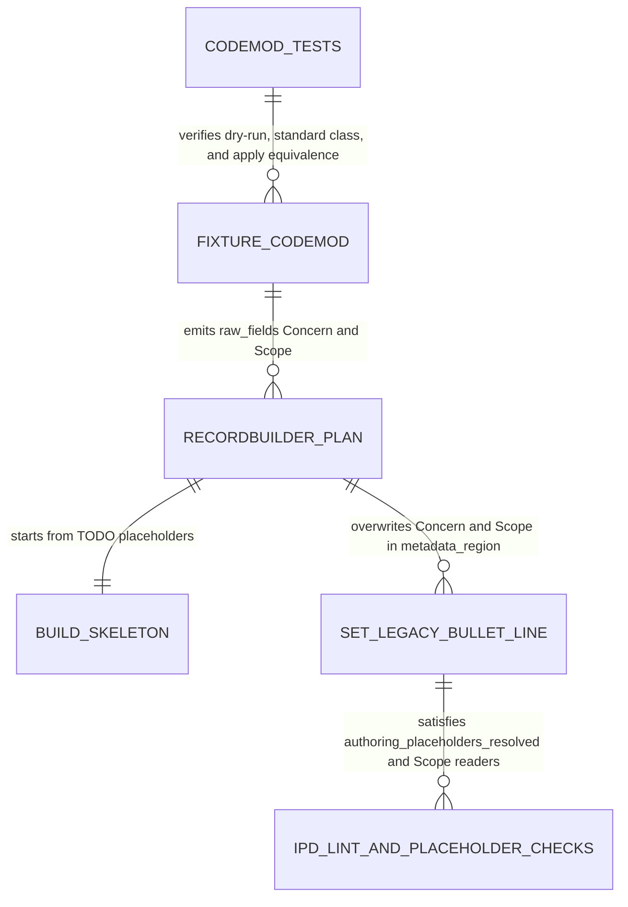
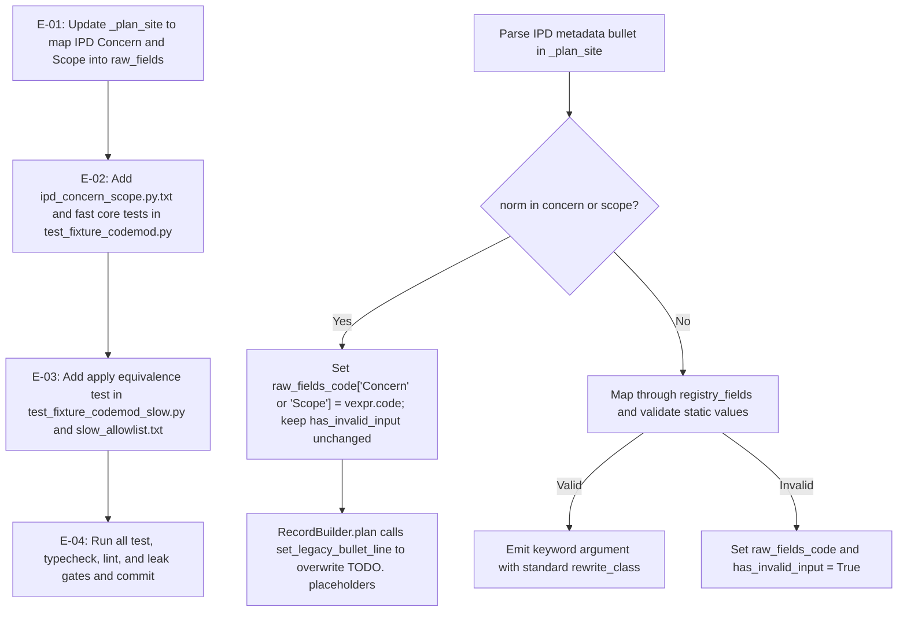

# IPD: Preserve Concern and Scope bullets in fixture_codemod._plan_site

- Date: 2026-11-21
- Kind: child
- Concern: `tools/fixture_codemod.py::_plan_site` currently skips `Concern` and `Scope` bullets on Implementation Plan Document (IPD) fixtures because those two required schema fields are absent from `agent_workflows/artifact_meta.py::registry_fields("ipd")`. When a rewritten test fixture calls `tests/record_builder.py::RecordBuilder.plan`, `agent_workflows/ipd_authoring.py::build_skeleton` supplies `Concern: TODO.` and `Scope: TODO.` placeholders. Leaving those placeholders behind causes `agent_workflows/ipd_authoring.py::authoring_placeholders_resolved` to return `False`, suppresses `check.ipd-draft-ready-to-review` in `agent_workflows/ipd_lint.py` and `agent_workflows/check_engine.py`, alters `- Scope:` fallback detail extraction in attention readers, breaks `- Scope: sample.` text replacements in IPD lint tests, and triggers apply-time `not-equivalent` refusals across 34 test modules (45 IPD rewrite sites measured on `HEAD`).
- Scope: IN: (1) update `tools/fixture_codemod.py::_plan_site` to preserve `Concern` and `Scope` bullets on `inferred_type == "ipd"` fixtures by emitting canonical `"Concern"` and `"Scope"` entries into `raw_fields` without setting `has_invalid_input` (keeping `rewrite_class == "standard"` when no invalid field is present); (2) add a fixture module `tests/fixtures/fixture_codemod/ipd_concern_scope.py.txt` containing static and f-string IPD `Concern` and `Scope` fixtures exercised against `authoring_placeholders_resolved`, `ipd_lint.lint_text`, and `- Scope:` text preservation; (3) add fast core-tier behavioral tests in `tests/test_fixture_codemod.py` covering `--dry-run --format json` output, rendered `RecordBuilder().plan` output, lowercase label normalization, single-variable f-string expressions, coexistence with invalid fields, and non-IPD record isolation while keeping `tests/test_fixture_codemod.py` under its 10-second serial wall-time limit; and (4) add a subprocess `--apply` equivalence and rewritten-suite pytest test in `tests/test_fixture_codemod_slow.py` with its node ID documented in `tests/slow_allowlist.txt`. OUT: changing `tests/record_builder.py::RecordBuilder.plan` or `agent_workflows/ipd_authoring.py::build_skeleton`, adding `- Concern:` or `- Scope:` to `tools/fixture_codemod.py::F01_PATTERN`, rewriting repository test modules (`59aiyh` and batch plans), or addressing sibling backlog items `e0wwtc` and `lufe6m`.
- Scope-Paths: tools/fixture_codemod.py, tests/test_fixture_codemod.py, tests/test_fixture_codemod_slow.py, tests/fixtures/fixture_codemod/ipd_concern_scope.py.txt, tests/slow_allowlist.txt
- Item-Dependencies: none
- Status: to-review
- Short-Description: Preserve IPD Concern and Scope bullets via raw_fields in fixture_codemod._plan_site instead of dropping them to build_skeleton TODO placeholders.
- Work-Kind: bug
- Priority: medium
- From-Backlog: b1j6bl
- Blocks-Release: next
- Set: b1j6bl
- Order: 1
- Highest E allocated: 04
- Author: antigravity/gemini
- Id: kbh055

> Write and proofread this plan per the technical writing standard, `.aw/system/workflows/technical-writing/technical-writing.md` (`.agents/workflows/technical-writing/technical-writing.md` in a legacy-layout install), including requirement 12 (diagrams).

## Workflow history

- 2026-11-21 to-review (aw set): Authored review-ready child plan graduated from backlog b1j6bl
- 2026-11-21 draft (antigravity/gemini): created.

## Goal

Ensure `tools/fixture_codemod.py::_plan_site` preserves `Concern` and `Scope` metadata bullets on IPD fixtures through `RecordBuilder.plan(..., raw_fields=...)` instead of dropping them, so rewritten IPD test fixtures overwrite `build_skeleton`'s `TODO.` placeholders, keep `rewrite_class == "standard"`, pass `ipd_lint` and placeholder-completeness checks, and avoid `not-equivalent` refusals.

## Detailed Implementation Checklist (TODO)

Execution-state rule: mark an `E-*` item complete only after performing the action. That mark is not validation. Right-sizing rule: write for a modest executor that cannot hold much in its head. Each E-item is one step (one concern, about one file, executable in one focused pass) and its V-item names each unit it covers with its own check; a plan stays at about 5 E-items and 8 work Scope-Paths, else split it into more child plans (guidance, `IPD-Z603`). Accepted execution states: blocked, failed, pending, performed; terminal gate demands 'performed'.

### Task group 1: Preserve IPD Concern and Scope bullets in the codemod

- [ ] E-01 Update `tools/fixture_codemod.py::_plan_site` where `norm in ("concern", "scope") and inferred_type == "ipd"` so it maps `norm` to canonical key `"Concern"` or `"Scope"` and sets `raw_fields_code[canon_label] = vexpr.code` before continuing. Do not set `has_invalid_input = True` for `Concern` or `Scope`, so valid IPD fixtures stay `rewrite_class == "standard"` while any invalid sibling field (such as `- Status: EXECUTED`) still sets `has_invalid_input = True` and coexists in `raw_fields`. Confirm `tools/fixture_codemod.py::F01_PATTERN` and non-IPD handling remain unchanged.
  - Depends on: none
  - Expected outcome: `tools/fixture_codemod.py::_plan_site` emits `raw_fields={'Concern': ..., 'Scope': ...}` (for static strings, mixed f-strings, single-placeholder f-strings, and lowercase `- concern:`/`- scope:` bullets) with `rewrite_class == "standard"`, overwriting `build_skeleton`'s `Concern: TODO.` and `Scope: TODO.` lines via `tests/record_builder.py::_apply_raw_fields` and `agent_workflows/artifact_meta.py::set_legacy_bullet_line`.
  - Execution state: pending

### Task group 2: Add behavioral fixture, core tests, and slow equivalence proof

- [ ] E-02 Add `tests/fixtures/fixture_codemod/ipd_concern_scope.py.txt` (never named `test_*.py` under `tests/fixtures/`) and fast core-tier behavioral tests in `tests/test_fixture_codemod.py` (using zero `inspect`, `ast`, or production source regex reads per `GUIDING_PRINCIPLES` P16):
  1. In `tests/fixtures/fixture_codemod/ipd_concern_scope.py.txt`, include IPD fixtures with static and f-string `Concern` and `Scope` bullets and tests asserting that `agent_workflows/ipd_authoring.py::authoring_placeholders_resolved(text)` is `True`, `agent_workflows/ipd_lint.py::lint_text(text, checkpoint="author")` returns `disposition == "conforming"` with `agent_workflows/ipd_lint.py::C_DRAFT_READY` (`check.ipd-draft-ready-to-review`) in `advisories`, and `- Concern:` and `- Scope:` carry the expected values in both `read_text` and rendered lines.
  2. In `tests/test_fixture_codemod.py`, add tests driving `tools/fixture_codemod.py --dry-run --format json` (via `_run_codemod` on `_stage_fixture_in_temp_repo`) and in-process `analyze_module` / `apply_rewrites_to_source` / `RecordBuilder` evaluation covering: (a) static and f-string IPD `Concern` and `Scope` preservation with `rewrite_class == "standard"` and no `Concern: TODO.` or `Scope: TODO.` in rendered output; (b) lowercase `- concern:` / `- scope:` normalization to `"Concern"` / `"Scope"`; (c) single-placeholder `f"- Concern: {concern_var}"`; (d) coexistence with invalid `- Status: EXECUTED` yielding `rewrite_class == "invalid-input"` with all three keys in `raw_fields`; and (e) non-IPD records carrying `- Concern:` remaining unaffected.
  3. Confirm `python3 -m pytest -o addopts="" -n 0 -v --durations=0 tests/test_fixture_codemod.py` stays under the 10-second serial wall-time bound (`j2xjtt` E-10).
  - Depends on: E-01
  - Expected outcome: `tests/test_fixture_codemod.py` passes all existing and new tests in under 10 seconds under `-n 0` with zero unlisted slow tests.
  - Execution state: pending

- [ ] E-03 Add a subprocess `--apply` equivalence test in `tests/test_fixture_codemod_slow.py` driving `tools/fixture_codemod.py --apply --format json` on a temporary repository copy of `tests/fixtures/fixture_codemod/ipd_concern_scope.py.txt` (via `_stage_fixture_in_temp_repo` and `_run_codemod`), asserting `equivalent is True`, `before_hash == after_hash`, `totals["rewrites"] == 2`, `totals["by_reason"]["not-equivalent"] == 0`, `rewrite_class == "standard"`, `"Concern"` and `"Scope"` present in `raw_fields`, absence of `Concern: TODO.` and `Scope: TODO.` when rendered, and `returncode == 0` when executing the rewritten fixture module under `pytest -o addopts="" -m "" -p no:randomly -n 0 -v`. Record the new slow test node ID in `tests/slow_allowlist.txt` alongside `test_case_g` and `test_case_h`.
  - Depends on: E-02
  - Expected outcome: `python3 -m pytest -o addopts="" -n 0 -v --durations=0 tests/test_fixture_codemod_slow.py` passes with zero `not-equivalent` refusals and zero unlisted slow-test warnings.
  - Execution state: pending

### Task group 3: Validate repository gates and commit

- [ ] E-04 Run all required validation gates after the final edit: `python3 -m pytest -o addopts="" -n 0 -v --durations=0 tests/test_fixture_codemod.py`, `python3 -m pytest -o addopts="" -n 0 -v --durations=0 tests/test_fixture_codemod_slow.py`, bare `python3 -m pytest`, `make test-all`, `make typecheck`, `aw ipd lint --phase pre-transition --agent .aw/records/plans/pending/20261121-b1j6bl-01-kbh055-preserve-concern-and-scope-bullets-in-fixture-codemod-plan-s.ipd.md`, and `aw sanitize --agent`. Verify `rg -n "inspect\.|getsource" tests/test_fixture_codemod.py tests/test_fixture_codemod_slow.py` produces no matches, then commit only modified `- Scope-Paths:` files via `aw commit kbh055 -- <paths>`.
  - Depends on: E-03
  - Expected outcome: All targeted, core-tier, thorough-tier, typecheck, pre-transition lint, and leak-scan checks pass, and commits stay scoped to `- Scope-Paths:`.
  - Execution state: pending

## Project conventions discovered (Step 0)

- `tests/record_builder.py::RecordBuilder.plan` validates keyword arguments via `_validate_fields("ipd", check_fields)` against `agent_workflows/artifact_meta.py::registry_fields("ipd")` and builds the base IPD text via `agent_workflows/ipd_authoring.py::build_skeleton`, which emits `Concern: TODO.` and `Scope: TODO.`. `RecordBuilder.plan` already applies `raw_fields=` last via `tests/record_builder.py::_apply_raw_fields` -> `agent_workflows/artifact_meta.py::set_legacy_bullet_line`.
- Existing hand-written tests in `tests/test_finalize_sendback.py` and `tests/test_attention.py` already supply `Concern` and `Scope` on `RecordBuilder.plan` using `raw_fields={"Concern": ..., "Scope": ...}`.
- `tools/fixture_codemod.py::_plan_site` already uses `raw_fields_code` without setting `has_invalid_input = True` for valid non-skeleton IPD roles (`tools/fixture_codemod.py::_is_known_ipd_non_skeleton_role`), keeping `rewrite_class == "standard"`.
- `agent_workflows/artifact_meta.py::set_legacy_bullet_line` matches `^- <label>:` case-sensitively inside `metadata_region`, so passing lowercase `"concern"` or `"scope"` would insert a duplicate line while leaving `Concern: TODO.` or `Scope: TODO.` intact. Mapping `norm` to `"Concern"` and `"Scope"` overwrites the skeleton placeholders in place.
- `tests/test_fixture_codemod.py` enforces a 10-second serial wall-time bound under `-n 0` (`j2xjtt` E-10, `n0li9v` E-13; baseline measured at `11 passed in 8.35s`), and `tests/test_fixture_codemod_slow.py` hosts slower subprocess `--apply` equivalence tests whose node IDs are listed in `tests/slow_allowlist.txt` (baseline measured at `2 passed in 5.47s`).
- Cite code by repository-relative `path::Symbol` identifiers or quoted strings rather than bare line numbers (`IPD-C801`).

## Findings

| Id | Source inspected | Finding |
|---|---|---|
| F-01 | `tools/fixture_codemod.py::_plan_site` | The branch `elif norm in ("concern", "scope") and inferred_type == "ipd": continue` silently discards `Concern` and `Scope` metadata bullets on every rewritten IPD fixture. |
| F-02 | `agent_workflows/ipd_authoring.py::build_skeleton`, `_AUTHORING_PLACEHOLDERS` | `build_skeleton` emits `Concern: TODO.` and `Scope: TODO.`, both listed in `_AUTHORING_PLACEHOLDERS`. Because `RecordBuilder.plan` receives neither field when `fixture_codemod` drops them, `authoring_placeholders_resolved` returns `False`, suppressing `check.ipd-draft-ready-to-review` in `agent_workflows/ipd_lint.py::_draft_ready_advisory` and `agent_workflows/check_engine.py::check_ipd_draft_ready`, and breaking `tests/test_run_selection_policy.py::_COMPLETE_PLAN` (`authoring_placeholders_resolved` becomes `False` instead of `True`) and `tests/test_ipd_lint.py::_conforming_child` (missing `- Scope: sample.` breaks `.replace("- Scope: sample.", ...)` insertions of `- Scope-Paths:` and suppresses draft readiness). |
| F-03 | `tests/test_readers_attention.py::test_short_description_wins_over_extract_detail_fallback` | When `- Scope:` is dropped, `- Scope: Fallback scope paragraph.` becomes `Scope: TODO.`, changing `detail_text` from `"Fallback scope paragraph."` to `"TODO."` and causing `not-equivalent` refusal. |
| F-04 | `tools/fixture_codemod.py::analyze_module` scan across `tests/test_*.py` | 34 test modules (45 IPD rewrite sites) carry `- Concern:` or `- Scope:` bullets that `fixture_codemod` currently drops, including static strings and dynamic f-strings (such as `tests/test_gradcover_end_to_end.py` and `tests/test_companion_doctor_and_carriers.py`). |
| F-05 | `python3 -m pytest -o addopts="" -n 0 -v --durations=0` on `tests/test_fixture_codemod.py` and `tests/test_fixture_codemod_slow.py` | Baseline passes (`11 passed in 8.35s` in `tests/test_fixture_codemod.py` and `2 passed in 5.47s` in `tests/test_fixture_codemod_slow.py`). Adding subprocess `--apply` equivalence tests to `tests/test_fixture_codemod.py` would push it near or above the 10-second limit, so `--dry-run` and fast in-process checks belong in `tests/test_fixture_codemod.py` while `--apply` equivalence stays in `tests/test_fixture_codemod_slow.py`. |

## Proposed changes (ordered, validatable)

The entity-relationship diagram below maps the components and test surfaces connected by this fix:

The flowchart below shows the bullet-mapping branches in `tools/fixture_codemod.py::_plan_site` and the execution order (`E-01` through `E-04`):

1. **Preserve IPD `Concern` and `Scope` in `tools/fixture_codemod.py::_plan_site` (`E-01`)**: Replace the dropping `continue` branch with canonical `raw_fields_code["Concern"]` / `raw_fields_code["Scope"]` assignment without setting `has_invalid_input = True`.
2. **Add fixture and fast core-tier behavioral tests (`E-02`)**: Add `tests/fixtures/fixture_codemod/ipd_concern_scope.py.txt` and tests in `tests/test_fixture_codemod.py` covering static, f-string, single-placeholder, lowercase-label, invalid-sibling, and non-IPD behavior while keeping serial runtime under 10 seconds.
3. **Add subprocess `--apply` equivalence test (`E-03`)**: Add a slow equivalence test in `tests/test_fixture_codemod_slow.py` verifying zero `not-equivalent` refusals and passing rewritten-module pytest execution, and record its node ID in `tests/slow_allowlist.txt`.
4. **Verify all gates and commit (`E-04`)**: Run targeted, core-tier, thorough-tier, `mypy`, pre-transition lint, and leak-scan gates, then commit via `aw commit kbh055 -- <paths>`.

## Deferred / out of scope (with reason)

- Rewriting the 34 repository test modules carrying IPD `Concern` and `Scope` sites onto `RecordBuilder`:
  - Carrier: 59aiyh
- Fixing `tools/fixture_codemod.py` dropping H1 heading titles on backlog and prompt records:
  - Carrier: e0wwtc
- Fixing `tools/fixture_codemod.py::_is_body_or_oq_kwarg` misclassifying full record literals passed via `body=` to non-`RecordBuilder` helpers:
  - Carrier: lufe6m
- Adding `concern` and `scope` keyword parameters to `tests/record_builder.py::RecordBuilder.plan` or modifying `agent_workflows/ipd_authoring.py::build_skeleton`:
  - Carrier-Declined: `RecordBuilder.plan` validates keyword fields strictly against `registry_fields("ipd")`, already supports `Concern` and `Scope` via `raw_fields=`, and existing tests (`tests/test_finalize_sendback.py`, `tests/test_attention.py`) use `raw_fields={"Concern": ..., "Scope": ...}` without altering `RecordBuilder.plan` or `tests/test_record_builder.py::RecordBuilderGoldenTests.test_golden_ready_plan_text`.
- Adding `- Concern:` or `- Scope:` to `tools/fixture_codemod.py::F01_PATTERN`:
  - Carrier-Declined: `F01_PATTERN` is the established F-01 census regex (`y3uowx`); expanding it would sweep prose bullets mentioning `- Scope:` or `- Concern:` that are not record fixtures, while real IPD fixtures already match `F01_PATTERN` via `- Id:`, `- Status:`, `- Kind:`, `- Set:`, or `- Date:`.

## Scope check

- Over-scope: none. `- Scope-Paths:` names only `tools/fixture_codemod.py`, `tests/test_fixture_codemod.py`, `tests/test_fixture_codemod_slow.py`, `tests/fixtures/fixture_codemod/ipd_concern_scope.py.txt`, and `tests/slow_allowlist.txt`.
- Under-scope: none. Covers static and dynamic IPD `Concern` and `Scope` preservation, lowercase normalization, `standard` vs `invalid-input` rewrite classification, placeholder resolution, `ipd_lint` readiness advisories, `- Scope:` preservation, core-tier budget, and full subprocess `--apply` equivalence.

## Required tests / validation

- Targeted core codemod suite (must stay under 10 seconds under `-n 0`):
  `python3 -m pytest -o addopts="" -n 0 -v --durations=0 tests/test_fixture_codemod.py`
- Targeted slow equivalence codemod suite:
  `python3 -m pytest -o addopts="" -n 0 -v --durations=0 tests/test_fixture_codemod_slow.py`
- Repository gates:
  - `python3 -m pytest`
  - `make test-all`
  - `make typecheck`
  - `aw ipd lint --phase pre-transition --agent .aw/records/plans/pending/20261121-b1j6bl-01-kbh055-preserve-concern-and-scope-bullets-in-fixture-codemod-plan-s.ipd.md`
  - `aw sanitize --agent`

## Spec / documentation sync

N/A with reason: internal defect fix in `tools/fixture_codemod.py::_plan_site`; `tools/README.md` (`fixture_codemod.py`) does not document dropping `Concern` or `Scope`, and no CLI flags, refusal reason codes, or specification contracts change.

## Open questions

### OQ-01: Should fixture_codemod._plan_site emit Concern and Scope via raw_fields or add keyword parameters to RecordBuilder.plan?

- Blocking: no
- Status: resolved
- Owner: plan author
- Resolution or deferral rationale: RESOLVED from repository evidence in `tests/record_builder.py::RecordBuilder.plan`, `tests/record_builder.py::_apply_raw_fields`, `agent_workflows/artifact_meta.py::registry_fields`, `tests/test_finalize_sendback.py`, `tests/test_attention.py`, and `tools/fixture_codemod.py::_is_known_ipd_non_skeleton_role`. `Concern` and `Scope` are non-registry IPD schema fields, `RecordBuilder.plan` enforces `registry_fields("ipd")` on keyword arguments, `RecordBuilder.plan` already overwrites `build_skeleton`'s `Concern: TODO.` and `Scope: TODO.` lines when passed `raw_fields={"Concern": ..., "Scope": ...}`, and `tools/fixture_codemod.py::_plan_site` already uses `raw_fields` without setting `has_invalid_input = True` for valid non-skeleton IPD field values. Emitting canonical `"Concern"` and `"Scope"` entries into `raw_fields` in `_plan_site` fixes the drop directly with minimal blast radius.

## Validation and cross-check (verify before reporting done)

Validation-state rule: inspect evidence in a separate pass. Do not mark a `V-*` item complete from memory or from the matching execution checkmark. Accepted validation results: blocked, failed, pass, pending; terminal gate demands 'pass'. Runtime-demonstration reachability rule: for each `V-*` item demanding the software be observed acting (such as a run, a dispatch, or a transition), as distinct from items demanding a diff, a file's content, or a test result (which are reachable by construction), name the code path that produces the observation or the sibling `E-*` that creates it, else the demand is UNDER-SCOPE.

- [ ] V-01 validates E-01
  - Required evidence: paste the `git diff -- tools/fixture_codemod.py` hunk showing `Concern` and `Scope` mapped to canonical `"Concern"` and `"Scope"` entries in `raw_fields_code` without setting `has_invalid_input = True`, with `F01_PATTERN` and non-IPD behavior unchanged.
  - Observed evidence:
  - Result: pending

- [ ] V-02 validates E-02
  - Required evidence: paste the `git diff --stat tests/fixtures/fixture_codemod/ipd_concern_scope.py.txt tests/test_fixture_codemod.py`, actual output from `python3 -m pytest -o addopts="" -n 0 -v --durations=0 tests/test_fixture_codemod.py` showing all new and existing tests `PASSED` in under 10 seconds with `0 unlisted slow tests`, and `rg -n "inspect\.|getsource" tests/test_fixture_codemod.py` returning no matches.
  - Observed evidence:
  - Result: pending

- [ ] V-03 validates E-03
  - Required evidence: paste the `git diff -- tests/test_fixture_codemod_slow.py tests/slow_allowlist.txt` hunks and actual output from `python3 -m pytest -o addopts="" -n 0 -v --durations=0 tests/test_fixture_codemod_slow.py` showing the new equivalence test `PASSED` with `0 unlisted slow tests` and `not-equivalent == 0`, plus `rg -n "inspect\.|getsource" tests/test_fixture_codemod_slow.py` returning no matches.
  - Observed evidence:
  - Result: pending

- [ ] V-04 validates E-04
  - Required evidence: paste actual runner output and summary lines from bare `python3 -m pytest`, `make test-all`, `make typecheck`, `aw ipd lint --phase pre-transition --agent .aw/records/plans/pending/20261121-b1j6bl-01-kbh055-preserve-concern-and-scope-bullets-in-fixture-codemod-plan-s.ipd.md` (`"outcome":"clean"`), and `aw sanitize --agent` (`"outcome":"clean"`), plus `git show --stat` of the `aw commit kbh055` commit(s) confirming only `- Scope-Paths:` files changed.
  - Observed evidence:
  - Result: pending

## Approval and execution gate

- Size assessment: standard
- Cohesion rationale: not required

Execute only after human approval (`- Status: approved` or authorized automated approval) and with `- Item-Dependencies: none` confirmed. All open questions are resolved (`OQ-01`).

SCOPE FENCE. `- Scope-Paths:` declares `tools/fixture_codemod.py`, `tests/test_fixture_codemod.py`, `tests/test_fixture_codemod_slow.py`, `tests/fixtures/fixture_codemod/ipd_concern_scope.py.txt`, and `tests/slow_allowlist.txt`. Do not expand scope casually; if execution genuinely requires editing a file outside the fence, make the edit and justify it in two-way scope reconciliation at finalize (`--scope-reason`), and acknowledge any declared-but-unmodified path with `--scope-ack`. Stop and report only on a genuinely unsafe condition such as an unresolvable concurrent-edit conflict or missing prerequisite symbols in `tools/fixture_codemod.py` (`_plan_site`, `_template_to_value_expr`, `_parse_bullet_site`).

HONESTY. Every `V-*` evidence block must paste actual observed runner output from commands run after the final edit; never claim success you did not run.

COMMIT. Commit only files changed for this plan through `aw commit kbh055 -- <paths>`; verify `git diff --cached --name-only` contains only your paths; never use `git add -A`, bare `git add`, or `git commit -a`; never push without an explicit human request.

POST-GATE LIFECYCLE. Once every `E-*` item has `Execution state: performed`, every `V-*` item has `Result: pass`, and `aw ipd lint --phase pre-transition` reports `conforming`, move the plan to `.aw/records/plans/executed/` through `aw ipd finalize kbh055 --actor <agent/model> --message "
" --apply` (when executed by `aw oc run` or `aw agy run`, the runner owns finalization; a standalone executor runs `aw ipd finalize kbh055`). Never `git mv` the plan by hand. This plan inherits `- Blocks-Release: next` from backlog `b1j6bl`, so closing `b1j6bl` as `done` after execution follows the executed-carrier handoff path.
