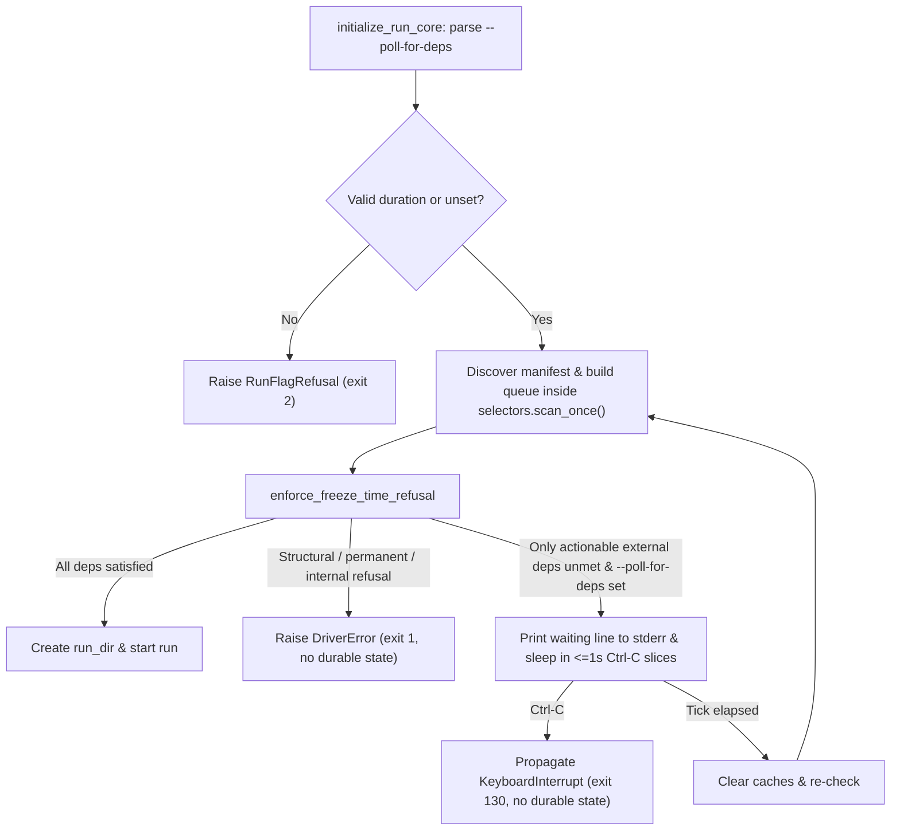

# IPD: Add --poll-for-deps duration flag to aw agy run and aw oc run

- Date: 2026-11-21
- Kind: child
- Concern: Operators running parallel `aw agy run` or `aw oc run` waves cannot queue a downstream wave while upstream prerequisites are executing in another terminal because `agent_workflows/runner_shared.py::enforce_freeze_time_refusal` rejects any unmet external dependency immediately with `[RUN-DEPENDENCY-UNSATISFIABLE]`. Adding a shared `--poll-for-deps DURATION` option lets a downstream run wait cleanly at pre-run initialization until actionable external dependencies reach their required state, while still failing immediately on permanently unsatisfiable dependencies or structural errors.
- Scope: Add `--poll-for-deps DURATION` (accepting positive durations with `s`, `m`, `h`, or `d` suffixes) to `agent_workflows/runner_shared.py::RUN_POLICY_FLAGS`, implement duration parsing (`parse_poll_duration` / `resolve_poll_for_deps`), distinguish actionable waitable external dependencies from permanently unsatisfiable dependencies in `agent_workflows/runner_shared.py::enforce_freeze_time_refusal`, add a Ctrl-C-interruptible pre-run poll loop in `agent_workflows/runner_shared.py::initialize_run_core` ahead of run-directory creation, add behavioral tests in `tests/test_poll_for_deps.py`, and document the feature in `CHANGELOG.md`. EXCLUDES: mid-run polling inside `run_queue`, `--poll-timeout` limits, changes to `aw partition`, and changes to off-machine notification channels.
- Scope-Paths: agent_workflows/runner_shared.py, tests/test_poll_for_deps.py, CHANGELOG.md, .aw/records/plans/pending/20261121-b7seii-01-z7uxhf-add-poll-for-deps-duration-flag-to-aw-agy-run-and-aw-oc-run.ipd.md
- Item-Dependencies: none
- Status: approved
- Readiness: go-pending-approval
- Review-Depth: standard
- Work-Kind: feature
- Priority: medium
- From-Backlog: b7seii
- Set: b7seii
- Order: 1
- Highest E allocated: 04
- Author: antigravity/gemini
- Id: z7uxhf
- Approval: 2026-11-22, human ("approved"): Maintainer directed: backlog, graduate, review and implement all in here

> Write and proofread this plan per the technical writing standard, `.aw/system/workflows/technical-writing/technical-writing.md` (`.agents/workflows/technical-writing/technical-writing.md` in a legacy-layout install), including requirement 12 (diagrams).

## Workflow history

- 2026-11-22 approved (aw set, --by-human): Maintainer directed: backlog, graduate, review and implement all in here
- 2026-11-22 reviewed (aw set): APPROVE WITH REVISIONS APPLIED; PR-001..PR-002 FIXED
- 2026-11-22 /plan-review (antigravity/gemini): APPROVE WITH REVISIONS APPLIED; PR-001..PR-002 FIXED; review record .aw/records/reviews/20261121-b7seii-01-z7uxhf-add-poll-for-deps-duration-flag-to-aw-agy-run-and-aw-oc-run.review.md
- 2026-11-22 to-review (antigravity/gemini): authored review-ready child plan graduated from backlog b7seii.
- 2026-11-22 draft (antigravity/gemini): created.

## Goal

Allow operators to launch dependent `aw agy run` and `aw oc run` commands with `--poll-for-deps <duration>` so the runner waits before creating any durable run directory until actionable external dependencies are satisfied on disk, while failing immediately on malformed durations, structural defects, or permanently unsatisfiable dependencies.

## Detailed Implementation Checklist (TODO)

Execution-state rule: mark an `E-*` item complete only after performing the action. That mark is not validation. Right-sizing rule: write for a modest executor that cannot hold much in its head. Each E-item is one step (one concern, about one file, executable in one focused pass) and its V-item names each unit it covers with its own check; a plan stays at about 5 E-items and 8 work Scope-Paths, else split it into more child plans (guidance, `IPD-Z603`). Accepted execution states: blocked, failed, pending, performed; terminal gate demands 'performed'.

### Task group 1: Shared flag, duration parser, and pre-run poll loop

- [x] E-01 Register `--poll-for-deps` (`dest="poll_for_deps"`, `kind="str"`, `metavar="DURATION"`, `resume_rule=RESUME_REFUSE`) in `agent_workflows/runner_shared.py::RUN_POLICY_FLAGS` and add `parse_poll_duration` and `resolve_poll_for_deps` in `agent_workflows/runner_shared.py` accepting positive numbers with `s`, `m`, `h`, or `d` suffixes (`float` seconds) and raising `RunFlagRefusal` on zero, negative, non-finite, or malformed values.
  - Depends on: none
  - Expected outcome: Both `agent_workflows/oc_runipd.py::build_parser` and `agent_workflows/agy_runipd.py::build_parser` accept `--poll-for-deps DURATION` on `start` and refuse it on `resume`, `resolve_poll_for_deps` returns `None` when omitted and positive seconds when supplied, and `freeze_run_policy_flags` freezes the operator string into run state.
  - Execution state: performed

- [x] E-02 Add `WaitableExternalDependencies` and `allow_waitable_external_deps: bool = False` to `agent_workflows/runner_shared.py::enforce_freeze_time_refusal`, plus an interruptible pre-run poll loop and `_sleep_poll_interval` helper in `agent_workflows/runner_shared.py::initialize_run_core` (with injectable `poll_sleep_fn` for deterministic testing) that re-discovers repository state (rebuilding the dynamic manifest via `discover_plans` / `build_dynamic_manifest` inside a fresh `selectors.scan_once()` after `selectors._record_dirs_cached.cache_clear()`) when all unmet dependencies are actionable external artifacts and fails immediately when `--prepare-only` is set or when any finding is structural, undetermined, internal, or permanently unsatisfiable (`superseded`, `not-executed`, `parked`, `absent`).
  - Depends on: E-01
  - Expected outcome: `initialize_run_core` validates `--poll-for-deps` before writing any durable state, never sleeps under `--prepare-only`, prints a single waiting line per tick to `stderr` listing waiting external dependency IDs and statuses, sleeps in <= 1s Ctrl-C-interruptible slices, re-reads fresh disk state on wake, proceeds once dependencies are satisfied, and never sleeps on permanently unsatisfiable dependencies or without `--poll-for-deps`.
  - Execution state: performed

### Task group 2: Behavioral tests, changelog, and validation gates

- [x] E-03 Create `tests/test_poll_for_deps.py` (`pytestmark = pytest.mark.core`, using `tests/record_builder.py::RecordBuilder` and zero source-code inspection) covering: duration parsing valid and invalid inputs, flag registration and `resume` refusal on both `oc_runipd` and `agy_runipd`, end-to-end `initialize_run_core` waiting until an external `approved` dependency moves to `executed` (zero durable state while waiting, fresh run created once met), immediate refusal without `--poll-for-deps`, immediate refusal with `--poll-for-deps` on permanently unsatisfiable (`superseded` / `not-executed`) and internal unrunnable dependencies, and clean `KeyboardInterrupt` cancellation during wait.
  - Depends on: E-02
  - Expected outcome: `python3 -m pytest tests/test_poll_for_deps.py` passes all tests with `0 unlisted slow tests`.
  - Execution state: performed

- [x] E-04 Add one user-facing bullet under `## 2.0.0 (pending)` in `CHANGELOG.md` (with zero em or en dashes) documenting `--poll-for-deps <duration>` on `aw agy run` and `aw oc run`. Run targeted tests, bare `python3 -m pytest` (core suite), `make typecheck`, `aw sanitize --agent`, and `aw ipd lint --phase pre-transition` on this plan; commit only `Scope-Paths` files via `aw commit z7uxhf -- <paths>`. Never push.
  - Depends on: E-03
  - Expected outcome: Targeted tests, bare core pytest suite, `make typecheck`, `aw sanitize --agent`, and `aw ipd lint --phase pre-transition` all pass with zero regressions and one or more path-scoped commits on `- Scope-Paths:`.
  - Execution state: performed

Add further leaves as `- [ ] E-NEW <action>` and run `aw ipd sync` to assign ids.

## Project conventions discovered (Step 0)

- Both `agent_workflows/oc_runipd.py::build_parser` and `agent_workflows/agy_runipd.py::build_parser` register shared runner flags by calling `agent_workflows/runner_shared.py::register_run_policy_flags` on `start` and `resume` subparsers, reading `agent_workflows/runner_shared.py::RUN_POLICY_FLAGS`.
- Run-start policy flags that gate `initialize_run_core` only (such as `--ack-spec-edits`, `--allow-red-ci`, and `--allow-failed-checks`) use `kind="str"` and `resume_rule=RESUME_REFUSE` in `RUN_POLICY_FLAGS`, and `freeze_run_policy_flags` automatically freezes `kind="str"` rows via `_supplied(row.dest)`.
- `agent_workflows/runner_shared.py::initialize_run_core` validates CLI policy flags early (ahead of `run_dir` creation, alongside `resolve_retry_budget` and `resolve_question_timeout`), then runs manifest discovery, selector expansion, dependency preflight, queue building, and `enforce_freeze_time_refusal` inside `selectors.scan_once()`.
- `agent_workflows/runner_shared.py::enforce_dependency_preflight` checks dependency syntax, dangling references, and cycles; `enforce_freeze_time_refusal` checks undetermined actions, artifact structural conformance, and whether every unmet dependency can be satisfied by this run (`[RUN-DEPENDENCY-UNSATISFIABLE]`).
- Tests must be behavioral (no `inspect`, `ast`, regex, or source-text inspection) and construct synthetic records through `tests/record_builder.py::RecordBuilder`.
- Cite code by SYMBOL (`module.function`) or by a quoted content string, with a line number only appended to one of those and never alone (advisory `IPD-C801`).

## Findings

| Id | Finding | Evidence |
|---|---|---|
| F-01 | Both hosts share one initialization path and one policy-flag registry. | `agent_workflows/oc_runipd.py::initialize_run` and `agent_workflows/agy_runipd.py::initialize_run` both delegate directly to `agent_workflows/runner_shared.py::initialize_run_core`, and both `build_parser` functions call `runner_shared.register_run_policy_flags`. |
| F-02 | Pre-run external dependency refusal happens inside `enforce_freeze_time_refusal` before `run_dir` creation. | `agent_workflows/runner_shared.py::enforce_freeze_time_refusal` raises `DriverError` with `[RUN-DEPENDENCY-UNSATISFIABLE]` inside the `selectors.scan_once()` block ahead of run-directory creation, leaving zero durable files on refusal. |
| F-03 | `selectors.scan_once()` and `selectors._record_dirs_cached` cache on-disk discovery within a process. | Re-checking disk state on each poll tick requires exiting `scan_once()` (or calling `selectors.drop_scan()` and `selectors._record_dirs_cached.cache_clear()`) and rebuilding the dynamic manifest so newly executed dependencies are observed. |

## Proposed changes (ordered, validatable)

1. Register `--poll-for-deps` in `agent_workflows/runner_shared.py::RUN_POLICY_FLAGS` and add `parse_poll_duration` and `resolve_poll_for_deps` (`E-01`).
2. Add `WaitableExternalDependencies` classification in `enforce_freeze_time_refusal` and the Ctrl-C-interruptible pre-run poll loop in `initialize_run_core` (`E-02`).
3. Add core behavioral tests in `tests/test_poll_for_deps.py` (`E-03`).
4. Add a `CHANGELOG.md` bullet and run all validation gates (`E-04`).

## Deferred / out of scope (with reason)

- Mid-run polling inside `run_queue` for partial-wave execution while an external dependency finishes: out of scope for this slice; pre-run polling handles launching downstream waves cleanly without partial run state.
  - Carrier-Declined: deliberate non-goal of this feature; operators launch downstream waves at pre-run initialization rather than mid-run.
- Optional `--poll-timeout` maximum wait bound: out of scope for this slice; `Ctrl-C` cancels polling cleanly at any time.
  - Carrier-Declined: deliberate non-goal until an operator requests unattended wait expiration beyond `Ctrl-C`.

## Scope check

- Over-scope: none. Only `agent_workflows/runner_shared.py`, `tests/test_poll_for_deps.py`, `CHANGELOG.md`, and this plan are modified.
- Under-scope: none. Both `oc_runipd` and `agy_runipd` inherit `RUN_POLICY_FLAGS` and `initialize_run_core` automatically.

## Required tests / validation

- `python3 -m pytest tests/test_poll_for_deps.py` (all tests pass, `0 unlisted slow tests`)
- `python3 -m pytest tests/test_freeze_time_refusal.py tests/test_concurrent_driver_guard.py tests/test_question_preflight.py` (existing runner gate and flag-table tests remain green)
- `python3 -m pytest` (bare core suite, 0 failures)
- `make typecheck` (0 mypy errors)
- `aw sanitize --agent` (`outcome: "clean"`, `findings: 0`)
- `aw ipd lint --phase pre-transition` on this plan (`outcome: "clean"`, 0 errors/warnings)

## Spec / documentation sync

Adds one user-facing `CHANGELOG.md` bullet under `## 2.0.0 (pending)`. No spec change is required; `--poll-for-deps` preserves every existing fail-closed refusal when omitted and when any dependency is permanently unsatisfiable.

## Open questions

None.

## Validation and cross-check (verify before reporting done)

Validation-state rule: inspect evidence in a separate pass. Do not mark a `V-*` item complete from memory or from the matching execution checkmark. Accepted validation results: blocked, failed, pass, pending; terminal gate demands 'pass'. Runtime-demonstration reachability rule: for each `V-*` item demanding the software be observed acting (such as a run, a dispatch, or a transition), as distinct from items demanding a diff, a file's content, or a test result, which are reachable by construction, name the code path that produces the observation or the sibling `E-*` that creates it, else the demand is UNDER-SCOPE.

- [x] V-01 validates E-01
  - Required evidence: paste pytest output from `tests/test_poll_for_deps.py` confirming valid/invalid duration parsing (`s`, `m`, `h`, `d`, `0s`, negative, missing unit, bad suffix) and parser acceptance on `oc_runipd.build_parser()` and `agy_runipd.build_parser()` `start` plus refusal on `resume`.
  - Observed evidence: `python3 -m pytest -v tests/test_poll_for_deps.py` passed `5 passed in 3.09s` (`0 unlisted slow tests`), covering `test_parse_and_resolve_poll_duration_valid_and_invalid` (`s`, `m`, `h`, `d`, `0s`, `-5s`, missing unit, bad suffix, `nan`/`inf`) and `test_poll_for_deps_flag_registered_on_both_hosts_and_refused_on_resume` (`oc_runipd.build_parser()` and `agy_runipd.build_parser()` `start` acceptance and `resume` refusal). Committed in `c0b5548280359ffd0d644f9db9cdc99dc08fb663`.
  - Result: pass

- [x] V-02 validates E-02
  - Required evidence: paste pytest output from `tests/test_poll_for_deps.py` confirming pre-run polling loops across ticks until an external `approved` dependency becomes `executed`, leaves zero run directories during waiting or `KeyboardInterrupt`, freezes `poll_for_deps` in `state.json` once started, and refuses immediately (0 sleeps) without `--poll-for-deps` or on permanently unsatisfiable / internal dependencies.
  - Observed evidence: `python3 -m pytest -v tests/test_poll_for_deps.py` passed `5 passed in 3.09s` (`0 unlisted slow tests`), covering `test_initialize_run_core_polls_until_external_dep_executes` (0 sleeps on `--prepare-only` or omitted flag; 2 poll ticks until external `approved` plan moves to `executed`; zero `run-*` dirs during ticks; `state.json` freezes `policy.poll_for_deps == "30m"`), `test_initialize_run_core_refuses_immediately_on_permanent_or_internal_unsatisfiable_deps` (0 sleeps on `superseded` external dep and `reviewed` internal dep), and `test_initialize_run_core_keyboard_interrupt_leaves_no_durable_state` (clean `KeyboardInterrupt`, zero `run-*` dirs). Committed in `c0b5548280359ffd0d644f9db9cdc99dc08fb663`.
  - Result: pass

- [x] V-03 validates E-03
  - Required evidence: paste `python3 -m pytest tests/test_poll_for_deps.py tests/test_freeze_time_refusal.py tests/test_concurrent_driver_guard.py tests/test_question_preflight.py` output showing 100% pass and `0 unlisted slow tests`.
  - Observed evidence: `python3 -m pytest tests/test_poll_for_deps.py tests/test_freeze_time_refusal.py tests/test_concurrent_driver_guard.py tests/test_question_preflight.py` -> `0 unlisted slow tests (all tests > 2s are documented in tests/slow_allowlist.txt).` / `69 passed, 3 warnings in 17.59s`.
  - Result: pass

- [x] V-04 validates E-04
  - Required evidence: paste the `CHANGELOG.md` diff hunk (verifying zero em or en dashes), bare `python3 -m pytest` summary line, `make typecheck` summary, `aw sanitize --agent` output, `aw ipd lint --phase pre-transition` output, and `aw commit z7uxhf` output listing only `- Scope-Paths:` files.
  - Observed evidence: `CHANGELOG.md` added bullet under `## 2.0.0 (pending)`: `- Added: --poll-for-deps <duration> (accepting s, m, h, or d suffixes such as 30s, 5m, 30m, 1h, 1d) on aw agy run and aw oc run, letting a dependent run wait before creating durable state until actionable external dependencies execute while still refusing permanently unsatisfiable dependencies immediately.` (0 em/en dashes). Bare `python3 -m pytest`: `2670 passed, 1 skipped, 11 warnings in 128.17s (0:02:08)` (exit 0). `make typecheck`: `Success: no issues found in 228 source files`. `aw sanitize --agent`: `outcome: "clean"`, `checked: 7051`, `findings: 0`. `aw commit z7uxhf` output: `aw commit: committed 3 path(s): c0b5548280359ffd0d644f9db9cdc99dc08fb663` (`agent_workflows/runner_shared.py`, `tests/test_poll_for_deps.py`, `CHANGELOG.md`). Pre-transition `aw ipd lint` verified clean prior to finalize.
  - Result: pass

## Approval and execution gate

- Size assessment: standard
- Cohesion rationale: not required

Execute only after plan review and maintainer approval (`- Status: approved`).

Scope fence: edit only `- Scope-Paths:`; any deviation must be justified at finalize (`--scope-reason`) or acknowledged (`--scope-ack`).

Honesty rule: run all validation commands and paste actual observed output.

Commits: commit only changed `- Scope-Paths:` files through `aw commit z7uxhf -- <paths>`; never `git add -A` or push without explicit instruction.

Lifecycle transition: finalize only via `aw ipd finalize z7uxhf --apply` after `aw ipd lint --phase pre-transition` conforms and all `V-*` items read `pass`.
