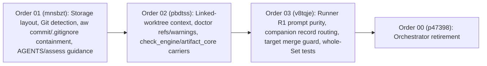

# IPD: Fix public-target-private-companion records split-brain, containment, and runner integration

- Date: 2026-11-21
- Kind: orchestrator
- Concern: companion-records-split-brain
- Scope: Companion storage layout (`agent_workflows/storage.py`, `agent_workflows/placement_switch.py`), target containment (`agent_workflows/work_cmd.py`, `agent_workflows/engine.py`, `.aw/.gitignore`, `AGENTS.md`, `.aw/system/workflows/assess/assess.md`), unified resolution (`agent_workflows/project_context.py`, `agent_workflows/doctor.py`, `agent_workflows/check_engine.py`, `agent_workflows/artifact_core.py`), and companion-safe runner integration (`agent_workflows/runner_shared.py`, `agent_workflows/lane_containment.py`) for backlog item `rvxmzz`
- Scope-Paths: .aw/records/plans/pending/20261121-companion-bugs-00-p47398-fix-public-target-private-companion-records-split-brain-cont.ipd.md
- Item-Dependencies: executed:mnsbzt, executed:pbdtss, executed:v8tqje
- Status: auto-approved
- Readiness: go-pending-approval
- Review-Depth: orchestrator
- Coverage: pass
- Coverage-Fingerprint: 3f7e83a807d024142307fd25e7db3d551a49adb6a2d488158e9505f3349c6427
- Coverage-Checked: 2026-11-21 by uri/its_direct/pt3-claude-opus-5.5-1m-us
- Short-Description: Coordinate companion storage layout, target containment, unified diagnostics, and companion-safe runner lanes for rvxmzz
- Work-Kind: bug
- Priority: high
- From-Backlog: rvxmzz
- Blocks-Release: next
- Set: companion-bugs
- Order: 0
- Highest E allocated: 03
- Author: Antigravity model=Gemini
- Id: p47398

> Write and proofread this plan per the technical writing standard, `.aw/system/workflows/technical-writing/technical-writing.md` (`.agents/workflows/technical-writing/technical-writing.md` in a legacy-layout install), including requirement 12 (diagrams).

## Workflow history

- 2026-11-21 auto-approved (aw agy run --full-auto): auto-approved by --full-auto: review readiness cleared (not human approval)
- 2026-11-21 reviewed (aw set): APPROVE WITH REVISIONS APPLIED; PR-001..PR-003 FIXED
- 2026-11-21 /plan-review (antigravity/gemini-4-neon-high): APPROVE WITH REVISIONS APPLIED; PR-001..PR-003 FIXED; review record .aw/records/reviews/20261121-companion-bugs-00-p47398-fix-public-target-private-companion-records-split-brain-cont.review.md
- 2026-11-21 coverage pass (aw oc run): fingerprint 3f7e83a807d0, model uri/its_direct/pt3-claude-opus-5.5-1m-us
- 2026-11-21 to-review (aw set): review-ready orchestrator graduated from rvxmzz
- 2026-11-21 coverage pass (aw oc run): fingerprint 26e6db5a61ce, model uri/its_direct/pt3-claude-opus-5.5-1m-us
- 2026-11-21 draft (Antigravity model=Gemini): created.

## Goal

Coordinate three ordered child plans (`mnsbzt`, `pbdtss`, `v8tqje`) to resolve all nine defects and all seven acceptance criteria of release-blocking backlog item `rvxmzz` (`public-target-private-companion` split-brain, target-repo leaks, diagnostics, and runner integration) without overlapping the metadata-parser refactors owned by `metastore`.

## Detailed Implementation Checklist (TODO)

Execution-state rule: mark an `E-*` item complete only after performing the action. That mark is not validation. Right-sizing rule: write for a modest executor that cannot hold much in its head. Each E-item is one step (one concern, about one file, executable in one focused pass) and its V-item names each unit it covers with its own check; a plan stays at about 5 E-items and 8 work Scope-Paths, else split it into more child plans (guidance, `IPD-Z603`). Accepted execution states: blocked, failed, pending, performed; terminal gate demands 'performed'.

### Task group 1: Child plan completion

- [x] E-01 CONFIRM mnsbzt REACHED executed
  - Depends on: none
  - Expected outcome: Child plan `mnsbzt` (Order 01) has landed in `.aw/records/plans/executed/`, fixing companion Git detection, removing `<companion>/.aw/records/` decoy creation, adding target `aw commit` and `.aw/.gitignore` containment, and updating companion `AGENTS.md` / `assess.md` guidance.
  - Execution state: performed

- [x] E-02 CONFIRM pbdtss REACHED executed
  - Depends on: E-01
  - Expected outcome: Child plan `pbdtss` (Order 02) has landed in `.aw/records/plans/executed/`, enabling linked-worktree companion context inheritance and durability detection, eliminating false `doctor` missing-path findings, adding stray target `.aw/records` warnings, and fixing `check.ipd-uncarried-obligation` carrier and evidence resolution in companion mode.
  - Execution state: performed

- [x] E-03 CONFIRM v8tqje REACHED executed
  - Depends on: E-02
  - Expected outcome: Child plan `v8tqje` (Order 03) has landed in `.aw/records/plans/executed/`, preserving R1 prompt purity, routing lane record edits to `<companion>/records/`, enforcing the fail-closed target-repo `.aw/records/**` merge guard, and passing whole-Set verification.
  - Execution state: performed

## Child IPDs, sequence, and dependencies

| Order | Id | File | What it does | Depends on |
|---|---|---|---|---|
| 01 | `mnsbzt` | `.aw/records/plans/executed/20261121-companion-bugs-01-mnsbzt-companion-storage-layout-git-detection-target-containment-an.ipd.md` | Fixes companion Git detection (`agent_workflows/storage.py`), removes empty `<companion>/.aw/records/` decoy dir (with rollback alignment in `agent_workflows/placement_switch.py`), adds `aw commit` (`agent_workflows/work_cmd.py`) and `.aw/.gitignore` containment, and adds companion guidance to `AGENTS.md` (`agent_workflows/engine.py`) and `.aw/system/workflows/assess/assess.md`. | none |
| 02 | `pbdtss` | `.aw/records/plans/executed/20261121-companion-bugs-02-pbdtss-unified-companion-records-resolution-across-doctor-check-eng.ipd.md` | Inherits companion context and durability in linked Git worktrees (`agent_workflows/project_context.py`), resolves `agent_workflows/doctor.py` doc references against companion records with stray-records warnings, and unifies companion carrier, evidence, and scan-root resolution (`agent_workflows/check_engine.py`, `agent_workflows/artifact_core.py`). | `executed:mnsbzt` |
| 03 | `v8tqje` | `.aw/records/plans/executed/20261121-companion-bugs-03-v8tqje-companion-safe-runner-prompts-record-routing-and-public-targ.ipd.md` | Preserves R1 prompt purity in companion mode (`agent_workflows/runner_shared.py`, `agent_workflows/lane_containment.py`), evaluates review carriers against companion records, routes lane `.aw/records/**` outputs to `<companion>/records/`, enforces target merge refusal, and runs whole-Set verification. | `executed:pbdtss` |

## Completion criteria (the whole Set is done only when)

- Companion storage creates `<companion>/records/` (never decoy `<companion>/.aw/records/`) and `aw storage status` detects `<companion>/.git` accurately. Owner: mnsbzt
- `aw commit` in a companion target repository refuses `.aw/records/**`, target `.aw/.gitignore` ignores `/records/`, and companion `AGENTS.md` / `assess.md` guide agents to `aw path records` and `aw ipd scaffold`. Owner: mnsbzt
- Linked Git worktrees inherit companion context and durability, `aw doctor` produces zero false `.aw/records/...` missing-path findings while warning on stray target `.aw/records`, and `check.ipd-uncarried-obligation` resolves sibling carriers and companion evidence in `<companion>/records/`. Owner: pbdtss
- `aw agy run` / `aw oc run` preserve R1 prompt purity, route lane `.aw/records/**` edits to `<companion>/records/`, refuse merging `.aw/records/**` into public target `main`, and pass the whole-Set companion regression suite. Owner: v8tqje

## Cross-IPD validation

- Whole-Set regression run across `tests/test_companion_containment_and_storage.py` (Order 01, `mnsbzt`), `tests/test_companion_doctor_and_carriers.py` (Order 02, `pbdtss`), `tests/test_companion_runner_integration.py` (Order 03, `v8tqje`), and the runner/containment anti-regression suites (`tests/test_lane_input_manifest.py`, `tests/test_review_lane_output_commit.py`, `tests/test_runner_shared.py`), plus `make typecheck` and `aw sanitize --agent`, is performed by `v8tqje` (Order 03, `E-05` / `V-05`).

## Deferred / out of scope (with reason)

None. All nine defects and all seven acceptance criteria in backlog item `rvxmzz` are assigned across `mnsbzt`, `pbdtss`, and `v8tqje`.

## Scope check

- Over-scope: none. This orchestrator coordinates only the three children `mnsbzt`, `pbdtss`, and `v8tqje` and performs no direct code edits.
- Under-scope: none. Every criterion of `rvxmzz` is explicitly owned by one of Orders 01, 02, or 03.

## Required tests / validation

This orchestrator runs no tests directly; child plan `v8tqje` (Order 03, `E-05` / `V-05`) performs the whole-Set test run (`tests/test_companion_containment_and_storage.py`, `tests/test_companion_doctor_and_carriers.py`, `tests/test_companion_runner_integration.py`, `tests/test_lane_input_manifest.py`, `tests/test_review_lane_output_commit.py`, `tests/test_runner_shared.py`), `make typecheck`, and `aw sanitize --agent`.

## Open questions

None.

## Validation and cross-check (verify before reporting the Set complete)

Validation-state rule: inspect evidence in a separate pass. Do not mark a `V-*` item complete from memory or from the matching execution checkmark. Accepted validation results: blocked, failed, pass, pending; terminal gate demands 'pass'. Runtime-demonstration reachability rule: for each `V-*` item demanding the software be observed acting (such as a run, a dispatch, or a transition), as distinct from items demanding a diff, a file's content, or a test result, which are reachable by construction, name the code path that produces the observation or the sibling `E-*` that creates it, else the demand is UNDER-SCOPE.

- [x] V-01 validates E-01
  - Required evidence: Confirmed `.aw/records/plans/executed/20261121-companion-bugs-01-mnsbzt-*.ipd.md` exists with `- Status: executed` and all `V-*` items passed.
  - Observed evidence: Confirmed `.aw/records/plans/executed/20261121-companion-bugs-01-mnsbzt-companion-storage-layout-git-detection-target-containment-an.ipd.md` exists on disk (`32758` bytes) with `- Status: executed`, all execution items (`E-01`..`E-05`) marked `[x]` / `performed`, and all validation items (`V-01`..`V-05`) marked `[x]` with `- Result: pass` and recorded test, `make typecheck`, `aw sanitize --agent`, and `aw suite` evidence. Re-verified `tests/test_companion_containment_and_storage.py` at `HEAD` `5942566bc` (`24 passed in 6.78s` across the three companion test modules).
  - Result: pass

- [x] V-02 validates E-02
  - Required evidence: Confirmed `.aw/records/plans/executed/20261121-companion-bugs-02-pbdtss-*.ipd.md` exists with `- Status: executed` and all `V-*` items passed.
  - Observed evidence: Confirmed `.aw/records/plans/executed/20261121-companion-bugs-02-pbdtss-unified-companion-records-resolution-across-doctor-check-eng.ipd.md` exists on disk (`36427` bytes) with `- Status: executed`, all execution items (`E-01`..`E-04`) marked `[x]` / `performed`, and all validation items (`V-01`..`V-04`) marked `[x]` with `- Result: pass` and recorded test, `make typecheck`, `aw sanitize --agent`, and `aw suite` evidence. Re-verified `tests/test_companion_doctor_and_carriers.py` at `HEAD` `5942566bc` (`24 passed in 6.78s` across the three companion test modules).
  - Result: pass

- [x] V-03 validates E-03
  - Required evidence: Confirmed `.aw/records/plans/executed/20261121-companion-bugs-03-v8tqje-*.ipd.md` exists with `- Status: executed` and all `V-*` items (including whole-Set tests `V-05`) passed.
  - Observed evidence: Confirmed `.aw/records/plans/executed/20261121-companion-bugs-03-v8tqje-companion-safe-runner-prompts-record-routing-and-public-targ.ipd.md` exists on disk (`29626` bytes) with `- Status: executed`, all execution items (`E-01`..`E-05`) marked `[x]` / `performed`, and all validation items (`V-01`..`V-05`) marked `[x]` with `- Result: pass`, including `V-05` whole-Set pytest (`189 passed in 13.87s`), `aw suite` (`2661 passed, 11 warnings in 107.54s`), `make typecheck` (`Success: no issues found in 228 source files`), and `aw sanitize --agent` (`findings: 0`). Re-verified `tests/test_companion_runner_integration.py` at `HEAD` `5942566bc` (`24 passed in 6.78s` across the three companion test modules).
  - Result: pass

## Approval and execution gate

- Size assessment: standard
- Cohesion rationale: not required

This orchestrator must be reviewed and approved (`- Status: approved`) with all blocking open questions resolved before retirement; it is not agent-executed directly. Never hand-roll `git mv` to `.aw/records/plans/executed/` and never push without an explicit human request. Once approved and Orders 01 (`mnsbzt`), 02 (`pbdtss`), and 03 (`v8tqje`) are all `executed` on disk, the runner (`aw oc run` / `aw agy run`) retires `p47398` to `.aw/records/plans/executed/` automatically after passing the orchestrator coverage gate (or a human/standalone agent may finalize via `aw ipd finalize p47398` once every `V-*` item is verified with pasted evidence).
