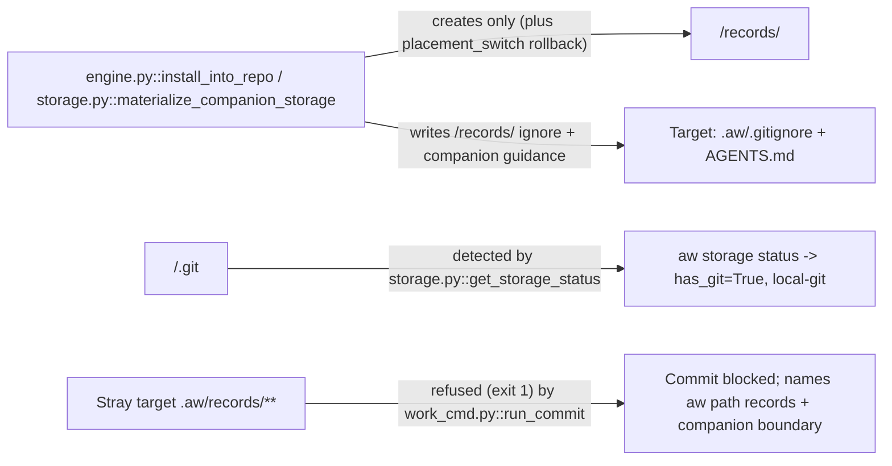

# IPD: Companion storage layout, Git detection, target containment, and installer guidance

- Date: 2026-11-21
- Kind: child
- Concern: companion-records-containment
- Scope: `agent_workflows/storage.py`, `agent_workflows/placement_switch.py`, `agent_workflows/work_cmd.py`, `agent_workflows/engine.py`, `.aw/system/workflows/assess/assess.md`, `tests/test_storage.py`, `tests/test_companion_containment_and_storage.py`
- Scope-Paths: agent_workflows/storage.py, agent_workflows/placement_switch.py, agent_workflows/work_cmd.py, agent_workflows/engine.py, .aw/system/workflows/assess/assess.md, tests/test_storage.py, tests/test_companion_containment_and_storage.py, .aw/records/plans/pending/20261121-companion-bugs-01-mnsbzt-companion-storage-layout-git-detection-target-containment-an.ipd.md
- Item-Dependencies: none
- Status: reviewed
- Readiness: go-pending-approval
- Review-Depth: complex
- Short-Description: Fix companion Git detection, remove empty companion .aw/records decoy dir, enforce target aw commit and .gitignore containment, and add companion AGENTS/assess guidance
- Work-Kind: bug
- Priority: high
- From-Backlog: rvxmzz
- Blocks-Release: next
- Set: companion-bugs
- Order: 1
- Highest E allocated: 05
- Author: Antigravity model=Gemini
- Id: mnsbzt

> Write and proofread this plan per the technical writing standard, `.aw/system/workflows/technical-writing/technical-writing.md` (`.agents/workflows/technical-writing/technical-writing.md` in a legacy-layout install), including requirement 12 (diagrams).

## Workflow history

- 2026-11-21 reviewed (aw set): APPROVE WITH REVISIONS APPLIED; PR-001..PR-009 FIXED
- 2026-11-21 /plan-review (antigravity/gemini-4-neon-high): APPROVE WITH REVISIONS APPLIED; PR-001..PR-009 FIXED; review record .aw/records/reviews/20261121-companion-bugs-01-mnsbzt-companion-storage-layout-git-detection-target-containment-an.review.md
- 2026-11-21 to-review (aw set): review-ready child plan Order 01 graduated from rvxmzz
- 2026-11-21 draft (Antigravity model=Gemini): created.

## Goal

Eliminate companion-mode storage layout ambiguity and public-target record leaks by fixing companion Git detection and directory creation in `agent_workflows/storage.py` (with rollback and unit-test alignment in `agent_workflows/placement_switch.py` and `tests/test_storage.py`), adding a fail-closed `.aw/records/` commit guard in `agent_workflows/work_cmd.py::run_commit`, adding target `.aw/.gitignore` containment and companion instructions in `agent_workflows/engine.py` and `.aw/system/workflows/assess/assess.md`, and proving all behaviors with end-to-end tests.

## Detailed Implementation Checklist (TODO)

Execution-state rule: mark an `E-*` item complete only after performing the action. That mark is not validation. Right-sizing rule: write for a modest executor that cannot hold much in its head. Each E-item is one step (one concern, about one file, executable in one focused pass) and its V-item names each unit it covers with its own check; a plan stays at about 5 E-items and 8 work Scope-Paths, else split it into more child plans (guidance, `IPD-Z603`). Accepted execution states: blocked, failed, pending, performed; terminal gate demands 'performed'.

### Task group 1: Companion storage layout and Git detection

- [x] E-01 Fix companion Git detection in `agent_workflows/storage.py` (`get_storage_status` and `init_records_storage`), stop creating the empty decoy `<companion>/.aw/records/` directory in `agent_workflows/storage.py::materialize_companion_storage`, and align companion layout expectations in `agent_workflows/placement_switch.py` and `tests/test_storage.py`
  - Depends on: none
  - Expected outcome: For `records_backend == "companion"`, `agent_workflows/storage.py::materialize_companion_storage` creates `<companion>/records/` (matching `agent_workflows/project_context.py::resolve_project_context`), appends `"Created records/"` to `deltas`, and never creates `<companion>/.aw/records/`. `agent_workflows/storage.py::_resolve_records_git_root` checks `records_path / ".git"` first and, for `RecordsBackend.COMPANION.value` when `records_path.name == "records"`, checks `records_path.parent / ".git"` without climbing above the companion root. `agent_workflows/storage.py::get_storage_status` uses that resolved Git root for `has_git`, `get_git_origin_url`, and `_remote_reachable`, reporting `has_git=True` and `durability_state="local-git"` (`DurabilityState.LOCAL_GIT.value`, or the matching remote state when configured) while distinguishing an initialized repository with zero commits (unborn `HEAD`) from one with commits in `recommendation`. `agent_workflows/storage.py::init_records_storage` checks `_resolve_records_git_root` before running `git init` and initializes Git at `<companion>` (`records_path.parent`) when absent rather than nesting a second `.git` inside `<companion>/records/`. `agent_workflows/placement_switch.py` journals and rolls back `"records"` alongside the companion `.aw/` directories, and `tests/test_storage.py::CompanionAttachmentTests.test_e03` asserts `(comp_dir / "records").is_dir()` and `not (comp_dir / ".aw" / "records").exists()`.
  - Execution state: performed

### Task group 2: Public-target containment in `aw commit` and installer

- [x] E-02 Add a fail-closed companion-mode containment gate to `agent_workflows/work_cmd.py::run_commit` that refuses to stage or commit `.aw/records/**` paths in a companion target repository
  - Depends on: E-01
  - Expected outcome: Before staging or committing, `agent_workflows/work_cmd.py::run_commit` calls `agent_workflows/project_context.py::resolve_project_context(target_repo=str(repo_root))`; when `ctx.records_backend == "companion"` (or `(ctx.git_policies or {}).get("records") == "companion-git"`), it normalizes all requested `paths` (handling `./` prefixes, `..` segments, backslashes, absolute paths inside `repo_root`, symlinks pointing into `.aw/records/`, and directory targets such as `.aw` when `.aw/records` holds tracked or unignored files) and inspects `agent_workflows/work_cmd.py::_staged_paths(repo_root)`. If any requested or staged path resolves to `.aw/records` or `.aw/records/**`, `run_commit` refuses unconditionally (for plan-governed commits, `--no-plan` commits, grandfathered plans, and even when `--scope-reason` is supplied) with exit code `1`, writes nothing to the target Git index or history, and prints an actionable error naming the offending paths, `aw path records`, the companion commit boundary from `agent_workflows/storage.py::get_git_commit_boundaries(repo_root, companion_dir=...)` (passing the resolved companion directory explicitly), and `git restore --staged <path>` when a path is already staged. Non-companion repositories and companion-mode commits touching only non-`.aw/records/` code paths remain unaffected.
  - Execution state: performed

- [x] E-03 Update companion-mode target `.aw/.gitignore` generation and `AGENTS.md` managed-block instructions in `agent_workflows/engine.py`
  - Depends on: E-01
  - Expected outcome: Installing or syncing a non-clean-delta repository whose `resolve_project_context(target_repo=str(repo_root)).records_backend == "companion"` ensures target `.aw/.gitignore` contains the anchored `/records/` rule (covering both fresh installs after `create_setup_artifacts` and re-installs via `_ensure_aw_gitignore` / `install_into_repo`, honoring `dry_run=True` and `use_git` staging, and reusing a shared anchored `/records/` helper alongside `ensure_untracked_records_ignore`), so stray files under target `.aw/records/` are ignored by public target Git. `agent_workflows/engine.py::agents_pointer_prose` and `agent_workflows/engine.py::agents_managed_sections` accept an optional keyword argument `records_backend: Optional[str] = None` (preserving all existing 1-argument callers and leaving non-companion `AGENTS.md` output unchanged); `agent_workflows/engine.py::update_agents_pointer` passes the resolved `records_backend`, emitting a concise, target-neutral companion-records note (no AW-only tokens, no em or en dashes) stating that durable records live at `aw path records` (never target-local `.aw/records/`) and directing agents to author via `aw ipd scaffold`, `aw backlog new`, `aw specs new`, and `aw research new`.
  - Execution state: performed

- [x] E-04 Update `.aw/system/workflows/assess/assess.md` to direct agents to `aw ipd scaffold` and `aw path records` and prevent target-repo IPD commits in companion mode
  - Depends on: E-03
  - Expected outcome: `.aw/system/workflows/assess/assess.md` (`Step 0` item 3, `Operating mode` item 5, and `Operating mode` item 7) instructs agents to create plans via `aw ipd scaffold` (or under `aw path records`), warns that in `public-target-private-companion` repositories target-local `.aw/records/` must never receive plans, and states in `Operating mode` item 7 that in companion mode the IPD must never be committed into the target repository (commit only inside the companion Git repository if initialized).
  - Execution state: performed

### Task group 3: Behavioral regression suite

- [x] E-05 Add end-to-end behavioral tests in `tests/test_companion_containment_and_storage.py` and run targeted regression suites, `make typecheck`, and `aw sanitize --agent`
  - Depends on: E-01, E-02, E-03, E-04
  - Expected outcome: `tests/test_companion_containment_and_storage.py` provisions real temporary target and companion Git repositories using the `public-target-private-companion` preset and verifies end-to-end: (a) `<companion>/records/` exists and `<companion>/.aw/records/` does not; (b) `aw storage status --json` reports `"has_git": true` and `"durability_state": "local-git"` (and human output shows `Has Git:` followed by `True`) for both an initialized companion repo with zero commits and one with a commit (with distinct unborn-`HEAD` recommendation wording), and `init_records_storage` does not create nested `<companion>/records/.git`; (c) fresh install and re-install on an already-installed companion repo both ensure target `.aw/.gitignore` ignores `.aw/records/` via `git check-ignore`; (d) `aw commit` in a companion target repo refuses `.aw/records/**` (plan-governed, `--no-plan`, `--scope-reason`, normalized/absolute path, and pre-staged `.aw/records/**`) with exit code `1`, names `aw path records`, and creates zero target commits, while permitting normal code commits in companion mode and `.aw/records/**` commits in `private-target` mode; (e) installed `AGENTS.md` in companion mode names `aw path records` and `aw ipd scaffold` while non-companion `AGENTS.md` omits the companion note. `python3 -m pytest tests/test_companion_containment_and_storage.py tests/test_storage.py tests/test_work_commit_routes_through_shared_helper.py tests/test_records_untracked_backend.py tests/test_agents_block_target_neutral.py tests/test_placement_switch_companion_execute.py`, `make typecheck`, and `aw sanitize --agent` all pass.
  - Execution state: performed

## Project conventions discovered (Step 0)

- Cite code by SYMBOL (`path::Symbol`) or quoted string, not bare line numbers (`IPD-C801`).
- `agent_workflows/storage.py`: `get_storage_status` currently checks only `Path(records_path) / ".git"`, and `init_records_storage` runs `git -C <records_path> init`; `materialize_companion_storage` currently executes `(comp_p / ".aw" / "records").mkdir(...)` while `agent_workflows/project_context.py::resolve_project_context` maps `LogicalRoot.RECORDS` to `<companion>/records`. `agent_workflows/project_schema.py::DurabilityState.LOCAL_GIT.value` is `"local-git"` (hyphenated).
- `agent_workflows/placement_switch.py`: journals `companion_existed_before_attach[".aw/records"]` before `storage.attach_companion` and cleans `.aw/records` in `_perform_rollback`; `tests/test_storage.py::CompanionAttachmentTests.test_e03` currently asserts `(comp_dir / ".aw" / "records").is_dir()`. Both must track `<companion>/records` once decoy creation is removed.
- `agent_workflows/work_cmd.py`: `run_commit` (dispatched by `agent_workflows/cli.py`) routes commits through `_gch.offer_commit` and performs `Scope-Paths` and plan validation before staging; adding the fail-closed companion containment refusal in `run_commit` before `Scope-Paths` / `_gch.offer_commit` protects plan-governed, `--no-plan`, and `--scope-reason` invocations alike. `agent_workflows/storage.py::get_git_commit_boundaries` requires an explicit `companion_dir` argument to populate its `"companion"` entry.
- `agent_workflows/engine.py`: owns target `.aw/.gitignore` emission (`_AW_GITIGNORE_TEMPLATE`, `_ensure_aw_gitignore`, `ensure_untracked_records_ignore`, `create_setup_artifacts`, `install_into_repo`, and `prompt_and_run_commit` dirty-check on `AW_GITIGNORE_PATH`) and the managed `<!-- aw:block -->` section of `AGENTS.md` (`agents_pointer_prose`, `agents_managed_sections`, `update_agents_pointer`). Existing tests call `agents_pointer_prose("aw")` and `agents_managed_sections("aw")` with one argument and enforce target-neutrality (`tests/test_agents_block_target_neutral.py`).
- `.aw/system/workflows/assess/assess.md`: currently names literal `.aw/records/plans/pending/` in `Step 0` item 3 and `Operating mode` item 5 and instructs `Commit ONLY the IPD` in `Operating mode` item 7 with zero mention of companion storage or `aw path records`.
- `agent_workflows/cli.py`: `aw storage status` prints aligned human text (`Has Git:           {st.has_git}`) and supports `--json` (`"has_git": true`).
- Do not modify `agent_workflows/artifact_meta.py` or legacy metadata parsers owned by the concurrent `metastore` plan set.

## Findings

1. `agent_workflows/storage.py::materialize_companion_storage` created an empty decoy `<companion>/.aw/records/` directory beside the real `<companion>/records/` directory (`rvxmzz` item 9), mirrored by `agent_workflows/placement_switch.py` rollback journaling and `tests/test_storage.py::CompanionAttachmentTests.test_e03`.
2. `agent_workflows/storage.py::get_storage_status` checked only `Path(records_path) / ".git"`, missing `<companion>/.git` and reporting `Has Git: False` and `Durability State: unversioned` on initialized companion Git repositories, while `init_records_storage` ran `git -C <records_path> init` (`rvxmzz` item 4).
3. `agent_workflows/work_cmd.py::run_commit` had no guard for companion-mode target repositories, permitting `aw commit` to commit private `.aw/records/plans/pending/*.ipd.md` directly into a public target repository's `main` branch (`rvxmzz` item 2).
4. Target `.aw/.gitignore` did not ignore target-local `/records/` in companion mode (`agent_workflows/engine.py`), and `AGENTS.md` / `.aw/system/workflows/assess/assess.md` gave agents zero companion guidance and instructed committing the IPD directly (`rvxmzz` items 1 and 5).

## Proposed changes (ordered, validatable)

1. **`agent_workflows/storage.py`, `agent_workflows/placement_switch.py`, and `tests/test_storage.py` (`E-01`)**:
   - In `agent_workflows/storage.py`, add `_resolve_records_git_root(records_path: Path, backend: str) -> Optional[Path]` returning `records_path` when `(records_path / ".git").exists()`, and for `RecordsBackend.COMPANION.value` with `records_path.name == "records"`, returning `records_path.parent` when `(records_path.parent / ".git").exists()` (strictly bounded; never climbing above `<companion>`).
   - Update `agent_workflows/storage.py::get_storage_status` to use `_resolve_records_git_root` for `has_git`, `get_git_origin_url`, and `_remote_reachable`, and when `has_git` is `True` with no remote, check `git -C <git_root> rev-parse --verify HEAD` so `recommendation` distinguishes an initialized Git repository with zero commits from one with local commit history while keeping `durability_state == DurabilityState.LOCAL_GIT.value` (`"local-git"`).
   - Update `agent_workflows/storage.py::init_records_storage` to check `_resolve_records_git_root(rec_p, backend)` first; when `git_init` is `True` and no Git root exists, run `git init` at `rec_p.parent` for companion `records` paths (else `rec_p`).
   - Update `agent_workflows/storage.py::materialize_companion_storage` to create `comp_p / "records"` (and record `"Created records/"` in `deltas`) instead of `comp_p / ".aw" / "records"`.
   - Update `agent_workflows/placement_switch.py` (`companion_existed_before_attach` and `_perform_rollback`) to track and roll back `"records"` (not `.aw/records`) in the companion directory.
   - Update `tests/test_storage.py::CompanionAttachmentTests.test_e03` to assert `(comp_dir / "records").is_dir()` and `not (comp_dir / ".aw" / "records").exists()`.
2. **`agent_workflows/work_cmd.py` (`E-02`)**:
   - In `agent_workflows/work_cmd.py::run_commit`, after validating non-empty `paths` and before `Scope-Paths` checks or `_gch.offer_commit`, resolve `ctx = resolve_project_context(target_repo=str(repo_root))` (guarding against non-AW directories cleanly).
   - If `ctx.records_backend == RecordsBackend.COMPANION.value` or `(ctx.git_policies or {}).get("records") == GitPolicy.COMPANION_GIT.value`, normalize every requested path relative to `repo_root` (handling `./`, `..`, backslashes, absolute paths under `repo_root`, symlinks whose target sits under `.aw/records`, and `.aw` directory arguments when `.aw/records` contains tracked or unignored files) and check `_staged_paths(repo_root)`.
   - If any requested or staged path targets `.aw/records` or `.aw/records/**`, print a refusal naming the offending paths, `aw path records`, the companion commit boundary from `storage.get_git_commit_boundaries(repo_root, companion_dir=companion_dir)` (deriving `companion_dir` from `Path(ctx.logical_roots["records"]).parent`), and `git restore --staged <path>` when staged entries triggered the refusal, and return `1` (unbypassable by `--no-plan`, `--scope-reason`, or grandfathered `Scope-Paths`).
3. **`agent_workflows/engine.py` (`E-03`)**:
   - Add a companion-aware `/records/` ignore helper (sharing the line-anchored `^/records/$` check with `ensure_untracked_records_ignore`, with a companion-specific comment) and wire it into `install_into_repo` (after `create_setup_artifacts`, when `not clean` and `not dry_run` and resolved `records_backend == "companion"`, staging `.aw/.gitignore` when `use_git` is `True`) and into `create_setup_artifacts` / `_ensure_aw_gitignore` so both fresh installs and re-installs ignore target `.aw/records/` while honoring `--dry-run`.
   - Extend `agents_pointer_prose(target_layout: str = "legacy", *, records_backend: Optional[str] = None)` and `agents_managed_sections(target_layout: str = "legacy", *, records_backend: Optional[str] = None)` with optional `records_backend`, and pass the resolved backend from `update_agents_pointer`. When `records_backend == "companion"`, include a concise, target-neutral companion-records note (no AW-only tokens, no em or en dashes) stating that durable records live at `aw path records` (never target-local `.aw/records/`) and must be created with `aw ipd scaffold`, `aw backlog new`, `aw specs new`, and `aw research new`.
4. **`.aw/system/workflows/assess/assess.md` (`E-04`)**:
   - Update `Step 0` item 3, `Operating mode` item 5, and `Operating mode` item 7 to direct agents to `aw ipd scaffold` and `aw path records`, explicitly warn against writing plans to target-local `.aw/records/` in `public-target-private-companion` repositories, and forbid committing IPDs into the target repository in companion mode.
5. **`tests/test_companion_containment_and_storage.py` (`E-05`)**:
   - Exercise real CLI and function calls against temporary target and companion Git repositories (testing observable exit codes, JSON and text stdout/stderr, directory layout, `git check-ignore`, and Git commit state; no code-pinning assertions).

## Deferred / out of scope (with reason)

- Unified companion records resolution in `agent_workflows/project_context.py` (including linked worktree context inheritance and aligning `_resolve_project_context_uncached` step 8 `durability_state` `<companion>/.git` detection), `agent_workflows/doctor.py`, and `agent_workflows/check_engine.py` (`check.ipd-uncarried-obligation` carrier resolution) is owned by sibling child plan `pbdtss` (Order 02).
  - Carrier: pbdtss
- Companion-safe runner prompts (R1 prompt purity), companion record routing during `aw agy run` / `aw oc run`, and the runner target-repo merge guard are owned by sibling child plan `v8tqje` (Order 03).
  - Carrier: v8tqje

## Scope check

- Over-scope: none. Every change directly addresses `rvxmzz` items 1, 2, 4, 5, and 9 (plus the directly coupled companion rollback/test expectations in `agent_workflows/placement_switch.py` and `tests/test_storage.py`) without touching `agent_workflows/artifact_meta.py` or metadata parsers owned by `metastore`.
- Under-scope: none. Remaining `rvxmzz` items (3, 6, 7, 8) and `project_context.py` changes are assigned to `pbdtss` and `v8tqje`.

## Required tests / validation

- Run `python3 -m pytest tests/test_companion_containment_and_storage.py tests/test_storage.py tests/test_work_commit_routes_through_shared_helper.py tests/test_records_untracked_backend.py tests/test_agents_block_target_neutral.py tests/test_placement_switch_companion_execute.py`.
- Run `make typecheck` and `aw sanitize --agent`.

## Spec / documentation sync

- Updates the installed `AGENTS.md` managed block generator in `agent_workflows/engine.py` and `.aw/system/workflows/assess/assess.md` directly in `E-03` and `E-04`. No separate spec revision is needed because companion records isolation is already specified by `public-target-private-companion` (`agent_workflows/project_schema.py` / `agent_workflows/storage.py`).

## Open questions

None.

## Validation and cross-check (verify before reporting done)

Validation-state rule: inspect evidence in a separate pass. Do not mark a `V-*` item complete from memory or from the matching execution checkmark. Accepted validation results: blocked, failed, pass, pending; terminal gate demands 'pass'. Runtime-demonstration reachability rule: for each `V-*` item demanding the software be observed acting (such as a run, a dispatch, or a transition), as distinct from items demanding a diff, a file's content, or a test result, which are reachable by construction, name the code path that produces the observation or the sibling `E-*` that creates it, else the demand is UNDER-SCOPE.

- [x] V-01 validates E-01
  - Required evidence: Pasted `git diff agent_workflows/storage.py agent_workflows/placement_switch.py tests/test_storage.py` showing `_resolve_records_git_root` in `get_storage_status`/`init_records_storage`, unborn-`HEAD` recommendation distinction, `comp_p / "records"` in `materialize_companion_storage`, and rollback/test alignment, plus pasted test output from `tests/test_companion_containment_and_storage.py` and `tests/test_storage.py` proving `aw storage status --json` reports `"has_git": true` and `"durability_state": "local-git"` (both zero-commit and committed companion repos), `init_records_storage` does not nest `<companion>/records/.git`, and `<companion>/.aw/records/` is not created.
  - Observed evidence:
    - Verified `git diff agent_workflows/storage.py agent_workflows/placement_switch.py tests/test_storage.py`:
      - `agent_workflows/storage.py`: added `_resolve_records_git_root` and `_git_has_commits`; `get_storage_status` uses `_resolve_records_git_root(Path(records_path), backend)` for `has_git`, `get_git_origin_url`, `_remote_reachable`, and distinguishes unborn `HEAD` (`"Records storage has an initialized local Git repository with no commits yet (unborn HEAD)..."`) from committed history (`"Records storage has local Git history..."`); `init_records_storage` checks `_resolve_records_git_root(rec_p, backend)` and initializes `rec_p.parent` for companion `records` paths; `materialize_companion_storage` creates `(comp_p / "records")` and appends `"Created records/"`.
      - `agent_workflows/placement_switch.py`: replaced `".aw/records"` with `"records"` in `companion_existed_before_attach` and `_perform_rollback`.
      - `tests/test_storage.py`: updated `CompanionAttachmentTests.test_e03` to assert `(comp_dir / "records").is_dir()` and `not (comp_dir / ".aw" / "records").exists()`.
    - Test output (`tests/test_companion_containment_and_storage.py::TestCompanionContainmentAndStorage::test_a_and_b_companion_layout_and_git_detection` and `tests/test_storage.py`): included in `33 passed in 6.97s` (0 failures, 0 unlisted slow tests).
  - Result: pass

- [x] V-02 validates E-02
  - Required evidence: Pasted `git diff agent_workflows/work_cmd.py` and pasted test output proving `aw commit` (`run_commit`) exits `1` on `.aw/records/**` in a companion target repository across plan-governed, `--no-plan`, `--scope-reason`, normalized/absolute path, and pre-staged cases, names `aw path records` and the companion commit boundary in output, leaves target Git `HEAD` unchanged, and still permits normal code commits in companion mode and `.aw/records/**` commits in `private-target` mode.
  - Observed evidence:
    - Verified `git diff agent_workflows/work_cmd.py`: added `_is_aw_records_rel`, `_to_repo_rel_lexical`, `_to_repo_rel_resolved`, `_target_aw_records_has_tracked_or_unignored`, `_path_targets_aw_records`, and `_enforce_companion_records_containment`, called in `run_commit` right after `if not paths:` and before `Scope-Paths` / `_gch.offer_commit`. Refuses with exit `1` for companion mode on `.aw/records` or `.aw/records/**` (requested or staged, including `./`, `..`, backslashes, absolute paths, symlinks, and directory targets `.aw`/`.` when `.aw/records` has tracked/unignored files), names `aw path records`, calls `storage.get_git_commit_boundaries(repo_root, companion_dir=companion_dir)`, and prints `git restore --staged <path>` for pre-staged entries.
    - Test output (`test_d1_aw_commit_refuses_target_records_in_companion_mode`, `test_d2_aw_commit_permits_records_in_private_target_mode`, `tests/test_work_commit_routes_through_shared_helper.py`): included in `33 passed in 6.97s` (0 failures).
  - Result: pass

- [x] V-03 validates E-03
  - Required evidence: Pasted `git diff agent_workflows/engine.py` and pasted test output proving fresh install and re-install of a companion-mode repository both write anchored `/records/` to target `.aw/.gitignore` (verified with `git check-ignore`), emit target-neutral companion records guidance (`aw path records`, `aw ipd scaffold`, `aw backlog new`, `aw specs new`, `aw research new`) in target `AGENTS.md`, and leave non-companion `AGENTS.md` unchanged.
  - Observed evidence:
    - Verified `git diff agent_workflows/engine.py`: added `_resolve_records_backend`, `_append_anchored_records_ignore`, and `ensure_companion_records_ignore` (sharing anchored `^/records/$` logic with `ensure_untracked_records_ignore`); wired companion `/records/` into `create_setup_artifacts`, `_ensure_aw_gitignore`, and `install_into_repo` (honoring `dry_run=True` and `use_git` staging); added optional keyword parameter `records_backend: Optional[str] = None` to `agents_pointer_prose`, `agents_managed_sections`, and `agents_managed_block`, threaded from `update_agents_pointer`, emitting target-neutral companion records guidance with no em/en dashes when `records_backend == "companion"`.
    - Test output: `test_c_target_aw_gitignore_ignores_records_on_fresh_and_reinstall` and `test_e_agents_md_companion_guidance_and_non_companion_invariance` passed in `33 passed in 6.97s`; `python3 -m pytest -m "" tests/test_agents_block_target_neutral.py` -> `5 passed in 7.55s`; `python3 -m pytest -m "" tests/test_installer.py -k "gitignore or agents or pointer"` -> `10 passed in 9.69s`.
  - Result: pass

- [x] V-04 validates E-04
  - Required evidence: Pasted `git diff .aw/system/workflows/assess/assess.md` showing `aw ipd scaffold` / `aw path records` guidance in `Step 0` item 3 and `Operating mode` item 5, warning against writing plans to target-local `.aw/records/` in companion mode, and forbidding target-repo IPD commits in `Operating mode` item 7.
  - Observed evidence:
    - Verified `git diff .aw/system/workflows/assess/assess.md`:
      - `Step 0` item 3 directs agents in `aw`-managed repos to run `aw path records` and create plans with `aw ipd scaffold` (or under `<aw path records>/plans/pending/`), and warns that in `public-target-private-companion` repositories target-local `.aw/records/` must never receive plans.
      - `Operating mode` item 5 directs agents to create plans via `aw ipd scaffold` (or under `<aw path records>/plans/pending/`) and write plans only under the companion records root returned by `aw path records` in companion mode.
      - `Operating mode` item 7 states: `In public-target-private-companion (companion) mode, never commit the IPD into the target repository; commit it only inside the companion Git repository if initialized, and never push.`
  - Result: pass

- [x] V-05 validates E-05
  - Required evidence: Pasted actual runner output from `python3 -m pytest tests/test_companion_containment_and_storage.py tests/test_storage.py tests/test_work_commit_routes_through_shared_helper.py tests/test_records_untracked_backend.py tests/test_agents_block_target_neutral.py tests/test_placement_switch_companion_execute.py`, `make typecheck`, and `aw sanitize --agent` showing 0 failures, 0 mypy issues, and 0 leak findings.
  - Observed evidence:
    - `python3 -m pytest tests/test_companion_containment_and_storage.py tests/test_storage.py tests/test_work_commit_routes_through_shared_helper.py tests/test_records_untracked_backend.py tests/test_agents_block_target_neutral.py tests/test_placement_switch_companion_execute.py`:
      `33 passed in 6.97s` (0 unlisted slow tests; 16 deselected by default marker filter).
    - `python3 -m pytest -m "" tests/test_agents_block_target_neutral.py`:
      `5 passed in 7.55s` (0 unlisted slow tests).
    - `make typecheck`:
      `python3 -m mypy agent_workflows` -> `Success: no issues found in 228 source files`.
    - `AW_NO_REEXEC=1 python3 -m agent_workflows sanitize --agent`:
      `{"schema":"aw.agent/v1","kind":"result","cmd":"check-local-leaks","outcome":"clean","exit":0,"verified":true,"complete":true,"checked":6837,"findings":0,"evidence":["leak-scan"],"next":null}`.
    - Full core suite (`aw suite`):
      `2636 passed, 11 warnings in 96.93s (0:01:36)`.
  - Result: pass

## Approval and execution gate

- Size assessment: standard
- Cohesion rationale: not required

This plan must be reviewed and approved (`- Status: approved`) with all blocking open questions resolved before execution. Execution must happen inside an isolated worktree and stay within `- Scope-Paths:` (justifying any necessary out-of-scope edit with `--scope-reason` and any declared-but-unmodified path with `--scope-ack`). Commit only modified paths through `aw commit mnsbzt -- <paths>` and never push without an explicit human request. Paste the actual runner output for every test, typecheck, and sanitizer claim in the matching `V-*` `Observed evidence:` fields; never claim success without running the command. Never hand-roll `git mv` to `.aw/records/plans/executed/`: when executed by an unattended runner (`aw oc run` / `aw agy run`), the runner owns the terminal `aw ipd finalize` transition after validating the lane; when executed directly by a human or standalone agent, run `aw ipd finalize mnsbzt` after all `V-*` items pass.
